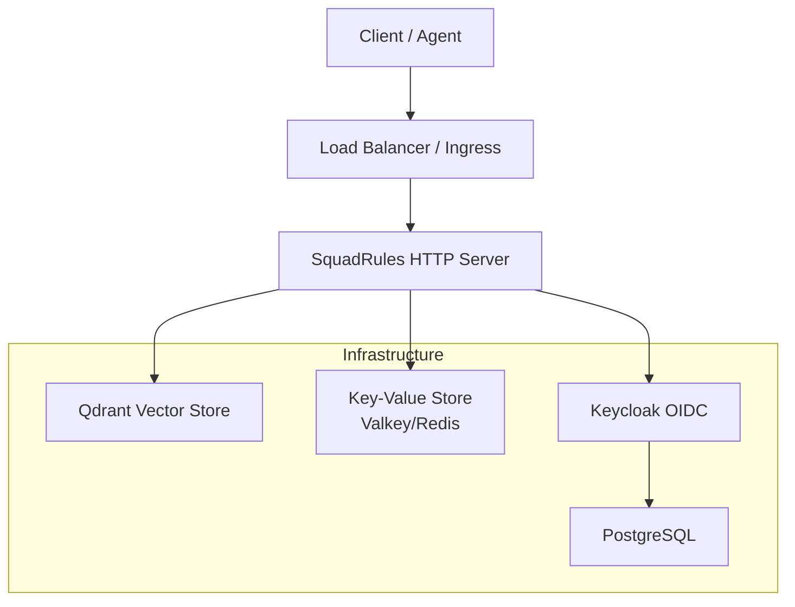
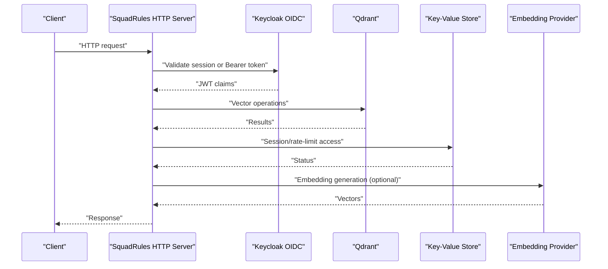
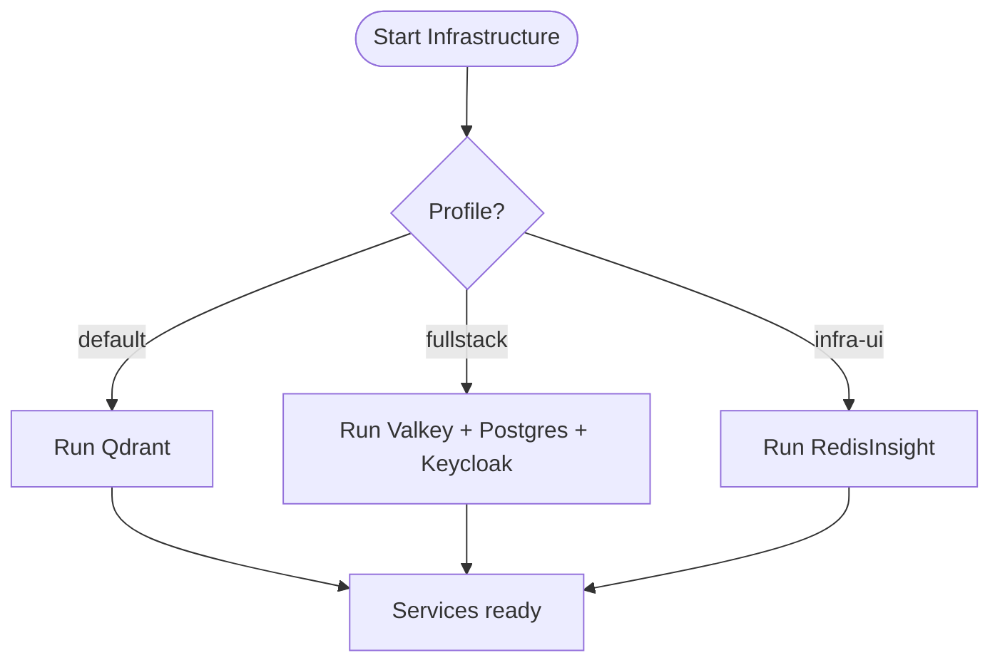
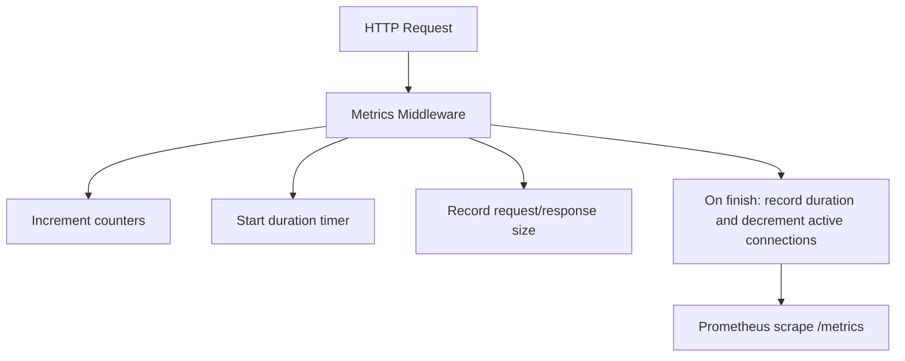
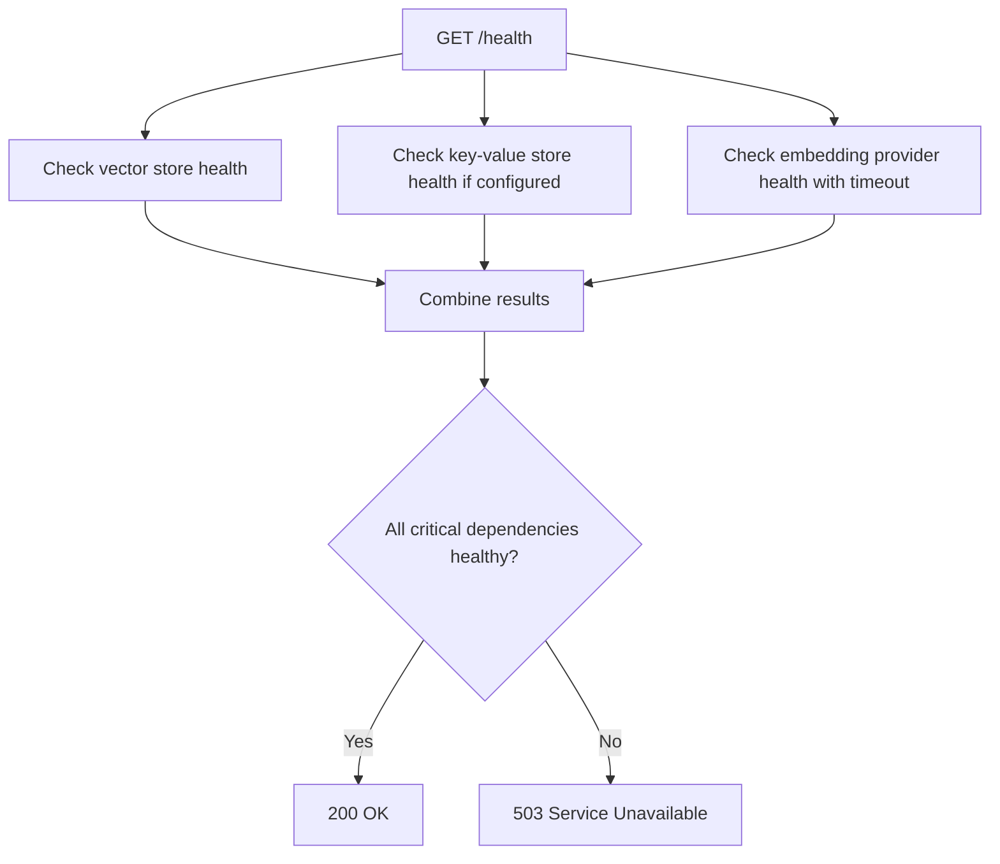
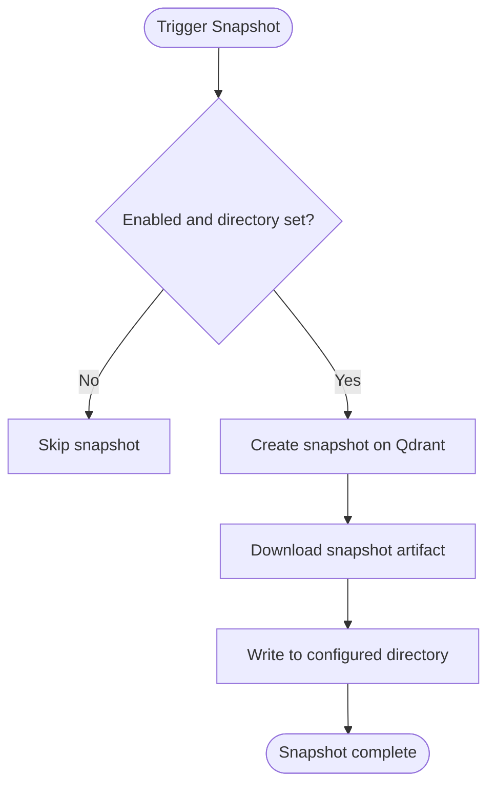
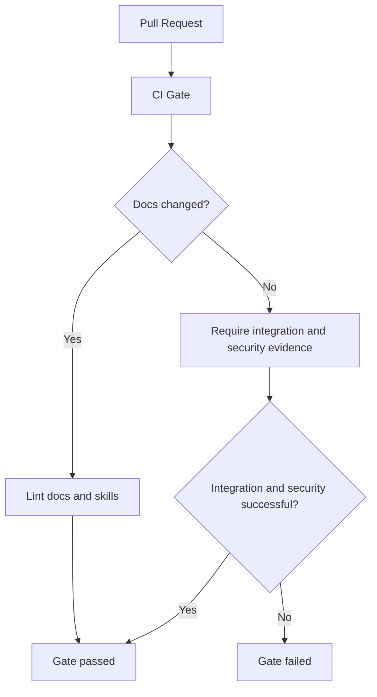
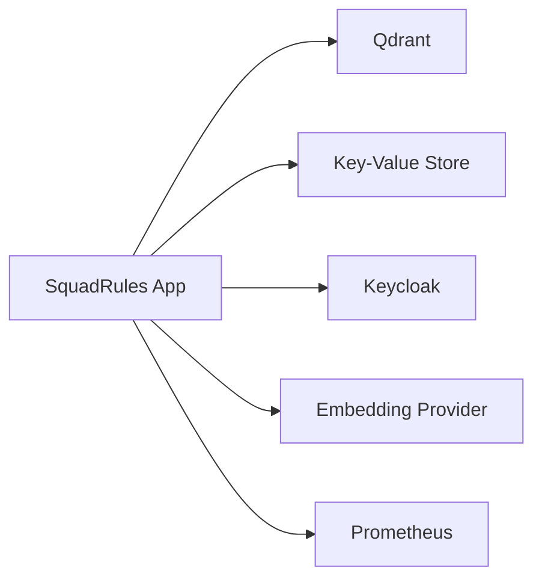

# Deployment and Operations

<cite>
**Referenced Files in This Document**
- [docs/README.md](file://docs/README.md)
- [compose/infra.yaml](file://compose/infra.yaml)
- [.github/workflows/ci-gate.yml](file://.github/workflows/ci-gate.yml)
- [.github/workflows/release.yml](file://.github/workflows/release.yml)
- [src/config.ts](file://src/config.ts)
- [src/server.ts](file://src/server.ts)
- [src/bootstrap.ts](file://src/bootstrap.ts)
- [src/http/http-health-routes.ts](file://src/http/http-health-routes.ts)
- [src/http/http-metrics-middleware.ts](file://src/http/http-metrics-middleware.ts)
- [src/services/metrics/registry.ts](file://src/services/metrics/registry.ts)
- [src/services/metrics/system-metrics.ts](file://src/services/metrics/system-metrics.ts)
- [src/services/qdrant/snapshots.ts](file://src/services/qdrant/snapshots.ts)
- [src/utils/structured-logger.ts](file://src/utils/structured-logger.ts)
</cite>

## Table of Contents
1. [Introduction](#introduction)
2. [Project Structure](#project-structure)
3. [Core Components](#core-components)
4. [Architecture Overview](#architecture-overview)
5. [Detailed Component Analysis](#detailed-component-analysis)
6. [Dependency Analysis](#dependency-analysis)
7. [Performance Considerations](#performance-considerations)
8. [Troubleshooting Guide](#troubleshooting-guide)
9. [Conclusion](#conclusion)
10. [Appendices](#appendices)

## Introduction
This document provides production deployment and operations guidance for SquadRules, an agent-first Model Context Protocol (MCP) framework. It focuses on containerization with Docker, infrastructure setup using Docker Compose, monitoring and metrics collection, health checks, performance tuning, scaling and high availability considerations, backup and recovery procedures, log management, environment configuration, secrets management, and CI/CD integration.

SquadRules runs as a Node.js application that can operate in two modes:
- stdio mode: local, single-user execution without an HTTP server.
- http mode: clustered posture exposing REST API, Streamable HTTP MCP, UI, and metrics.

The repository’s documentation router clarifies that container images, Docker Compose deployments, and Helm charts are owned by sibling repositories; this repository contains the application code, configuration, and operational assets such as compose infrastructure definitions and CI workflows.

**Section sources**
- [docs/README.md:1-33](file://docs/README.md#L1-L33)

## Project Structure
At runtime, SquadRules composes several services:
- Application process: Node.js server exposing HTTP endpoints and MCP tools.
- Vector store: Qdrant (remote-capable) or embedded LanceDB.
- Key-value store: Redis-compatible service (Valkey/Redis) for sessions and rate limiting.
- Identity provider: Keycloak with PostgreSQL backing OIDC/JWT authentication.
- Optional UI tooling: RedisInsight for inspecting key-value stores.

**Diagram sources**
- [compose/infra.yaml:13-157](file://compose/infra.yaml#L13-L157)
- [src/config.ts:245-266](file://src/config.ts#L245-L266)

**Section sources**
- [compose/infra.yaml:1-168](file://compose/infra.yaml#L1-L168)
- [src/config.ts:245-266](file://src/config.ts#L245-L266)

## Core Components
- Configuration center: Centralized parsing of environment variables for transport mode, auth, vector store selection, embedding providers, logging, rate limits, search behavior, snapshot settings, and metrics port.
- HTTP server bootstrap: Creates the MCP server, registers tools, resources, prompts, and logs masked runtime configuration.
- Health endpoints: Expose `/health` and `/api` with dependency status and version information.
- Metrics: Prometheus registry, HTTP middleware, and system metrics gauges.
- Logging: Structured logger with audit file support, request tracing, and safe sanitization.
- Backup: Qdrant snapshot creation and download to a configured directory.

**Section sources**
- [src/config.ts:1-351](file://src/config.ts#L1-L351)
- [src/server.ts:1-115](file://src/server.ts#L1-L115)
- [src/http/http-health-routes.ts:1-119](file://src/http/http-health-routes.ts#L1-L119)
- [src/http/http-metrics-middleware.ts:1-73](file://src/http/http-metrics-middleware.ts#L1-L73)
- [src/services/metrics/registry.ts:1-23](file://src/services/metrics/registry.ts#L1-L23)
- [src/services/metrics/system-metrics.ts:1-47](file://src/services/metrics/system-metrics.ts#L1-L47)
- [src/utils/structured-logger.ts:1-350](file://src/utils/structured-logger.ts#L1-L350)
- [src/services/qdrant/snapshots.ts:1-170](file://src/services/qdrant/snapshots.ts#L1-L170)

## Architecture Overview
The production architecture centers around a stateless HTTP server backed by external services. Authentication is handled via Keycloak OIDC, while data persistence and semantic search rely on Qdrant and optionally a Redis-compatible key-value store. Embedding providers may be external (OpenAI, TEI) or local (fastembed).

**Diagram sources**
- [src/config.ts:141-168](file://src/config.ts#L141-L168)
- [src/http/http-health-routes.ts:13-92](file://src/http/http-health-routes.ts#L13-L92)
- [compose/infra.yaml:86-141](file://compose/infra.yaml#L86-L141)

## Detailed Component Analysis

### Production Deployment Strategies
- Containerization: The app is packaged as an npm-only package; container images are built from published artifacts in sibling repositories. Use the provided Docker Compose infrastructure definitions to run dependencies locally or in CI.
- Environment-driven mode: Set `TRANSPORT_TYPE=http` for clustered HTTP mode; use stdio for local development.
- External dependencies: Configure Qdrant URL and API key; optionally configure Valkey/Redis for sessions and rate limiting; configure Keycloak for OIDC.

Operational steps:
1. Prepare environment variables for Qdrant, Keycloak, and optional Redis.
2. Start infrastructure services using Docker Compose profiles.
3. Deploy the application image and expose it behind a load balancer or ingress controller.
4. Validate health endpoints and metrics exposure.

**Section sources**
- [docs/README.md:23-26](file://docs/README.md#L23-L26)
- [compose/infra.yaml:1-12](file://compose/infra.yaml#L1-L12)
- [src/config.ts:132-137](file://src/config.ts#L132-L137)

### Docker and Docker Compose Setup
- Profiles:
  - Default (mini): Qdrant only.
  - Fullstack: Adds Valkey, PostgreSQL, and Keycloak.
  - Infra UI: Adds RedisInsight for key-value inspection.
- Services:
  - valkey: Redis-compatible store with password protection and memory policies.
  - qdrant: Vector database with API key and performance tuning.
  - postgres: Database for Keycloak.
  - keycloak: OIDC identity provider with health endpoint enabled.
  - redisinsight: Optional UI for Valkey/Redis.

**Diagram sources**
- [compose/infra.yaml:13-157](file://compose/infra.yaml#L13-L157)

**Section sources**
- [compose/infra.yaml:13-157](file://compose/infra.yaml#L13-L157)

### Monitoring and Metrics Collection
- Prometheus registry: Global default labels include service name, version, and instance identifier.
- HTTP metrics middleware: Tracks request counts, durations, payload sizes, active connections, and response sizes per route and tenant context.
- System metrics: Uptime, memory usage (RSS, heap), and process start time updated periodically.
- Metrics endpoint: Exposed via the configured metrics port.

**Diagram sources**
- [src/http/http-metrics-middleware.ts:15-70](file://src/http/http-metrics-middleware.ts#L15-L70)
- [src/services/metrics/registry.ts:11-18](file://src/services/metrics/registry.ts#L11-L18)
- [src/services/metrics/system-metrics.ts:10-41](file://src/services/metrics/system-metrics.ts#L10-L41)

**Section sources**
- [src/http/http-metrics-middleware.ts:1-73](file://src/http/http-metrics-middleware.ts#L1-L73)
- [src/services/metrics/registry.ts:1-23](file://src/services/metrics/registry.ts#L1-L23)
- [src/services/metrics/system-metrics.ts:1-47](file://src/services/metrics/system-metrics.ts#L1-L47)

### Health Checks
- `/health`: Reports overall status, service version, uptime, and dependency health for vector store, embedding provider, and cache backend.
- `/api`: Lists available endpoints and indicates whether authentication is required.

Health logic:
- Vector store health depends on configured backend (Qdrant or embedded LanceDB).
- Redis health is checked only when configured; otherwise, memory-backed cache is considered healthy.
- Embedding provider health is bounded by a short timeout to keep `/health` responsive.

**Diagram sources**
- [src/http/http-health-routes.ts:13-92](file://src/http/http-health-routes.ts#L13-L92)

**Section sources**
- [src/http/http-health-routes.ts:1-119](file://src/http/http-health-routes.ts#L1-L119)

### Performance Tuning
- Embedding provider tuning:
  - Latency warning threshold, norm ranges, retry policy with exponential backoff, and total retry budget.
- Search tuning:
  - Overfetch factor, max fetch cap, group collapse toggle, and choice limits.
- Rate limiting:
  - Separate windows and caps for HTTP, auth, and MCP routes.
- Qdrant performance:
  - Working memory and log level configuration via environment variables.
- Concurrency:
  - Configurable maximum concurrent MCP requests with auto-detection fallback.

Recommended actions:
- Adjust `EMBEDDING_*` variables based on provider SLAs and quotas.
- Tune `SQUADRULES_SEARCH_*` variables to balance recall and latency.
- Set appropriate rate limits for your traffic profile.
- Ensure Qdrant has sufficient memory and I/O capacity.

**Section sources**
- [src/config.ts:70-95](file://src/config.ts#L70-L95)
- [src/config.ts:106-127](file://src/config.ts#L106-L127)
- [src/config.ts:280-287](file://src/config.ts#L280-L287)
- [compose/infra.yaml:56-75](file://compose/infra.yaml#L56-L75)

### Scaling, Load Balancing, and High Availability
- Horizontal scaling:
  - Run multiple replicas of the HTTP server behind a load balancer or ingress controller.
  - Use shared external services: Qdrant, Redis-compatible store, and Keycloak.
- Session affinity:
  - If using in-memory sessions, ensure sticky sessions or migrate to Redis-backed sessions via `KEY_VALUE_STORE_URL`.
- Stateful services:
  - Qdrant: Use managed or replicated instances; enable snapshots for disaster recovery.
  - Keycloak: Use managed PostgreSQL and consider clustering Keycloak for HA.
- Observability:
  - Aggregate metrics from all replicas and centralize logs.

Best practices:
- Keep application processes stateless; persist state in Qdrant and Redis.
- Use readiness/liveness probes based on `/health`.
- Configure graceful shutdowns and connection draining at the load balancer.

[No sources needed since this section provides general guidance]

### Backup and Recovery Procedures
- Qdrant snapshots:
  - Enable snapshotting via environment variables and configure a persistent directory.
  - Snapshots are created by calling Qdrant’s snapshot API and downloading the artifact to disk.
- Operational workflow:
  - Trigger snapshots on startup or via API.
  - Monitor snapshot success and file sizes.
  - Periodically test restore procedures against a staging environment.

**Diagram sources**
- [src/services/qdrant/snapshots.ts:68-168](file://src/services/qdrant/snapshots.ts#L68-L168)

**Section sources**
- [src/services/qdrant/snapshots.ts:1-170](file://src/services/qdrant/snapshots.ts#L1-L170)
- [src/config.ts:268-277](file://src/config.ts#L268-L277)

### Log Management
- Structured logging:
  - Pino-based structured logger with consistent JSON shape.
  - HTTP access logging includes request ID, client IP, method, path, status, and duration.
- Audit logging:
  - Optional audit file output with sanitized bindings and bounded depth/size.
- Transport-aware formatting:
  - Text or JSON format controlled by environment variables.

Operational recommendations:
- Ship logs to centralized systems (e.g., Loki, Elasticsearch).
- Correlate requests using `request_id`.
- Limit sensitive data in logs; sanitize bindings before writing.

**Section sources**
- [src/utils/structured-logger.ts:1-350](file://src/utils/structured-logger.ts#L1-L350)

### Environment Configuration and Secrets Management
- Environment variables:
  - Centralized parsing for transport mode, auth, vector store, embedding providers, logging, rate limits, search behavior, snapshot settings, and metrics port.
- Required variables:
  - When enabling auth, missing required variables cause startup errors.
- Secrets handling:
  - Use secure secret stores (Kubernetes Secrets, cloud secret managers).
  - Avoid committing secrets; inject them at runtime.

Key configuration areas:
- Auth: Keycloak URL, realm, client IDs, callback base URL, session secret.
- Vector store: Qdrant URL, API key, collection name, rescore flag, snapshot directory.
- Embeddings: Provider selection, model names, API keys, retry policies.
- Logging: Level, format, audit file path.
- Metrics: Port and instance identification.

**Section sources**
- [src/config.ts:17-26](file://src/config.ts#L17-L26)
- [src/config.ts:141-168](file://src/config.ts#L141-L168)
- [src/config.ts:245-266](file://src/config.ts#L245-L266)
- [src/config.ts:268-287](file://src/config.ts#L268-L287)

### CI/CD Pipeline Integration
- CI gate:
  - Classifies changed paths into documentation vs application lanes.
  - Ensures documentation linting and link checks for docs changes.
  - Waits for integration and security evidence for application changes.
- Release pipeline:
  - Uses release-please to create releases and PRs.
  - Synchronizes version-derived sources and verifies release integrity.
  - Publishes npm package with provenance and attaches SBOM.

Operational notes:
- Provide required GitHub App credentials for unattended PR checks.
- Ensure Qoder CLI authentication secret is present for release synchronization.
- Verify published package visibility after publication.

**Diagram sources**
- [.github/workflows/ci-gate.yml:63-140](file://.github/workflows/ci-gate.yml#L63-L140)
- [.github/workflows/ci-gate.yml:142-204](file://.github/workflows/ci-gate.yml#L142-L204)

**Section sources**
- [.github/workflows/ci-gate.yml:1-204](file://.github/workflows/ci-gate.yml#L1-L204)
- [.github/workflows/release.yml:1-338](file://.github/workflows/release.yml#L1-L338)

## Dependency Analysis
The application depends on:
- Qdrant for vector storage and semantic search.
- Redis-compatible store for sessions and rate limiting.
- Keycloak for OIDC authentication.
- Optional embedding providers (OpenAI, TEI, fastembed).
- Prometheus for metrics scraping.

**Diagram sources**
- [compose/infra.yaml:13-157](file://compose/infra.yaml#L13-L157)
- [src/config.ts:70-95](file://src/config.ts#L70-L95)
- [src/config.ts:141-168](file://src/config.ts#L141-L168)

**Section sources**
- [compose/infra.yaml:13-157](file://compose/infra.yaml#L13-L157)
- [src/config.ts:70-95](file://src/config.ts#L70-L95)
- [src/config.ts:141-168](file://src/config.ts#L141-L168)

## Performance Considerations
- Embedding provider tuning:
  - Adjust retry budgets and latency thresholds to match provider SLAs.
- Search parameters:
  - Tune overfetch and max fetch to balance recall and latency.
- Rate limiting:
  - Set appropriate windows and caps per route type.
- Qdrant capacity:
  - Allocate sufficient memory and tune log levels for production.
- Concurrency:
  - Configure maximum concurrent MCP requests based on workload characteristics.

[No sources needed since this section provides general guidance]

## Troubleshooting Guide
Common issues and resolutions:
- Missing required environment variables:
  - Startup fails when auth is enabled but required variables are absent.
- Health check failures:
  - Vector store or embedding provider unhealthy; verify connectivity and credentials.
- Metrics not exposed:
  - Ensure metrics port is open and scraped by Prometheus.
- Logs not written:
  - Verify audit log file path permissions and format settings.
- Snapshot failures:
  - Check Qdrant API key, network access, and snapshot directory permissions.

Operational tips:
- Use `/health` to validate dependency status.
- Inspect structured logs for request correlation IDs.
- Review Prometheus metrics for anomalies in request rates and latencies.

**Section sources**
- [src/config.ts:254-266](file://src/config.ts#L254-L266)
- [src/http/http-health-routes.ts:13-92](file://src/http/http-health-routes.ts#L13-L92)
- [src/utils/structured-logger.ts:150-183](file://src/utils/structured-logger.ts#L150-L183)
- [src/services/qdrant/snapshots.ts:68-168](file://src/services/qdrant/snapshots.ts#L68-L168)

## Conclusion
SquadRules production deployments rely on external services for vector storage, caching, and authentication, with the application remaining stateless and horizontally scalable. Robust observability is achieved through structured logging and Prometheus metrics. Operational excellence requires careful environment configuration, secrets management, and disciplined CI/CD practices. Backup and recovery procedures should leverage Qdrant snapshots, and performance tuning should align with workload characteristics and provider constraints.

[No sources needed since this section summarizes without analyzing specific files]

## Appendices

### Operational Runbooks
- Service startup:
  - Validate environment variables and secrets.
  - Start infrastructure services using Docker Compose profiles.
  - Launch the application and verify `/health`.
- Scaling out:
  - Increase replica count behind load balancer.
  - Monitor metrics and adjust resource allocations.
- Incident response:
  - Check health endpoints and dependency statuses.
  - Analyze structured logs for error patterns.
  - Review Prometheus metrics for anomalies.
- Backup verification:
  - Confirm snapshot files exist and are non-empty.
  - Test restore procedures in a staging environment.

[No sources needed since this section provides general guidance]