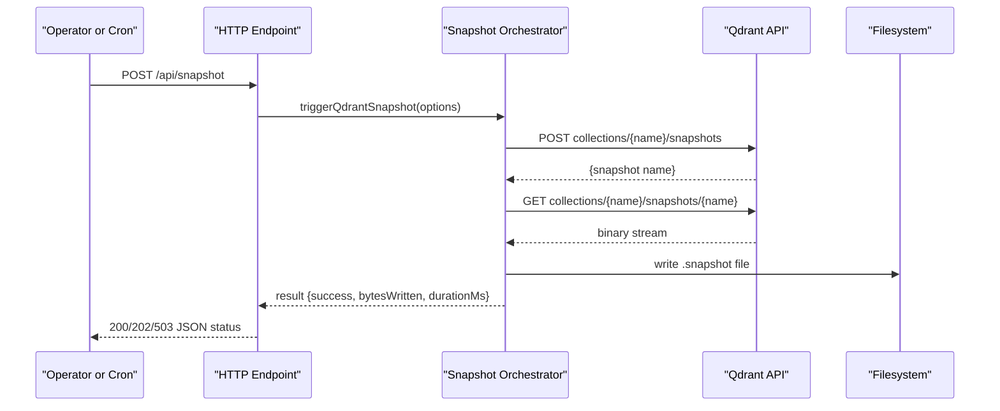
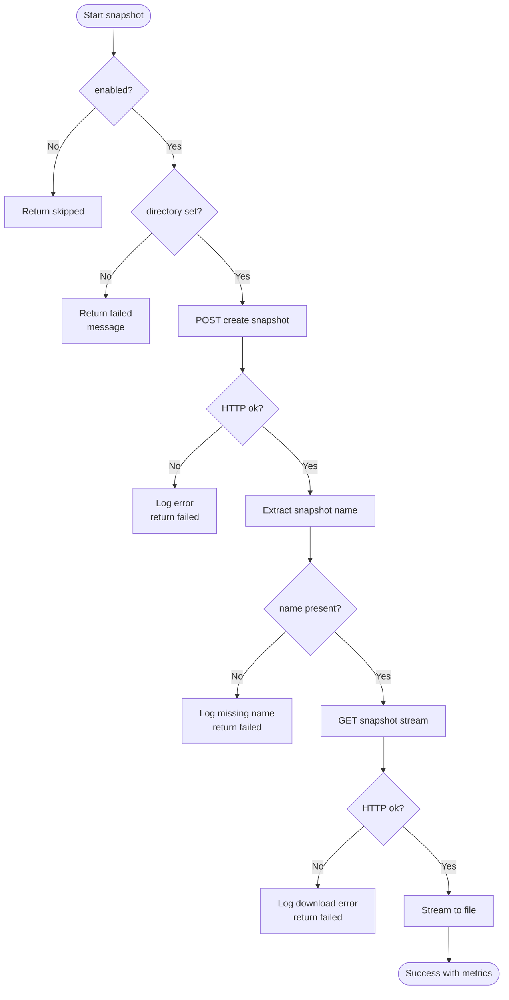
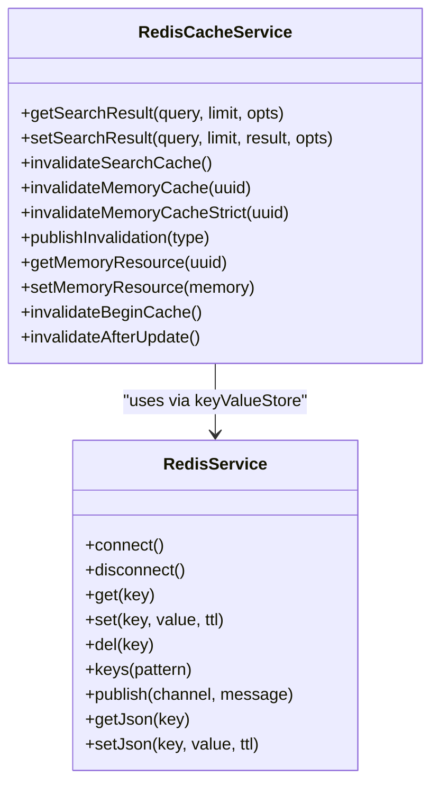
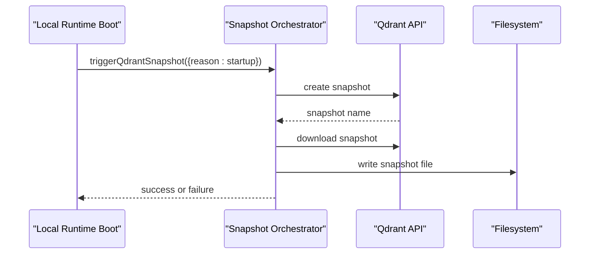
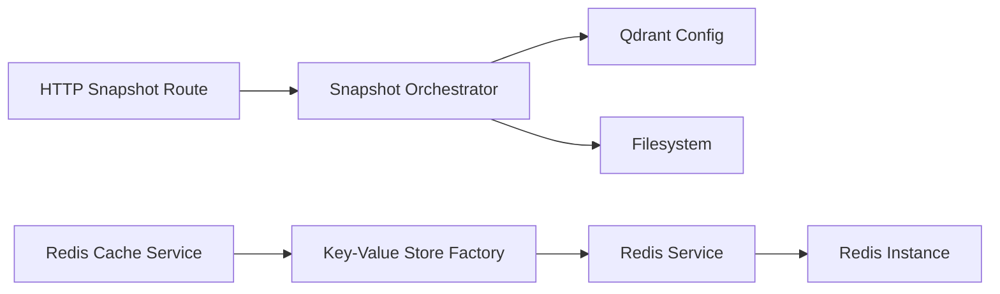

# Maintenance and Backup

<cite>
**Referenced Files in This Document**
- [config.ts](file://src/config.ts)
- [http-api-snapshot.ts](file://src/http/http-api-snapshot.ts)
- [snapshots.ts](file://src/services/qdrant/snapshots.ts)
- [redis-cache.ts](file://src/services/redis-cache.ts)
- [redis.ts](file://src/services/redis.ts)
- [boot-local-runtime.ts](file://src/runtime/boot-local-runtime.ts)
- [audit-log.md](file://docs/security/audit-log.md)
- [incident-runbook.md](file://docs/security/incident-runbook.md)
</cite>

## Table of Contents
1. [Introduction](#introduction)
2. [Project Structure](#project-structure)
3. [Core Components](#core-components)
4. [Architecture Overview](#architecture-overview)
5. [Detailed Component Analysis](#detailed-component-analysis)
6. [Dependency Analysis](#dependency-analysis)
7. [Performance Considerations](#performance-considerations)
8. [Troubleshooting Guide](#troubleshooting-guide)
9. [Conclusion](#conclusion)
10. [Appendices](#appendices)

## Introduction
This document provides maintenance and backup guidance for SquadRules MCP, focusing on:
- Routine maintenance: database optimization, index rebuilding, and cleanup procedures.
- Backup strategies: Qdrant snapshots, Redis data persistence, and filesystem artifacts.
- Restore procedures, version migration, and rollback strategies.
- Incident response, troubleshooting, and performance degradation diagnosis.
- Security maintenance: certificate rotation, secret updates, and audit log retention policies.

SquadRules uses:
- Qdrant as the primary vector store (remote-capable).
- LanceDB as a secondary embedded vector store.
- Redis for sessions, rate limiting, and application caching.
- Filesystem for configuration, adapters, and optional snapshot downloads.
- Keycloak + Google IdP for OAuth2/JWT authentication.

## Project Structure
The maintenance-relevant parts of the codebase are concentrated around:
- Configuration and environment variables.
- HTTP API endpoints for snapshots and health.
- Qdrant snapshot orchestration.
- Redis-backed key-value storage and cache invalidation.
- Audit logging and incident runbooks.

```mermaid
graph TB
subgraph "Runtime"
Server["HTTP Server"]
Runtime["Local Runtime Boot"]
end
subgraph "Services"
Qdrant["Qdrant Service"]
Snapshot["Snapshot Orchestrator"]
RedisSvc["Redis Service"]
Cache["Redis Cache Service"]
end
subgraph "External Systems"
QdrantDB["Qdrant Cluster"]
RedisDB["Redis Instance"]
FS["Filesystem"]
end
Server --> Snapshot
Runtime --> Snapshot
Snapshot --> QdrantDB
Cache --> RedisDB
RedisSvc --> RedisDB
Server --> FS
```

**Diagram sources**
- [http-api-snapshot.ts:14-52](file://src/http/http-api-snapshot.ts#L14-L52)
- [snapshots.ts:68-168](file://src/services/qdrant/snapshots.ts#L68-L168)
- [redis-cache.ts:21-274](file://src/services/redis-cache.ts#L21-L274)
- [redis.ts:26-293](file://src/services/redis.ts#L26-L293)
- [boot-local-runtime.ts:28-151](file://src/runtime/boot-local-runtime.ts#L28-L151)

**Section sources**
- [config.ts:50-69](file://src/config.ts#L50-L69)
- [config.ts:271-277](file://src/config.ts#L271-L277)

## Core Components
- Qdrant snapshot orchestrator: creates and downloads Qdrant snapshots to a configured directory.
- HTTP snapshot endpoint: exposes `/api/snapshot` with backend-aware behavior.
- Redis service: connection lifecycle, namespaced keys, JSON helpers, pub/sub.
- Redis cache service: search and memory resource caching with TTLs and invalidation.
- Configuration: environment-driven toggles for Redis, prefixes, and snapshot directories.
- Audit logging and incident runbook: operational visibility and response procedures.

**Section sources**
- [snapshots.ts:1-170](file://src/services/qdrant/snapshots.ts#L1-L170)
- [http-api-snapshot.ts:1-56](file://src/http/http-api-snapshot.ts#L1-L56)
- [redis.ts:1-293](file://src/services/redis.ts#L1-L293)
- [redis-cache.ts:1-274](file://src/services/redis-cache.ts#L1-L274)
- [config.ts:50-69](file://src/config.ts#L50-L69)
- [config.ts:271-277](file://src/config.ts#L271-L277)

## Architecture Overview
The snapshot workflow is exposed via an HTTP endpoint and implemented by the snapshot orchestrator. The local runtime can also trigger snapshots at startup.



**Diagram sources**
- [http-api-snapshot.ts:14-52](file://src/http/http-api-snapshot.ts#L14-L52)
- [snapshots.ts:68-168](file://src/services/qdrant/snapshots.ts#L68-L168)

## Detailed Component Analysis

### Qdrant Snapshot Management
Responsibilities:
- Validate snapshot enablement and target directory.
- Create a Qdrant snapshot and wait for completion.
- Download the snapshot artifact and persist it locally.
- Clean up partial files on failure.
- Emit structured logs with timing and size metrics.

Operational notes:
- If Qdrant is not configured, the HTTP endpoint returns a clear unsupported response.
- If the snapshot directory is not configured, the endpoint returns a 503 with a descriptive message.
- Snapshot filenames include reason, collection, and timestamp.



**Diagram sources**
- [snapshots.ts:68-168](file://src/services/qdrant/snapshots.ts#L68-L168)

**Section sources**
- [snapshots.ts:1-170](file://src/services/qdrant/snapshots.ts#L1-L170)
- [http-api-snapshot.ts:14-52](file://src/http/http-api-snapshot.ts#L14-L52)

### Redis Persistence and Caching
Responsibilities:
- Manage Redis connection lifecycle and errors.
- Provide namespaced key operations with space isolation.
- Support JSON serialization helpers and pub/sub channels.
- Implement application-level caching for search results and memory resources.
- Invalidate caches after writes to maintain consistency.

Key behaviors:
- Memory cache keys use a global prefix; other keys are prefixed with space ID.
- Search cache TTL is short-lived; memory resource cache has a bounded TTL safety net.
- Invalidation publishes events to a channel for cross-instance awareness.



**Diagram sources**
- [redis.ts:26-293](file://src/services/redis.ts#L26-L293)
- [redis-cache.ts:21-274](file://src/services/redis-cache.ts#L21-L274)

**Section sources**
- [redis.ts:1-293](file://src/services/redis.ts#L1-L293)
- [redis-cache.ts:1-274](file://src/services/redis-cache.ts#L1-L274)

### Configuration and Environment
Important variables:
- `REDIS_URL` or `KEY_VALUE_STORE_URL`: enables Redis-backed key-value store.
- `SQUADRULES_REDIS_PREFIX` or `SQUADRULES_KEY_VALUE_PREFIX`: namespace prefix for keys.
- `MEMORY_CACHE_KEY_PREFIX`: global prefix for memory cache entries.
- `OIDC_STATE_KEY_PREFIX`: global prefix for OIDC state entries.
- `QDRANT_SNAPSHOT_DIR`: absolute or relative path where snapshots are written.

Behavioral implications:
- When Redis URL is empty, application-level caching is disabled.
- Snapshot directory must be writable; otherwise, snapshot operations are skipped or fail.

**Section sources**
- [config.ts:50-69](file://src/config.ts#L50-L69)
- [config.ts:271-277](file://src/config.ts#L271-L277)

### Startup and Automated Snapshots
The local runtime boot process can trigger snapshots at startup using the configured snapshot directory. This supports automated backup workflows without manual intervention.



**Diagram sources**
- [boot-local-runtime.ts:28-151](file://src/runtime/boot-local-runtime.ts#L28-L151)
- [snapshots.ts:68-168](file://src/services/qdrant/snapshots.ts#L68-L168)

**Section sources**
- [boot-local-runtime.ts:28-151](file://src/runtime/boot-local-runtime.ts#L28-L151)

## Dependency Analysis
- HTTP snapshot route depends on configuration flags and the snapshot orchestrator.
- Snapshot orchestrator depends on Qdrant service configuration and filesystem I/O.
- Redis cache service depends on the key-value store factory and Redis service.
- Redis service implements the key-value store interface and manages connection state.



**Diagram sources**
- [http-api-snapshot.ts:1-56](file://src/http/http-api-snapshot.ts#L1-L56)
- [snapshots.ts:68-168](file://src/services/qdrant/snapshots.ts#L68-L168)
- [redis-cache.ts:1-274](file://src/services/redis-cache.ts#L1-L274)
- [redis.ts:1-293](file://src/services/redis.ts#L1-L293)

**Section sources**
- [http-api-snapshot.ts:1-56](file://src/http/http-api-snapshot.ts#L1-L56)
- [snapshots.ts:1-170](file://src/services/qdrant/snapshots.ts#L1-L170)
- [redis-cache.ts:1-274](file://src/services/redis-cache.ts#L1-L274)
- [redis.ts:1-293](file://src/services/redis.ts#L1-L293)

## Performance Considerations
- Prefer Qdrant for persistent vector storage; avoid frequent full re-indexing unless necessary.
- Use Redis cache for read-heavy search paths; ensure invalidation runs after writes.
- Monitor snapshot duration and bytes written to detect slow Qdrant nodes or network issues.
- Keep Redis TTLs conservative to balance freshness and throughput.
- Avoid scanning large key spaces with KEYS; prefer patterned queries and controlled keysets.

[No sources needed since this section provides general guidance]

## Troubleshooting Guide

### Common Issues and Diagnostics
- Snapshot directory not configured:
  - Symptom: `/api/snapshot` returns 503 with a message indicating backup is not configured.
  - Action: Set `QDRANT_SNAPSHOT_DIR` to a writable path.
- Embedded LanceDB backend:
  - Symptom: `/api/snapshot` returns unsupported because server-side snapshots require Qdrant.
  - Action: Back up the embedded data directory directly when using LanceDB.
- Redis connectivity errors:
  - Symptom: Connection errors, readiness failures, or cache misses.
  - Action: Verify `REDIS_URL`, network reachability, and credentials; inspect structured logs for masked URL diagnostics.
- Cache inconsistency:
  - Symptom: Stale search results or memory resources after updates.
  - Action: Ensure invalidation methods are invoked after writes; check pub/sub channel delivery.

**Section sources**
- [http-api-snapshot.ts:14-52](file://src/http/http-api-snapshot.ts#L14-L52)
- [redis.ts:47-84](file://src/services/redis.ts#L47-L84)
- [redis-cache.ts:81-152](file://src/services/redis-cache.ts#L81-L152)

### Incident Response Procedures
Use the incident runbook to triage and contain security incidents:
- Collect request context (`request_id`, time window, tenant/space).
- Trace request flow through structured logs and audit logs.
- Confirm tenant boundaries and validate write metadata.
- Contain compromised credentials and risky paths.
- Recover and verify expected behavior; run focused regression tests.

For embedding abuse or data poisoning:
- Filter anomaly categories and provider events.
- Identify affected memories and actors.
- Quarantine suspicious content and re-ingest trusted material.
- Rotate API keys and enforce rate limits.

**Section sources**
- [incident-runbook.md:1-115](file://docs/security/incident-runbook.md#L1-L115)

### Audit Log Retention Policies
- Primary structured logs capture rich event details.
- Optional append-only audit file receives coarse lines for allowlisted categories.
- Rotation, retention, and permissions are environment responsibilities.
- Configure `AUDIT_LOG_FILE` and `AUDIT_LOG_LEVEL` to control verbosity and output.

Recommended practices:
- Ship both main structured logs and the optional audit file to your SIEM.
- Enforce retention aligned with compliance requirements.
- Monitor disk usage and rotate logs externally.

**Section sources**
- [audit-log.md:30-47](file://docs/security/audit-log.md#L30-L47)
- [audit-log.md:157-187](file://docs/security/audit-log.md#L157-L187)

## Conclusion
Maintaining SquadRules requires disciplined backups, proactive cache management, and robust observability:
- Automate Qdrant snapshots and back up Redis and filesystem artifacts.
- Keep Redis TTLs and invalidation consistent to prevent stale reads.
- Use audit logs and incident runbooks for fast detection and containment.
- Treat certificate rotation and secret updates as routine maintenance with clear rollback plans.

[No sources needed since this section summarizes without analyzing specific files]

## Appendices

### Routine Maintenance Checklist
- Database optimization:
  - Review Qdrant collection health and query latency.
  - Rebuild indexes only during low-traffic windows if required.
- Index rebuilding:
  - Trigger rebuilds after bulk imports or schema changes.
  - Validate search quality post-rebuild.
- Cleanup procedures:
  - Remove old snapshots beyond retention policy.
  - Purge expired Redis keys and unused cache patterns.
  - Archive or delete stale adapter artifacts.

[No sources needed since this section provides general guidance]

### Backup Strategies
- Qdrant snapshots:
  - Use `/api/snapshot` or startup-triggered snapshots.
  - Store `.snapshot` files in a secure, offsite location.
- Redis persistence:
  - Enable RDB/AOF on the Redis instance per vendor guidelines.
  - Periodically test restore from snapshots.
- Filesystem artifacts:
  - Back up configuration, adapters, and UI assets.
  - Include environment variable manifests (without secrets) for reproducibility.

**Section sources**
- [http-api-snapshot.ts:14-52](file://src/http/http-api-snapshot.ts#L14-L52)
- [snapshots.ts:68-168](file://src/services/qdrant/snapshots.ts#L68-L168)

### Restore Procedures
- Qdrant:
  - Restore snapshot into a matching Qdrant cluster.
  - Verify collection existence and query correctness.
- Redis:
  - Restore RDB/AOF and restart Redis.
  - Validate cache warm-up and invalidation behavior.
- Filesystem:
  - Restore configuration and adapters.
  - Restart services and confirm health endpoints.

[No sources needed since this section provides general guidance]

### Data Migration Between Versions
- Plan migrations during maintenance windows.
- Export and compare audit journeys across versions for behavioral diffs.
- Validate search quality and adapter contracts before promoting traffic.

**Section sources**
- [audit-log.md:188-197](file://docs/security/audit-log.md#L188-L197)

### Rollback Strategies
- Keep previous snapshot sets and Redis snapshots available.
- Maintain immutable release artifacts and configuration manifests.
- Test rollback procedures regularly in staging environments.

[No sources needed since this section provides general guidance]

### Security Maintenance
- Certificate rotation:
  - Rotate TLS certificates and OIDC provider certificates on schedule.
  - Validate HTTPS endpoints and JWT issuer trust chains.
- Secret updates:
  - Rotate Redis credentials, Qdrant API keys, and embedding provider keys.
  - Update environment variables and restart services safely.
- Audit log retention:
  - Align retention with compliance requirements.
  - Monitor access to audit files and restrict permissions.

**Section sources**
- [audit-log.md:30-47](file://docs/security/audit-log.md#L30-L47)
- [incident-runbook.md:81-90](file://docs/security/incident-runbook.md#L81-L90)