# Monitoring and Metrics

<cite>
**Referenced Files in This Document**
- [metrics-server.ts](file://src/metrics-server.ts)
- [registry.ts](file://src/services/metrics/registry.ts)
- [system-metrics.ts](file://src/services/metrics/system-metrics.ts)
- [http-metrics.ts](file://src/services/metrics/http-metrics.ts)
- [http-metrics-middleware.ts](file://src/http/http-metrics-middleware.ts)
- [memory-metrics.ts](file://src/services/metrics/memory-metrics.ts)
- [mcp-metrics.ts](file://src/services/metrics/mcp-metrics.ts)
- [embedding-metrics.ts](file://src/services/metrics/embedding-metrics.ts)
- [export-metrics.ts](file://src/services/metrics/export-metrics.ts)
- [agent-metrics.ts](file://src/services/metrics/agent-metrics.ts)
- [anomaly-metrics.ts](file://src/services/metrics/anomaly-metrics.ts)
- [qdrant-metrics.ts](file://src/services/metrics/qdrant-metrics.ts)
</cite>

## Table of Contents
1. [Introduction](#introduction)
2. [Project Structure](#project-structure)
3. [Core Components](#core-components)
4. [Architecture Overview](#architecture-overview)
5. [Detailed Component Analysis](#detailed-component-analysis)
6. [Dependency Analysis](#dependency-analysis)
7. [Performance Considerations](#performance-considerations)
8. [Troubleshooting Guide](#troubleshooting-guide)
9. [Conclusion](#conclusion)
10. [Appendices](#appendices)

## Introduction
This document explains SquadRules monitoring and metrics, including the built-in Prometheus integration, custom metric definitions, and operational observability guidance. It covers system metrics (CPU, memory), HTTP request metrics, memory store operations, MCP tool performance, embedding service metrics, export path observability, agent performance, anomaly events, and Qdrant vector database metrics. It also documents the dedicated metrics endpoint, data export format, configuration for scraping, and best practices for alerting, dashboards, log aggregation, and establishing performance baselines.

## Project Structure
SquadRules exposes a dedicated metrics server that serves Prometheus-compatible metrics on a separate port. The metrics registry applies default labels such as service name, version, and instance identifier. System-level gauges are initialized at startup and updated periodically. HTTP middleware records request counts, durations, payload sizes, and active connections. Domain-specific modules define counters and histograms for memory, MCP tools, embeddings, exports, agents, anomalies, and Qdrant operations.

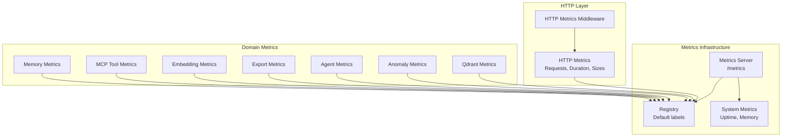

**Diagram sources**
- [metrics-server.ts:1-45](file://src/metrics-server.ts#L1-L45)
- [registry.ts:1-23](file://src/services/metrics/registry.ts#L1-L23)
- [system-metrics.ts:1-47](file://src/services/metrics/system-metrics.ts#L1-L47)
- [http-metrics-middleware.ts:1-73](file://src/http/http-metrics-middleware.ts#L1-L73)
- [http-metrics.ts:1-53](file://src/services/metrics/http-metrics.ts#L1-L53)
- [memory-metrics.ts:1-38](file://src/services/metrics/memory-metrics.ts#L1-L38)
- [mcp-metrics.ts:1-63](file://src/services/metrics/mcp-metrics.ts#L1-L63)
- [embedding-metrics.ts:1-51](file://src/services/metrics/embedding-metrics.ts#L1-L51)
- [export-metrics.ts:1-65](file://src/services/metrics/export-metrics.ts#L1-L65)
- [agent-metrics.ts:1-48](file://src/services/metrics/agent-metrics.ts#L1-L48)
- [anomaly-metrics.ts:1-11](file://src/services/metrics/anomaly-metrics.ts#L1-L11)
- [qdrant-metrics.ts:1-42](file://src/services/metrics/qdrant-metrics.ts#L1-L42)

**Section sources**
- [metrics-server.ts:1-45](file://src/metrics-server.ts#L1-L45)
- [registry.ts:1-23](file://src/services/metrics/registry.ts#L1-L23)

## Core Components
- Metrics Registry: Central Prometheus registry with default labels (service, squadrules_version, instance). Tenant isolation is enforced by adding tenant_id per metric where applicable.
- Dedicated Metrics Server: Express server exposing only /metrics and /health endpoints. It serializes metrics using the registry’s content type and error handling.
- System Metrics: Gauges for uptime, process start time, and memory usage (RSS, heapTotal, heapUsed), updated every few seconds.
- HTTP Metrics: Counters and histograms for requests, duration, request/response sizes, and active connections, recorded via middleware.
- Domain Metrics Modules:
  - Memory: Store counts, durations, and adapter layer size distributions.
  - MCP Tools: Tool call counts, durations, errors, input/output sizes, plus specific counters for quality update failures and similar adapter detection.
  - Embeddings: Provider-scoped request counts, durations, errors, vector sizes, and batch sizes.
  - Exports: Export duration, request totals, adapter counts, and ZIP decoded bytes.
  - Agents: Contribution counts, bonus points, rare successes, and quality score distributions.
  - Anomalies: Heuristic anomaly event counters.
  - Qdrant: Operation counts, operation/query/upsert durations.

**Section sources**
- [registry.ts:1-23](file://src/services/metrics/registry.ts#L1-L23)
- [metrics-server.ts:1-45](file://src/metrics-server.ts#L1-L45)
- [system-metrics.ts:1-47](file://src/services/metrics/system-metrics.ts#L1-L47)
- [http-metrics.ts:1-53](file://src/services/metrics/http-metrics.ts#L1-L53)
- [http-metrics-middleware.ts:1-73](file://src/http/http-metrics-middleware.ts#L1-L73)
- [memory-metrics.ts:1-38](file://src/services/metrics/memory-metrics.ts#L1-L38)
- [mcp-metrics.ts:1-63](file://src/services/metrics/mcp-metrics.ts#L1-L63)
- [embedding-metrics.ts:1-51](file://src/services/metrics/embedding-metrics.ts#L1-L51)
- [export-metrics.ts:1-65](file://src/services/metrics/export-metrics.ts#L1-L65)
- [agent-metrics.ts:1-48](file://src/services/metrics/agent-metrics.ts#L1-L48)
- [anomaly-metrics.ts:1-11](file://src/services/metrics/anomaly-metrics.ts#L1-L11)
- [qdrant-metrics.ts:1-42](file://src/services/metrics/qdrant-metrics.ts#L1-L42)

## Architecture Overview
The metrics architecture isolates telemetry from application traffic by running a separate metrics server. All domain components register metrics against a shared registry. HTTP middleware captures request lifecycle metrics. System metrics run on an interval to reflect runtime state.

```mermaid
sequenceDiagram
participant Client as "Prometheus Scraper"
participant MetricsServer as "Metrics Server"
participant Registry as "Prometheus Registry"
participant Sys as "System Metrics"
participant HTTPMW as "HTTP Metrics Middleware"
participant Domain as "Domain Metrics Modules"
Client->>MetricsServer : GET /metrics
MetricsServer->>Registry : serialize()
Registry-->>MetricsServer : text/plain; version=0.0.4
MetricsServer-->>Client : Prometheus exposition format
Note over Sys : Uptime and memory gauges updated periodically
Note over HTTPMW : Records request counts, durations, sizes, active connections
Note over Domain : Emits counters/histograms for memory, MCP, embeddings, exports, agents, anomalies, Qdrant
```

**Diagram sources**
- [metrics-server.ts:1-45](file://src/metrics-server.ts#L1-L45)
- [registry.ts:1-23](file://src/services/metrics/registry.ts#L1-L23)
- [system-metrics.ts:1-47](file://src/services/metrics/system-metrics.ts#L1-L47)
- [http-metrics-middleware.ts:1-73](file://src/http/http-metrics-middleware.ts#L1-L73)

## Detailed Component Analysis

### Metrics Registry and Default Labels
- Purpose: Centralize metric registration and apply default labels across all metrics.
- Key behaviors:
  - Sets default labels: service, squadrules_version, instance.
  - Enforces tenant isolation by requiring tenant_id per metric where relevant.
- Usage: All metric modules import the registry and pass it to their Counter/Histogram/Gauge constructors.

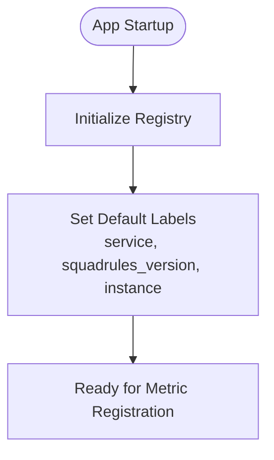

**Diagram sources**
- [registry.ts:1-23](file://src/services/metrics/registry.ts#L1-L23)

**Section sources**
- [registry.ts:1-23](file://src/services/metrics/registry.ts#L1-L23)

### Dedicated Metrics Server
- Purpose: Serve Prometheus scrape endpoint on a dedicated port.
- Endpoints:
  - GET /metrics: Serializes metrics using the registry’s content type.
  - GET /health: Simple health check returning status ok.
- Error Handling: Logs errors and returns 500 when metrics serialization fails.

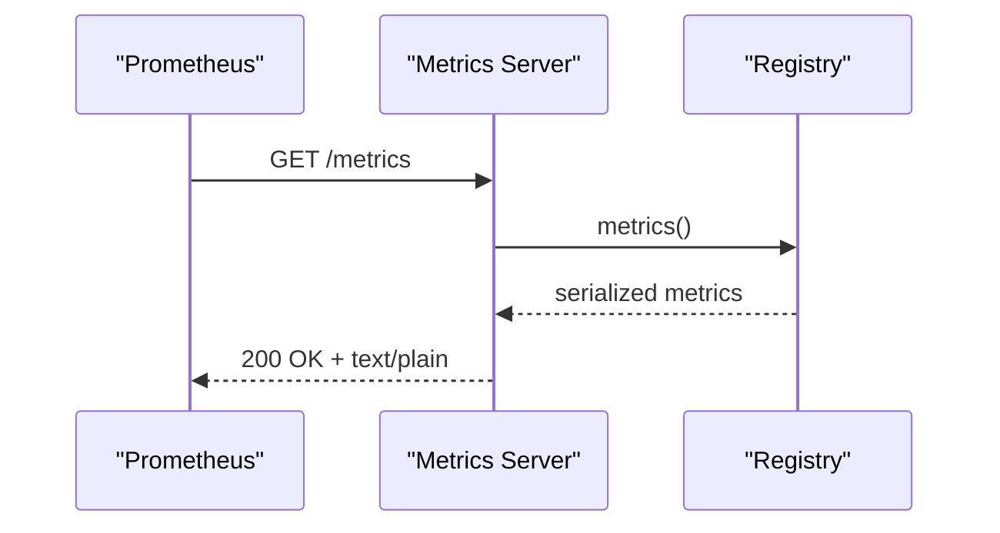

**Diagram sources**
- [metrics-server.ts:1-45](file://src/metrics-server.ts#L1-L45)

**Section sources**
- [metrics-server.ts:1-45](file://src/metrics-server.ts#L1-L45)

### System Metrics
- Metrics:
  - Uptime gauge.
  - Process start time gauge.
  - Memory usage gauge with labels for type (rss, heapTotal, heapUsed).
- Update Mechanism: Periodic interval updates uptime and memory gauges.

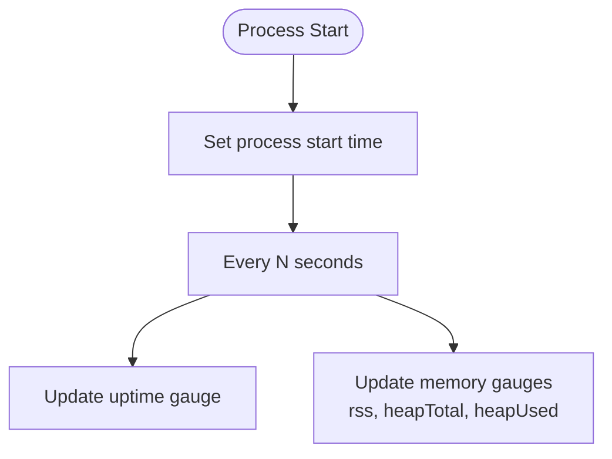

**Diagram sources**
- [system-metrics.ts:1-47](file://src/services/metrics/system-metrics.ts#L1-L47)

**Section sources**
- [system-metrics.ts:1-47](file://src/services/metrics/system-metrics.ts#L1-L47)

### HTTP Request Metrics
- Metrics:
  - Total requests counter with labels method, route, status, tenant_id.
  - Request duration histogram with buckets spanning milliseconds to seconds.
  - Request and response size histograms.
  - Active connections gauge.
- Middleware Behavior:
  - Captures request size if present.
  - Increments active connections on entry.
  - Wraps res.send to capture response size.
  - On finish, increments request counter, finalizes duration timer, and decrements active connections.

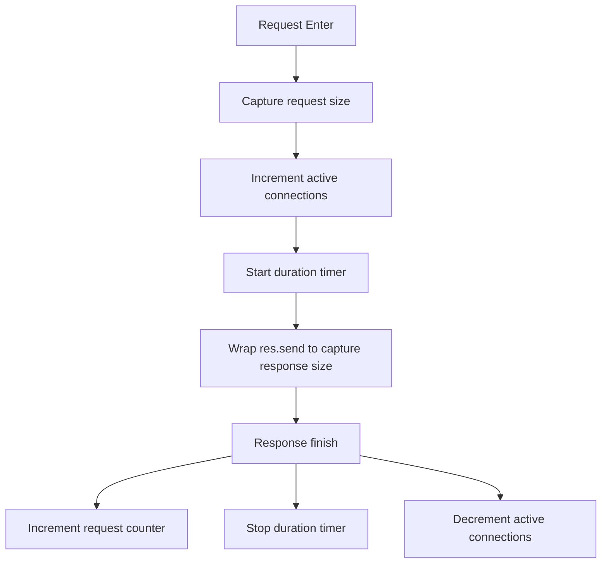

**Diagram sources**
- [http-metrics-middleware.ts:1-73](file://src/http/http-metrics-middleware.ts#L1-L73)
- [http-metrics.ts:1-53](file://src/services/metrics/http-metrics.ts#L1-L53)

**Section sources**
- [http-metrics-middleware.ts:1-73](file://src/http/http-metrics-middleware.ts#L1-L73)
- [http-metrics.ts:1-53](file://src/services/metrics/http-metrics.ts#L1-L53)

### Memory Store Metrics
- Metrics:
  - Store total counter labeled by quality and tenant_id.
  - Store duration histogram labeled by quality and tenant_id.
  - Adapter size histogram labeled by tenant_id.
- Typical Use: Emitted around memory store operations to track throughput and latency.

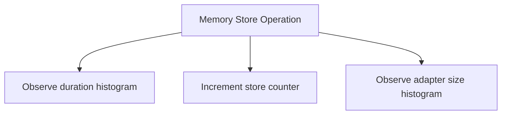

**Diagram sources**
- [memory-metrics.ts:1-38](file://src/services/metrics/memory-metrics.ts#L1-L38)

**Section sources**
- [memory-metrics.ts:1-38](file://src/services/metrics/memory-metrics.ts#L1-L38)

### MCP Tool Performance Metrics
- Metrics:
  - Tool calls counter labeled by tool, status, tenant_id.
  - Tool duration histogram labeled by tool, status, tenant_id.
  - Tool errors counter labeled by tool, status, tenant_id.
  - Input and output size histograms labeled by tool, tenant_id.
  - Quality update failure counter.
  - Similar adapter found counter for train flows.
- Observability: Enables per-tool latency analysis, error rate tracking, and payload sizing insights.

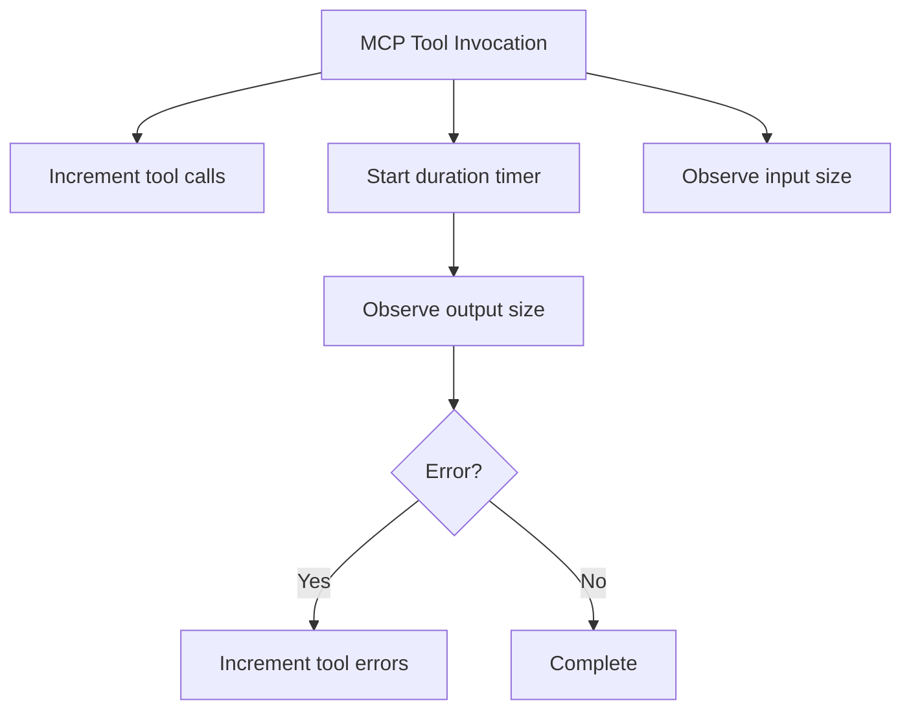

**Diagram sources**
- [mcp-metrics.ts:1-63](file://src/services/metrics/mcp-metrics.ts#L1-L63)

**Section sources**
- [mcp-metrics.ts:1-63](file://src/services/metrics/mcp-metrics.ts#L1-L63)

### Embedding Service Metrics
- Metrics:
  - Requests counter labeled by provider, status, tenant_id.
  - Duration histogram labeled by provider, tenant_id.
  - Errors counter labeled by provider, status, tenant_id.
  - Vector size histogram labeled by provider, tenant_id.
  - Batch size histogram labeled by tenant_id.
- Use Cases: Monitor provider performance, detect slow providers, and analyze vector payload sizes.

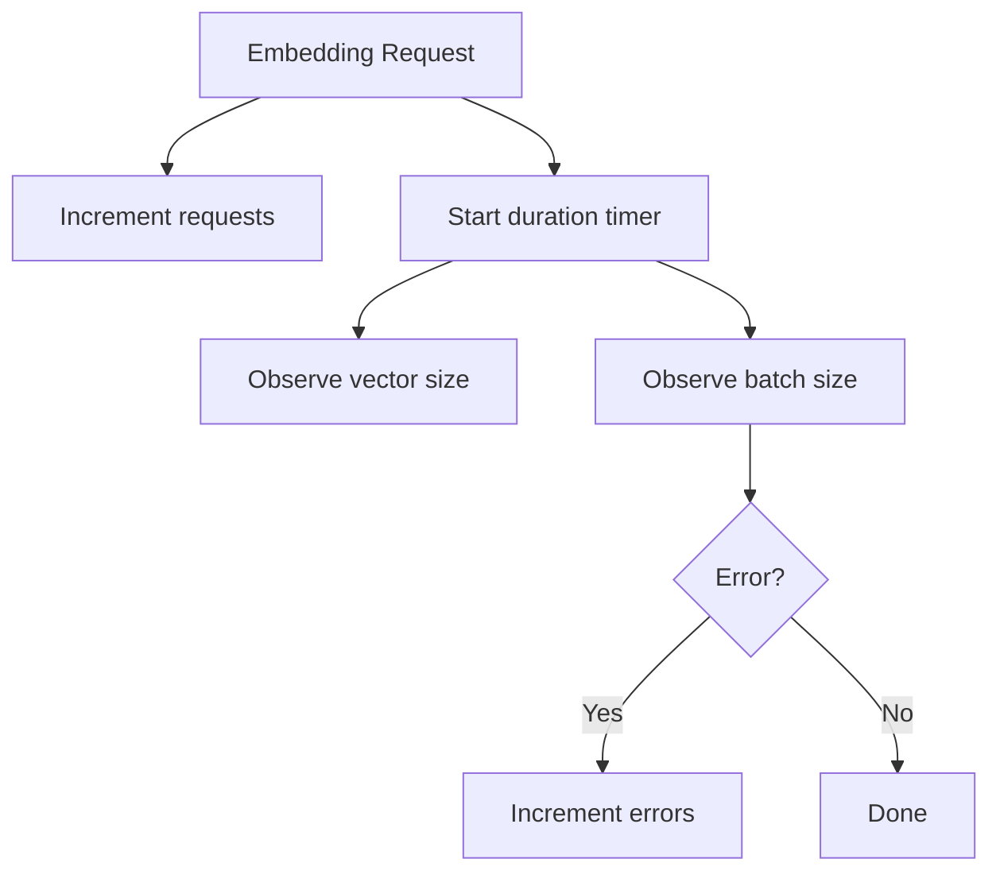

**Diagram sources**
- [embedding-metrics.ts:1-51](file://src/services/metrics/embedding-metrics.ts#L1-L51)

**Section sources**
- [embedding-metrics.ts:1-51](file://src/services/metrics/embedding-metrics.ts#L1-L51)

### Export Path Metrics
- Metrics:
  - Export duration histogram labeled by format and status.
  - Export requests counter labeled by format and status.
  - Adapter count histogram labeled by format.
  - Skill ZIP decoded bytes histogram.
- Helper: Utility function to compute elapsed time and a recorder function to emit multiple metrics atomically.

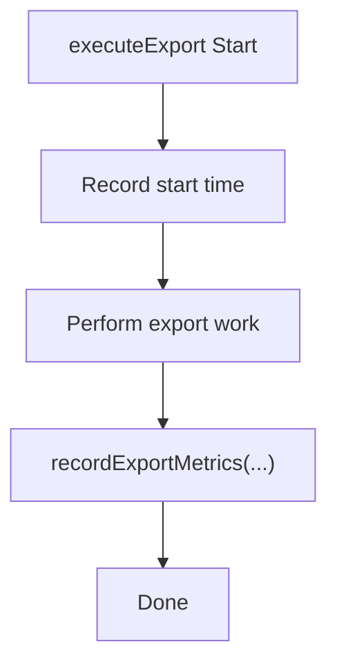

**Diagram sources**
- [export-metrics.ts:1-65](file://src/services/metrics/export-metrics.ts#L1-L65)

**Section sources**
- [export-metrics.ts:1-65](file://src/services/metrics/export-metrics.ts#L1-L65)

### Agent Performance Metrics
- Metrics:
  - Contributions counter labeled by agent_id, quality, tenant_id.
  - Implementation bonus counter labeled by agent_id, tenant_id.
  - Rare successes counter labeled by agent_id, tenant_id.
  - Quality score histogram labeled by agent_id, quality_tier, tenant_id.
- Purpose: Track agent contributions and outcomes for analytics and tuning.

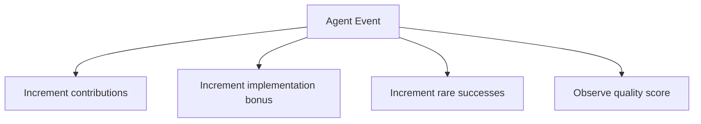

**Diagram sources**
- [agent-metrics.ts:1-48](file://src/services/metrics/agent-metrics.ts#L1-L48)

**Section sources**
- [agent-metrics.ts:1-48](file://src/services/metrics/agent-metrics.ts#L1-L48)

### Anomaly Metrics
- Metrics:
  - Anomaly events counter labeled by type, severity, tenant_id.
- Purpose: Surface heuristic-detected anomalies for alerting and investigation.

**Section sources**
- [anomaly-metrics.ts:1-11](file://src/services/metrics/anomaly-metrics.ts#L1-L11)

### Qdrant Metrics
- Metrics:
  - Operations counter labeled by operation, status, tenant_id.
  - Operation duration histogram labeled by operation, tenant_id.
  - Query duration histogram labeled by tenant_id.
  - Upsert duration histogram labeled by tenant_id.
- Purpose: Monitor vector DB performance and reliability.

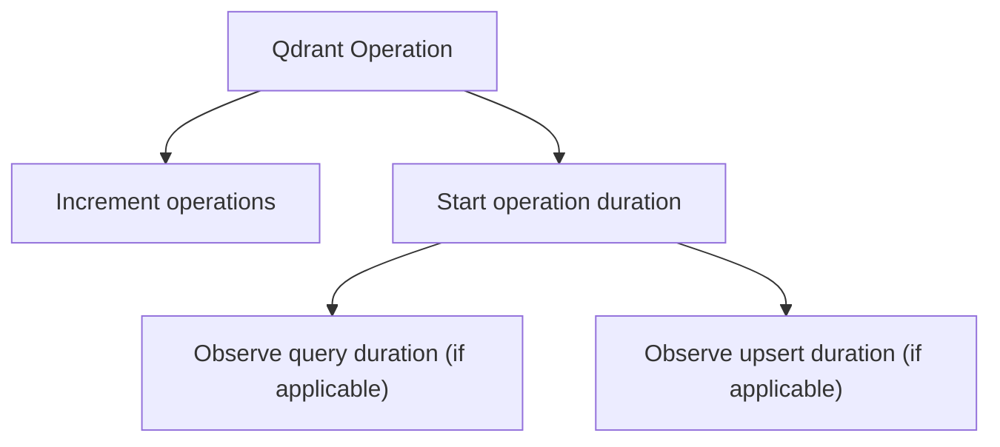

**Diagram sources**
- [qdrant-metrics.ts:1-42](file://src/services/metrics/qdrant-metrics.ts#L1-L42)

**Section sources**
- [qdrant-metrics.ts:1-42](file://src/services/metrics/qdrant-metrics.ts#L1-L42)

## Dependency Analysis
- Coupling:
  - All metric modules depend on the central registry for label defaults and registration.
  - HTTP middleware depends on HTTP metrics module and tenant context utility.
  - System metrics initialize gauges and schedule periodic updates.
- Cohesion:
  - Each domain module encapsulates related metrics for a subsystem (HTTP, memory, MCP, embeddings, exports, agents, anomalies, Qdrant).
- External Dependencies:
  - Uses @prometheus-io/client for Registry, Counter, Histogram, Gauge.
  - Express for the dedicated metrics server.

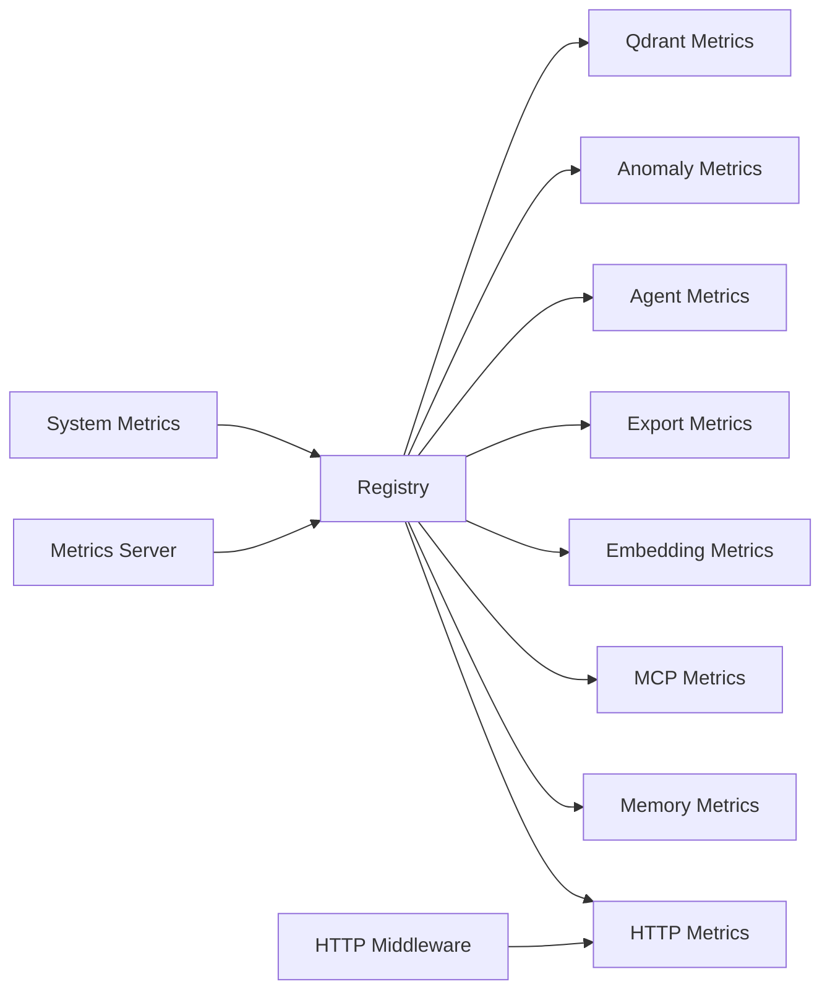

**Diagram sources**
- [registry.ts:1-23](file://src/services/metrics/registry.ts#L1-L23)
- [http-metrics-middleware.ts:1-73](file://src/http/http-metrics-middleware.ts#L1-L73)
- [metrics-server.ts:1-45](file://src/metrics-server.ts#L1-L45)
- [system-metrics.ts:1-47](file://src/services/metrics/system-metrics.ts#L1-L47)

**Section sources**
- [registry.ts:1-23](file://src/services/metrics/registry.ts#L1-L23)
- [http-metrics-middleware.ts:1-73](file://src/http/http-metrics-middleware.ts#L1-L73)
- [metrics-server.ts:1-45](file://src/metrics-server.ts#L1-L45)
- [system-metrics.ts:1-47](file://src/services/metrics/system-metrics.ts#L1-L47)

## Performance Considerations
- Isolation: Running metrics on a separate port avoids contention with application traffic and allows network restrictions.
- Label Cardinality: Avoid high-cardinality labels beyond tenant_id to prevent Prometheus ingestion overhead.
- Histogram Buckets: Ensure bucket ranges match expected latencies and payload sizes to maintain useful quantiles.
- Sampling: For very high-throughput paths, consider sampling or coalescing metrics to reduce cardinality and write amplification.
- Garbage Collection: Monitor heap metrics to identify leaks or excessive allocations under load.

[No sources needed since this section provides general guidance]

## Troubleshooting Guide
- Metrics Endpoint Returns 500:
  - Cause: Exception during metrics serialization.
  - Action: Inspect structured logs for “Error generating metrics” and verify registry state.
- Missing tenant_id:
  - Symptom: Inconsistent labeling across metrics.
  - Action: Ensure tenant context is populated before emitting metrics and that middleware extracts tenant_id correctly.
- High Cardinality Alerts:
  - Symptom: Slow Prometheus scrapes or high memory usage.
  - Action: Review label choices and remove unstable identifiers.
- HTTP Metrics Not Recorded:
  - Symptom: No request counters or durations.
  - Action: Verify middleware is applied globally and that routes expose path information.
- System Metrics Not Updating:
  - Symptom: Uptime or memory gauges static.
  - Action: Confirm periodic interval is running and process has permissions to read memory stats.

**Section sources**
- [metrics-server.ts:1-45](file://src/metrics-server.ts#L1-L45)
- [http-metrics-middleware.ts:1-73](file://src/http/http-metrics-middleware.ts#L1-L73)
- [system-metrics.ts:1-47](file://src/services/metrics/system-metrics.ts#L1-L47)

## Conclusion
SquadRules provides a comprehensive, modular metrics system centered on a Prometheus-compatible registry and a dedicated metrics server. It captures system runtime state, HTTP request characteristics, memory operations, MCP tool performance, embedding service behavior, export pipeline efficiency, agent outcomes, anomaly events, and Qdrant operations. By following the recommended configuration, alerting rules, dashboard patterns, and logging practices outlined here, operators can establish reliable observability and performance baselines for production environments.

[No sources needed since this section summarizes without analyzing specific files]

## Appendices

### Metrics Endpoint Configuration
- Port: Configured via environment variable METRICS_PORT.
- Endpoints:
  - GET /metrics: Prometheus exposition format.
  - GET /health: Health check for the metrics server.
- Network Exposure: Restrict to internal networks in production.

**Section sources**
- [metrics-server.ts:1-45](file://src/metrics-server.ts#L1-L45)

### Data Export Formats
- Content-Type: Determined by the registry’s contentType property.
- Format: Prometheus text-based exposition format suitable for scraping.

**Section sources**
- [metrics-server.ts:1-45](file://src/metrics-server.ts#L1-L45)

### Integration With Grafana
- Data Source: Add Prometheus pointing to the metrics server endpoint.
- Dashboards:
  - System: Uptime, memory usage (rss, heapTotal, heapUsed).
  - HTTP: Requests per route/status, latency percentiles, payload sizes, active connections.
  - MCP Tools: Calls, errors, latency, input/output sizes per tool.
  - Embeddings: Requests, errors, latency, vector sizes, batch sizes by provider.
  - Exports: Duration, adapter counts, ZIP sizes.
  - Agents: Contributions, bonuses, rare successes, quality scores.
  - Qdrant: Operation counts, query/upsert latencies.
- Example Queries:
  - HTTP p95 latency by route: histogram_quantile(0.95, sum(rate(squadrules_http_request_duration_seconds_bucket[5m])) by (le, route))
  - MCP error rate by tool: sum(rate(squadrules_mcp_tool_errors_total[5m])) by (tool) / sum(rate(squadrules_mcp_tool_calls_total[5m])) by (tool)
  - Memory RSS trend: squadrules_system_memory_usage_bytes{type="rss"}

[No sources needed since this section provides general guidance]

### Alerting Rules Examples
- High HTTP Error Rate:
  - Rule: Increase when sum(rate(squadrules_http_requests_total{status=~"5.."}[5m])) / sum(rate(squadrules_http_requests_total[5m])) exceeds threshold.
- Elevated MCP Tool Latency:
  - Rule: Increase when histogram_quantile(0.95, sum(rate(squadrules_mcp_tool_duration_seconds_bucket[5m])) by (tool, le)) > threshold.
- Memory Pressure:
  - Rule: Increase when squadrules_system_memory_usage_bytes{type="heapUsed"} exceeds configured limit.
- Qdrant Latency Spikes:
  - Rule: Increase when histogram_quantile(0.95, sum(rate(squadrules_qdrant_query_duration_seconds_bucket[5m])) by (le)) > threshold.
- Export Failures:
  - Rule: Increase when sum(rate(squadrules_export_requests_total{status="error"}[5m])) > threshold.

[No sources needed since this section provides general guidance]

### Log Aggregation and Structured Logging
- Structured Logger: Used throughout for consistent log formatting and correlation.
- Recommendations:
  - Ship logs to a centralized aggregator (e.g., Loki, Elasticsearch).
  - Include trace IDs or request IDs where available for cross-correlation with metrics.
  - Apply retention policies aligned with compliance requirements.

**Section sources**
- [metrics-server.ts:1-45](file://src/metrics-server.ts#L1-L45)

### Operational Observability Best Practices
- Establish Baselines:
  - Collect metrics for at least two weeks under normal load.
  - Compute p50/p95/p99 latencies and error rates per critical path.
- Instrumentation Hygiene:
  - Always include tenant_id where applicable.
  - Keep label cardinality low and stable.
- Health Checks:
  - Use /health for liveness probes and readiness checks in orchestrators.
- Capacity Planning:
  - Monitor memory gauges and histogram tails to plan scaling thresholds.

[No sources needed since this section provides general guidance]