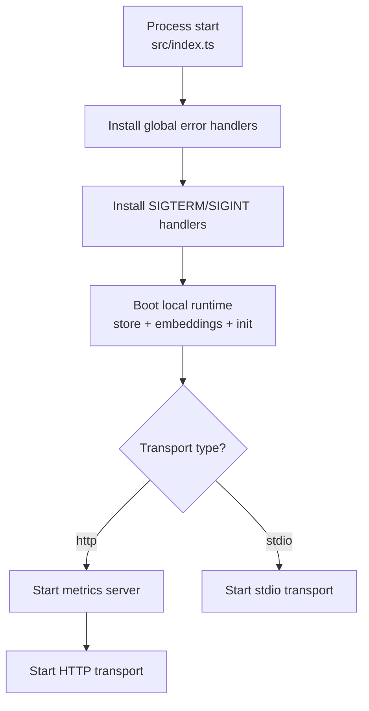
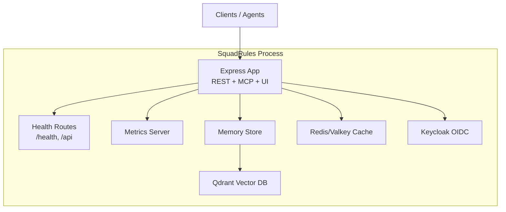
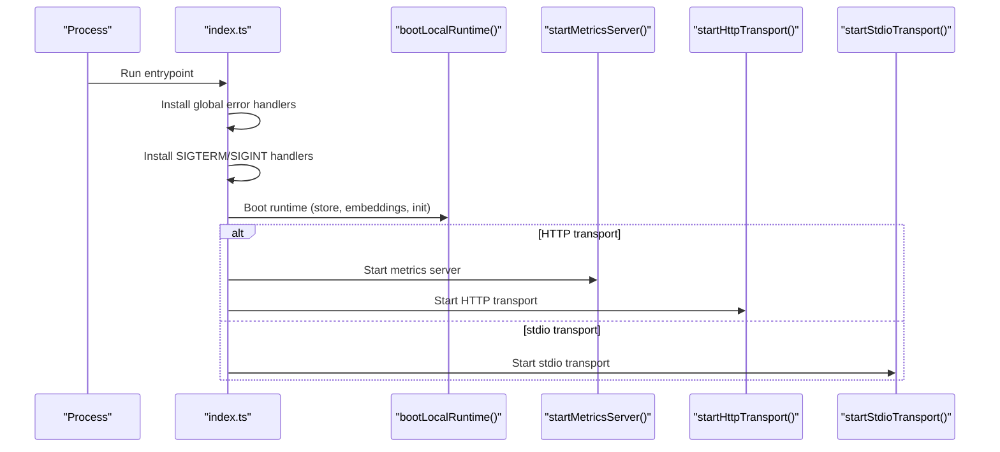
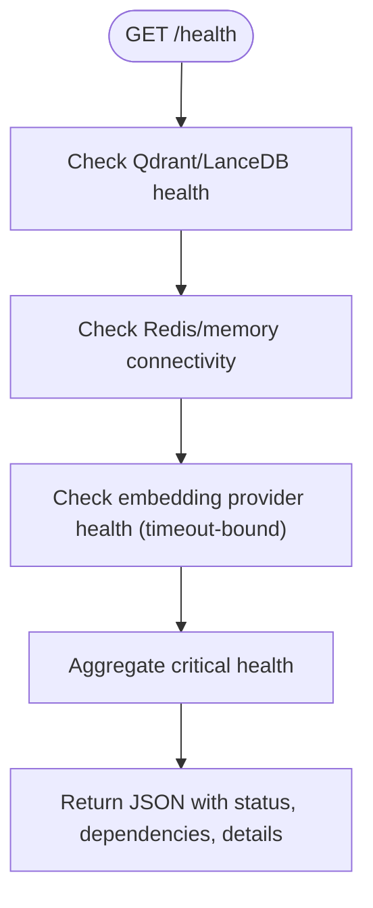
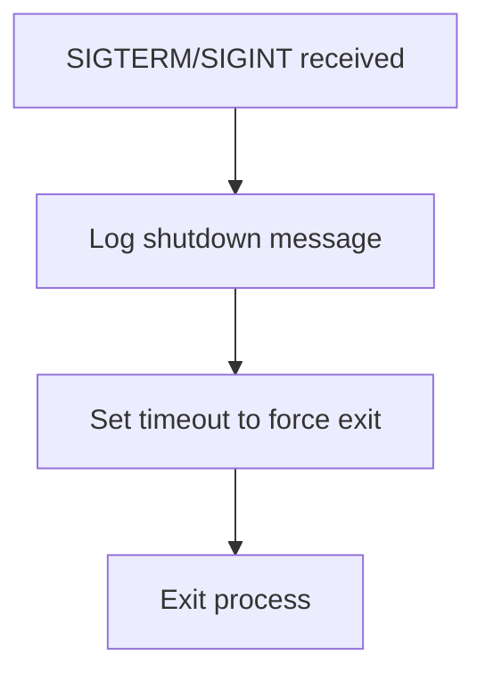
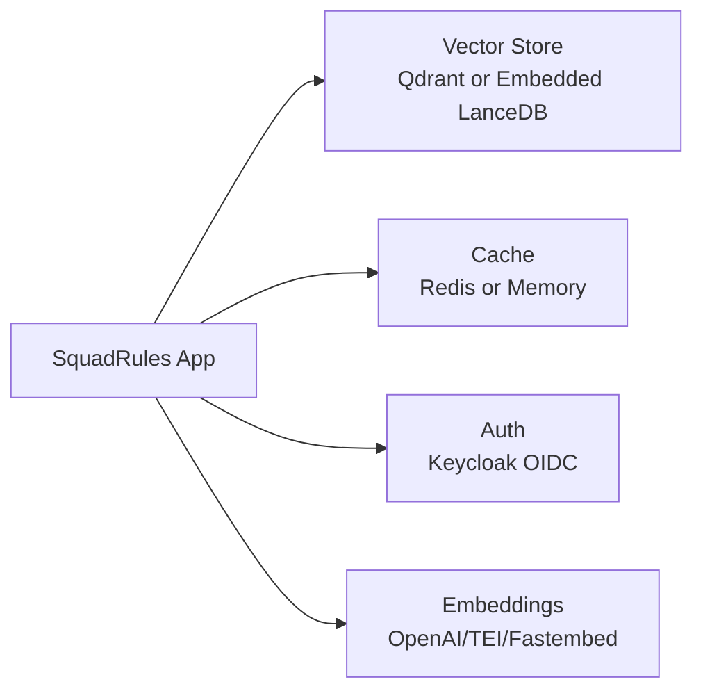

# Production Deployment

<cite>
**Referenced Files in This Document**
- [index.ts](file://src/index.ts)
- [server.ts](file://src/server.ts)
- [config.ts](file://src/config.ts)
- [runtime-mode.ts](file://src/config/runtime-mode.ts)
- [http-health-routes.ts](file://src/http/http-health-routes.ts)
- [http-server-startup.ts](file://src/http/http-server-startup.ts)
- [infra.yaml](file://compose/infra.yaml)
</cite>

## Table of Contents
1. [Introduction](#introduction)
2. [Project Structure](#project-structure)
3. [Core Components](#core-components)
4. [Architecture Overview](#architecture-overview)
5. [Detailed Component Analysis](#detailed-component-analysis)
6. [Dependency Analysis](#dependency-analysis)
7. [Performance Considerations](#performance-considerations)
8. [Troubleshooting Guide](#troubleshooting-guide)
9. [Conclusion](#conclusion)
10. [Appendices](#appendices)

## Introduction
This document provides production deployment guidance for SquadRules, an agent-first MCP framework where AI agents are the primary users and humans configure preferences through agents. The core operational flow is activate → forward → reward, with deterministic, auditable adapters. SquadRules uses Qdrant as the primary vector database (with LanceDB embedded as a fallback), Redis-compatible stores for sessions and rate limiting, and Keycloak for OIDC authentication.

Key production characteristics:
- Two runtime modes: simple (stdio, local single-user, embedded LanceDB) and cluster (HTTP, REST API, Streamable HTTP MCP, browser UI, metrics, auth enabled by default).
- Infrastructure: Qdrant vector store, Redis-compatible cache, optional Postgres for Keycloak, and Keycloak OIDC provider.
- Health checks, graceful shutdown, and process management are supported via signal handlers and HTTP endpoints.
- Resource tuning is available through environment variables for embedding retries, search behavior, rate limits, and body size limits.

## Project Structure
SquadRules exposes two transports:
- stdio transport for local, single-user MCP server usage.
- http transport for clustered deployments with REST API, MCP over HTTP, UI, and metrics.

The application entrypoint initializes global error handling, installs signal handlers, boots shared runtime components (store selection, embedding probe, initialization, snapshots, app-space seeding), starts the metrics server when applicable, and then launches either the HTTP or stdio transport.

**Diagram sources**
- [index.ts:27-129](file://src/index.ts#L27-L129)

**Section sources**
- [index.ts:27-129](file://src/index.ts#L27-L129)

## Core Components
- Runtime mode resolution determines transport, authentication posture, and local-mode guards.
- Centralized configuration parses environment variables for storage backends, OIDC, embedding providers, rate limits, and feature flags.
- HTTP server startup binds the Express app to a port and logs health/MCP endpoints.
- Health routes report dependency status (Qdrant/LanceDB, Redis/memory, embedding provider) and expose the API root.
- Infrastructure compose file defines Qdrant, Valkey/Redis, Postgres, and Keycloak services for development and CI.

**Section sources**
- [runtime-mode.ts:1-150](file://src/config/runtime-mode.ts#L1-L150)
- [config.ts:1-351](file://src/config.ts#L1-L351)
- [http-server-startup.ts:1-28](file://src/http/http-server-startup.ts#L1-L28)
- [http-health-routes.ts:1-119](file://src/http/http-health-routes.ts#L1-L119)
- [infra.yaml:1-168](file://compose/infra.yaml#L1-L168)

## Architecture Overview
At runtime, SquadRules selects a vector backend based on whether Qdrant is configured; otherwise it falls back to embedded LanceDB. Sessions and rate limiting use a Redis-compatible store when configured; otherwise they fall back to in-memory. Authentication integrates with Keycloak via OIDC. The HTTP transport serves REST endpoints, Streamable HTTP MCP, the UI, and metrics.

**Diagram sources**
- [config.ts:1-351](file://src/config.ts#L1-L351)
- [http-health-routes.ts:1-119](file://src/http/http-health-routes.ts#L1-L119)
- [index.ts:27-129](file://src/index.ts#L27-L129)

## Detailed Component Analysis

### Environment Configuration and Runtime Modes
SquadRules supports two mutually exclusive runtime modes:
- Simple mode (stdio): Local, single-user MCP server with embedded LanceDB, no HTTP listener, no OAuth callback surface, and no per-client space context.
- Cluster mode (http): Deployed posture with REST API, Streamable HTTP MCP, browser UI, metrics, and authentication enabled by default.

Mode resolution rules:
- TRANSPORT_TYPE explicitly selects http or stdio.
- If not set, launching via the local MCP bin or serve command defaults to stdio; all other entrypoints default to http.
- AUTH_ENABLED follows the mode unless explicitly set: true for http, false for stdio.
- Stdio mode rejects incompatible configurations such as enabling auth or pointing to an external Qdrant URL.

Environment variables include:
- Transport and mode: TRANSPORT_TYPE, AUTH_ENABLED.
- Storage: QDRANT_URL, QDRANT_API_KEY, QDRANT_COLLECTION_CURRENT, QDRANT_RESCORE_STRING, QDRANT_SNAPSHOT_DIR, QDRANT_SNAPSHOT_ON_START.
- Cache: KEY_VALUE_STORE_URL or REDIS_URL, KEY_VALUE_STORE_PASSWORD or REDIS_PASSWORD, SQUADRULES_KEY_VALUE_PREFIX or SQUADRULES_REDIS_PREFIX.
- Embeddings: EMBEDDING_PROVIDER, OPENAI_* settings, TEI_BASE_URL/TEI_MODEL/TEI_API_KEY, FASTEMBED_MODEL/FASTEMBED_CACHE_DIR, plus retry and latency controls.
- Auth: KEYCLOAK_URL, KEYCLOAK_INTERNAL_URL, KEYCLOAK_REALM, KEYCLOAK_CLIENT_ID, KEYCLOAK_CLI_CLIENT_ID, AUTH_CALLBACK_BASE_URL, SESSION_SECRET, SESSION_MAX_AGE_SEC, AUTH_MODE, AUTH_TRUSTED_ISSUERS, AUTH_ALLOWED_AUDIENCES, OIDC_SCOPES_SUPPORTED, OIDC_GROUPS_ALLOWLIST, OIDC_BEARER_MERGE_USERINFO_GROUPS.
- HTTP and performance: SERVER_PORT, METRICS_PORT, HTTP_JSON_BODY_LIMIT, HTTP_TRAIN_RAW_BODY_LIMIT, HTTP_RATE_LIMIT_WINDOW_MS, HTTP_RATE_LIMIT_MAX, AUTH_RATE_LIMIT_WINDOW_MS, AUTH_RATE_LIMIT_MAX, MCP_RATE_LIMIT_WINDOW_MS, MCP_RATE_LIMIT_MAX.
- Search and memory: SCORE_THRESHOLD, SIMILAR_MEMORY_THRESHOLD, MIN_ATTEST_RUNS, RUNS_FULL_CONFIDENCE, ATTEST_BOOST_MAX, SQUADRULES_SEARCH_OVERFETCH_FACTOR, SQUADRULES_SEARCH_MAX_FETCH, SQUADRULES_SEARCH_MAX_CHOICES, SQUADRULES_SEARCH_LIMIT_CAP, SQUADRULES_SEARCH_LIMIT_MIN, SQUADRULES_ENABLE_GROUP_COLLAPSE.

Startup validation:
- When AUTH_ENABLED=true is explicitly set, required OIDC variables must be present; otherwise startup throws.
- Stdio mode enforces consistency: auth must be disabled and Qdrant must not be configured.

**Section sources**
- [runtime-mode.ts:1-150](file://src/config/runtime-mode.ts#L1-L150)
- [config.ts:1-351](file://src/config.ts#L1-L351)

### Server Startup Procedures
- Direct process entrypoint runs the boot sequence: install global error handlers, install signal handlers, boot local runtime, optionally start metrics, then start HTTP or stdio transport.
- HTTP server startup logs health and MCP endpoints and handles address-in-use errors.
- Stdio mode avoids HTTP listeners and metrics.

**Diagram sources**
- [index.ts:27-129](file://src/index.ts#L27-L129)
- [http-server-startup.ts:1-28](file://src/http/http-server-startup.ts#L1-L28)

**Section sources**
- [index.ts:27-129](file://src/index.ts#L27-L129)
- [http-server-startup.ts:1-28](file://src/http/http-server-startup.ts#L1-L28)

### Docker Containerization Strategies
- The repository is an npm-only package; container images are built from the published npm package in the SquadRules containers repository.
- For local development and CI, infrastructure services are defined in compose/infra.yaml. The app itself runs via npm on the host or inside a devcontainer.
- Recommended strategy:
  - Build a minimal Node image that installs dependencies and runs the compiled output.
  - Provide environment variables for QDRANT_URL, REDIS_URL/KEY_VALUE_STORE_URL, KEYCLOAK_URL, KEYCLOAK_REALM, KEYCLOAK_CLIENT_ID, AUTH_CALLBACK_BASE_URL, SESSION_SECRET, and any embedding provider settings.
  - Expose SERVER_PORT and METRICS_PORT.
  - Use health checks against /health and readiness probes against /health.
  - Configure resource limits at the orchestrator level (see Performance Considerations).

[No sources needed since this section provides general guidance]

### Docker Compose Configurations
The provided compose file defines infrastructure services:
- Valkey/Redis-compatible cache with maxmemory and persistence options.
- Optional RedisInsight UI for inspecting the cache.
- Qdrant vector database with HTTP and gRPC ports, API key, and working memory optimization.
- Postgres for Keycloak.
- Keycloak with bootstrap admin credentials, Postgres connection, and health endpoint enabled.

Profiles:
- Default profile includes Qdrant only.
- fullstack profile adds Valkey, Postgres, and Keycloak.
- infra-ui profile adds RedisInsight.

Networking and volumes:
- All services share a bridge network named squadrules-network.
- Persistent volumes are defined for data directories.

Operational notes:
- Valkey requires KEY_VALUE_STORE_PASSWORD (or legacy REDIS_PASSWORD).
- Qdrant requires QDRANT_API_KEY.
- Keycloak depends on Postgres being healthy.
- Realm setup is performed via scripts/deploy-configure-keycloak-realms.py after bringing up the fullstack profile.

**Section sources**
- [infra.yaml:1-168](file://compose/infra.yaml#L1-L168)

### Kubernetes Deployment Manifests
Kubernetes manifests are not included in this repository. Follow these guidelines when creating manifests:
- Define a Deployment with replicas appropriate for your workload.
- Mount environment variables for all required configuration (storage, OIDC, embeddings, rate limits).
- Expose SERVICE_PORT via a Service and Ingress if needed.
- Add liveness and readiness probes using GET /health.
- Set resource requests and limits (CPU and memory) according to the recommendations below.
- Use a Secret for sensitive values (SESSION_SECRET, KEYCLOAK_* credentials, QDRANT_API_KEY, REDIS passwords).
- Use a ConfigMap for non-sensitive settings (SERVER_PORT, METRICS_PORT, EMBEDDING_PROVIDER, etc.).
- Ensure persistent volumes for Qdrant and Redis if using stateful operators or managed services.

[No sources needed since this section provides general guidance]

### Infrastructure Requirements

#### Qdrant Vector Database
- Required when running in cluster mode with external vector storage.
- Environment variables: QDRANT_URL, QDRANT_API_KEY, QDRANT_COLLECTION_CURRENT, QDRANT_RESCORE_STRING, QDRANT_SNAPSHOT_DIR, QDRANT_SNAPSHOT_ON_START.
- Health check: The service’s HTTP endpoint is used by the application’s health route.

**Section sources**
- [config.ts:106-116](file://src/config.ts#L106-L116)
- [config.ts:268-277](file://src/config.ts#L268-L277)
- [infra.yaml:56-84](file://compose/infra.yaml#L56-L84)

#### Redis Cache
- Used for sessions and rate limiting when configured; otherwise in-memory fallback.
- Environment variables: KEY_VALUE_STORE_URL or REDIS_URL, KEY_VALUE_STORE_PASSWORD or REDIS_PASSWORD, SQUADRULES_KEY_VALUE_PREFIX or SQUADRULES_REDIS_PREFIX.
- Health check: The application reports cache backend and connectivity in /health.

**Section sources**
- [config.ts:50-57](file://src/config.ts#L50-L57)
- [http-health-routes.ts:19-21](file://src/http/http-health-routes.ts#L19-L21)
- [infra.yaml:14-34](file://compose/infra.yaml#L14-L34)

#### Keycloak Authentication
- OIDC integration for browser sessions and Bearer token validation.
- Environment variables: KEYCLOAK_URL, KEYCLOAK_INTERNAL_URL, KEYCLOAK_REALM, KEYCLOAK_CLIENT_ID, KEYCLOAK_CLI_CLIENT_ID, AUTH_CALLBACK_BASE_URL, SESSION_SECRET, SESSION_MAX_AGE_SEC, AUTH_MODE, AUTH_TRUSTED_ISSUERS, AUTH_ALLOWED_AUDIENCES, OIDC_SCOPES_SUPPORTED, OIDC_GROUPS_ALLOWLIST, OIDC_BEARER_MERGE_USERINFO_GROUPS.
- Startup validation ensures required OIDC variables when AUTH_ENABLED=true is explicitly set.

**Section sources**
- [config.ts:141-195](file://src/config.ts#L141-L195)
- [config.ts:248-266](file://src/config.ts#L248-L266)
- [infra.yaml:111-141](file://compose/infra.yaml#L111-L141)

### Health Check Endpoints
- GET /health returns service status, version, uptime, transport, dependency health, and details about cache/vector backends.
- Dependency checks:
  - Vector store: Qdrant when configured; otherwise embedded LanceDB.
  - Cache: Redis when configured; otherwise in-memory.
  - Embedding provider: Health checked with a timeout to keep /health responsive.
- GET /api returns API metadata and endpoint descriptions; when AUTH_ENABLED, it indicates authentication requirements.

**Diagram sources**
- [http-health-routes.ts:13-91](file://src/http/http-health-routes.ts#L13-L91)

**Section sources**
- [http-health-routes.ts:13-117](file://src/http/http-health-routes.ts#L13-L117)

### Graceful Shutdown Procedures
- Signal handlers for SIGTERM and SIGINT log shutdown and force exit after a short grace period to avoid hanging on open handles.
- Supervisors should send SIGTERM to trigger graceful shutdown.

**Diagram sources**
- [index.ts:39-53](file://src/index.ts#L39-L53)

**Section sources**
- [index.ts:39-53](file://src/index.ts#L39-L53)

### Process Management with systemd or Container Orchestration
- systemd:
  - Use ExecStart to run the compiled entrypoint.
  - Set EnvironmentFile for .env variables.
  - Configure Restart=always and RestartSec.
  - Use TimeoutStopSec aligned with the graceful shutdown grace period.
- Container orchestration (Kubernetes):
  - Use livenessProbe and readinessProbe against /health.
  - Set resource requests/limits (see Performance Considerations).
  - Manage secrets via Kubernetes Secrets.

[No sources needed since this section provides general guidance]

## Dependency Analysis
The application’s runtime depends on:
- Vector store: Qdrant when configured; otherwise embedded LanceDB.
- Cache: Redis-compatible store when configured; otherwise in-memory.
- Authentication: Keycloak OIDC when AUTH_ENABLED=true.
- Embedding provider: OpenAI, TEI, or fastembed depending on configuration.

**Diagram sources**
- [config.ts:1-351](file://src/config.ts#L1-351)
- [http-health-routes.ts:1-119](file://src/http/http-health-routes.ts#L1-L119)

**Section sources**
- [config.ts:1-351](file://src/config.ts#L1-L351)
- [http-health-routes.ts:1-119](file://src/http/http-health-routes.ts#L1-L119)

## Performance Considerations
- Embedding retries and budgets:
  - EMBEDDING_MAX_RETRIES, EMBEDDING_RETRY_BASE_DELAY_MS, EMBEDDING_RETRY_MAX_DELAY_MS, EMBEDDING_RETRY_AFTER_CAP_MS, EMBEDDING_RETRY_BUDGET_MS control retry behavior and total budget.
  - EMBEDDING_LATENCY_WARN_MS sets a warning threshold for slow embedding calls.
- Search tuning:
  - SCORE_THRESHOLD, SIMILAR_MEMORY_THRESHOLD adjust matching sensitivity.
  - SQUADRULES_SEARCH_OVERFETCH_FACTOR, SQUADRULES_SEARCH_MAX_FETCH, SQUADRULES_SEARCH_MAX_CHOICES, SQUADRULES_SEARCH_LIMIT_CAP, SQUADRULES_SEARCH_LIMIT_MIN control retrieval volume and caps.
  - SQUADRULES_ENABLE_GROUP_COLLAPSE toggles group collapse behavior.
- Rate limiting:
  - HTTP_RATE_LIMIT_WINDOW_MS, HTTP_RATE_LIMIT_MAX
  - AUTH_RATE_LIMIT_WINDOW_MS, AUTH_RATE_LIMIT_MAX
  - MCP_RATE_LIMIT_WINDOW_MS, MCP_RATE_LIMIT_MAX
- Body size limits:
  - HTTP_JSON_BODY_LIMIT, HTTP_TRAIN_RAW_BODY_LIMIT
- Concurrency:
  - MAX_CONCURRENT_MCP_REQUESTS_RAW allows overriding concurrency detection.
- Qdrant memory:
  - QDRANT__SERVICE__MAX_WORKING_MEMORY_MB can be tuned in the Qdrant service configuration.

Recommended resource allocation:
- CPU: Start with 1–2 cores per replica for moderate workloads; scale horizontally for higher throughput.
- Memory: Allocate sufficient heap for Node.js and embedding model caching; consider 1–2 GB base plus additional memory for embeddings and vector operations.
- Qdrant: Allocate adequate RAM for vector storage and scoring; tune working memory based on dataset size and query patterns.
- Redis: Allocate memory for session and rate-limit data; monitor eviction policies and set appropriate maxmemory.

[No sources needed since this section provides general guidance]

## Troubleshooting Guide
Common issues and resolutions:
- Port already in use:
  - The HTTP server logs an error and exits when the configured SERVER_PORT is occupied. Choose another port or stop the conflicting process.
- Missing OIDC configuration:
  - When AUTH_ENABLED=true is explicitly set, missing KEYCLOAK_URL, KEYCLOAK_REALM, KEYCLOAK_CLIENT_ID, AUTH_CALLBACK_BASE_URL, or SESSION_SECRET causes startup to fail.
- Stdio mode misconfiguration:
  - Enabling auth or setting QDRANT_URL in stdio mode triggers a startup error due to incompatible local-mode assumptions.
- Health check failures:
  - /health reports unhealthy status when critical dependencies (vector store, Redis when configured, embedding provider when configured) are unreachable or unauthenticated. Inspect dependencies field for specifics.
- Embedding provider timeouts:
  - Embedding health checks are bounded by a timeout to keep /health responsive. If embedding is disabled or failing, verify provider configuration and network access.

**Section sources**
- [http-server-startup.ts:17-24](file://src/http/http-server-startup.ts#L17-L24)
- [config.ts:248-266](file://src/config.ts#L248-L266)
- [runtime-mode.ts:91-121](file://src/config/runtime-mode.ts#L91-L121)
- [http-health-routes.ts:13-91](file://src/http/http-health-routes.ts#L13-L91)

## Conclusion
SquadRules provides a robust, configurable platform for agent-driven workflows with clear separation between local simple mode and clustered HTTP deployments. Production readiness hinges on correct environment configuration, reliable infrastructure (Qdrant, Redis, Keycloak), and proper health monitoring. Use the provided compose definitions for local and CI environments, and follow the outlined guidelines for containerization and orchestration. Tune performance parameters to match workload characteristics and ensure graceful shutdown behavior aligns with your supervisor or orchestrator expectations.

## Appendices

### Environment Variables Summary
- Transport and mode: TRANSPORT_TYPE, AUTH_ENABLED.
- Storage: QDRANT_URL, QDRANT_API_KEY, QDRANT_COLLECTION_CURRENT, QDRANT_RESCORE_STRING, QDRANT_SNAPSHOT_DIR, QDRANT_SNAPSHOT_ON_START.
- Cache: KEY_VALUE_STORE_URL or REDIS_URL, KEY_VALUE_STORE_PASSWORD or REDIS_PASSWORD, SQUADRULES_KEY_VALUE_PREFIX or SQUADRULES_REDIS_PREFIX.
- Embeddings: EMBEDDING_PROVIDER, OPENAI_API_URL, OPENAI_API_KEY, OPENAI_EMBEDDING_MODEL, TEI_BASE_URL, TEI_MODEL, TEI_API_KEY, FASTEMBED_MODEL, FASTEMBED_CACHE_DIR, plus retry and latency controls.
- Auth: KEYCLOAK_URL, KEYCLOAK_INTERNAL_URL, KEYCLOAK_REALM, KEYCLOAK_CLIENT_ID, KEYCLOAK_CLI_CLIENT_ID, AUTH_CALLBACK_BASE_URL, SESSION_SECRET, SESSION_MAX_AGE_SEC, AUTH_MODE, AUTH_TRUSTED_ISSUERS, AUTH_ALLOWED_AUDIENCES, OIDC_SCOPES_SUPPORTED, OIDC_GROUPS_ALLOWLIST, OIDC_BEARER_MERGE_USERINFO_GROUPS.
- HTTP and performance: SERVER_PORT, METRICS_PORT, HTTP_JSON_BODY_LIMIT, HTTP_TRAIN_RAW_BODY_LIMIT, HTTP_RATE_LIMIT_WINDOW_MS, HTTP_RATE_LIMIT_MAX, AUTH_RATE_LIMIT_WINDOW_MS, AUTH_RATE_LIMIT_MAX, MCP_RATE_LIMIT_WINDOW_MS, MCP_RATE_LIMIT_MAX.
- Search and memory: SCORE_THRESHOLD, SIMILAR_MEMORY_THRESHOLD, MIN_ATTEST_RUNS, RUNS_FULL_CONFIDENCE, ATTEST_BOOST_MAX, SQUADRULES_SEARCH_OVERFETCH_FACTOR, SQUADRULES_SEARCH_MAX_FETCH, SQUADRULES_SEARCH_MAX_CHOICES, SQUADRULES_SEARCH_LIMIT_CAP, SQUADRULES_SEARCH_LIMIT_MIN, SQUADRULES_ENABLE_GROUP_COLLAPSE.

**Section sources**
- [config.ts:1-351](file://src/config.ts#L1-L351)