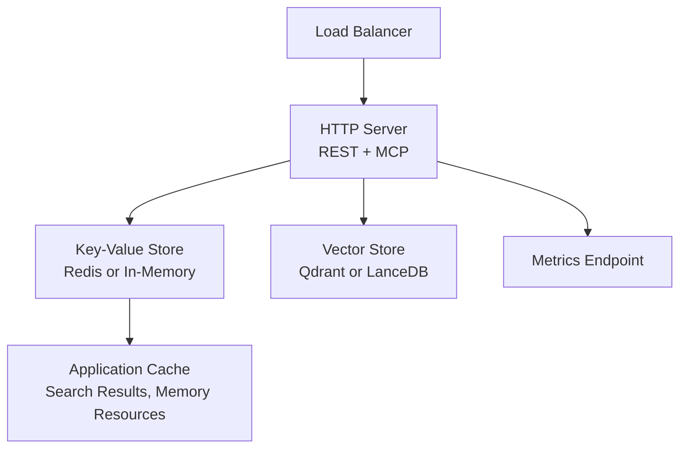
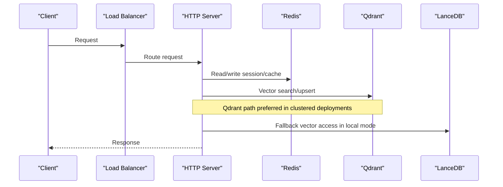
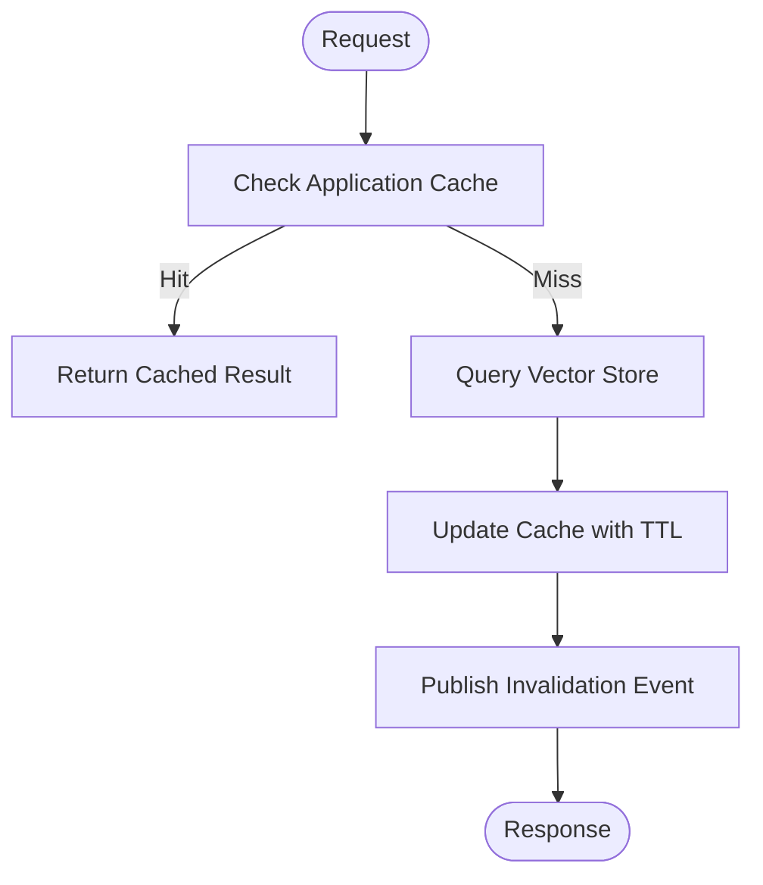
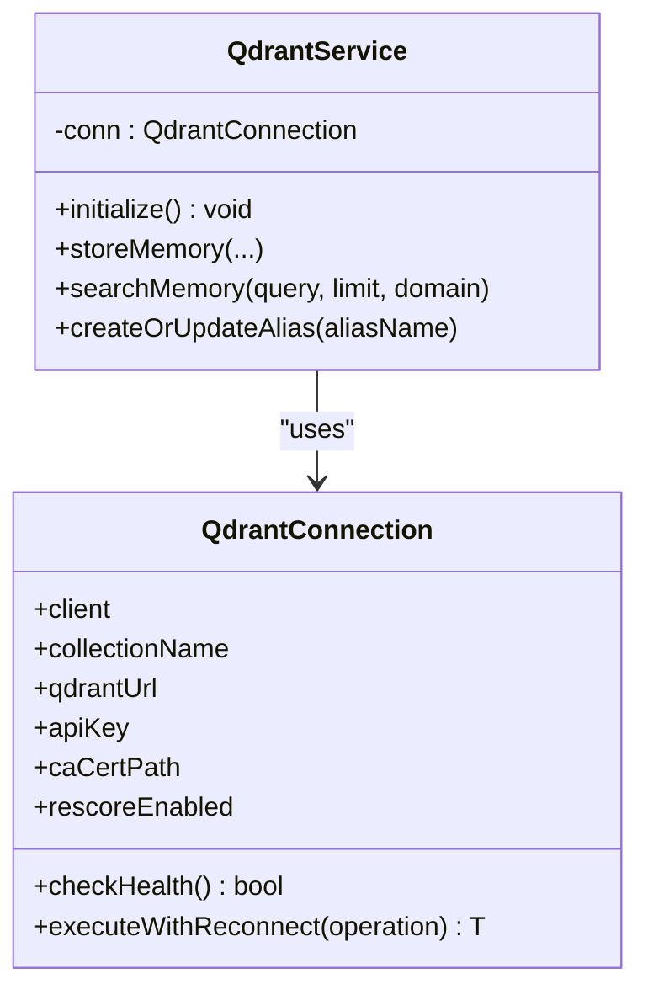
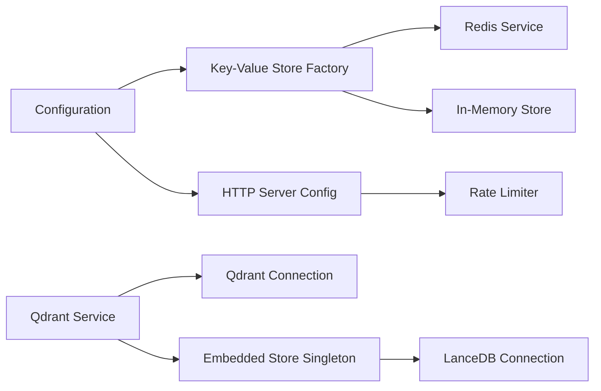

# Scaling and High Availability

<cite>
**Referenced Files in This Document**
- [config.ts](file://src/config.ts)
- [http-server-config.ts](file://src/http/http-server-config.ts)
- [redis.ts](file://src/services/redis.ts)
- [redis-cache.ts](file://src/services/redis-cache.ts)
- [key-value-store-factory.ts](file://src/services/key-value-store-factory.ts)
- [connection.ts](file://src/services/qdrant/connection.ts)
- [service.ts](file://src/services/qdrant/service.ts)
- [lancedb-connection.ts](file://src/services/vector-store/lancedb-connection.ts)
- [embedded-store-singleton.ts](file://src/services/vector-store/embedded-store-singleton.ts)
</cite>

## Table of Contents
1. [Introduction](#introduction)
2. [Project Structure](#project-structure)
3. [Core Components](#core-components)
4. [Architecture Overview](#architecture-overview)
5. [Detailed Component Analysis](#detailed-component-analysis)
6. [Dependency Analysis](#dependency-analysis)
7. [Performance Considerations](#performance-considerations)
8. [Troubleshooting Guide](#troubleshooting-guide)
9. [Conclusion](#conclusion)
10. [Appendices](#appendices)

## Introduction
This document explains how SquadRules scales horizontally and remains highly available. It focuses on:
- Stateless service design for horizontal scaling behind a load balancer.
- Redis-backed session management, rate limiting, and application caching.
- Qdrant cluster configuration for vector search scalability.
- LanceDB embedded storage limitations and when to use it.
- Database sharding strategies, connection pooling, and caching layers.
- Disaster recovery, backup strategies for vector databases, and failover mechanisms.
- Performance tuning for high-throughput scenarios and capacity planning guidelines.

SquadRules is an agent-first MCP framework where agents drive workflows through activate → forward → reward. The HTTP server exposes REST and Streamable HTTP MCP endpoints, while the runtime uses Redis (optional), Qdrant (primary vector store), or LanceDB (embedded fallback).

## Project Structure
The scalable surface area relevant to this document spans:
- Configuration and mode selection.
- HTTP middleware including rate limiting.
- Redis client and cache abstraction.
- Qdrant client wrapper with resilience.
- Embedded LanceDB connection behavior.

**Diagram sources**
- [http-server-config.ts:49-99](file://src/http/http-server-config.ts#L49-L99)
- [key-value-store-factory.ts:13-22](file://src/services/key-value-store-factory.ts#L13-L22)
- [service.ts:153-161](file://src/services/qdrant/service.ts#L153-L161)

**Section sources**
- [config.ts:1-10](file://src/config.ts#L1-L10)
- [http-server-config.ts:49-99](file://src/http/http-server-config.ts#L49-L99)

## Core Components
- Key-value store factory selects Redis when configured, otherwise in-memory.
- Redis service implements key namespacing, TTLs, JSON helpers, pub/sub, and error logging.
- Redis cache service provides search result and memory resource caching with invalidation events.
- Qdrant connection encapsulates client initialization, health checks, and reconnect logic.
- Qdrant service composes operations and can be replaced by the embedded store in non-clustered mode.
- LanceDB connection opens a strong-consistency embedded database directory per user.

**Section sources**
- [key-value-store-factory.ts:1-23](file://src/services/key-value-store-factory.ts#L1-L23)
- [redis.ts:26-117](file://src/services/redis.ts#L26-L117)
- [redis-cache.ts:21-41](file://src/services/redis-cache.ts#L21-L41)
- [connection.ts:11-37](file://src/services/qdrant/connection.ts#L11-L37)
- [service.ts:17-28](file://src/services/qdrant/service.ts#L17-L28)
- [lancedb-connection.ts:21-33](file://src/services/vector-store/lancedb-connection.ts#L21-L33)

## Architecture Overview
SquadRules runs as stateless HTTP processes. Shared state lives in Redis; vector data lives in Qdrant or LanceDB. A load balancer distributes traffic across replicas. Caching reduces vector query costs. Rate limiting protects services.

**Diagram sources**
- [http-server-config.ts:74-99](file://src/http/http-server-config.ts#L74-L99)
- [key-value-store-factory.ts:13-22](file://src/services/key-value-store-factory.ts#L13-L22)
- [service.ts:153-161](file://src/services/qdrant/service.ts#L153-L161)

## Detailed Component Analysis

### Horizontal Scaling and Stateless Service Design
- Run multiple identical HTTP server instances behind a load balancer.
- Do not store process-local sessions or caches; use Redis for shared state.
- Use environment-driven backend selection so each replica connects to the same Redis and Qdrant clusters.
- Keep request handlers free of mutable global state; rely on dependency injection and external stores.

Operational implications:
- Zero-downtime deployments are possible because requests do not depend on process-local state.
- Health checks should validate Redis connectivity and Qdrant availability.
- Graceful shutdown should close HTTP listeners and flush metrics.

**Section sources**
- [config.ts:50-56](file://src/config.ts#L50-L56)
- [http-server-config.ts:74-99](file://src/http/http-server-config.ts#L74-L99)

### Load Balancing Considerations
- Prefer layer-4 or layer-7 load balancing with sticky sessions disabled.
- Configure health checks to probe `/health` or equivalent endpoints exposed by the HTTP server.
- Set timeouts and retry budgets at the load balancer to match embedding and vector search latency profiles.
- Use separate rate limiters per route group to protect authentication, API, and MCP paths.

**Section sources**
- [http-server-config.ts:49-99](file://src/http/http-server-config.ts#L49-L99)

### Redis Clustering for Sessions and Rate Limiting
- Redis is used for sessions, proof-of-work counters, and application cache keys.
- Keys are prefixed and optionally namespaced by space ID to avoid collisions across tenants.
- Global prefixes exist for memory cache and OIDC state to ensure cross-space consistency.
- Pub/sub channels enable cache invalidation across replicas.

Scaling guidance:
- Deploy Redis in clustered or sentinel mode with replication and persistence enabled.
- Use TLS and authentication for Redis connections.
- Monitor memory usage, eviction policies, and slow log.
- Partition keys by space ID to distribute load across shards.

**Diagram sources**
- [redis-cache.ts:43-79](file://src/services/redis-cache.ts#L43-L79)
- [redis-cache.ts:141-152](file://src/services/redis-cache.ts#L141-L152)

**Section sources**
- [redis.ts:110-117](file://src/services/redis.ts#L110-L117)
- [redis.ts:219-235](file://src/services/redis.ts#L219-L235)
- [redis-cache.ts:21-41](file://src/services/redis-cache.ts#L21-L41)
- [redis-cache.ts:81-105](file://src/services/redis-cache.ts#L81-L105)

### Qdrant Cluster Configuration for Vector Search Scalability
- Qdrant is the primary vector store for semantic search of rules and workflows.
- The QdrantConnection class initializes the client, supports TLS with custom CA, performs health checks, and retries failed operations with exponential backoff.
- The QdrantService composes all vector operations and can be swapped with the embedded store in local mode.

Scaling guidance:
- Deploy Qdrant as a multi-node cluster with replication and shard awareness.
- Use the collection alias mechanism to support zero-downtime reindexing and blue/green rollouts.
- Enable snapshots and configure snapshot directories for backups.
- Tune rescore settings and search limits via environment variables.

**Diagram sources**
- [connection.ts:11-37](file://src/services/qdrant/connection.ts#L11-L37)
- [connection.ts:63-96](file://src/services/qdrant/connection.ts#L63-L96)
- [connection.ts:98-130](file://src/services/qdrant/connection.ts#L98-L130)
- [service.ts:17-28](file://src/services/qdrant/service.ts#L17-L28)
- [service.ts:132-142](file://src/services/qdrant/service.ts#L132-L142)

**Section sources**
- [connection.ts:24-61](file://src/services/qdrant/connection.ts#L24-L61)
- [connection.ts:63-130](file://src/services/qdrant/connection.ts#L63-L130)
- [service.ts:17-28](file://src/services/qdrant/service.ts#L17-L28)
- [service.ts:132-142](file://src/services/qdrant/service.ts#L132-L142)

### LanceDB Embedded Storage Limitations
- LanceDB is embedded and file-based, suitable for local development and single-user scenarios.
- The connection enforces strong consistency across processes by reading the latest committed version explicitly.
- It is not designed for multi-process write concurrency beyond MVCC guarantees and filesystem locking semantics.
- In clustered deployments, prefer Qdrant for distributed vector search.

Operational notes:
- The embedded store directory is derived from the user config directory.
- The SDK is loaded lazily to avoid native binding overhead when using Qdrant.
- The embedded store singleton ensures both memory and vector interfaces share one connection.

**Section sources**
- [lancedb-connection.ts:1-33](file://src/services/vector-store/lancedb-connection.ts#L1-L33)
- [embedded-store-singleton.ts:1-18](file://src/services/vector-store/embedded-store-singleton.ts#L1-L18)

### Database Sharding Strategies
- Redis sharding: partition keys by space ID prefix to distribute load across nodes.
- Qdrant sharding: configure collections with appropriate shard count and replication factor based on vector volume and query throughput.
- Avoid hotspots by ensuring even distribution of space IDs and avoiding overly broad queries without filters.

Capacity planning:
- Estimate vectors per space, average embedding size, and growth rate.
- Size Qdrant nodes for CPU, RAM, and disk I/O based on indexing and search workloads.
- Size Redis nodes for memory footprint, network bandwidth, and persistence overhead.

[No sources needed since this section provides general guidance]

### Connection Pooling
- Redis client: the implementation creates a single client instance per process. For very high throughput, consider connection pool sizing and keep-alive settings provided by the Redis driver.
- Qdrant client: the connection wrapper manages a single client instance with health checks and reconnect logic. Ensure underlying HTTP client pool settings align with expected concurrency.
- Embedding providers: tune retry budgets and delays to prevent overload during spikes.

**Section sources**
- [redis.ts:33-45](file://src/services/redis.ts#L33-L45)
- [connection.ts:39-61](file://src/services/qdrant/connection.ts#L39-L61)
- [config.ts:87-93](file://src/config.ts#L87-L93)

### Caching Layers
- Application cache: search results and memory resources are cached in Redis with short TTLs and invalidation events.
- Cache invalidation: triggered on updates to maintain consistency across replicas.
- Stats tracking: hit/miss counters help monitor cache effectiveness.

Best practices:
- Use bounded TTLs to prevent stale data if invalidation fails.
- Publish invalidation events after writes to ensure all replicas refresh their caches.
- Monitor cache hit ratios and adjust TTLs based on workload patterns.

**Section sources**
- [redis-cache.ts:43-79](file://src/services/redis-cache.ts#L43-L79)
- [redis-cache.ts:107-139](file://src/services/redis-cache.ts#L107-L139)
- [redis-cache.ts:154-184](file://src/services/redis-cache.ts#L154-L184)

### Disaster Recovery Procedures
- Qdrant snapshots: configure snapshot directory and optional snapshot-on-start behavior.
- Backup strategy: schedule periodic snapshots and copy them to durable storage.
- Restore procedure: stop writes, restore snapshot, restart service, verify health.
- Failover: use Qdrant cluster replication and leader election; promote replicas as needed.

Operational checklist:
- Validate snapshot directory permissions and disk space.
- Test restore procedures regularly.
- Monitor snapshot success and age.

**Section sources**
- [config.ts:268-277](file://src/config.ts#L268-L277)

### Backup Strategies for Vector Databases
- Qdrant: leverage built-in snapshot functionality and externalize snapshots to object storage.
- LanceDB: back up the embedded directory periodically; ensure consistent snapshots by stopping writes or using filesystem snapshots.
- Metadata and configuration: include environment variables, collection aliases, and schema definitions in backups.

[No sources needed since this section provides general guidance]

### Failover Mechanisms
- Qdrant unavailability: the connection wrapper attempts reconnection with exponential backoff and returns structured errors.
- Redis failures: cache reads degrade gracefully; writes may fall back to in-memory store if Redis is not configured.
- Embedding provider outages: retries with backoff and jitter, honoring Retry-After headers and budget caps.

**Section sources**
- [connection.ts:76-96](file://src/services/qdrant/connection.ts#L76-L96)
- [connection.ts:98-130](file://src/services/qdrant/connection.ts#L98-L130)
- [config.ts:87-93](file://src/config.ts#L87-L93)

## Dependency Analysis
The following diagram shows how components depend on each other for scaling and availability.

**Diagram sources**
- [config.ts:50-56](file://src/config.ts#L50-L56)
- [key-value-store-factory.ts:13-22](file://src/services/key-value-store-factory.ts#L13-L22)
- [http-server-config.ts:49-99](file://src/http/http-server-config.ts#L49-L99)
- [service.ts:153-161](file://src/services/qdrant/service.ts#L153-L161)
- [embedded-store-singleton.ts:12-17](file://src/services/vector-store/embedded-store-singleton.ts#L12-L17)
- [lancedb-connection.ts:21-33](file://src/services/vector-store/lancedb-connection.ts#L21-L33)

**Section sources**
- [config.ts:50-56](file://src/config.ts#L50-L56)
- [key-value-store-factory.ts:13-22](file://src/services/key-value-store-factory.ts#L13-L22)
- [http-server-config.ts:49-99](file://src/http/http-server-config.ts#L49-L99)
- [service.ts:153-161](file://src/services/qdrant/service.ts#L153-L161)

## Performance Considerations
- Embedding latency: tune retry budgets, base delay, max delay, and Retry-After cap to balance responsiveness and reliability.
- Search performance: adjust overfetch factor, max fetch, and choice limits to reduce downstream processing.
- Cache effectiveness: monitor hit/miss ratios and adjust TTLs; invalidate aggressively on writes.
- Rate limiting: set per-route limits appropriate for authentication, API, and MCP workloads.
- Concurrency: cap concurrent MCP requests and tune HTTP body limits to prevent resource exhaustion.

**Section sources**
- [config.ts:87-93](file://src/config.ts#L87-L93)
- [config.ts:108-116](file://src/config.ts#L108-L116)
- [config.ts:121-126](file://src/config.ts#L121-L126)
- [config.ts:280-282](file://src/config.ts#L280-L282)

## Troubleshooting Guide
Common issues and diagnostics:
- Redis connectivity errors: check masked URL logs, inner error details, and address/port information.
- Cache invalidation failures: inspect invalidation event publishing and key deletion logs.
- Qdrant unavailability: review health check failures, reconnection attempts, and structured error payloads.
- Embedded store consistency: ensure read consistency interval is set to force fresh reads across processes.

Remediation steps:
- Verify environment variables for Redis URL, prefix, and authentication.
- Confirm Qdrant URL, API key, and TLS certificate configuration.
- Validate snapshot directory existence and permissions.
- Review rate limiter thresholds and adjust based on observed traffic patterns.

**Section sources**
- [redis.ts:39-67](file://src/services/redis.ts#L39-L67)
- [redis-cache.ts:141-152](file://src/services/redis-cache.ts#L141-L152)
- [connection.ts:63-96](file://src/services/qdrant/connection.ts#L63-L96)
- [lancedb-connection.ts:21-33](file://src/services/vector-store/lancedb-connection.ts#L21-L33)

## Conclusion
SquadRules achieves horizontal scaling and high availability through:
- Stateless HTTP servers behind a load balancer.
- Redis-backed sessions, rate limiting, and application caching with pub/sub invalidation.
- Qdrant cluster configuration for scalable vector search with resilience and snapshot-based backups.
- Embedded LanceDB for local development with strong consistency but limited multi-process scalability.
- Carefully tuned performance parameters and robust failure handling.

Adopt these patterns to scale reliably under high throughput and plan capacity based on vector volumes, cache effectiveness, and external service SLAs.

[No sources needed since this section summarizes without analyzing specific files]

## Appendices

### Environment Variables Reference for Scaling
- Redis: REDIS_URL, SQUADRULES_REDIS_PREFIX, KEY_VALUE_STORE_URL, KEY_VALUE_STORE_PASSWORD.
- Qdrant: QDRANT_URL, QDRANT_API_KEY, QDRANT_COLLECTION, QDRANT_CA_CERT_PATH, QDRANT_RESCORE, QDRANT_SNAPSHOT_DIR, QDRANT_SNAPSHOT_ON_START.
- HTTP: SERVER_PORT, METRICS_PORT, HTTP_JSON_BODY_LIMIT, HTTP_RATE_LIMIT_WINDOW_MS, HTTP_RATE_LIMIT_MAX, AUTH_RATE_LIMIT_WINDOW_MS, AUTH_RATE_LIMIT_MAX, MCP_RATE_LIMIT_WINDOW_MS, MCP_RATE_LIMIT_MAX.
- Embedding: OPENAI_EMBEDDING_MODEL, OPENAI_API_URL, OPENAI_API_KEY, EMBEDDING_PROVIDER, EMBEDDING_MAX_RETRIES, EMBEDDING_RETRY_BASE_DELAY_MS, EMBEDDING_RETRY_MAX_DELAY_MS, EMBEDDING_RETRY_AFTER_CAP_MS, EMBEDDING_RETRY_BUDGET_MS.
- Search: SQUADRULES_SEARCH_OVERFETCH_FACTOR, SQUADRULES_SEARCH_MAX_FETCH, SQUADRULES_SEARCH_MAX_CHOICES, SQUADRULES_SEARCH_LIMIT_CAP, SQUADRULES_SEARCH_LIMIT_MIN.

**Section sources**
- [config.ts:50-56](file://src/config.ts#L50-L56)
- [config.ts:106-116](file://src/config.ts#L106-L116)
- [config.ts:121-126](file://src/config.ts#L121-L126)
- [config.ts:268-282](file://src/config.ts#L268-L282)