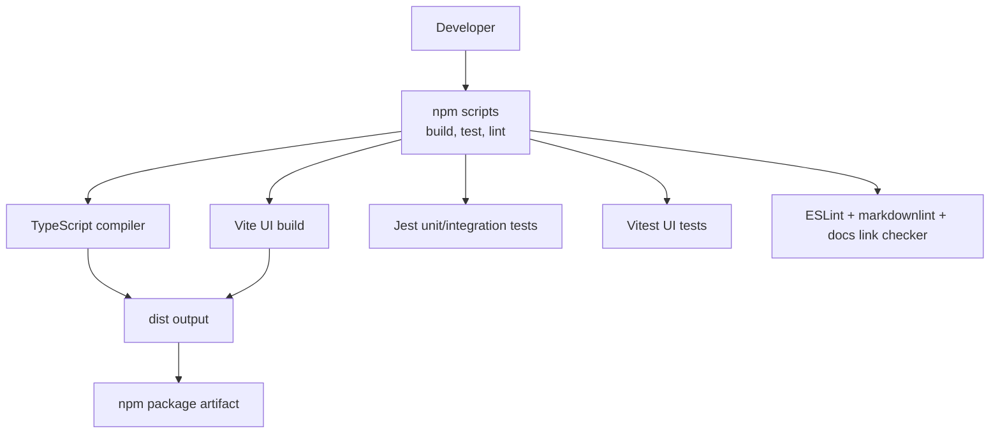
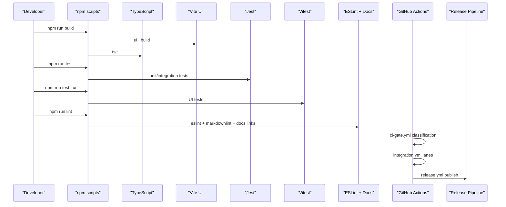
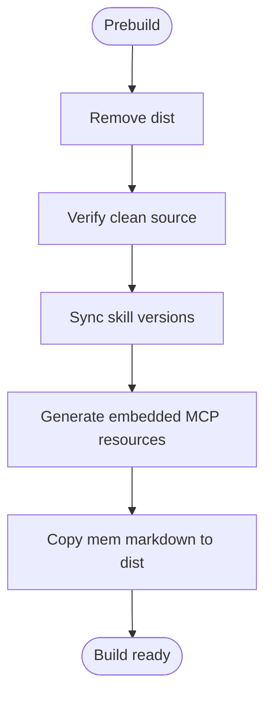
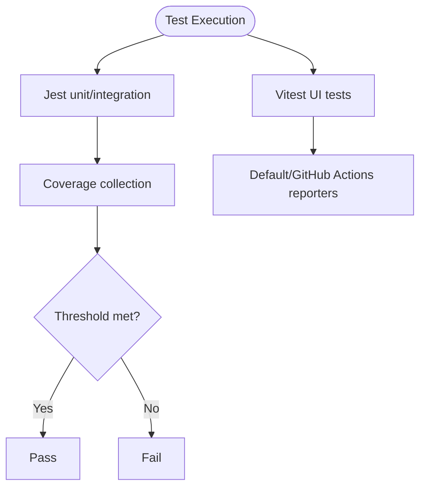
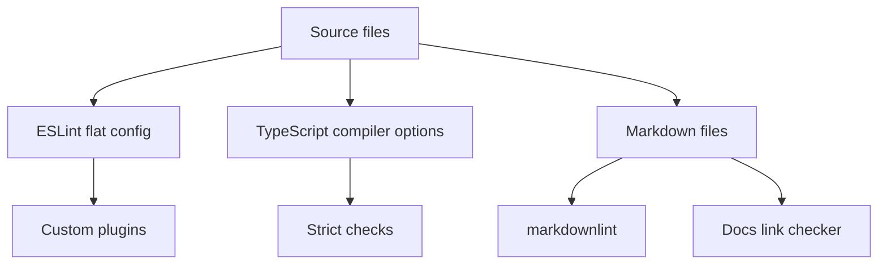
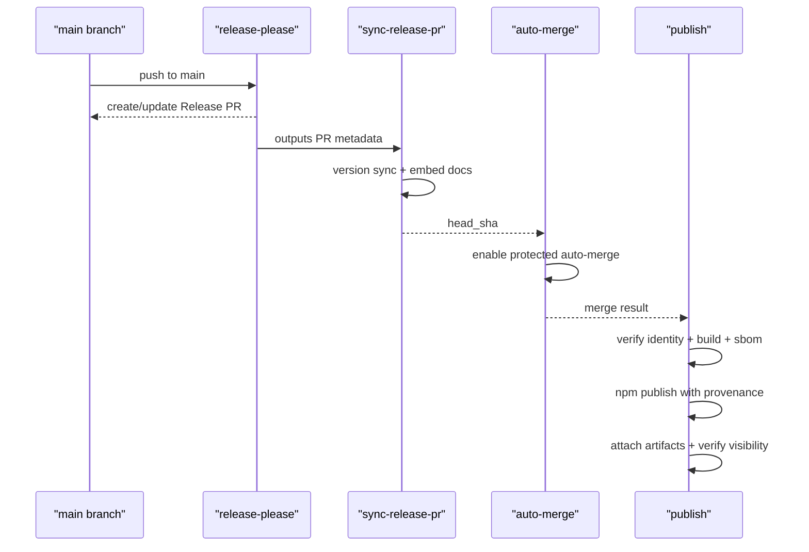
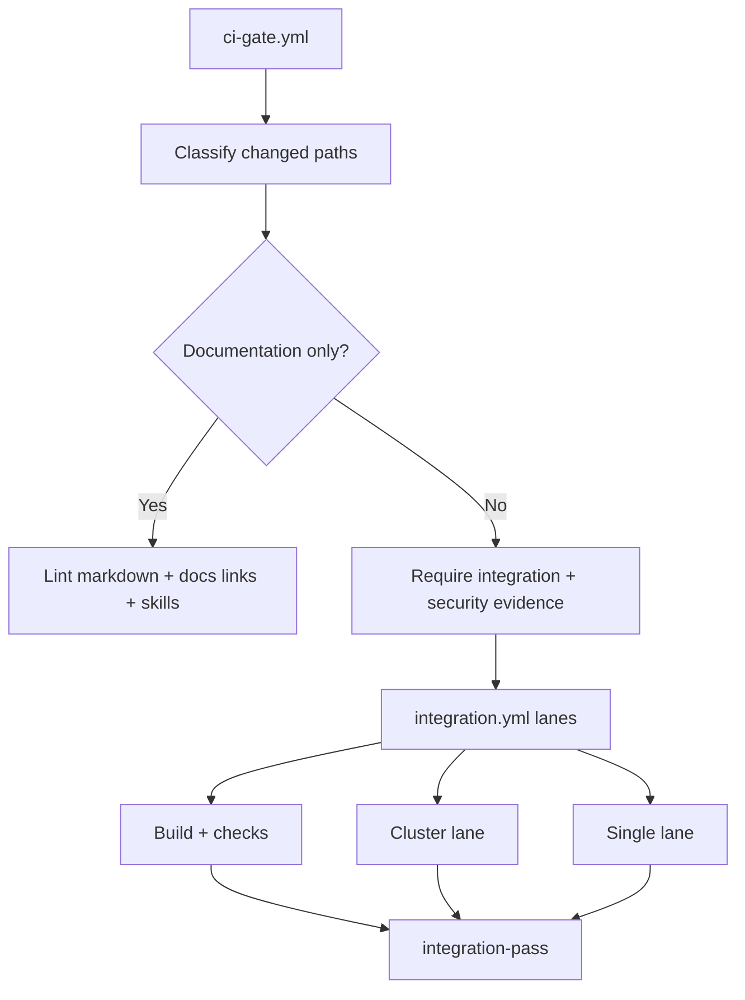
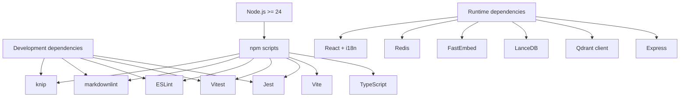

# Development Guide

<cite>
**Referenced Files in This Document**
- [package.json](file://package.json)
- [tsconfig.json](file://tsconfig.json)
- [jest.config.js](file://jest.config.js)
- [vitest.config.ts](file://vitest.config.ts)
- [eslint.config.cjs](file://eslint.config.cjs)
- [ci-gate.yml](file://.github/workflows/ci-gate.yml)
- [integration.yml](file://.github/workflows/integration.yml)
- [release.yml](file://.github/workflows/release.yml)
- [build-embed-docs.ts](file://scripts/build-embed-docs.ts)
- [release-please-config.json](file://release-please-config.json)
- [.release-please-manifest.json](file://.release-please-manifest.json)
</cite>

## Table of Contents
1. [Introduction](#introduction)
2. [Project Structure](#project-structure)
3. [Core Components](#core-components)
4. [Architecture Overview](#architecture-overview)
5. [Detailed Component Analysis](#detailed-component-analysis)
6. [Dependency Analysis](#dependency-analysis)
7. [Performance Considerations](#performance-considerations)
8. [Troubleshooting Guide](#troubleshooting-guide)
9. [Conclusion](#conclusion)
10. [Appendices](#appendices)

## Introduction
This guide explains how to set up the SquadRules MCP development environment, run tests, enforce code quality, build and release the package, and participate in the continuous integration pipeline. It is written for contributors who need both a high-level understanding and concrete steps to work effectively with the repository.

SquadRules is an agent-first MCP framework where AI agents are the primary users and humans configure preferences through agents. The core flow is activate → forward → reward. Adapters provide deterministic, auditable task execution. Vector databases (Qdrant as primary, LanceDB as secondary) support semantic search of rules and workflows. Storage includes Redis for sessions and rate limiting, vector databases for embeddings, and the filesystem for configuration and adapters. Authentication uses Keycloak plus Google IdP for OAuth2/JWT. Skills under `.agents/skills/` contain hand-authored routing logic; `squadrules` is the canonical action router. MCP tools include activate, forward, train, reward, tune, delete, export, and spaces.

## Project Structure
The repository is a Node.js TypeScript project with a React-based UI. Build tooling compiles TypeScript and builds the UI. Tests use Jest for unit and integration tests and Vitest for UI tests. Linting uses ESLint with custom plugins, markdownlint, and documentation link checks. Documentation assets are embedded at build time into the runtime bundle.

**Diagram sources**
- [package.json:40-79](file://package.json#L40-L79)
- [tsconfig.json:1-56](file://tsconfig.json#L1-L56)
- [jest.config.js:1-74](file://jest.config.js#L1-L74)
- [vitest.config.ts:1-25](file://vitest.config.ts#L1-L25)
- [eslint.config.cjs:1-18](file://eslint.config.cjs#L1-L18)

**Section sources**
- [package.json:1-194](file://package.json#L1-L194)
- [tsconfig.json:1-56](file://tsconfig.json#L1-L56)

## Core Components
- Development environment setup
  - Node.js version requirement is enforced by the engines field. Use Node.js 24 or newer.
  - Install dependencies with npm. The repository uses npm scripts for all common tasks.
- Dependency management
  - Dependencies include Express, Qdrant client, LanceDB, FastEmbed, Redis, React, and related tooling.
  - Overrides pin transitive dependency versions for stability.
- Build tooling
  - `npm run build` runs UI build, TypeScript compilation, and CLI permission fix.
  - `npm run ui:build` builds the React UI with Vite.
  - `npm run typecheck` validates TypeScript across server and UI projects.
- Testing strategy
  - Unit and integration tests run with Jest. Coverage thresholds are strict when enabled.
  - UI tests run with Vitest using jsdom.
  - End-to-end scenarios can use Playwright via integration workflows.
- Code quality standards
  - ESLint flat config entry delegates to a shared configuration. Custom plugins enforce forbidden tokens, CodeQL line integrity, and MCP widget contracts.
  - Markdown linting and documentation link validation are automated.
- Release process
  - Versioning is managed by release-please. A manifest tracks the current package version.
  - CI creates or updates a release PR, synchronizes version-derived sources, auto-merges when checks pass, and publishes the npm package with provenance.

**Section sources**
- [package.json:159-161](file://package.json#L159-L161)
- [package.json:40-79](file://package.json#L40-L79)
- [package.json:81-158](file://package.json#L81-L158)
- [package.json:162-184](file://package.json#L162-L184)
- [jest.config.js:45-58](file://jest.config.js#L45-L58)
- [vitest.config.ts:17-23](file://vitest.config.ts#L17-L23)
- [eslint.config.cjs:1-18](file://eslint.config.cjs#L1-L18)
- [release-please-config.json:1-13](file://release-please-config.json#L1-L13)
- [.release-please-manifest.json:1-4](file://.release-please-manifest.json#L1-L4)

## Architecture Overview
The development workflow connects local commands to CI gates and release automation.

**Diagram sources**
- [package.json:40-79](file://package.json#L40-L79)
- [ci-gate.yml:1-204](file://.github/workflows/ci-gate.yml#L1-L204)
- [integration.yml:1-366](file://.github/workflows/integration.yml#L1-L366)
- [release.yml:1-338](file://.github/workflows/release.yml#L1-L338)

## Detailed Component Analysis

### Development Environment Setup
- Node.js
  - Enforced minimum version is Node.js 24 or newer.
- Installation
  - Run `npm ci` to install dependencies from lockfile.
- Build
  - `npm run build` performs prebuild cleanup, skill version sync, embed-docs generation, UI build, TypeScript compilation, and CLI executable permissions.
- Type checking
  - `npm run typecheck` validates both server and UI TypeScript configurations.
- Documentation embedding
  - The prebuild step invokes a script that scans `src/embed-docs`, collects prompts, tools, resources, templates, and metadata, and generates a TypeScript module consumed by the runtime. It also copies `mem/` markdown files into `dist/embed-docs/mem`.

**Diagram sources**
- [package.json:70-71](file://package.json#L70-L71)
- [build-embed-docs.ts:107-166](file://scripts/build-embed-docs.ts#L107-L166)
- [build-embed-docs.ts:291-325](file://scripts/build-embed-docs.ts#L291-L325)

**Section sources**
- [package.json:159-161](file://package.json#L159-L161)
- [package.json:46-71](file://package.json#L46-L71)
- [build-embed-docs.ts:1-330](file://scripts/build-embed-docs.ts#L1-L330)

### Testing Strategy
- Jest unit and integration tests
  - Configuration enables ESM, sets roots, matches test patterns, ignores UI and load directories, transforms TypeScript, maps modules, collects coverage, and enforces thresholds.
  - Global setup and teardown manage authentication environments when enabled.
  - Test sequencing ensures train/update tests run before dependent suites.
- Vitest UI tests
  - Configuration defines root, React plugin, alias resolution, globals, jsdom environment, setup file, inclusion pattern, and reporters.
- Integration lanes
  - CI runs a cluster lane with full infrastructure (Qdrant, Redis, Keycloak, Postgres) and HTTP transport.
  - CI runs a single lane with zero-config defaults (stdio transport, LanceDB, fastembed).
  - Both lanes install the built tarball and execute tests against it.

**Diagram sources**
- [jest.config.js:1-74](file://jest.config.js#L1-L74)
- [vitest.config.ts:1-25](file://vitest.config.ts#L1-L25)
- [integration.yml:30-71](file://.github/workflows/integration.yml#L30-L71)
- [integration.yml:72-263](file://.github/workflows/integration.yml#L72-L263)
- [integration.yml:265-345](file://.github/workflows/integration.yml#L265-L345)

**Section sources**
- [jest.config.js:1-74](file://jest.config.js#L1-L74)
- [vitest.config.ts:1-25](file://vitest.config.ts#L1-L25)
- [integration.yml:30-71](file://.github/workflows/integration.yml#L30-L71)
- [integration.yml:72-263](file://.github/workflows/integration.yml#L72-L263)
- [integration.yml:265-345](file://.github/workflows/integration.yml#L265-L345)

### Code Quality Standards
- ESLint
  - Flat config entry delegates to a shared configuration and integrates ignore files.
  - Custom plugins enforce forbidden text, CodeQL line integrity, and MCP widget contracts.
  - Lint scripts cover JavaScript/TypeScript, skills, markdown, and documentation links.
- TypeScript
  - Strict mode enabled with null checks, function types, no implicit returns, exact optional property types, and isolated modules.
  - Output directory is `dist`; declarations and source maps are emitted.
- Markdown and docs
  - Markdown linting runs against documentation files.
  - Documentation link checker validates internal links and supports strict mode in CI.

**Diagram sources**
- [eslint.config.cjs:1-18](file://eslint.config.cjs#L1-L18)
- [tsconfig.json:5-44](file://tsconfig.json#L5-L44)
- [package.json:60-66](file://package.json#L60-L66)

**Section sources**
- [eslint.config.cjs:1-18](file://eslint.config.cjs#L1-L18)
- [tsconfig.json:1-56](file://tsconfig.json#L1-L56)
- [package.json:60-66](file://package.json#L60-L66)

### Release Process
- Version management
  - release-please manages releases based on commit history and configuration.
  - Manifest stores the current package version.
- Release PR synchronization
  - CI creates or updates a release PR, then synchronizes version-derived sources such as embedded docs and skill references.
  - Auto-merge is enabled for synchronized release PRs after checks pass.
- Publication
  - CI verifies tag identity, builds the tarball, generates SBOM, publishes to npm with provenance, attaches artifacts to GitHub Release, and verifies publication visibility.

**Diagram sources**
- [release.yml:26-83](file://.github/workflows/release.yml#L26-L83)
- [release.yml:84-169](file://.github/workflows/release.yml#L84-L169)
- [release.yml:170-208](file://.github/workflows/release.yml#L170-L208)
- [release.yml:209-338](file://.github/workflows/release.yml#L209-L338)
- [release-please-config.json:1-13](file://release-please-config.json#L1-L13)
- [.release-please-manifest.json:1-4](file://.release-please-manifest.json#L1-L4)

**Section sources**
- [release.yml:1-338](file://.github/workflows/release.yml#L1-L338)
- [release-please-config.json:1-13](file://release-please-config.json#L1-L13)
- [.release-please-manifest.json:1-4](file://.release-please-manifest.json#L1-L4)

### Continuous Integration Pipeline
- CI gate
  - Classifies changed paths into documentation-only or application changes.
  - For documentation-only revisions, runs markdown linting and docs link checks.
  - For application revisions, requires successful integration and security evidence before reporting success.
- Integration workflow
  - Build lane runs lint, typecheck, knip, spec parity, UI tests, and package build across Node 24 and 26.
  - Cluster lane provisions full infrastructure, installs the built package, and runs tests with AUTH enabled.
  - Single lane runs zero-config tests with stdio transport, LanceDB, and fastembed.
  - Merge gate requires positive evidence from every lane.

**Diagram sources**
- [ci-gate.yml:1-204](file://.github/workflows/ci-gate.yml#L1-L204)
- [integration.yml:1-366](file://.github/workflows/integration.yml#L1-L366)

**Section sources**
- [ci-gate.yml:1-204](file://.github/workflows/ci-gate.yml#L1-L204)
- [integration.yml:1-366](file://.github/workflows/integration.yml#L1-L366)

### Contribution Guidelines
- Coding standards
  - Follow TypeScript strictness and ESLint rules. Avoid inline disables unless absolutely necessary; the linter configuration discourages inline overrides.
  - Keep skills hand-authored and ensure they align with the canonical action router.
- Pull request procedures
  - Ensure all CI gates pass. Documentation-only PRs must pass markdown and docs link checks. Application PRs require integration and security evidence.
  - Release PRs are created automatically by release-please and synchronized by CI.
- Community interaction norms
  - Treat agents as primary users; design workflows that allow agents to consult team knowledge before acting.
  - Maintain deterministic, auditable adapter behavior and clear error guidance.

[No sources needed since this section provides general guidance]

## Dependency Analysis
The project depends on runtime libraries for HTTP serving, vector storage, embeddings, authentication, and UI rendering. Development dependencies include testing frameworks, linting tools, and build utilities.

**Diagram sources**
- [package.json:81-158](file://package.json#L81-L158)
- [package.json:159-161](file://package.json#L159-L161)
- [package.json:40-79](file://package.json#L40-L79)

**Section sources**
- [package.json:81-158](file://package.json#L81-L158)
- [package.json:159-161](file://package.json#L159-L161)
- [package.json:40-79](file://package.json#L40-L79)

## Performance Considerations
- Embedding initialization
  - Cold starts may download models and perform CPU inference. CI caches model downloads to reduce latency.
- Vector store warm-up
  - Boot-injected app adapters are trained at startup; warm boot is fast due to version-skip optimizations.
- UI build
  - Vite builds the React UI; keep component complexity reasonable and avoid heavy synchronous operations in render paths.
- Test performance
  - Integration tests can be slow due to infra provisioning and model downloads. Use caching strategies provided by CI.

[No sources needed since this section provides general guidance]

## Troubleshooting Guide
- Local development
  - If the UI does not reflect changes, rebuild with `npm run ui:build` and restart the server.
  - If embedded docs are missing, run `npm run build` to regenerate embedded resources and copy mem files.
- Tests
  - If Jest coverage thresholds fail, inspect uncovered branches/functions and add targeted tests.
  - If Vitest UI tests fail due to environment issues, ensure jsdom setup is correct and dependencies are installed.
- CI failures
  - If the CI gate reports unclassified paths, review changed files and ensure path classification works as expected.
  - If integration lanes fail, check logs for infra readiness, authentication configuration, and service health endpoints.
- Release issues
  - If release verification fails, confirm tag identity, version consistency, and that the release is not a draft or pre-release.
  - If npm publication verification times out, allow registry propagation delay and retry.

**Section sources**
- [jest.config.js:45-58](file://jest.config.js#L45-L58)
- [vitest.config.ts:17-23](file://vitest.config.ts#L17-L23)
- [ci-gate.yml:63-125](file://.github/workflows/ci-gate.yml#L63-L125)
- [integration.yml:226-263](file://.github/workflows/integration.yml#L226-L263)
- [release.yml:256-283](file://.github/workflows/release.yml#L256-L283)
- [release.yml:315-338](file://.github/workflows/release.yml#L315-L338)

## Conclusion
This guide outlines the end-to-end development workflow for SquadRules MCP: setting up the environment, running tests, enforcing quality, building artifacts, and participating in CI and release automation. Contributors should follow the coding standards, ensure CI gates pass, and rely on automated processes for versioning and publishing.

[No sources needed since this section summarizes without analyzing specific files]

## Appendices
- Useful commands
  - Build: `npm run build`
  - Type-check: `npm run typecheck`
  - Unit/integration tests: `npm test`
  - UI tests: `npm run test:ui`
  - Lint: `npm run lint`
  - Package artifact: `npm run build:tgz`
- Configuration highlights
  - Node.js engine requirement: `>=24.0.0`
  - TypeScript strict settings and output directory
  - Jest coverage thresholds and global setup/teardown
  - Vitest jsdom environment and reporters
  - ESLint flat config entry and custom plugins
  - Release-please configuration and manifest

**Section sources**
- [package.json:40-79](file://package.json#L40-L79)
- [package.json:159-161](file://package.json#L159-L161)
- [tsconfig.json:5-44](file://tsconfig.json#L5-L44)
- [jest.config.js:37-68](file://jest.config.js#L37-L68)
- [vitest.config.ts:6-23](file://vitest.config.ts#L6-L23)
- [eslint.config.cjs:1-18](file://eslint.config.cjs#L1-L18)
- [release-please-config.json:1-13](file://release-please-config.json#L1-L13)
- [.release-please-manifest.json:1-4](file://.release-please-manifest.json#L1-L4)