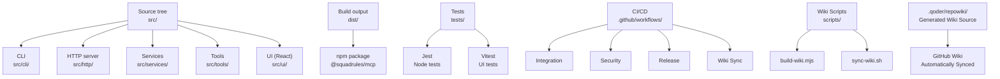
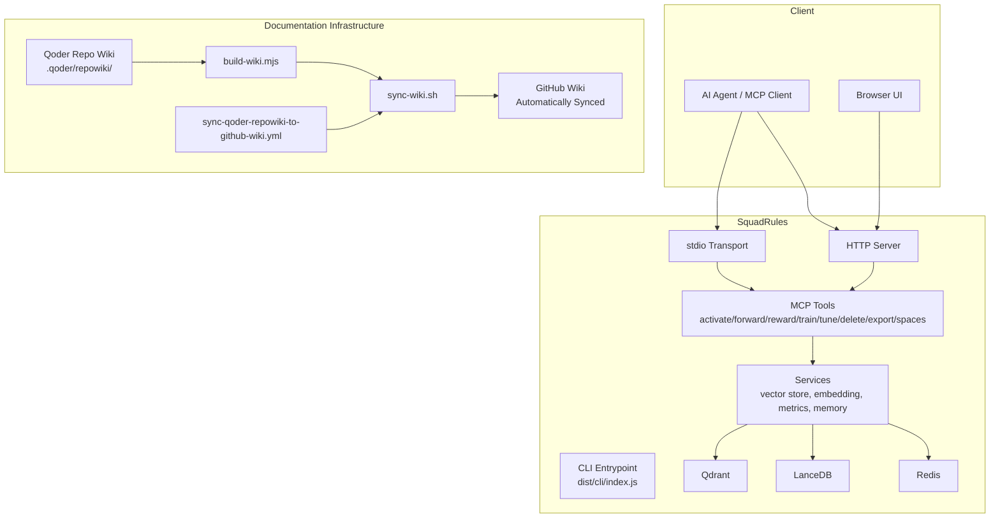
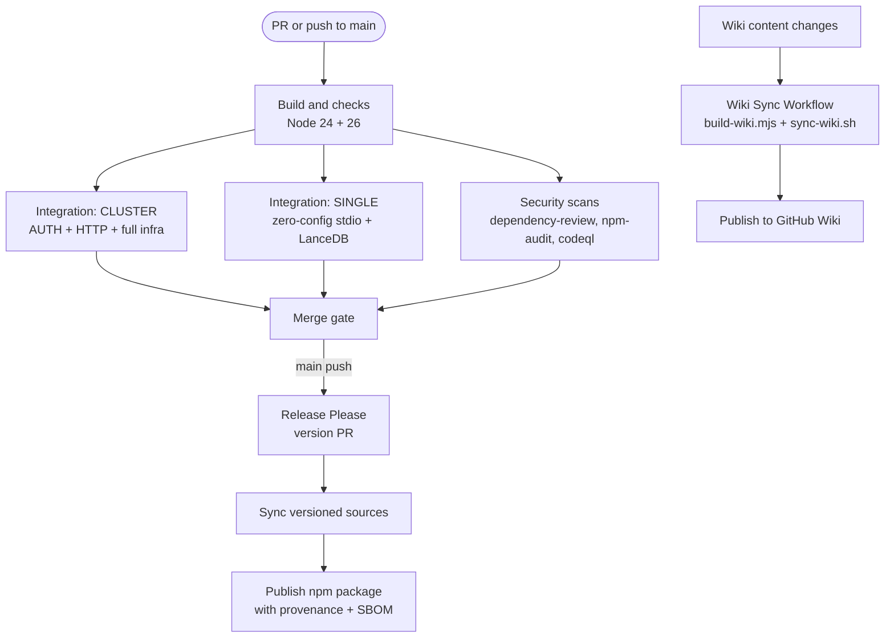
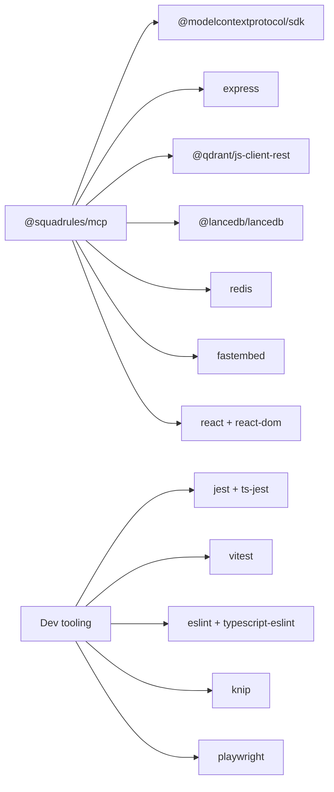

# Development Guide

<cite>
**Referenced Files in This Document**
- [package.json](file://package.json)
- [README.md](file://README.md)
- [CONTRIBUTING.md](file://CONTRIBUTING.md)
- [.github/workflows/integration.yml](file://.github/workflows/integration.yml)
- [.github/workflows/release.yml](file://.github/workflows/release.yml)
- [.github/workflows/security.yml](file://.github/workflows/security.yml)
- [.github/workflows/sync-qoder-repowiki-to-github-wiki.yml](file://.github/workflows/sync-qoder-repowiki-to-github-wiki.yml)
- [scripts/build-wiki.mjs](file://scripts/build-wiki.mjs)
- [scripts/sync-wiki.sh](file://scripts/sync-wiki.sh)
- [scripts/setup-github-wiki-permissions.sh](file://scripts/setup-github-wiki-permissions.sh)
- [jest.config.js](file://jest.config.js)
- [vitest.config.ts](file://vitest.config.ts)
- [tsconfig.json](file://tsconfig.json)
</cite>

## Update Summary
**Changes Made**
- Added comprehensive documentation for automated wiki building and synchronization infrastructure
- Updated CI/CD pipeline section to include wiki sync workflow
- Enhanced documentation workflow section with wiki-specific guidance
- Added troubleshooting section for wiki-related issues
- Updated project structure to reflect wiki automation components

## Table of Contents
1. [Introduction](#introduction)
2. [Project Structure](#project-structure)
3. [Core Components](#core-components)
4. [Architecture Overview](#architecture-overview)
5. [Detailed Component Analysis](#detailed-component-analysis)
6. [Dependency Analysis](#dependency-analysis)
7. [Performance Considerations](#performance-considerations)
8. [Troubleshooting Guide](#troubleshooting-guide)
9. [Conclusion](#conclusion)
10. [Appendices](#appendices)

## Introduction
This guide explains how to develop, test, and release SquadRules. It covers local setup, build and linting, testing strategies, CI/CD pipelines, debugging and performance analysis, release and versioning procedures, code review expectations, contribution workflows, and common issues.

SquadRules is an agent-first MCP framework where AI agents are the primary users. The core flow is activate → forward → reward. Adapters provide deterministic, auditable task execution. Vector storage uses Qdrant (primary, remote-capable) and LanceDB (secondary, embedded). Authentication uses Keycloak with Google IdP for OAuth2/JWT. Skills under `.agents/skills/` are hand-authored routing logic. Documentation is split between curated content under `docs/` and auto-generated wiki content under `.qoder/repowiki/`, which is automatically synchronized to GitHub Wiki through dedicated workflows.

**Section sources**
- [README.md:1-66](file://README.md#L1-L66)
- [CONTRIBUTING.md:1-12](file://CONTRIBUTING.md#L1-L12)

## Project Structure
The repository is a TypeScript Node.js application with a React UI. The main entry points are:
- Server and CLI under `src/`, including HTTP server, stdio transport, CLI commands, services, tools, and UI assets.
- Build output goes to `dist/`.
- Tests use Jest for Node-side tests and Vitest for UI tests.
- CI/CD is defined under `.github/workflows/`.
- Wiki automation scripts under `scripts/` handle automated documentation building and synchronization.

**Diagram sources**
- [package.json:40-80](file://package.json#L40-L80)
- [tsconfig.json:1-53](file://tsconfig.json#L1-L53)
- [.github/workflows/integration.yml:1-43](file://.github/workflows/integration.yml#L1-L43)
- [.github/workflows/security.yml:1-109](file://.github/workflows/security.yml#L1-L109)
- [.github/workflows/release.yml:1-313](file://.github/workflows/release.yml#L1-L313)
- [.github/workflows/sync-qoder-repowiki-to-github-wiki.yml:1-46](file://.github/workflows/sync-qoder-repowiki-to-github-wiki.yml#L1-L46)

**Section sources**
- [package.json:1-80](file://package.json#L1-L80)
- [tsconfig.json:1-53](file://tsconfig.json#L1-L53)

## Core Components
- Runtime modes: stdio (default for MCP clients) and HTTP (for browser UI and external integrations).
- Storage backends: Qdrant for vector search and metadata; LanceDB as embedded alternative. Redis is used for sessions and rate limiting.
- Authentication: Keycloak + Google IdP via OAuth2/JWT.
- Tools: activate, forward, train, reward, tune, delete, export, spaces.
- UI: React-based interface served by the HTTP server.
- Wiki Automation: Automated documentation building and synchronization from Qoder Repo Wiki to GitHub Wiki.

Local development requires Node.js 24 or newer. Install dependencies with `npm ci`, then run checks and builds using scripts defined in `package.json`.

**Section sources**
- [package.json:160-161](file://package.json#L160-L161)
- [package.json:40-80](file://package.json#L40-L80)
- [CONTRIBUTING.md:39-87](file://CONTRIBUTING.md#L39-L87)

## Architecture Overview
The system exposes MCP tools through either stdio or HTTP. The HTTP mode serves both API endpoints and the React UI. Services encapsulate vector stores, embeddings, metrics, and memory abstractions. The documentation infrastructure includes automated wiki building that transforms Qoder Repo Wiki content into navigable GitHub Wiki pages.

**Diagram sources**
- [package.json:30-34](file://package.json#L30-L34)
- [.github/workflows/integration.yml:50-53](file://.github/workflows/integration.yml#L50-L53)
- [.github/workflows/integration.yml:236-248](file://.github/workflows/integration.yml#L236-L248)
- [.github/workflows/sync-qoder-repowiki-to-github-wiki.yml:24-45](file://.github/workflows/sync-qoder-repowiki-to-github-wiki.yml#L24-L45)
- [scripts/build-wiki.mjs:1-338](file://scripts/build-wiki.mjs#L1-L338)
- [scripts/sync-wiki.sh:1-111](file://scripts/sync-wiki.sh#L1-L111)

## Detailed Component Analysis

### Local Development Setup
- Use Node.js 24 or newer.
- Install locked dependencies: `npm ci`.
- Run linters, type checks, and tests appropriate to your change.
- For documentation-only edits, run markdown and docs link checks.
- Some tests require external services; follow the Integration workflow's guidance before running service-backed tests.

Recommended validation sequence:
- `npm run lint`
- `npm run typecheck`
- `npm run test:spec-parity`
- `npm run test:ui`
- `npm run build:tgz`
- `npm run test:tgz`

For selected Jest tests: `npm test -- <test-path>`.

**Section sources**
- [CONTRIBUTING.md:39-75](file://CONTRIBUTING.md#L39-L75)
- [package.json:40-80](file://package.json#L40-L80)

### Build Process
- Full build compiles TypeScript and the React UI, then ensures the CLI is executable.
- Prebuild steps clean `dist/`, verify source cleanliness, sync skill versions, and embed documentation.
- UI build uses Vite; TypeScript compilation targets ES2022 with NodeNext module resolution.

Key scripts:
- `npm run build`
- `npm run ui:build`
- `npm run typecheck`

TypeScript configuration enforces strict typing, source maps, declarations, and incremental builds.

**Section sources**
- [package.json:46-47](file://package.json#L46-L47)
- [package.json:72-80](file://package.json#L72-L80)
- [tsconfig.json:1-53](file://tsconfig.json#L1-L53)

### Testing Strategy
- Unit and integration tests use Jest with ESM support and ts-jest.
- UI tests use Vitest with jsdom and React plugin.
- Coverage thresholds default to 99% across branches, functions, lines, and statements; set `STRICT_COVERAGE=true` for 100%.
- Global setup handles environment loading and optional auth stack lifecycle.
- Test sequencing ensures dependent suites run in the correct order.

Jest configuration highlights:
- ESM preset and ts-jest transform.
- Module name mappers for uuid stubs.
- Coverage collection and reporters.
- Global setup/teardown for auth-enabled runs.

Vitest configuration highlights:
- React plugin and alias for UI imports.
- jsdom environment.
- GitHub Actions reporter in CI.

**Section sources**
- [jest.config.js:1-74](file://jest.config.js#L1-L74)
- [vitest.config.ts:1-25](file://vitest.config.ts#L1-L25)

### Linting and Code Quality
- ESLint for JavaScript/TypeScript.
- Markdown linting for documentation.
- Custom doc-link checker.
- Skill validator via Python script.
- Mermaid diagram validation for docs.
- Dependency dead-code detection via knip.

Scripts:
- `npm run lint`
- `npm run lint:fix`
- `npm run lint:markdown`
- `npm run lint:docs`
- `npm run lint:skills`
- `npm run lint:mermaid`
- `npm run knip`

**Section sources**
- [package.json:62-69](file://package.json#L62-L69)
- [CONTRIBUTING.md:77-90](file://CONTRIBUTING.md#L77-L90)

### CI/CD Pipeline
The repository defines four major CI workflows:

- Integration: Builds on Node 24 and 26, runs lint, typecheck, knip, spec parity, UI tests, package build, and tgz install test. Two integration lanes validate different runtime configurations:
  - CLUSTER: full-stack infra (Qdrant, Valkey, PostgreSQL, Keycloak), AUTH enabled, HTTP transport.
  - SINGLE: zero-config defaults (stdio, LanceDB, fastembed, no auth, no Redis).

- Security: dependency review on PRs, npm audit, and CodeQL SAST.

- Release: automated versioning via Release Please, synchronized versioned sources, auto-merge of release PR, and npm publication with provenance and SBOM attachment.

- Wiki Sync: automated synchronization of generated wiki content from Qoder Repo Wiki to GitHub Wiki, triggered by changes to wiki content, build scripts, or workflow definitions.

**Diagram sources**
- [.github/workflows/integration.yml:16-43](file://.github/workflows/integration.yml#L16-L43)
- [.github/workflows/integration.yml:50-53](file://.github/workflows/integration.yml#L50-L53)
- [.github/workflows/integration.yml:236-248](file://.github/workflows/integration.yml#L236-L248)
- [.github/workflows/security.yml:20-83](file://.github/workflows/security.yml#L20-L83)
- [.github/workflows/release.yml:21-66](file://.github/workflows/release.yml#L21-L66)
- [.github/workflows/release.yml:184-279](file://.github/workflows/release.yml#L184-L279)
- [.github/workflows/sync-qoder-repowiki-to-github-wiki.yml:24-45](file://.github/workflows/sync-qoder-repowiki-to-github-wiki.yml#L24-L45)

**Section sources**
- [.github/workflows/integration.yml:1-332](file://.github/workflows/integration.yml#L1-L332)
- [.github/workflows/security.yml:1-109](file://.github/workflows/security.yml#L1-L109)
- [.github/workflows/release.yml:1-313](file://.github/workflows/release.yml#L1-L313)
- [.github/workflows/sync-qoder-repowiki-to-github-wiki.yml:1-46](file://.github/workflows/sync-qoder-repowiki-to-github-wiki.yml#L1-L46)

### Debugging Techniques
- Use structured logging for server logs; do not write MCP messages to stdout.
- For HTTP mode, inspect health endpoint and server logs during integration tests.
- When running auth-enabled tests, ensure Keycloak realms and test users are configured as per the integration workflow.
- For stdio mode, capture MCP request/response payloads from the client side and avoid polluting stdout with non-MCP logs.

Practical tips:
- Verify environment variables and `.env` generation for fullstack scenarios.
- Use Playwright caches for browser-based authentication flows.
- Inspect generated logs and test reports when failures occur.

**Section sources**
- [CONTRIBUTING.md:77-81](file://CONTRIBUTING.md#L77-L81)
- [.github/workflows/integration.yml:157-198](file://.github/workflows/integration.yml#L157-L198)
- [.github/workflows/integration.yml:205-234](file://.github/workflows/integration.yml#L205-L234)

### Profiling and Performance Analysis
- Embedding initialization can be slow on cold runners due to model downloads and ONNX inference; caches are provided for fastembed models.
- Vector search and memory operations depend on Qdrant/LanceDB; monitor service health and latency.
- Metrics are exposed via dedicated middleware and registry modules; integrate with observability stacks as needed.
- Use CI caching for Docker images, Playwright browsers, and fastembed models to reduce cold-start times.

Recommendations:
- Profile embedding provider initialization and vector retrieval paths.
- Tune concurrency limits and batch sizes for training and export operations.
- Monitor Redis session and rate-limiting behavior under load.

**Section sources**
- [.github/workflows/integration.yml:244-248](file://.github/workflows/integration.yml#L244-L248)
- [.github/workflows/integration.yml:283-305](file://.github/workflows/integration.yml#L283-L305)

### Wiki Building and Synchronization
The documentation infrastructure includes automated wiki building and synchronization capabilities:

**Wiki Build Process:**
- `scripts/build-wiki.mjs` transforms Qoder Repo Wiki source tree into flat, navigable GitHub Wiki format
- Handles page naming collision resolution and hierarchical navigation generation
- Rewrites file:// references to clickable GitHub blob URLs
- Generates `_Sidebar.md` and `Home.md` for proper wiki navigation

**Wiki Sync Workflow:**
- `.github/workflows/sync-qoder-repowiki-to-github-wiki.yml` triggers on wiki content changes
- Uses `scripts/sync-wiki.sh` to build and synchronize wiki content
- Automatically commits and pushes changes to GitHub Wiki repository
- Supports both local development and CI environments

**Setup Requirements:**
- Repository must have wiki feature enabled
- GitHub Actions permissions must be set to read-write
- Initial wiki setup requires creating a Home page

**Section sources**
- [scripts/build-wiki.mjs:1-338](file://scripts/build-wiki.mjs#L1-L338)
- [scripts/sync-wiki.sh:1-111](file://scripts/sync-wiki.sh#L1-L111)
- [.github/workflows/sync-qoder-repowiki-to-github-wiki.yml:1-46](file://.github/workflows/sync-qoder-repowiki-to-github-wiki.yml#L1-L46)
- [scripts/setup-github-wiki-permissions.sh:1-60](file://scripts/setup-github-wiki-permissions.sh#L1-L60)

### Release Process and Versioning
- Releases are automated via Release Please. On pushes to main, it creates or updates a version PR. After merging, the workflow publishes the tagged release to npm.
- The release job verifies tag identity, builds the package, generates an SBOM, publishes with provenance, attaches artifacts to the GitHub Release, and polls npm for availability.
- Do not create ad hoc version bumps or tags; rely on the automated process.

Version synchronization:
- Skill and embedded document versions are synced via scripts invoked in prebuild and release verification.
- Use `npm run version:sync-skills` and `npm run version:check-skills` to keep skills aligned.

**Section sources**
- [CONTRIBUTING.md:92-108](file://CONTRIBUTING.md#L92-L108)
- [.github/workflows/release.yml:21-66](file://.github/workflows/release.yml#L21-L66)
- [.github/workflows/release.yml:184-313](file://.github/workflows/release.yml#L184-L313)
- [package.json:69-73](file://package.json#L69-L73)

### Code Review Guidelines and Contribution Workflow
- Follow the development constitution: agent ownership and autonomous execution govern product behavior.
- Keep tool schemas, embedded descriptions, returned instructions, and runtime validation consistent.
- Return concrete next steps and actionable errors; distinguish repairable errors from blockers.
- Use semantic retrieval for discovery and explicit links for known dependencies.
- Work on topic branches, keep changes focused, add regression coverage where behavior changes, and explain problem, resulting behavior, and validation in PR descriptions.
- Use Conventional Commit titles (`fix:`, `feat:`, `docs:`); mark breaking changes explicitly.
- Required merge gates: Integration workflow passed, Security workflow passed, Automation policy passed.

**Section sources**
- [CONTRIBUTING.md:12-37](file://CONTRIBUTING.md#L12-L37)
- [CONTRIBUTING.md:92-108](file://CONTRIBUTING.md#L92-L108)

### Adding New Features
Steps:
1. Create a feature branch.
2. Implement changes following TypeScript and ESLint rules.
3. Add unit or integration tests covering new behavior and failure paths.
4. Update documentation if user-facing behavior changes.
5. Run linters, type checks, and tests locally.
6. Open a PR with clear description and validation results.

Validation checklist:
- `npm run lint`
- `npm run typecheck`
- `npm run test:spec-parity`
- `npm run test:ui`
- `npm run build:tgz`
- `npm run test:tgz`

**Section sources**
- [CONTRIBUTING.md:39-75](file://CONTRIBUTING.md#L39-L75)
- [CONTRIBUTING.md:92-108](file://CONTRIBUTING.md#L92-L108)

### Writing Tests
- Place Node-side tests under `tests/` matching Jest patterns.
- Place UI tests under `tests/ui/` matching Vitest patterns.
- Use mocks and stubs as configured in Jest module mappers.
- For service-backed tests, follow the Integration lane's setup requirements.

Coverage:
- Default threshold is 99%; enable strict mode for 100% coverage.

**Section sources**
- [jest.config.js:12-20](file://jest.config.js#L12-L20)
- [jest.config.js:37-58](file://jest.config.js#L37-L58)
- [vitest.config.ts:17-23](file://vitest.config.ts#L17-L23)

### Documenting Changes
- Edit source documents before regenerating embedded output through the build.
- Keep adapter and skill versions aligned with `package.json`.
- Record significant architecture decisions in `docs/adr/`.
- Do not hand-edit generated wiki content under `.qoder/repowiki/`; it is automatically built and synchronized.
- Wiki content changes trigger automatic synchronization to GitHub Wiki through the dedicated workflow.

**Section sources**
- [CONTRIBUTING.md:77-90](file://CONTRIBUTING.md#L77-L90)

## Dependency Analysis
The project depends on MCP SDK, Express, Qdrant client, LanceDB, Redis, FastEmbed, React, and various utilities. Dev dependencies include Jest, Vitest, ESLint, TypeScript, Knip, and Playwright.

**Diagram sources**
- [package.json:82-158](file://package.json#L82-L158)

**Section sources**
- [package.json:82-158](file://package.json#L82-L158)

## Performance Considerations
- Embedding initialization cost: cold starts download models and run ONNX inference; leverage caches.
- Vector store selection: Qdrant for scalable search; LanceDB for embedded zero-config usage.
- Concurrency and batching: tune training and export operations to balance throughput and resource usage.
- Observability: use metrics middleware and registries to track latency, error rates, and resource consumption.

[No sources needed since this section provides general guidance]

## Troubleshooting Guide
Common issues and resolutions:
- Missing external services: Ensure Qdrant, Redis, PostgreSQL, and Keycloak are running for auth-enabled tests.
- Slow CI runs: Restore Docker image cache, Playwright browsers cache, and fastembed model cache.
- Test failures with auth: Configure Keycloak realms and test users before running integration tests.
- Lint or typecheck failures: Run fixers where applicable and re-run checks.
- Package installation issues: Rebuild and reinstall from tgz artifact as done in CI.

Wiki-related issues:
- Wiki sync workflow fails: Ensure wiki feature is enabled and GitHub Actions permissions are set to read-write using `scripts/setup-github-wiki-permissions.sh`.
- Wiki content not updating: Check that wiki content changes are committed to `.qoder/repowiki/en/content/` directory.
- Manual wiki setup required: Initialize wiki by visiting `/wiki` tab and creating a Home page before first sync.
- Permission errors: Run `gh auth login` and ensure admin access to repository for permission setup.

Operational tips:
- Inspect generated logs and test reports after failures.
- Validate environment variables and `.env` generation for fullstack scenarios.
- Confirm that MCP stdout remains free of non-MCP logs.

**Section sources**
- [.github/workflows/integration.yml:157-198](file://.github/workflows/integration.yml#L157-L198)
- [.github/workflows/integration.yml:205-234](file://.github/workflows/integration.yml#L205-L234)
- [CONTRIBUTING.md:77-81](file://CONTRIBUTING.md#L77-L81)
- [scripts/setup-github-wiki-permissions.sh:1-60](file://scripts/setup-github-wiki-permissions.sh#L1-L60)

## Conclusion
SquadRules provides a robust, agent-first MCP framework with clear development practices, comprehensive CI/CD, and automated releases. By following the local setup, build, testing, and linting guidelines, and adhering to the contribution and review standards, contributors can deliver high-quality changes efficiently. The CI pipeline validates builds across Node versions, security posture, and runtime configurations, while the release process ensures reproducible, provenanced npm publications. The enhanced documentation infrastructure automatically synchronizes wiki content from Qoder Repo Wiki to GitHub Wiki, ensuring documentation stays current and accessible.

[No sources needed since this section summarizes without analyzing specific files]

## Appendices

### Quick Commands Reference
- Install dependencies: `npm ci`
- Lint and fix: `npm run lint`, `npm run lint:fix`
- Type check: `npm run typecheck`
- Run tests: `npm test`, `npm run test:ui`
- Build: `npm run build`
- Package: `npm run build:tgz`, `npm run test:tgz`
- Docs checks: `npm run lint:markdown`, `npm run lint:docs`
- Wiki setup: `bash scripts/setup-github-wiki-permissions.sh`

**Section sources**
- [package.json:40-80](file://package.json#L40-L80)
- [CONTRIBUTING.md:39-75](file://CONTRIBUTING.md#L39-L75)
- [scripts/setup-github-wiki-permissions.sh:1-60](file://scripts/setup-github-wiki-permissions.sh#L1-L60)