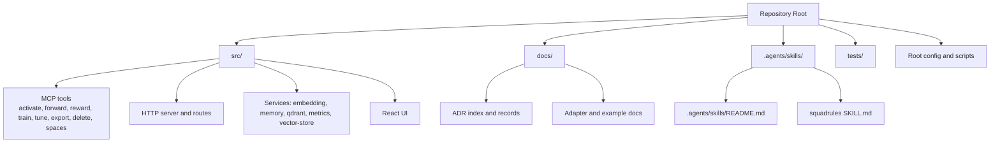
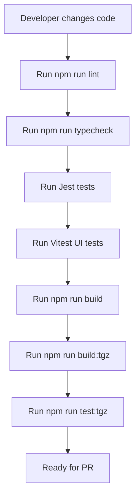
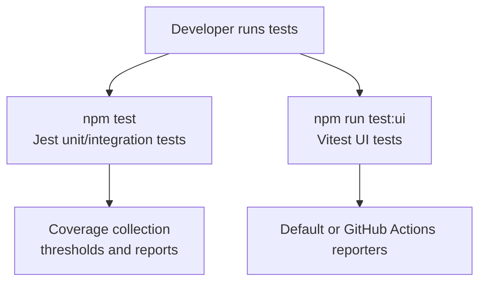
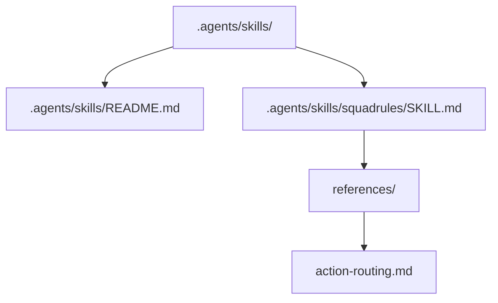
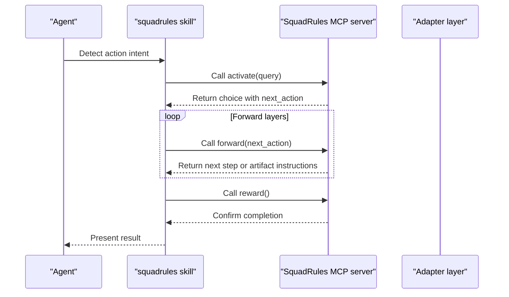
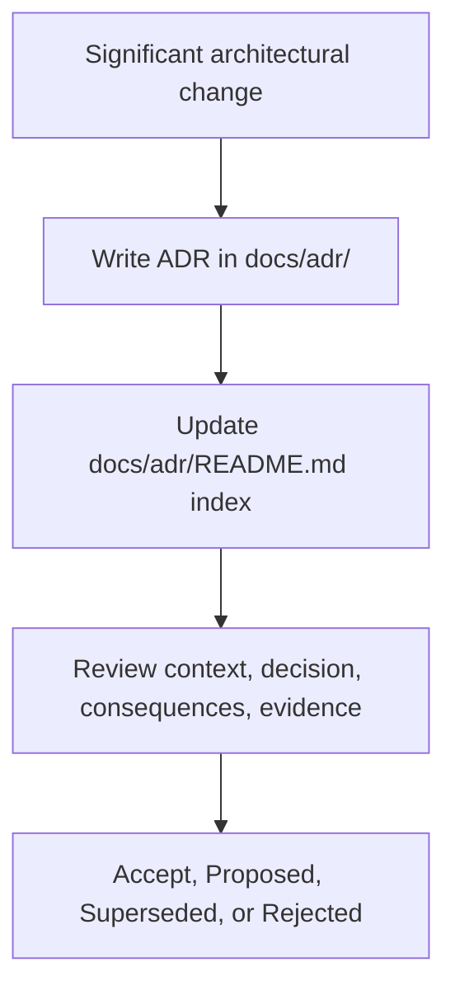

# Development Guide

<cite>
**Referenced Files in This Document**
- [package.json](file://package.json)
- [CONTRIBUTING.md](file://CONTRIBUTING.md)
- [jest.config.js](file://jest.config.js)
- [vitest.config.ts](file://vitest.config.ts)
- [eslint.config.cjs](file://eslint.config.cjs)
- [eslint/flat-config.cjs](file://eslint/flat-config.cjs)
- [.agents/skills/README.md](file://.agents/skills/README.md)
- [.agents/skills/squadrules/SKILL.md](file://.agents/skills/squadrules/SKILL.md)
- [.agents/skills/squadrules/references/action-routing.md](file://.agents/skills/squadrules/references/action-routing.md)
- [docs/adr/README.md](file://docs/adr/README.md)
- [docs/README.md](file://docs/README.md)
</cite>

## Table of Contents
1. [Introduction](#introduction)
2. [Project Structure](#project-structure)
3. [Development Environment Setup](#development-environment-setup)
4. [Coding Conventions and Code Quality](#coding-conventions-and-code-quality)
5. [Testing Framework](#testing-framework)
6. [Build Process](#build-process)
7. [Debugging Techniques](#debugging-techniques)
8. [Agent Skills System](#agent-skills-system)
9. [Hand-authored Routing Logic](#hand-authored-routing-logic)
10. [Architecture Decision Records](#architecture-decision-records)
11. [Contribution Guidelines](#contribution-guidelines)
12. [Code Review Processes](#code-review-processes)
13. [Release Procedures](#release-procedures)
14. [Troubleshooting Guide](#troubleshooting-guide)
15. [Conclusion](#conclusion)

## Introduction
SquadRules is an agent-first Model Context Protocol (MCP) framework where AI agents are the primary users and humans configure preferences through agents. The core workflow is `activate` → `forward` → `reward`. Adapters provide deterministic, auditable task execution, and agents must create or repair adapters when workflows change.

The system uses:
- Qdrant as the primary vector database for semantic search of rules and workflows.
- LanceDB as a secondary embedded vector store.
- Redis for sessions and rate limiting.
- Keycloak with Google IdP for OAuth2/JWT authentication.
- A hand-authored skills system under `.agents/skills/` that provides routing logic rather than auto-generated instructions.

This guide explains how to set up the development environment, follow coding conventions, run tests, build the project, debug issues, understand the agent skills system, and contribute changes following the repository’s review and release procedures.

## Project Structure
At a high level, the repository separates runtime source code, documentation, agent skills, configuration, and tooling:

- `src/`: TypeScript server, CLI, HTTP routes, MCP tools, services, UI assets, and utilities.
- `docs/`: Curated documentation, including architecture decision records, examples, security notes, and CLI reference.
- `.agents/skills/`: Hand-authored agent skills, including the canonical `squadrules` action router.
- `tests/`: Jest unit/integration tests and Vitest UI tests.
- Configuration and tooling files at the root, such as `package.json`, ESLint, Jest, Vitest, and lint scripts.

**Diagram sources**
- [package.json:30-79](file://package.json#L30-L79)
- [docs/README.md:1-33](file://docs/README.md#L1-L33)
- [.agents/skills/README.md:1-35](file://.agents/skills/README.md#L1-L35)

**Section sources**
- [package.json:1-79](file://package.json#L1-L79)
- [docs/README.md:1-33](file://docs/README.md#L1-L33)

## Development Environment Setup
Use Node.js 24 or newer and install locked dependencies before running any commands. The integration workflow defines supported environments and validation steps. Docker Compose is required only for authenticated HTTP integration lanes; it is not required for the default local runtime.

Recommended setup steps:
1. Install dependencies with `npm ci`.
2. Run linters, type checks, spec parity tests, UI tests, and package verification according to your change scope.
3. For documentation-only edits, run markdown and doc-link checks first.
4. For service-backed tests, follow the relevant integration lane setup before running those tests.

Key commands from the project:
- `npm ci` — install locked dependencies.
- `npm run lint` — ESLint, skill lint, markdown lint, and doc-link lint.
- `npm run typecheck` — TypeScript checks for application and UI.
- `npm run test:spec-parity` — Jest-based spec parity tests.
- `npm run test:ui` — Vitest-based UI tests.
- `npm run build:tgz` — build tarball for packaging.
- `npm run test:tgz` — verify the built package.

**Section sources**
- [CONTRIBUTING.md:39-75](file://CONTRIBUTING.md#L39-L75)
- [package.json:40-79](file://package.json#L40-L79)

## Coding Conventions and Code Quality
The project enforces consistent code quality through ESLint, markdownlint, custom rule plugins, and strict configuration boundaries.

### Linting and Rules
- ESLint is configured through a thin entry file that delegates to a flat configuration.
- Custom plugins enforce:
  - Forbidden SquadRules text patterns.
  - CodeQL line comment integrity.
  - MCP Apps widget handshake and HTML shell safety.
- Inline `eslint-disable` comments are generally disabled except in explicitly allowed directories.
- Markdown files are scanned for forbidden strings and protocol wording warnings.
- Shell scripts and JSON/YAML files have specific ignore or stub-parser rules so they are not treated as TypeScript.

Important ESLint behaviors:
- Backend source disallows `console` logging.
- Test mocks (`jest.mock` / `vi.mock`) are restricted outside unit tests.
- Frontend and backend have separate TypeScript project configurations.
- Max-line limits apply broadly, with targeted exceptions for large generated or intentionally large files.

### Documentation Linting
- Markdown style is enforced by `markdownlint-cli2`.
- Doc-link checking runs through a dedicated script.
- Agent skills have their own validator command.

### Source Style
- Use TypeScript and ESM-style relative imports.
- Use the structured logger for server logs.
- Reserve stdio stdout for MCP messages.
- Keep adapter and skill versions aligned with `package.json`.

**Diagram sources**
- [package.json:40-79](file://package.json#L40-L79)
- [CONTRIBUTING.md:53-75](file://CONTRIBUTING.md#L53-L75)

**Section sources**
- [eslint.config.cjs:1-18](file://eslint.config.cjs#L1-L18)
- [eslint/flat-config.cjs:1-122](file://eslint/flat-config.cjs#L1-L122)
- [eslint/flat-config.cjs:124-181](file://eslint/flat-config.cjs#L124-L181)
- [eslint/flat-config.cjs:183-287](file://eslint/flat-config.cjs#L183-L287)
- [eslint/flat-config.cjs:289-415](file://eslint/flat-config.cjs#L289-L415)
- [eslint/flat-config.cjs:417-573](file://eslint/flat-config.cjs#L417-L573)
- [CONTRIBUTING.md:77-87](file://CONTRIBUTING.md#L77-L87)

## Testing Framework
The repository uses two testing frameworks with different scopes:

- **Jest**: Used for unit and integration tests, including spec parity and service-backed flows.
- **Vitest**: Used for UI tests against the React frontend.

### Jest Configuration
Jest runs against TypeScript using `ts-jest` with ESM support. It scans `src/` and `tests/`, excludes UI and load tests, and applies coverage thresholds. When `STRICT_COVERAGE=true`, it requires near-perfect coverage; otherwise, it targets 99%.

Key behaviors:
- Test discovery matches `.test.ts`, `.test.js`, `.spec.ts`, and `.spec.js`.
- Coverage is collected from `src/**/*.{ts,tsx}` excluding declaration files and test directories.
- Global setup can start Keycloak and the server when authentication is enabled.
- A custom test sequencer ensures certain tests run before others.

### Vitest Configuration
Vitest runs UI tests in a JSDOM environment with React plugin support. It aliases `@` to `src/ui`, includes UI test files under `tests/ui/`, and reports differently in CI versus local runs.

**Diagram sources**
- [jest.config.js:1-74](file://jest.config.js#L1-L74)
- [vitest.config.ts:1-25](file://vitest.config.ts#L1-L25)

**Section sources**
- [package.json:42-57](file://package.json#L42-L57)
- [jest.config.js:1-74](file://jest.config.js#L1-L74)
- [vitest.config.ts:1-25](file://vitest.config.ts#L1-L25)

## Build Process
The build process compiles both the backend and the React UI, then prepares the CLI entry point.

Main build flow:
1. Clean the `dist/` directory.
2. Verify clean source state.
3. Sync skill versions.
4. Embed documentation artifacts.
5. Build the UI with Vite.
6. Compile TypeScript.
7. Make the CLI executable.

Relevant scripts:
- `npm run build` — full build.
- `npm run ui:build` — UI build only.
- `npm run prebuild` — cleanup, verification, version sync, and embed-doc generation.
- `npm run typecheck` — TypeScript checks without emitting output.

**Section sources**
- [package.json:40-79](file://package.json#L40-L79)

## Debugging Techniques
For local development:
- Use the Node development script to run the compiled CLI during development.
- Use the structured logger for server-side diagnostics instead of raw console output.
- For authentication-related flows, enable the authentication-enabled test setup, which starts Keycloak and the server and writes a test auth environment file.
- For UI debugging, use the Vitest UI test runner and the React development tooling provided by Vite.

Operational hints:
- If MCP tool calls fail due to id resolution or authentication, verify the host MCP endpoint, allowed tools, and credentials.
- If the SquadRules MCP server is unavailable or unauthenticated, treat it as a critical error and stop routing until remediation occurs.

**Section sources**
- [package.json:44-45](file://package.json#L44-L45)
- [CONTRIBUTING.md:77-81](file://CONTRIBUTING.md#L77-L81)
- [.agents/skills/squadrules/references/action-routing.md:193-212](file://.agents/skills/squadrules/references/action-routing.md#L193-L212)

## Agent Skills System
Agent skills live under `.agents/skills/`. The repository ships one discoverable skill: `squadrules`. This skill is the canonical action router for end users and agents.

Key points:
- Agent hosts load repo-scoped skills from `.agents/` and user-scoped skills from `~/.agents/`.
- The `skills` CLI discovers this directory, enabling installation via `npx skills add jakub-plichcinski/squadrules-mcp`.
- The `SKILL.md` file is the concise router; deeper content lives under `references/`.
- Links out of a skill must be absolute GitHub URLs because skills can be installed on machines without this repository.
- Skill links are validated with `npm run lint:skills`.

**Diagram sources**
- [.agents/skills/README.md:1-35](file://.agents/skills/README.md#L1-L35)
- [.agents/skills/squadrules/SKILL.md:1-20](file://.agents/skills/squadrules/SKILL.md#L1-L20)
- [.agents/skills/squadrules/references/action-routing.md:1-28](file://.agents/skills/squadrules/references/action-routing.md#L1-L28)

**Section sources**
- [.agents/skills/README.md:1-35](file://.agents/skills/README.md#L1-L35)
- [.agents/skills/squadrules/SKILL.md:1-20](file://.agents/skills/squadrules/SKILL.md#L1-L20)

## Hand-authored Routing Logic
The `squadrules` skill defines hand-authored routing logic for the `activate` → `forward` → `reward` chain. Agents should detect action intents, call `activate`, follow `next_action` through `forward` layers, obtain adapter artifacts when needed, and finalize with `reward`.

Routing principles:
- Echo verbatim server-generated URIs, nonces, hashes, IDs, `must_obey`, and `next_action`.
- Do not skip, reorder, or merge adapter layers.
- Treat proof types (`user_input`, `forward`, `shell`, `subagent`, `comment`) as execution directives.
- Obtain scripts through `export` or `linked_artifacts[].materialize` before running them.
- Complete the full chain before responding to the user or starting substantive work.
- If no matching adapter exists, inform the user and offer to create one via `train`.

**Diagram sources**
- [.agents/skills/squadrules/SKILL.md:22-53](file://.agents/skills/squadrules/SKILL.md#L22-L53)
- [.agents/skills/squadrules/references/action-routing.md:19-50](file://.agents/skills/squadrules/references/action-routing.md#L19-L50)

**Section sources**
- [.agents/skills/squadrules/SKILL.md:22-53](file://.agents/skills/squadrules/SKILL.md#L22-L53)
- [.agents/skills/squadrules/references/action-routing.md:19-68](file://.agents/skills/squadrules/references/action-routing.md#L19-L68)

## Architecture Decision Records
Architecture decisions are recorded under `docs/adr/`. Each ADR captures context, decision, consequences, and evidence. The index tracks status and revisit conditions.

Guidelines:
- One decision per file.
- Never rewrite history in an accepted ADR; supersede it with a new record.
- ADRs own the “why”; code and workflows own the “what”.
- Every ADR names an issue that can reopen it.
- The index follows current behavior even when a record’s Status line needs reconciliation.

**Diagram sources**
- [docs/adr/README.md:1-28](file://docs/adr/README.md#L1-L28)
- [docs/adr/README.md:29-74](file://docs/adr/README.md#L29-L74)

**Section sources**
- [docs/adr/README.md:1-74](file://docs/adr/README.md#L1-L74)
- [docs/README.md:10-17](file://docs/README.md#L10-L17)

## Contribution Guidelines
Contributions should align with the development constitution and prioritize agent ownership and autonomous execution. Changes should make it clear what the next action is and how completion is recognized.

Key expectations:
- Keep interface contracts consistent across published tool schemas, embedded descriptions, returned instructions, and runtime validation.
- Return concrete next steps and actionable errors.
- Use semantic retrieval for discovery and explicit links for known dependencies.
- Check ordinary tasks and failure paths, including missing adapters, changed preferences, unavailable dependencies, interrupted execution, and failing linked workflows.
- Use Node.js 24+, install dependencies with `npm ci`, and run appropriate checks.
- Edit source documents before regenerating embedded output.
- Align adapter and skill versions with `package.json`.

**Section sources**
- [CONTRIBUTING.md:1-18](file://CONTRIBUTING.md#L1-L18)
- [CONTRIBUTING.md:20-37](file://CONTRIBUTING.md#L20-L37)
- [CONTRIBUTING.md:39-87](file://CONTRIBUTING.md#L39-L87)

## Code Review Processes
Pull requests should be focused, include regression coverage where behavior changes, and explain the problem, resulting behavior, and validation. Use Conventional Commit titles and mark breaking changes explicitly.

Required gates:
- `Automation policy passed` and `CI gate passed` are required on every PR.
- `CI gate passed` routes validation by what the PR changes.
- Documentation-only PRs receive documentation checks inside the gate itself.
- Application-path PRs pass only once `Integration workflow passed` and `Security workflow passed` have completed successfully for the PR head commit.

**Section sources**
- [CONTRIBUTING.md:92-112](file://CONTRIBUTING.md#L92-L112)

## Release Procedures
Releases are automated through Release Please:
1. A version PR is prepared by the release workflow.
2. After merging, the workflow publishes the tagged release to npm.
3. Do not create ad hoc version bumps or release tags as part of an ordinary change.
4. Container and chart releases belong to sibling repositories.

Version synchronization:
- Use `npm run version:sync-skills` to align skill versions with `package.json`.
- Use `npm run version:check-skills` to validate alignment.

**Section sources**
- [CONTRIBUTING.md:108-112](file://CONTRIBUTING.md#L108-L112)
- [package.json:67-69](file://package.json#L67-L69)

## Troubleshooting Guide
Common development and operational issues:

| Area | Symptom | Guidance |
|---|---|---|
| Dependencies | Missing or incompatible packages | Run `npm ci` with Node.js 24+. |
| Linting | ESLint or markdown failures | Run `npm run lint`, `npm run lint:markdown`, and `npm run lint:skills`. |
| Type errors | TypeScript check failures | Run `npm run typecheck`. |
| Tests | Service-backed tests fail locally | Follow the relevant integration lane setup before running those tests. |
| Authentication | MCP auth fails | Enable the authentication-enabled test setup and verify Keycloak, server, and token configuration. |
| MCP availability | Server unreachable or unauthenticated | Treat as a critical error; verify endpoint, health check, allowed tools, and credentials. |
| Skills | Skill link or format validation fails | Run `npm run lint:skills` and ensure absolute external links. |
| Releases | Unexpected version or tag | Use Release Please; do not bump versions manually. |

**Section sources**
- [CONTRIBUTING.md:39-75](file://CONTRIBUTING.md#L39-L75)
- [.agents/skills/squadrules/references/action-routing.md:193-212](file://.agents/skills/squadrules/references/action-routing.md#L193-L212)

## Conclusion
SquadRules combines an agent-first workflow with deterministic adapter execution, semantic search, and strong code quality standards. Contributors should:
- Set up Node.js 24+ and install dependencies with `npm ci`.
- Follow ESLint, markdown, and skill linting rules.
- Use Jest for unit/integration tests and Vitest for UI tests.
- Build with `npm run build`, which compiles the UI and backend.
- Route actions through the hand-authored `squadrules` skill using `activate` → `forward` → `reward`.
- Record significant architectural decisions in ADRs.
- Submit focused pull requests that satisfy required CI gates.
- Use Release Please for releases and avoid manual version bumps.