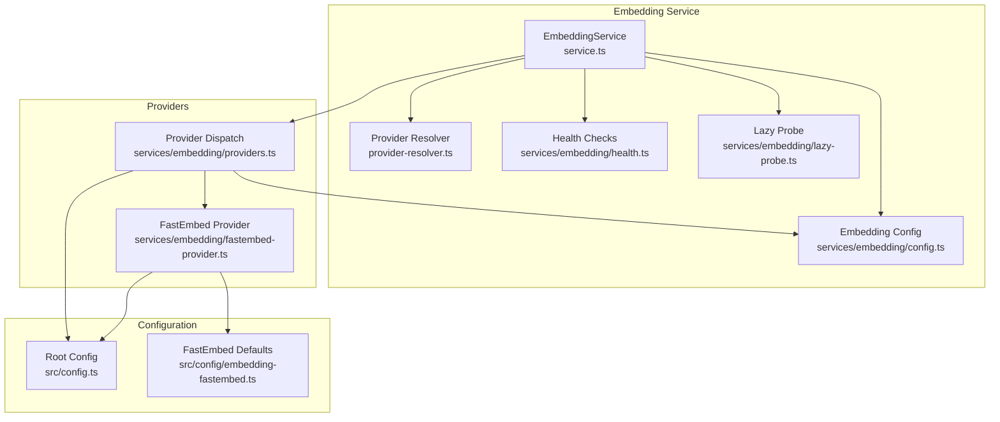
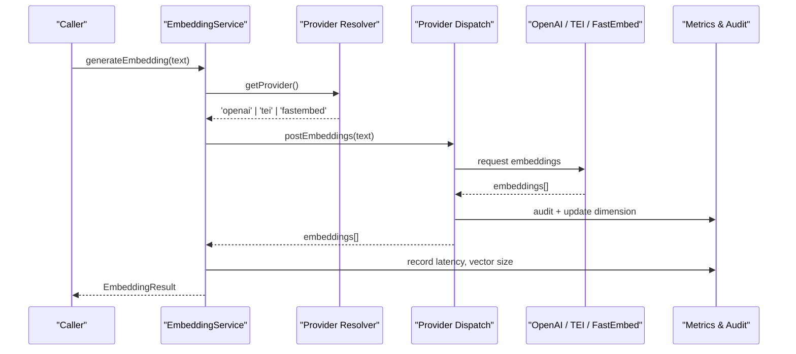
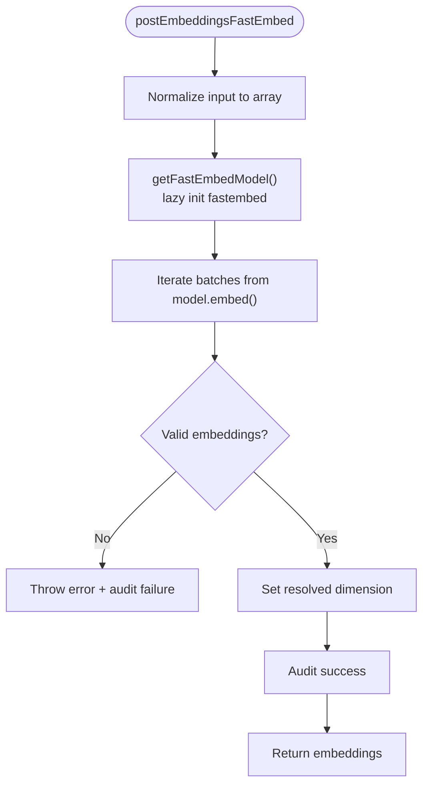
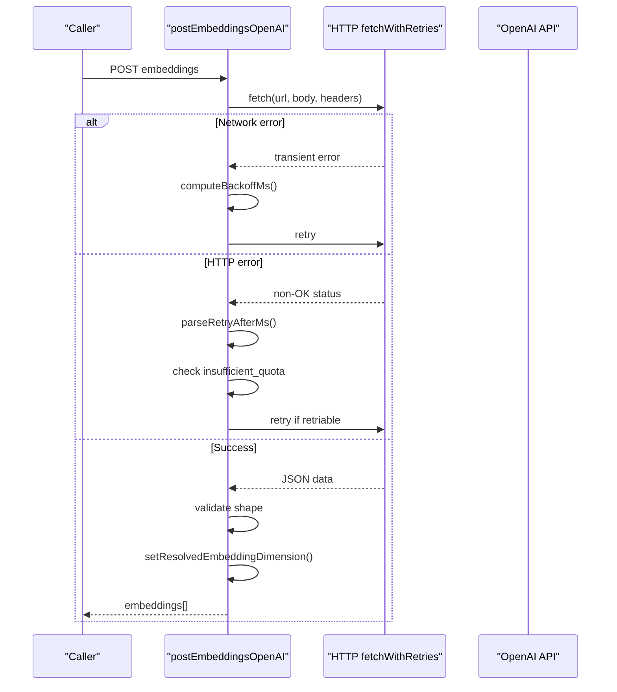
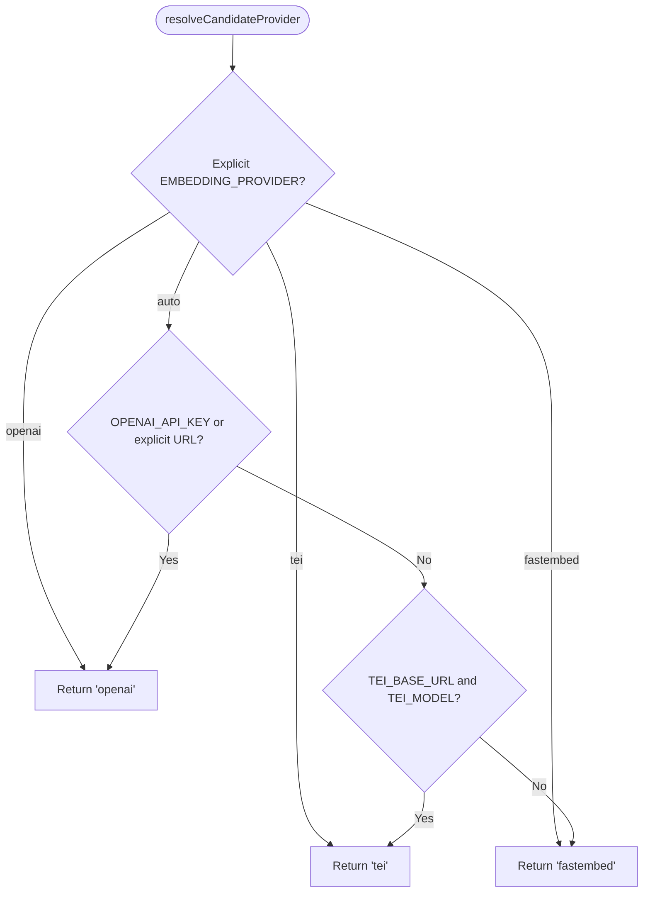
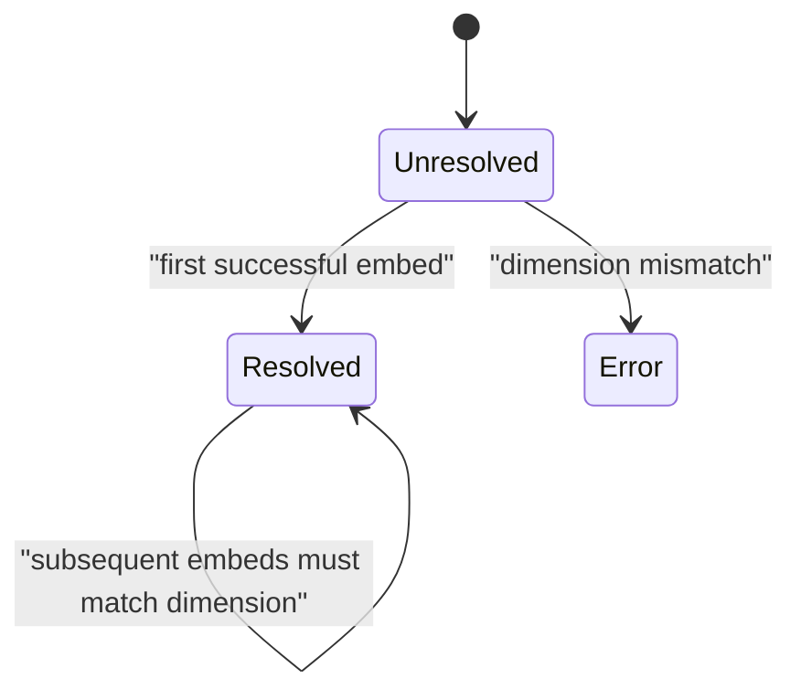
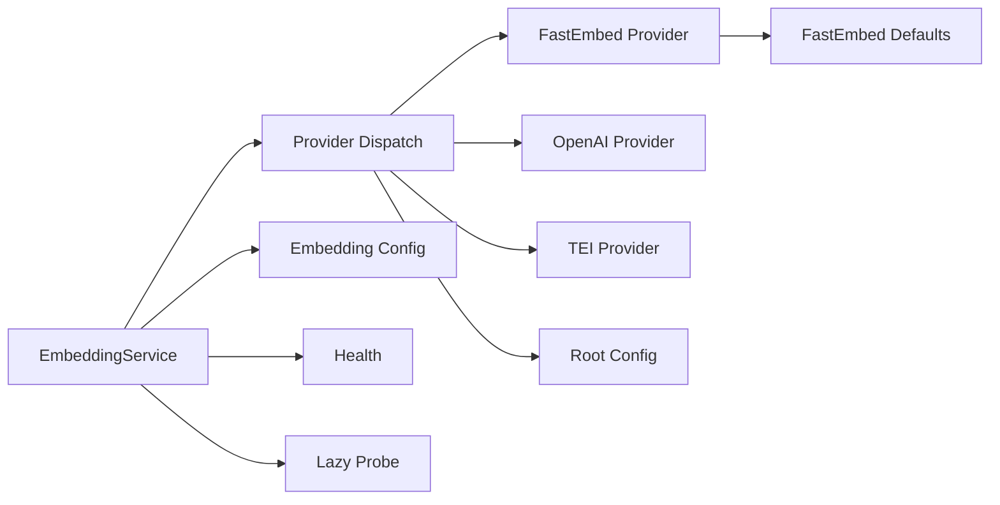

# Built-in Providers

<cite>
**Referenced Files in This Document**
- [fastembed-provider.ts](file://src/services/embedding/fastembed-provider.ts)
- [providers.ts](file://src/services/embedding/providers.ts)
- [config.ts](file://src/services/embedding/config.ts)
- [service.ts](file://src/services/embedding/service.ts)
- [health.ts](file://src/services/embedding/health.ts)
- [lazy-probe.ts](file://src/services/embedding/lazy-probe.ts)
- [provider-resolver.ts](file://src/services/embedding/provider-resolver.ts)
- [embedding-fastembed.ts](file://src/config/embedding-fastembed.ts)
- [config.ts](file://src/config.ts)
</cite>

## Table of Contents
1. [Introduction](#introduction)
2. [Project Structure](#project-structure)
3. [Core Components](#core-components)
4. [Architecture Overview](#architecture-overview)
5. [Detailed Component Analysis](#detailed-component-analysis)
6. [Dependency Analysis](#dependency-analysis)
7. [Performance Considerations](#performance-considerations)
8. [Troubleshooting Guide](#troubleshooting-guide)
9. [Conclusion](#conclusion)
10. [Appendices](#appendices)

## Introduction
This document explains the built-in embedding providers used by the application: FastEmbed (local ONNX inference), OpenAI (cloud embeddings API), and TEI (Text Embeddings Inference, self-hosted). It covers provider selection, configuration, environment variables, model loading, memory management, rate limiting, cost tracking, deployment considerations, usage patterns, performance characteristics, versioning, caching, and migration between models.

The embedding system is designed so that a single `EmbeddingService` exposes a stable interface while routing requests to one of three backends. Provider selection can be explicit or automatic, with sensible defaults for local development and production deployments.

## Project Structure
The embedding subsystem lives under `src/services/embedding`. The most important files are:

- `fastembed-provider.ts`: Local FastEmbed ONNX provider implementation.
- `providers.ts`: Unified provider dispatch, retry/backoff, rate-limit handling, and OpenAI/TEI implementations.
- `config.ts`: Runtime dimension cache and endpoint construction.
- `service.ts`: Public service class, metrics, audit, health, and dimension probing.
- `health.ts`: Health checks per provider.
- `lazy-probe.ts`: Memoized dimension probe for eager or lazy startup.
- `provider-resolver.ts`: Candidate provider resolution and successful provider tracking.
- `embedding-fastembed.ts`: FastEmbed-specific defaults and cache directory.
- `config.ts` (root): Environment variable definitions for all providers.

**Diagram sources**
- [service.ts:39-275](file://src/services/embedding/service.ts#L39-L275)
- [providers.ts:1-343](file://src/services/embedding/providers.ts#L1-L343)
- [fastembed-provider.ts:1-83](file://src/services/embedding/fastembed-provider.ts#L1-L83)
- [config.ts:1-40](file://src/services/embedding/config.ts#L1-L40)
- [health.ts:1-123](file://src/services/embedding/health.ts#L1-L123)
- [lazy-probe.ts:1-28](file://src/services/embedding/lazy-probe.ts#L1-L28)
- [provider-resolver.ts:1-82](file://src/services/embedding/provider-resolver.ts#L1-L82)
- [embedding-fastembed.ts:1-23](file://src/config/embedding-fastembed.ts#L1-L23)
- [config.ts:70-93](file://src/config.ts#L70-L93)

**Section sources**
- [service.ts:39-275](file://src/services/embedding/service.ts#L39-L275)
- [providers.ts:1-343](file://src/services/embedding/providers.ts#L1-L343)
- [fastembed-provider.ts:1-83](file://src/services/embedding/fastembed-provider.ts#L1-L83)
- [config.ts:1-40](file://src/services/embedding/config.ts#L1-L40)
- [health.ts:1-123](file://src/services/embedding/health.ts#L1-L123)
- [lazy-probe.ts:1-28](file://src/services/embedding/lazy-probe.ts#L1-L28)
- [provider-resolver.ts:1-82](file://src/services/embedding/provider-resolver.ts#L1-L82)
- [embedding-fastembed.ts:1-23](file://src/config/embedding-fastembed.ts#L1-L23)
- [config.ts:70-93](file://src/config.ts#L70-L93)

## Core Components
- EmbeddingService: Public API for generating single and batch embeddings, cosine similarity, health checks, and configuration inspection. It also tracks metrics and audit events and enforces embedding dimension consistency.
- Provider dispatch: Centralizes retries, backoff, rate-limit detection, and provider selection logic.
- FastEmbed provider: Local ONNX-based embedding generation using FastEmbed, with lazy SDK import and shared model cache.
- OpenAI provider: Cloud embeddings via OpenAI-compatible endpoints, with authentication, retry/backoff, and quota handling.
- TEI provider: Self-hosted embeddings via Text Embeddings Inference, with flexible response parsing and deprecation warning.
- Configuration: Resolves endpoints, dimensions, and environment-driven behavior.
- Health and probing: Startup probes ensure the correct embedding dimension is resolved before vector store initialization.

**Section sources**
- [service.ts:39-275](file://src/services/embedding/service.ts#L39-L275)
- [providers.ts:1-343](file://src/services/embedding/providers.ts#L1-L343)
- [fastembed-provider.ts:1-83](file://src/services/embedding/fastembed-provider.ts#L1-L83)
- [config.ts:1-40](file://src/services/embedding/config.ts#L1-L40)
- [health.ts:1-123](file://src/services/embedding/health.ts#L1-L123)
- [lazy-probe.ts:1-28](file://src/services/embedding/lazy-probe.ts#L1-L28)
- [provider-resolver.ts:1-82](file://src/services/embedding/provider-resolver.ts#L1-L82)

## Architecture Overview
The embedding pipeline starts at `EmbeddingService`, which selects a candidate provider based on environment configuration and then delegates to the provider dispatch layer. Each provider returns normalized embeddings and updates the resolved embedding dimension. Health checks and lazy probing ensure the system is ready before use.

**Diagram sources**
- [service.ts:48-127](file://src/services/embedding/service.ts#L48-L127)
- [provider-resolver.ts:28-46](file://src/services/embedding/provider-resolver.ts#L28-L46)
- [providers.ts:93-201](file://src/services/embedding/providers.ts#L93-L201)
- [providers.ts:203-295](file://src/services/embedding/providers.ts#L203-L295)
- [fastembed-provider.ts:41-82](file://src/services/embedding/fastembed-provider.ts#L41-L82)

## Detailed Component Analysis

### FastEmbed Provider (Local ONNX Models)
FastEmbed provides zero-dependency local embedding generation. The SDK is imported lazily so native ONNX/tokenizer bindings load only when FastEmbed is selected. Model weights are downloaded once into a shared cache directory and reused across runs.

Key behaviors:
- Lazy initialization: The FastEmbed SDK is dynamically imported and initialized once per process.
- Model cache: Uses `FASTEMBED_CACHE_DIR`; if empty, it falls back to a user-shared embedding models cache.
- Dimension resolution: Sets the resolved embedding dimension after the first successful call.
- Auditing: Logs success/failure with input count, character length, output dimension, and latency.

**Diagram sources**
- [fastembed-provider.ts:26-39](file://src/services/embedding/fastembed-provider.ts#L26-L39)
- [fastembed-provider.ts:41-82](file://src/services/embedding/fastembed-provider.ts#L41-L82)

Configuration and environment:
- `FASTEMBED_MODEL`: FastEmbed model enum value (not a HuggingFace repo id). Default is a small English model with 384 dimensions.
- `FASTEMBED_CACHE_DIR`: Directory where FastEmbed downloads and caches model weights. Defaults to a shared per-user cache directory.

Deployment considerations:
- First run may download model weights; subsequent runs reuse cached weights.
- Native bindings load only when FastEmbed is selected, avoiding unnecessary overhead.
- Suitable for local development, offline environments, or when cloud APIs are not desired.

Usage pattern:
- Select explicitly via `EMBEDDING_PROVIDER=fastembed`, or rely on auto-selection when no external provider is configured.
- Use `EmbeddingService.generateEmbedding()` or `generateBatchEmbeddings()`; FastEmbed will be chosen automatically if configured.

**Section sources**
- [fastembed-provider.ts:1-83](file://src/services/embedding/fastembed-provider.ts#L1-L83)
- [embedding-fastembed.ts:1-23](file://src/config/embedding-fastembed.ts#L1-L23)
- [config.ts:76-79](file://src/config.ts#L76-L79)

### OpenAI Provider Integration
The OpenAI provider calls an OpenAI-compatible embeddings endpoint. It supports both the official OpenAI API and custom endpoints when `OPENAI_API_URL` is explicitly overridden.

Key behaviors:
- Authentication: Requires `OPENAI_API_KEY` unless `OPENAI_API_URL` is explicitly overridden.
- Endpoint: Built from `OPENAI_API_URL` plus `/v1/embeddings`.
- Retry policy: Exponential backoff with full jitter, honoring `Retry-After` headers, capped by a wall-clock budget.
- Rate limiting: Detects 429 responses; non-retriable quota errors fail fast; retriable limits respect retry headers and budgets.
- Dimension resolution: Sets resolved embedding dimension from the first successful response.
- Auditing: Records provider, model, status, input size, output dimension, latency, and HTTP status.

**Diagram sources**
- [providers.ts:93-201](file://src/services/embedding/providers.ts#L93-L201)
- [providers.ts:76-92](file://src/services/embedding/providers.ts#L76-L92)
- [providers.ts:30-64](file://src/services/embedding/providers.ts#L30-L64)

Configuration and environment:
- `OPENAI_EMBEDDING_MODEL`: Required for OpenAI provider. Default is `text-embedding-3-small`.
- `OPENAI_API_URL`: Base URL for OpenAI API; default is the official endpoint. If explicitly overridden, keyless requests are allowed.
- `OPENAI_API_KEY`: Bearer token for authentication.
- `EMBEDDING_MAX_RETRIES`, `EMBEDDING_RETRY_BASE_DELAY_MS`, `EMBEDDING_RETRY_MAX_DELAY_MS`, `EMBEDDING_RETRY_AFTER_CAP_MS`, `EMBEDDING_RETRY_BUDGET_MS`: Control retry behavior.

Rate limiting and cost tracking:
- Rate limiting: 429 responses trigger retries respecting `Retry-After` headers and budget. Non-retriable quota errors (`insufficient_quota`) fail fast with a typed error.
- Cost tracking: The current service returns zero tokens in usage fields; cost estimation is a placeholder method returning zero. To add real cost tracking, integrate provider usage metadata and billing rates.

Migration and versioning:
- Change `OPENAI_EMBEDDING_MODEL` to switch models. Ensure downstream stores accept the new dimension; the system validates dimension consistency.
- When switching models, consider re-indexing vector stores if dimensions change.

**Section sources**
- [providers.ts:93-201](file://src/services/embedding/providers.ts#L93-L201)
- [config.ts:70-75](file://src/config.ts#L70-L75)
- [config.ts:87-93](file://src/config.ts#L87-L93)
- [service.ts:250-253](file://src/services/embedding/service.ts#L250-L253)

### TEI Provider Setup (Self-Hosted Embeddings)
The TEI provider targets Text Embeddings Inference servers. It is marked deprecated but remains supported as a transitional fallback.

Key behaviors:
- Endpoint: Uses `TEI_BASE_URL` plus `/v1/embeddings`, or an explicit `TEI_EMBEDDING_ENDPOINT`.
- Authentication: Optional `x-api-key` header via `TEI_API_KEY`.
- Response parsing: Supports multiple shapes (`embeddings`, `data`, `result`, or raw arrays).
- Retry policy: Same retry/backoff and budget logic as OpenAI.
- Deprecation warning: Emits a one-time warning when TEI is used.

Configuration and environment:
- `TEI_BASE_URL`: Base URL for the TEI server.
- `TEI_MODEL`: Model name sent in requests.
- `TEI_API_KEY`: Optional API key for authenticated TEI servers.

Deployment considerations:
- Ensure the TEI server exposes a compatible embeddings endpoint.
- Health checks probe the endpoint and validate response shape.
- Prefer OpenAI or FastEmbed for new deployments due to TEI deprecation.

**Section sources**
- [providers.ts:203-295](file://src/services/embedding/providers.ts#L203-L295)
- [config.ts:80-83](file://src/config.ts#L80-L83)
- [config.ts:7-10](file://src/services/embedding/config.ts#L7-L10)
- [health.ts:35-80](file://src/services/embedding/health.ts#L35-L80)

### Provider Selection and Resolution
Provider selection follows explicit preference first, then auto-detection:
- Explicit: `EMBEDDING_PROVIDER=openai|tei|fastembed`.
- Auto: Prefers OpenAI if `OPENAI_API_KEY` or explicitly overridden `OPENAI_API_URL` is present; otherwise TEI if configured; otherwise FastEmbed.

Successful provider tracking records the actual provider, model, and dimension after the first successful embedding call.

**Diagram sources**
- [provider-resolver.ts:28-46](file://src/services/embedding/provider-resolver.ts#L28-L46)

**Section sources**
- [provider-resolver.ts:1-82](file://src/services/embedding/provider-resolver.ts#L1-L82)
- [providers.ts:296-333](file://src/services/embedding/providers.ts#L296-L333)

### Dimension Resolution and Probing
The system resolves and caches the embedding dimension from the first successful provider response. A startup probe ensures the dimension is known before vector store initialization.

- `setResolvedEmbeddingDimension(dim)`: Sets and validates dimension consistency.
- `getResolvedEmbeddingDimension()`: Throws if not yet resolved.
- `probeEmbeddingDimension()`: Runs a minimal embed to resolve dimension.
- `ensureEmbeddingDimension()`: Memoized lazy probe for CLI/local backend deferral.

**Diagram sources**
- [config.ts:12-31](file://src/services/embedding/config.ts#L12-L31)
- [service.ts:280-284](file://src/services/embedding/service.ts#L280-L284)
- [lazy-probe.ts:12-27](file://src/services/embedding/lazy-probe.ts#L12-L27)

**Section sources**
- [config.ts:12-31](file://src/services/embedding/config.ts#L12-L31)
- [service.ts:280-284](file://src/services/embedding/service.ts#L280-L284)
- [lazy-probe.ts:1-28](file://src/services/embedding/lazy-probe.ts#L1-L28)

## Dependency Analysis
The embedding subsystem has clear boundaries:
- `EmbeddingService` depends on provider dispatch, configuration, metrics, audit, and health modules.
- Provider dispatch depends on root configuration and implements retry/backoff logic.
- FastEmbed provider depends on FastEmbed SDK and FastEmbed defaults.
- OpenAI and TEI providers depend on HTTP fetch and configuration.

**Diagram sources**
- [service.ts:39-275](file://src/services/embedding/service.ts#L39-L275)
- [providers.ts:1-343](file://src/services/embedding/providers.ts#L1-L343)
- [fastembed-provider.ts:1-83](file://src/services/embedding/fastembed-provider.ts#L1-L83)
- [embedding-fastembed.ts:1-23](file://src/config/embedding-fastembed.ts#L1-L23)
- [config.ts:70-93](file://src/config.ts#L70-L93)

**Section sources**
- [service.ts:39-275](file://src/services/embedding/service.ts#L39-L275)
- [providers.ts:1-343](file://src/services/embedding/providers.ts#L1-L343)
- [fastembed-provider.ts:1-83](file://src/services/embedding/fastembed-provider.ts#L1-L83)
- [embedding-fastembed.ts:1-23](file://src/config/embedding-fastembed.ts#L1-L23)
- [config.ts:70-93](file://src/config.ts#L70-L93)

## Performance Considerations
- FastEmbed:
  - Zero network latency after model load; CPU-bound ONNX inference.
  - First run downloads model weights; subsequent runs reuse cache.
  - Native bindings load lazily to avoid startup overhead when not selected.
  - Batch processing via iterator reduces memory pressure.
- OpenAI:
  - Network latency dominates; retry/backoff mitigates transient failures.
  - Rate limiting handled with exponential backoff and `Retry-After` support.
  - Cost tracking is currently a placeholder; integrate billing rates for real costs.
- TEI:
  - Similar to OpenAI but self-hosted; latency depends on server capacity.
  - Deprecated; prefer OpenAI or FastEmbed for new deployments.

Optimization recommendations:
- Use FastEmbed for local development and offline scenarios.
- Tune retry parameters (`EMBEDDING_MAX_RETRIES`, delays, budget) based on network conditions.
- Monitor embedding latency and vector sizes via metrics.
- Pre-warm the embedding dimension at startup to avoid runtime probes.

[No sources needed since this section provides general guidance]

## Troubleshooting Guide
Common issues and resolutions:

- FastEmbed fails to initialize:
  - Cause: Network hiccup during model download or missing cache directory permissions.
  - Resolution: Ensure `FASTEMBED_CACHE_DIR` is writable; retry after network recovery.
  - Evidence: Lazy init clears memo on failure to allow retry.

- OpenAI authentication failed:
  - Cause: Missing or invalid `OPENAI_API_KEY`.
  - Resolution: Set `OPENAI_API_KEY`; verify endpoint if using custom `OPENAI_API_URL`.
  - Evidence: 401 errors are surfaced with actionable messages.

- OpenAI rate limited:
  - Cause: Quota exceeded or throttling.
  - Resolution: For `insufficient_quota`, add billing/quota; for transient 429, rely on retry/backoff.
  - Evidence: Typed `EmbeddingRateLimitError` distinguishes non-retriable quota vs retriable limits.

- TEI authentication failed:
  - Cause: Missing or invalid `TEI_API_KEY`.
  - Resolution: Set `TEI_API_KEY`; verify `TEI_BASE_URL` and endpoint compatibility.
  - Evidence: 401 errors are surfaced; health check reports auth failures.

- Embedding dimension mismatch:
  - Cause: Switching models without re-indexing vector stores.
  - Resolution: Ensure consistent model/dimension across services; re-index if necessary.
  - Evidence: Dimension validation throws on mismatch.

- Health check unhealthy:
  - Cause: Provider misconfiguration or unreachable endpoint.
  - Resolution: Verify environment variables and endpoint reachability; inspect health messages.
  - Evidence: Health checks return detailed messages per provider.

**Section sources**
- [fastembed-provider.ts:26-39](file://src/services/embedding/fastembed-provider.ts#L26-L39)
- [providers.ts:147-172](file://src/services/embedding/providers.ts#L147-L172)
- [providers.ts:250-261](file://src/services/embedding/providers.ts#L250-L261)
- [config.ts:16-31](file://src/services/embedding/config.ts#L16-L31)
- [health.ts:17-33](file://src/services/embedding/health.ts#L17-L33)
- [health.ts:35-80](file://src/services/embedding/health.ts#L35-L80)

## Conclusion
The embedding subsystem provides flexible, robust integration with FastEmbed, OpenAI, and TEI. FastEmbed offers local, zero-dependency inference with lazy model loading and shared caching. OpenAI integrates with robust retry/backoff and rate-limit handling, while TEI supports self-hosted deployments with deprecation warnings. Provider selection is explicit or automatic, dimension consistency is enforced, and health checks aid operational visibility. For production, prefer OpenAI or FastEmbed, tune retry parameters, monitor metrics, and plan model migrations carefully to avoid dimension mismatches.

[No sources needed since this section summarizes without analyzing specific files]

## Appendices

### Environment Variables Reference
- `EMBEDDING_PROVIDER`: `'auto' | 'openai' | 'tei' | 'fastembed'`
- `OPENAI_EMBEDDING_MODEL`: OpenAI model name (default `text-embedding-3-small`)
- `OPENAI_API_URL`: OpenAI base URL (default official endpoint); explicit override allows keyless requests
- `OPENAI_API_KEY`: OpenAI bearer token
- `TEI_BASE_URL`: TEI server base URL
- `TEI_MODEL`: TEI model name
- `TEI_API_KEY`: TEI API key
- `FASTEMBED_MODEL`: FastEmbed model enum value
- `FASTEMBED_CACHE_DIR`: FastEmbed model cache directory
- `EMBEDDING_MAX_RETRIES`: Maximum retry attempts
- `EMBEDDING_RETRY_BASE_DELAY_MS`: Base delay for exponential backoff
- `EMBEDDING_RETRY_MAX_DELAY_MS`: Max delay cap for backoff
- `EMBEDDING_RETRY_AFTER_CAP_MS`: Cap for `Retry-After` header
- `EMBEDDING_RETRY_BUDGET_MS`: Wall-clock budget for retries

**Section sources**
- [config.ts:70-93](file://src/config.ts#L70-L93)
- [embedding-fastembed.ts:14-22](file://src/config/embedding-fastembed.ts#L14-L22)

### Usage Patterns
- Local development:
  - Set `EMBEDDING_PROVIDER=fastembed` or leave auto; ensure `FASTEMBED_MODEL` and `FASTEMBED_CACHE_DIR` are acceptable.
- Cloud embeddings:
  - Set `OPENAI_API_KEY` and optionally `OPENAI_EMBEDDING_MODEL`; use auto or explicit `openai`.
- Self-hosted embeddings:
  - Set `TEI_BASE_URL` and `TEI_MODEL`; use auto or explicit `tei`.

**Section sources**
- [providers.ts:296-333](file://src/services/embedding/providers.ts#L296-L333)
- [service.ts:259-275](file://src/services/embedding/service.ts#L259-L275)