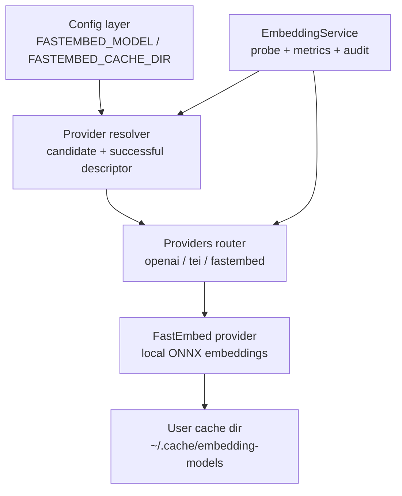
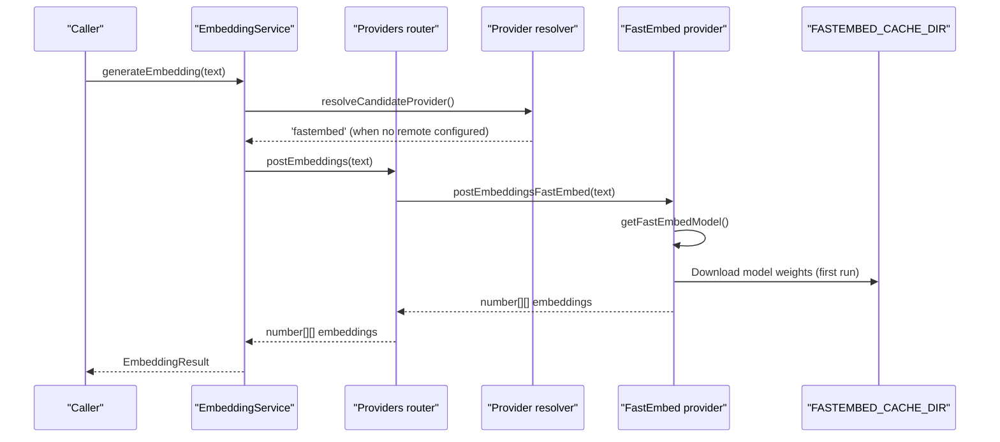
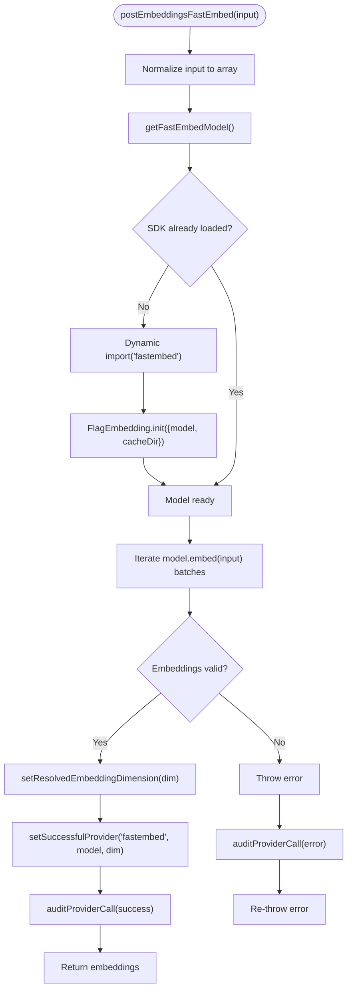
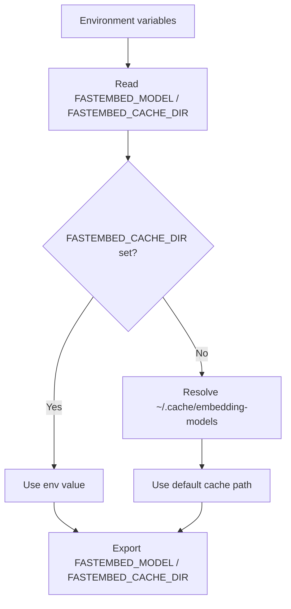
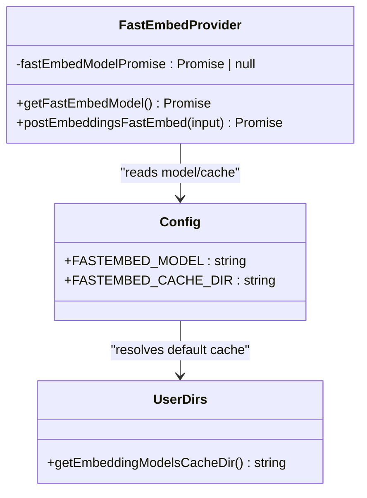
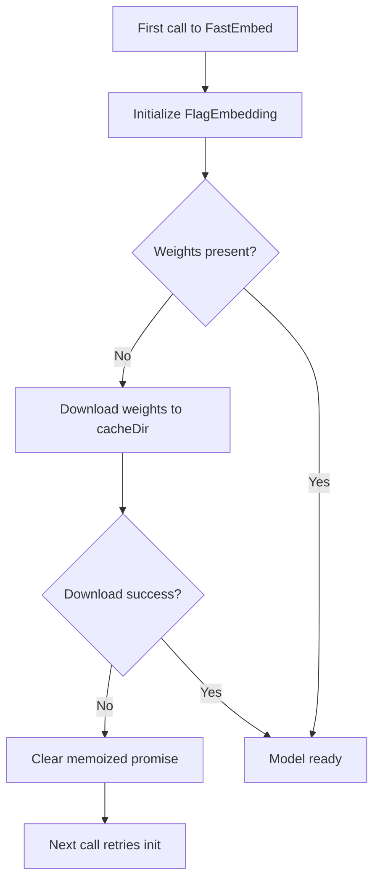
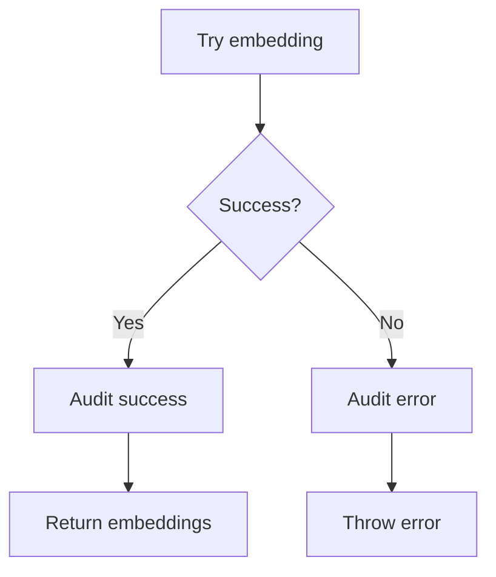
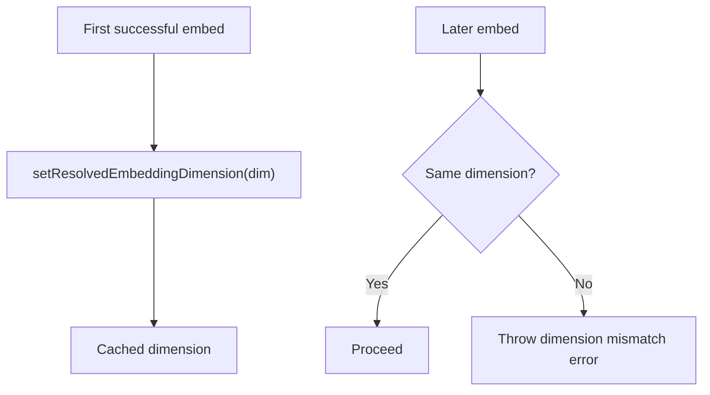
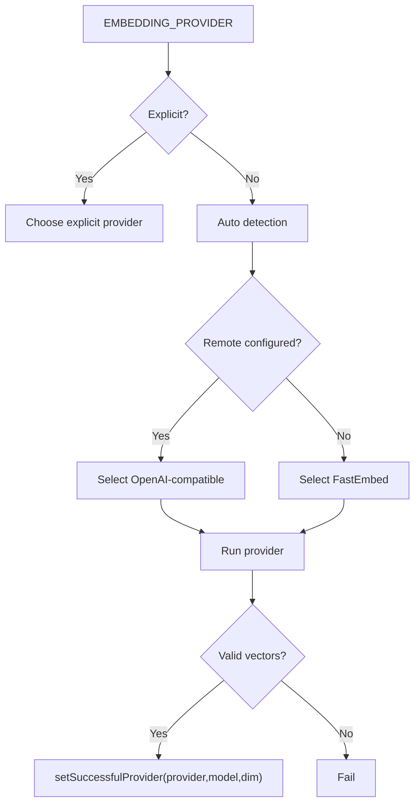
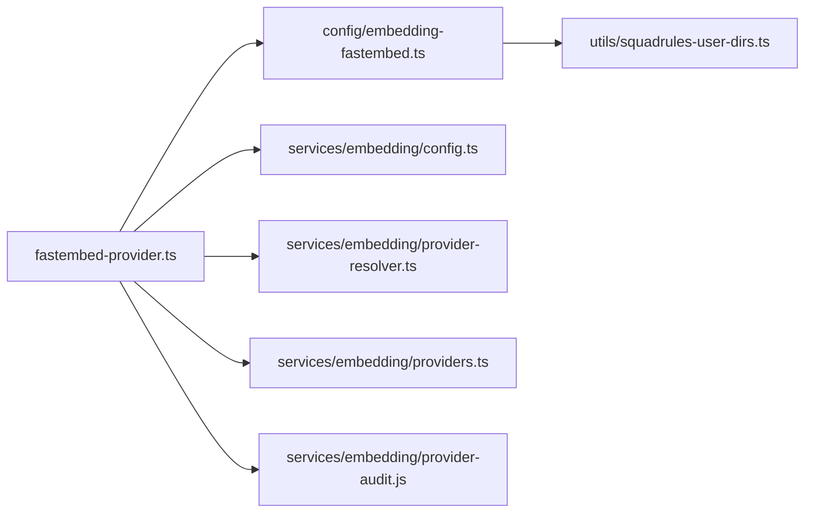

# FastEmbed Provider

<cite>
**Referenced Files in This Document**
- [fastembed-provider.ts](file://src/services/embedding/fastembed-provider.ts)
- [embedding-fastembed.ts](file://src/config/embedding-fastembed.ts)
- [squadrules-user-dirs.ts](file://src/utils/squadrules-user-dirs.ts)
- [config.ts](file://src/config.ts)
- [providers.ts](file://src/services/embedding/providers.ts)
- [service.ts](file://src/services/embedding/service.ts)
- [provider-resolver.ts](file://src/services/embedding/provider-resolver.ts)
- [config.ts (embedding config)](file://src/services/embedding/config.ts)
- [0004-fastembed-default-for-testing.md](file://docs/adr/0004-fastembed-default-for-testing.md)
- [0021-embedding-provider-auto-resolution-and-store-width-binding.md](file://docs/adr/0021-embedding-provider-auto-resolution-and-store-width-binding.md)
</cite>

## Table of Contents
1. [Introduction](#introduction)
2. [Project Structure](#project-structure)
3. [Core Components](#core-components)
4. [Architecture Overview](#architecture-overview)
5. [Detailed Component Analysis](#detailed-component-analysis)
6. [Dependency Analysis](#dependency-analysis)
7. [Performance Considerations](#performance-considerations)
8. [Troubleshooting Guide](#troubleshooting-guide)
9. [Conclusion](#conclusion)

## Introduction
The FastEmbed provider is the local, zero-dependency embedding path for SquadRules MCP. It generates embeddings in-process using ONNX models through the FastEmbed SDK, without requiring an API key or external inference service. Model weights are downloaded once on first use into a shared cache directory and reused across processes. The implementation uses lazy initialization to avoid loading native ONNX bindings unless FastEmbed is selected, and it integrates with the broader embedding provider resolution so that local embeddings become the default when no remote provider is configured.

This document explains how FastEmbed works, how configuration controls model selection and caching, how downloads and errors are handled, and how memory and performance behave in practice.

## Project Structure
FastEmbed-related code is split between configuration, provider implementation, provider resolution, and user-directory utilities:

- Configuration defaults and environment variables live under `src/config/embedding-fastembed.ts` and are re-exported from `src/config.ts`.
- The FastEmbed provider implementation lives in `src/services/embedding/fastembed-provider.ts`.
- User-level cache directories are resolved by `src/utils/squadrules-user-dirs.ts`.
- Provider selection and successful-provider tracking live in `src/services/embedding/provider-resolver.ts` and `src/services/embedding/providers.ts`.
- Embedding dimension management is centralized in `src/services/embedding/config.ts`.
- High-level embedding orchestration and startup probing are in `src/services/embedding/service.ts`.
- Architectural decisions around auto-selection and store width binding are documented in ADRs under `docs/adr/`.

**Diagram sources**
- [embedding-fastembed.ts:14-22](file://src/config/embedding-fastembed.ts#L14-L22)
- [provider-resolver.ts:28-46](file://src/services/embedding/provider-resolver.ts#L28-L46)
- [providers.ts:296-333](file://src/services/embedding/providers.ts#L296-L333)
- [fastembed-provider.ts:26-39](file://src/services/embedding/fastembed-provider.ts#L26-L39)
- [squadrules-user-dirs.ts:63-75](file://src/utils/squadrules-user-dirs.ts#L63-L75)
- [service.ts:280-284](file://src/services/embedding/service.ts#L280-L284)

**Section sources**
- [embedding-fastembed.ts:1-22](file://src/config/embedding-fastembed.ts#L1-L22)
- [config.ts:76-79](file://src/config.ts#L76-L79)
- [fastembed-provider.ts:1-19](file://src/services/embedding/fastembed-provider.ts#L1-L19)
- [squadrules-user-dirs.ts:63-75](file://src/utils/squadrules-user-dirs.ts#L63-L75)
- [provider-resolver.ts:1-16](file://src/services/embedding/provider-resolver.ts#L1-L16)
- [providers.ts:296-333](file://src/services/embedding/providers.ts#L296-L333)
- [service.ts:280-284](file://src/services/embedding/service.ts#L280-L284)

## Core Components
- FastEmbed provider module: Implements lazy initialization, model download via FastEmbed’s downloader, batch embedding iteration, dimension detection, successful-provider registration, and audit logging.
- Configuration module: Defines `FASTEMBED_MODEL` and `FASTEMBED_CACHE_DIR`, including default model name and default cache directory resolution.
- User directory utility: Computes platform-appropriate cache paths for embedding models.
- Provider resolver: Determines candidate provider based on explicit preference and environment; records successful provider after a valid response.
- Providers router: Routes requests to OpenAI, TEI, or FastEmbed; includes retry/backoff logic for network providers and calls FastEmbed when selected.
- Embedding service: Exposes high-level APIs, probes embedding dimension at startup, tracks metrics and audit events, and exposes health checks.

Key responsibilities:
- Local embedding generation without API keys.
- Lazy loading of ONNX/native bindings.
- First-run model download into a shared cache directory.
- Single process-wide embedding dimension validation.
- Integration with provider selection and successful-provider tracking.

**Section sources**
- [fastembed-provider.ts:17-39](file://src/services/embedding/fastembed-provider.ts#L17-L39)
- [fastembed-provider.ts:41-82](file://src/services/embedding/fastembed-provider.ts#L41-L82)
- [embedding-fastembed.ts:14-22](file://src/config/embedding-fastembed.ts#L14-L22)
- [squadrules-user-dirs.ts:63-75](file://src/utils/squadrules-user-dirs.ts#L63-L75)
- [provider-resolver.ts:28-46](file://src/services/embedding/provider-resolver.ts#L28-L46)
- [providers.ts:296-333](file://src/services/embedding/providers.ts#L296-L333)
- [service.ts:39-128](file://src/services/embedding/service.ts#L39-L128)
- [service.ts:130-222](file://src/services/embedding/service.ts#L130-L222)
- [service.ts:280-284](file://src/services/embedding/service.ts#L280-L284)

## Architecture Overview
FastEmbed is one of three supported embedding backends. When no remote provider is explicitly configured, the system selects FastEmbed as the zero-config default. Once selected, FastEmbed lazily initializes the ONNX-backed model, downloads weights if missing, and returns embeddings locally.

**Diagram sources**
- [service.ts:48-128](file://src/services/embedding/service.ts#L48-L128)
- [provider-resolver.ts:28-46](file://src/services/embedding/provider-resolver.ts#L28-L46)
- [providers.ts:296-333](file://src/services/embedding/providers.ts#L296-L333)
- [fastembed-provider.ts:26-39](file://src/services/embedding/fastembed-provider.ts#L26-L39)
- [fastembed-provider.ts:41-67](file://src/services/embedding/fastembed-provider.ts#L41-L67)
- [embedding-fastembed.ts:14-22](file://src/config/embedding-fastembed.ts#L14-L22)

## Detailed Component Analysis

### FastEmbed Provider Implementation
The FastEmbed provider encapsulates:
- Lazy initialization of the FastEmbed SDK via dynamic import.
- Memoization of the initialized model promise to avoid repeated initialization.
- Automatic model weight download on first use into `FASTEMBED_CACHE_DIR`.
- Batch embedding iteration over the model stream.
- Validation that embeddings are returned and non-empty.
- Setting the resolved embedding dimension and recording the successful provider.
- Audit logging for success and error cases.

**Diagram sources**
- [fastembed-provider.ts:26-39](file://src/services/embedding/fastembed-provider.ts#L26-L39)
- [fastembed-provider.ts:41-82](file://src/services/embedding/fastembed-provider.ts#L41-L82)

**Section sources**
- [fastembed-provider.ts:17-39](file://src/services/embedding/fastembed-provider.ts#L17-L39)
- [fastembed-provider.ts:41-82](file://src/services/embedding/fastembed-provider.ts#L41-L82)

### Configuration Options: FASTEMBED_MODEL and FASTEMBED_CACHE_DIR
- `FASTEMBED_MODEL`: Selects the FastEmbed model identifier. Default is a small English BGE model suitable for local CPU inference.
- `FASTEMBED_CACHE_DIR`: Directory where FastEmbed stores model weights. If not set, it resolves to a user-shared cache directory (`~/.cache/embedding-models` on Unix-like systems, equivalent location on Windows).

These values are defined in the FastEmbed configuration module and re-exported from the central config module.

**Diagram sources**
- [embedding-fastembed.ts:14-22](file://src/config/embedding-fastembed.ts#L14-L22)
- [squadrules-user-dirs.ts:63-75](file://src/utils/squadrules-user-dirs.ts#L63-L75)
- [config.ts:76-79](file://src/config.ts#L76-L79)

**Section sources**
- [embedding-fastembed.ts:14-22](file://src/config/embedding-fastembed.ts#L14-L22)
- [squadrules-user-dirs.ts:63-75](file://src/utils/squadrules-user-dirs.ts#L63-L75)
- [config.ts:76-79](file://src/config.ts#L76-L79)

### Lazy Initialization and Model Caching
- Lazy initialization: The FastEmbed SDK is dynamically imported only when FastEmbed is selected. This avoids loading ONNX/tokenizers native bindings during unrelated operations.
- Memoized promise: The initialization promise is cached at module scope. Subsequent calls reuse the same promise.
- Failure reset: If initialization fails, the memo is cleared so transient failures (such as a network hiccup during first-run download) can be retried on the next call.
- Model caching: Model weights are downloaded once into `FASTEMBED_CACHE_DIR` and reused across processes.

**Diagram sources**
- [fastembed-provider.ts:17-39](file://src/services/embedding/fastembed-provider.ts#L17-L39)
- [embedding-fastembed.ts:14-22](file://src/config/embedding-fastembed.ts#L14-L22)
- [squadrules-user-dirs.ts:63-75](file://src/utils/squadrules-user-dirs.ts#L63-L75)

**Section sources**
- [fastembed-provider.ts:17-39](file://src/services/embedding/fastembed-provider.ts#L17-L39)
- [embedding-fastembed.ts:14-22](file://src/config/embedding-fastembed.ts#L14-L22)
- [squadrules-user-dirs.ts:63-75](file://src/utils/squadrules-user-dirs.ts#L63-L75)

### Automatic Model Downloading and Retry Behavior
- Automatic download: On first use, FastEmbed’s own downloader fetches model weights into `FASTEMBED_CACHE_DIR`.
- Retry mechanism: If initialization fails, the memoized promise is cleared, allowing subsequent calls to retry initialization. This handles transient network issues during first-run downloads.
- Network retries elsewhere: The broader embedding router implements retry/backoff for HTTP-based providers (OpenAI/TEI), but FastEmbed relies on its internal downloader plus the failed-init reset behavior.

**Diagram sources**
- [fastembed-provider.ts:26-39](file://src/services/embedding/fastembed-provider.ts#L26-L39)
- [embedding-fastembed.ts:17-22](file://src/config/embedding-fastembed.ts#L17-L22)

**Section sources**
- [fastembed-provider.ts:26-39](file://src/services/embedding/fastembed-provider.ts#L26-L39)
- [embedding-fastembed.ts:17-22](file://src/config/embedding-fastembed.ts#L17-L22)

### Error Handling and Audit Logging
- FastEmbed provider catches errors during embedding generation, logs them via audit, and re-throws the original error.
- Successful runs record provider, model, dimension, latency, and input size.
- Failed runs record similar metadata plus error message.

**Diagram sources**
- [fastembed-provider.ts:41-82](file://src/services/embedding/fastembed-provider.ts#L41-L82)

**Section sources**
- [fastembed-provider.ts:41-82](file://src/services/embedding/fastembed-provider.ts#L41-L82)

### Embedding Dimension Management
- The first successful embedding sets the process-wide embedding dimension.
- Subsequent calls assert consistency; mismatches throw an error.
- Startup probing ensures dimension is resolved before vector store usage.

**Diagram sources**
- [config.ts (embedding config):12-31](file://src/services/embedding/config.ts#L12-L31)
- [fastembed-provider.ts:54-56](file://src/services/embedding/fastembed-provider.ts#L54-L56)
- [service.ts:280-284](file://src/services/embedding/service.ts#L280-L284)

**Section sources**
- [config.ts (embedding config):12-31](file://src/services/embedding/config.ts#L12-L31)
- [fastembed-provider.ts:54-56](file://src/services/embedding/fastembed-provider.ts#L54-L56)
- [service.ts:280-284](file://src/services/embedding/service.ts#L280-L284)

### Provider Resolution and Successful Provider Tracking
- Candidate resolution: Explicit preference wins; otherwise, auto selects OpenAI-compatible endpoints if configured, else falls back to FastEmbed.
- Successful provider: After a provider returns valid vectors, the successful descriptor (provider, model, dimension) is recorded.
- FastEmbed integration: When FastEmbed succeeds, it records itself as the successful provider along with the model and dimension.

**Diagram sources**
- [provider-resolver.ts:28-46](file://src/services/embedding/provider-resolver.ts#L28-L46)
- [provider-resolver.ts:68-81](file://src/services/embedding/provider-resolver.ts#L68-L81)
- [providers.ts:296-333](file://src/services/embedding/providers.ts#L296-L333)
- [fastembed-provider.ts:54-56](file://src/services/embedding/fastembed-provider.ts#L54-L56)

**Section sources**
- [provider-resolver.ts:28-46](file://src/services/embedding/provider-resolver.ts#L28-L46)
- [provider-resolver.ts:68-81](file://src/services/embedding/provider-resolver.ts#L68-L81)
- [providers.ts:296-333](file://src/services/embedding/providers.ts#L296-L333)
- [fastembed-provider.ts:54-56](file://src/services/embedding/fastembed-provider.ts#L54-L56)

## Dependency Analysis
FastEmbed depends on:
- Configuration exports for model and cache directory.
- User directory utilities for default cache path resolution.
- Embedding dimension management for process-wide validation.
- Provider resolver and successful-provider tracking for integration with the broader embedding pipeline.
- Audit logging for observability.

**Diagram sources**
- [fastembed-provider.ts:11-15](file://src/services/embedding/fastembed-provider.ts#L11-L15)
- [embedding-fastembed.ts:14-22](file://src/config/embedding-fastembed.ts#L14-L22)
- [squadrules-user-dirs.ts:63-75](file://src/utils/squadrules-user-dirs.ts#L63-L75)
- [config.ts (embedding config):12-31](file://src/services/embedding/config.ts#L12-L31)
- [provider-resolver.ts:28-46](file://src/services/embedding/provider-resolver.ts#L28-L46)
- [providers.ts:296-333](file://src/services/embedding/providers.ts#L296-L333)

**Section sources**
- [fastembed-provider.ts:11-15](file://src/services/embedding/fastembed-provider.ts#L11-L15)
- [embedding-fastembed.ts:14-22](file://src/config/embedding-fastembed.ts#L14-L22)
- [squadrules-user-dirs.ts:63-75](file://src/utils/squadrules-user-dirs.ts#L63-L75)
- [config.ts (embedding config):12-31](file://src/services/embedding/config.ts#L12-L31)
- [provider-resolver.ts:28-46](file://src/services/embedding/provider-resolver.ts#L28-L46)
- [providers.ts:296-333](file://src/services/embedding/providers.ts#L296-L333)

## Performance Considerations
- Cold start cost: First run downloads model weights and loads ONNX/native bindings. CI measurements indicate significant cold boot time for embedded adapters, while warm boots are much faster.
- Memory usage: Model weights occupy substantial disk space and are cached per user/process. Vector data is held in memory during embedding generation; batch processing helps amortize overhead.
- CPU-bound inference: Local embeddings are CPU-bound; concurrency should be tuned to match available cores.
- Reuse benefits: Shared cache directory avoids duplicate downloads across processes.
- Optimization tips:
  - Pre-warm the model by invoking a probe embedding at startup.
  - Use batch embeddings to reduce per-call overhead.
  - Pin `FASTEMBED_CACHE_DIR` to a persistent, shared location to avoid re-downloads.
  - Avoid running inside Jest workers due to native binding constraints; spawn child processes for integration tests.

**Section sources**
- [0004-fastembed-default-for-testing.md:67-86](file://docs/adr/0004-fastembed-default-for-testing.md#L67-L86)
- [service.ts:280-284](file://src/services/embedding/service.ts#L280-L284)
- [fastembed-provider.ts:41-67](file://src/services/embedding/fastembed-provider.ts#L41-L67)

## Troubleshooting Guide

Common issues and resolutions:
- Native binding problems:
  - Symptom: Errors related to ONNX runtime or tokenizers native bindings, especially inside Jest workers.
  - Cause: Dual-package nature of ONNX runtime causes type comparisons across realms.
  - Resolution: Run integration tests in child processes rather than mocking providers; keep assertions in test realm.
- Disk space constraints:
  - Symptom: First-run download fails due to insufficient disk space.
  - Cause: Model weights are stored in `FASTEMBED_CACHE_DIR`.
  - Resolution: Ensure sufficient free space in the cache directory; consider moving `FASTEMBED_CACHE_DIR` to a larger volume.
- Network issues during first-run download:
  - Symptom: Transient network errors on initial model download.
  - Cause: FastEmbed downloader attempts to fetch weights on first use.
  - Resolution: Retry the operation; failed initialization clears the memo so subsequent calls will retry automatically.
- Wrong model or dimension:
  - Symptom: Dimension mismatch errors or unexpected vector sizes.
  - Cause: Using a different `FASTEMBED_MODEL` or mixing providers inconsistently.
  - Resolution: Align `FASTEMBED_MODEL` across deployments; ensure startup probing runs before store usage.

Operational guidance:
- Verify `FASTEMBED_MODEL` and `FASTEMBED_CACHE_DIR` are set as intended.
- Confirm the cache directory exists and is writable.
- For CI or containerized environments, pin `FASTEMBED_CACHE_DIR` to a shared path to avoid re-downloads.
- Monitor audit logs for embedding errors and latency.

**Section sources**
- [0004-fastembed-default-for-testing.md:79-86](file://docs/adr/0004-fastembed-default-for-testing.md#L79-L86)
- [fastembed-provider.ts:26-39](file://src/services/embedding/fastembed-provider.ts#L26-L39)
- [embedding-fastembed.ts:17-22](file://src/config/embedding-fastembed.ts#L17-L22)
- [config.ts (embedding config):12-31](file://src/services/embedding/config.ts#L12-L31)

## Conclusion
The FastEmbed provider delivers a self-contained, key-free embedding path powered by ONNX models. It integrates cleanly with the broader embedding system by lazily initializing the SDK, downloading model weights once into a shared cache directory, validating embedding dimensions, and recording successful provider information. Operators can control model selection and cache location via `FASTEMBED_MODEL` and `FASTEMBED_CACHE_DIR`, and they can optimize performance by pre-warming the model, batching inputs, and sharing the cache across processes. Troubleshooting focuses on native binding constraints, disk space, network reliability during first-run downloads, and consistent model/dimension configuration.