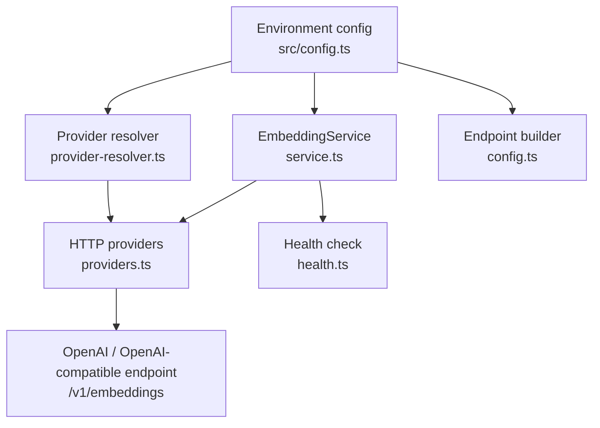
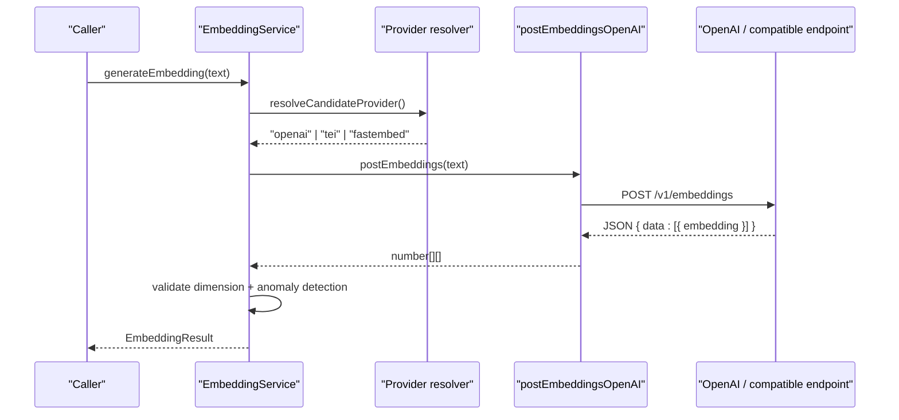
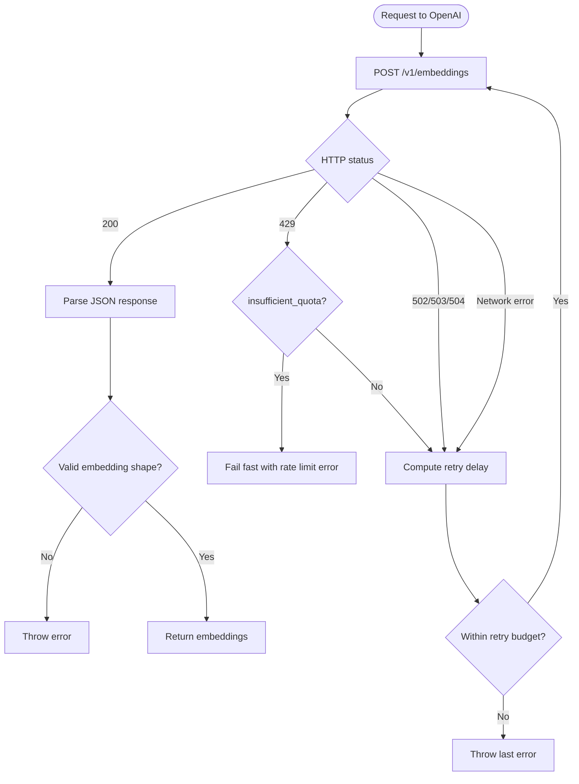
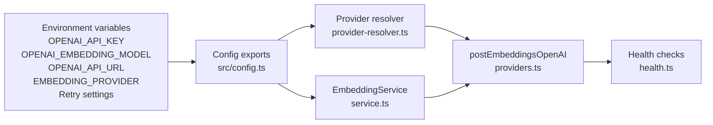

# OpenAI Provider

<cite>
**Referenced Files in This Document**
- [src/config.ts](file://src/config.ts)
- [src/services/embedding/service.ts](file://src/services/embedding/service.ts)
- [src/services/embedding/providers.ts](file://src/services/embedding/providers.ts)
- [src/services/embedding/config.ts](file://src/services/embedding/config.ts)
- [src/services/embedding/provider-resolver.ts](file://src/services/embedding/provider-resolver.ts)
- [src/services/embedding/health.ts](file://src/services/embedding/health.ts)
- [docs/adr/0021-embedding-provider-auto-resolution-and-store-width-binding.md](file://docs/adr/0021-embedding-provider-auto-resolution-and-store-width-binding.md)
</cite>

## Table of Contents
1. [Introduction](#introduction)
2. [Project Structure](#project-structure)
3. [Core Components](#core-components)
4. [Architecture Overview](#architecture-overview)
5. [Detailed Component Analysis](#detailed-component-analysis)
6. [Dependency Analysis](#dependency-analysis)
7. [Performance Considerations](#performance-considerations)
8. [Troubleshooting Guide](#troubleshooting-guide)
9. [Conclusion](#conclusion)
10. [Appendices](#appendices)

## Introduction
This document explains the OpenAI embedding provider integration used by the application. It covers how to configure authentication through `OPENAI_API_KEY`, how requests are routed and retried, how rate limiting is handled, how dimensions are resolved and validated, and how monitoring and audit data are recorded. It also documents supported model configuration via `OPENAI_EMBEDDING_MODEL`, batch processing behavior, migration considerations when changing models, and production best practices.

The implementation supports multiple embedding backends, but this document focuses on the OpenAI-compatible path. The default embedding model name is `text-embedding-3-small`, and the endpoint is derived from `OPENAI_API_URL` plus `/v1/embeddings`.

## Project Structure
The OpenAI embedding integration lives under the embedding service layer:

- Configuration and environment parsing: `src/config.ts`
- Embedding service API surface: `src/services/embedding/service.ts`
- Provider selection and HTTP call logic: `src/services/embedding/providers.ts`
- Endpoint construction and dimension cache: `src/services/embedding/config.ts`
- Candidate provider resolution and successful provider tracking: `src/services/embedding/provider-resolver.ts`
- Health checks for providers: `src/services/embedding/health.ts`
- Architectural decision record about auto resolution and store width binding: `docs/adr/0021-embedding-provider-auto-resolution-and-store-width-binding.md`

**Diagram sources**
- [src/config.ts:70-93](file://src/config.ts#L70-L93)
- [src/services/embedding/config.ts:1-10](file://src/services/embedding/config.ts#L1-L10)
- [src/services/embedding/provider-resolver.ts:28-62](file://src/services/embedding/provider-resolver.ts#L28-L62)
- [src/services/embedding/service.ts:39-46](file://src/services/embedding/service.ts#L39-L46)
- [src/services/embedding/providers.ts:93-116](file://src/services/embedding/providers.ts#L93-L116)
- [src/services/embedding/health.ts:17-33](file://src/services/embedding/health.ts#L17-L33)

**Section sources**
- [src/config.ts:70-93](file://src/config.ts#L70-L93)
- [src/services/embedding/config.ts:1-10](file://src/services/embedding/config.ts#L1-L10)
- [src/services/embedding/provider-resolver.ts:28-62](file://src/services/embedding/provider-resolver.ts#L28-L62)
- [src/services/embedding/service.ts:39-46](file://src/services/embedding/service.ts#L39-L46)
- [src/services/embedding/providers.ts:93-116](file://src/services/embedding/providers.ts#L93-L116)
- [src/services/embedding/health.ts:17-33](file://src/services/embedding/health.ts#L17-L33)

## Core Components
- Environment configuration: centralizes `OPENAI_API_KEY`, `OPENAI_EMBEDDING_MODEL`, `OPENAI_API_URL`, `EMBEDDING_PROVIDER`, and retry policy variables.
- Embedding service: exposes single-text and batch embedding APIs, tracks metrics, performs anomaly detection, and delegates to the selected provider.
- Provider layer: implements OpenAI-compatible HTTP calls, retries, rate limit handling, and response validation.
- Provider resolver: selects candidate provider based on explicit preference or auto-detection rules.
- Dimension cache: records the first successful embedding dimension and enforces consistency across the process lifetime.
- Health module: probes configured providers and reports reachability, authentication status, and throttling.

Key responsibilities:
- Authentication: optional `Authorization: Bearer OPENAI_API_KEY` header; keyless requests are allowed only when `OPENAI_API_URL` is explicitly overridden.
- Model selection: uses `OPENAI_EMBEDDING_MODEL`; default is `text-embedding-3-small`.
- Rate limiting: recognizes 429 responses, honors `Retry-After` headers, applies exponential backoff with jitter, and fails fast for non-retriable quota errors such as `insufficient_quota`.
- Dimension binding: stores embeddings must match the dimension returned by the first successful provider call.

**Section sources**
- [src/config.ts:70-93](file://src/config.ts#L70-L93)
- [src/services/embedding/service.ts:39-127](file://src/services/embedding/service.ts#L39-L127)
- [src/services/embedding/providers.ts:17-74](file://src/services/embedding/providers.ts#L17-L74)
- [src/services/embedding/config.ts:12-36](file://src/services/embedding/config.ts#L12-L36)
- [src/services/embedding/provider-resolver.ts:28-62](file://src/services/embedding/provider-resolver.ts#L28-L62)
- [src/services/embedding/health.ts:17-33](file://src/services/embedding/health.ts#L17-L33)

## Architecture Overview
The embedding request flow starts at `EmbeddingService`, which resolves the candidate provider, invokes the provider layer, validates the response shape and dimension, records metrics and audit events, and returns normalized results.

**Diagram sources**
- [src/services/embedding/service.ts:48-127](file://src/services/embedding/service.ts#L48-L127)
- [src/services/embedding/provider-resolver.ts:28-62](file://src/services/embedding/provider-resolver.ts#L28-L62)
- [src/services/embedding/providers.ts:93-199](file://src/services/embedding/providers.ts#L93-L199)

## Detailed Component Analysis

### Authentication and API Key Configuration
- `OPENAI_API_KEY` is read from the environment and trimmed. If present, it is added as a `Bearer` token for OpenAI requests.
- When `OPENAI_API_KEY` is absent, requests are still allowed if `OPENAI_API_URL` has been explicitly overridden. This enables keyless OpenAI-compatible endpoints such as local proxies or internal gateways.
- Health checks report authentication failures clearly, including guidance to verify `OPENAI_API_KEY`.

Configuration details:
- Default base URL is `https://api.openai.com`, without trailing slash.
- Explicit override is detected via `OPENAI_API_URL_EXPLICIT`.
- Health check distinguishes between missing configuration, authentication failure, and throttling.

Best practice:
- Always set `OPENAI_API_KEY` for production OpenAI usage.
- Use `OPENAI_API_URL` only for controlled OpenAI-compatible endpoints.
- Validate health before enabling embedding-dependent features.

**Section sources**
- [src/config.ts:70-75](file://src/config.ts#L70-L75)
- [src/services/embedding/providers.ts:93-106](file://src/services/embedding/providers.ts#L93-L106)
- [src/services/embedding/health.ts:17-33](file://src/services/embedding/health.ts#L17-L33)

### Rate Limiting and Retry Strategy
The provider layer implements robust retry behavior for transient network and server conditions:

- Retriable HTTP statuses: 429, 502, 503, 504.
- Network errors considered retriable include fetch failures, timeouts, connection resets, refused connections, DNS failures, and similar transient conditions.
- Retry delay strategy:
  - Honors `retry-after-ms` header when present.
  - Honors `retry-after` header in seconds or as a date.
  - Caps advised delays using `EMBEDDING_RETRY_AFTER_CAP_MS`.
  - Falls back to exponential backoff with full jitter bounded by `EMBEDDING_RETRY_MAX_DELAY_MS`.
- Total retry budget: wall-clock deadline computed from `EMBEDDING_RETRY_BUDGET_MS` prevents indefinite retries.
- Non-retriable quota: OpenAI 429 with `insufficient_quota` fails immediately with `EmbeddingRateLimitError`.

Operational implications:
- Configure `EMBEDDING_MAX_RETRIES`, `EMBEDDING_RETRY_BASE_DELAY_MS`, `EMBEDDING_RETRY_MAX_DELAY_MS`, `EMBEDDING_RETRY_AFTER_CAP_MS`, and `EMBEDDING_RETRY_BUDGET_MS` according to your deployment’s latency and cost targets.
- Monitor 429 responses and adjust retry settings or upstream rate limits accordingly.

**Diagram sources**
- [src/services/embedding/providers.ts:14-74](file://src/services/embedding/providers.ts#L14-L74)
- [src/services/embedding/providers.ts:110-201](file://src/services/embedding/providers.ts#L110-L201)

**Section sources**
- [src/services/embedding/providers.ts:14-74](file://src/services/embedding/providers.ts#L14-L74)
- [src/services/embedding/providers.ts:110-201](file://src/services/embedding/providers.ts#L110-L201)
- [src/config.ts:87-93](file://src/config.ts#L87-L93)

### Supported Models, Dimensions, and Performance Characteristics
- Model name: configured via `OPENAI_EMBEDDING_MODEL`. Default is `text-embedding-3-small`.
- Dimension: not hardcoded. The first successful embedding response determines the vector dimension, which is cached and enforced for subsequent calls.
- Performance characteristics:
  - Single embedding and batch embedding both delegate to the same provider layer.
  - Batch size is observed via metrics.
  - Vector size is tracked assuming float32 vectors (4 bytes per element).
  - Latency is measured and exposed through metrics timers.
  - Anomaly detection compares expected vs actual dimension and can reject critical mismatches.

Important note:
- The code does not enumerate OpenAI model-to-dimension mappings. Dimension is discovered at runtime from the provider response. Changing `OPENAI_EMBEDDING_MODEL` may change the stored vector width, which requires careful migration.

**Section sources**
- [src/config.ts:70](file://src/config.ts#L70)
- [src/services/embedding/config.ts:12-36](file://src/services/embedding/config.ts#L12-L36)
- [src/services/embedding/service.ts:130-221](file://src/services/embedding/service.ts#L130-L221)
- [src/services/embedding/providers.ts:179-199](file://src/services/embedding/providers.ts#L179-L199)

### Request and Response Handling
- Request body: `{ model: OPENAI_EMBEDDING_MODEL, input: string[] }`.
- Headers: `Content-Type: application/json`; optional `Authorization: Bearer OPENAI_API_KEY`.
- Response shape: expects `{ data: [{ embedding: number[] }] }`.
- Validation:
  - Parses JSON; retries on retriable HTTP status when possible.
  - Validates that `data` is an array and each item has an `embedding` array.
  - Records successful provider descriptor with model and dimension.
  - Audits success and error outcomes.

Error handling highlights:
- 401: throws authentication error with guidance to check `OPENAI_API_KEY`.
- 429 with `insufficient_quota`: throws `EmbeddingRateLimitError` immediately.
- Other 429/5xx/network: retries with backoff until budget exhausted.
- Non-JSON response: logs error and throws after considering retry eligibility.

**Section sources**
- [src/services/embedding/providers.ts:93-116](file://src/services/embedding/providers.ts#L93-L116)
- [src/services/embedding/providers.ts:117-199](file://src/services/embedding/providers.ts#L117-L199)

### Batch Processing Capabilities
- `generateBatchEmbeddings` accepts an array of strings.
- Empty or whitespace-only entries are filtered out before calling the provider.
- Input count and total character length are tracked for audit and metrics.
- Batch size is observed via metrics.
- All returned embeddings must match the expected dimension; otherwise, an error is thrown.

Production recommendation:
- Pre-filter empty inputs at the caller level to avoid unnecessary provider calls.
- Size batches according to provider limits and cost constraints.
- Monitor batch duration and vector size metrics.

**Section sources**
- [src/services/embedding/service.ts:130-221](file://src/services/embedding/service.ts#L130-L221)

### Monitoring, Audit, and Cost Tracking
- Metrics:
  - Request counts by provider and status.
  - Duration timer per request.
  - Vector size observations.
  - Batch size observations.
  - Error counters.
- Audit:
  - Success and error audit events include tenant ID, request ID, provider, model, input count, input character length, output dimension, latency, and error message where applicable.
- Cost tracking:
  - The current `estimateCost` method returns zero. Cost estimation is marked as a future extension point.

Operational guidance:
- Use metrics and audit logs to track provider utilization, latency, and error rates.
- Do not rely on `estimateCost` for billing calculations yet.
- Integrate external cost tracking if needed by correlating audit events with provider billing data.

**Section sources**
- [src/services/embedding/service.ts:76-127](file://src/services/embedding/service.ts#L76-L127)
- [src/services/embedding/service.ts:166-221](file://src/services/embedding/service.ts#L166-L221)
- [src/services/embedding/service.ts:250-253](file://src/services/embedding/service.ts#L250-L253)

### Migration Paths Between Models and Version Compatibility
- Changing `OPENAI_EMBEDDING_MODEL` changes the embedding dimension returned by the provider.
- The embedding dimension is bound to the first successful provider response and enforced for all subsequent operations.
- For Qdrant, vector space migration is supported at boot: existing dimension vs current dimension triggers migration routines.
- For LanceDB, there is no automatic re-embed migration in this codebase; width mismatch is treated as a schema inconsistency.
- ADR 0021 documents the design choice to bind store vector width to the provider and the consequences of switching models.

Migration steps:
1. Decide whether to keep the existing store width or migrate to a new width.
2. For Qdrant, allow boot-time migration to add new vector columns and update collection metadata.
3. For LanceDB, plan a manual migration or rebuild if you switch models with different dimensions.
4. Update `OPENAI_EMBEDDING_MODEL` and validate health and dimension resolution.
5. Monitor for width mismatch errors and audit logs during migration.

**Section sources**
- [docs/adr/0021-embedding-provider-auto-resolution-and-store-width-binding.md:72-127](file://docs/adr/0021-embedding-provider-auto-resolution-and-store-width-binding.md#L72-L127)
- [docs/adr/0021-embedding-provider-auto-resolution-and-store-width-binding.md:164-183](file://docs/adr/0021-embedding-provider-auto-resolution-and-store-width-binding.md#L164-L183)
- [src/services/embedding/config.ts:12-36](file://src/services/embedding/config.ts#L12-L36)

### Best Practices for Production Deployments
- Set `OPENAI_API_KEY` and `OPENAI_EMBEDDING_MODEL` explicitly.
- Keep `EMBEDDING_PROVIDER=auto` unless you need deterministic provider selection.
- Tune retry parameters to balance resilience and cost:
  - `EMBEDDING_MAX_RETRIES`
  - `EMBEDDING_RETRY_BASE_DELAY_MS`
  - `EMBEDDING_RETRY_MAX_DELAY_MS`
  - `EMBEDDING_RETRY_AFTER_CAP_MS`
  - `EMBEDDING_RETRY_BUDGET_MS`
- Enable health checks and integrate them into readiness/liveness probes.
- Monitor 429 responses and adjust upstream rate limits or retry budgets.
- Avoid changing `OPENAI_EMBEDDING_MODEL` frequently; plan migrations carefully due to dimension binding.
- Track metrics and audit events for latency, throughput, errors, and vector sizes.
- Implement external cost tracking if billing accuracy is required.

**Section sources**
- [src/config.ts:70-93](file://src/config.ts#L70-L93)
- [src/services/embedding/health.ts:92-123](file://src/services/embedding/health.ts#L92-L123)
- [src/services/embedding/providers.ts:14-74](file://src/services/embedding/providers.ts#L14-L74)
- [src/services/embedding/service.ts:76-127](file://src/services/embedding/service.ts#L76-L127)

## Dependency Analysis
The embedding subsystem depends on centralized configuration and provides a clean interface to callers while delegating HTTP concerns to the provider layer.

**Diagram sources**
- [src/config.ts:70-93](file://src/config.ts#L70-L93)
- [src/services/embedding/provider-resolver.ts:28-62](file://src/services/embedding/provider-resolver.ts#L28-L62)
- [src/services/embedding/service.ts:39-46](file://src/services/embedding/service.ts#L39-L46)
- [src/services/embedding/providers.ts:93-116](file://src/services/embedding/providers.ts#L93-L116)
- [src/services/embedding/health.ts:17-33](file://src/services/embedding/health.ts#L17-L33)

**Section sources**
- [src/config.ts:70-93](file://src/config.ts#L70-L93)
- [src/services/embedding/provider-resolver.ts:28-62](file://src/services/embedding/provider-resolver.ts#L28-L62)
- [src/services/embedding/service.ts:39-46](file://src/services/embedding/service.ts#L39-L46)
- [src/services/embedding/providers.ts:93-116](file://src/services/embedding/providers.ts#L93-L116)
- [src/services/embedding/health.ts:17-33](file://src/services/embedding/health.ts#L17-L33)

## Performance Considerations
- Latency: embedding duration is measured per request and tagged with provider and tenant context.
- Throughput: batch embeddings reduce per-request overhead but increase payload size; tune batch size based on provider limits.
- Memory: vector size is observed assuming float32 storage; larger dimensions increase memory usage.
- Retries: exponential backoff with jitter reduces thundering herd effects; cap delays and total budget to prevent long-running retries.
- Dimension validation: early rejection of mismatched dimensions avoids downstream corruption and silent degradation.

[No sources needed since this section provides general guidance]

## Troubleshooting Guide
Common issues and resolutions:

- Missing API key:
  - Symptom: authentication error or health check failure.
  - Resolution: set `OPENAI_API_KEY`.
  - Source references:
    - [src/services/embedding/providers.ts:93-106](file://src/services/embedding/providers.ts#L93-L106)
    - [src/services/embedding/health.ts:17-33](file://src/services/embedding/health.ts#L17-L33)

- Rate limited:
  - Symptom: 429 responses; possibly `insufficient_quota`.
  - Resolution: honor `Retry-After`, adjust retry settings, or add billing/quota to the OpenAI account.
  - Source references:
    - [src/services/embedding/providers.ts:14-74](file://src/services/embedding/providers.ts#L14-L74)
    - [src/services/embedding/providers.ts:147-172](file://src/services/embedding/providers.ts#L147-L172)

- Wrong model dimension:
  - Symptom: dimension mismatch error or unexpected vector width.
  - Resolution: ensure consistent `OPENAI_EMBEDDING_MODEL`; plan migration if changing models.
  - Source references:
    - [src/services/embedding/config.ts:12-36](file://src/services/embedding/config.ts#L12-L36)
    - [docs/adr/0021-embedding-provider-auto-resolution-and-store-width-binding.md:72-127](file://docs/adr/0021-embedding-provider-auto-resolution-and-store-width-binding.md#L72-L127)

- Health check failures:
  - Symptom: health endpoint reports unhealthy or throttled state.
  - Resolution: verify configuration, network connectivity, and provider availability.
  - Source references:
    - [src/services/embedding/health.ts:92-123](file://src/services/embedding/health.ts#L92-L123)

**Section sources**
- [src/services/embedding/providers.ts:93-106](file://src/services/embedding/providers.ts#L93-L106)
- [src/services/embedding/providers.ts:147-172](file://src/services/embedding/providers.ts#L147-L172)
- [src/services/embedding/config.ts:12-36](file://src/services/embedding/config.ts#L12-L36)
- [src/services/embedding/health.ts:92-123](file://src/services/embedding/health.ts#L92-L123)
- [docs/adr/0021-embedding-provider-auto-resolution-and-store-width-binding.md:72-127](file://docs/adr/0021-embedding-provider-auto-resolution-and-store-width-binding.md#L72-L127)

## Conclusion
The OpenAI embedding provider integration provides a configurable, resilient, and observable path for generating embeddings. Authentication is driven by `OPENAI_API_KEY`, with support for keyless OpenAI-compatible endpoints when `OPENAI_API_URL` is explicitly overridden. The system automatically discovers embedding dimensions, validates consistency, and integrates with metrics and audit logging. Rate limiting is handled with robust retry logic, honoring provider hints and capping costs through a retry budget. Operators should monitor health, metrics, and audit events, plan carefully when changing models, and implement external cost tracking if needed.

[No sources needed since this section summarizes without analyzing specific files]

## Appendices

### Environment Variables Summary
- `OPENAI_API_KEY`: OpenAI API key for authentication.
- `OPENAI_EMBEDDING_MODEL`: Embedding model name; default `text-embedding-3-small`.
- `OPENAI_API_URL`: Base URL for OpenAI-compatible endpoint; defaults to `https://api.openai.com`.
- `EMBEDDING_PROVIDER`: Provider selection; `auto` by default.
- `EMBEDDING_MAX_RETRIES`: Maximum retry attempts.
- `EMBEDDING_RETRY_BASE_DELAY_MS`: Base delay for exponential backoff.
- `EMBEDDING_RETRY_MAX_DELAY_MS`: Maximum backoff delay.
- `EMBEDDING_RETRY_AFTER_CAP_MS`: Cap for `Retry-After` advice.
- `EMBEDDING_RETRY_BUDGET_MS`: Total wall-clock retry budget.

**Section sources**
- [src/config.ts:70-93](file://src/config.ts#L70-L93)