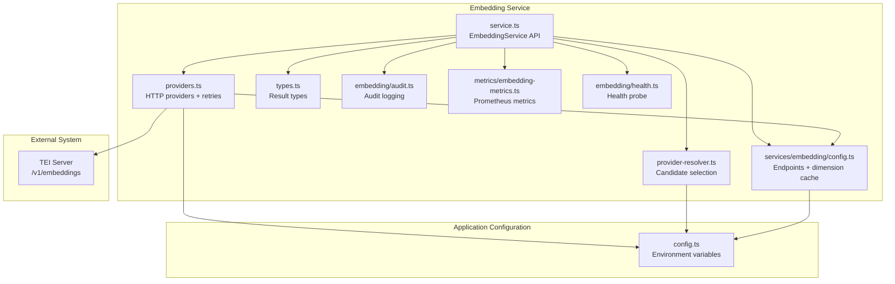
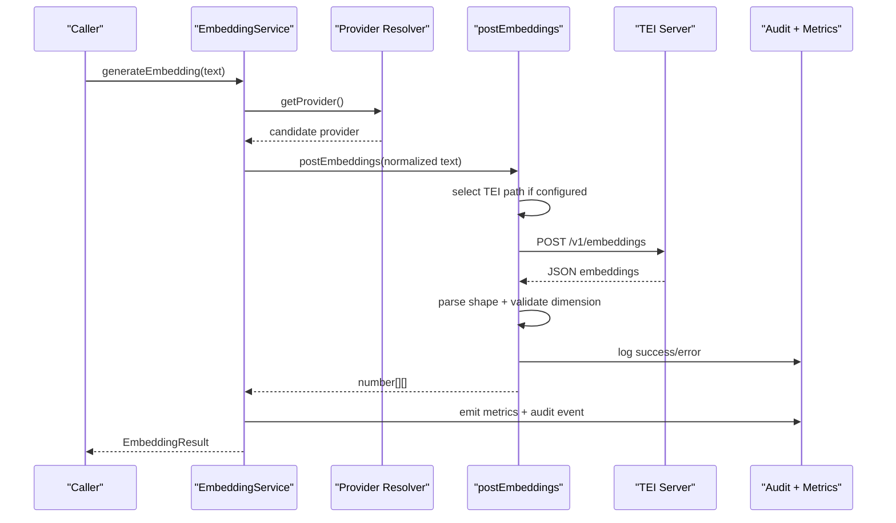
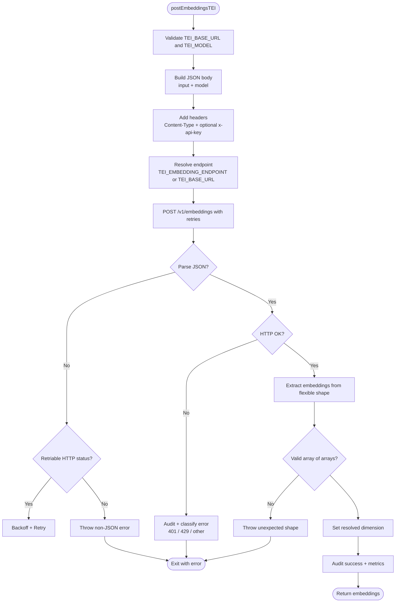
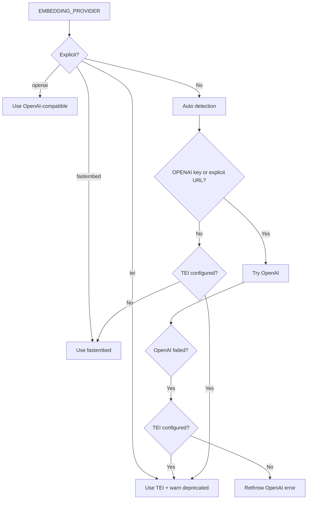
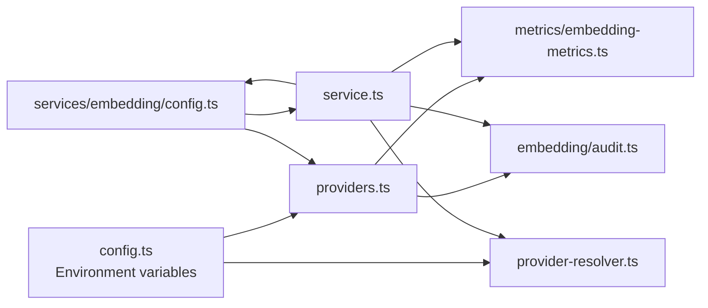

# TEI Provider

<cite>
**Referenced Files in This Document**
- [providers.ts](file://src/services/embedding/providers.ts)
- [service.ts](file://src/services/embedding/service.ts)
- [config.ts](file://src/services/embedding/config.ts)
- [provider-resolver.ts](file://src/services/embedding/provider-resolver.ts)
- [types.ts](file://src/services/embedding/types.ts)
- [embedding-metrics.ts](file://src/services/metrics/embedding-metrics.ts)
- [audit.ts](file://src/services/embedding/audit.ts)
- [health.ts](file://src/services/embedding/health.ts)
- [config.ts](file://src/config.ts)
- [0021-embedding-provider-auto-resolution-and-store-width-binding.md](file://docs/adr/0021-embedding-provider-auto-resolution-and-store-width-binding.md)
- [0004-fastembed-default-for-testing.md](file://docs/adr/0004-fastembed-default-for-testing.md)
</cite>

## Table of Contents
1. [Introduction](#introduction)
2. [Project Structure](#project-structure)
3. [Core Components](#core-components)
4. [Architecture Overview](#architecture-overview)
5. [Detailed Component Analysis](#detailed-component-analysis)
6. [Dependency Analysis](#dependency-analysis)
7. [Performance Considerations](#performance-considerations)
8. [Troubleshooting Guide](#troubleshooting-guide)
9. [Conclusion](#conclusion)

## Introduction
This document explains how the application integrates with a self-hosted TEI (Text Embeddings Inference) server for embedding generation. It covers configuration, HTTP request and response handling, provider selection, retries, authentication, monitoring, scaling considerations, and operational troubleshooting.

The TEI integration is one of several supported embedding backends. The default behavior prefers an OpenAI-compatible endpoint when configured; otherwise it falls back to local fastembed embeddings. TEI remains supported but is marked as deprecated in favor of OpenAI-compatible endpoints or the built-in fastembed model.

Key points:
- TEI is selected through environment variables rather than a dedicated client class.
- Requests are sent over HTTP using a JSON body compatible with a `/v1/embeddings` endpoint.
- Responses are parsed flexibly because different TEI servers may return embeddings under different keys.
- Retries use exponential backoff with jitter, honor `Retry-After`, and enforce a wall-clock retry budget.
- Successful calls record the embedding dimension once per process and reject mismatched dimensions.

## Project Structure
The TEI-related logic lives primarily under the embedding service layer and central configuration:

**Diagram sources**
- [providers.ts:1-343](file://src/services/embedding/providers.ts#L1-L343)
- [service.ts:1-285](file://src/services/embedding/service.ts#L1-L285)
- [provider-resolver.ts:1-82](file://src/services/embedding/provider-resolver.ts#L1-L82)
- [config.ts:1-40](file://src/services/embedding/config.ts#L1-L40)
- [types.ts:1-17](file://src/services/embedding/types.ts#L1-L17)
- [config.ts:70-93](file://src/config.ts#L70-L93)

**Section sources**
- [providers.ts:1-343](file://src/services/embedding/providers.ts#L1-L343)
- [service.ts:1-285](file://src/services/embedding/service.ts#L1-L285)
- [config.ts:70-93](file://src/config.ts#L70-L93)

## Core Components
- **EmbeddingService**: Public API for single and batch embeddings, cosine similarity, health checks, and provider configuration inspection. It delegates actual network calls to the provider layer.
- **Provider Layer (`postEmbeddings`)**: Chooses between OpenAI-compatible, TEI, and fastembed based on environment configuration. Implements retries, rate-limit handling, audit logging, and dimension resolution.
- **TEI Client Logic**: Sends POST requests to `/v1/embeddings`, supports optional `x-api-key`, parses multiple response shapes, and records successful provider metadata.
- **Configuration**: Centralizes environment variables such as `TEI_BASE_URL`, `TEI_MODEL`, `TEI_API_KEY`, `EMBEDDING_PROVIDER`, and retry tuning parameters.
- **Dimension Cache**: Ensures all vectors in a process have the same embedding dimension and exposes it to downstream stores.

**Section sources**
- [service.ts:39-276](file://src/services/embedding/service.ts#L39-L276)
- [providers.ts:76-343](file://src/services/embedding/providers.ts#L76-L343)
- [config.ts:70-93](file://src/config.ts#L70-L93)
- [config.ts:12-36](file://src/services/embedding/config.ts#L12-L36)

## Architecture Overview
At runtime, the embedding pipeline follows this flow:

**Diagram sources**
- [service.ts:48-127](file://src/services/embedding/service.ts#L48-L127)
- [provider-resolver.ts:28-46](file://src/services/embedding/provider-resolver.ts#L28-L46)
- [providers.ts:203-295](file://src/services/embedding/providers.ts#L203-L295)

## Detailed Component Analysis

### TEI HTTP API Communication Protocol
The TEI client sends a POST request to a `/v1/embeddings` endpoint. The base URL comes from `TEI_BASE_URL`; if `TEI_EMBEDDING_ENDPOINT` is explicitly set, that value is used instead.

Request characteristics:
- Method: `POST`
- Content-Type: `application/json`
- Body includes:
  - `input`: array of strings or a single string
  - `model`: the configured `TEI_MODEL`
- Optional header:
  - `x-api-key`: present when `TEI_API_KEY` is set

Response parsing:
- The implementation accepts several common response shapes:
  - `data[].embedding`
  - `embeddings[]`
  - `result[]`
  - top-level array
- Each embedding must be an array of numbers.
- On success, the first embedding’s length becomes the resolved embedding dimension for the process.

Error handling:
- Non-JSON responses throw an error after considering retriable HTTP status codes.
- HTTP 401 throws an authentication failure error.
- HTTP 429 throws a typed rate-limit error.
- Other non-OK statuses produce descriptive errors including the server-provided message when available.

**Diagram sources**
- [providers.ts:203-295](file://src/services/embedding/providers.ts#L203-L295)
- [config.ts:7-10](file://src/services/embedding/config.ts#L7-L10)

**Section sources**
- [providers.ts:203-295](file://src/services/embedding/providers.ts#L203-L295)
- [config.ts:7-10](file://src/services/embedding/config.ts#L7-L10)

### Provider Selection and TEI Deprecation
Provider selection is driven by `EMBEDDING_PROVIDER` and environment configuration:

- Explicit values:
  - `openai`: uses OpenAI-compatible endpoint
  - `tei`: uses TEI
  - `fastembed`: uses local fastembed
- Default:
  - `auto`: prefers OpenAI-compatible when `OPENAI_API_KEY` or an explicitly overridden `OPENAI_API_URL` is present; otherwise falls back to TEI if both `TEI_BASE_URL` and `TEI_MODEL` are configured; otherwise uses fastembed.

When TEI is selected, the code emits a deprecation warning indicating that TEI support is transitional and will be removed in a future release.

**Diagram sources**
- [providers.ts:296-333](file://src/services/embedding/providers.ts#L296-L333)
- [provider-resolver.ts:28-46](file://src/services/embedding/provider-resolver.ts#L28-L46)
- [config.ts:76-83](file://src/config.ts#L76-L83)

**Section sources**
- [providers.ts:296-343](file://src/services/embedding/providers.ts#L296-L343)
- [provider-resolver.ts:28-46](file://src/services/embedding/provider-resolver.ts#L28-L46)
- [config.ts:76-83](file://src/config.ts#L76-L83)

### Request Formatting and Response Parsing
Request formatting:
- Input is normalized to an array of strings.
- Character count is computed for audit and metrics.
- Headers include `Content-Type`; `x-api-key` is added only when `TEI_API_KEY` is set.
- The target URL is either `TEI_EMBEDDING_ENDPOINT` or `TEI_BASE_URL`.

Response parsing:
- The response body is read as text and parsed as JSON.
- If parsing fails, the handler considers retriable HTTP status codes before throwing.
- Embeddings are extracted from multiple possible locations: `embeddings`, `data`, `result`, or a top-level array.
- Each element must resolve to an array of numbers.

Dimension handling:
- The first successful embedding’s length sets the process-wide embedding dimension.
- Subsequent mismatches throw an error.
- Downstream components retrieve the dimension via a getter that enforces that a probe has already run.

**Section sources**
- [providers.ts:203-295](file://src/services/embedding/providers.ts#L203-L295)
- [config.ts:12-36](file://src/services/embedding/config.ts#L12-L36)

### Authentication Methods
TEI authentication is handled through an optional API key:
- If `TEI_API_KEY` is set, the client adds `x-api-key` to the request headers.
- A 401 response from the TEI server is treated as an authentication failure.
- There is no automatic token refresh or OAuth flow for TEI in this integration.

For OpenAI-compatible endpoints, the client uses `Authorization: Bearer <OPENAI_API_KEY>` when a key is present. Keyless requests are allowed only when `OPENAI_API_URL` is explicitly overridden.

**Section sources**
- [providers.ts:203-295](file://src/services/embedding/providers.ts#L203-L295)
- [providers.ts:93-106](file://src/services/embedding/providers.ts#L93-L106)
- [config.ts:70-83](file://src/config.ts#L70-L83)

### Security Configurations
Security-relevant behaviors for TEI:
- Do not expose `TEI_API_KEY` in logs; it is only used to set a request header.
- Ensure `TEI_BASE_URL` points to a trusted internal endpoint.
- Prefer HTTPS when the TEI server is exposed externally.
- Combine TEI deployment with the application’s broader authentication and authorization configuration, such as OIDC/JWT validation for incoming requests.

The embedding service also validates embedding dimensions and rejects unexpected shapes, reducing the risk of malformed data propagating into vector stores.

**Section sources**
- [providers.ts:203-295](file://src/services/embedding/providers.ts#L203-L295)
- [config.ts:70-93](file://src/config.ts#L70-L93)

### Monitoring Approaches
Embedding operations emit structured telemetry:
- Prometheus-style metrics track request counts, latency, errors, vector size, and batch size.
- Audit events record provider, model, input size, output dimension, latency, HTTP status, and error messages.
- Health checks delegate to the embedding health module, which can surface provider readiness.

Operational recommendations:
- Monitor embedding latency against `EMBEDDING_LATENCY_WARN_MS`.
- Alert on repeated 429 or 5xx responses from the TEI server.
- Track dimension consistency; mismatches indicate misconfiguration or incompatible models.
- Use audit logs to correlate embedding failures with upstream TEI errors.

**Section sources**
- [service.ts:19-34](file://src/services/embedding/service.ts#L19-L34)
- [providers.ts:136-199](file://src/services/embedding/providers.ts#L136-L199)
- [providers.ts:239-291](file://src/services/embedding/providers.ts#L239-L291)

### Supported Models and Endpoint Configuration
Supported configuration for TEI:
- `TEI_BASE_URL`: Base URL of the TEI server.
- `TEI_MODEL`: Model identifier sent in the request body.
- `TEI_API_KEY`: Optional API key for TEI authentication.
- `TEI_EMBEDDING_ENDPOINT`: Optional override for the full embeddings endpoint.

Default model:
- The configuration defaults `TEI_MODEL` to `Alibaba-NLP/gte-large-en-v1.5`.

Endpoint construction:
- If `TEI_EMBEDDING_ENDPOINT` is empty, the client appends `/v1/embeddings` to `TEI_BASE_URL`, trimming any trailing slash.

Note:
- The TEI integration is deprecated in favor of OpenAI-compatible endpoints or fastembed.
- Different TEI deployments may vary in supported models and response shapes; the client handles several common formats.

**Section sources**
- [config.ts:80-83](file://src/config.ts#L80-L83)
- [config.ts:7-10](file://src/services/embedding/config.ts#L7-L10)
- [providers.ts:203-210](file://src/services/embedding/providers.ts#L203-L210)

### Scaling Considerations for Production Environments
Production guidance:
- Treat TEI as a stateless HTTP backend. Scale the TEI server horizontally behind a load balancer.
- Tune retry settings to match your SLA and upstream capacity:
  - `EMBEDDING_MAX_RETRIES`
  - `EMBEDDING_RETRY_BASE_DELAY_MS`
  - `EMBEDDING_RETRY_MAX_DELAY_MS`
  - `EMBEDDING_RETRY_AFTER_CAP_MS`
  - `EMBEDDING_RETRY_BUDGET_MS`
- Use connection pooling at the HTTP client level if you replace the built-in fetch behavior.
- Monitor queueing and latency at the TEI server; backpressure should be visible in embedding latency and error rates.
- Avoid mixing embedding dimensions across processes or stores; the application enforces a single dimension per process.

**Section sources**
- [config.ts:87-93](file://src/config.ts#L87-L93)
- [providers.ts:49-74](file://src/services/embedding/providers.ts#L49-L74)
- [config.ts:12-36](file://src/services/embedding/config.ts#L12-L36)

### Examples of Configuration and Integration Patterns

#### TEI Server Configuration
Set these environment variables when running the application:
- `TEI_BASE_URL=http://localhost:8080`
- `TEI_MODEL=Alibaba-NLP/gte-large-en-v1.5`
- `TEI_API_KEY=<your-tei-api-key>` (optional)
- `EMBEDDING_PROVIDER=tei` (to force TEI)

If you want auto-detection to prefer TEI, ensure OpenAI is not configured so the auto branch selects TEI when both `TEI_BASE_URL` and `TEI_MODEL` are present.

**Section sources**
- [config.ts:80-83](file://src/config.ts#L80-L83)
- [providers.ts:306-331](file://src/services/embedding/providers.ts#L306-L331)

#### Client Setup
To integrate TEI through the public embedding API:
- Configure the environment variables described above.
- Use `EmbeddingService.generateEmbedding` for single texts.
- Use `EmbeddingService.generateBatchEmbeddings` for multiple texts.
- Inspect `EmbeddingService.getConfig()` to see the resolved provider, model, dimension, and configuration flags.

**Section sources**
- [service.ts:48-127](file://src/services/embedding/service.ts#L48-L127)
- [service.ts:130-222](file://src/services/embedding/service.ts#L130-L222)
- [service.ts:259-275](file://src/services/embedding/service.ts#L259-L275)

#### Integration Pattern
A typical production pattern:
1. Start the application with TEI environment variables.
2. Run the embedding dimension probe at startup.
3. Initialize vector stores after the dimension is resolved.
4. Route embedding calls through `EmbeddingService`.
5. Monitor metrics and audit logs for latency, errors, and dimension consistency.

**Section sources**
- [service.ts:280-284](file://src/services/embedding/service.ts#L280-L284)
- [config.ts:12-36](file://src/services/embedding/config.ts#L12-L36)

## Dependency Analysis
The TEI integration depends on shared configuration, metrics, audit, and provider resolution modules.

**Diagram sources**
- [config.ts:70-93](file://src/config.ts#L70-L93)
- [providers.ts:1-6](file://src/services/embedding/providers.ts#L1-L6)
- [service.ts:15-34](file://src/services/embedding/service.ts#L15-L34)
- [config.ts:1-4](file://src/services/embedding/config.ts#L1-L4)

**Section sources**
- [providers.ts:1-6](file://src/services/embedding/providers.ts#L1-L6)
- [service.ts:15-34](file://src/services/embedding/service.ts#L15-L34)
- [config.ts:70-93](file://src/config.ts#L70-L93)

## Performance Considerations
- **Retries and backoff**: The provider uses exponential backoff with jitter, honors `Retry-After`, and caps total retry time with a wall-clock budget. Increase `EMBEDDING_RETRY_BUDGET_MS` cautiously to avoid long-running retries masking upstream failures.
- **Latency warnings**: `EMBEDDING_LATENCY_WARN_MS` provides a threshold for slow embedding calls.
- **Batching**: Batch embeddings reduce per-request overhead. The service tracks batch size and validates that all returned vectors match the expected dimension.
- **Dimension stability**: Mixing models with different dimensions causes runtime errors. Keep one model per process and store.
- **Network resilience**: Transient network errors trigger retries; persistent errors fail fast after exhausting retries or the retry budget.

**Section sources**
- [providers.ts:49-74](file://src/services/embedding/providers.ts#L49-L74)
- [providers.ts:76-92](file://src/services/embedding/providers.ts#L76-L92)
- [config.ts:84-93](file://src/config.ts#L84-L93)
- [service.ts:130-222](file://src/services/embedding/service.ts#L130-L222)

## Troubleshooting Guide

Common issues and resolutions:

| Symptom | Likely Cause | Resolution |
|---|---|---|
| `TEI requires TEI_BASE_URL and TEI_MODEL to be configured` | Missing TEI environment variables | Set `TEI_BASE_URL` and `TEI_MODEL`. |
| `TEI authentication failed (401)` | Invalid or missing `TEI_API_KEY` | Verify the key and TEI server configuration. |
| `TEI embeddings returned non-JSON response` | TEI server returned HTML or error page | Check TEI health, proxy configuration, and endpoint path. |
| `TEI returned unexpected embedding shape` | Incompatible TEI server response format | Confirm the server returns one of the supported shapes. |
| `Embedding dimension mismatch` | Model change or mixed providers | Use a consistent model per process and store. |
| `TEI rate limit (429)` | Upstream throttling | Reduce request rate, increase retry budget carefully, or scale TEI. |
| `Embedding dimension not resolved` | Startup probe did not run | Ensure `probeEmbeddingDimension()` runs before vector store initialization. |

Additional notes:
- The TEI provider is deprecated; consider migrating to an OpenAI-compatible endpoint or fastembed.
- When `EMBEDDING_PROVIDER=auto`, an OpenAI failure does not automatically fall back to fastembed; it tries TEI only if configured.
- For Qdrant-backed deployments, vector dimension migration is supported at boot; embedded LanceDB behavior is more restrictive and may require store migration or re-embedding depending on schema alignment.

**Section sources**
- [providers.ts:203-295](file://src/services/embedding/providers.ts#L203-L295)
- [config.ts:80-83](file://src/config.ts#L80-L83)
- [config.ts:12-36](file://src/services/embedding/config.ts#L12-L36)
- [0021-embedding-provider-auto-resolution-and-store-width-binding.md:101-127](file://docs/adr/0021-embedding-provider-auto-resolution-and-store-width-binding.md#L101-L127)

## Conclusion
The TEI provider enables self-hosted embedding generation through a straightforward HTTP interface. While supported, it is deprecated in favor of OpenAI-compatible endpoints or the built-in fastembed model. Operators should configure `TEI_BASE_URL`, `TEI_MODEL`, and optionally `TEI_API_KEY`, then rely on the embedding service for retries, dimension validation, auditing, and metrics. For production environments, monitor latency, rate limits, and dimension consistency, and plan migration paths away from TEI as future releases remove deprecated support.