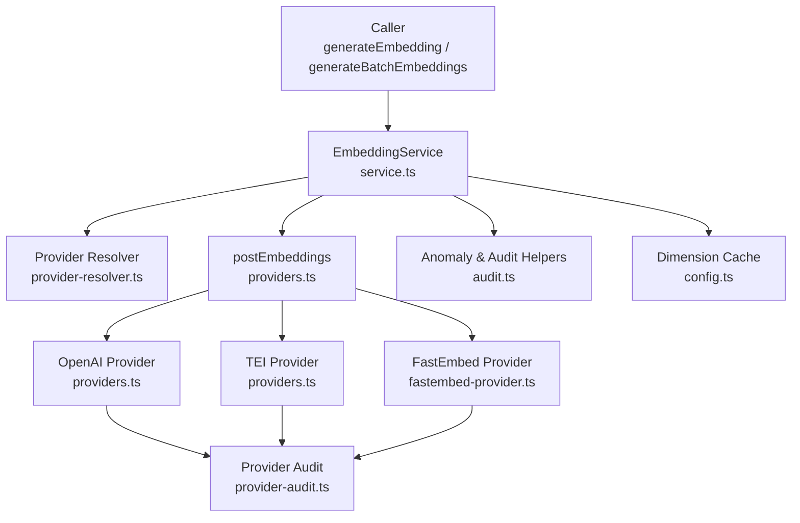
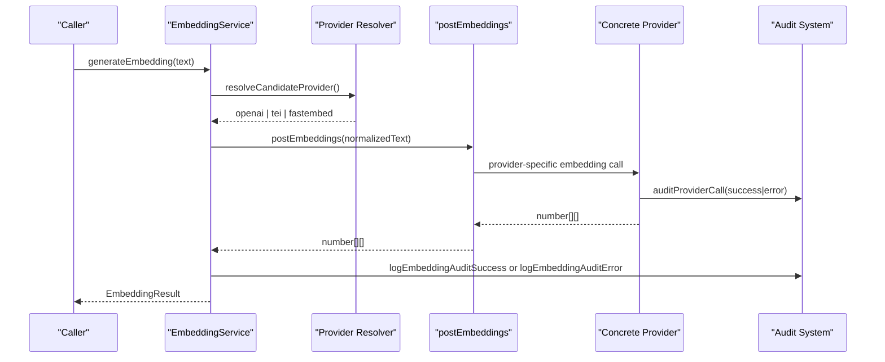
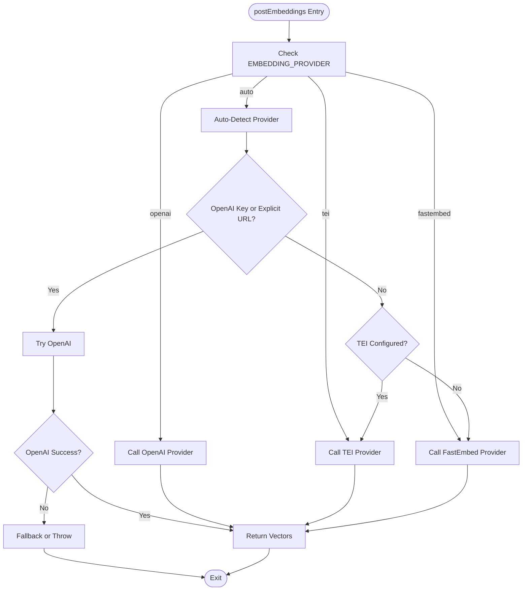
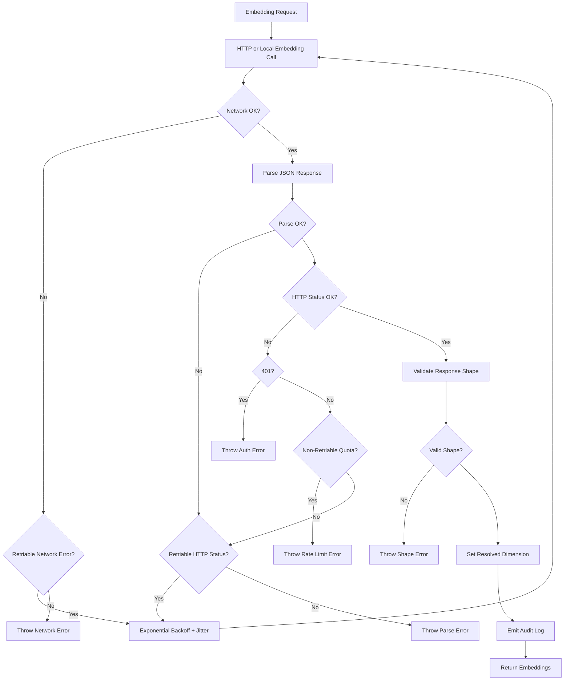
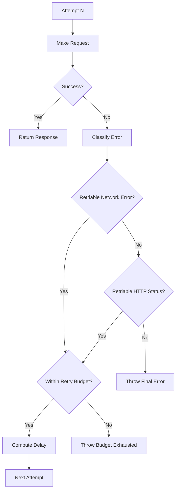
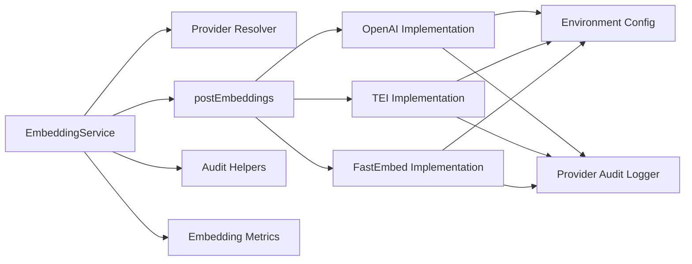

# Custom Provider Development

<cite>
**Referenced Files in This Document**
- [providers.ts](file://src/services/embedding/providers.ts)
- [service.ts](file://src/services/embedding/service.ts)
- [types.ts](file://src/services/embedding/types.ts)
- [config.ts](file://src/services/embedding/config.ts)
- [fastembed-provider.ts](file://src/services/embedding/fastembed-provider.ts)
- [provider-audit.ts](file://src/services/embedding/provider-audit.ts)
- [audit.ts](file://src/services/embedding/audit.ts)
- [provider-resolver.ts](file://src/services/embedding/provider-resolver.ts)
- [health.ts](file://src/services/embedding/health.ts)
- [embedding-fastembed.ts](file://src/config/embedding-fastembed.ts)
- [config.ts](file://src/config.ts)
- [0021-embedding-provider-auto-resolution-and-store-width-binding.md](file://docs/adr/0021-embedding-provider-auto-resolution-and-store-width-binding.md)
</cite>

## Table of Contents
1. [Introduction](#introduction)
2. [Project Structure](#project-structure)
3. [Core Components](#core-components)
4. [Architecture Overview](#architecture-overview)
5. [Detailed Component Analysis](#detailed-component-analysis)
6. [Dependency Analysis](#dependency-analysis)
7. [Performance Considerations](#performance-considerations)
8. [Troubleshooting Guide](#troubleshooting-guide)
9. [Conclusion](#conclusion)
10. [Appendices](#appendices)

## Introduction
This document explains how to develop custom embedding providers that integrate with third-party embedding services or specialized models. It focuses on the provider interface, the `postEmbeddings` implementation contract, error handling, authentication, retry and rate-limit behavior, audit integration, testing strategies, production considerations, and step-by-step instructions for adding new providers to the system configuration.

The embedding subsystem currently supports:
- OpenAI-compatible endpoints (including proxies such as Ollama).
- TEI (Text Embeddings Inference), which is deprecated but still functional.
- Local fastembed, the zero-dependency default.

New providers should follow the same patterns used by these implementations so they can be selected through the existing provider resolution logic, participate in retries, emit structured audit logs, and bind correctly to vector store dimensions.

## Project Structure
The embedding subsystem lives under `src/services/embedding`. The most relevant files for custom provider development are:

| File | Responsibility |
| --- | --- |
| `providers.ts` | Central `postEmbeddings` dispatcher, HTTP retry/backoff, provider-specific implementations, and shared retry helpers. |
| `service.ts` | Public `EmbeddingService` API surface, dimension validation, metrics, and high-level audit logging. |
| `types.ts` | Shared embedding result types returned to callers. |
| `config.ts` | Runtime embedding dimension cache and validation. |
| `fastembed-provider.ts` | Local ONNX-based provider example. |
| `provider-audit.ts` | Structured audit logger used by every provider backend. |
| `audit.ts` | Anomaly detection, latency/norm checks, and success/error audit helpers. |
| `provider-resolver.ts` | Candidate provider selection and successful provider descriptor tracking. |
| `health.ts` | Health probing and startup diagnostics. |
| `src/config.ts` | Environment variable definitions including provider selection and retry policy. |
| `docs/adr/0021-embedding-provider-auto-resolution-and-store-width-binding.md` | Architectural decision record explaining auto resolution, width binding, and migration implications. |

**Diagram sources**
- [service.ts:48-127](file://src/services/embedding/service.ts#L48-L127)
- [service.ts:130-221](file://src/services/embedding/service.ts#L130-L221)
- [providers.ts:296-333](file://src/services/embedding/providers.ts#L296-L333)
- [fastembed-provider.ts:41-82](file://src/services/embedding/fastembed-provider.ts#L41-L82)
- [provider-audit.ts:26-42](file://src/services/embedding/provider-audit.ts#L26-L42)
- [audit.ts:60-92](file://src/services/embedding/audit.ts#L60-L92)
- [config.ts:12-31](file://src/services/embedding/config.ts#L12-L31)

**Section sources**
- [service.ts:1-37](file://src/services/embedding/service.ts#L1-L37)
- [providers.ts:1-16](file://src/services/embedding/providers.ts#L1-L16)
- [fastembed-provider.ts:1-16](file://src/services/embedding/fastembed-provider.ts#L1-L16)
- [provider-audit.ts:1-11](file://src/services/embedding/provider-audit.ts#L1-L11)
- [audit.ts:1-19](file://src/services/embedding/audit.ts#L1-L19)
- [provider-resolver.ts:1-16](file://src/services/embedding/provider-resolver.ts#L1-L16)
- [config.ts:12-31](file://src/services/embedding/config.ts#L12-L31)
- [config.ts:70-93](file://src/config.ts#L70-L93)

## Core Components
The embedding subsystem exposes a stable service API while keeping provider-specific logic isolated.

### EmbeddingResult and BatchEmbeddingResult
Callers receive typed results rather than raw provider responses.

| Field | Meaning |
| --- | --- |
| `embedding` | Single embedding vector for single-text requests. |
| `embeddings` | Array of vectors for batch requests. |
| `model` | Model identifier associated with the response. |
| `usage.prompt_tokens` | Token usage placeholder; current providers return zero. |
| `usage.total_tokens` | Token usage placeholder; current providers return zero. |

These types are defined centrally so consumers do not depend on provider-specific shapes.

**Section sources**
- [types.ts:1-17](file://src/services/embedding/types.ts#L1-L17)

### EmbeddingService
`EmbeddingService` is the public entry point. It:
- Normalizes input text.
- Chooses the candidate provider.
- Calls `postEmbeddings`.
- Validates output dimension against the resolved dimension.
- Emits metrics and audit events.
- Exposes cosine similarity, health checks, and configuration inspection.

Key responsibilities:
- Single embedding generation.
- Batch embedding generation.
- Anomaly detection integration.
- Tenant and request context propagation.

**Section sources**
- [service.ts:39-127](file://src/services/embedding/service.ts#L39-L127)
- [service.ts:130-221](file://src/services/embedding/service.ts#L130-L221)
- [service.ts:224-275](file://src/services/embedding/service.ts#L224-L275)

### Provider Resolution
Provider selection is explicit-first and auto-second:
- Explicit `EMBEDDING_PROVIDER=openai|tei|fastembed`.
- Auto selects OpenAI when an API key or explicitly overridden URL is present.
- Falls back to TEI if configured.
- Defaults to fastembed when nothing external is configured.

A successful provider descriptor records the actual provider, model, and vector dimension after the first successful call.

**Section sources**
- [provider-resolver.ts:20-46](file://src/services/embedding/provider-resolver.ts#L20-L46)
- [provider-resolver.ts:64-81](file://src/services/embedding/provider-resolver.ts#L64-L81)
- [0021-embedding-provider-auto-resolution-and-store-width-binding.md:40-52](file://docs/adr/0021-embedding-provider-auto-resolution-and-store-width-binding.md#L40-L52)

## Architecture Overview
The embedding architecture separates concerns into layers:

1. **Service Layer**: `EmbeddingService` provides the user-facing API, validates inputs, tracks metrics, and integrates with anomaly detection.
2. **Dispatcher Layer**: `postEmbeddings` chooses the provider based on configuration and runtime state.
3. **Provider Layer**: Concrete implementations for OpenAI, TEI, and fastembed.
4. **Audit Layer**: Structured logging for provider calls and higher-level embedding lifecycle events.
5. **Configuration Layer**: Environment variables control provider selection, retry behavior, and model defaults.
6. **Dimension Binding Layer**: The first successful embedding determines the vector dimension, which is then validated for all subsequent calls.

**Diagram sources**
- [service.ts:48-127](file://src/services/embedding/service.ts#L48-L127)
- [provider-resolver.ts:28-46](file://src/services/embedding/provider-resolver.ts#L28-L46)
- [providers.ts:296-333](file://src/services/embedding/providers.ts#L296-L333)
- [provider-audit.ts:26-42](file://src/services/embedding/provider-audit.ts#L26-L42)
- [audit.ts:60-92](file://src/services/embedding/audit.ts#L60-L92)

## Detailed Component Analysis

### Provider Interface Requirements
Custom providers must implement a function compatible with the existing dispatcher. The current dispatcher expects:

- A function returning `Promise<number[][]>`.
- Acceptance of either a single string or an array of strings.
- Setting the resolved embedding dimension after the first successful response.
- Recording the successful provider descriptor.
- Emitting structured audit logs for both success and failure paths.

The central dispatcher already handles:
- Provider selection.
- Retry logic.
- Rate-limit detection.
- Authentication header injection.
- Response shape validation.

For a custom provider, you typically add a provider-specific implementation and wire it into the dispatcher or resolver depending on whether it should be auto-selected or explicitly selected.

**Section sources**
- [providers.ts:93-201](file://src/services/embedding/providers.ts#L93-L201)
- [providers.ts:203-295](file://src/services/embedding/providers.ts#L203-L295)
- [providers.ts:296-333](file://src/services/embedding/providers.ts#L296-L333)
- [fastembed-provider.ts:41-82](file://src/services/embedding/fastembed-provider.ts#L41-L82)
- [provider-resolver.ts:58-73](file://src/services/embedding/provider-resolver.ts#L58-L73)

### postEmbeddings Implementation Contract
The `postEmbeddings` function is the main entry point for embedding generation. It:
- Accepts a string or string array.
- Selects the provider based on `EMBEDDING_PROVIDER` or auto-detection.
- Delegates to provider-specific functions.
- Returns normalized `number[][]`.

Important implementation notes:
- Input normalization removes empty values at the service layer.
- Providers should validate their own required configuration before making network calls.
- Successful providers set the embedding dimension once per process.
- Errors should preserve meaningful messages for audit and debugging.

**Diagram sources**
- [providers.ts:296-333](file://src/services/embedding/providers.ts#L296-L333)

**Section sources**
- [providers.ts:296-333](file://src/services/embedding/providers.ts#L296-L333)

### Error Handling Patterns
The embedding subsystem distinguishes between:
- Network failures.
- Non-JSON responses.
- HTTP errors.
- Authentication failures.
- Rate limits.
- Invalid response shapes.
- Dimension mismatches.

Shared error behaviors include:
- Retriable network errors use exponential backoff with jitter.
- HTTP 429, 502, 503, and 504 are considered retriable when within retry budget.
- OpenAI `insufficient_quota` is non-retriable and throws a dedicated rate-limit error.
- 401 authentication failures throw immediately without retry.
- Unexpected response shapes throw descriptive errors.
- Dimension mismatches are treated as critical anomalies.

**Diagram sources**
- [providers.ts:10-15](file://src/services/embedding/providers.ts#L10-L15)
- [providers.ts:30-74](file://src/services/embedding/providers.ts#L30-L74)
- [providers.ts:76-92](file://src/services/embedding/providers.ts#L76-L92)
- [providers.ts:110-201](file://src/services/embedding/providers.ts#L110-L201)
- [providers.ts:214-295](file://src/services/embedding/providers.ts#L214-L295)

**Section sources**
- [providers.ts:10-15](file://src/services/embedding/providers.ts#L10-L15)
- [providers.ts:17-29](file://src/services/embedding/providers.ts#L17-L29)
- [providers.ts:30-74](file://src/services/embedding/providers.ts#L30-L74)
- [providers.ts:76-92](file://src/services/embedding/providers.ts#L76-L92)
- [providers.ts:110-201](file://src/services/embedding/providers.ts#L110-L201)
- [providers.ts:214-295](file://src/services/embedding/providers.ts#L214-L295)
- [audit.ts:94-157](file://src/services/embedding/audit.ts#L94-L157)

### Response Format Specifications
Providers must return `number[][]`, where each inner array is a numeric embedding vector. The service layer validates:
- The outer structure is an array.
- Each embedding is an array.
- The dimension matches the resolved dimension.
- Critical anomalies cause immediate failure.

The public API wraps this into `EmbeddingResult` or `BatchEmbeddingResult`, including model metadata and token usage placeholders.

**Section sources**
- [types.ts:1-17](file://src/services/embedding/types.ts#L1-L17)
- [service.ts:58-74](file://src/services/embedding/service.ts#L58-L74)
- [service.ts:149-164](file://src/services/embedding/service.ts#L149-L164)
- [audit.ts:94-157](file://src/services/embedding/audit.ts#L94-L157)

### Authentication Integration
Authentication depends on the provider:

| Provider | Authentication Mechanism |
| --- | --- |
| OpenAI | `Authorization: Bearer OPENAI_API_KEY` unless an explicitly overridden URL is used. |
| TEI | Optional `x-api-key` header from `TEI_API_KEY`. |
| FastEmbed | No external authentication; local ONNX execution. |

Custom providers should:
- Read credentials from environment variables or a secure secrets manager.
- Avoid logging secrets.
- Fail fast on missing or invalid credentials.
- Distinguish transient auth failures from permanent configuration errors.

**Section sources**
- [providers.ts:93-106](file://src/services/embedding/providers.ts#L93-L106)
- [providers.ts:203-210](file://src/services/embedding/providers.ts#L203-L210)
- [config.ts:70-83](file://src/config.ts#L70-L83)

### Rate Limiting and Retry Logic
Retry behavior is centralized:
- `EMBEDDING_MAX_RETRIES` controls maximum attempts.
- `EMBEDDING_RETRY_BASE_DELAY_MS` and `EMBEDDING_RETRY_MAX_DELAY_MS` control exponential backoff.
- `EMBEDDING_RETRY_AFTER_CAP_MS` caps `Retry-After` advice.
- `EMBEDDING_RETRY_BUDGET_MS` enforces a total wall-clock retry budget.
- `Retry-After` and `retry-after-ms` headers are honored when present.
- Non-retriable quota errors fail immediately.

Rate-limit errors are represented by `EmbeddingRateLimitError`, carrying provider, HTTP status, and optional error code.

**Diagram sources**
- [providers.ts:30-74](file://src/services/embedding/providers.ts#L30-L74)
- [providers.ts:76-92](file://src/services/embedding/providers.ts#L76-L92)
- [providers.ts:110-201](file://src/services/embedding/providers.ts#L110-L201)
- [providers.ts:214-295](file://src/services/embedding/providers.ts#L214-L295)

**Section sources**
- [providers.ts:17-29](file://src/services/embedding/providers.ts#L17-L29)
- [providers.ts:30-74](file://src/services/embedding/providers.ts#L30-L74)
- [providers.ts:76-92](file://src/services/embedding/providers.ts#L76-L92)
- [config.ts:87-93](file://src/config.ts#L87-L93)

### Audit System Integration
Every provider emits structured audit logs through `auditProviderCall`. The service layer also emits higher-level success/error audit events and anomaly detection.

Audit fields include:
- Tenant ID.
- Request ID.
- Provider name.
- Model name.
- Input count and character length.
- Output dimension.
- Latency.
- HTTP status and error message when applicable.

Anomaly detection monitors:
- High latency.
- Unusual vector norms.
- Dimension mismatches.

**Section sources**
- [provider-audit.ts:11-42](file://src/services/embedding/provider-audit.ts#L11-L42)
- [audit.ts:60-92](file://src/services/embedding/audit.ts#L60-L92)
- [audit.ts:94-157](file://src/services/embedding/audit.ts#L94-L157)
- [service.ts:64-94](file://src/services/embedding/service.ts#L64-L94)
- [service.ts:154-188](file://src/services/embedding/service.ts#L154-L188)

### Testing Strategies for Custom Providers
Recommended testing approaches:

1. **Unit Tests for Provider Logic**
   - Validate input normalization.
   - Validate credential requirements.
   - Validate response parsing.
   - Validate dimension setting.
   - Validate error paths.

2. **Mock Implementations**
   - Mock HTTP clients for remote providers.
   - Mock file system or model loader for local providers.
   - Mock audit and metrics sinks to verify emissions.

3. **Integration Tests**
   - Test against a real or test endpoint.
   - Verify retry behavior under simulated failures.
   - Verify rate-limit handling.
   - Verify audit log structure.
   - Verify dimension binding consistency.

4. **Contract Tests**
   - Ensure `postEmbeddings` returns `number[][]`.
   - Ensure `EmbeddingResult` and `BatchEmbeddingResult` match expected shapes.
   - Ensure provider selection follows documented rules.

Example patterns to reference:
- Fastembed provider shows lazy initialization and local embedding iteration.
- OpenAI and TEI providers show HTTP request construction, retry, and response parsing.
- Provider audit shows structured logging expectations.

**Section sources**
- [fastembed-provider.ts:26-39](file://src/services/embedding/fastembed-provider.ts#L26-L39)
- [fastembed-provider.ts:41-82](file://src/services/embedding/fastembed-provider.ts#L41-L82)
- [providers.ts:93-201](file://src/services/embedding/providers.ts#L93-L201)
- [providers.ts:203-295](file://src/services/embedding/providers.ts#L203-L295)
- [provider-audit.ts:26-42](file://src/services/embedding/provider-audit.ts#L26-L42)

### Popular Embedding Service Integrations

#### OpenAI-Compatible Endpoints
Useful for:
- OpenAI official embeddings.
- Ollama.
- vLLM.
- Any OpenAI-compatible proxy.

Configuration:
- `OPENAI_EMBEDDING_MODEL`
- `OPENAI_API_KEY`
- `OPENAI_API_URL` (optional override)

Behavior:
- Authorization header injected when key is present.
- Strict response shape validation.
- Dedicated rate-limit error for insufficient quota.

**Section sources**
- [providers.ts:93-201](file://src/services/embedding/providers.ts#L93-L201)
- [config.ts:70-75](file://src/config.ts#L70-L75)

#### TEI (Deprecated)
Useful for:
- Text Embeddings Inference deployments.
- Transitional environments.

Configuration:
- `TEI_BASE_URL`
- `TEI_MODEL`
- `TEI_API_KEY` (optional)

Behavior:
- Flexible response shape handling.
- Deprecated warning emitted once per process.

**Section sources**
- [providers.ts:203-295](file://src/services/embedding/providers.ts#L203-L295)
- [config.ts:80-83](file://src/config.ts#L80-L83)

#### Local FastEmbed
Useful for:
- Zero-config development.
- Offline or self-contained deployments.
- CI environments without external APIs.

Configuration:
- `FASTEMBED_MODEL`
- `FASTEMBED_CACHE_DIR`

Behavior:
- Lazy model loading.
- No API key required.
- First successful call resolves dimension.

**Section sources**
- [fastembed-provider.ts:1-16](file://src/services/embedding/fastembed-provider.ts#L1-L16)
- [fastembed-provider.ts:26-39](file://src/services/embedding/fastembed-provider.ts#L26-L39)
- [fastembed-provider.ts:41-82](file://src/services/embedding/fastembed-provider.ts#L41-L82)
- [embedding-fastembed.ts:1-20](file://src/config/embedding-fastembed.ts#L1-L20)

### Production Considerations

#### Connection Pooling
- Remote providers rely on Node.js `fetch`, which manages underlying connections.
- For high-throughput deployments, consider:
  - Tuning retry budgets.
  - Using a reverse proxy with connection reuse.
  - Monitoring upstream connection metrics.

#### Circuit Breakers
- The current implementation uses retry budgets and backoff rather than a full circuit breaker.
- For production, consider wrapping provider calls with a circuit breaker pattern to:
  - Stop calling failing providers quickly.
  - Allow recovery windows.
  - Reduce cascading failures.

#### Monitoring and Metrics
- Embedding metrics include request counts, duration histograms, error counts, vector size observations, and batch size observations.
- Audit logs provide structured observability for provider calls.
- Anomaly detection logs latency, norm, and dimension issues.

#### Dimension Binding and Store Migration
- The first successful embedding sets the vector dimension.
- Subsequent calls validate dimension consistency.
- Vector stores bind to the provider’s dimension.
- Width mismatches are treated as critical.

**Section sources**
- [service.ts:20-26](file://src/services/embedding/service.ts#L20-L26)
- [service.ts:76-84](file://src/services/embedding/service.ts#L76-L84)
- [service.ts:166-177](file://src/services/embedding/service.ts#L166-L177)
- [config.ts:12-31](file://src/services/embedding/config.ts#L12-L31)
- [0021-embedding-provider-auto-resolution-and-store-width-binding.md:72-87](file://docs/adr/0021-embedding-provider-auto-resolution-and-store-width-binding.md#L72-L87)
- [0021-embedding-provider-auto-resolution-and-store-width-binding.md:101-127](file://docs/adr/0021-embedding-provider-auto-resolution-and-store-width-binding.md#L101-L127)

## Dependency Analysis
The embedding subsystem has clear dependency boundaries:

- `EmbeddingService` depends on:
  - Provider resolver.
  - `postEmbeddings`.
  - Audit helpers.
  - Metrics.
  - Configuration.

- `postEmbeddings` depends on:
  - Environment configuration.
  - Provider-specific implementations.
  - Provider audit logger.
  - Provider resolver.

- Provider implementations depend on:
  - External SDKs or HTTP clients.
  - Configuration.
  - Audit logger.
  - Dimension cache.

**Diagram sources**
- [service.ts:15-34](file://src/services/embedding/service.ts#L15-L34)
- [providers.ts:1-7](file://src/services/embedding/providers.ts#L1-L7)
- [fastembed-provider.ts:11-15](file://src/services/embedding/fastembed-provider.ts#L11-L15)
- [provider-audit.ts:8-10](file://src/services/embedding/provider-audit.ts#L8-L10)
- [config.ts:70-93](file://src/config.ts#L70-L93)

**Section sources**
- [service.ts:15-34](file://src/services/embedding/service.ts#L15-L34)
- [providers.ts:1-7](file://src/services/embedding/providers.ts#L1-L7)
- [fastembed-provider.ts:11-15](file://src/services/embedding/fastembed-provider.ts#L11-L15)
- [provider-audit.ts:8-10](file://src/services/embedding/provider-audit.ts#L8-L10)
- [config.ts:70-93](file://src/config.ts#L70-L93)

## Performance Considerations
- Prefer batch embedding when possible to reduce overhead.
- Keep input text trimmed and valid to avoid unnecessary provider calls.
- Monitor latency thresholds via anomaly detection.
- Tune retry parameters for your provider’s SLA.
- Avoid mixing providers across runs when using persistent vector stores, because dimension binding matters.
- Use fastembed for local development to avoid network latency and billing.

[No sources needed since this section provides general guidance]

## Troubleshooting Guide

### Common Issues

| Symptom | Likely Cause | Recommended Action |
| --- | --- | --- |
| OpenAI authentication error | Missing or invalid `OPENAI_API_KEY` | Verify key and endpoint configuration. |
| OpenAI rate limit error | Quota exhausted or billing issue | Check account quota and billing; inspect `EmbeddingRateLimitError`. |
| TEI non-JSON response | Misconfigured endpoint or incompatible server | Verify endpoint path and response format. |
| Unexpected embedding shape | Provider returned malformed data | Inspect provider response and normalize or reject early. |
| Dimension mismatch | Provider changed model or store was created with different provider | Re-probe dimension and reconcile store width. |
| Auto provider does not select OpenAI | Only `OPENAI_API_URL` set without explicit override or key | Set `OPENAI_API_KEY` or ensure explicit URL override is detected. |

### Diagnostic Tools
- Use `EmbeddingService.healthCheck()` to probe provider availability.
- Review structured audit logs for provider-level details.
- Check anomaly logs for latency, norm, and dimension warnings.
- Inspect provider resolver output to confirm candidate selection.

**Section sources**
- [providers.ts:17-29](file://src/services/embedding/providers.ts#L17-L29)
- [providers.ts:147-172](file://src/services/embedding/providers.ts#L147-L172)
- [providers.ts:250-261](file://src/services/embedding/providers.ts#L250-L261)
- [audit.ts:94-157](file://src/services/embedding/audit.ts#L94-L157)
- [health.ts:1-40](file://src/services/embedding/health.ts#L1-L40)
- [provider-resolver.ts:28-46](file://src/services/embedding/provider-resolver.ts#L28-L46)

## Conclusion
Custom embedding providers should follow the established patterns:
- Implement a `postEmbeddings`-compatible function returning `number[][]`.
- Handle authentication securely.
- Respect retry, backoff, and rate-limit semantics.
- Emit structured audit logs.
- Set the resolved embedding dimension after the first successful call.
- Integrate with anomaly detection and metrics.
- Test unit, mock, integration, and contract paths.
- Consider production concerns like connection reuse, circuit breakers, monitoring, and dimension binding.

Adding a new provider improves flexibility while preserving stability through consistent interfaces, strict validation, and comprehensive observability.

[No sources needed since this section summarizes without analyzing specific files]

## Appendices

### Step-by-Step Instructions for Adding a New Provider

1. **Define Configuration**
   - Add environment variables for endpoint, model, and credentials.
   - Export them from `src/config.ts` or a dedicated config module.

2. **Implement Provider Function**
   - Create a function similar to `postEmbeddingsOpenAI` or `postEmbeddingsTEI`.
   - Normalize input to `string[]`.
   - Construct request body and headers.
   - Handle authentication.
   - Parse and validate response.
   - Set resolved embedding dimension.
   - Record successful provider descriptor.
   - Emit audit logs for success and failure.

3. **Wire Into Dispatcher**
   - Add provider selection logic in `postEmbeddings`.
   - Or extend provider resolver if auto-selection is desired.

4. **Add Tests**
   - Unit tests for parsing, validation, and error paths.
   - Mock external dependencies.
   - Integration tests against a test endpoint.
   - Contract tests for response shape and dimension binding.

5. **Update Documentation**
   - Document environment variables.
   - Document supported response formats.
   - Document retry and rate-limit behavior.
   - Document audit fields.

6. **Validate Production Readiness**
   - Verify health checks.
   - Verify metrics emission.
   - Verify audit logs.
   - Verify dimension binding consistency.
   - Plan migration strategy if changing vector dimensions.

**Section sources**
- [config.ts:70-93](file://src/config.ts#L70-L93)
- [providers.ts:93-201](file://src/services/embedding/providers.ts#L93-L201)
- [providers.ts:203-295](file://src/services/embedding/providers.ts#L203-L295)
- [providers.ts:296-333](file://src/services/embedding/providers.ts#L296-L333)
- [provider-resolver.ts:28-46](file://src/services/embedding/provider-resolver.ts#L28-L46)
- [provider-audit.ts:26-42](file://src/services/embedding/provider-audit.ts#L26-L42)
- [config.ts:12-31](file://src/services/embedding/config.ts#L12-L31)