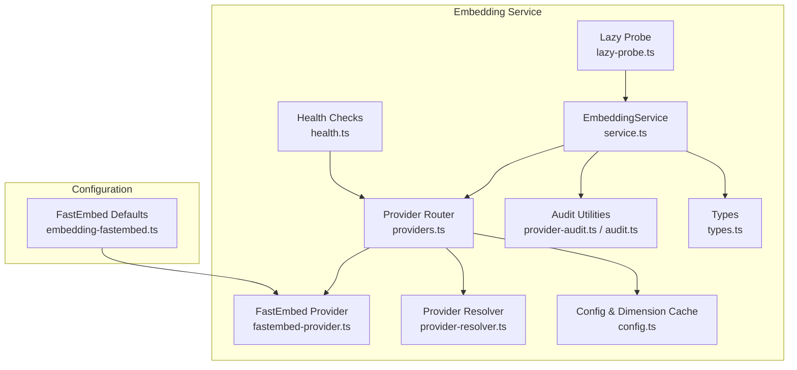
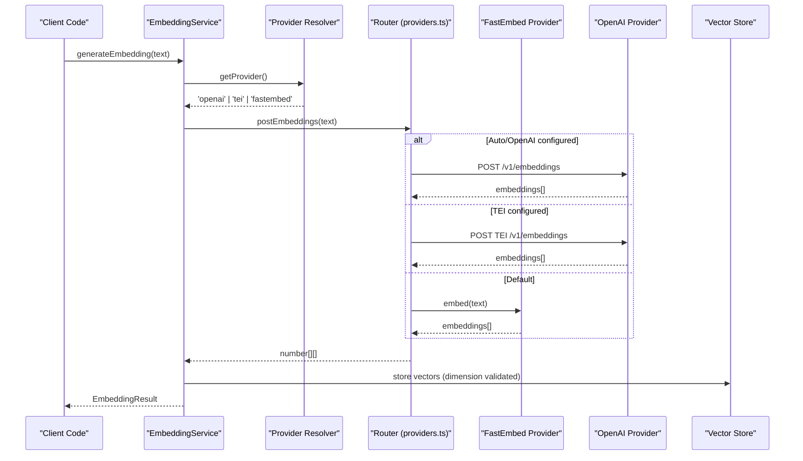
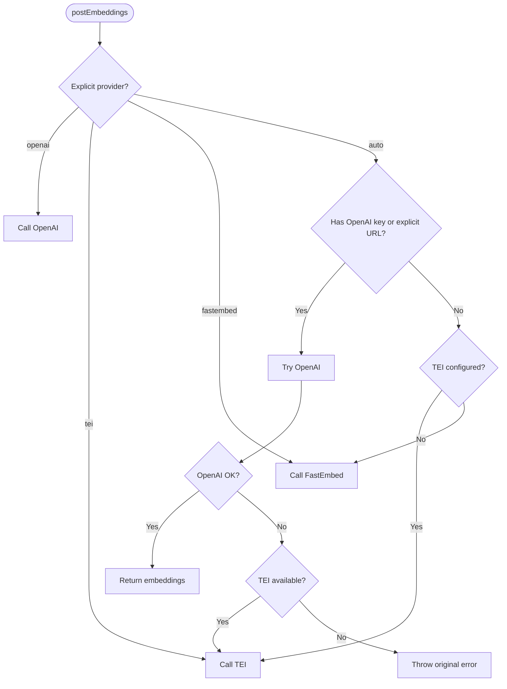
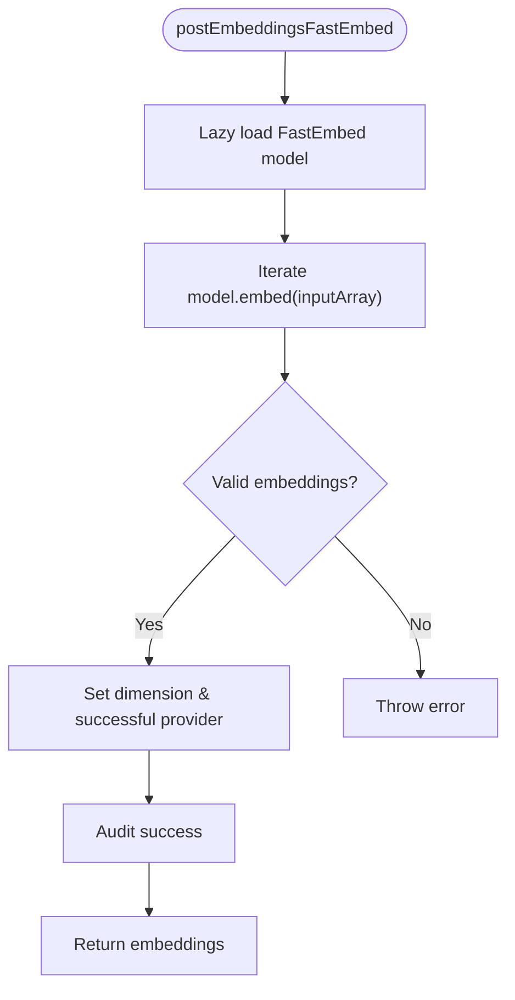
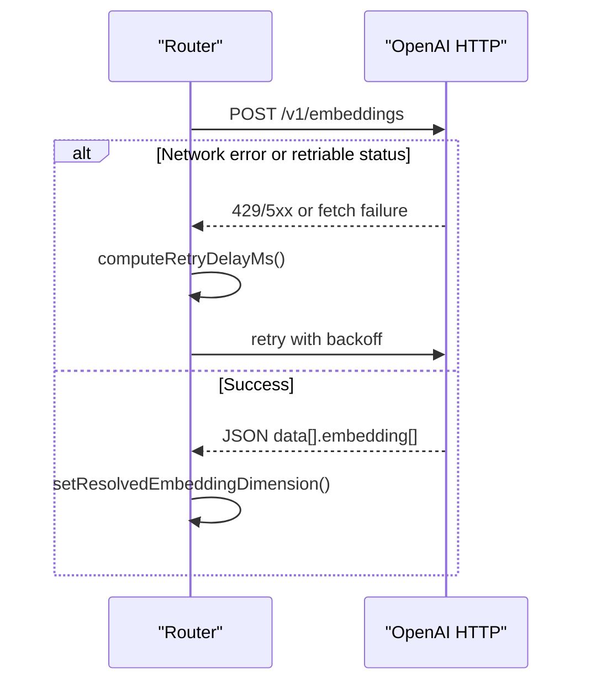
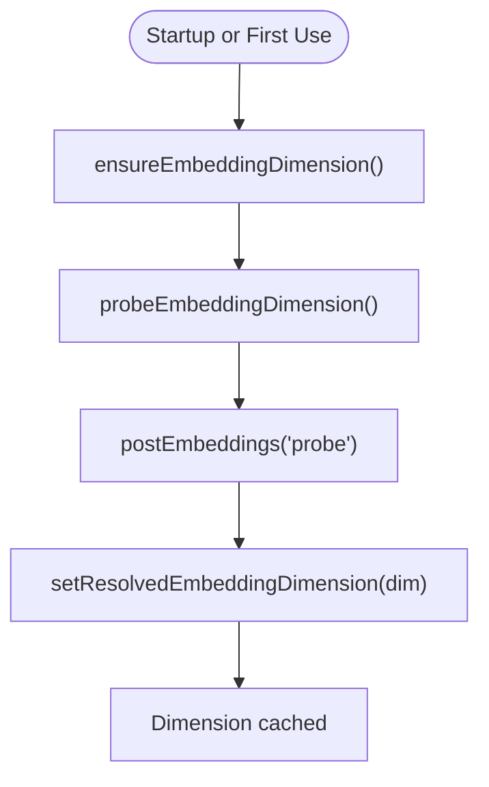
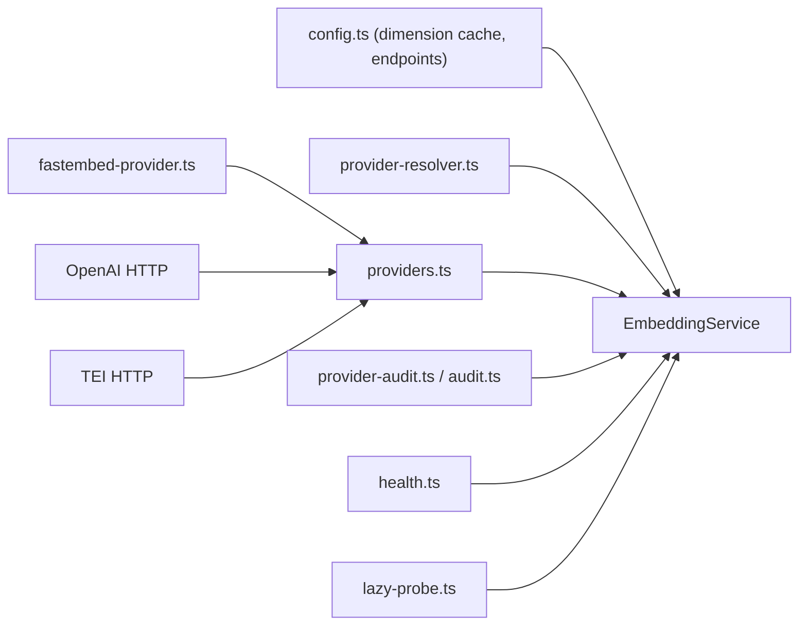

# Embedding Providers

<cite>
**Referenced Files in This Document**
- [service.ts](file://src/services/embedding/service.ts)
- [providers.ts](file://src/services/embedding/providers.ts)
- [fastembed-provider.ts](file://src/services/embedding/fastembed-provider.ts)
- [provider-resolver.ts](file://src/services/embedding/provider-resolver.ts)
- [config.ts](file://src/services/embedding/config.ts)
- [embedding-fastembed.ts](file://src/config/embedding-fastembed.ts)
- [health.ts](file://src/services/embedding/health.ts)
- [audit.ts](file://src/services/embedding/audit.ts)
- [provider-audit.ts](file://src/services/embedding/provider-audit.ts)
- [lazy-probe.ts](file://src/services/embedding/lazy-probe.ts)
- [types.ts](file://src/services/embedding/types.ts)
</cite>

## Table of Contents
1. [Introduction](#introduction)
2. [Project Structure](#project-structure)
3. [Core Components](#core-components)
4. [Architecture Overview](#architecture-overview)
5. [Detailed Component Analysis](#detailed-component-analysis)
6. [Dependency Analysis](#dependency-analysis)
7. [Performance Considerations](#performance-considerations)
8. [Troubleshooting Guide](#troubleshooting-guide)
9. [Conclusion](#conclusion)

## Introduction
This document explains the embedding provider system that powers semantic search in SquadRules. It covers the abstraction layer for plugging in different embedding models and services, the built-in FastEmbed integration for local embeddings, OpenAI SDK-compatible HTTP integration for cloud embeddings, and a deprecated TEI (Text Embeddings Inference) path. It also documents the automatic provider resolution mechanism, configuration options, error handling, retry and rate-limiting behavior, model versioning, caching strategies, and production reliability patterns such as health checks and fallbacks.

## Project Structure
The embedding subsystem is organized under src/services/embedding with supporting configuration in src/config/embedding-fastembed.ts:



**Diagram sources**
- [service.ts:39-278](file://src/services/embedding/service.ts#L39-L278)
- [providers.ts:296-333](file://src/services/embedding/providers.ts#L296-L333)
- [fastembed-provider.ts:41-82](file://src/services/embedding/fastembed-provider.ts#L41-L82)
- [provider-resolver.ts:28-46](file://src/services/embedding/provider-resolver.ts#L28-L46)
- [config.ts:12-36](file://src/services/embedding/config.ts#L12-L36)
- [health.ts:92-120](file://src/services/embedding/health.ts#L92-L120)
- [provider-audit.ts:26-42](file://src/services/embedding/provider-audit.ts#L26-L42)
- [embedding-fastembed.ts:14-22](file://src/config/embedding-fastembed.ts#L14-L22)

**Section sources**
- [service.ts:39-278](file://src/services/embedding/service.ts#L39-L278)
- [providers.ts:1-343](file://src/services/embedding/providers.ts#L1-L343)
- [fastembed-provider.ts:1-83](file://src/services/embedding/fastembed-provider.ts#L1-L83)
- [provider-resolver.ts:1-82](file://src/services/embedding/provider-resolver.ts#L1-L82)
- [config.ts:1-40](file://src/services/embedding/config.ts#L1-L40)
- [embedding-fastembed.ts:1-23](file://src/config/embedding-fastembed.ts#L1-L23)
- [health.ts:1-123](file://src/services/embedding/health.ts#L1-L123)
- [provider-audit.ts:1-43](file://src/services/embedding/provider-audit.ts#L1-L43)
- [audit.ts:1-197](file://src/services/embedding/audit.ts#L1-L197)
- [lazy-probe.ts:1-28](file://src/services/embedding/lazy-probe.ts#L1-L28)
- [types.ts:1-17](file://src/services/embedding/types.ts#L1-L17)

## Core Components
- EmbeddingService: Public API for single and batch embeddings, cosine similarity, health check, and configuration introspection. It selects the candidate provider, validates dimensions, tracks metrics, and emits audit logs.
- providers.ts: Central router that chooses between OpenAI, TEI, or FastEmbed based on explicit preference or auto-detection. Implements retries, backoff, and rate-limit error handling.
- fastembed-provider.ts: Local ONNX-based embeddings via FastEmbed with lazy initialization and shared cache directory.
- provider-resolver.ts: Pure logic to determine which provider to try and to record the successful provider descriptor after a successful run.
- config.ts: Runtime dimension cache and endpoint construction; enforces consistent vector dimensions across calls.
- health.ts: Health probes per provider mirroring runtime selection rules.
- audit.ts and provider-audit.ts: Structured audit logging and anomaly detection for latency, norms, and dimension mismatches.
- lazy-probe.ts: Memoized probe to eagerly or lazily resolve embedding dimension at startup or first use.
- types.ts: Shared result shapes for single and batch embeddings.

**Section sources**
- [service.ts:39-278](file://src/services/embedding/service.ts#L39-L278)
- [providers.ts:1-343](file://src/services/embedding/providers.ts#L1-L343)
- [fastembed-provider.ts:1-83](file://src/services/embedding/fastembed-provider.ts#L1-L83)
- [provider-resolver.ts:1-82](file://src/services/embedding/provider-resolver.ts#L1-L82)
- [config.ts:1-40](file://src/services/embedding/config.ts#L1-L40)
- [health.ts:1-123](file://src/services/embedding/health.ts#L1-L123)
- [provider-audit.ts:1-43](file://src/services/embedding/provider-audit.ts#L1-L43)
- [audit.ts:1-197](file://src/services/embedding/audit.ts#L1-L197)
- [lazy-probe.ts:1-28](file://src/services/embedding/lazy-probe.ts#L1-L28)
- [types.ts:1-17](file://src/services/embedding/types.ts#L1-L17)

## Architecture Overview
The embedding pipeline is a layered architecture:
- Consumer code calls EmbeddingService.generateEmbedding or generateBatchEmbeddings.
- EmbeddingService resolves the candidate provider and delegates to postEmbeddings.
- providers.ts selects OpenAI, TEI, or FastEmbed, applies retries/backoff, and records successful provider metadata.
- FastEmbed runs locally; OpenAI/TEI call remote endpoints with structured error handling.
- Dimensions are probed once and cached; anomalies are detected and audited.



**Diagram sources**
- [service.ts:48-127](file://src/services/embedding/service.ts#L48-L127)
- [provider-resolver.ts:28-46](file://src/services/embedding/provider-resolver.ts#L28-L46)
- [providers.ts:296-333](file://src/services/embedding/providers.ts#L296-L333)
- [fastembed-provider.ts:41-82](file://src/services/embedding/fastembed-provider.ts#L41-L82)

## Detailed Component Analysis

### EmbeddingService
Responsibilities:
- Single and batch embedding generation with validation and anomaly detection.
- Metrics collection and structured audit logging.
- Health check delegation and configuration introspection.
- Candidate provider selection via resolver.

Key behaviors:
- Validates non-empty input and expected vector dimensions.
- Tracks request duration, vector sizes, and batch sizes.
- Emits success/error audit events and anomaly alerts for latency, norm, and dimension mismatch.

```mermaid
classDiagram
class EmbeddingService {
+generateEmbedding(text) EmbeddingResult
+generateBatchEmbeddings(texts) BatchEmbeddingResult
+calculateCosineSimilarity(a,b) number
+generateMemoryEmbedding(memory) number[]
+estimateCost() number
+healthCheck() Promise~{healthy,message}~
+getProvider() 'openai'|'tei'|'fastembed'
+getConfig() object
}
```

**Diagram sources**
- [service.ts:39-278](file://src/services/embedding/service.ts#L39-L278)

**Section sources**
- [service.ts:48-278](file://src/services/embedding/service.ts#L48-L278)
- [audit.ts:94-157](file://src/services/embedding/audit.ts#L94-L157)

### Provider Resolution and Routing
Resolution rules:
- Explicit preference wins: openai, tei, fastembed.
- Auto mode prefers OpenAI if OPENAI_API_KEY or an explicitly overridden OPENAI_API_URL is present; otherwise falls back to TEI if configured; otherwise uses FastEmbed.
- Successful provider descriptor is recorded after a successful response to enable downstream consistency checks.

Routing behavior:
- postEmbeddings orchestrates retries, backoff, and rate-limit handling.
- OpenAI and TEI paths parse responses flexibly and set resolved dimension.
- FastEmbed path initializes ONNX model lazily and streams batches.



**Diagram sources**
- [providers.ts:296-333](file://src/services/embedding/providers.ts#L296-L333)
- [provider-resolver.ts:28-46](file://src/services/embedding/provider-resolver.ts#L28-L46)

**Section sources**
- [providers.ts:93-333](file://src/services/embedding/providers.ts#L93-L333)
- [provider-resolver.ts:28-82](file://src/services/embedding/provider-resolver.ts#L28-L82)

### FastEmbed Integration (Local)
Highlights:
- Lazy initialization of the FastEmbed model to avoid loading native bindings unless needed.
- Model weights downloaded into a shared cache directory configurable via environment variables.
- Streams embeddings in batches and sets resolved dimension and successful provider descriptor.



**Diagram sources**
- [fastembed-provider.ts:26-82](file://src/services/embedding/fastembed-provider.ts#L26-L82)
- [embedding-fastembed.ts:14-22](file://src/config/embedding-fastembed.ts#L14-L22)

**Section sources**
- [fastembed-provider.ts:1-83](file://src/services/embedding/fastembed-provider.ts#L1-L83)
- [embedding-fastembed.ts:1-23](file://src/config/embedding-fastembed.ts#L1-L23)

### OpenAI Integration (Cloud)
Highlights:
- Uses OPENAI_ENDPOINT constructed from base URL plus /v1/embeddings.
- Supports optional Authorization header when OPENAI_API_KEY is present.
- Robust retry with exponential backoff and jitter, honoring Retry-After headers where provided.
- Distinguishes transient vs non-transient 429 errors (e.g., insufficient quota).



**Diagram sources**
- [providers.ts:93-202](file://src/services/embedding/providers.ts#L93-L202)
- [config.ts:1-10](file://src/services/embedding/config.ts#L1-L10)

**Section sources**
- [providers.ts:93-202](file://src/services/embedding/providers.ts#L93-L202)
- [config.ts:1-10](file://src/services/embedding/config.ts#L1-L10)

### TEI Integration (Deprecated)
Highlights:
- Accepts multiple response shapes for compatibility.
- Soft-deprecation warning emitted once per process.
- Retries and rate-limit handling similar to OpenAI.

Note: Prefer OpenAI/Ollama-compatible endpoints or FastEmbed for new deployments.

**Section sources**
- [providers.ts:203-295](file://src/services/embedding/providers.ts#L203-L295)
- [providers.ts:335-341](file://src/services/embedding/providers.ts#L335-L341)

### Dimension Probing and Caching
- The first successful embedding call sets the resolved dimension; subsequent calls assert consistency.
- probeEmbeddingDimension performs a minimal embedding to initialize the model and cache dimension.
- ensureEmbeddingDimension memoizes the probe to avoid redundant work during boot or CLI flows.



**Diagram sources**
- [lazy-probe.ts:19-27](file://src/services/embedding/lazy-probe.ts#L19-L27)
- [service.ts:281-284](file://src/services/embedding/service.ts#L281-L284)
- [config.ts:12-36](file://src/services/embedding/config.ts#L12-L36)

**Section sources**
- [lazy-probe.ts:1-28](file://src/services/embedding/lazy-probe.ts#L1-L28)
- [service.ts:281-284](file://src/services/embedding/service.ts#L281-L284)
- [config.ts:12-36](file://src/services/embedding/config.ts#L12-L36)

### Health Checks
- Per-provider health functions mirror runtime selection rules.
- Reports reachability and common misconfigurations (auth, rate limits).
- Sets resolved dimension when successful.

**Section sources**
- [health.ts:17-90](file://src/services/embedding/health.ts#L17-L90)
- [health.ts:92-120](file://src/services/embedding/health.ts#L92-L120)

### Types and Results
- EmbeddingResult and BatchEmbeddingResult define the shape returned by the service, including model name and usage fields.

**Section sources**
- [types.ts:1-17](file://src/services/embedding/types.ts#L1-L17)

## Dependency Analysis
High-level dependencies:



**Diagram sources**
- [service.ts:39-278](file://src/services/embedding/service.ts#L39-L278)
- [providers.ts:1-343](file://src/services/embedding/providers.ts#L1-L343)
- [fastembed-provider.ts:1-83](file://src/services/embedding/fastembed-provider.ts#L1-L83)
- [provider-resolver.ts:1-82](file://src/services/embedding/provider-resolver.ts#L1-L82)
- [config.ts:1-40](file://src/services/embedding/config.ts#L1-L40)
- [health.ts:1-123](file://src/services/embedding/health.ts#L1-L123)
- [provider-audit.ts:1-43](file://src/services/embedding/provider-audit.ts#L1-L43)
- [audit.ts:1-197](file://src/services/embedding/audit.ts#L1-L197)
- [lazy-probe.ts:1-28](file://src/services/embedding/lazy-probe.ts#L1-L28)

**Section sources**
- [service.ts:39-278](file://src/services/embedding/service.ts#L39-L278)
- [providers.ts:1-343](file://src/services/embedding/providers.ts#L1-L343)

## Performance Considerations
- Local vs Cloud: FastEmbed avoids network latency and API costs but consumes CPU/GPU resources; OpenAI/TEI offload computation but incur network latency and potential rate limits.
- Batch Processing: Prefer batch embeddings for throughput; the service tracks batch size and vector sizes for observability.
- Model Warm-up: Use probeEmbeddingDimension at startup to warm up models and resolve dimensions early.
- Dimension Consistency: Enforced via cached dimension; mismatches trigger critical anomalies.
- Retry Budget: Exponential backoff with full jitter and optional Retry-After support prevents thundering herds while respecting provider guidance.

[No sources needed since this section provides general guidance]

## Troubleshooting Guide
Common issues and resolutions:
- Missing credentials:
  - OpenAI requires OPENAI_API_KEY or an explicitly overridden OPENAI_API_URL; otherwise authentication fails.
  - TEI requires TEI_BASE_URL and TEI_MODEL; missing values cause immediate errors.
- Rate limiting:
  - 429 responses are handled; OpenAI distinguishes transient throttling from non-retriable insufficient quota.
  - Respect Retry-After headers when provided; otherwise fall back to exponential backoff.
- Dimension mismatch:
  - If the provider returns vectors of unexpected dimension, the service throws and emits a critical anomaly.
- Health diagnostics:
  - Use the health check endpoints to validate provider reachability and configuration before relying on embeddings.

Operational tips:
- Enable structured audit logs to track provider, model, latency, and error messages.
- Monitor anomaly metrics for high latency, unusual vector norms, and dimension mismatches.
- For production, prefer explicit provider selection and pre-warm the embedding dimension at startup.

**Section sources**
- [providers.ts:93-202](file://src/services/embedding/providers.ts#L93-L202)
- [providers.ts:203-295](file://src/services/embedding/providers.ts#L203-L295)
- [audit.ts:94-157](file://src/services/embedding/audit.ts#L94-L157)
- [health.ts:17-90](file://src/services/embedding/health.ts#L17-L90)

## Conclusion
The embedding provider system offers a flexible, robust abstraction over local and cloud embedding backends. With automatic provider resolution, strict dimension validation, comprehensive retry and rate-limit handling, and strong observability, it supports both development convenience and production reliability. FastEmbed provides a zero-dependency default, while OpenAI and TEI integrate seamlessly for cloud scenarios. For best results, configure providers explicitly, probe dimensions at startup, monitor anomalies, and tune batch sizes according to workload characteristics.

[No sources needed since this section summarizes without analyzing specific files]