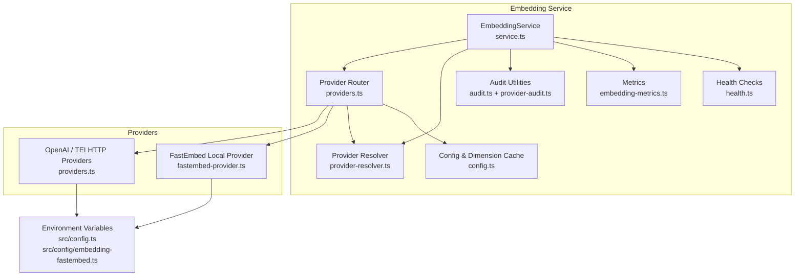
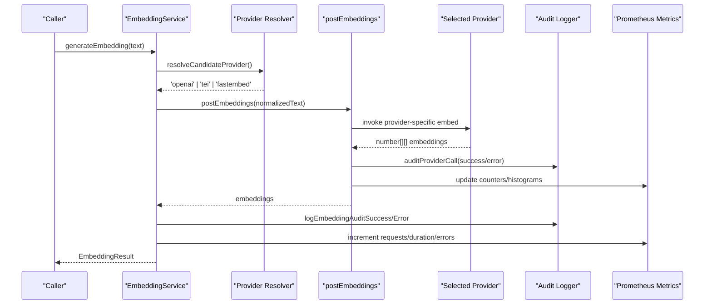
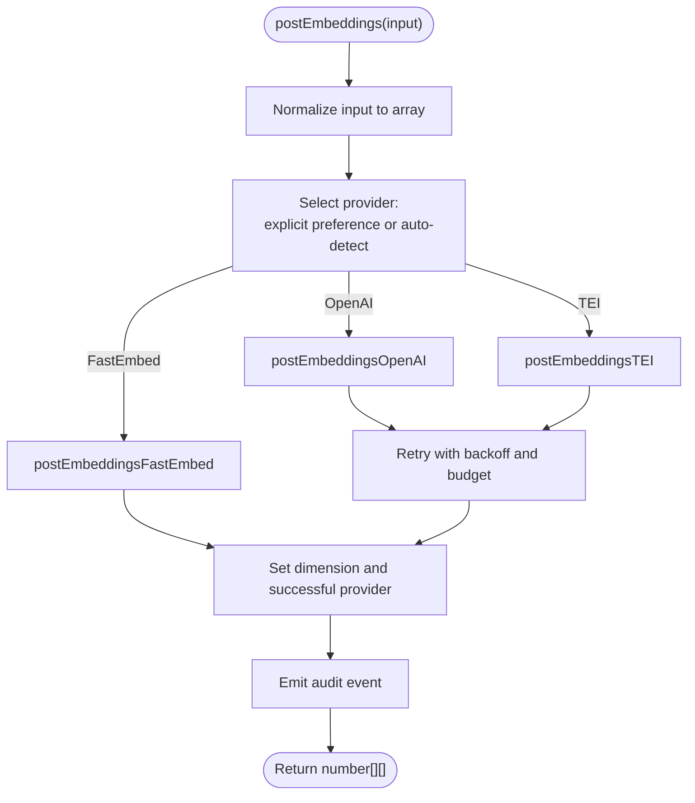
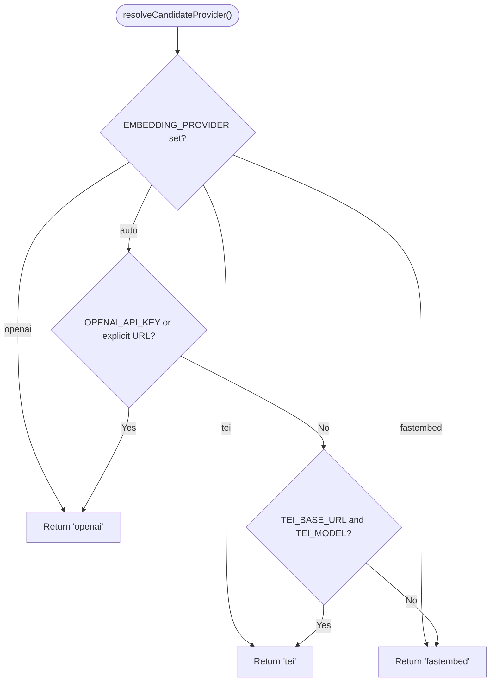
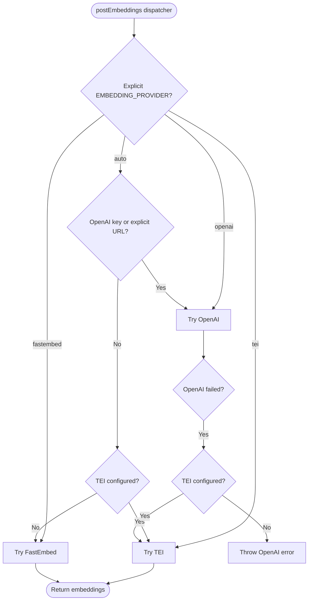
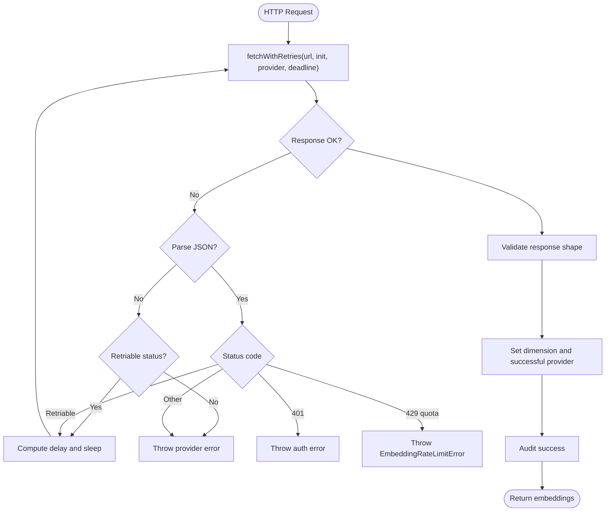
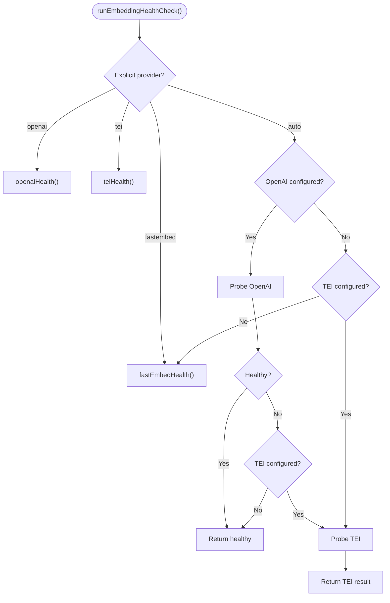
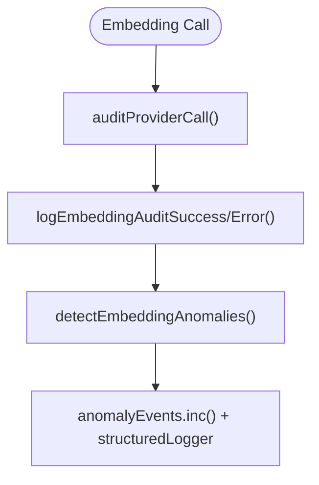
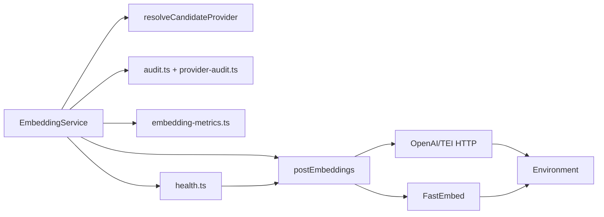

# Provider Abstraction Layer

<cite>
**Referenced Files in This Document**
- [providers.ts](file://src/services/embedding/providers.ts)
- [provider-resolver.ts](file://src/services/embedding/provider-resolver.ts)
- [fastembed-provider.ts](file://src/services/embedding/fastembed-provider.ts)
- [config.ts](file://src/services/embedding/config.ts)
- [service.ts](file://src/services/embedding/service.ts)
- [health.ts](file://src/services/embedding/health.ts)
- [audit.ts](file://src/services/embedding/audit.ts)
- [provider-audit.ts](file://src/services/embedding/provider-audit.ts)
- [embedding-metrics.ts](file://src/services/metrics/embedding-metrics.ts)
- [types.ts](file://src/services/embedding/types.ts)
- [config.ts](file://src/config.ts)
- [embedding-fastembed.ts](file://src/config/embedding-fastembed.ts)
</cite>

## Table of Contents
1. [Introduction](#introduction)
2. [Project Structure](#project-structure)
3. [Core Components](#core-components)
4. [Architecture Overview](#architecture-overview)
5. [Detailed Component Analysis](#detailed-component-analysis)
6. [Dependency Analysis](#dependency-analysis)
7. [Performance Considerations](#performance-considerations)
8. [Troubleshooting Guide](#troubleshooting-guide)
9. [Conclusion](#conclusion)

## Introduction
This document explains the embedding provider abstraction layer that enables pluggable embedding model implementations. It focuses on:
- The provider interface contract, including the `postEmbeddings` function signature and error handling patterns.
- The provider resolution mechanism that automatically selects between OpenAI, TEI, and FastEmbed providers based on configuration availability.
- Provider selection logic, fallback mechanisms, and behavior when a provider is unavailable.
- Examples of how provider implementations conform to the shared contract.
- How new providers can be integrated.
- Provider health checking, metrics collection, and audit logging integration.
- Configuration-driven provider switching and environment variable precedence rules.

The system is designed so callers use a stable service API while the underlying embedding provider can change through configuration or environment variables.

## Project Structure
The embedding subsystem lives under `src/services/embedding`. The most relevant files are:
- `providers.ts`: Central routing and retry logic for OpenAI and TEI HTTP providers, plus the main `postEmbeddings` dispatcher.
- `fastembed-provider.ts`: Local fastembed implementation with lazy initialization.
- `provider-resolver.ts`: Pure candidate provider selection and successful provider tracking.
- `config.ts`: Endpoint construction and embedding dimension caching/validation.
- `service.ts`: Public `EmbeddingService` facade used by the rest of the application.
- `health.ts`: Health checks per provider.
- `audit.ts` and `provider-audit.ts`: Structured audit logging and anomaly detection.
- `embedding-metrics.ts`: Prometheus-style metrics for embedding operations.
- `types.ts`: Shared result types.
- `src/config.ts` and `src/config/embedding-fastembed.ts`: Environment variable definitions and defaults.



**Diagram sources**
- [service.ts:39-275](file://src/services/embedding/service.ts#L39-L275)
- [providers.ts:296-333](file://src/services/embedding/providers.ts#L296-L333)
- [provider-resolver.ts:28-46](file://src/services/embedding/provider-resolver.ts#L28-L46)
- [config.ts:12-36](file://src/services/embedding/config.ts#L12-L36)
- [fastembed-provider.ts:41-82](file://src/services/embedding/fastembed-provider.ts#L41-L82)
- [embedding-metrics.ts:11-47](file://src/services/metrics/embedding-metrics.ts#L11-L47)
- [health.ts:92-120](file://src/services/embedding/health.ts#L92-L120)

**Section sources**
- [service.ts:39-275](file://src/services/embedding/service.ts#L39-L275)
- [providers.ts:296-333](file://src/services/embedding/providers.ts#L296-L333)
- [provider-resolver.ts:28-46](file://src/services/embedding/provider-resolver.ts#L28-L46)
- [config.ts:12-36](file://src/services/embedding/config.ts#L12-L36)
- [fastembed-provider.ts:41-82](file://src/services/embedding/fastembed-provider.ts#L41-L82)
- [embedding-metrics.ts:11-47](file://src/services/metrics/embedding-metrics.ts#L11-L47)
- [health.ts:92-120](file://src/services/embedding/health.ts#L92-L120)
- [config.ts:75-81](file://src/config.ts#L75-L81)
- [embedding-fastembed.ts:15-15](file://src/config/embedding-fastembed.ts#L15-L15)

## Core Components
- **EmbeddingService**: Public facade exposing single and batch embedding generation, cosine similarity calculation, health checks, and configuration inspection. It delegates actual embedding work to `postEmbeddings`, tracks metrics, performs anomaly detection, and emits structured audit logs.
- **Provider Router (`postEmbeddings`)**: Central dispatcher that chooses OpenAI, TEI, or FastEmbed based on explicit preference or auto-detection. It implements retries, backoff, rate-limit handling, and audit logging.
- **Provider Resolver**: Pure logic that determines the candidate provider from `EMBEDDING_PROVIDER` and environment configuration. It also tracks the last successful provider descriptor (provider name, model, vector dimension).
- **FastEmbed Provider**: Local ONNX-based provider with lazy initialization and model download into a cache directory. It sets the resolved embedding dimension and successful provider descriptor after success.
- **Config Module**: Builds OpenAI and TEI endpoints, caches the resolved embedding dimension, and enforces dimension consistency across calls.
- **Health Module**: Per-provider health probes that mirror runtime selection logic.
- **Audit and Metrics**: Structured logging and Prometheus metrics for request counts, latency, errors, vector sizes, and batch sizes.

Key responsibilities:
- Provide a stable `postEmbeddings(input)` contract returning `number[][]`.
- Normalize input to arrays and compute input character length for audit.
- Record successful provider metadata and dimension.
- Emit structured audit events for both success and failure paths.
- Expose metrics tagged by provider and tenant.

**Section sources**
- [service.ts:39-275](file://src/services/embedding/service.ts#L39-L275)
- [providers.ts:93-295](file://src/services/embedding/providers.ts#L93-L295)
- [provider-resolver.ts:28-81](file://src/services/embedding/provider-resolver.ts#L28-L81)
- [fastembed-provider.ts:41-82](file://src/services/embedding/fastembed-provider.ts#L41-L82)
- [config.ts:12-36](file://src/services/embedding/config.ts#L12-L36)
- [embedding-metrics.ts:11-47](file://src/services/metrics/embedding-metrics.ts#L11-L47)
- [audit.ts:60-157](file://src/services/embedding/audit.ts#L60-L157)
- [provider-audit.ts:26-42](file://src/services/embedding/provider-audit.ts#L26-L42)

## Architecture Overview
The embedding abstraction separates caller-facing APIs from provider-specific details. Callers interact with `EmbeddingService`, which uses `postEmbeddings` to delegate to the selected provider. Provider selection is driven by configuration and environment variables. Successful provider information and embedding dimensions are recorded globally for downstream components like vector stores.



**Diagram sources**
- [service.ts:48-127](file://src/services/embedding/service.ts#L48-L127)
- [provider-resolver.ts:28-46](file://src/services/embedding/provider-resolver.ts#L28-L46)
- [providers.ts:296-333](file://src/services/embedding/providers.ts#L296-L333)
- [provider-audit.ts:26-42](file://src/services/embedding/provider-audit.ts#L26-L42)
- [embedding-metrics.ts:11-47](file://src/services/metrics/embedding-metrics.ts#L11-L47)

## Detailed Component Analysis

### Provider Interface Contract
The core contract is the `postEmbeddings` function exported by the provider router. Its responsibilities include:
- Accepting either a single string or an array of strings.
- Normalizing input to an array.
- Returning a two-dimensional array of numbers representing embeddings.
- Handling retries, backoff, and provider-specific error mapping.
- Recording successful provider metadata and embedding dimension.
- Emitting structured audit logs for each call.



**Diagram sources**
- [providers.ts:93-295](file://src/services/embedding/providers.ts#L93-L295)
- [providers.ts:296-333](file://src/services/embedding/providers.ts#L296-L333)
- [fastembed-provider.ts:41-82](file://src/services/embedding/fastembed-provider.ts#L41-L82)

**Section sources**
- [providers.ts:93-295](file://src/services/embedding/providers.ts#L93-L295)
- [providers.ts:296-333](file://src/services/embedding/providers.ts#L296-L333)
- [fastembed-provider.ts:41-82](file://src/services/embedding/fastembed-provider.ts#L41-L82)

### Provider Resolution Mechanism
The resolver determines the candidate provider using these rules:
1. Explicit preference via `EMBEDDING_PROVIDER` wins if set to `openai`, `tei`, or `fastembed`.
2. Auto mode selects:
   - OpenAI if `OPENAI_API_KEY` is present or `OPENAI_API_URL` was explicitly overridden.
   - TEI if both `TEI_BASE_URL` and `TEI_MODEL` are configured.
   - FastEmbed otherwise as the zero-configuration default.

The resolver does not indicate what actually succeeded; it only indicates what will be attempted. Actual success is recorded separately via `setSuccessfulProvider`.



**Diagram sources**
- [provider-resolver.ts:28-46](file://src/services/embedding/provider-resolver.ts#L28-L46)

**Section sources**
- [provider-resolver.ts:28-46](file://src/services/embedding/provider-resolver.ts#L28-L46)
- [config.ts:75-81](file://src/config.ts#L75-L81)
- [embedding-fastembed.ts:15-15](file://src/config/embedding-fastembed.ts#L15-L15)

### Provider Selection Logic and Fallbacks
The central `postEmbeddings` dispatcher mirrors the resolver but adds runtime fallback behavior:
- If `EMBEDDING_PROVIDER` is explicitly set, it uses that provider directly.
- In auto mode:
  - If OpenAI credentials or explicit URL are present, it attempts OpenAI first.
  - On OpenAI failure, it falls back to TEI if configured.
  - If neither external provider is available, it uses FastEmbed.

This ensures graceful degradation: external providers are preferred when configured, but local fastembed remains available without keys or services.



**Diagram sources**
- [providers.ts:296-333](file://src/services/embedding/providers.ts#L296-L333)

**Section sources**
- [providers.ts:296-333](file://src/services/embedding/providers.ts#L296-L333)

### Error Handling Patterns
Error handling is consistent across providers:
- Network failures are retried up to a configured maximum with exponential backoff and jitter.
- HTTP status codes 429, 502, 503, and 504 are considered retriable.
- Retry delays honor `Retry-After` headers when present, capped at a configured maximum.
- Wall-clock retry budget prevents indefinite retries.
- OpenAI 429 with `insufficient_quota` is treated as non-retriable billing failure and surfaced as a typed rate limit error.
- Authentication failures (401) throw clear errors indicating missing or invalid credentials.
- Non-JSON responses and unexpected response shapes produce descriptive errors.
- Rate limit exhaustion after retries throws a typed `EmbeddingRateLimitError`.



**Diagram sources**
- [providers.ts:76-92](file://src/services/embedding/providers.ts#L76-L92)
- [providers.ts:110-201](file://src/services/embedding/providers.ts#L110-L201)
- [providers.ts:214-295](file://src/services/embedding/providers.ts#L214-L295)

**Section sources**
- [providers.ts:76-92](file://src/services/embedding/providers.ts#L76-L92)
- [providers.ts:110-201](file://src/services/embedding/providers.ts#L110-L201)
- [providers.ts:214-295](file://src/services/embedding/providers.ts#L214-L295)

### Provider Implementations

#### OpenAI Provider
- Requires `OPENAI_EMBEDDING_MODEL` and either `OPENAI_API_KEY` or an explicitly overridden `OPENAI_API_URL`.
- Sends POST requests to `/v1/embeddings`.
- Parses JSON responses and validates embedding arrays.
- Records dimension and successful provider.
- Emits structured audit logs for success and error paths.
- Handles authentication, quota, and transient network errors.

**Section sources**
- [providers.ts:93-201](file://src/services/embedding/providers.ts#L93-L201)

#### TEI Provider
- Requires `TEI_BASE_URL` and `TEI_MODEL`.
- Supports optional `x-api-key` header.
- Accepts multiple response shapes from different TEI servers.
- Records dimension and successful provider.
- Emits structured audit logs for success and error paths.
- Handles authentication and transient network errors.

**Section sources**
- [providers.ts:203-295](file://src/services/embedding/providers.ts#L203-L295)

#### FastEmbed Provider
- Zero-dependency local provider using ONNX inference.
- Lazily initializes the model and downloads weights into `FASTEMBED_CACHE_DIR`.
- Iterates over streaming batches to build embeddings.
- Sets resolved embedding dimension and successful provider.
- Emits structured audit logs for success and error paths.

**Section sources**
- [fastembed-provider.ts:1-82](file://src/services/embedding/fastembed-provider.ts#L1-L82)

### Integrating a New Provider
To add a new provider:
1. Create a new provider file implementing the same contract: accept `string[] | string`, return `Promise<number[][]>`, set resolved embedding dimension, record successful provider, and emit audit logs.
2. Export a function named consistently with existing providers (for example, `postEmbeddingsNewProvider`).
3. Update the `postEmbeddings` dispatcher to recognize the new provider preference and route to your implementation.
4. Update `resolveCandidateProvider` if you want automatic selection based on environment variables.
5. Add health check support in `health.ts` if applicable.
6. Ensure metrics and audit logging are emitted consistently.

```mermaid
classDiagram
class EmbeddingService {
+generateEmbedding(text) EmbeddingResult
+generateBatchEmbeddings(texts) BatchEmbeddingResult
+healthCheck() Promise~{healthy,message}~
+getProvider() 'openai'|'tei'|'fastembed'
}
class ProviderRouter {
+postEmbeddings(input) Promise~number[][]~
}
class OpenAIProvider {
+postEmbeddingsOpenAI(input) Promise~number[][]~
}
class TEIProvider {
+postEmbeddingsTEI(input) Promise~number[][]~
}
class FastEmbedProvider {
+postEmbeddingsFastEmbed(input) Promise~number[][]~
}
EmbeddingService --> ProviderRouter : "delegates"
ProviderRouter --> OpenAIProvider : "routes"
ProviderRouter --> TEIProvider : "routes"
ProviderRouter --> FastEmbedProvider : "routes"
```

**Diagram sources**
- [service.ts:39-275](file://src/services/embedding/service.ts#L39-L275)
- [providers.ts:296-333](file://src/services/embedding/providers.ts#L296-L333)
- [fastembed-provider.ts:41-82](file://src/services/embedding/fastembed-provider.ts#L41-L82)

**Section sources**
- [service.ts:39-275](file://src/services/embedding/service.ts#L39-L275)
- [providers.ts:296-333](file://src/services/embedding/providers.ts#L296-L333)
- [fastembed-provider.ts:41-82](file://src/services/embedding/fastembed-provider.ts#L41-L82)

### Health Checking
Health checks mirror runtime provider selection:
- For explicit preferences, they probe the chosen provider.
- For auto mode, they prefer OpenAI if configured, then TEI if configured, otherwise FastEmbed.
- They interpret 429 as reachable but throttled and 401 as authentication failure.
- They set the resolved embedding dimension when successful.



**Diagram sources**
- [health.ts:17-90](file://src/services/embedding/health.ts#L17-L90)
- [health.ts:92-120](file://src/services/embedding/health.ts#L92-L120)

**Section sources**
- [health.ts:17-90](file://src/services/embedding/health.ts#L17-L90)
- [health.ts:92-120](file://src/services/embedding/health.ts#L92-L120)

### Metrics Collection
Embedding operations emit Prometheus metrics:
- Total requests by provider, status, and tenant.
- Duration histogram by provider and tenant.
- Error counter by provider, status, and tenant.
- Vector size histogram by provider and tenant.
- Batch size histogram by tenant.

These metrics are updated in `EmbeddingService` around provider calls and within provider implementations where appropriate.

**Section sources**
- [embedding-metrics.ts:11-47](file://src/services/metrics/embedding-metrics.ts#L11-L47)
- [service.ts:48-127](file://src/services/embedding/service.ts#L48-L127)
- [service.ts:130-221](file://src/services/embedding/service.ts#L130-L221)

### Audit Logging Integration
Audit logging is split into two layers:
- Provider-level audit: Each provider emits a structured audit line describing the call outcome, input size, output dimension, latency, and HTTP status when applicable.
- Service-level audit: `EmbeddingService` logs success or failure with tenant and request context, and performs anomaly detection for latency, vector norm, and dimension mismatches.



**Diagram sources**
- [provider-audit.ts:26-42](file://src/services/embedding/provider-audit.ts#L26-L42)
- [audit.ts:60-157](file://src/services/embedding/audit.ts#L60-L157)
- [service.ts:48-127](file://src/services/embedding/service.ts#L48-L127)

**Section sources**
- [provider-audit.ts:26-42](file://src/services/embedding/provider-audit.ts#L26-L42)
- [audit.ts:60-157](file://src/services/embedding/audit.ts#L60-L157)
- [service.ts:48-127](file://src/services/embedding/service.ts#L48-L127)

### Configuration-Driven Provider Switching and Environment Precedence
Configuration sources:
- `EMBEDDING_PROVIDER`: Explicit preference (`auto`, `openai`, `tei`, `fastembed`).
- `OPENAI_API_KEY`: Enables OpenAI auto-selection.
- `OPENAI_API_URL_EXPLICIT`: Indicates whether `OPENAI_API_URL` was explicitly overridden.
- `OPENAI_EMBEDDING_MODEL`: Required for OpenAI usage.
- `TEI_BASE_URL` and `TEI_MODEL`: Required for TEI usage.
- `FASTEMBED_MODEL` and `FASTEMBED_CACHE_DIR`: Used by the local provider.

Precedence rules:
1. Explicit `EMBEDDING_PROVIDER` always wins.
2. Auto mode prefers OpenAI if credentials or explicit URL are present.
3. If OpenAI fails at runtime, auto mode falls back to TEI if configured.
4. Otherwise, FastEmbed is used as the zero-configuration default.

Environment variable definitions and defaults are centralized in `src/config.ts` and `src/config/embedding-fastembed.ts`.

**Section sources**
- [config.ts:75-81](file://src/config.ts#L75-L81)
- [embedding-fastembed.ts:15-15](file://src/config/embedding-fastembed.ts#L15-L15)
- [provider-resolver.ts:28-46](file://src/services/embedding/provider-resolver.ts#L28-L46)
- [providers.ts:296-333](file://src/services/embedding/providers.ts#L296-L333)

## Dependency Analysis
The embedding subsystem has clear boundaries:
- `EmbeddingService` depends on the provider router, resolver, config, audit, metrics, and health modules.
- The provider router depends on OpenAI and TEI HTTP logic and the FastEmbed provider.
- All providers depend on environment configuration and emit audit logs.
- Config provides endpoint construction and dimension caching.
- Health depends on provider functions to perform probes.



**Diagram sources**
- [service.ts:39-275](file://src/services/embedding/service.ts#L39-L275)
- [providers.ts:296-333](file://src/services/embedding/providers.ts#L296-L333)
- [health.ts:92-120](file://src/services/embedding/health.ts#L92-L120)

**Section sources**
- [service.ts:39-275](file://src/services/embedding/service.ts#L39-L275)
- [providers.ts:296-333](file://src/services/embedding/providers.ts#L296-L333)
- [health.ts:92-120](file://src/services/embedding/health.ts#L92-L120)

## Performance Considerations
- **Lazy Initialization**: FastEmbed loads ONNX bindings and downloads models only when selected, avoiding startup overhead when unused.
- **Batching**: FastEmbed iterates over streaming batches to reduce memory pressure during large embedding jobs.
- **Dimension Caching**: The resolved embedding dimension is cached and validated to prevent mismatched vectors from being accepted.
- **Retry Budget**: Wall-clock retry budget prevents long-running retry loops under persistent failures.
- **Metrics**: Duration histograms and counters help identify slow providers and high error rates.

[No sources needed since this section provides general guidance]

## Troubleshooting Guide
Common issues and diagnostics:
- **Missing OpenAI credentials**: Errors indicate `OPENAI_API_KEY` or explicit `OPENAI_API_URL` is required.
- **Missing TEI configuration**: Errors indicate `TEI_BASE_URL` and `TEI_MODEL` are required.
- **Authentication failures**: 401 responses surface clear messages about missing or invalid keys.
- **Rate limiting**: 429 responses may be retriable depending on provider and error code; insufficient quota is non-retriable.
- **Unexpected response shapes**: Non-JSON bodies or malformed embedding arrays cause descriptive errors.
- **Dimension mismatch**: The system enforces consistent vector dimensions and throws when providers return inconsistent sizes.
- **Health checks**: Use the health module to verify provider reachability and configuration before relying on embeddings.

Recommended steps:
1. Verify environment variables for the intended provider.
2. Run `runEmbeddingHealthCheck()` to validate provider configuration and connectivity.
3. Inspect structured audit logs for provider-level success/failure details.
4. Review Prometheus metrics for request counts, durations, and errors.
5. If OpenAI fails in auto mode, confirm whether TEI fallback is configured.

**Section sources**
- [providers.ts:93-201](file://src/services/embedding/providers.ts#L93-L201)
- [providers.ts:203-295](file://src/services/embedding/providers.ts#L203-L295)
- [health.ts:17-90](file://src/services/embedding/health.ts#L17-L90)
- [config.ts:12-36](file://src/services/embedding/config.ts#L12-L36)

## Conclusion
The embedding provider abstraction layer provides a stable interface for generating embeddings while allowing flexible provider selection through configuration. It supports OpenAI, TEI, and FastEmbed, with robust retry logic, structured audit logging, Prometheus metrics, and health checks. The resolver cleanly separates candidate selection from successful provider tracking, enabling reliable operation even when providers are unavailable. Adding new providers follows a consistent pattern centered on the `postEmbeddings` contract, making the system extensible and maintainable.

[No sources needed since this section summarizes without analyzing specific files]