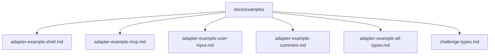
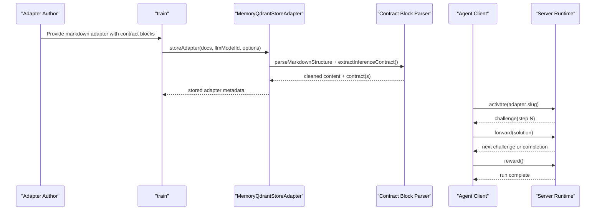
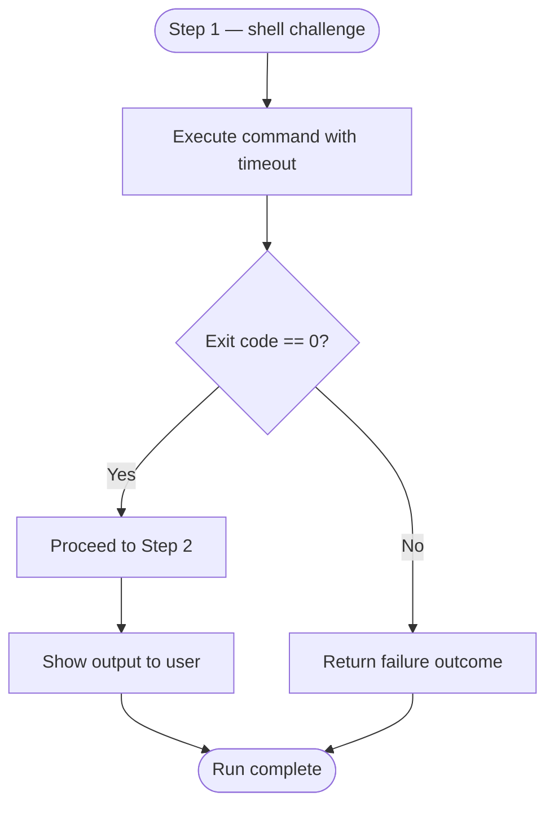
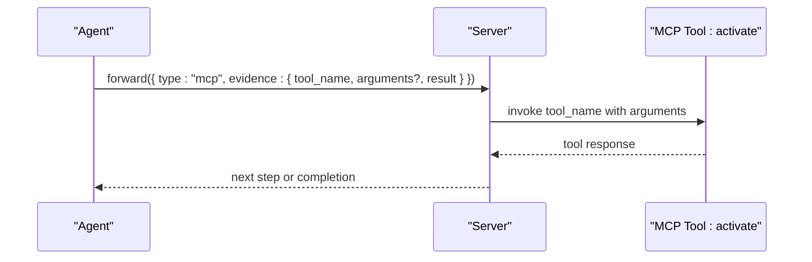
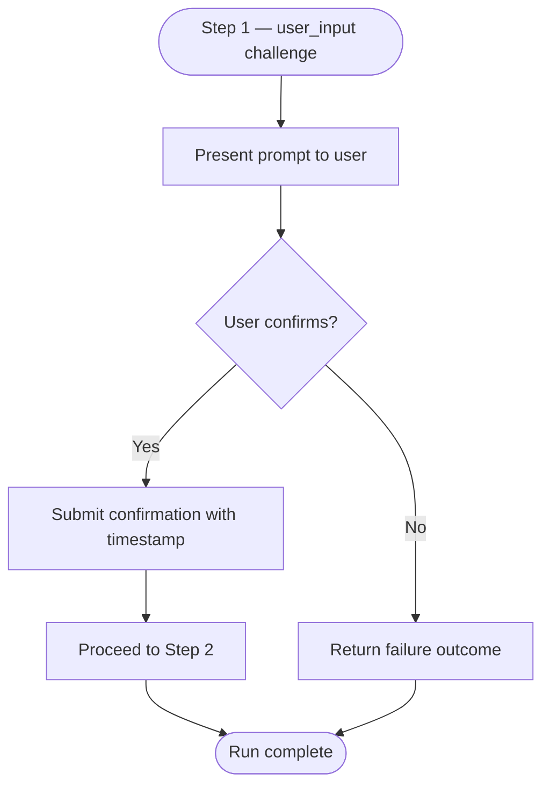
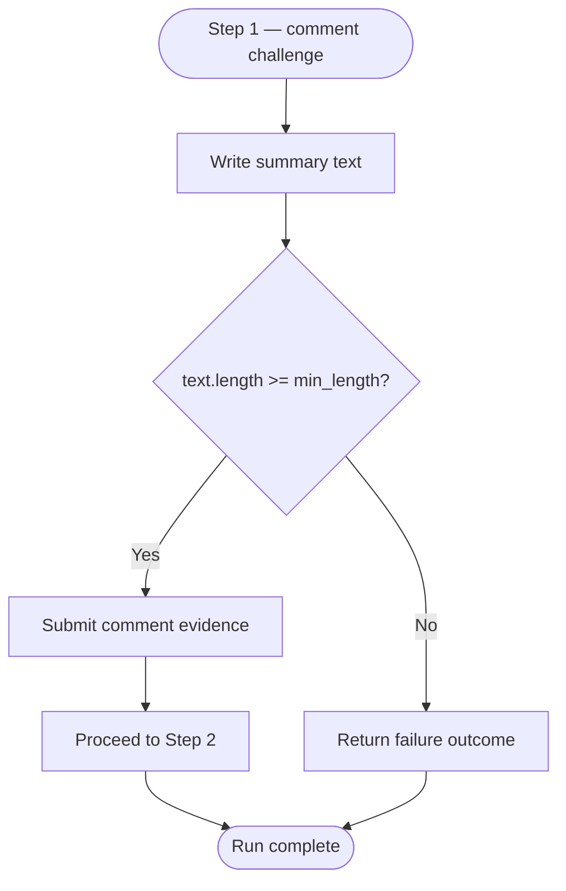
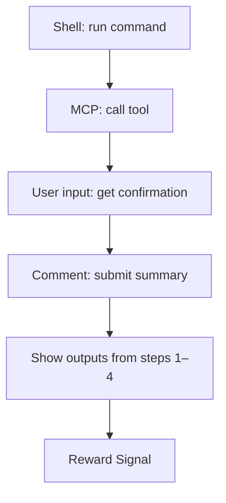
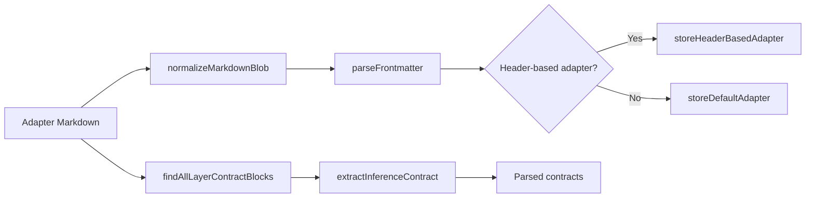

# Adapter Examples

<cite>
**Referenced Files in This Document**
- [adapter-example-all-types.md](file://docs/examples/adapter-example-all-types.md)
- [adapter-example-shell.md](file://docs/examples/adapter-example-shell.md)
- [adapter-example-mcp.md](file://docs/examples/adapter-example-mcp.md)
- [adapter-example-user-input.md](file://docs/examples/adapter-example-user-input.md)
- [adapter-example-comment.md](file://docs/examples/adapter-example-comment.md)
- [challenge-types.md](file://docs/examples/challenge-types.md)
- [challenge-type-guide.md](file://src/embed-docs/mem/challenge-type-guide.md)
- [store-adapter.ts](file://src/services/memory/store-adapter.ts)
- [adapter-contract-blocks.ts](file://src/services/memory/adapter-contract-blocks.ts)
</cite>

## Table of Contents
1. [Introduction](#introduction)
2. [Project Structure](#project-structure)
3. [Core Components](#core-components)
4. [Architecture Overview](#architecture-overview)
5. [Detailed Component Analysis](#detailed-component-analysis)
6. [Dependency Analysis](#dependency-analysis)
7. [Performance Considerations](#performance-considerations)
8. [Troubleshooting Guide](#troubleshooting-guide)
9. [Conclusion](#conclusion)

## Introduction
This document provides comprehensive adapter examples for the four challenge types supported by SquadRules: shell, MCP tool calls, user input collection, and comment verification. It explains how to write trainable adapters, how activation patterns work, how challenges are parsed and executed, and how solutions are validated. It also includes best practices for error handling, timeout configuration, output formatting, and combining multiple challenge types in complex workflows.

SquadRules is an agent-first MCP framework where agents perform deterministic, auditable tasks through adapters. The core execution flow is activate → forward → reward. Adapters define steps as structured contracts that the server interprets and enforces during training and runtime.

## Project Structure
The adapter examples live under `docs/examples`. Each example is a markdown file with:
- An H1 title.
- One or more H2 steps.
- A trailing fenced JSON block per step containing a `contract` object.



**Diagram sources**
- [adapter-example-shell.md:1-33](file://docs/examples/adapter-example-shell.md#L1-L33)
- [adapter-example-mcp.md:1-53](file://docs/examples/adapter-example-mcp.md#L1-L53)
- [adapter-example-user-input.md:1-32](file://docs/examples/adapter-example-user-input.md#L1-L32)
- [adapter-example-comment.md:1-32](file://docs/examples/adapter-example-comment.md#L1-L32)
- [adapter-example-all-types.md:1-81](file://docs/examples/adapter-example-all-types.md#L1-L81)
- [challenge-types.md:1-41](file://docs/examples/challenge-types.md#L1-L41)

**Section sources**
- [adapter-example-shell.md:1-33](file://docs/examples/adapter-example-shell.md#L1-L33)
- [adapter-example-mcp.md:1-53](file://docs/examples/adapter-example-mcp.md#L1-L53)
- [adapter-example-user-input.md:1-32](file://docs/examples/adapter-example-user-input.md#L1-L32)
- [adapter-example-comment.md:1-32](file://docs/examples/adapter-example-comment.md#L1-L32)
- [adapter-example-all-types.md:1-81](file://docs/examples/adapter-example-all-types.md#L1-L81)
- [challenge-types.md:1-41](file://docs/examples/challenge-types.md#L1-L41)

## Core Components
- Challenge types:
  - shell: execute a command and verify exit code.
  - mcp: call an MCP tool and report success.
  - user_input: collect explicit human confirmation.
  - comment: provide a text summary meeting length constraints.
- Contract structure:
  - Each step ends with a fenced JSON block containing a `contract` object.
  - Contracts include `type`, type-specific fields (e.g., `shell.cmd`, `mcp.tool_name`, `user_input.prompt`, `comment.min_length`), and `required`.
- Solution envelope:
  - Solutions use a unified envelope with `type`, `outcome`, `evidence`, and echo fields like `nonce` and `proof_hash`.

Key references:
- Example contracts and solution shapes are defined in the example files and the challenge type index.
- The selection guide documents decision rules, interpreter choices, security rules, and composition patterns.

**Section sources**
- [challenge-types.md:21-40](file://docs/examples/challenge-types.md#L21-L40)
- [challenge-type-guide.md:70-171](file://src/embed-docs/mem/challenge-type-guide.md#L70-L171)

## Architecture Overview
The end-to-end lifecycle for an adapter involves training, activation, step-by-step execution, and reward.



**Diagram sources**
- [store-adapter.ts:43-147](file://src/services/memory/store-adapter.ts#L43-L147)
- [adapter-contract-blocks.ts:21-116](file://src/services/memory/adapter-contract-blocks.ts#L21-L116)
- [challenge-types.md:21-40](file://docs/examples/challenge-types.md#L21-L40)

## Detailed Component Analysis

### Shell Challenge Example
Purpose: Execute a command and prove success via exit code.

- Activation pattern: Run when the user says “example shell” or “run shell example”.
- Step 1: Run the test suite. Success means exit code 0.
- Step 2: Show the command output to the user; no additional challenge.
- Reward Signal: Only reachable after all prior steps are solved.

Best practices:
- Set `timeout_seconds` to bound execution time.
- Capture and report `exit_code`, optional `stdout`/`stderr`, and `duration_seconds`.
- Use compound commands with `&&` to fail fast on the first check.
- Preserve real process status even when stdout/stderr are empty.



**Diagram sources**
- [adapter-example-shell.md:9-28](file://docs/examples/adapter-example-shell.md#L9-L28)
- [challenge-type-guide.md:215-233](file://src/embed-docs/mem/challenge-type-guide.md#L215-L233)

**Section sources**
- [adapter-example-shell.md:1-33](file://docs/examples/adapter-example-shell.md#L1-L33)
- [challenge-type-guide.md:215-233](file://src/embed-docs/mem/challenge-type-guide.md#L215-L233)

### MCP Tool Call Example
Purpose: Invoke an MCP tool and report success.

- Activation pattern: Run when the user says “example mcp” or “mcp challenge”.
- Step 1: Call the `activate` tool with a query and report success (`success: true`).
- Optional arguments: Constrain `arguments` to require specific parameters; extra keys in the solution are allowed.
- Step 2: Show tool name, query, and result to the user; no additional challenge.
- Reward Signal: Only reachable after all prior steps are solved.

Best practices:
- Omit `mcp.arguments` when any tool call suffices.
- Use `arguments` to enforce subset matching against the contract.
- Echo `nonce` and `proof_hash` from the challenge.



**Diagram sources**
- [adapter-example-mcp.md:9-48](file://docs/examples/adapter-example-mcp.md#L9-L48)
- [challenge-types.md:25-30](file://docs/examples/challenge-types.md#L25-L30)

**Section sources**
- [adapter-example-mcp.md:1-53](file://docs/examples/adapter-example-mcp.md#L1-L53)
- [challenge-types.md:25-30](file://docs/examples/challenge-types.md#L25-L30)

### User Input Collection Example
Purpose: Obtain explicit human approval before continuing.

- Activation pattern: Run when the user says “example user input” or “user input challenge”.
- Step 1: Ask the user to approve deployment; capture confirmation.
- Step 2: Show the user’s confirmation to the user; no additional challenge.
- Reward Signal: Only reachable after all prior steps are solved.

Best practices:
- Make prompts specific and actionable.
- Include timestamp in the solution evidence for auditability.
- Treat missing or ambiguous confirmation as failure.



**Diagram sources**
- [adapter-example-user-input.md:9-27](file://docs/examples/adapter-example-user-input.md#L9-L27)
- [challenge-type-guide.md:143-153](file://src/embed-docs/mem/challenge-type-guide.md#L143-L153)

**Section sources**
- [adapter-example-user-input.md:1-32](file://docs/examples/adapter-example-user-input.md#L1-L32)
- [challenge-type-guide.md:143-153](file://src/embed-docs/mem/challenge-type-guide.md#L143-L153)

### Comment Verification Example
Purpose: Require a verification comment or summary meeting minimum length.

- Activation pattern: Run when the user says “example comment” or “comment challenge”.
- Step 1: Provide a short summary of changes; minimum length enforced by contract.
- Step 2: Show the submitted summary to the user; no additional challenge.
- Reward Signal: Only reachable after all prior steps are solved.

Best practices:
- Use `min_length` to prevent trivial comments.
- Prefer semantic checks when available beyond length.
- Keep summaries concise but informative.



**Diagram sources**
- [adapter-example-comment.md:9-27](file://docs/examples/adapter-example-comment.md#L9-L27)
- [challenge-type-guide.md:97-100](file://src/embed-docs/mem/challenge-type-guide.md#L97-L100)

**Section sources**
- [adapter-example-comment.md:1-32](file://docs/examples/adapter-example-comment.md#L1-L32)
- [challenge-type-guide.md:97-100](file://src/embed-docs/mem/challenge-type-guide.md#L97-L100)

### Combined Workflow: All Challenge Types
Purpose: Demonstrate a single adapter chaining all four challenge types.

- Activation pattern: Run when the user says “example all types” or “all challenge types”.
- Steps:
  1. shell: run a command and verify exit code.
  2. mcp: call an MCP tool and report success.
  3. user_input: obtain explicit approval.
  4. comment: provide a summary meeting minimum length.
  5. Final step: show outputs from steps 1–4; no additional challenge.
- Reward Signal: Only reachable after all prior steps are solved.



**Diagram sources**
- [adapter-example-all-types.md:5-80](file://docs/examples/adapter-example-all-types.md#L5-L80)

**Section sources**
- [adapter-example-all-types.md:1-81](file://docs/examples/adapter-example-all-types.md#L1-L81)

## Dependency Analysis
Training and parsing pipeline:
- `MemoryQdrantStoreAdapter.storeAdapter` normalizes markdown, parses frontmatter, and delegates to header-based or default adapter storage.
- Contract extraction uses regex to find fenced JSON blocks and parse `{"contract": ...}` payloads.
- The parser supports both trailing contract blocks and multiple contract blocks across layers.



**Diagram sources**
- [store-adapter.ts:43-147](file://src/services/memory/store-adapter.ts#L43-L147)
- [adapter-contract-blocks.ts:21-116](file://src/services/memory/adapter-contract-blocks.ts#L21-L116)

**Section sources**
- [store-adapter.ts:43-147](file://src/services/memory/store-adapter.ts#L43-L147)
- [adapter-contract-blocks.ts:1-117](file://src/services/memory/adapter-contract-blocks.ts#L1-L117)

## Performance Considerations
- Shell timeouts: Always set `timeout_seconds` to avoid long-running or hung commands.
- Compound commands: Use `&&` to fail fast and preserve exit codes.
- Output clarity: Separate machine-readable stdout from agent-readable status markers on stderr.
- Argument minimization: For MCP challenges, omit unnecessary arguments unless required by the contract.
- Comment length: Choose `min_length` large enough to discourage trivial responses without being overly restrictive.

[No sources needed since this section provides general guidance]

## Troubleshooting Guide
Common issues and resolutions:
- Missing or malformed contract blocks:
  - Ensure each step ends with a single fenced JSON block containing a `contract` key.
  - Avoid mixing plain ``` fences with JSON content if they contain a `contract` key; the parser distinguishes ` ```json ` blocks.
- Incorrect solution shape:
  - Use the unified envelope with `type`, `outcome`, `evidence`, and echo fields (`nonce`, `proof_hash`) when present.
  - Match the expected fields for the challenge type (e.g., `shell.exit_code`, `mcp.success`, `user_input.confirmation`, `comment.text`).
- Timeout failures:
  - Increase `timeout_seconds` for longer-running commands.
  - Split long tasks into smaller steps with intermediate checkpoints.
- Ambiguous user input:
  - Make prompts specific and unambiguous.
  - Validate confirmation presence and format before submitting.

**Section sources**
- [adapter-contract-blocks.ts:21-116](file://src/services/memory/adapter-contract-blocks.ts#L21-L116)
- [challenge-types.md:21-40](file://docs/examples/challenge-types.md#L21-L40)
- [challenge-type-guide.md:166-171](file://src/embed-docs/mem/challenge-type-guide.md#L166-L171)

## Conclusion
Use these adapter examples as templates for building robust, auditable workflows:
- Prefer shell or MCP challenges whenever there is an observable artifact.
- Use user_input for human approvals and comment only when no stronger contract exists.
- Chain multiple challenge types to model complex workflows while keeping each step deterministic and verifiable.
- Follow the documented solution envelopes, timeout settings, and output formatting guidelines to ensure reliable execution and clear reporting.

[No sources needed since this section summarizes without analyzing specific files]