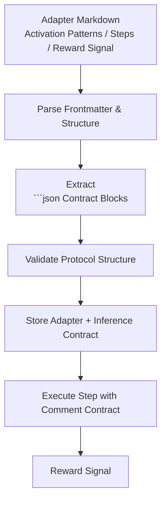
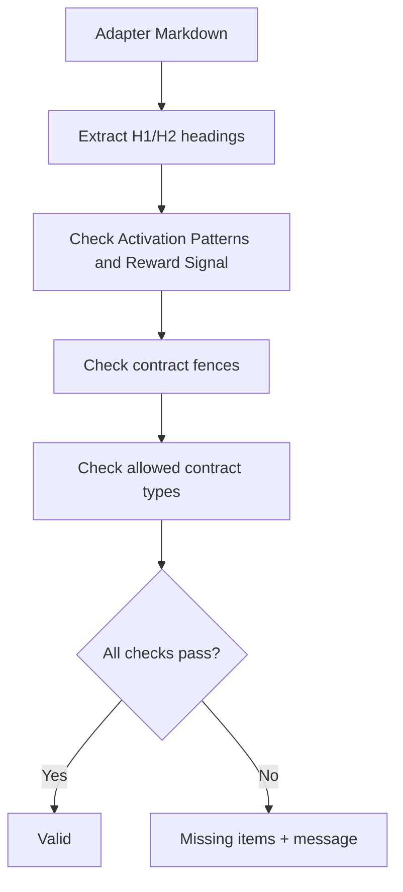
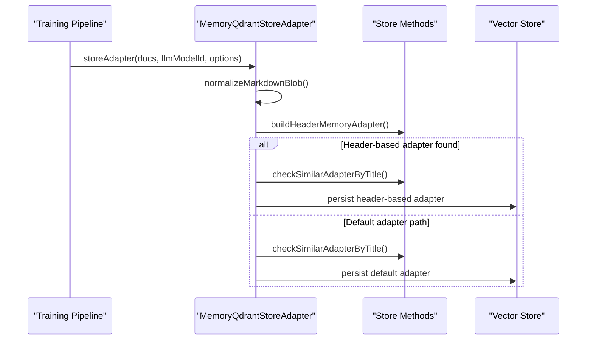
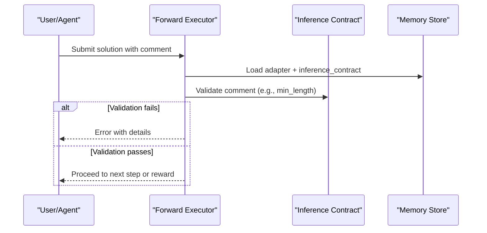
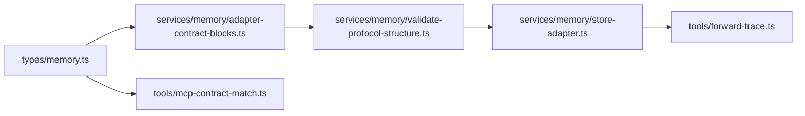

# Comment Adapter Example

<cite>
**Referenced Files in This Document**
- [adapter-example-comment.md](file://docs/examples/adapter-example-comment.md)
- [adapter-contract-blocks.ts](file://src/services/memory/adapter-contract-blocks.ts)
- [validate-protocol-structure.ts](file://src/services/memory/validate-protocol-structure.ts)
- [store-adapter.ts](file://src/services/memory/store-adapter.ts)
- [memory.ts](file://src/types/memory.ts)
- [forward-trace.ts](file://src/tools/forward-trace.ts)
- [mcp-contract-match.ts](file://src/tools/mcp-contract-match.ts)
</cite>

## Table of Contents
1. [Introduction](#introduction)
2. [Project Structure](#project-structure)
3. [Core Components](#core-components)
4. [Architecture Overview](#architecture-overview)
5. [Detailed Component Analysis](#detailed-component-analysis)
6. [Dependency Analysis](#dependency-analysis)
7. [Performance Considerations](#performance-considerations)
8. [Troubleshooting Guide](#troubleshooting-guide)
9. [Conclusion](#conclusion)
10. [Appendices](#appendices)

## Introduction
This document explains how to implement and use comment adapters in the project. A comment adapter is a Markdown-based workflow that asks an agent or user to provide a verification comment, summary, or natural-language description. The system parses structured contracts from fenced JSON blocks, validates them, stores the adapter as memory, and enforces validation rules during execution.

The goal is to help you:
- Create adapters that verify code comments or summaries.
- Extract structured information from comments using contract definitions.
- Process natural language descriptions with deterministic validation rules.
- Integrate comment challenges into the activate → forward → reward chain.
- Follow best practices for text processing and NLP patterns.

## Project Structure
Comment adapters live in Markdown documents and are trained into the memory store. The training pipeline parses Markdown structure, extracts contract blocks, validates protocol structure, and persists adapters with their inference contracts.



**Diagram sources**
- [store-adapter.ts:43-147](file://src/services/memory/store-adapter.ts#L43-L147)
- [adapter-contract-blocks.ts:51-116](file://src/services/memory/adapter-contract-blocks.ts#L51-L116)
- [validate-protocol-structure.ts:113-186](file://src/services/memory/validate-protocol-structure.ts#L113-L186)

**Section sources**
- [store-adapter.ts:43-147](file://src/services/memory/store-adapter.ts#L43-L147)
- [adapter-contract-blocks.ts:51-116](file://src/services/memory/adapter-contract-blocks.ts#L51-L116)
- [validate-protocol-structure.ts:113-186](file://src/services/memory/validate-protocol-structure.ts#L113-L186)

## Core Components
- Comment contract type: Defines validation rules for comment submissions, such as minimum length.
- Contract extraction: Parses fenced JSON blocks containing `{"contract": ...}`.
- Protocol validation: Ensures required sections and allowed contract types.
- Storage: Persists adapters with their inference contracts for later execution.
- Execution validation: Enforces contract constraints when a step requires a comment.

Key implementation points:
- Contracts are defined inside fenced JSON blocks at the end of steps.
- Only `type: "comment"` is relevant for comment adapters.
- Validation includes structural checks (headings, fences) and semantic checks (allowed types).
- During execution, comment fields like `min_length` are enforced.

**Section sources**
- [memory.ts:29-58](file://src/types/memory.ts#L29-L58)
- [adapter-contract-blocks.ts:25-45](file://src/services/memory/adapter-contract-blocks.ts#L25-L45)
- [validate-protocol-structure.ts:24-24](file://src/services/memory/validate-protocol-structure.ts#L24-L24)
- [forward-trace.ts:176-196](file://src/tools/forward-trace.ts#L176-L196)

## Architecture Overview
The comment adapter lifecycle spans training and runtime:

```mermaid
sequenceDiagram
participant Author as "Adapter Author"
participant Train as "Training Pipeline"
participant Parser as "Contract Parser"
participant Validator as "Protocol Validator"
participant Store as "Memory Store"
participant Runtime as "Forward Executor"
Author->>Train : Submit Markdown with
```json contract
    Train->>Parser: Extract trailing ```json block
    Parser-->>Train: Normalized contract object
    Train->>Validator: validateProtocolStructure()
    Validator-->>Train: valid or missing items
    Train->>Store: Persist adapter + inference_contract
    Note over Store: Adapter stored with type="comment"
    Runtime->>Store: Load adapter for activation
    Runtime->>Runtime: Enforce comment rules (e.g., min_length)
    Runtime-->>Author: Step result or validation error
```

**Diagram sources**
- [adapter-contract-blocks.ts:97-116](file://src/services/memory/adapter-contract-blocks.ts#L97-L116)
- [validate-protocol-structure.ts:113-186](file://src/services/memory/validate-protocol-structure.ts#L113-L186)
- [store-adapter.ts:43-147](file://src/services/memory/store-adapter.ts#L43-L147)
- [forward-trace.ts:176-196](file://src/tools/forward-trace.ts#L176-L196)

## Detailed Component Analysis

### Comment Contract Definition
A comment contract specifies validation criteria for textual submissions. The most common field is `min_length`, which ensures the provided comment meets a minimum character threshold.

- Allowed contract types include shell, mcp, user_input, comment, and tensor.
- For comment adapters, set `type: "comment"` and define `comment.min_length`.
- The contract can be marked `required: true` to enforce submission.

Best practices:
- Use clear, measurable thresholds (e.g., minimum length).
- Keep contracts focused on deterministic checks; avoid ambiguous natural language requirements.
- Place the contract in a fenced JSON block at the end of the step body.

**Section sources**
- [memory.ts:29-58](file://src/types/memory.ts#L29-L58)
- [adapter-example-comment.md:13-23](file://docs/examples/adapter-example-comment.md#L13-L23)

### Contract Extraction and Parsing
The parser locates fenced JSON blocks and normalizes them into a contract object. It supports:
- Trailing JSON blocks per step.
- Multiple contract blocks across layers.
- Rejection of mixed fence styles (plain ``` blocks containing contract JSON).

Parsing behavior:
- Only `type: "comment"` is considered for comment adapters.
- Mixed fences trigger validation errors to prevent ambiguity.
- The parser returns cleaned content without the contract block for storage.

```mermaid
flowchart TD
Start(["Markdown Input"]) --> FindFences["Find
```json blocks"]
  FindFences --> CheckMixed["Reject plain ``` with contract JSON"]
  CheckMixed --> ParseBlock["Parse {\"contract\": ...}"]
  ParseBlock --> Normalize["Normalize contract object"]
  Normalize --> Return["Return cleaned content + contract"]
```

**Diagram sources**
- [adapter-contract-blocks.ts:51-116](file://src/services/memory/adapter-contract-blocks.ts#L51-L116)

**Section sources**
- [adapter-contract-blocks.ts:51-116](file://src/services/memory/adapter-contract-blocks.ts#L51-L116)

### Protocol Structure Validation
Before storing an adapter, the system validates its Markdown structure:
- Requires an H1 title.
- Requires first H2 section named “Activation Patterns”.
- Requires last H2 section named “Reward Signal”.
- Requires at least one ```json contract block.
- Rejects mixed fences and invalid contract types.

Validation outcomes:
- Valid adapters proceed to storage.
- Invalid adapters return missing items and guidance messages.



**Diagram sources**
- [validate-protocol-structure.ts:29-60](file://src/services/memory/validate-protocol-structure.ts#L29-L60)
- [validate-protocol-structure.ts:113-186](file://src/services/memory/validate-protocol-structure.ts#L113-L186)

**Section sources**
- [validate-protocol-structure.ts:113-186](file://src/services/memory/validate-protocol-structure.ts#L113-L186)

### Storage and Training Flow
The training flow normalizes Markdown, parses frontmatter, detects header-based adapters, and falls back to default adapter storage. It also performs similarity checks by title and persists the adapter with its inference contract.

Key responsibilities:
- Normalize and parse Markdown.
- Detect header-based adapters vs default adapters.
- Resolve slugs and check for similar adapters.
- Store adapters with metadata and inference contracts.



**Diagram sources**
- [store-adapter.ts:43-147](file://src/services/memory/store-adapter.ts#L43-L147)

**Section sources**
- [store-adapter.ts:43-147](file://src/services/memory/store-adapter.ts#L43-L147)

### Execution and Validation of Comment Submissions
During forward execution, the system enforces contract constraints. While tensor validation logic is explicitly shown, comment validation follows the same pattern: ensure required fields exist and meet criteria (e.g., minimum length).

Execution considerations:
- If a step requires a comment, the executor must validate the submission against the contract.
- Errors should indicate missing or invalid submissions.
- Successful validations allow progression to subsequent steps or reward signals.



**Diagram sources**
- [forward-trace.ts:176-196](file://src/tools/forward-trace.ts#L176-L196)

**Section sources**
- [forward-trace.ts:176-196](file://src/tools/forward-trace.ts#L176-L196)

### Example: Comment Challenge Workflow
The example adapter demonstrates a two-step workflow:
- Step 1: Require a summary comment with a minimum length.
- Step 2: Display the submitted summary after Step 1 is solved.

This example shows:
- How to define a comment contract.
- How to structure steps and reachability.
- How to integrate with training and execution.

**Section sources**
- [adapter-example-comment.md:1-32](file://docs/examples/adapter-example-comment.md#L1-L32)

## Dependency Analysis
The comment adapter feature depends on several modules:



**Diagram sources**
- [memory.ts:29-58](file://src/types/memory.ts#L29-L58)
- [adapter-contract-blocks.ts:51-116](file://src/services/memory/adapter-contract-blocks.ts#L51-L116)
- [validate-protocol-structure.ts:113-186](file://src/services/memory/validate-protocol-structure.ts#L113-L186)
- [store-adapter.ts:43-147](file://src/services/memory/store-adapter.ts#L43-L147)
- [forward-trace.ts:176-196](file://src/tools/forward-trace.ts#L176-L196)
- [mcp-contract-match.ts:35-45](file://src/tools/mcp-contract-match.ts#L35-L45)

**Section sources**
- [memory.ts:29-58](file://src/types/memory.ts#L29-L58)
- [adapter-contract-blocks.ts:51-116](file://src/services/memory/adapter-contract-blocks.ts#L51-L116)
- [validate-protocol-structure.ts:113-186](file://src/services/memory/validate-protocol-structure.ts#L113-L186)
- [store-adapter.ts:43-147](file://src/services/memory/store-adapter.ts#L43-L147)
- [forward-trace.ts:176-196](file://src/tools/forward-trace.ts#L176-L196)
- [mcp-contract-match.ts:35-45](file://src/tools/mcp-contract-match.ts#L35-L45)

## Performance Considerations
- Contract parsing uses regular expressions; keep Markdown concise to minimize regex overhead.
- Avoid excessive nested structures in contracts; prefer simple, deterministic rules.
- Limit the number of contract blocks per adapter to reduce parsing time.
- Prefer exact thresholds (e.g., min_length) over complex natural language conditions to speed up validation.

[No sources needed since this section provides general guidance]

## Troubleshooting Guide
Common issues and resolutions:
- Missing H1 title: Add a top-level heading.
- Missing Activation Patterns: Ensure the first H2 section is named exactly “Activation Patterns”.
- Missing Reward Signal: Ensure the last H2 section is named exactly “Reward Signal”.
- No contract block: Include at least one ```json block with `{"contract": ...}`.
- Mixed fences: Use only ```json for contract blocks; do not place contract JSON in plain ```.
- Invalid contract type: Set `type` to one of the allowed values, including “comment”.
- Comment too short: Increase the comment length to satisfy `min_length`.

Diagnostic references:
- Structural validation messages and allowed types.
- Contract parsing behavior and rejection of mixed fences.
- Execution validation examples for tensor outputs (applicable pattern for comment validation).

**Section sources**
- [validate-protocol-structure.ts:113-186](file://src/services/memory/validate-protocol-structure.ts#L113-L186)
- [adapter-contract-blocks.ts:73-89](file://src/services/memory/adapter-contract-blocks.ts#L73-L89)
- [forward-trace.ts:176-196](file://src/tools/forward-trace.ts#L176-L196)

## Conclusion
Comment adapters enable deterministic, auditable workflows that require human or agent-provided comments and summaries. By defining clear contracts, following Markdown structure rules, and leveraging the training and execution pipelines, you can build reliable comment verification steps. Use measurable validation criteria, maintain consistent formatting, and integrate with the activate → forward → reward chain for robust code review processes.

[No sources needed since this section summarizes without analyzing specific files]

## Appendices

### Best Practices for Text Processing and NLP Patterns
- Prefer deterministic rules (length, presence, format) over subjective assessments.
- When using natural language, constrain it with explicit fields and thresholds.
- Keep prompts and instructions concise and unambiguous.
- Validate inputs early and fail fast with actionable error messages.
- Test adapters with edge cases (short comments, empty submissions, extra whitespace).

[No sources needed since this section provides general guidance]