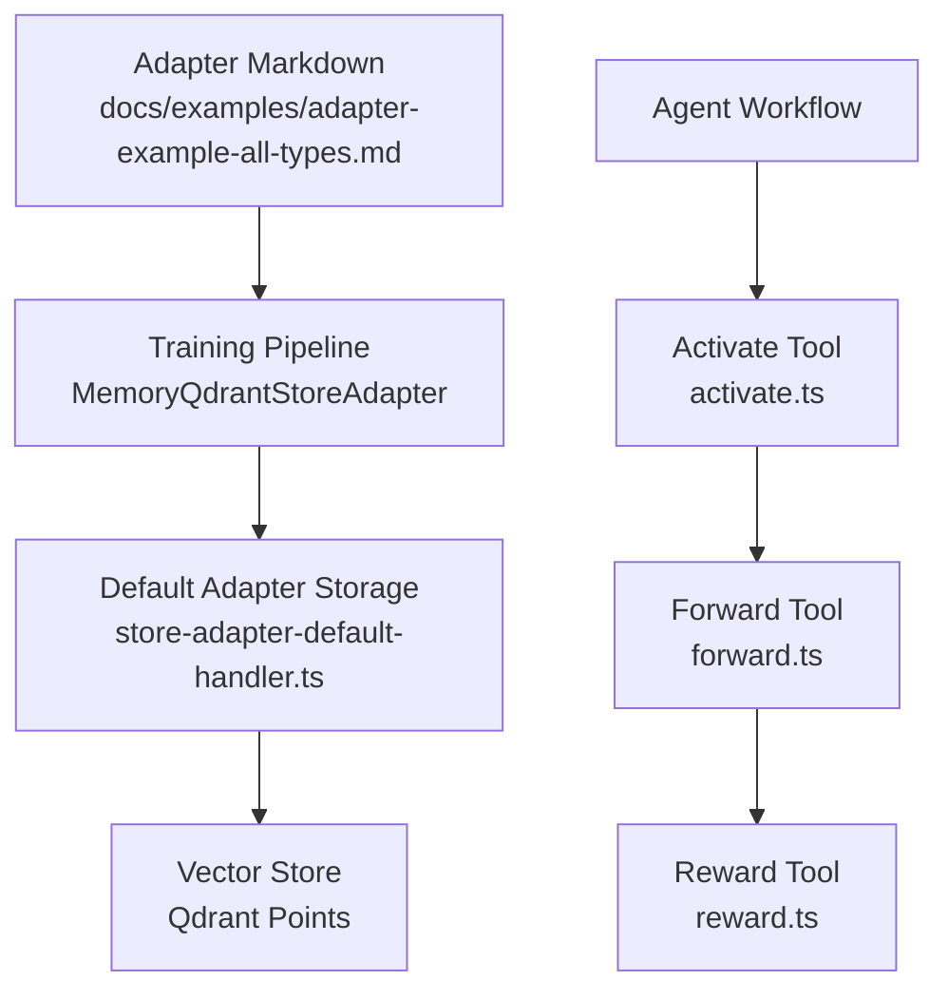
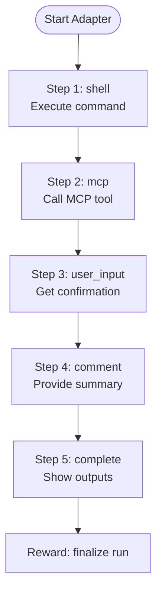
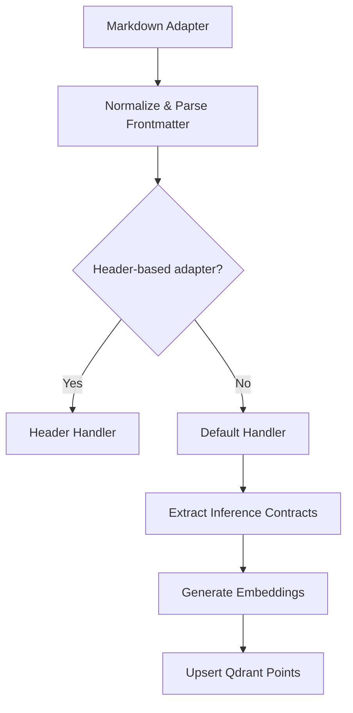
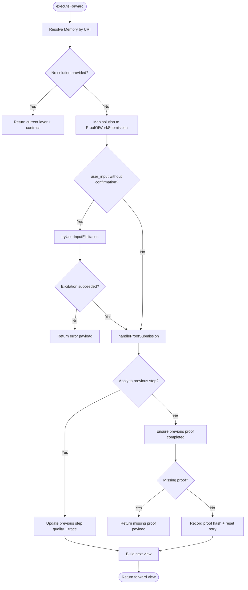
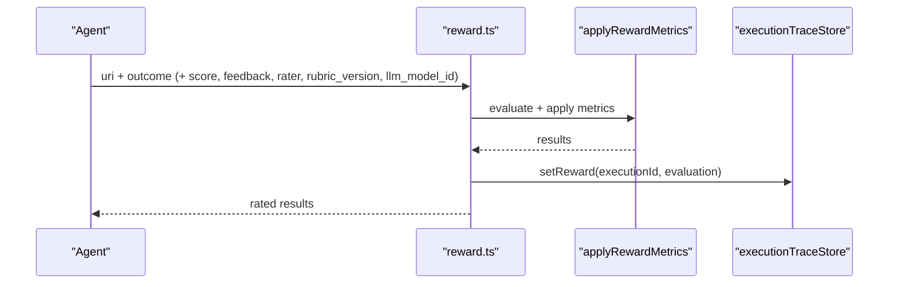
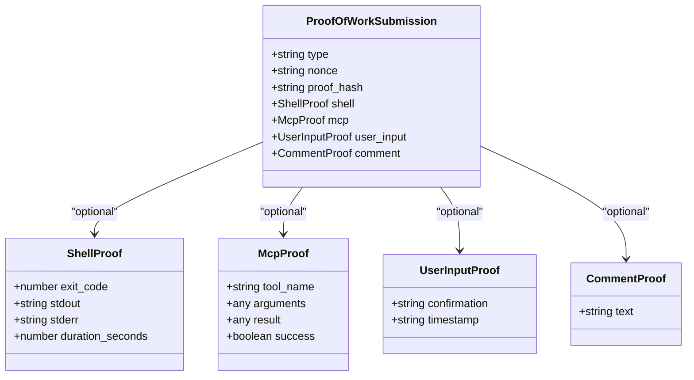
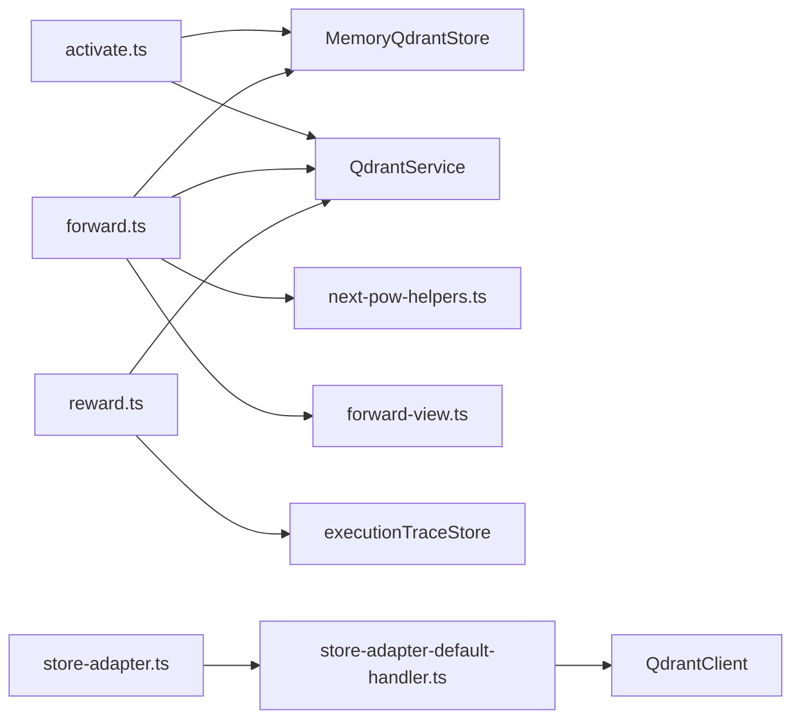

# Comprehensive All Types Example

<cite>
**Referenced Files in This Document**   
- [adapter-example-all-types.md](file://docs/examples/adapter-example-all-types.md)
- [challenge-types.md](file://docs/examples/challenge-types.md)
- [activate.ts](file://src/tools/activate.ts)
- [forward.ts](file://src/tools/forward.ts)
- [reward.ts](file://src/tools/reward.ts)
- [store-adapter.ts](file://src/services/memory/store-adapter.ts)
- [store-adapter-default-handler.ts](file://src/services/memory/store-adapter-default-handler.ts)
- [adapter-contract-blocks.ts](file://src/services/memory/adapter-contract-blocks.ts)
- [next-pow-helpers.ts](file://src/tools/next-pow-helpers.ts)
- [forward-view.ts](file://src/tools/forward-view.ts)
- [next-proof-types.ts](file://src/tools/next-proof-types.ts)
</cite>

## Table of Contents
1. [Introduction](#introduction)
2. [Project Structure](#project-structure)
3. [Core Components](#core-components)
4. [Architecture Overview](#architecture-overview)
5. [Detailed Component Analysis](#detailed-component-analysis)
6. [Dependency Analysis](#dependency-analysis)
7. [Performance Considerations](#performance-considerations)
8. [Troubleshooting Guide](#troubleshooting-guide)
9. [Conclusion](#conclusion)

## Introduction
This document explains how to design and operate a multi-step adapter workflow that combines all supported challenge types: shell, MCP tool calls, user input confirmation, and comment verification. It uses the repository’s canonical example adapter as a unified reference and maps it to the runtime implementation for activate→forward→reward execution.

The goal is to help agents and developers:
- Build adapters with multiple steps, each enforcing a different contract type.
- Understand how activation selects an adapter, how forward validates solutions step-by-step, and how reward finalizes the run.
- Share state across steps through execution IDs, proof hashes, nonces, and layer URIs.
- Handle errors, retries, missing proofs, and semantic validation robustly.
- Design complex workflows that combine shell commands, MCP calls, human confirmation, and comment processing.

## Project Structure
At a high level, the example lives in documentation as a markdown adapter, while the runtime enforces contracts during training and execution.



**Diagram sources**
- [adapter-example-all-types.md:1-81](file://docs/examples/adapter-example-all-types.md#L1-L81)
- [store-adapter.ts:43-147](file://src/services/memory/store-adapter.ts#L43-L147)
- [store-adapter-default-handler.ts:34-254](file://src/services/memory/store-adapter-default-handler.ts#L34-L254)
- [activate.ts:209-234](file://src/tools/activate.ts#L209-L234)
- [forward.ts:93-317](file://src/tools/forward.ts#L93-L317)
- [reward.ts:27-109](file://src/tools/reward.ts#L27-L109)

**Section sources**
- [adapter-example-all-types.md:1-81](file://docs/examples/adapter-example-all-types.md#L1-L81)
- [store-adapter.ts:43-147](file://src/services/memory/store-adapter.ts#L43-L147)
- [store-adapter-default-handler.ts:34-254](file://src/services/memory/store-adapter-default-handler.ts#L34-L254)

## Core Components
- Example adapter: A single markdown adapter containing four challenge steps (shell, mcp, user_input, comment), followed by a completion step and a reward signal.
- Training pipeline: Parses markdown, extracts inference contracts from fenced JSON blocks, and stores layers with embeddings and metadata.
- Runtime tools:
  - activate: Searches and returns candidate adapters with next-action guidance.
  - forward: Validates solutions against contracts, manages nonces and proof hashes, elicits user input when required, and advances layers.
  - reward: Evaluates outcomes, persists metrics, and finalizes runs.

Key responsibilities:
- Contract parsing and validation occur at training time and runtime.
- State sharing across steps uses execution_id, nonce, proof_hash, and layer URIs.
- Error handling produces structured error payloads with retry guidance and next actions.

**Section sources**
- [adapter-example-all-types.md:1-81](file://docs/examples/adapter-example-all-types.md#L1-L81)
- [challenge-types.md:1-41](file://docs/examples/challenge-types.md#L1-L41)
- [activate.ts:209-234](file://src/tools/activate.ts#L209-L234)
- [forward.ts:93-317](file://src/tools/forward.ts#L93-L317)
- [reward.ts:27-109](file://src/tools/reward.ts#L27-L109)

## Architecture Overview
The end-to-end flow for the “all types” adapter is:

```mermaid
sequenceDiagram
participant Agent as "Agent"
participant Activate as "activate.ts"
participant Store as "store-adapter.ts"
participant DefaultHandler as "store-adapter-default-handler.ts"
participant Forward as "forward.ts"
participant POW as "next-pow-helpers.ts"
participant View as "forward-view.ts"
participant Reward as "reward.ts"
Agent->>Activate : "example all types"
Activate-->>Agent : "choices + next_action"
Agent->>Forward : "first forward with no solution"
Forward->>View : "build current layer view"
View-->>Forward : "contract + next_call"
loop Steps 1–4
Agent->>Forward : "solution matching contract type"
Forward->>POW : "handleProofSubmission"
POW-->>Forward : "proofHash or blocked payload"
alt success
Forward->>View : "advance to next layer"
View-->>Agent : "next challenge or completion"
else failure
Forward->>View : "mapLayerPayloadToForwardView"
View-->>Agent : "error_code + retry guidance"
end
end
Agent->>Reward : "final reward with outcome"
Reward-->>Agent : "rated results"
```

**Diagram sources**
- [activate.ts:209-234](file://src/tools/activate.ts#L209-L234)
- [forward.ts:93-317](file://src/tools/forward.ts#L93-L317)
- [next-pow-helpers.ts:155-326](file://src/tools/next-pow-helpers.ts#L155-L326)
- [forward-view.ts:242-290](file://src/tools/forward-view.ts#L242-L290)
- [reward.ts:27-109](file://src/tools/reward.ts#L27-L109)

## Detailed Component Analysis

### Unified Example: Shell → MCP → User Input → Comment
The canonical example defines one adapter with four steps, each using a different challenge type, plus a final completion step and a reward signal.

- Step 1 (shell): Execute a command; success means exit code 0.
- Step 2 (mcp): Call an MCP tool and report success.
- Step 3 (user_input): Obtain explicit approval before continuing.
- Step 4 (comment): Provide a verification summary meeting minimum length requirements.
- Step 5 (completion): Show outputs from prior steps; no additional challenge.
- Reward: Finalize after all steps are solved.



**Diagram sources**
- [adapter-example-all-types.md:9-81](file://docs/examples/adapter-example-all-types.md#L9-L81)

**Section sources**
- [adapter-example-all-types.md:1-81](file://docs/examples/adapter-example-all-types.md#L1-L81)

### Challenge Type Contracts and Solutions
Challenge types define both the expected solution shape and pass conditions. The server returns challenges during forward; agents submit solutions that must match the contract.

| Type | Solution Shape | Pass Condition |
|------|----------------|----------------|
| shell | type: "shell", shell: { exit_code, stdout?, stderr?, duration_seconds? } | exit_code === 0 |
| mcp | type: "mcp", mcp: { tool_name, result, success, arguments? } | success === true |
| user_input | type: "user_input", user_input: { confirmation, timestamp? } | Agent supplies confirmation from user |
| comment | type: "comment", comment: { text } | text.length ≥ min_length (and optional semantic check) |

Agents must echo nonce and proof_hash from the challenge or previous response when present. After the final forward, the server directs the client to call reward.

**Section sources**
- [challenge-types.md:21-41](file://docs/examples/challenge-types.md#L21-L41)

### Training: From Markdown Adapters to Layered Contracts
Training parses markdown into layered memories and extracts inference contracts from fenced JSON blocks.

- store-adapter.ts orchestrates normalization, frontmatter parsing, header-based vs default path selection, and storage.
- store-adapter-default-handler.ts builds memories, generates embeddings, assigns slugs, and upserts points into Qdrant.
- adapter-contract-blocks.ts locates ```json blocks containing {"contract": ...}, extracts trailing contracts, and rejects ambiguous plain fences.



**Diagram sources**
- [store-adapter.ts:43-147](file://src/services/memory/store-adapter.ts#L43-L147)
- [store-adapter-default-handler.ts:34-254](file://src/services/memory/store-adapter-default-handler.ts#L34-L254)
- [adapter-contract-blocks.ts:21-117](file://src/services/memory/adapter-contract-blocks.ts#L21-L117)

**Section sources**
- [store-adapter.ts:43-147](file://src/services/memory/store-adapter.ts#L43-L147)
- [store-adapter-default-handler.ts:34-254](file://src/services/memory/store-adapter-default-handler.ts#L34-L254)
- [adapter-contract-blocks.ts:21-117](file://src/services/memory/adapter-contract-blocks.ts#L21-L117)

### Activation: Selecting the Right Adapter
activate searches for the best adapter and returns choices with next-action guidance. For the example, activation patterns include phrases like “example all types” or “all challenge types”.

- executeActivate performs search and maps results to activation output.
- Choices include labels, scores, roles, and next_action instructions.
- Linked artifacts can be materialized before calling forward.

```mermaid
sequenceDiagram
participant Agent as "Agent"
participant Activate as "activate.ts"
participant Search as "executeSearch"
Agent->>Activate : query = "example all types"
Activate->>Search : search(query)
Search-->>Activate : choices
Activate-->>Agent : choices + next_action
```

**Diagram sources**
- [activate.ts:209-234](file://src/tools/activate.ts#L209-L234)

**Section sources**
- [adapter-example-all-types.md:5-8](file://docs/examples/adapter-example-all-types.md#L5-L8)
- [activate.ts:209-234](file://src/tools/activate.ts#L209-L234)

### Forward: Validating Multi-Type Chains
forward is the core engine for step validation, state management, and progression.

Key behaviors:
- Resolves memory by URI (layer, slug, or adapter).
- Starts execution context if needed and tracks execution traces.
- Handles tensor contracts separately; otherwise maps solutions to ProofOfWorkSubmission.
- Elicits user input when contract.type is user_input and confirmation is missing.
- Validates submissions via handleProofSubmission, managing nonces and proof hashes.
- Applies solutions to previous steps when appropriate and ensures prior proofs are completed.
- Builds post-submission views to advance to the next layer or return final completion.



**Diagram sources**
- [forward.ts:93-317](file://src/tools/forward.ts#L93-L317)
- [next-pow-helpers.ts:58-120](file://src/tools/next-pow-helpers.ts#L58-L120)
- [next-pow-helpers.ts:155-326](file://src/tools/next-pow-helpers.ts#L155-L326)
- [forward-view.ts:242-290](file://src/tools/forward-view.ts#L242-L290)

**Section sources**
- [forward.ts:93-317](file://src/tools/forward.ts#L93-L317)
- [next-pow-helpers.ts:58-120](file://src/tools/next-pow-helpers.ts#L58-L120)
- [next-pow-helpers.ts:155-326](file://src/tools/next-pow-helpers.ts#L155-L326)
- [forward-view.ts:242-290](file://src/tools/forward-view.ts#L242-L290)

### Reward: Finalizing Runs
reward evaluates outcomes, applies metrics, and persists rated data.

- executeReward validates layer URIs, evaluates rewards, applies metrics, and writes execution traces.
- Errors during persistence are wrapped as REWARD_FAILED with retry guidance.
- Returns structured results including normalized score, feedback, rater, rubric version, and eligibility flags.



**Diagram sources**
- [reward.ts:27-109](file://src/tools/reward.ts#L27-L109)

**Section sources**
- [reward.ts:27-109](file://src/tools/reward.ts#L27-L109)

### Data Models and Submission Shapes
The submission model unifies all challenge types under a single structure used by forward and proof-of-work helpers.



**Diagram sources**
- [next-proof-types.ts:1-42](file://src/tools/next-proof-types.ts#L1-L42)

**Section sources**
- [next-proof-types.ts:1-42](file://src/tools/next-proof-types.ts#L1-L42)

## Dependency Analysis
The following diagram shows key dependencies between tools and services involved in the activate→forward→reward chain.



**Diagram sources**
- [activate.ts:209-234](file://src/tools/activate.ts#L209-L234)
- [forward.ts:93-317](file://src/tools/forward.ts#L93-L317)
- [reward.ts:27-109](file://src/tools/reward.ts#L27-L109)
- [store-adapter.ts:43-147](file://src/services/memory/store-adapter.ts#L43-L147)
- [store-adapter-default-handler.ts:34-254](file://src/services/memory/store-adapter-default-handler.ts#L34-L254)

**Section sources**
- [activate.ts:209-234](file://src/tools/activate.ts#L209-L234)
- [forward.ts:93-317](file://src/tools/forward.ts#L93-L317)
- [reward.ts:27-109](file://src/tools/reward.ts#L27-L109)
- [store-adapter.ts:43-147](file://src/services/memory/store-adapter.ts#L43-L147)
- [store-adapter-default-handler.ts:34-254](file://src/services/memory/store-adapter-default-handler.ts#L34-L254)

## Performance Considerations
- Embedding batches: Training generates dense vectors for primary, title, and activation pattern fields; failures fall back to zero vectors to keep storage resilient.
- Sparse BM25: Optional sparse indexing may be retried without bm25 if the collection lacks sparse configuration.
- Nonce rotation: On nonce mismatch, a fresh nonce is issued to avoid unrecoverable loops.
- Semantic validation timeout: Comment relevance checks use a configurable timeout to prevent blocking long-running chains.
- Execution tracing: Forward appends execution traces asynchronously; persistence failures are logged but do not block the main flow.
- Metrics: Tools record call counts, durations, input/output sizes, and error rates for observability.

[No sources needed since this section provides general guidance]

## Troubleshooting Guide
Common issues and strategies:

- NONCE_MISMATCH:
  - Cause: Submitted nonce does not match stored nonce.
  - Resolution: Use the nonce from the latest challenge response; the system rotates nonces automatically on mismatch.
  - Evidence: handleProofSubmission logs and returns a blocked payload with retry guidance.

- PROOF_HASH_MISMATCH or MISSING_FIELD:
  - Cause: proof_hash missing or incorrect relative to expectedPreviousHash.
  - Resolution: Include proof_hash from the previous response or current contract.

- TYPE_MISMATCH:
  - Cause: Submitted solution type does not match contract.type.
  - Resolution: Align solution.type with the contract (shell, mcp, user_input, comment).

- COMMENT_TOO_SHORT or COMMENT_IRRELEVANT:
  - Cause: Text below min_length or similarity below threshold.
  - Resolution: Increase length and ensure content engages with the step description.

- USER_DECLINED or ELICITATION_FAILED:
  - Cause: Human declined confirmation or elicitation failed.
  - Resolution: Retry with updated prompt or adjust workflow logic; consider fallback steps.

- MISSING_PROOF:
  - Cause: Prior step proof not completed.
  - Resolution: Submit missing proof for earlier step; system returns current_step and next_action.

- REWARD_FAILED:
  - Cause: Persistence error during reward recording.
  - Resolution: Retry once storage is healthy; inspect error details.

Operational tips:
- Always echo nonce and proof_hash from the challenge or previous response.
- Follow next_action guidance returned in error payloads.
- Use execution_id to correlate traces across activate→forward→reward.
- Inspect structured logs for pow events, embedding failures, and metric counters.

**Section sources**
- [next-pow-helpers.ts:155-326](file://src/tools/next-pow-helpers.ts#L155-L326)
- [forward.ts:256-317](file://src/tools/forward.ts#L256-L317)
- [reward.ts:18-25](file://src/tools/reward.ts#L18-L25)

## Conclusion
The “all types” example demonstrates a robust, auditable workflow combining shell execution, MCP tool calls, human confirmation, and comment verification. Training converts markdown adapters into layered memories with inference contracts, while the runtime enforces strict validation, state sharing, and error recovery across steps. By following the activate→forward→reward chain and leveraging execution IDs, nonces, and proof hashes, agents can build complex, multi-step workflows that are deterministic, observable, and trainable.

[No sources needed since this section summarizes without analyzing specific files]