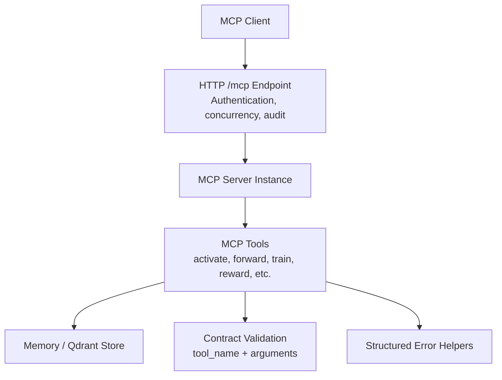
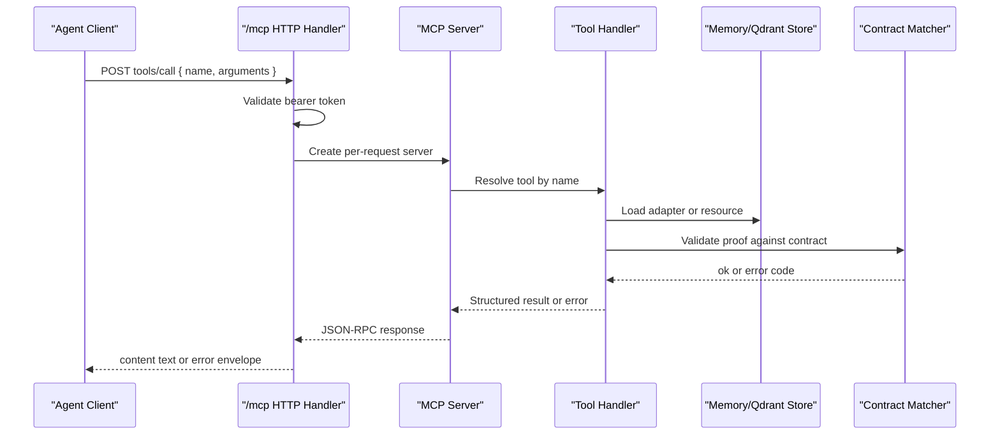
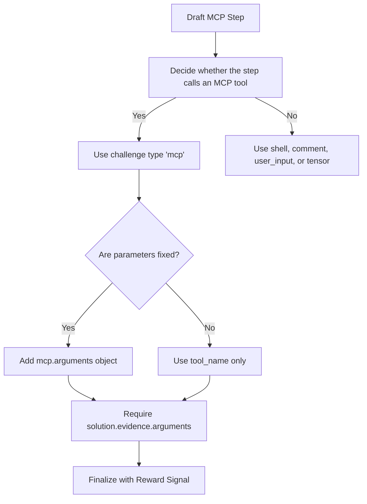
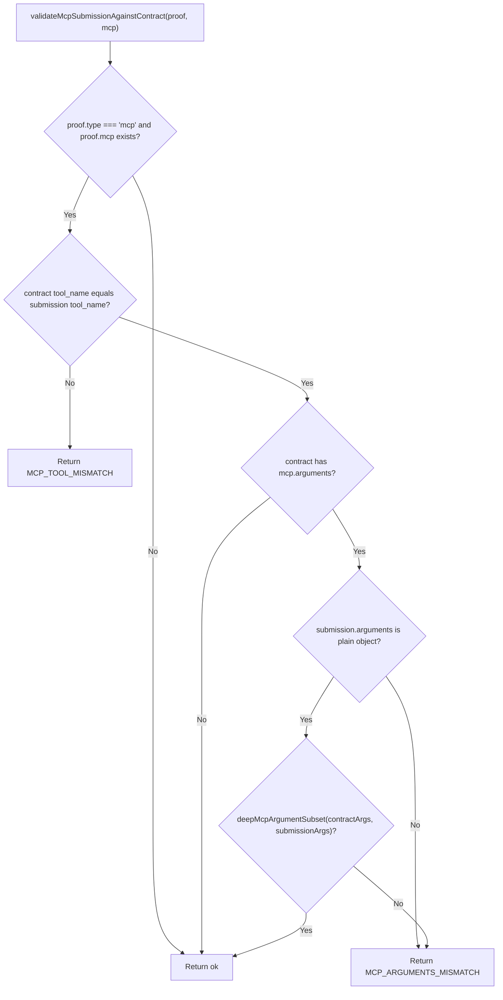
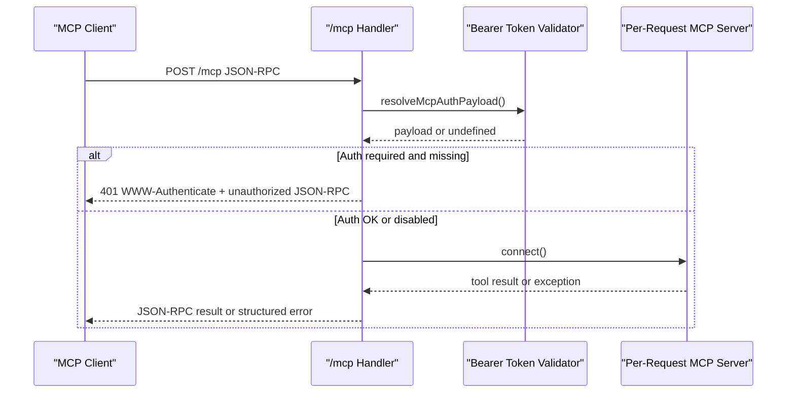
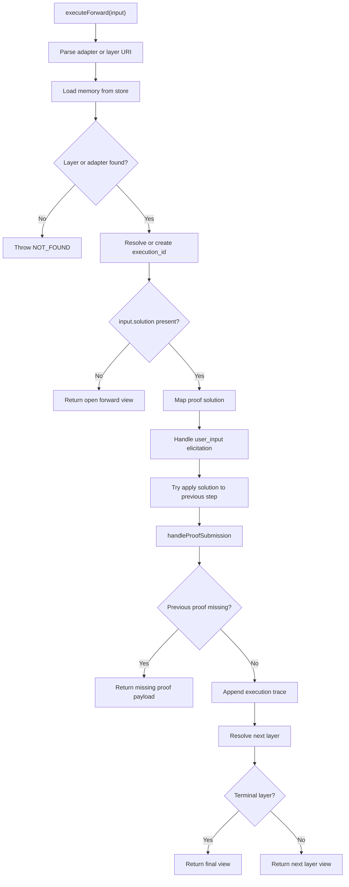
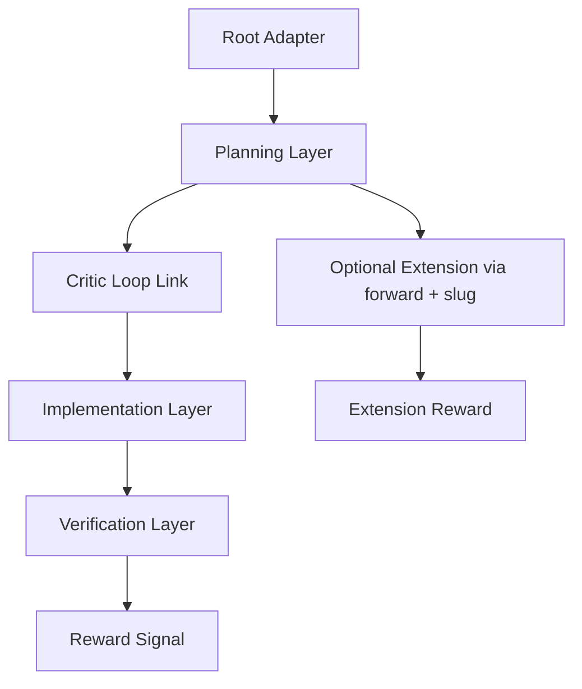
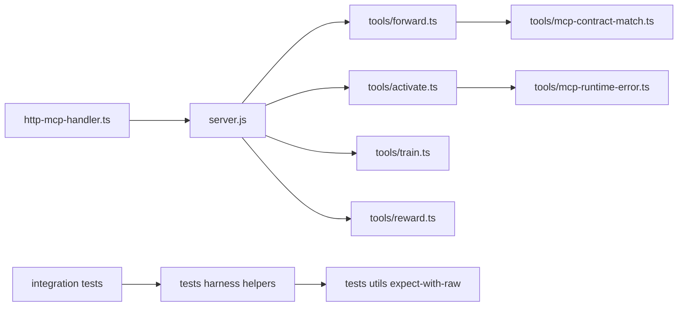

# MCP Adapter Example

<cite>
**Referenced Files in This Document**   
- [adapter-example-mcp.md](file://docs/examples/adapter-example-mcp.md)
- [mcp-contract-match.ts](file://src/tools/mcp-contract-match.ts)
- [http-mcp-handler.ts](file://src/http/http-mcp-handler.ts)
- [forward.ts](file://src/tools/forward.ts)
- [mcp-runtime-error.ts](file://src/tools/mcp-runtime-error.ts)
- [embedded-mcp-resources.ts](file://src/resources/embedded-mcp-resources.ts)
- [protocol-linking-guide.md](file://src/resources/embedded-mcp-resources.ts)
- [challenge-type-guide.md](file://src/resources/embedded-mcp-resources.ts)
- [mcp-call-normalize.ts](file://tests/integration/harness/helpers/mcp-call-normalize.ts)
- [expect-with-raw.ts](file://tests/utils/expect-with-raw.ts)
- [v4-squadrules-forward-mcp-contract-args.test.ts](file://tests/integration/write/v4-squadrules-forward-mcp-contract-args.test.ts)
</cite>

## Table of Contents
1. [Introduction](#introduction)
2. [Project Structure](#project-structure)
3. [Core Components](#core-components)
4. [Architecture Overview](#architecture-overview)
5. [Detailed Component Analysis](#detailed-component-analysis)
6. [Dependency Analysis](#dependency-analysis)
7. [Performance Considerations](#performance-considerations)
8. [Troubleshooting Guide](#troubleshooting-guide)
9. [Conclusion](#conclusion)

## Introduction
This document explains how to create and reason about MCP (Model Context Protocol) adapters in this repository. It focuses on:

- Creating adapters that call external MCP tools through the `mcp` challenge type.
- Handling tool invocation patterns, including parameter constraints and response processing.
- Understanding the MCP contract structure for challenges, especially tool selection criteria, argument matching, and response transformation.
- Discovering available MCP tools, handling authentication, and propagating errors.
- Composing and chaining adapters using `activate`, `forward`, and slug-based linking.

The project treats AI agents as primary users. Adapters are deterministic, auditable workflows following an activate → forward → reward chain. MCP tools such as `activate`, `forward`, `train`, `reward`, `tune`, `delete`, `export`, and `spaces` participate in this flow.

## Project Structure
At a high level, MCP adapter documentation lives in curated examples and embedded protocol guides, while runtime behavior is implemented in HTTP transport, tool handlers, and contract validation logic.

**Diagram sources**
- [http-mcp-handler.ts:115-348](file://src/http/http-mcp-handler.ts#L115-L348)
- [forward.ts:93-317](file://src/tools/forward.ts#L93-L317)
- [mcp-contract-match.ts:47-86](file://src/tools/mcp-contract-match.ts#L47-L86)
- [mcp-runtime-error.ts:14-35](file://src/tools/mcp-runtime-error.ts#L14-L35)

**Section sources**
- [adapter-example-mcp.md:1-53](file://docs/examples/adapter-example-mcp.md#L1-L53)
- [embedded-mcp-resources.ts:18-36](file://src/resources/embedded-mcp-resources.ts#L18-L36)

## Core Components
The MCP adapter implementation revolves around four areas:

1. **Adapter authoring example**: A minimal MCP challenge showing how to require an MCP tool call and report success.
2. **Contract validation**: Enforcing that a submitted solution calls the expected tool with compatible arguments.
3. **HTTP transport and authentication**: Validating bearer tokens, returning structured JSON-RPC errors, and auditing requests.
4. **Forward execution**: Running adapters layer by layer, mapping solutions, validating proofs, and producing next-action guidance.

Key responsibilities:

| Area | Responsibility |
|---|---|
| Adapter example | Shows MCP challenge shape, required fields, and argument constraints. |
| Contract matcher | Validates `tool_name` and deep subset matching of `arguments`. |
| HTTP handler | Parses auth, limits concurrency, maps errors, and emits audit events. |
| Forward tool | Executes adapter layers, handles missing proofs, and returns `next_call`. |
| Runtime error helper | Converts rate-limit errors into structured MCP payloads. |

**Section sources**
- [adapter-example-mcp.md:1-53](file://docs/examples/adapter-example-mcp.md#L1-L53)
- [mcp-contract-match.ts:1-87](file://src/tools/mcp-contract-match.ts#L1-L87)
- [http-mcp-handler.ts:44-105](file://src/http/http-mcp-handler.ts#L44-L105)
- [forward.ts:93-317](file://src/tools/forward.ts#L93-L317)
- [mcp-runtime-error.ts:1-36](file://src/tools/mcp-runtime-error.ts#L1-L36)

## Architecture Overview
The MCP adapter lifecycle connects client tool calls to stored adapter contracts, then validates submissions and advances the workflow.

**Diagram sources**
- [http-mcp-handler.ts:115-348](file://src/http/http-mcp-handler.ts#L115-L348)
- [mcp-contract-match.ts:47-86](file://src/tools/mcp-contract-match.ts#L47-L86)
- [forward.ts:93-317](file://src/tools/forward.ts#L93-L317)

## Detailed Component Analysis

### MCP Challenge Authoring
An MCP challenge requires the agent to call a specific MCP tool and include observable evidence. The example shows:

- A step requiring `tool_name: "activate"`.
- Optional constrained arguments via `arguments`.
- A final verification step after the MCP call succeeds.

When writing MCP challenges:

- Use `type: "mcp"` when the step calls an MCP tool.
- Include `required: true` to enforce the step.
- Add `arguments` only when you need to constrain parameters.
- Treat extra keys in the agent’s submission as allowed; validation uses subset semantics.

**Diagram sources**
- [adapter-example-mcp.md:1-53](file://docs/examples/adapter-example-mcp.md#L1-L53)
- [challenge-type-guide.md:18-36](file://src/resources/embedded-mcp-resources.ts#L18-L36)

**Section sources**
- [adapter-example-mcp.md:1-53](file://docs/examples/adapter-example-mcp.md#L1-L53)

### MCP Contract Matching
The contract matcher enforces two important rules:

1. **Tool name matching**: If the contract specifies a tool name, the submitted solution must use the same tool.
2. **Argument subset matching**: If the contract specifies `arguments`, the submitted arguments must contain all required keys with matching values. Extra keys are allowed.

Validation outcomes include:

| Outcome | Meaning |
|---|---|
| `ok: true` | Submission matches the contract. |
| `MCP_TOOL_MISMATCH` | Submitted tool name differs from contract. |
| `MISSING_FIELD` | Contract requires `arguments`, but submission lacks them. |
| `MCP_ARGUMENTS_MISMATCH` | Arguments do not satisfy contract constraints. |

**Diagram sources**
- [mcp-contract-match.ts:47-86](file://src/tools/mcp-contract-match.ts#L47-L86)
- [mcp-contract-match.ts:3-41](file://src/tools/mcp-contract-match.ts#L3-L41)

**Section sources**
- [mcp-contract-match.ts:1-87](file://src/tools/mcp-contract-match.ts#L1-L87)
- [v4-squadrules-forward-mcp-contract-args.test.ts:46-104](file://tests/integration/write/v4-squadrules-forward-mcp-contract-args.test.ts#L46-L104)

### HTTP Transport, Authentication, and Error Propagation
The `/mcp` endpoint is the entry point for MCP clients. It:

- Extracts method, tool name, and request ID.
- Resolves bearer token authentication when enabled.
- Handles special UI discovery methods like `listOfferingsForUI`.
- Limits concurrent requests and returns 503 with retry hints when overloaded.
- Creates a per-request MCP server instance.
- Maps internal errors to structured JSON-RPC responses with `error_code`, `retry_hint`, and optional details.

Authentication behavior:

- When `AUTH_ENABLED` is true, bearer tokens are validated against trusted issuers and allowed audiences.
- Unauthenticated requests may receive `WWW-Authenticate` headers pointing to OAuth metadata.
- UI discovery endpoints return explicit unauthorized JSON-RPC responses instead of generic method-not-found errors.

Error propagation:

- `SquadrulesError` instances expose `code`, `message`, and `details`.
- Unknown errors become `SERVER_ERROR` with a safe retry hint.
- Connection conflicts produce `CONNECTION_CONFLICT`.
- Audit events capture request start/end and tool call details at configurable levels.

**Diagram sources**
- [http-mcp-handler.ts:44-105](file://src/http/http-mcp-handler.ts#L44-L105)
- [http-mcp-handler.ts:115-348](file://src/http/http-mcp-handler.ts#L115-L348)

**Section sources**
- [http-mcp-handler.ts:44-105](file://src/http/http-mcp-handler.ts#L44-L105)
- [http-mcp-handler.ts:115-348](file://src/http/http-mcp-handler.ts#L115-L348)

### Forward Execution and Response Processing
The `forward` tool drives the adapter lifecycle:

1. Parse the input URI (`squadrules://adapter/...` or `squadrules://layer/...`).
2. Load the adapter or layer from memory storage.
3. Start or resume an execution with an `execution_id`.
4. Map the incoming solution to the canonical proof format.
5. Handle user-input elicitation when required.
6. Apply solutions to previous steps when appropriate.
7. Validate the current proof against the stored contract.
8. Record execution traces and update step quality metrics.
9. Return the next layer or terminal guidance.

Response processing includes:

- Returning `current_layer`, `contract`, `next_action`, and `next_call`.
- Supporting unified solution envelopes with `outcome` and `evidence`.
- Accepting older type-specific shapes for compatibility.
- Producing error payloads when previous proofs are missing or blocked.

**Diagram sources**
- [forward.ts:93-317](file://src/tools/forward.ts#L93-L317)

**Section sources**
- [forward.ts:93-317](file://src/tools/forward.ts#L93-L317)

### MCP Tool Discovery and UI Offerings
Tool discovery is exposed through MCP methods. The HTTP handler includes special handling for `listOfferingsForUI`:

- It is not implemented by the SDK, so it is handled directly.
- When authentication is required and missing, it returns a proper unauthorized JSON-RPC response.
- When authenticated or anonymous access is allowed, it returns available offerings for the UI.

Clients should treat `tools/list` and similar discovery methods as part of the MCP contract, but rely on the server’s documented tools: `activate`, `forward`, `train`, `reward`, `tune`, `delete`, `export`, and `spaces`.

**Section sources**
- [http-mcp-handler.ts:149-166](file://src/http/http-mcp-handler.ts#L149-L166)
- [embedded-mcp-resources.ts:18-36](file://src/resources/embedded-mcp-resources.ts#L18-L36)

### MCP Tool Composition and Chaining Patterns
Chaining is central to composing complex workflows:

- Use `activate` for initial intent resolution.
- Use `forward` with a known slug when the target adapter is deterministic.
- Use `chain_root` frontmatter to protect mid-chain adapters from being activated out of order.
- Use MCP contracts with `arguments` to bind chain links to specific adapter URIs.

Recommended composition patterns:

| Pattern | When to Use |
|---|---|
| Layers | Most workflows fit within one adapter under 350 lines. |
| Chain via `forward` + slug | Large protocols, routing, reusable sub-protocols. |
| `chain_root` collapsing | Mid-chain adapters should redirect to root unless parent context is provided. |
| MCP argument binding | Bind `forward` calls to exact adapter slugs for deterministic linking. |

**Diagram sources**
- [protocol-linking-guide.md:18-36](file://src/resources/embedded-mcp-resources.ts#L18-L36)
- [challenge-type-guide.md:18-36](file://src/resources/embedded-mcp-resources.ts#L18-L36)

**Section sources**
- [protocol-linking-guide.md:18-36](file://src/resources/embedded-mcp-resources.ts#L18-L36)
- [challenge-type-guide.md:18-36](file://src/resources/embedded-mcp-resources.ts#L18-L36)

## Dependency Analysis
The MCP adapter system depends on several layers:

- **HTTP transport**: Request parsing, authentication, concurrency control, audit emission.
- **MCP server**: Per-request server instance wiring tools to storage and validation.
- **Tools**: Business logic for `activate`, `forward`, `train`, `reward`, etc.
- **Contract matcher**: Deterministic validation of MCP challenge submissions.
- **Storage**: Memory and vector stores for adapters, layers, artifacts, and metrics.
- **Tests**: Integration helpers normalize MCP results and assert error paths.

**Diagram sources**
- [http-mcp-handler.ts:115-348](file://src/http/http-mcp-handler.ts#L115-L348)
- [forward.ts:93-317](file://src/tools/forward.ts#L93-L317)
- [mcp-contract-match.ts:47-86](file://src/tools/mcp-contract-match.ts#L47-L86)
- [mcp-runtime-error.ts:14-35](file://src/tools/mcp-runtime-error.ts#L14-L35)
- [mcp-call-normalize.ts:9-22](file://tests/integration/harness/helpers/mcp-call-normalize.ts#L9-L22)
- [expect-with-raw.ts:31-54](file://tests/utils/expect-with-raw.ts#L31-L54)

**Section sources**
- [http-mcp-handler.ts:115-348](file://src/http/http-mcp-handler.ts#L115-L348)
- [forward.ts:93-317](file://src/tools/forward.ts#L93-L317)
- [mcp-contract-match.ts:47-86](file://src/tools/mcp-contract-match.ts#L47-L86)
- [mcp-runtime-error.ts:14-35](file://src/tools/mcp-runtime-error.ts#L14-L35)
- [mcp-call-normalize.ts:9-22](file://tests/integration/harness/helpers/mcp-call-normalize.ts#L9-L22)
- [expect-with-raw.ts:31-54](file://tests/utils/expect-with-raw.ts#L31-L54)

## Performance Considerations
The MCP transport includes several performance-related safeguards:

- **Concurrency limit**: Requests exceeding `MAX_CONCURRENT_MCP_REQUESTS_RAW` receive 503 with `Retry-After`.
- **Per-request server instances**: Avoids single-transport contention across concurrent requests.
- **Timeout logging**: Warns at 25 seconds before typical client timeouts.
- **Audit capture**: Optional JSON-RPC response capture for replay at higher audit levels.
- **Stale timestamp cleanup**: Periodically removes old request timestamps.

Recommendations:

- Tune concurrency limits based on workload and backend capacity.
- Use structured logging and audit levels to monitor slow or failing tool calls.
- Prefer deterministic chains with `forward` + slug over repeated `activate` lookups when the target is known.
- Batch reversible work where possible and gate irreversible changes with objective proofs.

[No sources needed since this section provides general guidance]

## Troubleshooting Guide
Common issues and their likely causes:

| Symptom | Likely Cause | Resolution |
|---|---|---|
| `MCP_TOOL_MISMATCH` | Solution calls a different tool than the contract requires. | Align `solution.mcp.tool_name` with the adapter’s contract. |
| `MCP_ARGUMENTS_MISMATCH` | Submitted arguments do not match contract constraints. | Add required keys and ensure nested values match. |
| `MISSING_FIELD` | Contract requires `arguments`, but submission omitted them. | Provide a plain object for `solution.mcp.arguments`. |
| 401 Unauthorized on `/mcp` | Bearer token missing or invalid. | Authenticate first; check `WWW-Authenticate` and OAuth metadata. |
| 503 Overloaded | Too many concurrent MCP requests. | Retry after `Retry-After`; reduce concurrency. |
| Rate-limit error from embedding provider | External provider quota or throttling. | Inspect structured error payload and adjust billing or request rate. |
| Invalid MCP result during tests | Missing or non-text content in MCP response. | Use test helpers to parse and log raw responses. |

Error-handling references:

- Structured error mapping in the HTTP handler.
- Rate-limit error conversion for embedding providers.
- Test helpers for normalizing MCP tool results.
- Contract validation error codes for MCP submissions.

**Section sources**
- [http-mcp-handler.ts:62-105](file://src/http/http-mcp-handler.ts#L62-L105)
- [http-mcp-handler.ts:168-192](file://src/http/http-mcp-handler.ts#L168-L192)
- [mcp-runtime-error.ts:14-35](file://src/tools/mcp-runtime-error.ts#L14-L35)
- [mcp-contract-match.ts:43-86](file://src/tools/mcp-contract-match.ts#L43-L86)
- [mcp-call-normalize.ts:9-22](file://tests/integration/harness/helpers/mcp-call-normalize.ts#L9-L22)
- [expect-with-raw.ts:31-54](file://tests/utils/expect-with-raw.ts#L31-L54)

## Conclusion
MCP adapters in this repository combine authored adapter contracts with deterministic runtime validation. To build effective MCP adapters:

- Use `type: "mcp"` for steps that call MCP tools.
- Constrain tool names and arguments in contracts to prevent ambiguous executions.
- Rely on `forward` to drive layered workflows and produce machine-readable next actions.
- Use `activate` for discovery and `forward` + slug for deterministic chaining.
- Handle authentication at the HTTP transport layer and propagate structured errors to clients.
- Compose complex workflows by splitting large adapters into chains and reusing sub-protocols.

This approach keeps adapters auditable, composable, and aligned with the activate → forward → reward chain that defines the project’s agent-first workflow.

[No sources needed since this section summarizes without analyzing specific files]