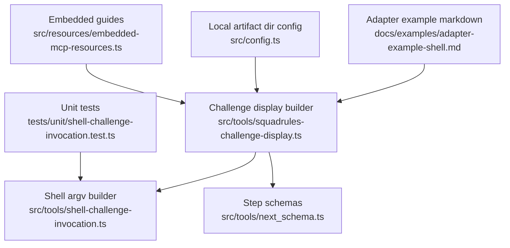
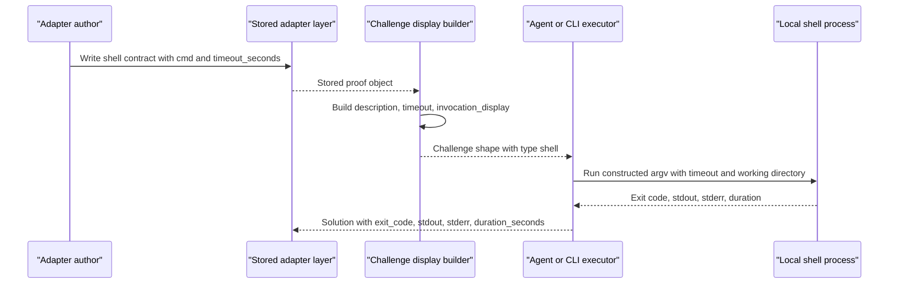
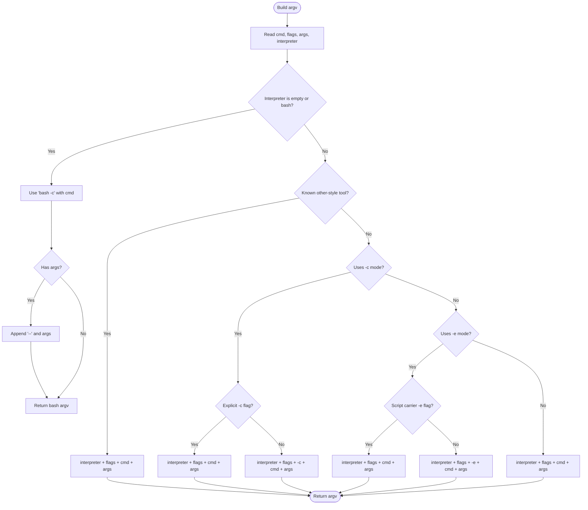
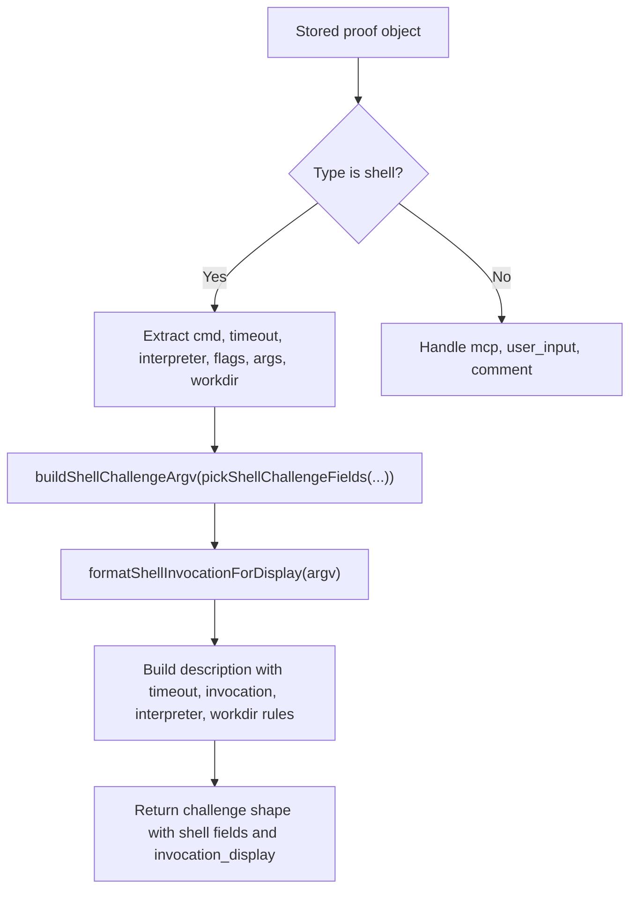
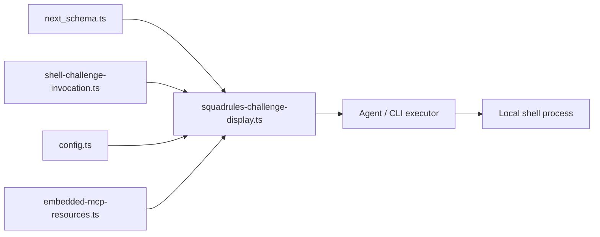

# Shell Adapter Example

<cite>
**Referenced Files in This Document**
- [adapter-example-shell.md](file://docs/examples/adapter-example-shell.md)
- [shell-challenge-invocation.ts](file://src/tools/shell-challenge-invocation.ts)
- [squadrules-challenge-display.ts](file://src/tools/squadrules-challenge-display.ts)
- [next_schema.ts](file://src/tools/next_schema.ts)
- [config.ts](file://src/config.ts)
- [challenge-type-guide.md](file://src/resources/embedded-mcp-resources.ts)
- [critic-loop-guide.md](file://src/resources/embedded-mcp-resources.ts)
- [create-new-protocol.md](file://src/resources/embedded-mcp-resources.ts)
- [bulk-insert-adapters-via-cli.md](file://src/resources/embedded-mcp-resources.ts)
- [shell-challenge-invocation.test.ts](file://tests/unit/shell-challenge-invocation.test.ts)
</cite>

## Table of Contents
1. [Introduction](#introduction)
2. [Project Structure](#project-structure)
3. [Core Components](#core-components)
4. [Architecture Overview](#architecture-overview)
5. [Detailed Component Analysis](#detailed-component-analysis)
6. [Dependency Analysis](#dependency-analysis)
7. [Performance Considerations](#performance-considerations)
8. [Troubleshooting Guide](#troubleshooting-guide)
9. [Conclusion](#conclusion)
10. [Appendices](#appendices)

## Introduction
This document explains how shell adapters work in this project and how to implement safe, deterministic shell challenges for SQUADRULES adapters. A shell challenge is a per-step contract that tells an executor (typically an AI agent or CLI runner) exactly which command to run, how long it may run, what interpreter to use, where to run it, and how to report the result.

The key design principle is:
- The MCP server does not spawn processes for proof-of-work. Executors run shell commands locally.
- Adapters describe contracts; executors execute them and return structured solutions.
- Security comes from explicit contracts, bounded timeouts, working-directory guidance, environment variable conventions, and strict solution validation.

## Project Structure
Shell adapter support spans documentation, runtime schemas, display helpers, and argument construction utilities:

**Diagram sources**
- [adapter-example-shell.md:1-33](file://docs/examples/adapter-example-shell.md#L1-L33)
- [squadrules-challenge-display.ts:1-90](file://src/tools/squadrules-challenge-display.ts#L1-L90)
- [shell-challenge-invocation.ts:1-138](file://src/tools/shell-challenge-invocation.ts#L1-L138)
- [next_schema.ts:1-108](file://src/tools/next_schema.ts#L1-L108)
- [config.ts:58-67](file://src/config.ts#L58-L67)
- [challenge-type-guide.md:1-200](file://src/resources/embedded-mcp-resources.ts#L28-L228)
- [shell-challenge-invocation.test.ts:1-124](file://tests/unit/shell-challenge-invocation.test.ts#L1-L124)

**Section sources**
- [adapter-example-shell.md:1-33](file://docs/examples/adapter-example-shell.md#L1-L33)
- [squadrules-challenge-display.ts:1-90](file://src/tools/squadrules-challenge-display.ts#L1-L90)
- [shell-challenge-invocation.ts:1-138](file://src/tools/shell-challenge-invocation.ts#L1-L138)
- [next_schema.ts:1-108](file://src/tools/next_schema.ts#L1-L108)
- [config.ts:58-67](file://src/config.ts#L58-L67)
- [challenge-type-guide.md:1-200](file://src/resources/embedded-mcp-resources.ts#L28-L228)
- [shell-challenge-invocation.test.ts:1-124](file://tests/unit/shell-challenge-invocation.test.ts#L1-L124)

## Core Components
The shell adapter implementation has four main responsibilities:

| Component | Responsibility | Key behavior |
|---|---|---|
| Shell challenge fields and argv builder | Convert loose adapter fields into a deterministic process invocation | Normalizes interpreter, flags, args, and default `bash -c` behavior |
| Challenge display builder | Turn stored proof data into an agent-readable challenge | Adds timeout, description, invocation line, interpreter hints, and working-directory guidance |
| Step schemas | Define valid challenge and solution shapes | Enforces `type`, `timeout_seconds`, `exit_code`, `stdout`, `stderr`, and `duration_seconds` |
| Local artifact directory configuration | Provide client-side path hints for shared handoff files | Emits ordered URI hints and documents `SQUADRULES_LOCAL_ARTIFACT_DIR` usage |

**Section sources**
- [shell-challenge-invocation.ts:6-12](file://src/tools/shell-challenge-invocation.ts#L6-L12)
- [shell-challenge-invocation.ts:88-121](file://src/tools/shell-challenge-invocation.ts#L88-L121)
- [squadrules-challenge-display.ts:19-62](file://src/tools/squadrules-challenge-display.ts#L19-L62)
- [next_schema.ts:16-77](file://src/tools/next_schema.ts#L16-L77)
- [config.ts:58-67](file://src/config.ts#L58-L67)

## Architecture Overview
A shell adapter step follows this flow:

**Diagram sources**
- [squadrules-challenge-display.ts:19-62](file://src/tools/squadrules-challenge-display.ts#L19-L62)
- [shell-challenge-invocation.ts:88-137](file://src/tools/shell-challenge-invocation.ts#L88-L137)
- [next_schema.ts:16-77](file://src/tools/next_schema.ts#L16-L77)

## Detailed Component Analysis

### Shell Challenge Contract Shape
A shell challenge describes what must be executed and how long it may run. The schema requires:

| Field | Meaning | Notes |
|---|---|---|
| `type` | Must be `shell` | Matches the solution type |
| `description` | Human-readable instruction | Generated by the display builder |
| `shell.cmd` | Command string | Defaulted to a placeholder when missing |
| `shell.timeout_seconds` | Maximum execution time | Defaults to 30 seconds when missing |
| `shell.interpreter` | Optional interpreter override | Used for argv construction and PATH checks |
| `shell.flags` | Optional interpreter flags | Auto-injection avoids duplicate `-c` or `-e` |
| `shell.args` | Optional trailing arguments | Passed after `--` for bash `-c` |
| `shell.workdir` | Optional working directory | Real process cwd, not the shared local artifact directory |
| `shell.invocation_display` | Server-computed one-line command | Used for UI and error messages |

**Section sources**
- [next_schema.ts:51-77](file://src/tools/next_schema.ts#L51-L77)
- [squadrules-challenge-display.ts:35-62](file://src/tools/squadrules-challenge-display.ts#L35-L62)

### Shell Challenge Fields and Argument Construction
The shell adapter normalizes loose input into a stable field set before building argv:

- `cmd` is required.
- `interpreter` is trimmed and optional.
- `flags` and `args` are preserved when explicitly provided.
- `workdir` is trimmed and optional.

The argv builder then chooses an execution style:

| Interpreter category | Behavior |
|---|---|
| No interpreter or `bash` | Runs `bash -c <cmd>`; appends `--` plus `args` if present |
| Known “other” tools such as `terraform`, `docker`, `kubectl` | Uses `interpreter + flags + cmd + args` without auto code flag |
| `-c` interpreters such as `python3`, `python`, `sh` | Injects `-c` unless already present |
| `-e` interpreters such as `perl`, `node`, `ruby` | Injects `-e` unless a script carrier flag like `-e`, `-ne`, or `-pe` is present |
| Unknown interpreter | Uses `interpreter + flags + cmd + args` |

**Diagram sources**
- [shell-challenge-invocation.ts:35-121](file://src/tools/shell-challenge-invocation.ts#L35-L121)

**Section sources**
- [shell-challenge-invocation.ts:18-33](file://src/tools/shell-challenge-invocation.ts#L18-L33)
- [shell-challenge-invocation.ts:40-63](file://src/tools/shell-challenge-invocation.ts#L40-L63)
- [shell-challenge-invocation.ts:65-83](file://src/tools/shell-challenge-invocation.ts#L65-L83)
- [shell-challenge-invocation.ts:88-121](file://src/tools/shell-challenge-invocation.ts#L88-L121)
- [shell-challenge-invocation.test.ts:13-81](file://tests/unit/shell-challenge-invocation.test.ts#L13-L81)

### Challenge Description and Output Formatting
The display builder converts stored proof data into a readable challenge:

1. It determines the challenge type and defaults unknown types to `comment`.
2. For `shell`, it reads `cmd`, `timeout_seconds`, `interpreter`, `flags`, `args`, and `workdir`.
3. It builds argv using the same logic used by executors.
4. It formats a safe one-line invocation for descriptions and UI.
5. It adds instructions to capture `stdout` and `stderr`, treat exit code 0 as success, and avoid fabricating results.
6. If an interpreter is specified, it instructs the executor to verify availability on PATH.
7. If a working directory is specified, it explains real cwd behavior and the relationship to `SQUADRULES_LOCAL_ARTIFACT_DIR`.

**Diagram sources**
- [squadrules-challenge-display.ts:19-62](file://src/tools/squadrules-challenge-display.ts#L19-L62)
- [shell-challenge-invocation.ts:123-137](file://src/tools/shell-challenge-invocation.ts#L123-L137)

**Section sources**
- [squadrules-challenge-display.ts:10-13](file://src/tools/squadrules-challenge-display.ts#L10-L13)
- [squadrules-challenge-display.ts:15-34](file://src/tools/squadrules-challenge-display.ts#L15-L34)
- [squadrules-challenge-display.ts:35-62](file://src/tools/squadrules-challenge-display.ts#L35-L62)

### Solution Shape and Result Parsing
When an executor completes a shell challenge, it returns a solution with:

| Field | Required? | Purpose |
|---|---:|---|
| `type` | Yes | Must match the challenge type |
| `shell.exit_code` | Yes | Process exit status; 0 means success |
| `shell.stdout` | Optional | Standard output |
| `shell.stderr` | Optional | Standard error; should not be suppressed |
| `shell.duration_seconds` | Optional | Wall-clock duration of execution |

The schema enforces that at least one type-specific field is present and that the field matches the declared type.

**Section sources**
- [next_schema.ts:16-49](file://src/tools/next_schema.ts#L16-L49)

### Environment Variables and Working Directory
Shell challenges rely on environment variables and working directories for safe file handoff:

- `SQUADRULES_LOCAL_ARTIFACT_DIR` is the base directory for local handoff artifacts.
- The server emits ordered URI hints through `squadrules_local_artifact_dir`.
- Clients resolve `project://<rel>` and `user://<rel>` URIs on their own filesystem.
- Shell challenges should use variables supplied by the parent agent rather than hardcoding filenames.
- Secrets must never be written to files.

**Section sources**
- [config.ts:58-67](file://src/config.ts#L58-L67)
- [next_schema.ts:97-104](file://src/tools/next_schema.ts#L97-L104)
- [challenge-type-guide.md:120-170](file://src/resources/embedded-mcp-resources.ts#L120-L170)

### Timeout Handling
Timeout handling is defined at the contract level:

- `shell.timeout_seconds` is part of the challenge schema.
- If missing, the display builder defaults to 30 seconds.
- The description includes the timeout so the executor knows the expected wall-clock budget.
- Timeouts are enforced by the executor running the shell command; the server does not spawn processes itself.

**Section sources**
- [next_schema.ts:56-65](file://src/tools/next_schema.ts#L56-L65)
- [squadrules-challenge-display.ts:35-46](file://src/tools/squadrules-challenge-display.ts#L35-L46)

### Error Handling Strategies
Recommended error handling patterns include:

- Treat non-zero exit codes as failures even when stdout is empty.
- Preserve pipeline failure status using `set -o pipefail` and capturing `$?`.
- Print machine-readable status markers to stderr when stdout carries structured data.
- Fail clearly when required tools are missing from PATH.
- Fail clearly when `workdir` is missing, not a directory, or expands to an empty path.
- Avoid weak proofs such as `echo "done"`; prefer objective checks like file existence, grep matches, or remote state verification.

**Section sources**
- [squadrules-challenge-display.ts:46-54](file://src/tools/squadrules-challenge-display.ts#L46-L54)
- [challenge-type-guide.md:170-220](file://src/resources/embedded-mcp-resources.ts#L170-L220)
- [critic-loop-guide.md:120-200](file://src/resources/embedded-mcp-resources.ts#L310-L390)

### Output Formatting Best Practices
Best practices for shell output formatting:

- Keep stdout machine-readable when possible.
- Put human-readable diagnostics or status markers on stderr.
- Use POSIX-style quoting for displayed invocations.
- Avoid suppressing stderr; capture it as evidence.
- Report real values for `exit_code`, `stdout`, `stderr`, and `duration_seconds`.
- Do not fabricate outputs to make a step appear successful.

**Section sources**
- [squadrules-challenge-display.ts:46-46](file://src/tools/squadrules-challenge-display.ts#L46-L46)
- [shell-challenge-invocation.ts:123-132](file://src/tools/shell-challenge-invocation.ts#L123-L132)
- [challenge-type-guide.md:170-220](file://src/resources/embedded-mcp-resources.ts#L170-L220)

### When to Use Shell Adapters Versus Other Challenge Types
Use `shell` when a step executes or verifies local state and produces observable results. Use other types according to these rules:

| Mode | Recommended type | Reason |
|---|---|---|
| Clarify or approve | `user_input` | Requires human choice or confirmation |
| Call a SQUADRULES or MCP tool | `mcp` | Tool call is the observable action |
| Execute or verify local state | `shell` | Produces exit code, files, or system state |
| Pure reasoning with no observable artifact | `comment` | Last resort when no stronger contract exists |

**Section sources**
- [challenge-type-guide.md:40-120](file://src/resources/embedded-mcp-resources.ts#L40-L120)

## Dependency Analysis
The shell adapter components have clear dependencies:

**Diagram sources**
- [next_schema.ts:51-77](file://src/tools/next_schema.ts#L51-L77)
- [squadrules-challenge-display.ts:1-90](file://src/tools/squadrules-challenge-display.ts#L1-L90)
- [shell-challenge-invocation.ts:1-138](file://src/tools/shell-challenge-invocation.ts#L1-L138)
- [config.ts:58-67](file://src/config.ts#L58-L67)
- [challenge-type-guide.md:1-200](file://src/resources/embedded-mcp-resources.ts#L28-L228)

Key relationships:

- `squadrules-challenge-display.ts` depends on `shell-challenge-invocation.ts` for argv construction and display formatting.
- `next_schema.ts` defines the contract and solution shapes consumed by the forward runtime.
- `config.ts` provides local artifact directory hints used by shell challenges.
- Embedded guides provide authoring rules, interpreter selection, security rules, and composition patterns.

**Section sources**
- [squadrules-challenge-display.ts:1-90](file://src/tools/squadrules-challenge-display.ts#L1-L90)
- [shell-challenge-invocation.ts:1-138](file://src/tools/shell-challenge-invocation.ts#L1-L138)
- [next_schema.ts:1-108](file://src/tools/next_schema.ts#L1-L108)
- [config.ts:58-67](file://src/config.ts#L58-L67)
- [challenge-type-guide.md:1-200](file://src/resources/embedded-mcp-resources.ts#L28-L228)

## Performance Considerations
Shell challenges can range from fast local checks to long-running tool invocations. Consider:

- Set realistic `timeout_seconds` values based on command complexity.
- Prefer short preflight checks before expensive operations.
- Batch reversible, checkable steps into one aggregate proof to reduce round-trips.
- Avoid heavy shell pipelines; rewrite complex logic in Perl or Python when quoting becomes fragile.
- Capture `duration_seconds` to help diagnose slow steps.
- Use critic-loop for review-heavy phases instead of adding many weak shell gates.

[No sources needed since this section provides general guidance]

## Troubleshooting Guide

### Common Issues and Fixes

| Symptom | Likely cause | Fix |
|---|---|---|
| Missing proof error | Executor did not return a shell solution | Return `type: "shell"` with `exit_code`, `stdout`, and `stderr` |
| Wrong interpreter invoked | Missing or incorrect `interpreter` | Specify the correct interpreter or rely on default `bash -c` |
| Duplicate `-c` or `-e` flag | Flags already contain code injection flag | Let the argv builder detect existing flags |
| Command fails silently | Stdout empty but exit code non-zero | Check `exit_code`; do not treat empty stdout as success |
| File path collision | Hardcoded filename under shared directory | Use variables under `SQUADRULES_LOCAL_ARTIFACT_DIR` |
| Workdir error | Path missing, not a directory, or empty after expansion | Validate workdir before execution and fail with a clear error |
| Weak verification | Proof only prints success text | Replace with objective checks such as file existence, grep, or remote state |

**Section sources**
- [squadrules-challenge-display.ts:46-62](file://src/tools/squadrules-challenge-display.ts#L46-L62)
- [shell-challenge-invocation.ts:88-121](file://src/tools/shell-challenge-invocation.ts#L88-L121)
- [challenge-type-guide.md:170-220](file://src/resources/embedded-mcp-resources.ts#L170-L220)
- [critic-loop-guide.md:120-200](file://src/resources/embedded-mcp-resources.ts#L310-L390)

## Conclusion
Shell adapters in this project are contracts, not direct server-side process runners. They define what an executor must run, how long it may run, and how to report results. Safe shell execution relies on:

- Explicit `cmd` and `timeout_seconds`.
- Deterministic argv construction with interpreter-aware flag handling.
- Clear descriptions generated by the display builder.
- Structured solutions with exit code, stdout, stderr, and duration.
- Safe working-directory and environment variable conventions.
- Strong verification patterns instead of narrative-only proofs.

Use shell challenges for executable or verifiable local steps, MCP challenges for tool calls, user input for human decisions, and comments only when no stronger observable contract exists.

[No sources needed since this section summarizes without analyzing specific files]

## Appendices

### Minimal Shell Adapter Example
A minimal adapter example shows a two-step flow: run a command and then report completion.

**Section sources**
- [adapter-example-shell.md:1-33](file://docs/examples/adapter-example-shell.md#L1-L33)

### Embedded Authoring References
The embedded guides provide decision trees, JSON formats, interpreter selection, security rules, and mutation gate patterns.

**Section sources**
- [challenge-type-guide.md:1-200](file://src/resources/embedded-mcp-resources.ts#L28-L228)
- [critic-loop-guide.md:1-200](file://src/resources/embedded-mcp-resources.ts#L310-L510)
- [create-new-protocol.md:1-200](file://src/resources/embedded-mcp-resources.ts#L290-L490)
- [bulk-insert-adapters-via-cli.md:1-200](file://src/resources/embedded-mcp-resources.ts#L1-L200)