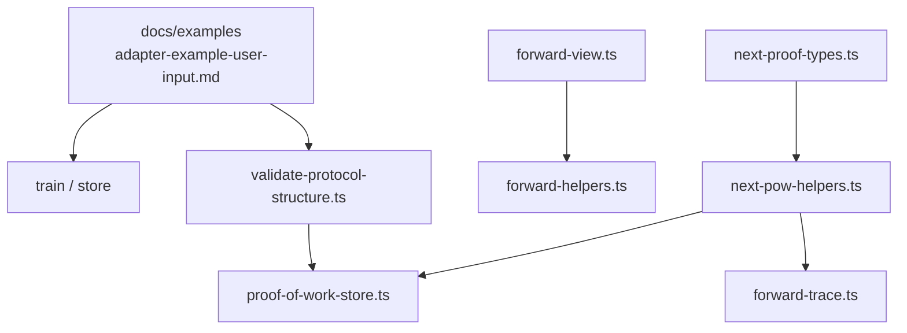
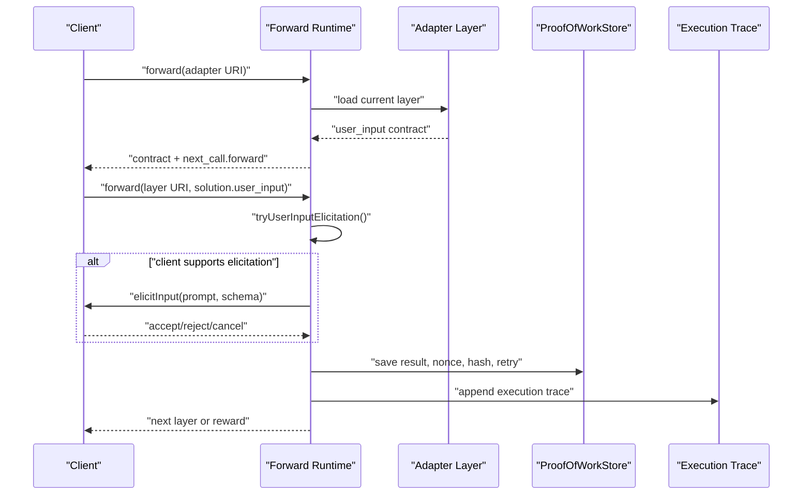
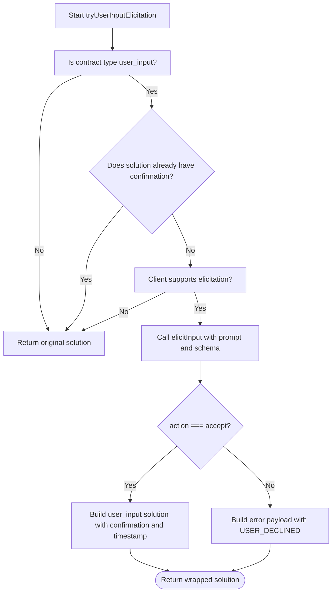
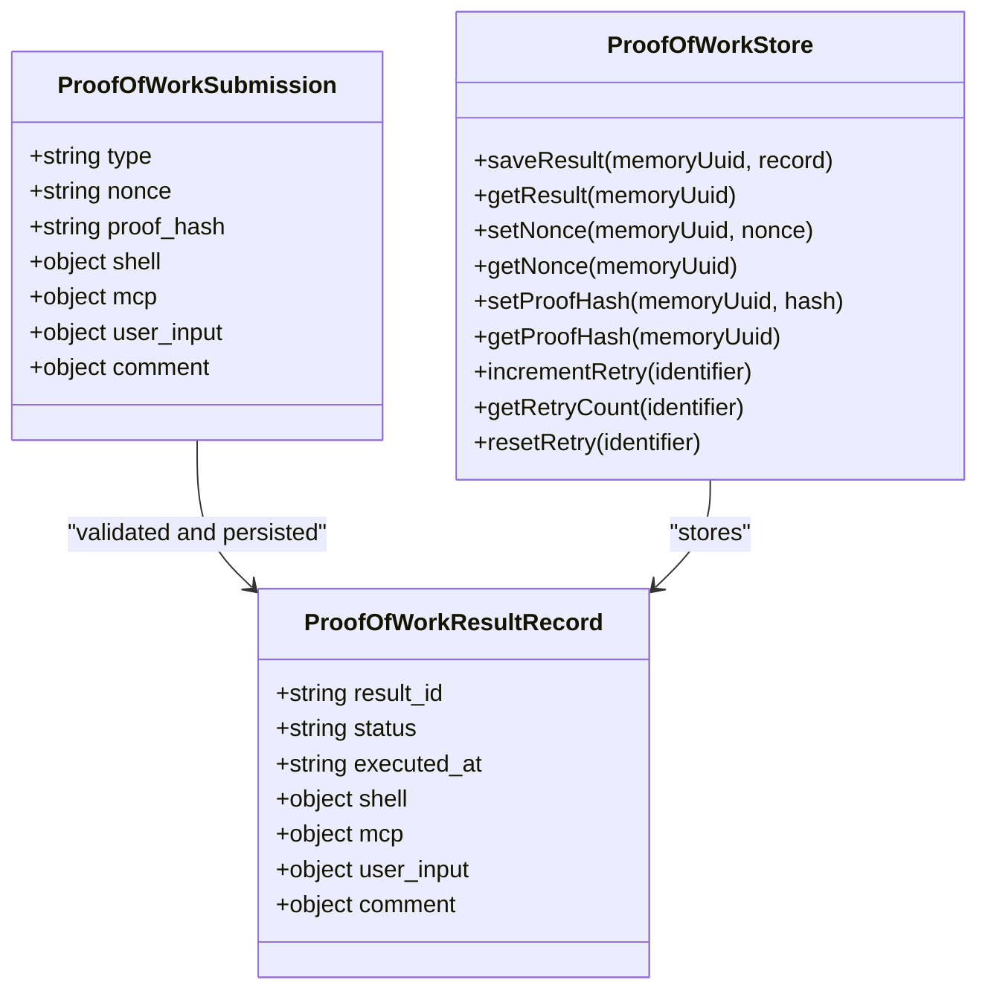
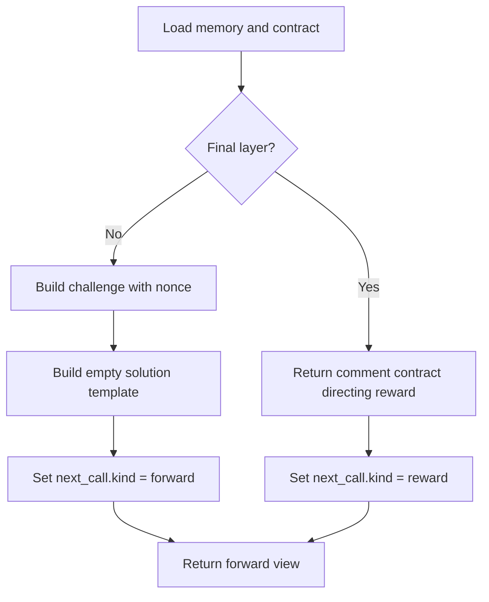
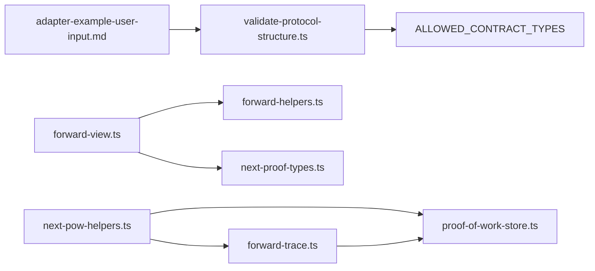

# User Input Adapter Example

<cite>
**Referenced Files in This Document**
- [adapter-example-user-input.md](file://docs/examples/adapter-example-user-input.md)
- [challenge-types.md](file://docs/examples/challenge-types.md)
- [next-pow-helpers.ts](file://src/tools/next-pow-helpers.ts)
- [forward-view.ts](file://src/tools/forward-view.ts)
- [forward-trace.ts](file://src/tools/forward-trace.ts)
- [forward-helpers.ts](file://src/tools/forward-helpers.ts)
- [validate-protocol-structure.ts](file://src/services/memory/validate-protocol-structure.ts)
- [proof-of-work-store.ts](file://src/services/proof-of-work-store.ts)
- [next-proof-types.ts](file://src/tools/next-proof-types.ts)
- [0009-autonomous-adapter-execution-no-human-gates.md](file://docs/adr/0009-autonomous-adapter-execution-no-human-gates.md)
</cite>

## Table of Contents
1. [Introduction](#introduction)
2. [Project Structure](#project-structure)
3. [Core Components](#core-components)
4. [Architecture Overview](#architecture-overview)
5. [Detailed Component Analysis](#detailed-component-analysis)
6. [Dependency Analysis](#dependency-analysis)
7. [Performance Considerations](#performance-considerations)
8. [Troubleshooting Guide](#troubleshooting-guide)
9. [Conclusion](#conclusion)
10. [Appendices](#appendices)

## Introduction
This document explains how to implement a user input adapter in the SquadRules MCP framework. A user input adapter is an adapter whose step asks a human for clarification, approval, or choice, and then continues the workflow only after the response is collected and validated.

The project follows an agent-first model: agents execute deterministic, auditable workflows, while humans provide preferences through adapters. The core flow is `activate` → `forward` → `reward`. Adapters define steps as layers, each ending with a JSON contract block that tells the runtime what kind of proof is required. For human feedback, the contract type is `user_input`.

Key design principles relevant to user input:
- Use `user_input` when a step requires human approval or choice.
- Do not use `user_input` as a general safety gate for irreversible remote mutations; those should be guarded by objective pre/post verification and critic-loop review instead.
- Every solution uses a unified envelope with `type`, `outcome`, `evidence`, `nonce`, and `proof_hash`.
- The server can optionally elicit confirmation through an elicitation-capable client, but the agent may also collect and submit the confirmation directly.

## Project Structure
User input support spans documentation, protocol validation, forward execution, UI hints, tracing, and persistent state.

**Diagram sources**
- [adapter-example-user-input.md:1-32](file://docs/examples/adapter-example-user-input.md#L1-L32)
- [validate-protocol-structure.ts:1-187](file://src/services/memory/validate-protocol-structure.ts#L1-L187)
- [proof-of-work-store.ts:1-175](file://src/services/proof-of-work-store.ts#L1-L175)
- [forward-view.ts:1-344](file://src/tools/forward-view.ts#L1-L344)
- [forward-helpers.ts:1-29](file://src/tools/forward-helpers.ts#L1-L29)
- [next-pow-helpers.ts:1-327](file://src/tools/next-pow-helpers.ts#L1-L327)
- [forward-trace.ts:1-230](file://src/tools/forward-trace.ts#L1-L230)
- [next-proof-types.ts:1-42](file://src/tools/next-proof-types.ts#L1-L42)

**Section sources**
- [adapter-example-user-input.md:1-32](file://docs/examples/adapter-example-user-input.md#L1-L32)
- [challenge-types.md:1-41](file://docs/examples/challenge-types.md#L1-L41)

## Core Components
The user input adapter implementation consists of five main areas:

| Area | Responsibility | Key files |
|---|---|---|
| Adapter example | Shows how to write a `user_input` step in markdown | [adapter-example-user-input.md](file://docs/examples/adapter-example-user-input.md) |
| Contract validation | Ensures `user_input` is an allowed contract type and the adapter has required structure | [validate-protocol-structure.ts](file://src/services/memory/validate-protocol-structure.ts) |
| Forward execution | Builds challenges, maps solutions, and handles user input submissions | [forward-view.ts](file://src/tools/forward-view.ts), [next-pow-helpers.ts](file://src/tools/next-pow-helpers.ts) |
| Elicitation integration | Optionally asks the client for confirmation using `approved` or `rejected` | [next-pow-helpers.ts](file://src/tools/next-pow-helpers.ts) |
| State and tracing | Stores results, nonces, hashes, retry counts, and traces user input evidence | [proof-of-work-store.ts](file://src/services/proof-of-work-store.ts), [forward-trace.ts](file://src/tools/forward-trace.ts) |

**Section sources**
- [adapter-example-user-input.md:1-32](file://docs/examples/adapter-example-user-input.md#L1-L32)
- [validate-protocol-structure.ts:24-24](file://src/services/memory/validate-protocol-structure.ts#L24-L24)
- [forward-view.ts:77-80](file://src/tools/forward-view.ts#L77-L80)
- [next-pow-helpers.ts:58-120](file://src/tools/next-pow-helpers.ts#L58-L120)
- [proof-of-work-store.ts:5-37](file://src/services/proof-of-work-store.ts#L5-L37)
- [forward-trace.ts:56-60](file://src/tools/forward-trace.ts#L56-L60)

## Architecture Overview
A user input adapter runs like any other adapter layer:

1. `activate` selects the adapter.
2. `forward` loads the current layer and returns a challenge.
3. If the contract is `user_input`, the runtime expects a solution with `type: "user_input"` and `user_input.confirmation`.
4. The server may call an elicitation API to ask the client for confirmation.
5. On success, the runtime records the result and moves to the next layer.
6. On failure or decline, it returns an error payload with guidance and retry information.
7. After the final layer, `reward` finalizes the run.

**Diagram sources**
- [forward-view.ts:242-291](file://src/tools/forward-view.ts#L242-L291)
- [next-pow-helpers.ts:58-120](file://src/tools/next-pow-helpers.ts#L58-L120)
- [proof-of-work-store.ts:66-173](file://src/services/proof-of-work-store.ts#L66-L173)
- [forward-trace.ts:94-117](file://src/tools/forward-trace.ts#L94-L117)

## Detailed Component Analysis

### Contract Structure for User Input Challenges
A user input adapter is written as markdown with:
- An H1 title.
- An `Activation Patterns` section.
- One or more H2 steps.
- Each executable step ends with a fenced JSON block containing a `contract`.
- A final `Reward Signal` section.

For user input, the contract shape is:

| Field | Meaning |
|---|---|
| `contract.type` | Must be `"user_input"` |
| `contract.user_input.prompt` | Human-facing question or instruction |
| `contract.required` | Whether the step must succeed before continuing |

The example adapter shows a deployment confirmation step followed by a completion step with no challenge.

Validation rules enforced at train time include:
- Required H1 title.
- First H2 must be `Activation Patterns`.
- Last H2 must be `Reward Signal`.
- At least one fenced JSON contract block.
- Contract `type` must be one of `shell`, `mcp`, `user_input`, `comment`, or `tensor`.

**Section sources**
- [adapter-example-user-input.md:1-32](file://docs/examples/adapter-example-user-input.md#L1-L32)
- [validate-protocol-structure.ts:113-186](file://src/services/memory/validate-protocol-structure.ts#L113-L186)

### Solution Format for User Input
Every solution follows a unified envelope:

| Field | Type | Requirement |
|---|---|---|
| `type` | string | `"user_input"` |
| `outcome` | string | Usually `"success"` |
| `evidence` | object | Type-specific proof data |
| `nonce` | string | Echoed from the challenge |
| `proof_hash` | string | Echoed from the challenge or previous response |

For `user_input`, the evidence contains:

| Field | Type | Description |
|---|---|---|
| `confirmation` | string | Human reply, such as approval text |
| `timestamp` | string | Optional ISO timestamp |

The server also accepts older shapes where fields are placed directly under the type key, but new protocols should use the unified envelope.

**Section sources**
- [challenge-types.md:21-32](file://docs/examples/challenge-types.md#L21-L32)
- [next-proof-types.ts:3-28](file://src/tools/next-proof-types.ts#L3-L28)
- [forward-view.ts:83-139](file://src/tools/forward-view.ts#L83-L139)

### Elicitation Integration
When the current contract is `user_input` and the submitted solution does not already contain `user_input.confirmation`, the runtime attempts to elicit confirmation from the client.

The elicitation flow:
1. Check whether the current contract is `user_input`.
2. Check whether the solution already includes a confirmation.
3. Check whether the client exposes `getClientCapabilities` and `elicitInput`.
4. Call `elicitInput` with the prompt from the contract and a schema requiring `confirmation` with values `approved` or `rejected`.
5. If the client accepts and returns a confirmation, wrap it into a `user_input` solution with a timestamp.
6. If the client declines, cancels, or the call fails, return an error payload with guidance.

**Diagram sources**
- [next-pow-helpers.ts:58-120](file://src/tools/next-pow-helpers.ts#L58-L120)

**Section sources**
- [next-pow-helpers.ts:58-120](file://src/tools/next-pow-helpers.ts#L58-L120)

### Proof Validation and State Management
The proof submission pipeline validates and persists user input solutions alongside other challenge types.

For `user_input`:
- The submission must include `user_input.confirmation`.
- If missing, the runtime blocks the step with a `MISSING_FIELD` error.
- On success, the record stores the confirmation and an optional timestamp.
- Nonce and `proof_hash` are used to prevent replay and ensure chain integrity.
- Retry counters track repeated failures.
- Once recorded successfully, later submissions can reuse the stored proof hash.

State management details:
- Nonces expire after one hour.
- Proof hashes expire after seven days.
- Retry counters expire after sixty seconds and reset on success.
- Maximum retries default to three before escalation guidance is returned.

**Diagram sources**
- [next-proof-types.ts:3-28](file://src/tools/next-proof-types.ts#L3-L28)
- [proof-of-work-store.ts:7-37](file://src/services/proof-of-work-store.ts#L7-L37)
- [proof-of-work-store.ts:48-173](file://src/services/proof-of-work-store.ts#L48-L173)

**Section sources**
- [next-pow-helpers.ts:261-270](file://src/tools/next-pow-helpers.ts#L261-L270)
- [proof-of-work-store.ts:39-46](file://src/services/proof-of-work-store.ts#L39-L46)
- [proof-of-work-store.ts:66-173](file://src/services/proof-of-work-store.ts#L66-L173)

### UI and Workflow Presentation
The forward view builds user-facing summaries and instructions. For `user_input`, it summarizes the contract as collecting user input and provides a template solution hint.

Key behaviors:
- Summarize the current contract for display.
- Build a solution template with `type`, `outcome`, and empty evidence.
- Provide `next_action` guidance telling the agent how to continue.
- Include local artifact directory fields for handoff artifacts.
- Map layer payloads back to forward views for consistent UI output.

**Diagram sources**
- [forward-view.ts:59-81](file://src/tools/forward-view.ts#L59-L81)
- [forward-view.ts:242-291](file://src/tools/forward-view.ts#L242-L291)
- [forward-helpers.ts:3-28](file://src/tools/forward-helpers.ts#L3-L28)

**Section sources**
- [forward-view.ts:59-81](file://src/tools/forward-view.ts#L59-L81)
- [forward-view.ts:242-291](file://src/tools/forward-view.ts#L242-L291)
- [forward-helpers.ts:3-28](file://src/tools/forward-helpers.ts#L3-L28)

### Tracing and Evidence
User input evidence is included in execution traces so runs remain auditable.

Tracing behavior:
- Raw solutions are appended to the execution trace.
- User input confirmation is normalized into a trace value named `user_input`.
- Both direct `solution.user_input` and unified-envelope forms are supported.
- Traces are fire-and-forget; persistence failures are logged but do not break the forward flow.

**Section sources**
- [forward-trace.ts:56-60](file://src/tools/forward-trace.ts#L56-L60)
- [forward-trace.ts:94-117](file://src/tools/forward-trace.ts#L94-L117)

### Approval Workflows and Conditional Branching
User input is appropriate for clarification and approval. However, the repository explicitly rejects using `user_input` as a general human veto gate for irreversible remote mutations. Instead:
- Use critic-loop for adversarial review.
- Use objective pre-mutation readiness checks.
- Use post-mutation verification.
- Treat FAIL verdicts as hard stops, not escalations to human approval.

Conditional branching in this codebase is primarily driven by tensor contracts and layer resolution, but the same principle applies: make branching deterministic and auditable rather than relying on ad hoc human prompts.

**Section sources**
- [0009-autonomous-adapter-execution-no-human-gates.md:55-84](file://docs/adr/0009-autonomous-adapter-execution-no-human-gates.md#L55-L84)

### UX Patterns and Accessibility Considerations
Although this repository is primarily backend and tooling, the following patterns emerge from the implementation:

| UX Pattern | Implementation Guidance |
|---|---|
| Clear prompts | Use `contract.user_input.prompt` to describe exactly what the human should confirm. |
| Structured responses | Require `confirmation` and optionally `timestamp` so clients can render structured inputs. |
| Consistent envelopes | Always use `type`, `outcome`, `evidence`, `nonce`, and `proof_hash`. |
| Retry guidance | When elicitation fails or is declined, return `message`, `error_code`, `retry_count`, and `next_action`. |
| Auditability | Record confirmation and timestamp in both proof records and execution traces. |
| Accessibility | Prefer explicit, machine-readable choices (`approved`, `rejected`) over free-form ambiguity when possible. |
| Progressive disclosure | Keep adapter steps focused; use chaining for complex multi-phase workflows. |

[No sources needed since this section synthesizes patterns without quoting specific code]

## Dependency Analysis
The user input adapter depends on several modules:

**Diagram sources**
- [adapter-example-user-input.md:1-32](file://docs/examples/adapter-example-user-input.md#L1-L32)
- [validate-protocol-structure.ts:24-24](file://src/services/memory/validate-protocol-structure.ts#L24-L24)
- [forward-view.ts:1-15](file://src/tools/forward-view.ts#L1-L15)
- [forward-helpers.ts:1-29](file://src/tools/forward-helpers.ts#L1-L29)
- [next-proof-types.ts:1-42](file://src/tools/next-proof-types.ts#L1-L42)
- [next-pow-helpers.ts:1-26](file://src/tools/next-pow-helpers.ts#L1-L26)
- [proof-of-work-store.ts:1-46](file://src/services/proof-of-work-store.ts#L1-L46)
- [forward-trace.ts:1-14](file://src/tools/forward-trace.ts#L1-L14)

**Section sources**
- [validate-protocol-structure.ts:24-24](file://src/services/memory/validate-protocol-structure.ts#L24-L24)
- [next-pow-helpers.ts:1-26](file://src/tools/next-pow-helpers.ts#L1-L26)
- [forward-view.ts:1-15](file://src/tools/forward-view.ts#L1-L15)

## Performance Considerations
- Elicitation adds a round-trip between the server and client. It is skipped if the client does not support elicitation or if the solution already contains a confirmation.
- Nonces rotate on mismatch to avoid unrecoverable retry loops.
- Retry counters are short-lived and reset on success, limiting stale state.
- Execution traces are appended asynchronously and failures are logged without blocking the forward flow.
- Semantic validation exists for `comment` challenges, not `user_input`; user input validation is structural and lightweight.

[No sources needed since this section provides general guidance derived from analyzed components]

## Troubleshooting Guide

| Symptom | Likely Cause | Resolution |
|---|---|---|
| Adapter cannot be trained | Missing `Activation Patterns`, `Reward Signal`, or invalid contract type | Ensure the first H2 is `Activation Patterns`, the last H2 is `Reward Signal`, and the contract `type` is exactly `user_input`. |
| Step blocked with `MISSING_FIELD` | `user_input.confirmation` is absent | Include `confirmation` in `solution.user_input`. |
| Step blocked with `NONCE_MISMATCH` | Submitted nonce does not match stored nonce | Use the nonce from the latest challenge response. |
| Step blocked with `PROOF_HASH_MISMATCH` | `proof_hash` does not match expected previous hash | Echo `proof_hash` from the previous response or current contract. |
| Elicitation fails | Client lacks `elicitInput` or capability | Fall back to collecting confirmation manually and submitting it in the solution. |
| User declines confirmation | Client action is `decline`, cancel, or error | Review the prompt, adjust wording, and retry with updated context. |
| Max retries exceeded | Repeated failures without recovery | Inspect `error_code`, fix the step, and consider calling `tune` or `reward` with failure feedback. |

**Section sources**
- [validate-protocol-structure.ts:113-186](file://src/services/memory/validate-protocol-structure.ts#L113-L186)
- [next-pow-helpers.ts:122-153](file://src/tools/next-pow-helpers.ts#L122-L153)
- [next-pow-helpers.ts:155-220](file://src/tools/next-pow-helpers.ts#L155-L220)
- [next-pow-helpers.ts:261-270](file://src/tools/next-pow-helpers.ts#L261-L270)

## Conclusion
A user input adapter in SquadRules is a small, well-defined pattern:
- Define a `user_input` contract with a clear prompt.
- Submit a unified-envelope solution with `type: "user_input"` and `user_input.confirmation`.
- Let the runtime optionally elicit confirmation through a capable client.
- Rely on nonces, proof hashes, retry counters, and execution traces for auditability.
- Reserve `user_input` for genuine clarification and approval, not as a substitute for objective mutation gates.

This keeps human feedback integrated into deterministic, agent-driven workflows while preserving security, reproducibility, and clarity.

## Appendices

### Quick Reference: User Input Contract and Solution

| Concept | Shape |
|---|---|
| Contract | `{"contract": {"type": "user_input", "user_input": {"prompt": "..."}, "required": true}}` |
| Solution envelope | `{"type": "user_input", "outcome": "success", "evidence": {"confirmation": "...", "timestamp": "..."}, "nonce": "...", "proof_hash": "..."}` |
| Elicitation schema | Object with required `confirmation` enum `approved` or `rejected` |
| Storage field | `user_input.confirmation` and optional `user_input.timestamp` |

**Section sources**
- [adapter-example-user-input.md:13-22](file://docs/examples/adapter-example-user-input.md#L13-L22)
- [challenge-types.md:21-32](file://docs/examples/challenge-types.md#L21-L32)
- [next-pow-helpers.ts:81-88](file://src/tools/next-pow-helpers.ts#L81-L88)
- [next-proof-types.ts:21-24](file://src/tools/next-proof-types.ts#L21-L24)