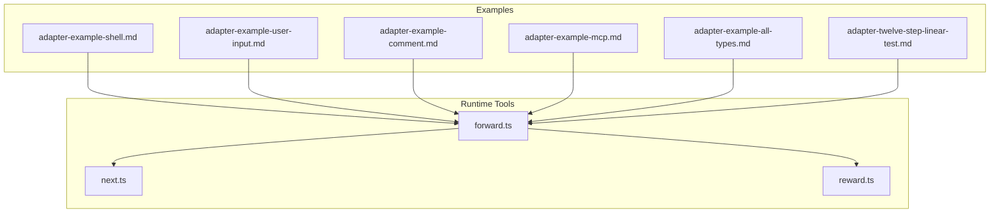
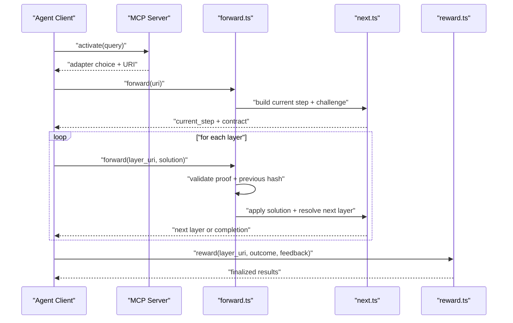
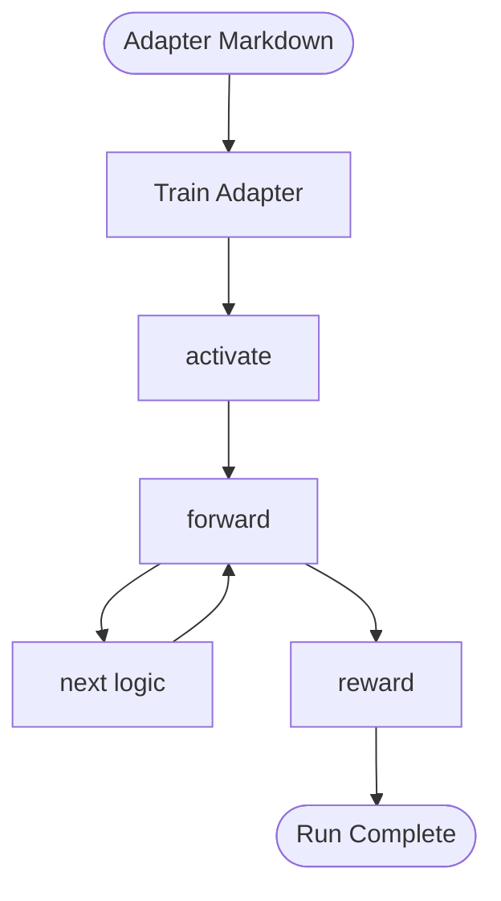

# Examples & Tutorials

<cite>
**Referenced Files in This Document**
- [README.md](file://docs/examples/README.md)
- [challenge-types.md](file://docs/examples/challenge-types.md)
- [adapter-example-shell.md](file://docs/examples/adapter-example-shell.md)
- [adapter-example-user-input.md](file://docs/examples/adapter-example-user-input.md)
- [adapter-example-comment.md](file://docs/examples/adapter-example-comment.md)
- [adapter-example-mcp.md](file://docs/examples/adapter-example-mcp.md)
- [adapter-example-all-types.md](file://docs/examples/adapter-example-all-types.md)
- [adapter-twelve-step-linear-test.md](file://docs/examples/adapter-twelve-step-linear-test.md)
- [action-routing.md](file://.agents/skills/squadrules/references/action-routing.md)
- [forward.ts](file://src/tools/forward.ts)
- [next.ts](file://src/tools/next.ts)
- [reward.ts](file://src/tools/reward.ts)
</cite>

## Table of Contents
1. [Introduction](#introduction)
2. [Project Structure](#project-structure)
3. [Core Components](#core-components)
4. [Architecture Overview](#architecture-overview)
5. [Detailed Component Analysis](#detailed-component-analysis)
6. [Dependency Analysis](#dependency-analysis)
7. [Performance Considerations](#performance-considerations)
8. [Troubleshooting Guide](#troubleshooting-guide)
9. [Conclusion](#conclusion)
10. [Appendices](#appendices)

## Introduction
This document is a practical tutorial for building and running SquadRules adapters. It focuses on:
- Creating adapters with different challenge types: shell, MCP tool calls, user input, and comments.
- Running the activate → forward → reward chain safely and deterministically.
- Implementing complex workflows such as long linear pipelines, conditional branching, parallel execution patterns, and error handling.
- Integrating with external systems through shell commands and MCP tools.
- Applying best practices for agent autonomy, auditability, and performance.

SquadRules is an agent-first MCP framework where AI agents are primary users and humans configure preferences through agents. The canonical flow is activate → forward → reward. Adapters provide deterministic, auditable task execution. Agents must create or repair adapters when workflows change.

## Project Structure
The examples live under `docs/examples`. Each markdown file is a complete trainable adapter:
- One H1 title.
- Activation patterns.
- One H2 per step.
- A trailing JSON contract block per executable step.
- A final “run complete” step with no challenge.
- An optional Reward Signal section.

**Diagram sources**
- [adapter-example-shell.md:1-33](file://docs/examples/adapter-example-shell.md#L1-L33)
- [adapter-example-user-input.md:1-32](file://docs/examples/adapter-example-user-input.md#L1-L32)
- [adapter-example-comment.md:1-32](file://docs/examples/adapter-example-comment.md#L1-L32)
- [adapter-example-mcp.md:1-53](file://docs/examples/adapter-example-mcp.md#L1-L53)
- [adapter-example-all-types.md:1-81](file://docs/examples/adapter-example-all-types.md#L1-L81)
- [adapter-twelve-step-linear-test.md:1-180](file://docs/examples/adapter-twelve-step-linear-test.md#L1-L180)
- [forward.ts:93-317](file://src/tools/forward.ts#L93-L317)
- [next.ts:58-83](file://src/tools/next.ts#L58-L83)
- [reward.ts:27-109](file://src/tools/reward.ts#L27-L109)

**Section sources**
- [README.md:1-41](file://docs/examples/README.md#L1-L41)

## Core Components
- Trainable adapters: Markdown documents describing steps and contracts.
- Challenge types:
  - shell: execute a command and return exit code and output.
  - mcp: call an MCP tool and report success.
  - user_input: obtain real human confirmation.
  - comment: provide a text summary meeting length or semantic requirements.
- Chain tools:
  - activate: select an adapter based on intent.
  - forward: submit solutions and advance layers.
  - reward: finalize the run and record outcomes.

Key rules for agents inside a chain:
- Echo verbatim server-generated URIs, nonces, hashes, IDs, must_obey, and next_action.
- Do not skip, reorder, or merge layers.
- For each proof type, perform the real action (user reply, MCP call, shell execution, genuine comment).
- On rejection, read message and follow next_action exactly.
- Do not answer the user until reward succeeds unless the active layer requires user_input or a blocking error occurs.

**Section sources**
- [challenge-types.md:1-41](file://docs/examples/challenge-types.md#L1-L41)
- [action-routing.md:32-47](file://.agents/skills/squadrules/references/action-routing.md#L32-L47)

## Architecture Overview
The runtime enforces a strict layer-by-layer workflow.

**Diagram sources**
- [forward.ts:93-317](file://src/tools/forward.ts#L93-L317)
- [next.ts:58-83](file://src/tools/next.ts#L58-L83)
- [reward.ts:27-109](file://src/tools/reward.ts#L27-L109)

## Detailed Component Analysis

### Tutorial 1: Shell Command Automation
Use this pattern to automate local tasks such as running tests, linting, or deployment scripts.

Steps:
1. Create an adapter with one shell challenge.
2. Define the command and timeout in the contract.
3. Add a final “run complete” step that shows the command result.
4. Train the adapter, then run activate → forward → reward.

Design decisions:
- Use shell only when the task requires local execution.
- Keep timeouts reasonable to avoid hanging chains.
- Always show the command output to the user after success.

Example references:
- Shell adapter structure and contract: [adapter-example-shell.md:9-24](file://docs/examples/adapter-example-shell.md#L9-L24)
- Final verification step without a challenge: [adapter-example-shell.md:26-32](file://docs/examples/adapter-example-shell.md#L26-L32)

Best practices:
- Prefer MCP-only adapters when shell access is restricted.
- Log both stdout and stderr for diagnostics.
- Treat non-zero exit codes as failures and surface them to the user.

**Section sources**
- [adapter-example-shell.md:1-33](file://docs/examples/adapter-example-shell.md#L1-L33)

### Tutorial 2: MCP Tool Integration
Use this pattern to integrate with external MCP services by calling tools like activate, spaces, or custom tools.

Steps:
1. Create an adapter with one MCP challenge.
2. Specify the target tool_name and optional arguments.
3. Require success in the solution.
4. Show the tool name, query, and result in the final step.

Design decisions:
- Omit arguments when any call is sufficient.
- Constrain arguments when the step requires specific parameters.
- Validate success explicitly in the solution.

Example references:
- MCP challenge contract and argument guidance: [adapter-example-mcp.md:9-44](file://docs/examples/adapter-example-mcp.md#L9-L44)
- Final verification step: [adapter-example-mcp.md:46-52](file://docs/examples/adapter-example-mcp.md#L46-L52)

Advanced tip:
- When chaining multiple MCP calls, split them into separate layers so each call has its own checkpoint and audit trail.

**Section sources**
- [adapter-example-mcp.md:1-53](file://docs/examples/adapter-example-mcp.md#L1-L53)

### Tutorial 3: Human-in-the-Loop Workflows
Use user_input challenges for approvals, confirmations, or clarifications.

Steps:
1. Create an adapter with a user_input challenge.
2. Provide a clear prompt for the human.
3. Obtain the real confirmation from the user.
4. Show the user’s response in the final step.

Design decisions:
- Never fabricate confirmation; always ask the user.
- Make prompts explicit about consequences.
- Use user_input sparingly; prefer automation where possible.

Example references:
- User input challenge contract: [adapter-example-user-input.md:9-23](file://docs/examples/adapter-example-user-input.md#L9-L23)
- Final verification step: [adapter-example-user-input.md:25-31](file://docs/examples/adapter-example-user-input.md#L25-L31)

**Section sources**
- [adapter-example-user-input.md:1-32](file://docs/examples/adapter-example-user-input.md#L1-L32)

### Tutorial 4: Verification Comments and Summaries
Use comment challenges to enforce summaries, explanations, or review notes.

Steps:
1. Create an adapter with a comment challenge.
2. Set min_length and any semantic checks required by your team.
3. Require a genuine summary from the agent.
4. Show the submitted summary in the final step.

Design decisions:
- Use min_length to prevent trivial responses.
- Combine with semantic checks when needed.
- Treat comments as audit evidence.

Example references:
- Comment challenge contract: [adapter-example-comment.md:9-23](file://docs/examples/adapter-example-comment.md#L9-L23)
- Final verification step: [adapter-example-comment.md:25-31](file://docs/examples/adapter-example-comment.md#L25-L31)

**Section sources**
- [adapter-example-comment.md:1-32](file://docs/examples/adapter-example-comment.md#L1-L32)

### Tutorial 5: Multi-Type Adapter Workflow
Combine all challenge types in one adapter to demonstrate sequential dependencies.

Steps:
1. Step 1: shell command.
2. Step 2: MCP tool call.
3. Step 3: user confirmation.
4. Step 4: verification comment.
5. Step 5: show outputs from prior steps.

Design decisions:
- Order steps to respect dependencies.
- Keep each step focused and auditable.
- Use the final step to present a consolidated result.

Example references:
- Multi-type adapter steps and contracts: [adapter-example-all-types.md:9-72](file://docs/examples/adapter-example-all-types.md#L9-L72)
- Final consolidation step: [adapter-example-all-types.md:74-80](file://docs/examples/adapter-example-all-types.md#L74-L80)

**Section sources**
- [adapter-example-all-types.md:1-81](file://docs/examples/adapter-example-all-types.md#L1-L81)

### Tutorial 6: Long Linear Pipelines
Use long linear adapters to test progress tracking, UI coverage, and stability over many checkpoints.

Steps:
1. Create many comment checkpoints with consistent min_length.
2. Ensure each step advances deterministically.
3. Add a final Reward Signal section.

Design decisions:
- Use unique checkpoint labels for traceability.
- Keep each checkpoint concise but meaningful.
- Prefer splitting very long adapters into chained adapters if they exceed recommended size limits.

Example references:
- Twelve-step linear adapter: [adapter-twelve-step-linear-test.md:1-180](file://docs/examples/adapter-twelve-step-linear-test.md#L1-L180)

**Section sources**
- [adapter-twelve-step-linear-test.md:1-180](file://docs/examples/adapter-twelve-step-linear-test.md#L1-L180)

### Tutorial 7: Conditional Branching
Branching is achieved by chaining adapters rather than embedding branches inside a single adapter.

Recommended pattern:
- Root adapter performs discovery and selects a branch.
- Branch adapters implement specialized flows.
- Use activate at phase boundaries when the next slug is ambiguous.
- Use explicit forward when the next adapter slug is already known.

Implementation details:
- Include chain_root and prerequisite clauses in mid-chain adapters.
- Link sibling adapters consistently.
- Reserve activate for ambiguous runtime discovery.

References:
- Chaining guidance and protocol linking: [create-new-protocol.md:156-180](file://src/embed-docs/mem/create-new-protocol.md#L156-L180)

**Section sources**
- [create-new-protocol.md:156-180](file://src/embed-docs/mem/create-new-protocol.md#L156-L180)

### Tutorial 8: Parallel Execution Patterns
Parallelism should be modeled as independent branches that converge later.

Recommended pattern:
- Split work into parallel leaf adapters.
- Each leaf completes independently.
- A convergence adapter collects results and proceeds to validation.
- Record intermediate rewards for each branch to improve quality metrics.

Notes:
- Avoid executing substantive work before completing the SquadRules chain.
- Finish reward first, then act on the adapter’s guidance.

References:
- Chain discipline and timing guidance: [action-routing.md:140-156](file://.agents/skills/squadrules/references/action-routing.md#L140-L156)

**Section sources**
- [action-routing.md:140-156](file://.agents/skills/squadrules/references/action-routing.md#L140-L156)

### Tutorial 9: Error Handling and Recovery
Common errors include invalid inputs, missing URIs, and missing proofs.

Patterns:
- Validate inputs early.
- Return structured errors with error_code and message.
- Follow next_action exactly on rejection.
- Retry only as instructed; do not guess or jump ahead.

Runtime behavior:
- forward validates URIs and returns NOT_FOUND for missing adapters or layers.
- forward may return MISSING_PROOF when a previous layer is incomplete.
- reward validates outcome and persists evaluation results.

References:
- HTTP route error expectations: [api-error-paths.test.ts:92-137](file://tests/integration/api-error-paths.test.ts#L92-L137)
- Missing proof handling in forward: [forward.ts:266-293](file://src/tools/forward.ts#L266-L293)
- Reward persistence and error mapping: [reward.ts:18-25](file://src/tools/reward.ts#L18-L25), [reward.ts:54-86](file://src/tools/reward.ts#L54-L86)

**Section sources**
- [forward.ts:266-293](file://src/tools/forward.ts#L266-L293)
- [reward.ts:18-25](file://src/tools/reward.ts#L18-L25)
- [reward.ts:54-86](file://src/tools/reward.ts#L54-L86)

### Tutorial 10: Advanced Features
- Tensor challenges: forward supports tensor-shaped solutions for advanced workflows.
- Previous-step application: solutions can apply to pending prior layers when matching.
- Quality updates: successful or blocked submissions update step quality metrics.

References:
- Tensor handling and previous-step application: [forward.ts:136-139](file://src/tools/forward.ts#L136-L139), [forward.ts:152-221](file://src/tools/forward.ts#L152-L221)
- Quality metric updates: [next.ts:85-129](file://src/tools/next.ts#L85-L129)

**Section sources**
- [forward.ts:136-139](file://src/tools/forward.ts#L136-L139)
- [forward.ts:152-221](file://src/tools/forward.ts#L152-L221)
- [next.ts:85-129](file://src/tools/next.ts#L85-L129)

## Dependency Analysis
The core runtime components interact as follows:

**Diagram sources**
- [README.md:21-27](file://docs/examples/README.md#L21-L27)
- [forward.ts:93-317](file://src/tools/forward.ts#L93-L317)
- [next.ts:58-83](file://src/tools/next.ts#L58-L83)
- [reward.ts:27-109](file://src/tools/reward.ts#L27-L109)

**Section sources**
- [README.md:21-27](file://docs/examples/README.md#L21-L27)

## Performance Considerations
- Prefer MCP-only adapters when shell access is restricted to reduce overhead and risk.
- Keep adapters under recommended size limits; split large workflows into chained adapters.
- Use targeted activation queries to reduce search cost.
- Cache repeated lookups where appropriate; the runtime already caches memory resources.
- Avoid unnecessary retries; follow next_action exactly.
- Record rewards promptly to improve quality metrics and retrieval ranking.

[No sources needed since this section provides general guidance]

## Troubleshooting Guide
Common issues and resolutions:
- Invalid input: ensure required fields like uri and outcome are present and valid.
- Not found: verify adapter slug or layer URI exists.
- Missing proof: submit the previous layer’s solution before continuing.
- Rejection: read message and follow next_action; do not guess or skip layers.

Action checklist:
- Validate input schema before calling tools.
- Echo server-provided URIs, nonces, and hashes.
- Respect must_obey and retry_count signals.
- Use structured logging and capture request/response traces for debugging.

**Section sources**
- [action-routing.md:32-47](file://.agents/skills/squadrules/references/action-routing.md#L32-L47)
- [forward.ts:266-293](file://src/tools/forward.ts#L266-L293)
- [reward.ts:18-25](file://src/tools/reward.ts#L18-L25)

## Conclusion
SquadRules turns team-specific workflows into deterministic, auditable chains. By training adapters with clear steps and contracts, agents can automate shell tasks, integrate with MCP tools, involve humans at the right gates, and produce reliable outputs. Use branching and convergence patterns for complex workflows, follow chain discipline strictly, and record rewards to continuously improve quality.

[No sources needed since this section summarizes without analyzing specific files]

## Appendices

### Appendix A: Challenge Type Reference
- shell: exit_code must be zero; include stdout/stderr when available.
- mcp: success must be true; include tool_name and arguments when constrained.
- user_input: obtain real confirmation; never fabricate.
- comment: meet min_length and any semantic checks.

References:
- Challenge types and solution shapes: [challenge-types.md:21-35](file://docs/examples/challenge-types.md#L21-L35)

**Section sources**
- [challenge-types.md:21-35](file://docs/examples/challenge-types.md#L21-L35)

### Appendix B: Training and Running Examples
- Train adapters by passing markdown content with contract blocks.
- Run activate → forward → reward.
- For MCP-only tests, use adapters without shell steps.

References:
- Example README and usage instructions: [README.md:1-27](file://docs/examples/README.md#L1-L27)

**Section sources**
- [README.md:1-27](file://docs/examples/README.md#L1-L27)