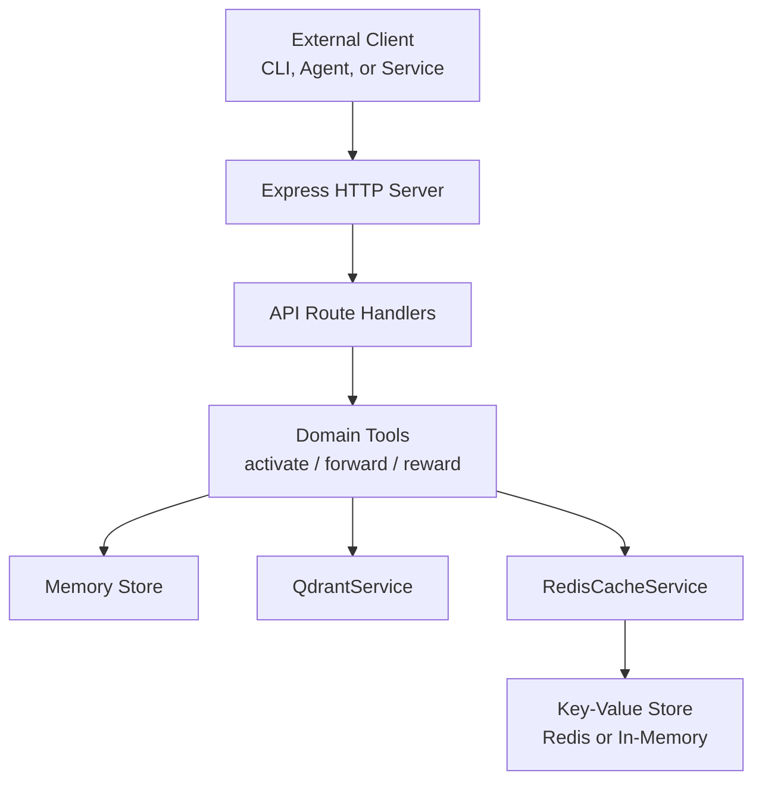
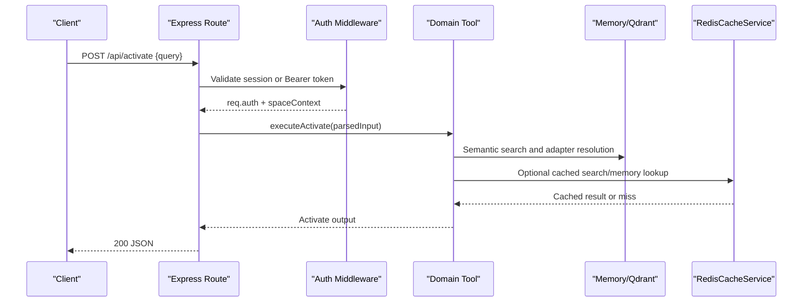
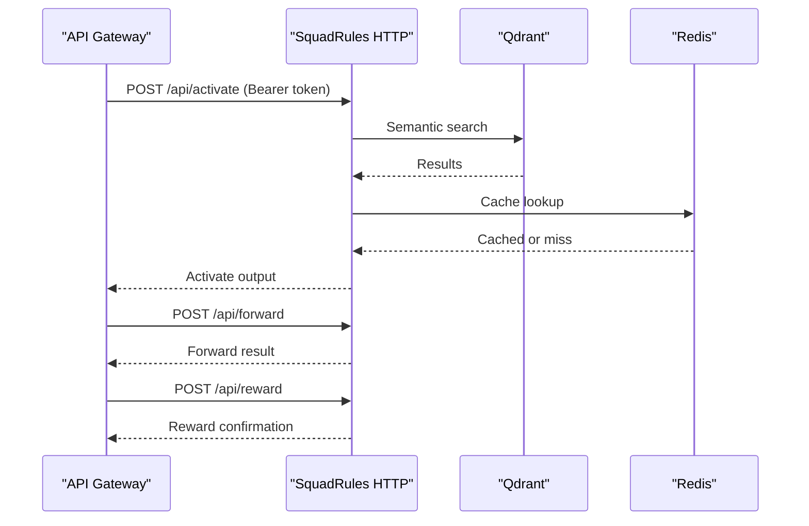
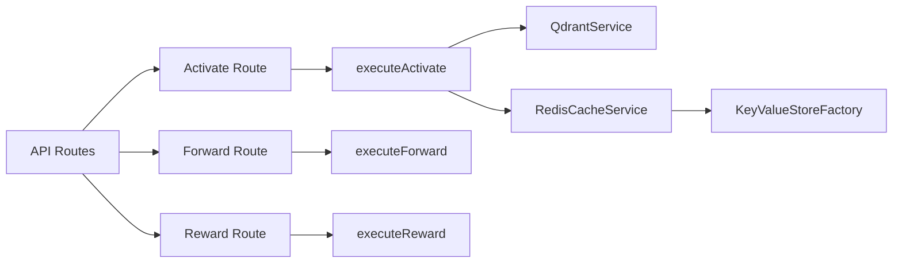

# Integration Examples

<cite>
**Referenced Files in This Document**
- [http-api-routes.ts](file://src/http/http-api-routes.ts)
- [http-health-routes.ts](file://src/http/http-health-routes.ts)
- [http-auth-middleware.ts](file://src/http/http-auth-middleware.ts)
- [bearer-validate.ts](file://src/http/bearer-validate.ts)
- [http-api-begin.ts](file://src/http/http-api-begin.ts)
- [http-api-begin-step.ts](file://src/http/http-api-begin-step.ts)
- [http-api-attest.ts](file://src/http/http-api-attest.ts)
- [activate.ts](file://src/tools/activate.ts)
- [redis-cache.ts](file://src/services/redis-cache.ts)
- [key-value-store-factory.ts](file://src/services/key-value-store-factory.ts)
- [service.ts](file://src/services/qdrant/service.ts)
- [config.ts](file://src/config.ts)
- [index.ts](file://src/cli/index.ts)
- [config.ts](file://src/cli/config.ts)
</cite>

## Table of Contents
1. [Introduction](#introduction)
2. [Project Structure](#project-structure)
3. [Core Components](#core-components)
4. [Architecture Overview](#architecture-overview)
5. [Detailed Component Analysis](#detailed-component-analysis)
6. [Dependency Analysis](#dependency-analysis)
7. [Performance Considerations](#performance-considerations)
8. [Troubleshooting Guide](#troubleshooting-guide)
9. [Conclusion](#conclusion)

## Introduction
This document provides practical integration examples for embedding SquadRules into external systems, APIs, and services. It focuses on:
- HTTP API integrations for the activate → forward → reward chain.
- Authentication handling with Keycloak OIDC sessions and Bearer tokens.
- Rate limiting considerations and error propagation patterns.
- External service interactions including Qdrant vector search, Redis-backed caching, and local file system operations through artifacts.
- Embedding SquadRules in larger applications and microservices architectures.

The guidance is grounded in the repository’s HTTP routes, middleware, tools, services, and configuration.

## Project Structure
SquadRules exposes a REST API under `/api`, an MCP endpoint at `/mcp`, and a UI under `/ui`. The HTTP server wires Express routes to domain tools that operate over memory stores and vector backends.

**Diagram sources**
- [http-api-routes.ts:22-36](file://src/http/http-api-routes.ts#L22-L36)
- [http-api-begin.ts:14-39](file://src/http/http-api-begin.ts#L14-L39)
- [http-api-begin-step.ts:13-38](file://src/http/http-api-begin-step.ts#L13-L38)
- [http-api-attest.ts:12-35](file://src/http/http-api-attest.ts#L12-L35)
- [activate.ts:209-235](file://src/tools/activate.ts#L209-L235)
- [redis-cache.ts:21-31](file://src/services/redis-cache.ts#L21-L31)
- [key-value-store-factory.ts:13-22](file://src/services/key-value-store-factory.ts#L13-L22)
- [service.ts:17-28](file://src/services/qdrant/service.ts#L17-L28)

**Section sources**
- [http-api-routes.ts:1-36](file://src/http/http-api-routes.ts#L1-L36)
- [http-health-routes.ts:96-117](file://src/http/http-health-routes.ts#L96-L117)

## Core Components
- HTTP API surface: `/api/activate`, `/api/forward`, `/api/reward`, plus training, snapshot, spaces, and dump endpoints.
- Authentication middleware: supports browser session cookies and Bearer JWT validation; returns structured 401 responses with `login_url` when authentication is required.
- Domain tools: `activate`, `forward`, and `reward` implement the agent workflow.
- Vector store abstraction: `QdrantService` abstracts remote Qdrant or embedded LanceDB.
- Caching layer: `RedisCacheService` uses a key-value store factory that selects Redis or in-memory storage.
- Configuration: environment-driven settings for auth, rate limits, vector store, embedding providers, and artifact directories.

**Section sources**
- [http-api-routes.ts:22-36](file://src/http/http-api-routes.ts#L22-L36)
- [http-auth-middleware.ts:172-327](file://src/http/http-auth-middleware.ts#L172-L327)
- [activate.ts:209-235](file://src/tools/activate.ts#L209-L235)
- [service.ts:17-28](file://src/services/qdrant/service.ts#L17-L28)
- [redis-cache.ts:21-31](file://src/services/redis-cache.ts#L21-L31)
- [config.ts:120-125](file://src/config.ts#L120-L125)

## Architecture Overview
The HTTP layer validates input, applies authentication, sets tenant context, and delegates to domain tools. Tools perform semantic search and orchestrate adapter execution, optionally interacting with caches and vector stores.

**Diagram sources**
- [http-api-begin.ts:14-39](file://src/http/http-api-begin.ts#L14-L39)
- [http-auth-middleware.ts:172-327](file://src/http/http-auth-middleware.ts#L172-L327)
- [activate.ts:209-235](file://src/tools/activate.ts#L209-L235)
- [redis-cache.ts:38-72](file://src/services/redis-cache.ts#L38-L72)

## Detailed Component Analysis

### HTTP API Integrations
Use the following endpoints to integrate SquadRules from external systems:
- POST `/api/activate`: Start an activation flow by querying available adapters.
- POST `/api/forward`: Execute an adapter step using the chosen adapter URI.
- POST `/api/reward`: Attest outcomes to improve future matching and quality metrics.

Example request patterns:
- Activate: Send a JSON body with a query string. On success, receive ranked choices and next actions.
- Forward: Provide the adapter URI and any solution data. On success, receive tool output and structured content.
- Reward: Provide the adapter URI and outcome classification. On success, receive confirmation and updated metrics.

Error handling:
- Invalid input returns 400 with an `INVALID_INPUT` error message.
- Runtime failures return structured errors via route error handlers.

Authentication:
- When authentication is enabled, unauthenticated requests receive 401 with a `login_url`.
- Bearer tokens are validated against trusted issuers and allowed audiences when configured.

Rate limiting:
- HTTP-level rate limits are configurable via environment variables.
- MCP-specific rate limits are also configurable.

Embedding example (conceptual):
- A microservice receives user queries, calls `/api/activate`, then `/api/forward` based on the returned choice, and finally `/api/reward` after observing downstream results.

**Section sources**
- [http-api-routes.ts:22-36](file://src/http/http-api-routes.ts#L22-L36)
- [http-api-begin.ts:14-39](file://src/http/http-api-begin.ts#L14-L39)
- [http-api-begin-step.ts:13-38](file://src/http/http-api-begin-step.ts#L13-L38)
- [http-api-attest.ts:12-35](file://src/http/http-api-attest.ts#L12-L35)
- [http-health-routes.ts:96-117](file://src/http/http-health-routes.ts#L96-L117)
- [config.ts:120-125](file://src/config.ts#L120-L125)

### Authentication Handling
SquadRules supports two primary authentication paths:
- Browser session cookie: OIDC login redirects users to Keycloak; a signed session cookie is established.
- Bearer token: Clients can send a JWT access token in the Authorization header. Validation requires trusted issuers and allowed audiences.

Behavior:
- Protected paths include `/api`, `/api/*`, `/mcp`, and `/ui`.
- Unauthenticated GET requests may redirect to the OIDC login URL; non-GET requests and MCP clients receive 401 JSON with `login_url`.
- Space scoping is supported via query parameters; unauthorized space access returns 403.

Integration tips:
- For headless agents, configure `AUTH_MODE=oidc_bearer`, set `AUTH_TRUSTED_ISSUERS` and `AUTH_ALLOWED_AUDIENCES`, and pass Bearer tokens.
- For browser-based flows, ensure `AUTH_CALLBACK_BASE_URL` and `SESSION_SECRET` are configured.

**Section sources**
- [http-auth-middleware.ts:172-327](file://src/http/http-auth-middleware.ts#L172-L327)
- [bearer-validate.ts](file://src/http/bearer-validate.ts)
- [config.ts:140-167](file://src/config.ts#L140-L167)

### Database Connections
SquadRules does not use a traditional relational database. Instead, it integrates with:
- Qdrant (remote-capable) for vector embeddings and semantic search.
- Embedded LanceDB as a fallback when Qdrant is not configured.
- Redis (optional) for caching and distributed state.

Configuration:
- Set `QDRANT_URL` and related options to enable Qdrant.
- If Qdrant is not configured, the system falls back to embedded storage.
- Set `KEY_VALUE_STORE_URL` or `REDIS_URL` to enable Redis-backed caching.

Operational notes:
- `QdrantService` abstracts both remote and embedded backends.
- Health endpoints expose dependency status, including cache backend and vector store backend.

**Section sources**
- [service.ts:17-28](file://src/services/qdrant/service.ts#L17-L28)
- [config.ts:105-112](file://src/config.ts#L105-L112)
- [config.ts:296-302](file://src/config.ts#L296-L302)
- [http-health-routes.ts:73-91](file://src/http/http-health-routes.ts#L73-L91)

### File System Operations
SquadRules supports local artifact directories for deterministic, auditable workflows:
- The system emits hints for preferred local artifact directories.
- Activated adapters can include linked artifacts with download URLs and SHA-256 checksums.
- Agents can materialize artifacts locally, verify integrity, and then proceed with adapter execution.

Integration tips:
- Configure `SQUADRULES_LOCAL_ARTIFACT_DIRS` to define preferred locations.
- Use the provided materialization instructions in activation outputs to download and verify artifacts before calling forward.

**Section sources**
- [activate.ts:30-67](file://src/tools/activate.ts#L30-L67)
- [activate.ts:116-177](file://src/tools/activate.ts#L116-L177)
- [config.ts:59-67](file://src/config.ts#L59-L67)

### Third-Party Service Interactions
Embedding providers:
- SquadRules supports OpenAI, TEI, and fastembed providers.
- Embedding latency, retries, and budgets are configurable.

Vector search:
- Semantic search is performed via Qdrant or embedded LanceDB.
- Search behavior includes overfetch factors, limit caps, and group collapse options.

Caching:
- `RedisCacheService` caches search results and memory resources.
- Keys are namespaced per space; invalidation events are published for distributed consistency.

**Section sources**
- [config.ts:70-92](file://src/config.ts#L70-L92)
- [config.ts:107-116](file://src/config.ts#L107-L116)
- [redis-cache.ts:33-72](file://src/services/redis-cache.ts#L33-L72)
- [redis-cache.ts:99-129](file://src/services/redis-cache.ts#L99-L129)

### Embedding SquadRules in Larger Applications and Microservices
Recommended patterns:
- Expose SquadRules behind an API gateway or service mesh.
- Use Bearer tokens issued by your identity provider; validate them using the same trusted issuers and audiences configured in SquadRules.
- Centralize rate limiting at the gateway and within SquadRules for defense-in-depth.
- Monitor health and dependencies via `/health` and `/api`.

Microservice call flow:

**Diagram sources**
- [http-api-routes.ts:22-36](file://src/http/http-api-routes.ts#L22-L36)
- [http-api-begin.ts:14-39](file://src/http/http-api-begin.ts#L14-L39)
- [http-api-begin-step.ts:13-38](file://src/http/http-api-begin-step.ts#L13-L38)
- [http-api-attest.ts:12-35](file://src/http/http-api-attest.ts#L12-L35)
- [service.ts:17-28](file://src/services/qdrant/service.ts#L17-L28)
- [redis-cache.ts:38-72](file://src/services/redis-cache.ts#L38-L72)

## Dependency Analysis
The HTTP routes depend on domain tools, which in turn depend on memory stores, vector services, and optional caches. Authentication middleware injects user context and space scoping.

**Diagram sources**
- [http-api-routes.ts:22-36](file://src/http/http-api-routes.ts#L22-L36)
- [http-api-begin.ts:14-39](file://src/http/http-api-begin.ts#L14-L39)
- [http-api-begin-step.ts:13-38](file://src/http/http-api-begin-step.ts#L13-L38)
- [http-api-attest.ts:12-35](file://src/http/http-api-attest.ts#L12-L35)
- [activate.ts:209-235](file://src/tools/activate.ts#L209-L235)
- [redis-cache.ts:21-31](file://src/services/redis-cache.ts#L21-L31)
- [key-value-store-factory.ts:13-22](file://src/services/key-value-store-factory.ts#L13-L22)

**Section sources**
- [http-api-routes.ts:1-36](file://src/http/http-api-routes.ts#L1-L36)
- [activate.ts:209-235](file://src/tools/activate.ts#L209-L235)
- [redis-cache.ts:21-31](file://src/services/redis-cache.ts#L21-L31)
- [key-value-store-factory.ts:13-22](file://src/services/key-value-store-factory.ts#L13-L22)

## Performance Considerations
- Embedding provider tuning: Adjust retry policies, budgets, and latency thresholds to balance accuracy and responsiveness.
- Search optimization: Tune overfetch factors, limit caps, and group collapse to control payload sizes and latency.
- Caching strategy: Use Redis-backed caching for read-heavy workloads; invalidate aggressively on writes.
- Rate limiting: Apply layered rate limiting at the gateway and within SquadRules to protect downstream services.

[No sources needed since this section provides general guidance]

## Troubleshooting Guide
Common issues and resolutions:
- 401 Unauthorized: Ensure OIDC configuration is correct or provide a valid Bearer token. Check `AUTH_TRUSTED_ISSUERS` and `AUTH_ALLOWED_AUDIENCES`.
- Missing `login_url`: Verify `AUTH_CALLBACK_BASE_URL` is set when authentication is enabled.
- Slow activations: Inspect embedding provider latency and consider enabling caching or adjusting search limits.
- Stale search results: Trigger cache invalidation after updates; monitor invalidation events.

Operational checks:
- Use `/health` to inspect service status and dependency health.
- Use `/api` to discover available endpoints and authentication requirements.

**Section sources**
- [http-auth-middleware.ts:289-327](file://src/http/http-auth-middleware.ts#L289-L327)
- [http-health-routes.ts:73-117](file://src/http/http-health-routes.ts#L73-L117)
- [redis-cache.ts:74-129](file://src/services/redis-cache.ts#L74-L129)

## Conclusion
SquadRules integrates cleanly into external systems through a well-defined HTTP API, robust authentication, and flexible storage backends. By combining bearer tokens or OIDC sessions with Redis caching and Qdrant/LanceDB vector search, you can embed SquadRules in microservices, CLI tools, and agent workflows while maintaining security, performance, and observability.

[No sources needed since this section summarizes without analyzing specific files]