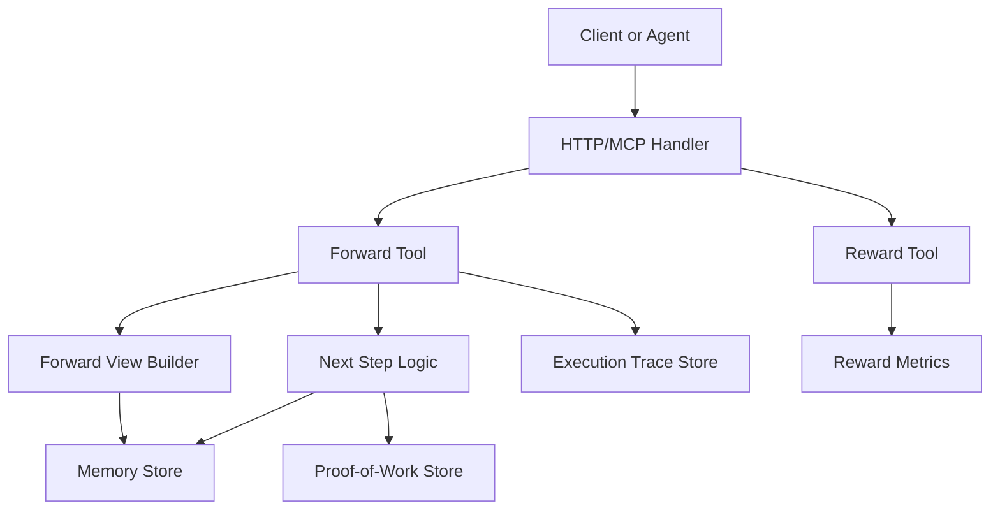
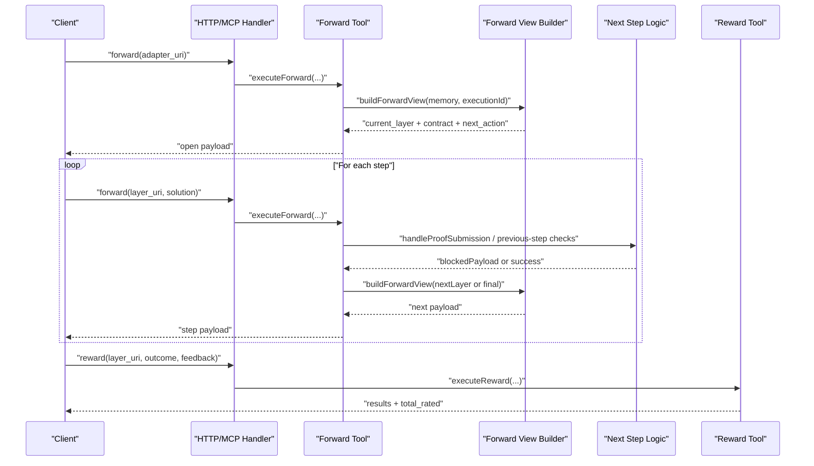
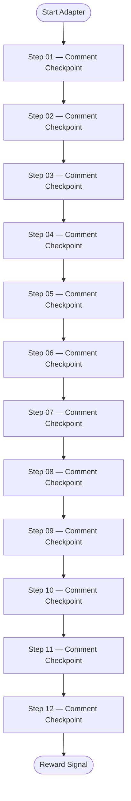
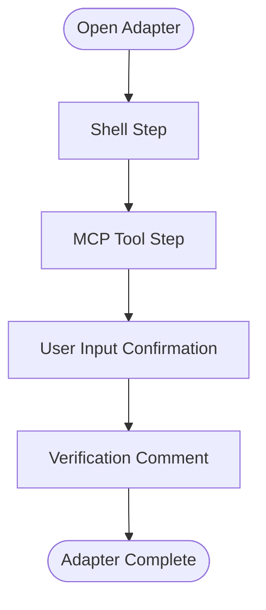
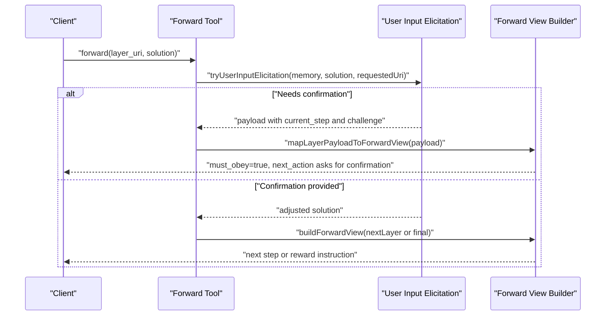
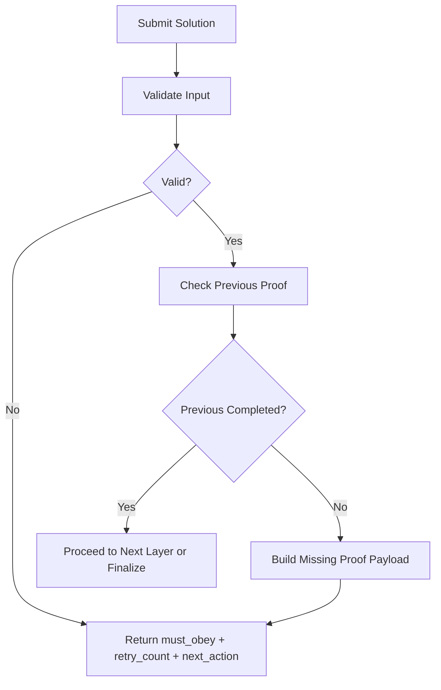
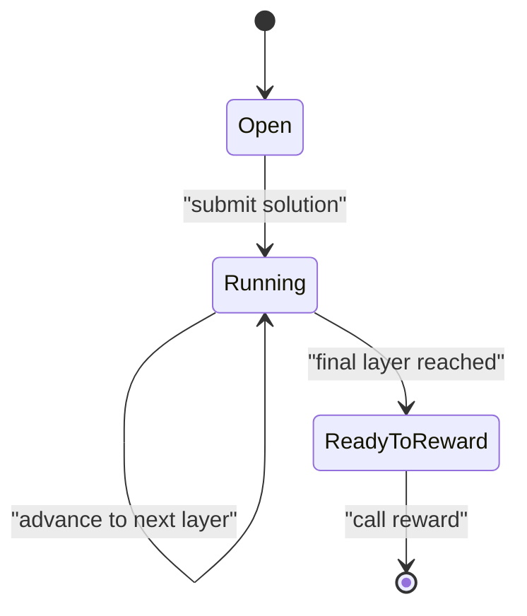
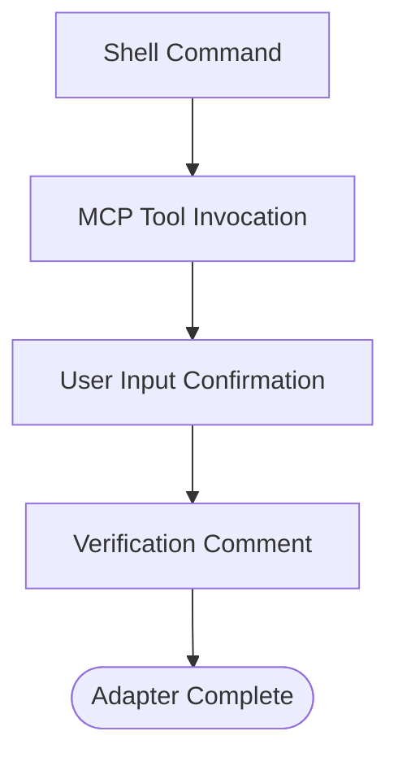
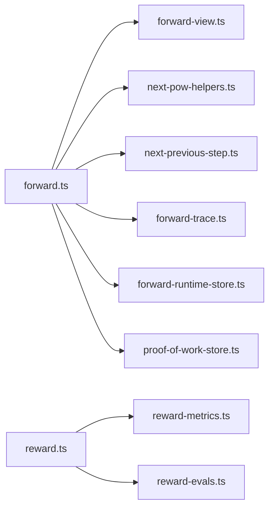

# Workflow Patterns

<cite>
**Referenced Files in This Document**
- [adapter-twelve-step-linear-test.md](file://docs/examples/adapter-twelve-step-linear-test.md)
- [adapter-example-all-types.md](file://docs/examples/adapter-example-all-types.md)
- [forward.ts](file://src/tools/forward.ts)
- [reward.ts](file://src/tools/reward.ts)
- [next.ts](file://src/tools/next.ts)
- [forward-view.ts](file://src/tools/forward-view.ts)
- [mcp-tool-input-teaching.ts](file://src/tools/mcp-tool-input-teaching.ts)
- [http-mcp-handler.ts](file://src/http/http-mcp-handler.ts)
- [RunGuidedPage.tsx](file://src/ui/pages/RunGuidedPage.tsx)
- [v4-squadrules-forward-continue.test.ts](file://tests/integration/write/v4-squadrules-forward-continue.test.ts)
- [squadrules-next-output-shape.test.ts](file://tests/integration/readonly/squadrules-next-output-shape.test.ts)
- [v4-squadrules-reward.test.ts](file://tests/integration/write/v4-squadrules-reward.test.ts)
</cite>

## Table of Contents
1. [Introduction](#introduction)
2. [Project Structure](#project-structure)
3. [Core Components](#core-components)
4. [Architecture Overview](#architecture-overview)
5. [Detailed Component Analysis](#detailed-component-analysis)
6. [Dependency Analysis](#dependency-analysis)
7. [Performance Considerations](#performance-considerations)
8. [Troubleshooting Guide](#troubleshooting-guide)
9. [Conclusion](#conclusion)

## Introduction
This document explains advanced workflow patterns for SquadRules adapters and the runtime that executes them. It focuses on:
- Linear test workflows with many checkpoints
- Conditional branching through MCP tool calls
- Human-in-the-loop approval via user input challenges
- Parallel execution strategies using tensor contracts
- State management across adapter layers, executions, and proof-of-work chains
- Error recovery mechanisms and retry guidance
- Design patterns for scalable long-running processes

The core workflow is activate → forward → reward. Adapters define deterministic, auditable steps. The server drives state transitions by returning structured next actions, current layer content, and challenge contracts.

## Project Structure
At a high level, workflow logic lives under src/tools, with examples under docs/examples and UI/runtime integration in src/ui and tests.



**Diagram sources**
- [http-mcp-handler.ts:62-89](file://src/http/http-mcp-handler.ts#L62-L89)
- [forward.ts:93-317](file://src/tools/forward.ts#L93-L317)
- [reward.ts:27-109](file://src/tools/reward.ts#L27-L109)
- [forward-view.ts:242-290](file://src/tools/forward-view.ts#L242-L290)
- [next.ts:137-272](file://src/tools/next.ts#L137-L272)

**Section sources**
- [adapter-twelve-step-linear-test.md:1-180](file://docs/examples/adapter-twelve-step-linear-test.md#L1-L180)
- [adapter-example-all-types.md:1-81](file://docs/examples/adapter-example-all-types.md#L1-L81)

## Core Components
- Forward tool: orchestrates step progression, proof validation, human elicitation, tracing, and view construction.
- Reward tool: evaluates outcomes, persists metrics, and returns structured results.
- Next step logic: shared engine for computing next payloads, handling missing proofs, and quality updates.
- Forward view builder: normalizes contracts, builds current layer views, and produces client-friendly next_action instructions.
- Input teaching and retry helpers: provide must_obey flags, retry counts, and safe error messages.
- UI run page: tracks running vs ready_to_reward states and maintains history.

Key responsibilities:
- Linear progression through adapter layers
- Conditional branching via MCP tool contracts
- Human approval gates via user_input challenges
- Tensor-based parallel phases
- Robust error recovery with retry guidance

**Section sources**
- [forward.ts:93-317](file://src/tools/forward.ts#L93-L317)
- [reward.ts:27-156](file://src/tools/reward.ts#L27-L156)
- [next.ts:137-272](file://src/tools/next.ts#L137-L272)
- [forward-view.ts:83-139](file://src/tools/forward-view.ts#L83-L139)
- [forward-view.ts:242-290](file://src/tools/forward-view.ts#L242-L290)
- [mcp-tool-input-teaching.ts:44-74](file://src/tools/mcp-tool-input-teaching.ts#L44-L74)
- [RunGuidedPage.tsx:104-139](file://src/ui/pages/RunGuidedPage.tsx#L104-L139)

## Architecture Overview
The forward workflow is a state machine driven by adapter layers and inference contracts. Each call to forward either opens an adapter, advances to the next layer, or signals completion. Reward finalizes the process and records evaluation data.



**Diagram sources**
- [forward.ts:93-317](file://src/tools/forward.ts#L93-L317)
- [forward-view.ts:242-290](file://src/tools/forward-view.ts#L242-L290)
- [next.ts:137-272](file://src/tools/next.ts#L137-L272)
- [reward.ts:27-109](file://src/tools/reward.ts#L27-L109)

## Detailed Component Analysis

### Linear Test Workflows
A linear workflow is a sequence of steps where each layer depends on the previous one. The twelve-step linear test adapter demonstrates a long sequential chain used for progress coverage and stress testing.

Patterns:
- Activation patterns trigger the adapter
- Each step defines a comment contract requiring a minimum-length verification
- Completion leads to a reward signal only after all steps are solved



**Diagram sources**
- [adapter-twelve-step-linear-test.md:1-180](file://docs/examples/adapter-twelve-step-linear-test.md#L1-L180)

**Section sources**
- [adapter-twelve-step-linear-test.md:1-180](file://docs/examples/adapter-twelve-step-linear-test.md#L1-L180)

### Conditional Branching Patterns
Adapters can branch conditionally by calling MCP tools. A multi-type example shows shell commands, MCP tool invocations, user confirmation, and verification comments.

Patterns:
- Shell steps execute commands and validate exit codes
- MCP steps invoke tools; when chaining adapters, arguments constrain the target
- User input steps require explicit approval before continuing
- Comment steps capture summaries and evidence



**Diagram sources**
- [adapter-example-all-types.md:1-81](file://docs/examples/adapter-example-all-types.md#L1-L81)

**Section sources**
- [adapter-example-all-types.md:1-81](file://docs/examples/adapter-example-all-types.md#L1-L81)

### Parallel Execution Strategies
Tensor contracts enable parallel phases by defining required inputs and outputs. The forward view builder constructs tensor-specific contracts and integrates runtime inputs from the execution context.

Patterns:
- Tensor contracts specify output names and types
- Runtime requires tensor inputs per execution
- Clients submit tensor solutions with structured evidence
- The system maps solutions into internal proof-of-work submissions

```mermaid
classDiagram
class ForwardViewBuilder {
+buildContractResponse(memory, executionId, proofHash)
+mapProofSolution(solution)
+buildForwardView(memory, executionId, options)
}
class TensorContract {
+type : "tensor"
+required_inputs : string[]
+output : { name : string, type : string }
}
class ExecutionRuntime {
+requireTensorInputs(executionId, requiredInputs)
}
ForwardViewBuilder --> TensorContract : "normalizes"
ForwardViewBuilder --> ExecutionRuntime : "reads inputs"
```

**Diagram sources**
- [forward-view.ts:183-220](file://src/tools/forward-view.ts#L183-L220)
- [forward-view.ts:83-139](file://src/tools/forward-view.ts#L83-L139)

**Section sources**
- [forward-view.ts:183-220](file://src/tools/forward-view.ts#L183-L220)
- [forward-view.ts:83-139](file://src/tools/forward-view.ts#L83-L139)

### Human-in-the-Loop Approval Processes
Human approval is modeled as a user_input challenge. The forward tool elicits user input and may return a payload directing the client to collect confirmation before proceeding.

Patterns:
- Contract type user_input includes a prompt
- Elicitation returns either adjusted solution or a payload instructing the client
- UI and clients follow next_action to request confirmation



**Diagram sources**
- [forward.ts:142-149](file://src/tools/forward.ts#L142-L149)
- [forward-view.ts:292-322](file://src/tools/forward-view.ts#L292-L322)

**Section sources**
- [forward.ts:142-149](file://src/tools/forward.ts#L142-L149)
- [forward-view.ts:292-322](file://src/tools/forward-view.ts#L292-L322)

### Error Recovery Mechanisms
Error recovery is built into both the forward flow and input validation. Missing proofs, invalid inputs, and transient failures produce structured error_code fields, retry hints, and must_obey flags.

Patterns:
- Missing previous proof triggers a blocked payload with retry guidance
- Input validation wraps errors with retry counters and max retries
- HTTP handler sanitizes details and exposes safe error_code and retry_hint



**Diagram sources**
- [forward.ts:256-294](file://src/tools/forward.ts#L256-L294)
- [mcp-tool-input-teaching.ts:44-74](file://src/tools/mcp-tool-input-teaching.ts#L44-L74)
- [http-mcp-handler.ts:62-89](file://src/http/http-mcp-handler.ts#L62-L89)

**Section sources**
- [forward.ts:256-294](file://src/tools/forward.ts#L256-L294)
- [mcp-tool-input-teaching.ts:44-74](file://src/tools/mcp-tool-input-teaching.ts#L44-L74)
- [http-mcp-handler.ts:62-89](file://src/http/http-mcp-handler.ts#L62-L89)

### State Management Techniques
State is managed across multiple dimensions:
- Adapter layers: ordered steps with indices and counts
- Executions: unique IDs tracking runs, activation queries, and slug disambiguation notes
- Proof-of-work: nonces and proof hashes linking layers securely
- Quality metrics: success/failure updates per step

Techniques:
- Execution ID propagation through layer URIs
- Proof hash chaining between previous and current layers
- Redis-backed memory caching for read performance
- Qdrant quality metadata updates for step scoring



**Diagram sources**
- [forward.ts:112-130](file://src/tools/forward.ts#L112-L130)
- [forward-view.ts:242-290](file://src/tools/forward-view.ts#L242-L290)
- [next.ts:24-34](file://src/tools/next.ts#L24-L34)

**Section sources**
- [forward.ts:112-130](file://src/tools/forward.ts#L112-L130)
- [forward-view.ts:242-290](file://src/tools/forward-view.ts#L242-L290)
- [next.ts:24-34](file://src/tools/next.ts#L24-L34)

### Advanced Multi-Phase Adapters
Multi-phase adapters combine different challenge types within a single workflow. The all-types example demonstrates a four-phase pattern: shell, mcp, user_input, comment, followed by completion and reward.

Design principles:
- Use shell for deterministic system interactions
- Use mcp for tool invocation and cross-adapter chaining
- Use user_input for human approvals
- Use comment for verifiable summaries
- Ensure each phase has clear required constraints and evidence



**Diagram sources**
- [adapter-example-all-types.md:1-81](file://docs/examples/adapter-example-all-types.md#L1-L81)

**Section sources**
- [adapter-example-all-types.md:1-81](file://docs/examples/adapter-example-all-types.md#L1-L81)

## Dependency Analysis
The forward tool depends on several services and utilities to orchestrate workflow execution.



**Diagram sources**
- [forward.ts:1-35](file://src/tools/forward.ts#L1-L35)
- [reward.ts:1-12](file://src/tools/reward.ts#L1-L12)

**Section sources**
- [forward.ts:1-35](file://src/tools/forward.ts#L1-L35)
- [reward.ts:1-12](file://src/tools/reward.ts#L1-L12)

## Performance Considerations
- Caching: Memory reads use Redis cache to reduce latency for repeated layer access during long workflows.
- Tracing: Execution traces are appended asynchronously to avoid blocking the main flow.
- Quality updates: Step quality metrics are updated with success/failure outcomes to improve future retrieval and routing.
- Concurrency: Tensor contracts allow parallel phases; ensure clients submit independent tensors concurrently.
- Long-running processes: Use execution IDs to track progress, persist intermediate state, and support resuming after interruptions.

Recommendations:
- Batch tensor submissions where possible
- Monitor retry counts and backoff strategies for missing proofs
- Use UI state to reflect ready_to_reward transitions promptly
- Log and observe trace persistence failures without failing requests

[No sources needed since this section provides general guidance]

## Troubleshooting Guide
Common issues and resolutions:
- Missing proof: The server returns a blocked payload with error_code and retry guidance. Re-submit the previous step’s proof before continuing.
- Invalid input: Input validation wraps errors with retry counters and must_obey flags. Adjust the payload and retry within the allowed window.
- Not found: Layer or adapter URIs must resolve correctly; verify URI kinds and execution IDs.
- Reward failures: Persistence errors return a specific code and message; retry once storage is healthy.

Operational tips:
- Inspect next_action strings for precise client instructions
- Use error_code values to implement robust retry logic
- Track execution_id across calls to correlate logs and traces
- Validate contract types and evidence shapes before submission

**Section sources**
- [forward.ts:256-294](file://src/tools/forward.ts#L256-L294)
- [mcp-tool-input-teaching.ts:44-74](file://src/tools/mcp-tool-input-teaching.ts#L44-L74)
- [http-mcp-handler.ts:62-89](file://src/http/http-mcp-handler.ts#L62-L89)
- [reward.ts:18-25](file://src/tools/reward.ts#L18-L25)

## Conclusion
SquadRules workflows combine linear sequences, conditional branching, human approvals, and parallel tensor phases into a cohesive, auditable execution model. The forward tool orchestrates state transitions, while reward finalizes outcomes and records evaluations. Error recovery, retry guidance, and quality updates make long-running processes resilient. By following these patterns, teams can build scalable, observable, and secure workflows suitable for both automated agents and human-in-the-loop operations.

[No sources needed since this section summarizes without analyzing specific files]