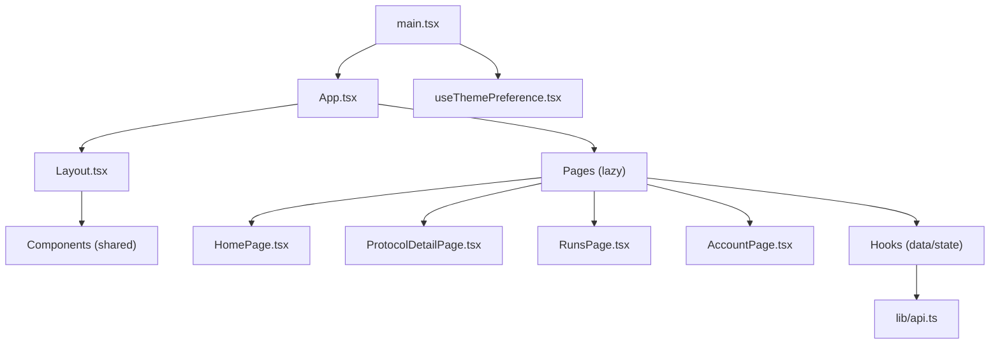
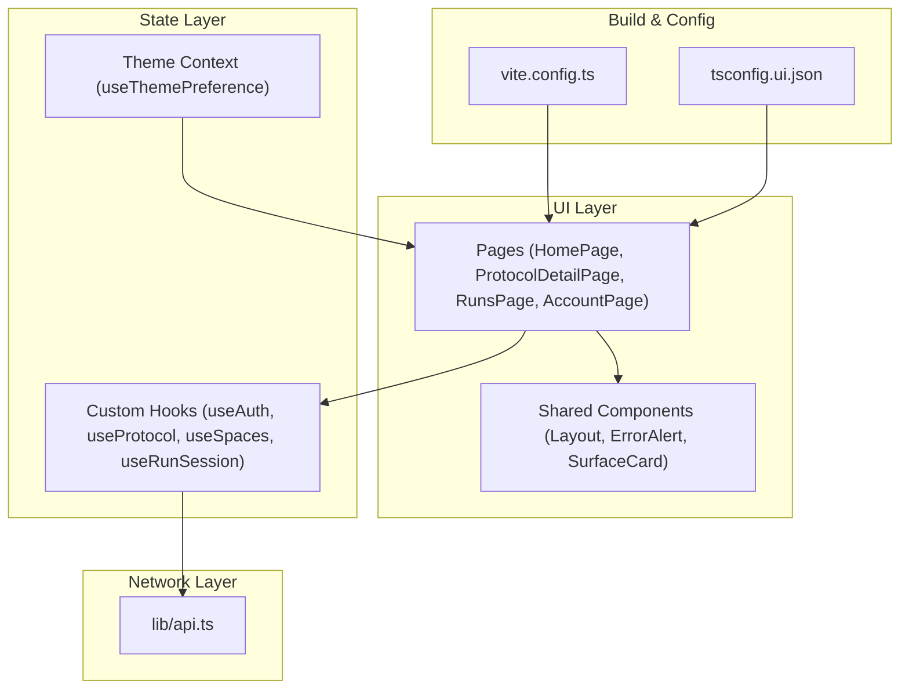
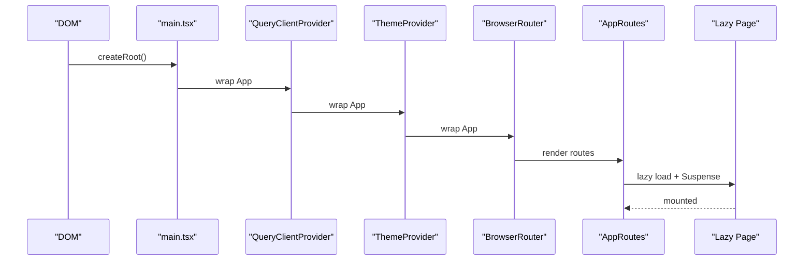
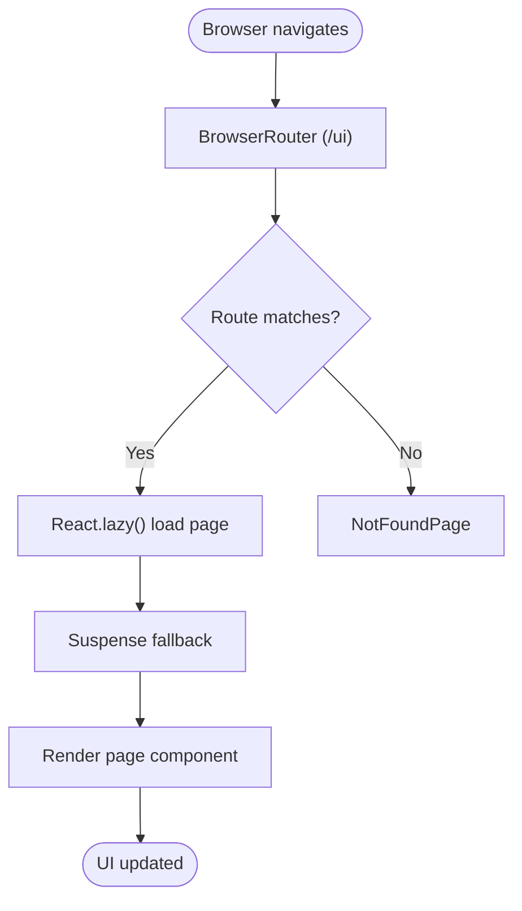
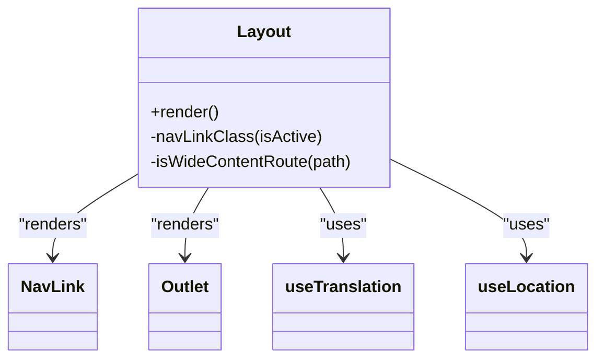
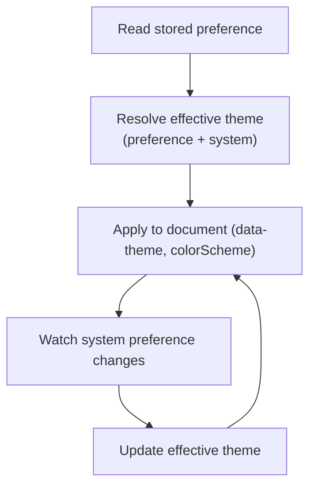
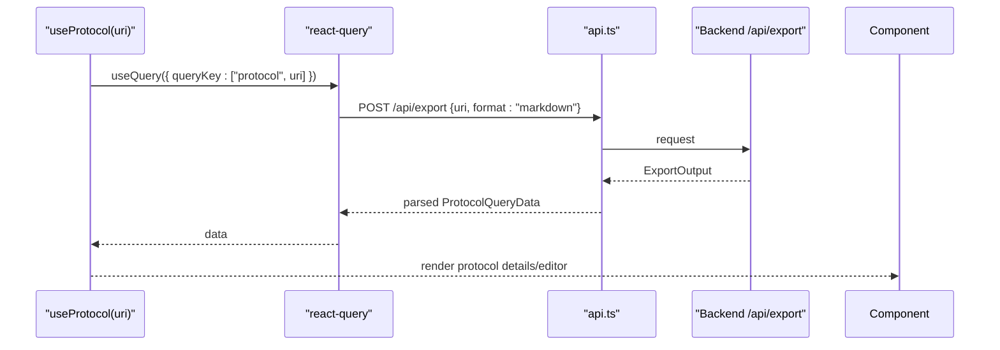
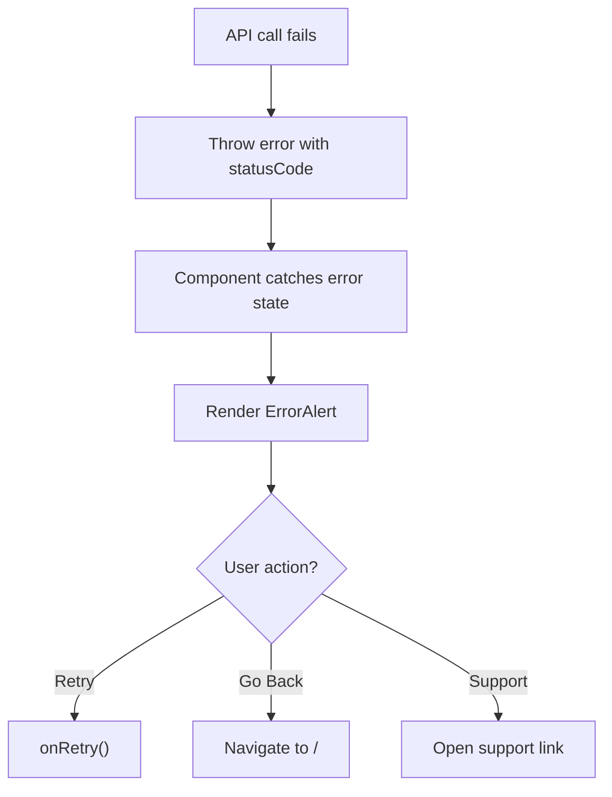
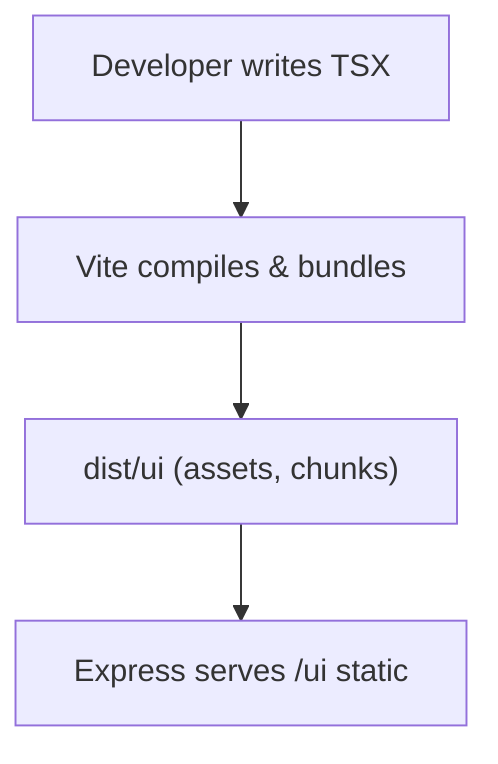
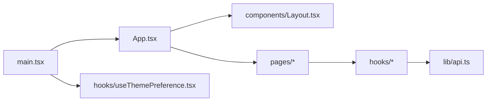

# Application Architecture

<cite>
**Referenced Files in This Document**
- [main.tsx](file://src/ui/main.tsx)
- [App.tsx](file://src/ui/App.tsx)
- [Layout.tsx](file://src/ui/components/Layout.tsx)
- [useThemePreference.tsx](file://src/ui/hooks/useThemePreference.tsx)
- [api.ts](file://src/ui/lib/api.ts)
- [vite.config.ts](file://vite.config.ts)
- [tsconfig.ui.json](file://tsconfig.ui.json)
- [HomePage.tsx](file://src/ui/pages/HomePage.tsx)
- [ErrorAlert.tsx](file://src/ui/components/ErrorAlert.tsx)
- [useAuth.ts](file://src/ui/hooks/useAuth.ts)
- [useProtocol.ts](file://src/ui/hooks/useProtocol.ts)
</cite>

## Table of Contents
1. [Introduction](#introduction)
2. [Project Structure](#project-structure)
3. [Core Components](#core-components)
4. [Architecture Overview](#architecture-overview)
5. [Detailed Component Analysis](#detailed-component-analysis)
6. [Dependency Analysis](#dependency-analysis)
7. [Performance Considerations](#performance-considerations)
8. [Troubleshooting Guide](#troubleshooting-guide)
9. [Conclusion](#conclusion)
10. [Appendices](#appendices)

## Introduction
This document describes the React frontend architecture for the Squadrules MCP UI. It explains how the application boots, how routes and pages are organized, how state is managed with hooks and React Query, and how the build pipeline is configured with Vite and TypeScript. It also provides guidance for extending the app with new pages and features while preserving architectural consistency.

## Project Structure
The UI lives under src/ui and follows a feature-oriented layout:
- Entry points: main.tsx bootstraps React, React Query, and theme context; App.tsx configures routing and lazy-loaded pages.
- Pages: src/ui/pages contains route-level components (e.g., HomePage, ProtocolDetailPage).
- Shared components: src/ui/components holds reusable UI pieces (Layout, ErrorAlert, SurfaceCard, etc.).
- Hooks: src/ui/hooks encapsulate data fetching and domain logic (useAuth, useProtocol, useSpaces, etc.).
- Utilities: src/ui/utils and src/ui/lib provide helpers and API clients.
- Theme and i18n: src/ui/theme and src/ui/i18n define design tokens and translations.

**Diagram sources**
- [main.tsx:1-20](file://src/ui/main.tsx#L1-L20)
- [App.tsx:1-133](file://src/ui/App.tsx#L1-L133)
- [Layout.tsx:1-109](file://src/ui/components/Layout.tsx#L1-L109)
- [HomePage.tsx:1-132](file://src/ui/pages/HomePage.tsx#L1-L132)
- [useThemePreference.tsx:1-149](file://src/ui/hooks/useThemePreference.tsx#L1-L149)
- [api.ts:1-14](file://src/ui/lib/api.ts#L1-L14)

**Section sources**
- [main.tsx:1-20](file://src/ui/main.tsx#L1-L20)
- [App.tsx:1-133](file://src/ui/App.tsx#L1-L133)
- [Layout.tsx:1-109](file://src/ui/components/Layout.tsx#L1-L109)

## Core Components
- Bootstrap and providers: main.tsx creates a React root, wraps the app with StrictMode, React Query’s QueryClientProvider, and ThemeProvider.
- Routing and code splitting: App.tsx defines BrowserRouter with base /ui and lazy-loads each page component inside Suspense boundaries.
- Layout shell: Layout.tsx renders the sidebar navigation, version footer, and an <Outlet /> for page content. It adapts main width based on route patterns.
- Theme context: useThemePreference.tsx exposes preference, effectiveTheme, and setPreference via Context, persisting to localStorage and syncing with system preferences.

Key responsibilities:
- Data fetching: lib/api.ts centralizes fetch calls with JSON headers and same-origin credentials.
- Domain hooks: useAuth.ts and useProtocol.ts wrap React Query to fetch user info and protocol markdown/export data.
- Page composition: HomePage.tsx composes cards, navigation, and space stats using shared components and hooks.

**Section sources**
- [main.tsx:1-20](file://src/ui/main.tsx#L1-L20)
- [App.tsx:1-133](file://src/ui/App.tsx#L1-L133)
- [Layout.tsx:1-109](file://src/ui/components/Layout.tsx#L1-L109)
- [useThemePreference.tsx:1-149](file://src/ui/hooks/useThemePreference.tsx#L1-L149)
- [api.ts:1-14](file://src/ui/lib/api.ts#L1-L14)
- [useAuth.ts:1-25](file://src/ui/hooks/useAuth.ts#L1-L25)
- [useProtocol.ts:1-253](file://src/ui/hooks/useProtocol.ts#L1-L253)
- [HomePage.tsx:1-132](file://src/ui/pages/HomePage.tsx#L1-L132)

## Architecture Overview
The UI uses a layered approach:
- Presentation layer: Pages and shared components render the UI.
- State/data layer: Custom hooks encapsulate React Query usage and business logic.
- Network layer: api.ts abstracts HTTP requests.
- Infrastructure: Vite builds the UI; TypeScript ensures type safety.

**Diagram sources**
- [App.tsx:1-133](file://src/ui/App.tsx#L1-L133)
- [HomePage.tsx:1-132](file://src/ui/pages/HomePage.tsx#L1-L132)
- [useAuth.ts:1-25](file://src/ui/hooks/useAuth.ts#L1-L25)
- [useProtocol.ts:1-253](file://src/ui/hooks/useProtocol.ts#L1-L253)
- [useThemePreference.tsx:1-149](file://src/ui/hooks/useThemePreference.tsx#L1-L149)
- [api.ts:1-14](file://src/ui/lib/api.ts#L1-L14)
- [vite.config.ts:1-44](file://vite.config.ts#L1-L44)
- [tsconfig.ui.json:1-24](file://tsconfig.ui.json#L1-L24)

## Detailed Component Analysis

### Application Bootstrap and Providers
- main.tsx initializes React Query client, mounts the app, and applies ThemeProvider around App.
- App.tsx sets up BrowserRouter with basename "/ui" and renders AppRoutes.
- RouteFallback provides a minimal loading indicator for Suspense boundaries.

**Diagram sources**
- [main.tsx:1-20](file://src/ui/main.tsx#L1-L20)
- [App.tsx:1-133](file://src/ui/App.tsx#L1-L133)

**Section sources**
- [main.tsx:1-20](file://src/ui/main.tsx#L1-L20)
- [App.tsx:1-133](file://src/ui/App.tsx#L1-L133)

### Routing and Code Splitting
- All pages are lazy-loaded via React.lazy and wrapped in Suspense with a consistent fallback.
- Routes are nested under Layout, which provides global navigation and content area.
- The catch-all route renders NotFoundPage.

**Diagram sources**
- [App.tsx:1-133](file://src/ui/App.tsx#L1-L133)

**Section sources**
- [App.tsx:1-133](file://src/ui/App.tsx#L1-L133)

### Layout Shell
- Layout.tsx renders a persistent sidebar with links to Home, Squadrules, Create, Runs, and Account.
- It dynamically adjusts main content width for wide-content routes like protocols and runs.
- Uses react-i18next for labels and displays the Squadrules version from environment variables.

**Diagram sources**
- [Layout.tsx:1-109](file://src/ui/components/Layout.tsx#L1-L109)

**Section sources**
- [Layout.tsx:1-109](file://src/ui/components/Layout.tsx#L1-L109)

### Theme Management
- useThemePreference.tsx manages user preference ("light", "dark", "system"), persists it to localStorage, and syncs with system color scheme changes.
- Exposes a Context Provider so any component can read or update the theme.

**Diagram sources**
- [useThemePreference.tsx:1-149](file://src/ui/hooks/useThemePreference.tsx#L1-L149)

**Section sources**
- [useThemePreference.tsx:1-149](file://src/ui/hooks/useThemePreference.tsx#L1-L149)

### Data Fetching and State Patterns
- api.ts centralizes fetch calls with JSON headers and same-origin credentials.
- useAuth.ts uses React Query to fetch current user info from /api/me.
- useProtocol.ts fetches protocol markdown via /api/export and parses it into structured form state for editing and display.

**Diagram sources**
- [useProtocol.ts:1-253](file://src/ui/hooks/useProtocol.ts#L1-L253)
- [api.ts:1-14](file://src/ui/lib/api.ts#L1-L14)

**Section sources**
- [api.ts:1-14](file://src/ui/lib/api.ts#L1-L14)
- [useAuth.ts:1-25](file://src/ui/hooks/useAuth.ts#L1-L25)
- [useProtocol.ts:1-253](file://src/ui/hooks/useProtocol.ts#L1-L253)

### Error Handling and User Feedback
- ErrorAlert.tsx provides a consistent error banner with optional retry action, back navigation, and support link.
- API errors thrown by hooks propagate to components that can render ErrorAlert or handle them via React Query states.

**Diagram sources**
- [ErrorAlert.tsx:1-71](file://src/ui/components/ErrorAlert.tsx#L1-L71)
- [useAuth.ts:1-25](file://src/ui/hooks/useAuth.ts#L1-L25)

**Section sources**
- [ErrorAlert.tsx:1-71](file://src/ui/components/ErrorAlert.tsx#L1-L71)
- [useAuth.ts:1-25](file://src/ui/hooks/useAuth.ts#L1-L25)

### Build Configuration and Development Workflow
- Vite configuration:
  - Root: src/ui
  - Base path: /ui
  - Define env via getUiImportMetaEnvDefine()
  - Plugins: @vitejs/plugin-react
  - Aliases: @ -> src/ui
  - Build output: dist/ui
  - Assets: assetsInlineLimit: 0 to avoid inline images blocked by CSP
  - Chunk groups: react, tiptap, vendor with priorities
- TypeScript:
  - Target ES2022, module ESNext, moduleResolution bundler
  - JSX transform: react-jsx
  - Strict mode enabled, no emit (Vite handles compilation)
  - Path alias @/* -> ./src/ui/*

**Diagram sources**
- [vite.config.ts:1-44](file://vite.config.ts#L1-L44)
- [tsconfig.ui.json:1-24](file://tsconfig.ui.json#L1-L24)

**Section sources**
- [vite.config.ts:1-44](file://vite.config.ts#L1-L44)
- [tsconfig.ui.json:1-24](file://tsconfig.ui.json#L1-L24)

## Dependency Analysis
The following diagram shows key runtime dependencies between UI modules:

**Diagram sources**
- [main.tsx:1-20](file://src/ui/main.tsx#L1-L20)
- [App.tsx:1-133](file://src/ui/App.tsx#L1-L133)
- [Layout.tsx:1-109](file://src/ui/components/Layout.tsx#L1-L109)
- [api.ts:1-14](file://src/ui/lib/api.ts#L1-L14)
- [useThemePreference.tsx:1-149](file://src/ui/hooks/useThemePreference.tsx#L1-L149)

**Section sources**
- [App.tsx:1-133](file://src/ui/App.tsx#L1-L133)
- [api.ts:1-14](file://src/ui/lib/api.ts#L1-L14)

## Performance Considerations
- Route-level code splitting: Each page is lazy-loaded to keep initial bundle small.
- Chunk grouping: React, editor libraries (tiptap), and other vendors are split into separate chunks for better caching and parallel loading.
- Asset handling: Disabling inline assets avoids CSP issues and allows external asset URLs.
- Query caching: React Query caches responses per queryKey to reduce network requests.

[No sources needed since this section provides general guidance]

## Troubleshooting Guide
- If the UI does not load under /ui:
  - Verify Vite base path and server serving dist/ui at /ui.
  - Ensure assets are served at /ui/assets/* (not inline) due to CSP constraints.
- If authentication or protocol data fails:
  - Check backend endpoints /api/me and /api/export.
  - Inspect error messages propagated by hooks; render ErrorAlert for user feedback.
- If theme does not apply:
  - Confirm ThemeProvider wraps App and document.documentElement receives data-theme.
  - Validate CSS tokens files exist and match theme values.

**Section sources**
- [ErrorAlert.tsx:1-71](file://src/ui/components/ErrorAlert.tsx#L1-L71)
- [useAuth.ts:1-25](file://src/ui/hooks/useAuth.ts#L1-L25)
- [useProtocol.ts:1-253](file://src/ui/hooks/useProtocol.ts#L1-L253)
- [useThemePreference.tsx:1-149](file://src/ui/hooks/useThemePreference.tsx#L1-L149)

## Conclusion
The Squadrules MCP UI is a modular React application built with Vite and TypeScript. It uses React Router for routing with lazy loading, React Query for data management, and a theme context for appearance control. The structure separates concerns across pages, shared components, hooks, and utilities, making it straightforward to extend with new features while maintaining consistency.

[No sources needed since this section summarizes without analyzing specific files]

## Appendices

### Adding a New Page
- Create a new component under src/ui/pages (e.g., MyFeaturePage.tsx).
- Add a lazy import and route in App.tsx within AppRoutes, wrapping the element in Suspense.
- Compose the page using shared components from src/ui/components and data hooks from src/ui/hooks.
- Use api.ts for network calls and React Query for caching and error states.

**Section sources**
- [App.tsx:1-133](file://src/ui/App.tsx#L1-L133)
- [api.ts:1-14](file://src/ui/lib/api.ts#L1-L14)

### Extending State and Data Flows
- Encapsulate data fetching in a custom hook under src/ui/hooks.
- Use React Query options (queryKey, retry, enabled) to control behavior.
- Handle errors consistently and surface them via ErrorAlert where appropriate.

**Section sources**
- [useAuth.ts:1-25](file://src/ui/hooks/useAuth.ts#L1-L25)
- [useProtocol.ts:1-253](file://src/ui/hooks/useProtocol.ts#L1-L253)
- [ErrorAlert.tsx:1-71](file://src/ui/components/ErrorAlert.tsx#L1-L71)