# Authentication Integration

<cite>
**Referenced Files in This Document**
- [useAuth.ts](file://src/ui/hooks/useAuth.ts)
- [api.ts](file://src/ui/lib/api.ts)
- [me-response.ts](file://src/me-response.ts)
- [http-auth-middleware.ts](file://src/http/http-auth-middleware.ts)
- [http-auth-callback.ts](file://src/http/http-auth-callback.ts)
- [http-auth-oidc-redirect.ts](file://src/http/http-auth-oidc-redirect.ts)
- [bearer-validate.ts](file://src/http/bearer-validate.ts)
- [oidc-profile-claims.ts](file://src/http/oidc-profile-claims.ts)
- [oidc-state-store.ts](file://src/services/oidc-state-store.ts)
- [oauth-refresh.ts](file://src/cli/oauth-refresh.ts)
</cite>

## Table of Contents
1. [Introduction](#introduction)
2. [Project Structure](#project-structure)
3. [Core Components](#core-components)
4. [Architecture Overview](#architecture-overview)
5. [Detailed Component Analysis](#detailed-component-analysis)
6. [Dependency Analysis](#dependency-analysis)
7. [Performance Considerations](#performance-considerations)
8. [Troubleshooting Guide](#troubleshooting-guide)
9. [Conclusion](#conclusion)

## Introduction
This document explains the end-to-end authentication integration between the frontend and backend, covering:
- OAuth2/OIDC flow with PKCE for browser login
- JWT Bearer token validation for API/MCP clients
- Signed session cookie handling for browser sessions
- The useMe hook for fetching current user info and managing auth state
- Protected route access patterns and permission-aware UI rendering
- Logout flow, token refresh mechanisms, and security best practices

The system supports both human users (browser-based OIDC login) and agents/API consumers (JWT Bearer tokens), while enforcing space-scoped permissions via middleware.

## Project Structure
Authentication spans several layers:
- Frontend React hooks and API client
- Backend Express routes and middleware
- OIDC provider integration (Keycloak)
- Token validation utilities
- State storage for OIDC login transactions

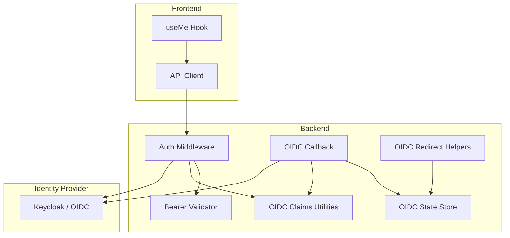

**Diagram sources**
- [useAuth.ts:7-24](file://src/ui/hooks/useAuth.ts#L7-L24)
- [http-auth-middleware.ts:172-327](file://src/http/http-auth-middleware.ts#L172-L327)
- [http-auth-callback.ts:122-229](file://src/http/http-auth-callback.ts#L122-L229)
- [http-auth-oidc-redirect.ts:15-78](file://src/http/http-auth-oidc-redirect.ts#L15-L78)
- [bearer-validate.ts](file://src/http/bearer-validate.ts)
- [oidc-profile-claims.ts](file://src/http/oidc-profile-claims.ts)
- [oidc-state-store.ts:50-61](file://src/services/oidc-state-store.ts#L50-L61)

**Section sources**
- [useAuth.ts:1-24](file://src/ui/hooks/useAuth.ts#L1-L24)
- [http-auth-middleware.ts:1-330](file://src/http/http-auth-middleware.ts#L1-L330)
- [http-auth-callback.ts:1-231](file://src/http/http-auth-callback.ts#L1-L231)
- [http-auth-oidc-redirect.ts:1-92](file://src/http/http-auth-oidc-redirect.ts#L1-L92)
- [oidc-state-store.ts:1-76](file://src/services/oidc-state-store.ts#L1-L76)

## Core Components
- Browser OIDC login with PKCE and signed session cookies
- JWT Bearer token validation for API/MCP clients
- Auth middleware that enforces authentication and sets request context
- useMe hook to fetch current user profile from /api/me
- OIDC callback that exchanges authorization code for tokens and sets session
- OIDC redirect helpers for login/logout URLs and PKCE state
- OIDC state store for secure, atomic state management across instances
- CLI refresh token flow for agent automation

**Section sources**
- [http-auth-middleware.ts:172-327](file://src/http/http-auth-middleware.ts#L172-L327)
- [http-auth-callback.ts:122-229](file://src/http/http-auth-callback.ts#L122-L229)
- [http-auth-oidc-redirect.ts:15-78](file://src/http/http-auth-oidc-redirect.ts#L15-L78)
- [oidc-state-store.ts:50-61](file://src/services/oidc-state-store.ts#L50-L61)
- [useAuth.ts:7-24](file://src/ui/hooks/useAuth.ts#L7-L24)
- [oauth-refresh.ts:26-96](file://src/cli/oauth-refresh.ts#L26-L96)

## Architecture Overview
The authentication architecture supports two primary flows:
- Browser-based OIDC login using PKCE, resulting in a signed session cookie
- Programmatic access using JWT Bearer tokens validated against trusted issuers and audiences

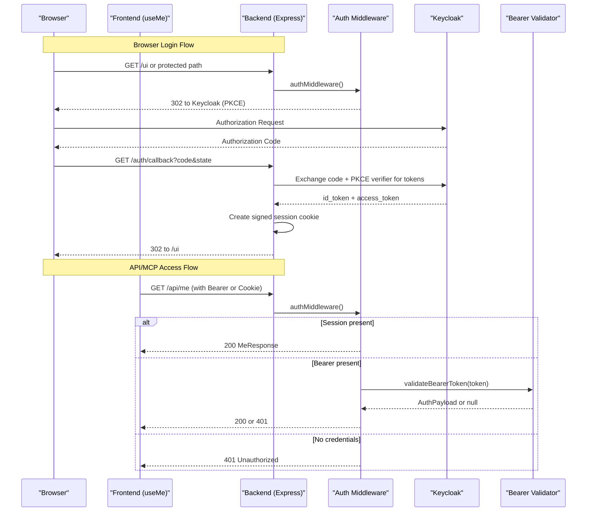

**Diagram sources**
- [http-auth-middleware.ts:172-327](file://src/http/http-auth-middleware.ts#L172-L327)
- [http-auth-callback.ts:122-229](file://src/http/http-auth-callback.ts#L122-L229)
- [http-auth-oidc-redirect.ts:52-78](file://src/http/http-auth-oidc-redirect.ts#L52-L78)
- [bearer-validate.ts](file://src/http/bearer-validate.ts)
- [useAuth.ts:7-24](file://src/ui/hooks/useAuth.ts#L7-L24)

## Detailed Component Analysis

### Browser OIDC Login with PKCE
- The backend generates a random state and PKCE code challenge, stores the code verifier in a shared state store, and redirects the browser to Keycloak.
- On callback, the backend exchanges the authorization code for tokens, merges claims, applies group allowlist, computes session TTL, signs the session cookie, and redirects back to the UI.

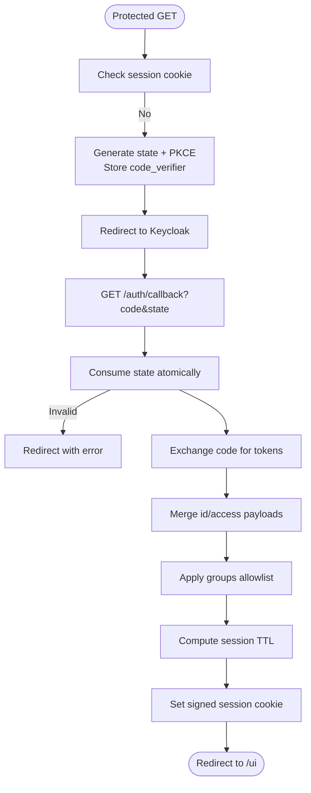

**Diagram sources**
- [http-auth-oidc-redirect.ts:52-78](file://src/http/http-auth-oidc-redirect.ts#L52-L78)
- [oidc-state-store.ts:50-61](file://src/services/oidc-state-store.ts#L50-L61)
- [http-auth-callback.ts:122-229](file://src/http/http-auth-callback.ts#L122-L229)

**Section sources**
- [http-auth-oidc-redirect.ts:15-78](file://src/http/http-auth-oidc-redirect.ts#L15-L78)
- [oidc-state-store.ts:1-76](file://src/services/oidc-state-store.ts#L1-L76)
- [http-auth-callback.ts:122-229](file://src/http/http-auth-callback.ts#L122-L229)

### JWT Bearer Token Validation
- For API/MCP clients, the middleware extracts the Bearer token and validates it against configured trusted issuers and allowed audiences.
- If valid, the middleware attaches an AuthPayload to the request; otherwise, it returns 401 with WWW-Authenticate headers and structured error responses.

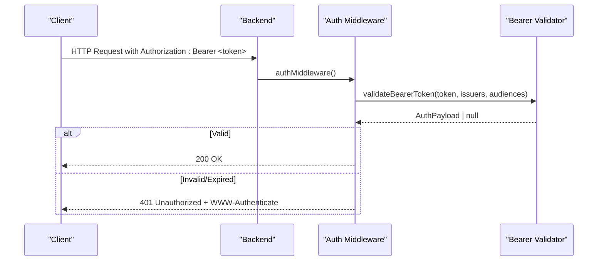

**Diagram sources**
- [http-auth-middleware.ts:230-286](file://src/http/http-auth-middleware.ts#L230-L286)
- [bearer-validate.ts](file://src/http/bearer-validate.ts)

**Section sources**
- [http-auth-middleware.ts:230-286](file://src/http/http-auth-middleware.ts#L230-L286)
- [bearer-validate.ts](file://src/http/bearer-validate.ts)

### Signed Session Cookie Handling
- The backend creates a signed session cookie containing user identity, groups, realm, issuer, and optional name/email fields.
- The cookie is HMAC-signed using a server-side secret, includes expiration, and is marked HttpOnly and SameSite=Lax. Secure flag is set when the callback base URL uses HTTPS.

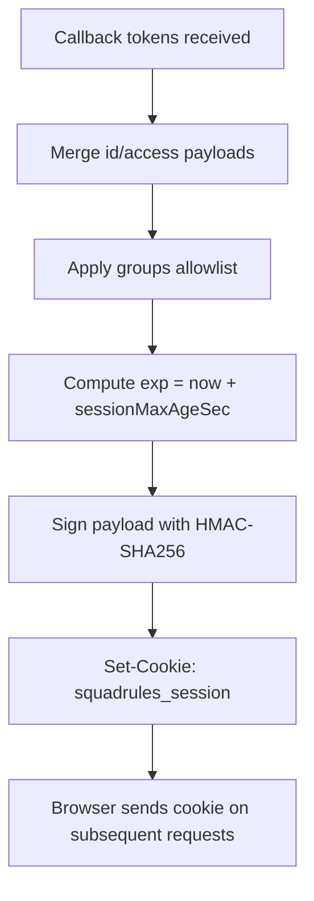

**Diagram sources**
- [http-auth-callback.ts:188-228](file://src/http/http-auth-callback.ts#L188-L228)
- [http-auth-middleware.ts:65-133](file://src/http/http-auth-middleware.ts#L65-L133)

**Section sources**
- [http-auth-callback.ts:188-228](file://src/http/http-auth-callback.ts#L188-L228)
- [http-auth-middleware.ts:65-133](file://src/http/http-auth-middleware.ts#L65-L133)

### useMe Hook and Frontend Auth State
- The useMe hook calls /api/me via the frontend API client and caches the result using React Query.
- It throws structured errors with status codes for unauthenticated or failed responses, enabling UI components to handle auth states gracefully.

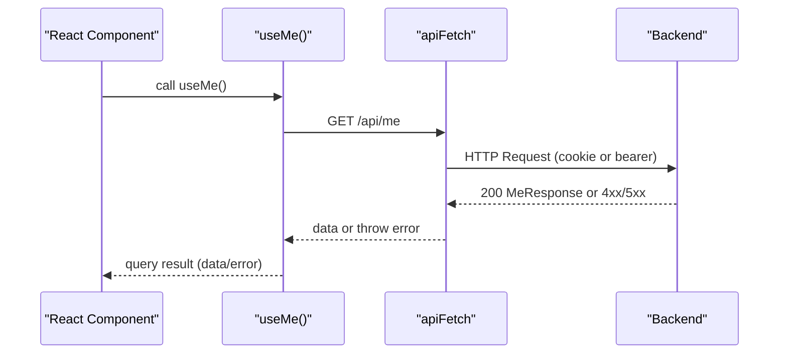

**Diagram sources**
- [useAuth.ts:7-24](file://src/ui/hooks/useAuth.ts#L7-L24)
- [api.ts](file://src/ui/lib/api.ts)

**Section sources**
- [useAuth.ts:1-24](file://src/ui/hooks/useAuth.ts#L1-L24)
- [api.ts](file://src/ui/lib/api.ts)
- [me-response.ts](file://src/me-response.ts)

### Protected Route Access and Space Context
- The middleware protects paths under /api, /mcp, and /ui.
- When a space parameter is provided, it restricts access to that space if it belongs to the user’s allowed spaces and sets default write space accordingly.
- MCP JSON-RPC requests receive structured JSON-RPC errors when authentication is required.

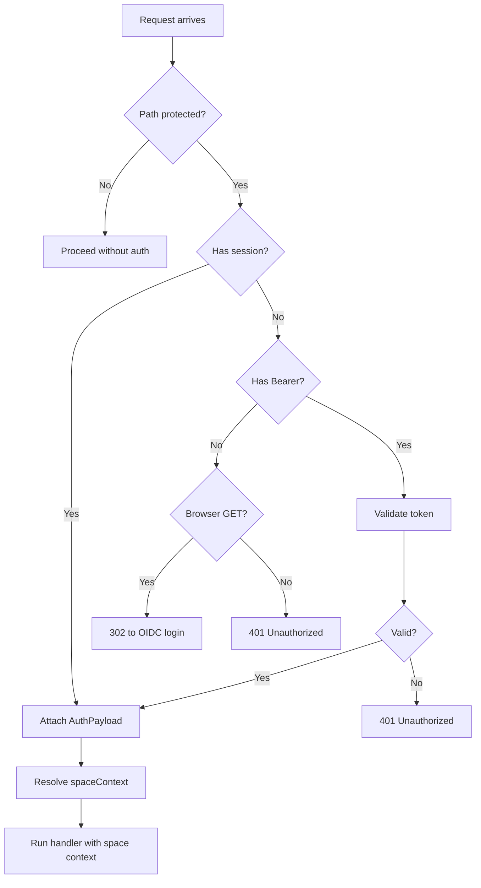

**Diagram sources**
- [http-auth-middleware.ts:151-160](file://src/http/http-auth-middleware.ts#L151-L160)
- [http-auth-middleware.ts:196-227](file://src/http/http-auth-middleware.ts#L196-L227)
- [http-auth-middleware.ts:297-327](file://src/http/http-auth-middleware.ts#L297-L327)

**Section sources**
- [http-auth-middleware.ts:151-160](file://src/http/http-auth-middleware.ts#L151-L160)
- [http-auth-middleware.ts:196-227](file://src/http/http-auth-middleware.ts#L196-L227)
- [http-auth-middleware.ts:297-327](file://src/http/http-auth-middleware.ts#L297-L327)

### Logout Flow
- RP-initiated logout clears the Squadrules session cookie and optionally ends the Keycloak SSO session using an id_token_hint to avoid static logged-out screens.
- After logout, the user is redirected to continue-signin, which triggers a new OIDC login or falls back to the UI.

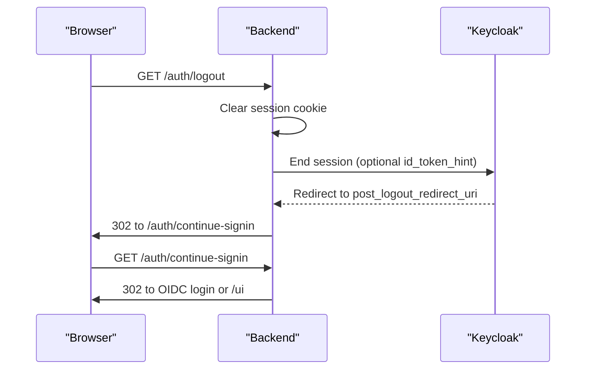

**Diagram sources**
- [http-auth-callback.ts:99-120](file://src/http/http-auth-callback.ts#L99-L120)
- [http-auth-callback.ts:77-82](file://src/http/http-auth-callback.ts#L77-L82)
- [http-auth-oidc-redirect.ts:38-50](file://src/http/http-auth-oidc-redirect.ts#L38-L50)

**Section sources**
- [http-auth-callback.ts:99-120](file://src/http/http-auth-callback.ts#L99-L120)
- [http-auth-oidc-redirect.ts:38-50](file://src/http/http-auth-oidc-redirect.ts#L38-L50)

### Token Refresh Mechanisms
- The CLI can discover token endpoints via /.well-known/oauth-protected-resource and exchange refresh_token for new access tokens.
- The refresh flow includes timeouts and safe URL normalization, returning updated access tokens and optional rotated refresh tokens.

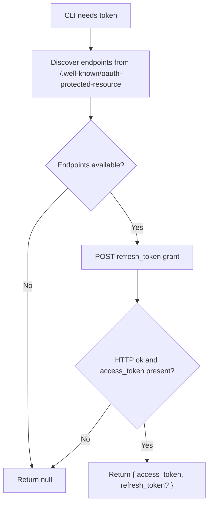

**Diagram sources**
- [oauth-refresh.ts:26-51](file://src/cli/oauth-refresh.ts#L26-L51)
- [oauth-refresh.ts:62-96](file://src/cli/oauth-refresh.ts#L62-L96)

**Section sources**
- [oauth-refresh.ts:26-96](file://src/cli/oauth-refresh.ts#L26-L96)

### Permission-Based UI Rendering
- User roles and group membership are derived from OIDC claims and filtered by an allowlist before being attached to the session or Bearer payload.
- The frontend can render features conditionally based on the presence of specific groups or roles returned by /api/me.

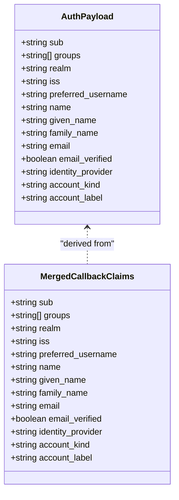

**Diagram sources**
- [http-auth-middleware.ts:95-133](file://src/http/http-auth-middleware.ts#L95-L133)
- [oidc-profile-claims.ts](file://src/http/oidc-profile-claims.ts)

**Section sources**
- [http-auth-middleware.ts:95-133](file://src/http/http-auth-middleware.ts#L95-L133)
- [oidc-profile-claims.ts](file://src/http/oidc-profile-claims.ts)

## Dependency Analysis
Authentication components depend on configuration values such as AUTH_ENABLED, KEYCLOAK_URL, SESSION_SECRET, and OIDC_GROUPS_ALLOWLIST. The OIDC state store abstracts Redis vs in-memory storage, ensuring consistent behavior across deployments.

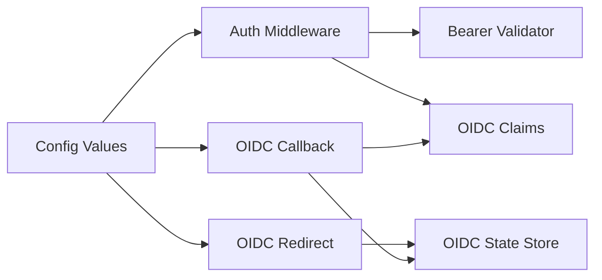

**Diagram sources**
- [http-auth-middleware.ts:172-327](file://src/http/http-auth-middleware.ts#L172-L327)
- [http-auth-callback.ts:122-229](file://src/http/http-auth-callback.ts#L122-L229)
- [http-auth-oidc-redirect.ts:15-78](file://src/http/http-auth-oidc-redirect.ts#L15-L78)
- [oidc-state-store.ts:50-61](file://src/services/oidc-state-store.ts#L50-L61)

**Section sources**
- [http-auth-middleware.ts:172-327](file://src/http/http-auth-middleware.ts#L172-L327)
- [http-auth-callback.ts:122-229](file://src/http/http-auth-callback.ts#L122-L229)
- [http-auth-oidc-redirect.ts:15-78](file://src/http/http-auth-oidc-redirect.ts#L15-L78)
- [oidc-state-store.ts:1-76](file://src/services/oidc-state-store.ts#L1-L76)

## Performance Considerations
- Use Redis-backed OIDC state store in multi-instance deployments to ensure atomic consume operations and cross-process state sharing.
- Avoid unnecessary re-authentication by setting appropriate session TTLs derived from token expiration.
- Prefer Bearer tokens for programmatic clients to reduce cookie overhead and simplify token rotation.
- Cache /api/me responses in the frontend using React Query defaults to minimize repeated network calls.

[No sources needed since this section provides general guidance]

## Troubleshooting Guide
Common issues and resolutions:
- Missing or invalid state during callback: Ensure the state was stored and consumed atomically; check Redis/memory store availability.
- Token exchange failures: Verify Keycloak configuration, client_id, redirect_uri, and PKCE verifier correctness.
- Bearer validation errors: Confirm AUTH_TRUSTED_ISSUERS and AUTH_ALLOWED_AUDIENCES are configured; ensure token issuer and audience match.
- Session not recognized: Check cookie domain/path settings and whether the callback base URL uses HTTPS for Secure flag.
- MCP clients receiving generic 401: The middleware returns structured JSON-RPC errors for /mcp; ensure clients parse these errors and prompt reconnection.

**Section sources**
- [http-auth-callback.ts:135-186](file://src/http/http-auth-callback.ts#L135-L186)
- [http-auth-middleware.ts:230-286](file://src/http/http-auth-middleware.ts#L230-L286)
- [http-auth-middleware.ts:297-327](file://src/http/http-auth-middleware.ts#L297-L327)

## Conclusion
The authentication integration combines robust OIDC/PKCE login for browsers with strict JWT Bearer validation for API/MCP clients. Signed session cookies and space-scoped contexts provide secure, flexible access control. The useMe hook simplifies frontend auth state management, while middleware ensures consistent enforcement across all protected routes. Following the outlined best practices and troubleshooting steps will help maintain a secure and reliable authentication experience.

[No sources needed since this section summarizes without analyzing specific files]