# Frontend Application

<cite>
**Referenced Files in This Document**
- [main.tsx](file://src/ui/main.tsx)
- [App.tsx](file://src/ui/App.tsx)
- [Layout.tsx](file://src/ui/components/Layout.tsx)
- [HomePage.tsx](file://src/ui/pages/HomePage.tsx)
- [SquadrulesPage.tsx](file://src/ui/pages/SquadrulesPage.tsx)
- [ProtocolEditPage.tsx](file://src/ui/pages/ProtocolEditPage.tsx)
- [RunGuidedPage.tsx](file://src/ui/pages/RunGuidedPage.tsx)
- [useAuth.ts](file://src/ui/hooks/useAuth.ts)
- [api.ts](file://src/ui/lib/api.ts)
- [index.ts](file://src/ui/i18n/index.ts)
- [en.json](file://src/ui/i18n/en.json)
</cite>

## Table of Contents
1. [Introduction](#introduction)
2. [Project Structure](#project-structure)
3. [Core Components](#core-components)
4. [Architecture Overview](#architecture-overview)
5. [Detailed Component Analysis](#detailed-component-analysis)
6. [Dependency Analysis](#dependency-analysis)
7. [Performance Considerations](#performance-considerations)
8. [Troubleshooting Guide](#troubleshooting-guide)
9. [Conclusion](#conclusion)
10. [Appendices](#appendices)

## Introduction
This document describes the React-based frontend application that provides browser-based interaction with the SquadRules framework. It explains how users discover, create, edit, and execute protocols (adapters), how authentication and internationalization are integrated, and how styling and accessibility are implemented. The application is designed for agent-first workflows where humans configure preferences through agents using an activate → forward → reward chain.

Key goals:
- Provide a responsive, accessible UI for browsing adapters, editing protocol definitions, and running guided workflows.
- Integrate with backend APIs for authentication, spaces, activation search, training/tuning, and execution.
- Support multiple languages via i18n and theme tokens for light/dark modes.
- Offer a foundation to extend the UI with custom components and pages.

## Project Structure
The frontend is a Vite + React application organized by feature areas:
- Entry and bootstrapping: main.tsx initializes providers and renders App.
- Routing: App.tsx defines lazy-loaded routes under a shared Layout.
- Pages: Feature-specific views such as Home, Squadrules search, Protocol editor, Runs, and Guided run.
- Components: Reusable UI building blocks like Layout, SurfaceCard, RichTextEditor, ErrorAlert.
- Hooks: Data fetching and state orchestration (authentication, spaces, activation, runs).
- i18n: English translations and initialization.
- Styling: CSS variables and theme tokens for consistent theming.

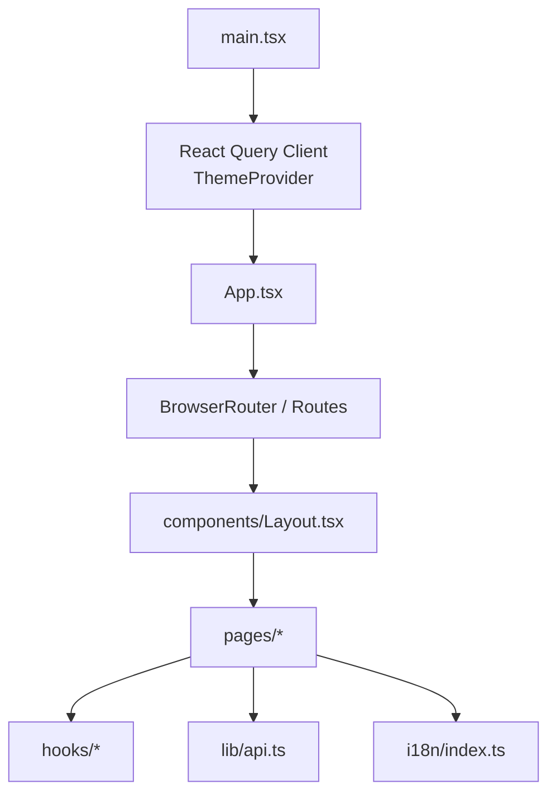

**Diagram sources**
- [main.tsx:1-20](file://src/ui/main.tsx#L1-L20)
- [App.tsx:1-133](file://src/ui/App.tsx#L1-L133)
- [Layout.tsx:1-109](file://src/ui/components/Layout.tsx#L1-L109)

**Section sources**
- [main.tsx:1-20](file://src/ui/main.tsx#L1-L20)
- [App.tsx:1-133](file://src/ui/App.tsx#L1-L133)

## Core Components
- Application shell:
  - main.tsx sets up StrictMode, React Query client, ThemeProvider, and mounts App.
  - App.tsx configures BrowserRouter with basename "/ui" and defines route tree with Suspense fallbacks.
- Layout:
  - components/Layout.tsx provides sidebar navigation, skip-to-main link, dynamic main width, and version footer.
- Pages:
  - HomePage.tsx: orientation hub with search form and space stats.
  - SquadrulesPage.tsx: adapter discovery and activation search with optional space scoping.
  - ProtocolEditPage.tsx: markdown-driven protocol authoring with validation, import/export, and save flows.
  - RunGuidedPage.tsx: guided workflow execution with start, step submission, and reward.

State management patterns:
- React Query for server data (e.g., useMe, useSpaces, useActivate).
- Local component state for forms and transient UI.
- URL-driven state for search queries and filters.

Internationalization:
- i18n initialized in index.ts with English resources from en.json.
- Components use react-i18next’s useTranslation hook.

Authentication integration:
- useAuth.ts fetches current user via /api/me using apiFetch with same-origin credentials.
- Permission-based rendering can be built on top of MeResponse shape.

Styling and theming:
- CSS variables define colors, spacing, and layout tokens.
- ThemeProvider toggles between light/dark themes.

Accessibility:
- Skip-to-main link, semantic landmarks, aria attributes, focus rings, and keyboard-friendly controls.

Responsive design:
- Tailwind utility classes and CSS variables adapt layouts across screen sizes.

Extensibility:
- Add new pages by importing and registering a route in App.tsx.
- Create reusable components in components/ and hooks in hooks/.

**Section sources**
- [main.tsx:1-20](file://src/ui/main.tsx#L1-L20)
- [App.tsx:1-133](file://src/ui/App.tsx#L1-L133)
- [Layout.tsx:1-109](file://src/ui/components/Layout.tsx#L1-L109)
- [HomePage.tsx:1-132](file://src/ui/pages/HomePage.tsx#L1-L132)
- [SquadrulesPage.tsx:1-219](file://src/ui/pages/SquadrulesPage.tsx#L1-L219)
- [ProtocolEditPage.tsx:1-338](file://src/ui/pages/ProtocolEditPage.tsx#L1-L338)
- [RunGuidedPage.tsx:1-240](file://src/ui/pages/RunGuidedPage.tsx#L1-L240)
- [useAuth.ts:1-25](file://src/ui/hooks/useAuth.ts#L1-L25)
- [api.ts:1-14](file://src/ui/lib/api.ts#L1-L14)
- [index.ts:1-13](file://src/ui/i18n/index.ts#L1-L13)

## Architecture Overview
The frontend follows a layered architecture:
- Presentation layer: React components and pages.
- State/data layer: React Query hooks and local state.
- API layer: Lightweight fetch wrapper with JSON headers and cookies.
- Internationalization: i18next with react-i18next.
- Theming: CSS variables and theme provider.

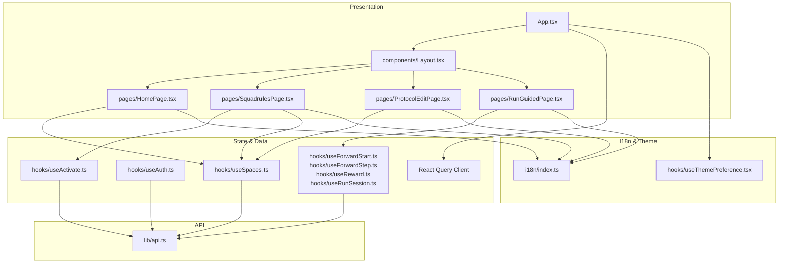

**Diagram sources**
- [App.tsx:1-133](file://src/ui/App.tsx#L1-L133)
- [Layout.tsx:1-109](file://src/ui/components/Layout.tsx#L1-L109)
- [HomePage.tsx:1-132](file://src/ui/pages/HomePage.tsx#L1-L132)
- [SquadrulesPage.tsx:1-219](file://src/ui/pages/SquadrulesPage.tsx#L1-L219)
- [ProtocolEditPage.tsx:1-338](file://src/ui/pages/ProtocolEditPage.tsx#L1-L338)
- [RunGuidedPage.tsx:1-240](file://src/ui/pages/RunGuidedPage.tsx#L1-L240)
- [useAuth.ts:1-25](file://src/ui/hooks/useAuth.ts#L1-L25)
- [api.ts:1-14](file://src/ui/lib/api.ts#L1-L14)
- [index.ts:1-13](file://src/ui/i18n/index.ts#L1-L13)

## Detailed Component Analysis

### Application Shell and Routing
- main.tsx:
  - Initializes i18n, creates React Query client, wraps App with ThemeProvider and QueryClientProvider.
- App.tsx:
  - Defines lazy-loaded routes for all pages with Suspense fallbacks.
  - Uses BrowserRouter with basename "/ui".
  - Route tree includes home, squadrules, runs, protocol creation/editing, guided run, skill bundle, protocol detail, account, and not found.

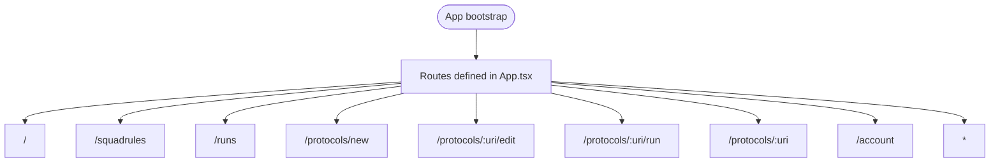

**Diagram sources**
- [App.tsx:1-133](file://src/ui/App.tsx#L1-L133)

**Section sources**
- [main.tsx:1-20](file://src/ui/main.tsx#L1-L20)
- [App.tsx:1-133](file://src/ui/App.tsx#L1-L133)

### Layout and Navigation
- components/Layout.tsx:
  - Provides skip-to-main link for accessibility.
  - Renders sidebar navigation with active states and aria-current.
  - Adjusts main content width based on route type.
  - Displays Squadrules version from environment variable.

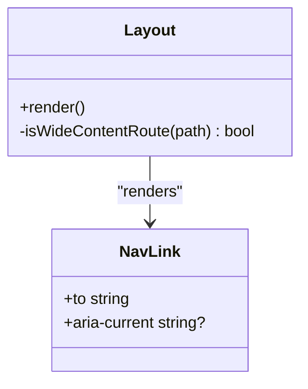

**Diagram sources**
- [Layout.tsx:1-109](file://src/ui/components/Layout.tsx#L1-L109)

**Section sources**
- [Layout.tsx:1-109](file://src/ui/components/Layout.tsx#L1-L109)

### Home Page
- pages/HomePage.tsx:
  - Presents a search form that navigates to /squadrules with query parameters.
  - Shows quick links to browse, create, and runs.
  - Displays space statistics with SpaceTypeBadge.

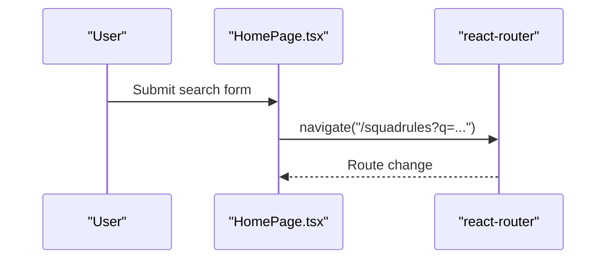

**Diagram sources**
- [HomePage.tsx:1-132](file://src/ui/pages/HomePage.tsx#L1-L132)

**Section sources**
- [HomePage.tsx:1-132](file://src/ui/pages/HomePage.tsx#L1-L132)

### Squadrules Search and Activation
- pages/SquadrulesPage.tsx:
  - Manages query and space scope via URL search params.
  - Calls useActivate to fetch choices and sorts by role and score.
  - Supports browsing adapters grouped by letter when no query is present.
  - Integrates SpaceSelect for filtering by space.

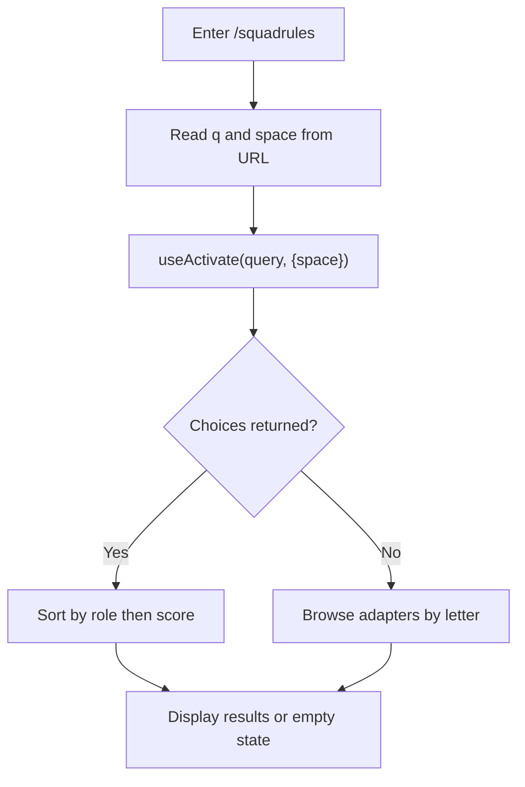

**Diagram sources**
- [SquadrulesPage.tsx:1-219](file://src/ui/pages/SquadrulesPage.tsx#L1-L219)

**Section sources**
- [SquadrulesPage.tsx:1-219](file://src/ui/pages/SquadrulesPage.tsx#L1-L219)

### Protocol Editor
- pages/ProtocolEditPage.tsx:
  - Loads existing protocol if editing; otherwise starts fresh.
  - Parses and builds protocol markdown; validates schema before saving.
  - Supports importing markdown files and forking from source adapter URI.
  - Saves via /api/train (new) or /api/tune (edit), navigating to resulting URI.

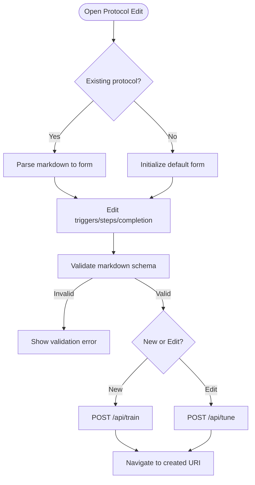

**Diagram sources**
- [ProtocolEditPage.tsx:1-338](file://src/ui/pages/ProtocolEditPage.tsx#L1-L338)

**Section sources**
- [ProtocolEditPage.tsx:1-338](file://src/ui/pages/ProtocolEditPage.tsx#L1-L338)

### Guided Run Workflow
- pages/RunGuidedPage.tsx:
  - Starts a run via useForwardStart, persists session state, and tracks progress.
  - Submits steps via useForwardStep, updating contract and proof hash.
  - Rewards via useReward when ready, marking run completed.
  - Handles errors and displays guidance and safety notices.

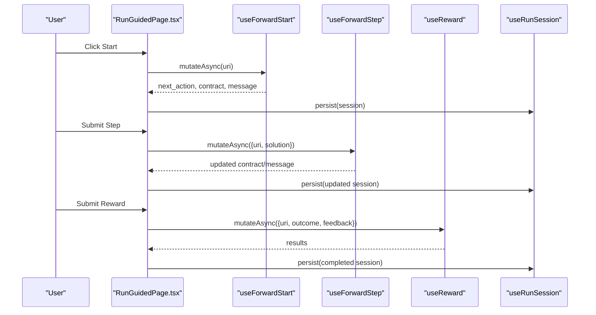

**Diagram sources**
- [RunGuidedPage.tsx:1-240](file://src/ui/pages/RunGuidedPage.tsx#L1-L240)

**Section sources**
- [RunGuidedPage.tsx:1-240](file://src/ui/pages/RunGuidedPage.tsx#L1-L240)

### Authentication Integration
- hooks/useAuth.ts:
  - Fetches current user profile from /api/me using apiFetch.
  - Wraps response handling and error propagation.
  - Exposes MeResponse type for permission-based UI rendering.

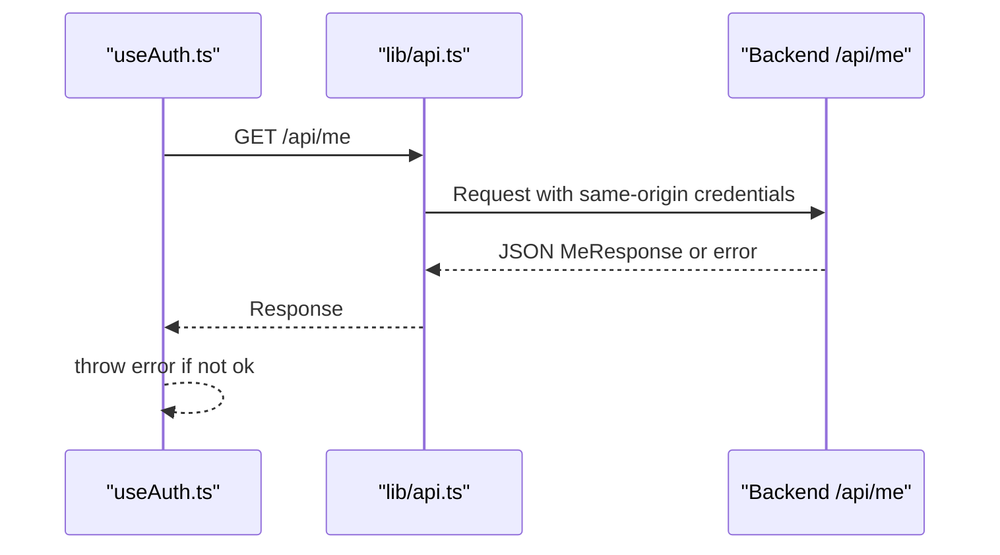

**Diagram sources**
- [useAuth.ts:1-25](file://src/ui/hooks/useAuth.ts#L1-L25)
- [api.ts:1-14](file://src/ui/lib/api.ts#L1-L14)

**Section sources**
- [useAuth.ts:1-25](file://src/ui/hooks/useAuth.ts#L1-L25)
- [api.ts:1-14](file://src/ui/lib/api.ts#L1-L14)

### Internationalization System
- i18n/index.ts:
  - Initializes i18next with English resources from en.json.
  - Configures namespaces and interpolation settings.
- Components use useTranslation to render localized strings.

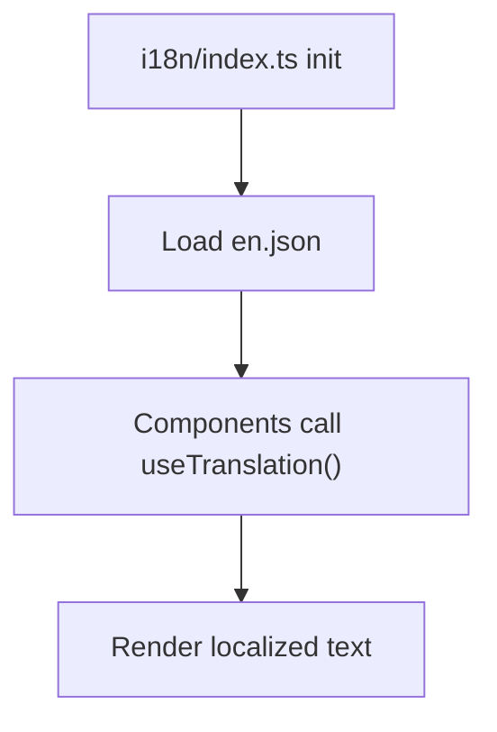

**Diagram sources**
- [index.ts:1-13](file://src/ui/i18n/index.ts#L1-L13)
- [en.json](file://src/ui/i18n/en.json)

**Section sources**
- [index.ts:1-13](file://src/ui/i18n/index.ts#L1-L13)
- [en.json](file://src/ui/i18n/en.json)

### Widget System for MCP Applications
- The repository includes backend-side widget generation and registration modules under src/mcp-apps, which produce HTML/CSS/JS for embedding MCP applications within the UI.
- These modules generate inline styles/scripts and register UI resources for activation, forward, and spaces features.
- While the frontend does not directly implement widget embedding logic, it serves static assets and integrates with backend endpoints that provide widget payloads.

[No sources needed since this section summarizes backend widget capabilities relevant to frontend integration]

## Dependency Analysis
- React Router manages routing and navigation.
- React Query provides caching and background updates for server data.
- i18next powers localization.
- Tailwind CSS utilities and CSS variables drive styling and theming.
- API layer uses native fetch with JSON headers and cookie-based sessions.

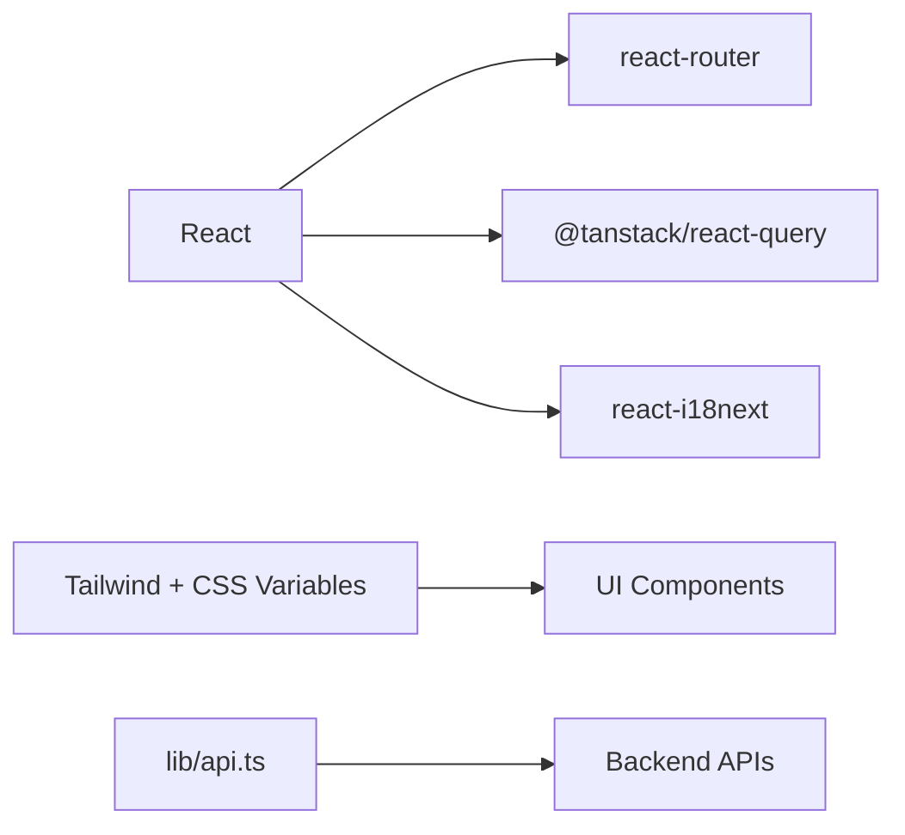

**Diagram sources**
- [App.tsx:1-133](file://src/ui/App.tsx#L1-L133)
- [main.tsx:1-20](file://src/ui/main.tsx#L1-L20)
- [api.ts:1-14](file://src/ui/lib/api.ts#L1-L14)

**Section sources**
- [App.tsx:1-133](file://src/ui/App.tsx#L1-L133)
- [main.tsx:1-20](file://src/ui/main.tsx#L1-L20)
- [api.ts:1-14](file://src/ui/lib/api.ts#L1-L14)

## Performance Considerations
- Route-level code splitting reduces initial bundle size.
- Suspense boundaries provide loading indicators during lazy loads.
- React Query caches responses and avoids redundant requests.
- Skeleton loaders improve perceived performance for async data.
- CSS variables enable efficient theme switching without reflows.

[No sources needed since this section provides general guidance]

## Troubleshooting Guide
Common issues and resolutions:
- Authentication failures:
  - Check /api/me response status and error messages.
  - Ensure cookies are enabled and same-origin requests are allowed.
- API errors:
  - Inspect network tab for request/response details.
  - Handle non-ok responses and display user-friendly messages.
- i18n missing keys:
  - Verify translation keys exist in en.json.
  - Ensure components use correct namespace and key paths.
- Theming issues:
  - Confirm ThemeProvider is mounted and CSS variables are applied.
  - Check browser dev tools for missing token definitions.

**Section sources**
- [useAuth.ts:1-25](file://src/ui/hooks/useAuth.ts#L1-L25)
- [api.ts:1-14](file://src/ui/lib/api.ts#L1-L14)
- [index.ts:1-13](file://src/ui/i18n/index.ts#L1-L13)

## Conclusion
The frontend application provides a robust, extensible interface for interacting with the SquadRules framework. It combines modern React patterns, clear routing, strong internationalization, and accessible design to support both human and agent workflows. By following the guidelines here, teams can extend the UI with new pages, components, and integrations while maintaining consistency and performance.

[No sources needed since this section summarizes without analyzing specific files]

## Appendices

### Extending the UI with Custom Components and Pages
- Adding a page:
  - Create a new file under pages/.
  - Import and register a route in App.tsx with lazy loading and Suspense.
- Creating reusable components:
  - Place components under components/ and export them for reuse.
  - Follow existing patterns for props, accessibility, and styling.
- Adding new hooks:
  - Implement data fetching or state logic under hooks/ and compose them in pages.
- Internationalization:
  - Add new keys to en.json and reference them via useTranslation.
- Theming:
  - Define new CSS variables in theme tokens and apply them consistently.

[No sources needed since this section provides general guidance]