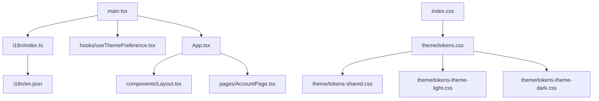
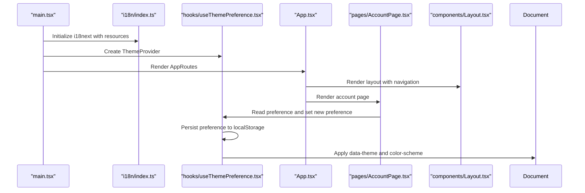
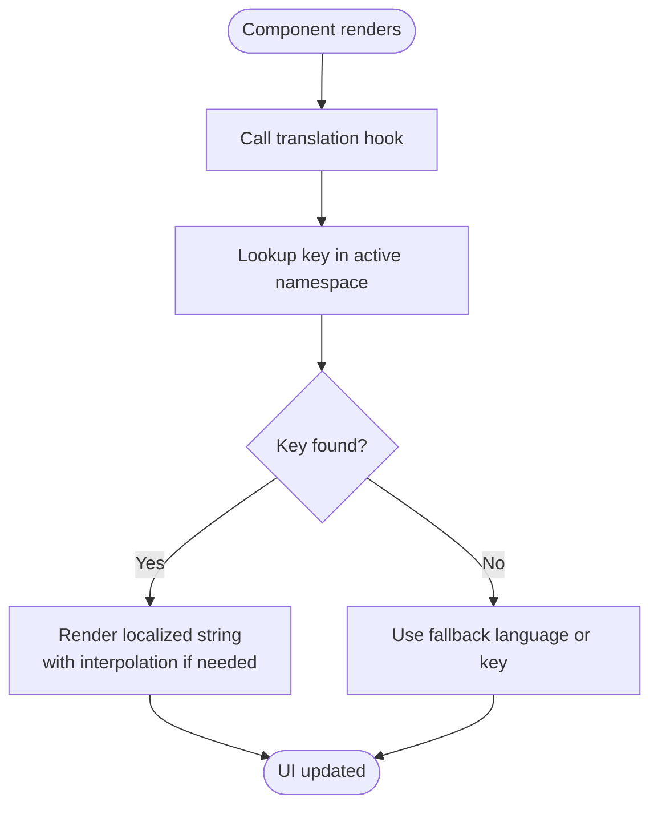
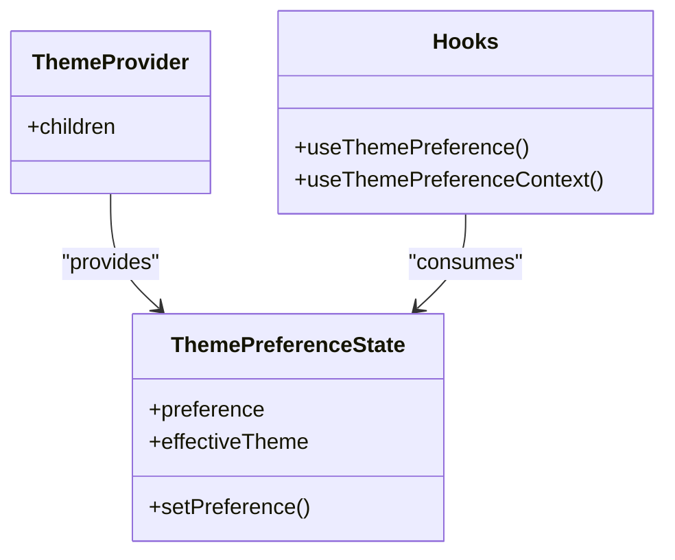
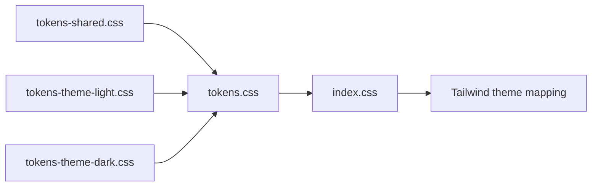
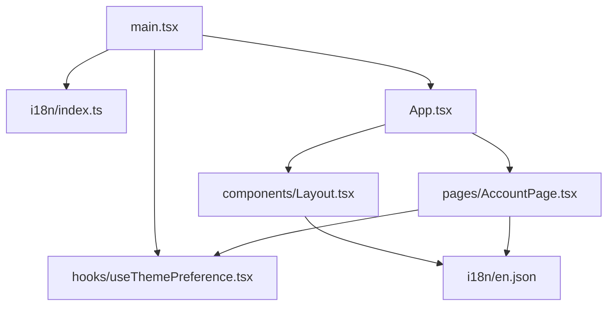

# Internationalization & Theming

<cite>
**Referenced Files in This Document**
- [main.tsx](file://src/ui/main.tsx)
- [App.tsx](file://src/ui/App.tsx)
- [Layout.tsx](file://src/ui/components/Layout.tsx)
- [AccountPage.tsx](file://src/ui/pages/AccountPage.tsx)
- [index.ts](file://src/ui/i18n/index.ts)
- [en.json](file://src/ui/i18n/en.json)
- [useThemePreference.tsx](file://src/ui/hooks/useThemePreference.tsx)
- [tokens.css](file://src/ui/theme/tokens.css)
- [tokens-shared.css](file://src/ui/theme/tokens-shared.css)
- [tokens-theme-light.css](file://src/ui/theme/tokens-theme-light.css)
- [tokens-theme-dark.css](file://src/ui/theme/tokens-theme-dark.css)
- [index.css](file://src/ui/index.css)
</cite>

## Table of Contents
1. [Introduction](#introduction)
2. [Project Structure](#project-structure)
3. [Core Components](#core-components)
4. [Architecture Overview](#architecture-overview)
5. [Detailed Component Analysis](#detailed-component-analysis)
6. [Dependency Analysis](#dependency-analysis)
7. [Performance Considerations](#performance-considerations)
8. [Troubleshooting Guide](#troubleshooting-guide)
9. [Conclusion](#conclusion)
10. [Appendices](#appendices)

## Introduction
This document explains the internationalization (i18n) and theming systems used by the UI layer. It covers:
- JSON-based translation files and dynamic content localization
- Language switching mechanisms and where translations are consumed
- Theme system based on CSS custom properties, light/dark modes, and theme customization
- The theme preference hook for user-specific selection and persistence
- Guidelines for adding languages, translating strings, and maintaining consistency
- CSS architecture with token-based styling, responsive breakpoints, and design system principles
- Examples for creating custom themes and extending the visual design system

## Project Structure
The i18n and theming features live under the UI package:
- Internationalization: `src/ui/i18n`
- Theme tokens and styles: `src/ui/theme`
- Theme preference hook: `src/ui/hooks/useThemePreference.tsx`
- App bootstrap and routing: `src/ui/main.tsx`, `src/ui/App.tsx`
- Pages consuming i18n and theme: `src/ui/pages/AccountPage.tsx`, `src/ui/components/Layout.tsx`
- Global CSS entry and Tailwind mapping: `src/ui/index.css`

**Diagram sources**
- [main.tsx:1-20](file://src/ui/main.tsx#L1-L20)
- [App.tsx:1-133](file://src/ui/App.tsx#L1-L133)
- [index.ts:1-13](file://src/ui/i18n/index.ts#L1-L13)
- [index.css:1-116](file://src/ui/index.css#L1-L116)
- [tokens.css:1-12](file://src/ui/theme/tokens.css#L1-L12)

**Section sources**
- [main.tsx:1-20](file://src/ui/main.tsx#L1-L20)
- [App.tsx:1-133](file://src/ui/App.tsx#L1-L133)
- [index.ts:1-13](file://src/ui/i18n/index.ts#L1-L13)
- [index.css:1-116](file://src/ui/index.css#L1-L116)
- [tokens.css:1-12](file://src/ui/theme/tokens.css#L1-L12)

## Core Components
- Internationalization setup: Initializes i18next with a default language and resources from JSON files.
- Translation consumption: React components use the translation hook to render localized strings.
- Theme preference hook: Provides user preference, effective theme, persistence via localStorage, and system preference detection.
- Theme provider: Wraps the app to expose theme state through context.
- Theme tokens: CSS custom properties define colors, spacing, typography, radii, and layout constraints.
- Global CSS: Imports tokens and maps them into Tailwind’s theme for consistent usage across components.

**Section sources**
- [index.ts:1-13](file://src/ui/i18n/index.ts#L1-L13)
- [en.json:1-273](file://src/ui/i18n/en.json#L1-L273)
- [useThemePreference.tsx:1-149](file://src/ui/hooks/useThemePreference.tsx#L1-L149)
- [tokens.css:1-12](file://src/ui/theme/tokens.css#L1-L12)
- [tokens-shared.css:1-80](file://src/ui/theme/tokens-shared.css#L1-L80)
- [tokens-theme-light.css:1-47](file://src/ui/theme/tokens-theme-light.css#L1-L47)
- [tokens-theme-dark.css:1-47](file://src/ui/theme/tokens-theme-dark.css#L1-L47)
- [index.css:1-116](file://src/ui/index.css#L1-L116)

## Architecture Overview
The runtime initializes i18n and the theme provider before rendering the application. Components consume translations and theme state through hooks and context.

**Diagram sources**
- [main.tsx:1-20](file://src/ui/main.tsx#L1-L20)
- [index.ts:1-13](file://src/ui/i18n/index.ts#L1-L13)
- [useThemePreference.tsx:68-149](file://src/ui/hooks/useThemePreference.tsx#L68-L149)
- [App.tsx:36-133](file://src/ui/App.tsx#L36-L133)
- [AccountPage.tsx:24-85](file://src/ui/pages/AccountPage.tsx#L24-L85)
- [Layout.tsx:11-109](file://src/ui/components/Layout.tsx#L11-L109)

## Detailed Component Analysis

### Internationalization System
- Initialization: i18next is configured with a default language, fallback language, namespace, and resources loaded from JSON.
- Resources: English translations are defined in a single JSON file with namespaced keys.
- Consumption: Components call the translation hook to access localized strings. Navigation labels, page titles, and messages are all translated.
- Dynamic content: Interpolation supports variables such as version numbers and counts.

**Diagram sources**
- [index.ts:1-13](file://src/ui/i18n/index.ts#L1-L13)
- [en.json:1-273](file://src/ui/i18n/en.json#L1-L273)
- [Layout.tsx:11-109](file://src/ui/components/Layout.tsx#L11-L109)
- [AccountPage.tsx:24-85](file://src/ui/pages/AccountPage.tsx#L24-L85)

Guidelines for adding languages and maintaining consistency:
- Add a new JSON file under the i18n directory with the same structure as the existing English file.
- Register the new language in the initialization configuration and add it to the resources map.
- Set the desired language at runtime using the i18next API exposed by react-i18next.
- Keep keys stable and descriptive; group related keys by feature area.
- Avoid hardcoding strings in components; always use translation keys.
- Validate pluralization and interpolation patterns consistently across all languages.

**Section sources**
- [index.ts:1-13](file://src/ui/i18n/index.ts#L1-L13)
- [en.json:1-273](file://src/ui/i18n/en.json#L1-L273)
- [Layout.tsx:11-109](file://src/ui/components/Layout.tsx#L11-L109)
- [AccountPage.tsx:24-85](file://src/ui/pages/AccountPage.tsx#L24-L85)

### Theme Preference Hook and Provider
- State model: Stores user preference (`light`, `dark`, or `system`) and computes an effective theme.
- Persistence: Reads and writes the preference to localStorage with a dedicated storage key.
- System integration: Detects OS-level dark mode preference and listens for changes when the preference is set to match the system.
- Application: Applies the effective theme by setting a data attribute on the document root and updating the browser’s color scheme.
- Context: Exposes preference, effective theme, and setter via React context for any component to consume.

**Diagram sources**
- [useThemePreference.tsx:62-149](file://src/ui/hooks/useThemePreference.tsx#L62-L149)

Usage example:
- Wrap the application with the theme provider during bootstrap.
- In pages like the account settings, render a selector that calls the setter to update the user’s preference.

**Section sources**
- [useThemePreference.tsx:1-149](file://src/ui/hooks/useThemePreference.tsx#L1-L149)
- [main.tsx:1-20](file://src/ui/main.tsx#L1-L20)
- [AccountPage.tsx:24-85](file://src/ui/pages/AccountPage.tsx#L24-L85)

### Theme System and CSS Architecture
- Token layers:
  - Shared tokens: Structural values such as spacing, typography, radii, and layout constraints.
  - Theme variants: Light and dark semantic color tokens applied via CSS custom properties.
  - Root selector: Light theme is default; dark theme applies when the document root has a specific data attribute.
- Global mapping: The global CSS imports tokens and maps them into Tailwind’s theme so components can use consistent design tokens.
- Responsive behavior: Breakpoints adjust padding and layout widths; focus visibility and reduced motion are respected.

**Diagram sources**
- [tokens-shared.css:1-80](file://src/ui/theme/tokens-shared.css#L1-L80)
- [tokens-theme-light.css:1-47](file://src/ui/theme/tokens-theme-light.css#L1-L47)
- [tokens-theme-dark.css:1-47](file://src/ui/theme/tokens-theme-dark.css#L1-L47)
- [tokens.css:1-12](file://src/ui/theme/tokens.css#L1-L12)
- [index.css:1-116](file://src/ui/index.css#L1-L116)

Design system principles:
- Single source of truth: All colors, spacing, typography, and radii are defined as CSS custom properties.
- Semantic naming: Tokens describe purpose (e.g., primary, surface, error) rather than literal colors.
- Accessibility: Focus rings, contrast, and reduced motion are considered in base styles.
- Consistency: Tailwind theme mapping ensures components consume tokens uniformly.

**Section sources**
- [tokens-shared.css:1-80](file://src/ui/theme/tokens-shared.css#L1-L80)
- [tokens-theme-light.css:1-47](file://src/ui/theme/tokens-theme-light.css#L1-L47)
- [tokens-theme-dark.css:1-47](file://src/ui/theme/tokens-theme-dark.css#L1-L47)
- [tokens.css:1-12](file://src/ui/theme/tokens.css#L1-L12)
- [index.css:1-116](file://src/ui/index.css#L1-L116)

### Creating Custom Themes and Extending the Visual Design System
To add a new theme variant:
- Create a new CSS file for the theme variant following the existing light/dark pattern.
- Define semantic color tokens on the appropriate selector scope.
- Import the new theme file in the main tokens stylesheet alongside existing themes.
- If needed, extend shared tokens for spacing, typography, or layout constraints.
- Map any new tokens into the Tailwind theme in the global CSS file.

Guidelines:
- Maintain semantic token names to avoid breaking components.
- Ensure sufficient contrast for text and interactive elements.
- Test both light and dark contexts for readability and accessibility.
- Update the Tailwind mapping whenever new tokens are introduced.

**Section sources**
- [tokens.css:1-12](file://src/ui/theme/tokens.css#L1-L12)
- [tokens-shared.css:1-80](file://src/ui/theme/tokens-shared.css#L1-L80)
- [tokens-theme-light.css:1-47](file://src/ui/theme/tokens-theme-light.css#L1-L47)
- [tokens-theme-dark.css:1-47](file://src/ui/theme/tokens-theme-dark.css#L1-L47)
- [index.css:1-116](file://src/ui/index.css#L1-L116)

## Dependency Analysis
The UI bootstraps i18n and theme provider before rendering routes and pages. Components depend on these services for localized text and theme state.

**Diagram sources**
- [main.tsx:1-20](file://src/ui/main.tsx#L1-L20)
- [App.tsx:1-133](file://src/ui/App.tsx#L1-L133)
- [index.ts:1-13](file://src/ui/i18n/index.ts#L1-L13)
- [en.json:1-273](file://src/ui/i18n/en.json#L1-L273)
- [Layout.tsx:11-109](file://src/ui/components/Layout.tsx#L11-L109)
- [AccountPage.tsx:24-85](file://src/ui/pages/AccountPage.tsx#L24-L85)
- [useThemePreference.tsx:68-149](file://src/ui/hooks/useThemePreference.tsx#L68-L149)

**Section sources**
- [main.tsx:1-20](file://src/ui/main.tsx#L1-L20)
- [App.tsx:1-133](file://src/ui/App.tsx#L1-L133)
- [index.ts:1-13](file://src/ui/i18n/index.ts#L1-L13)
- [en.json:1-273](file://src/ui/i18n/en.json#L1-L273)
- [Layout.tsx:11-109](file://src/ui/components/Layout.tsx#L11-L109)
- [AccountPage.tsx:24-85](file://src/ui/pages/AccountPage.tsx#L24-L85)
- [useThemePreference.tsx:68-149](file://src/ui/hooks/useThemePreference.tsx#L68-L149)

## Performance Considerations
- Route-level code splitting reduces initial bundle size by loading pages on demand.
- i18n resources are statically bundled; consider lazy-loading additional languages at runtime if the number of locales grows significantly.
- Theme switching updates only CSS custom properties and document attributes, which is lightweight and avoids full re-renders.
- Using localStorage for theme preference is efficient; guard against storage errors to prevent blocking the main thread.

[No sources needed since this section provides general guidance]

## Troubleshooting Guide
Common issues and resolutions:
- Translations not appearing:
  - Verify the translation key exists in the active language resource file.
  - Confirm the component uses the translation hook and the correct namespace.
  - Check that the initialization configuration includes the expected language and resources.
- Theme not applying:
  - Ensure the theme provider wraps the application tree.
  - Confirm the document root has the expected data attribute when the theme is set.
  - Validate that the theme CSS file is imported and mapped into the Tailwind theme.
- System theme mismatch:
  - When preference is set to match the system, verify media query support and event listeners for system preference changes.
  - Check that localStorage is available and not blocked; the hook handles failures gracefully.

**Section sources**
- [index.ts:1-13](file://src/ui/i18n/index.ts#L1-L13)
- [en.json:1-273](file://src/ui/i18n/en.json#L1-L273)
- [useThemePreference.tsx:34-60](file://src/ui/hooks/useThemePreference.tsx#L34-L60)
- [useThemePreference.tsx:81-126](file://src/ui/hooks/useThemePreference.tsx#L81-L126)
- [index.css:1-116](file://src/ui/index.css#L1-L116)

## Conclusion
The UI’s internationalization and theming systems are built around clear separation of concerns:
- i18n relies on static JSON resources and React hooks for localized rendering.
- Theming uses CSS custom properties with semantic tokens, enabling easy extension and consistent application across components.
- The theme preference hook centralizes user choice, persistence, and system integration.
Following the guidelines here will help maintain consistency, accessibility, and performance while expanding language coverage and visual themes.

[No sources needed since this section summarizes without analyzing specific files]

## Appendices

### Adding a New Language
Steps:
- Create a new JSON file under the i18n directory mirroring the structure of the existing English file.
- Register the new language in the initialization configuration and add its resources.
- Optionally set the active language at runtime using the i18next API.
- Translate all keys and validate pluralization and interpolation.

**Section sources**
- [index.ts:1-13](file://src/ui/i18n/index.ts#L1-L13)
- [en.json:1-273](file://src/ui/i18n/en.json#L1-L273)

### Example: Consuming Translations in a Component
- Call the translation hook to get the translation function.
- Use the function to render localized strings for labels, headings, and messages.
- For dynamic values, pass interpolation parameters to the translation function.

**Section sources**
- [Layout.tsx:11-109](file://src/ui/components/Layout.tsx#L11-L109)
- [AccountPage.tsx:24-85](file://src/ui/pages/AccountPage.tsx#L24-L85)

### Example: Changing Theme Preference
- Render a control that calls the setter provided by the theme preference context.
- The setter persists the preference and updates the effective theme immediately.

**Section sources**
- [AccountPage.tsx:67-85](file://src/ui/pages/AccountPage.tsx#L67-L85)
- [useThemePreference.tsx:116-126](file://src/ui/hooks/useThemePreference.tsx#L116-L126)