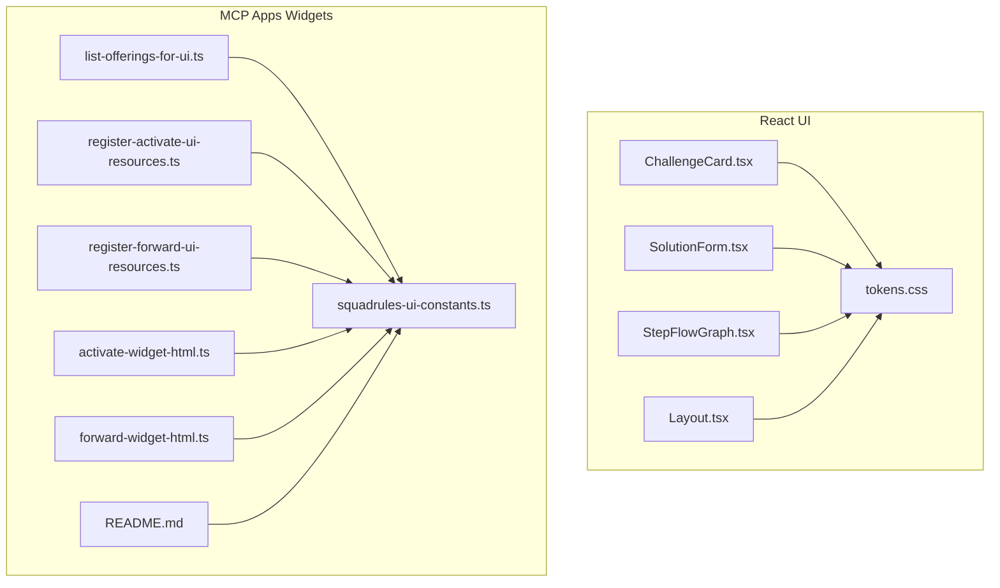
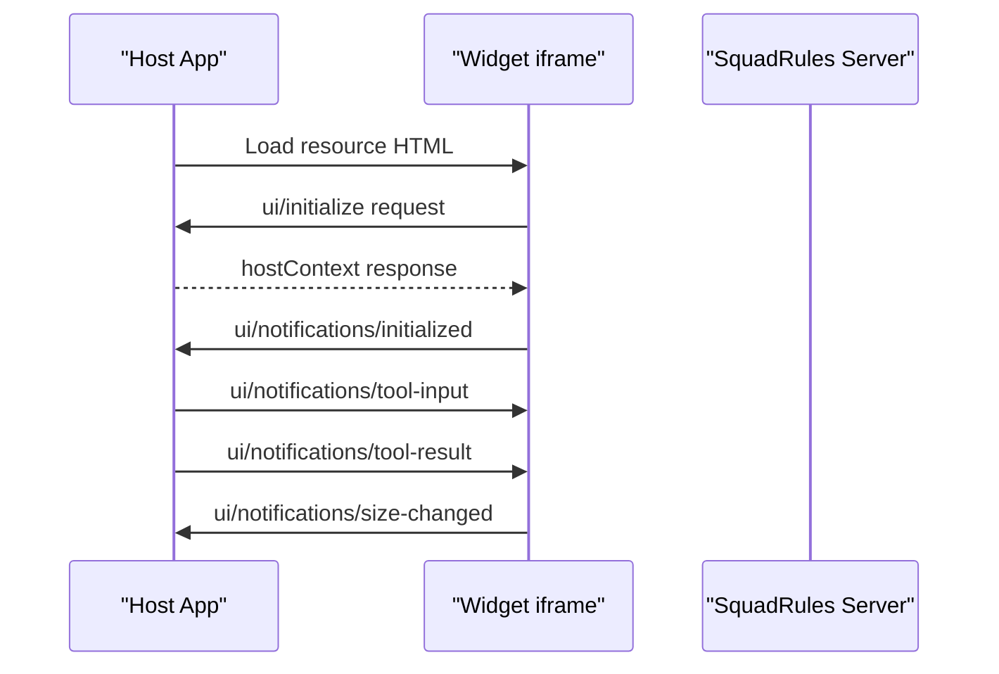
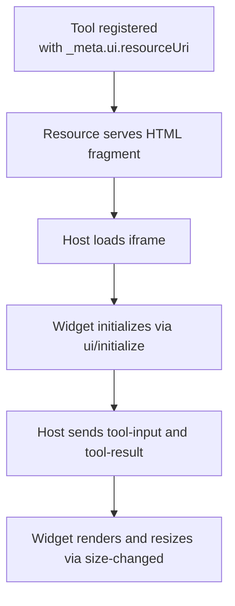
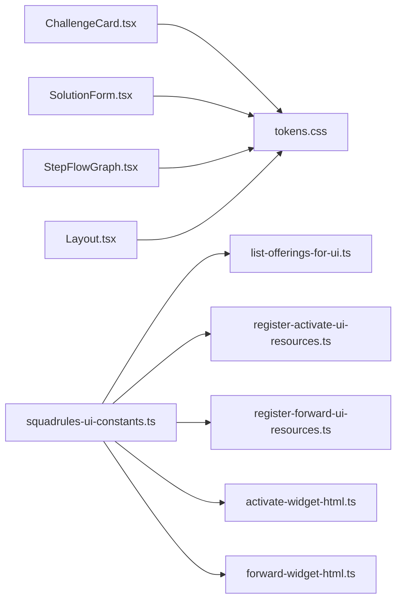

# UI Components & Widgets

<cite>
**Referenced Files in This Document**
- [ChallengeCard.tsx](file://src/ui/components/ChallengeCard.tsx)
- [SolutionForm.tsx](file://src/ui/components/run/SolutionForm.tsx)
- [StepFlowGraph.tsx](file://src/ui/components/StepFlowGraph.tsx)
- [Layout.tsx](file://src/ui/components/Layout.tsx)
- [tokens.css](file://src/ui/theme/tokens.css)
- [README.md](file://src/mcp-apps/README.md)
- [list-offerings-for-ui.ts](file://src/mcp-apps/list-offerings-for-ui.ts)
- [register-activate-ui-resources.ts](file://src/mcp-apps/register-activate-ui-resources.ts)
- [register-forward-ui-resources.ts](file://src/mcp-apps/register-forward-ui-resources.ts)
- [activate-widget-html.ts](file://src/mcp-apps/activate-widget-html.ts)
- [forward-widget-html.ts](file://src/mcp-apps/forward-widget-html.ts)
- [squadrules-ui-constants.ts](file://src/mcp-apps/squadrules-ui-constants.ts)
</cite>

## Table of Contents
1. [Introduction](#introduction)
2. [Project Structure](#project-structure)
3. [Core Components](#core-components)
4. [Architecture Overview](#architecture-overview)
5. [Detailed Component Analysis](#detailed-component-analysis)
6. [Dependency Analysis](#dependency-analysis)
7. [Performance Considerations](#performance-considerations)
8. [Troubleshooting Guide](#troubleshooting-guide)
9. [Conclusion](#conclusion)
10. [Appendices](#appendices)

## Introduction
This document explains the UI component library and widget system used by SquadRules. It covers:
- Reusable React components for challenges, guided runs, and layout.
- The MCP widget system that embeds external applications within the SquadRules interface via sandboxed iframes.
- Widget registration, resource management, lifecycle hooks, and host communication.
- Styling approaches using CSS variables and theme tokens.
- Accessibility considerations and cross-browser compatibility requirements.
- Examples for creating custom widgets and integrating them into the existing UI framework.

## Project Structure
The UI layer is split between:
- React components under src/ui/components (ChallengeCard, SolutionForm, StepFlowGraph, Layout).
- Theme tokens under src/ui/theme.
- MCP Apps widgets under src/mcp-apps (HTML fragments, inline CSS/JS, registration utilities, and constants).

**Diagram sources**
- [ChallengeCard.tsx:1-50](file://src/ui/components/ChallengeCard.tsx#L1-L50)
- [SolutionForm.tsx:1-230](file://src/ui/components/run/SolutionForm.tsx#L1-L230)
- [StepFlowGraph.tsx:1-41](file://src/ui/components/StepFlowGraph.tsx#L1-L41)
- [Layout.tsx:1-109](file://src/ui/components/Layout.tsx#L1-L109)
- [tokens.css:1-12](file://src/ui/theme/tokens.css#L1-L12)
- [list-offerings-for-ui.ts:1-257](file://src/mcp-apps/list-offerings-for-ui.ts#L1-L257)
- [register-activate-ui-resources.ts:1-41](file://src/mcp-apps/register-activate-ui-resources.ts#L1-L41)
- [register-forward-ui-resources.ts:1-41](file://src/mcp-apps/register-forward-ui-resources.ts#L1-L41)
- [activate-widget-html.ts:1-30](file://src/mcp-apps/activate-widget-html.ts#L1-L30)
- [forward-widget-html.ts:1-35](file://src/mcp-apps/forward-widget-html.ts#L1-L35)
- [squadrules-ui-constants.ts:1-71](file://src/mcp-apps/squadrules-ui-constants.ts#L1-L71)
- [README.md:1-295](file://src/mcp-apps/README.md#L1-L295)

**Section sources**
- [ChallengeCard.tsx:1-50](file://src/ui/components/ChallengeCard.tsx#L1-L50)
- [SolutionForm.tsx:1-230](file://src/ui/components/run/SolutionForm.tsx#L1-L230)
- [StepFlowGraph.tsx:1-41](file://src/ui/components/StepFlowGraph.tsx#L1-L41)
- [Layout.tsx:1-109](file://src/ui/components/Layout.tsx#L1-L109)
- [tokens.css:1-12](file://src/ui/theme/tokens.css#L1-L12)
- [README.md:1-295](file://src/mcp-apps/README.md#L1-L295)

## Core Components
This section documents reusable React components with their props, behavior, and accessibility attributes.

### ChallengeCard
Purpose: Displays a challenge card with type badge and optional payload details (command, target, prompt, minimum length).

Props:
- type: string — Challenge type key (e.g., shell, forward, user_input, comment).
- payload?: ChallengePayload — Optional object containing:
  - cmd?: string
  - target?: string
  - prompt?: string
  - min_length?: number

Behavior:
- Renders a human-readable label based on type mapping.
- Shows command code block when present.
- Displays target and prompt text when provided.
- Shows minimum length requirement when provided.

Accessibility:
- Uses semantic HTML structure and readable labels.
- Badge and content are visually grouped; no interactive elements.

Styling:
- Uses design tokens via CSS variables for colors, radius, and spacing.

**Section sources**
- [ChallengeCard.tsx:1-50](file://src/ui/components/ChallengeCard.tsx#L1-L50)

### SolutionForm
Purpose: Interactive form for submitting step solutions across different contract types (shell, forward, user_input, comment).

Props:
- contract: RunContract — Defines the current step type and parameters.
- disabled?: boolean — Disables all inputs and submit button.
- onSubmit: (draft) => void — Callback invoked with validated draft solution.

State and Validation:
- Tracks exit code, stdout/stderr for shell steps.
- Tracks forward target and success flag.
- Tracks confirmation text for user input steps.
- Tracks comment text and enforces minimum length.
- Computes validity based on step type and constraints.

Events:
- onSubmit receives structured payloads per type:
  - shell: { type, shell: { exit_code, stdout?, stderr? } }
  - forward: { type, forward: { target, success } }
  - user_input: { type, user_input: { confirmation, timestamp } }
  - comment: { type, comment: { text } }

Accessibility:
- Form has aria-label.
- Inputs have associated labels and ids.
- Error region uses role="alert".
- Comment textarea uses aria-invalid when below minimum length.

Styling:
- Consistent use of design tokens for borders, focus rings, and surfaces.

**Section sources**
- [SolutionForm.tsx:1-230](file://src/ui/components/run/SolutionForm.tsx#L1-L230)

### StepFlowGraph
Purpose: Visualizes the sequence of steps from Start to Attest, highlighting the current step.

Props:
- steps: { label: string }[] — Ordered step labels.
- currentIndex?: number — Index of the currently active step.

Behavior:
- Builds nodes array ["Start", ...steps, "Attest"].
- Highlights the node matching currentIndex.
- Renders arrows between nodes.

Accessibility:
- Container uses role="img" and aria-label describing the flow.
- Decorative arrows use aria-hidden.

Styling:
- Uses design tokens for background, border, and primary highlight.

**Section sources**
- [StepFlowGraph.tsx:1-41](file://src/ui/components/StepFlowGraph.tsx#L1-L41)

### Layout
Purpose: Application shell providing navigation sidebar and main content area.

Features:
- Skip-to-main link for keyboard users.
- Responsive main width based on route.
- Navigation links with active state styling and aria-current.
- Version footer.

Accessibility:
- Skip link targets main element id.
- Sidebar nav has aria-label.
- Links include aria-current when active.

Styling:
- Uses design tokens for layout dimensions, colors, and touch targets.

**Section sources**
- [Layout.tsx:1-109](file://src/ui/components/Layout.tsx#L1-L109)

## Architecture Overview
The UI consists of two layers:
- React UI components for the web application.
- MCP Apps widgets embedded in host-managed iframes, communicating via postMessage JSON-RPC.

**Diagram sources**
- [README.md:49-72](file://src/mcp-apps/README.md#L49-L72)

## Detailed Component Analysis

### React Components API

#### ChallengeCard
- Props:
  - type: string
  - payload?: { cmd?: string; target?: string; prompt?: string; min_length?: number }
- Events: None
- Customization:
  - Extend CHALLENGE_TYPE_LABEL mapping for new types.
  - Override CSS variables for badges and surfaces.

**Section sources**
- [ChallengeCard.tsx:1-50](file://src/ui/components/ChallengeCard.tsx#L1-L50)

#### SolutionForm
- Props:
  - contract: RunContract
  - disabled?: boolean
  - onSubmit: (draft) => void
- Events:
  - onSubmit triggered on valid submission.
- Customization:
  - Provide translations for i18n keys used in labels and messages.
  - Adjust validation rules by extending contract handling.

**Section sources**
- [SolutionForm.tsx:1-230](file://src/ui/components/run/SolutionForm.tsx#L1-L230)

#### StepFlowGraph
- Props:
  - steps: { label: string }[]
  - currentIndex?: number
- Events: None
- Customization:
  - Customize highlight styles via CSS variables.

**Section sources**
- [StepFlowGraph.tsx:1-41](file://src/ui/components/StepFlowGraph.tsx#L1-L41)

#### Layout
- Props: None
- Events: None
- Customization:
  - Add or remove navigation items.
  - Adjust max-width logic for wide routes.

**Section sources**
- [Layout.tsx:1-109](file://src/ui/components/Layout.tsx#L1-L109)

### MCP Widget System

#### Widget Registration Mechanism
- Tools expose _meta.ui.resourceUri pointing to a resource URI.
- Resources serve HTML fragments for hosts to render inside iframes.
- Dual MIME profiles ensure compatibility:
  - text/html;profile=mcp-app
  - text/html+skybridge

Key files:
- Constants define URIs and tool metadata.
- Registration functions register resources for activate and forward.
- Offerings builder lists tools and resources for UI discovery.

**Diagram sources**
- [squadrules-ui-constants.ts:36-61](file://src/mcp-apps/squadrules-ui-constants.ts#L36-L61)
- [register-activate-ui-resources.ts:17-40](file://src/mcp-apps/register-activate-ui-resources.ts#L17-L40)
- [register-forward-ui-resources.ts:17-40](file://src/mcp-apps/register-forward-ui-resources.ts#L17-L40)
- [list-offerings-for-ui.ts:232-256](file://src/mcp-apps/list-offerings-for-ui.ts#L232-L256)

**Section sources**
- [squadrules-ui-constants.ts:1-71](file://src/mcp-apps/squadrules-ui-constants.ts#L1-L71)
- [register-activate-ui-resources.ts:1-41](file://src/mcp-apps/register-activate-ui-resources.ts#L1-L41)
- [register-forward-ui-resources.ts:1-41](file://src/mcp-apps/register-forward-ui-resources.ts#L1-L41)
- [list-offerings-for-ui.ts:1-257](file://src/mcp-apps/list-offerings-for-ui.ts#L1-L257)

#### Resource Management
- Each widget registers two resources:
  - MCP App profile URI
  - Skybridge profile URI
- HTML builders assemble root div, style, and script blocks.
- Inline CSS and JS are injected into the HTML fragment.

Examples:
- Activate widget HTML builder composes logo, header, output container, styles, and script.
- Forward widget HTML builder includes progress footer and step indicators.

**Section sources**
- [activate-widget-html.ts:1-30](file://src/mcp-apps/activate-widget-html.ts#L1-L30)
- [forward-widget-html.ts:1-35](file://src/mcp-apps/forward-widget-html.ts#L1-L35)

#### Lifecycle Hooks and Communication
- Widget lifecycle:
  - Initialize handshake (ui/initialize, ui/notifications/initialized).
  - Receive tool-input and tool-result notifications.
  - Notify size changes to avoid internal scrolling.
- Presentation-only mode disables postMessage calls for static rendering.

Best practices:
- Handle both ui/notifications/tool-result and older notifications/tool-result.
- Parse structuredContent or fallback to content[0].text.
- Use requestAnimationFrame before measuring scrollHeight.

**Section sources**
- [README.md:49-72](file://src/mcp-apps/README.md#L49-L72)
- [README.md:195-213](file://src/mcp-apps/README.md#L195-L213)
- [README.md:282-294](file://src/mcp-apps/README.md#L282-L294)

#### Creating Custom Widgets
Steps:
1. Create three files:
   - {name}-widget-inline-css.ts
   - {name}-widget-inline-script.ts
   - {name}-widget-html.ts
2. Create registration file: register-{name}-ui-resources.ts
3. Add constants to squadrules-ui-constants.ts:
   - URIs and tool UI meta objects
4. Wire into the tool:
   - Add _meta to registerTool call
   - Call register{Name}UiResources(server)
5. Add to offerings:
   - Include builders in list-offering-for-ui.ts
6. Test:
   - Unit test HTML builder output
   - Integration test tools/list includes _meta and resource readability
   - Manual test in supported hosts

**Section sources**
- [README.md:230-254](file://src/mcp-apps/README.md#L230-L254)

## Dependency Analysis
React components depend on theme tokens for consistent styling. MCP widgets depend on shared constants and registration utilities.

**Diagram sources**
- [ChallengeCard.tsx:1-50](file://src/ui/components/ChallengeCard.tsx#L1-L50)
- [SolutionForm.tsx:1-230](file://src/ui/components/run/SolutionForm.tsx#L1-L230)
- [StepFlowGraph.tsx:1-41](file://src/ui/components/StepFlowGraph.tsx#L1-L41)
- [Layout.tsx:1-109](file://src/ui/components/Layout.tsx#L1-L109)
- [tokens.css:1-12](file://src/ui/theme/tokens.css#L1-L12)
- [squadrules-ui-constants.ts:1-71](file://src/mcp-apps/squadrules-ui-constants.ts#L1-L71)
- [list-offerings-for-ui.ts:1-257](file://src/mcp-apps/list-offerings-for-ui.ts#L1-L257)
- [register-activate-ui-resources.ts:1-41](file://src/mcp-apps/register-activate-ui-resources.ts#L1-L41)
- [register-forward-ui-resources.ts:1-41](file://src/mcp-apps/register-forward-ui-resources.ts#L1-L41)
- [activate-widget-html.ts:1-30](file://src/mcp-apps/activate-widget-html.ts#L1-L30)
- [forward-widget-html.ts:1-35](file://src/mcp-apps/forward-widget-html.ts#L1-L35)

**Section sources**
- [tokens.css:1-12](file://src/ui/theme/tokens.css#L1-L12)
- [squadrules-ui-constants.ts:1-71](file://src/mcp-apps/squadrules-ui-constants.ts#L1-L71)

## Performance Considerations
- React components:
  - Keep prop updates minimal; memoize derived values where appropriate.
  - Avoid heavy computations in render paths.
- MCP widgets:
  - Minimize DOM measurements; batch size-changed notifications.
  - Avoid network requests from widget JS due to CSP restrictions.
  - Use presentation-only mode for static testing to reduce overhead.

[No sources needed since this section provides general guidance]

## Troubleshooting Guide
Common issues and resolutions:
- Widget does not initialize:
  - Ensure ui/initialize and ui/notifications/initialized strings are present in the inline script.
  - Verify host context delivery and theme application.
- Tool result not displayed:
  - Handle both ui/notifications/tool-result and notifications/tool-result.
  - Parse structuredContent first; fallback to content[0].text.
- Internal scrolling in iframe:
  - Send ui/notifications/size-changed after every render.
  - Measure height using document.documentElement.scrollHeight inside requestAnimationFrame.
- CSP blocking fetch:
  - Do not rely on fetch() from widget JS; use postMessage to communicate with host.

**Section sources**
- [README.md:214-228](file://src/mcp-apps/README.md#L214-L228)
- [README.md:256-270](file://src/mcp-apps/README.md#L256-L270)
- [README.md:272-294](file://src/mcp-apps/README.md#L272-L294)

## Conclusion
The SquadRules UI combines accessible React components with a robust MCP widget system. Components provide clear APIs for challenges and guided runs, while widgets enable rich, host-integrated experiences through standardized lifecycles and messaging. Adhering to the registration patterns, resource management, and accessibility guidelines ensures consistent behavior across browsers and hosts.

[No sources needed since this section summarizes without analyzing specific files]

## Appendices

### Styling Approach
- Design tokens:
  - Centralized CSS variables for colors, spacing, typography, and radius.
  - Theme variants imported via tokens.css.
- Usage:
  - Reference CSS variables directly in Tailwind-like utility classes.
  - Maintain consistency across components and widgets.

**Section sources**
- [tokens.css:1-12](file://src/ui/theme/tokens.css#L1-L12)

### Accessibility Checklist
- Keyboard navigation:
  - Skip links and focus-visible outlines.
- Screen readers:
  - aria-labels on forms and images.
  - role="alert" for errors.
  - aria-current for active navigation.
- Color contrast:
  - Use design tokens to ensure sufficient contrast.

**Section sources**
- [Layout.tsx:31-33](file://src/ui/components/Layout.tsx#L31-L33)
- [Layout.tsx:59-89](file://src/ui/components/Layout.tsx#L59-L89)
- [SolutionForm.tsx:105-110](file://src/ui/components/run/SolutionForm.tsx#L105-L110)
- [SolutionForm.tsx:213-214](file://src/ui/components/run/SolutionForm.tsx#L213-L214)

### Cross-Browser Compatibility
- Supported hosts:
  - MCP Apps (Cursor, Claude Desktop)
  - Skybridge (ChatGPT, Windsurf)
- Requirements:
  - Handle both MIME profiles.
  - Support legacy notification method names.
  - Avoid non-standard features in inline scripts.

**Section sources**
- [README.md:121-131](file://src/mcp-apps/README.md#L121-L131)
- [README.md:282-294](file://src/mcp-apps/README.md#L282-L294)