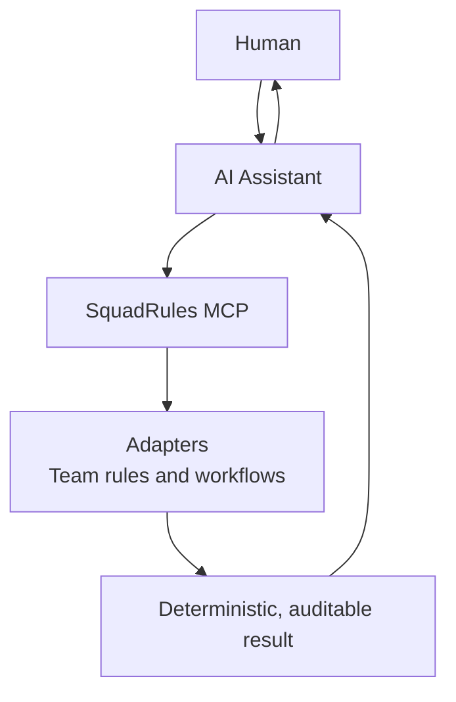
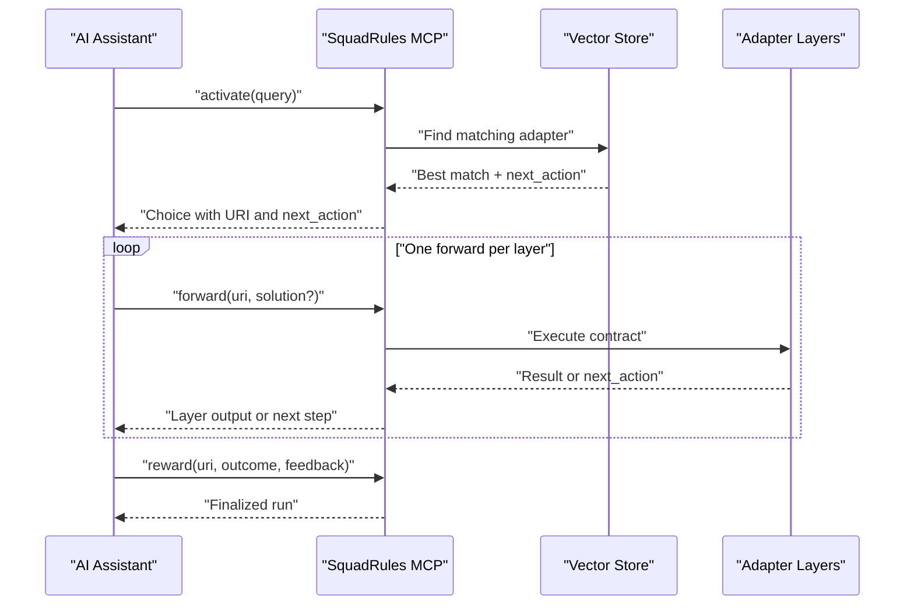
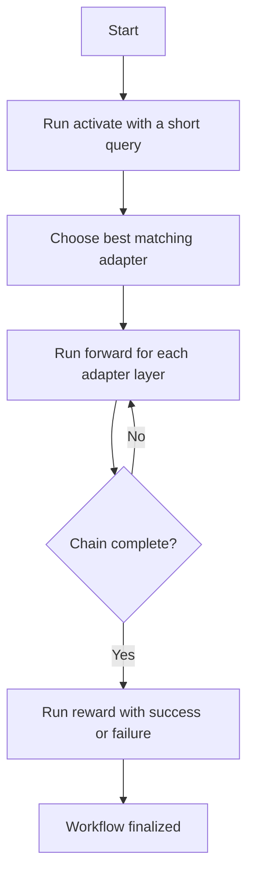

# Getting Started

<cite>
**Referenced Files in This Document**
- [SKILL.md](file://.agents/skills/squadrules/SKILL.md)
- [action-routing.md](file://.agents/skills/squadrules/references/action-routing.md)
- [install.md](file://.agents/skills/squadrules/references/install.md)
- [README.md](file://docs/README.md)
- [CLI.md](file://docs/CLI.md)
- [adapter-example-forward.md](file://docs/examples/adapter-example-forward.md)
- [activate.ts](file://src/cli/commands/activate.ts)
- [forward.ts](file://src/cli/commands/forward.ts)
- [reward.ts](file://src/cli/commands/reward.ts)
</cite>

## Table of Contents
1. [Introduction](#introduction)
2. [What SquadRules Is](#what-squadrules-is)
3. [Core Concepts](#core-concepts)
4. [Prerequisites](#prerequisites)
5. [Installation](#installation)
6. [MCP Server Configuration](#mcp-server-configuration)
7. [Skill Setup](#skill-setup)
8. [First Workflow: Activate → Forward → Reward](#first-workflow-activate--forward--reward)
9. [Troubleshooting Initial Setup](#troubleshooting-initial-setup)
10. [Next Steps](#next-steps)

## Introduction
This guide helps you install and run SquadRules MCP so your AI assistant can follow team workflows instead of guessing them. It focuses on the end-user path: installing the package, configuring an MCP-compatible host, connecting a vector store and embedding backend, and running a simple workflow through the `activate` → `forward` → `reward` chain.

SquadRules is designed for agents first: humans configure preferences through their AI assistants, while the system enforces deterministic, auditable execution through adapters.

## What SquadRules Is
SquadRules is an agent-first MCP framework that gives AI assistants shared team preferences and structured workflows. Instead of relying only on general training data, an agent consults SquadRules to learn how this team actually works.

At a high level:
- **Adapters** encode team-specific procedures as deterministic, auditable steps.
- **The activate → forward → reward chain** is the core workflow: find a matching adapter, execute its layers, then record whether it succeeded or failed.
- **AI ownership model**: one AI plus one human forms a team. The AI owns routing and workflow execution; the human provides clarification when required by an adapter.



[No sources needed since this diagram shows conceptual workflow, not actual code structure]

## Core Concepts

### Adapters
An adapter is a trained workflow describing how to perform a task according to team conventions. Adapters are not just prompts; they define contracts such as shell commands, user input, subagent delegation, comments, or links to other adapters.

Key points:
- Adapters provide deterministic, auditable task execution.
- Agents must create or repair adapters when workflows change.
- Scripts referenced by adapters are delivered through artifacts and exported before execution.

**Section sources**
- [SKILL.md:22-48](file://.agents/skills/squadrules/SKILL.md#L22-L48)
- [action-routing.md:52-68](file://.agents/skills/squadrules/references/action-routing.md#L52-L68)

### The activate → forward → reward Chain
The chain is the central flow for every action routed through SquadRules:

1. **Activate**: search for the best matching adapter for a short query.
2. **Forward**: run the first or next adapter layer, following `next_action` until completion.
3. **Reward**: record success or failure with optional feedback, score, rater, rubric version, and model attribution.



**Diagram sources**
- [activate.ts:12-35](file://src/cli/commands/activate.ts#L12-L35)
- [forward.ts:12-32](file://src/cli/commands/forward.ts#L12-L32)
- [reward.ts:13-66](file://src/cli/commands/reward.ts#L13-L66)

**Section sources**
- [SKILL.md:35-48](file://.agents/skills/squadrules/SKILL.md#L35-L48)
- [action-routing.md:19-30](file://.agents/skills/squadrules/references/action-routing.md#L19-L30)
- [CLI.md:79-103](file://docs/CLI.md#L79-L103)

### AI Ownership Model
SquadRules treats the AI assistant as the primary operator:
- The agent detects action intents and routes them through SquadRules.
- The agent follows server-generated URIs, nonces, hashes, IDs, and `next_action` fields verbatim.
- Humans observe passively but do not need to interact directly with SquadRules.
- If no adapter exists, the agent offers to create one rather than bypassing the process.

**Section sources**
- [SKILL.md:22-33](file://.agents/skills/squadrules/SKILL.md#L22-L33)
- [SKILL.md:49-53](file://.agents/skills/squadrules/SKILL.md#L49-L53)
- [action-routing.md:6-17](file://.agents/skills/squadrules/references/action-routing.md#L6-L17)

## Prerequisites
Before installing SquadRules, ensure the following:

| Requirement | Details |
|---|---|
| Node.js | Version 24 or later |
| Vector store | Qdrant reachable at `localhost:6333` with no auth for local setup |
| Embedding backend | Exactly one of OpenAI hosted, OpenAI-compatible/Ollama, or TEI |
| MCP-compatible host | An AI application that supports MCP servers (for example, Claude Desktop, Cursor, or Claude Code) |
| Optional HTTP server | Use `squadrules serve --transport http` if you need the HTTP `/mcp`, `/api/*`, `/ui`, and `/health` endpoints |

**Section sources**
- [install.md:12-25](file://.agents/skills/squadrules/references/install.md#L12-L25)
- [CLI.md:221-229](file://docs/CLI.md#L221-L229)

## Installation
There are two supported paths:

### Global installation (recommended for end users)
Install the package globally so both the CLI and the MCP server binary are available:

```bash
npm install -g @squadrules/mcp
squadrules --help
```

### npx invocation
If you prefer not to install globally, you can run commands through `npx`:

```bash
npx -y @squadrules/mcp activate "how do I deploy a release"
```

A bare invocation without a subcommand starts the MCP server over stdio, which is how most MCP hosts launch it.

**Section sources**
- [install.md:27-35](file://.agents/skills/squadrules/references/install.md#L27-L35)
- [CLI.md:9-27](file://docs/CLI.md#L9-L27)

## MCP Server Configuration
After installing the package, configure your MCP-compatible host to launch `squadrules serve`. The command uses stdio by default, so no transport flag is required.

Example host configuration:

```json
{
  "mcpServers": {
    "squadrules": {
      "command": "squadrules",
      "args": ["serve"],
      "env": {
        "QDRANT_URL": "http://localhost:6333",
        "QDRANT_API_KEY": "",
        "OPENAI_API_KEY": "sk-..."
      }
    }
  }
}
```

Important notes:
- `QDRANT_URL` defaults to `http://localhost:6333`.
- `QDRANT_API_KEY` defaults to empty, meaning no authentication for localhost Qdrant.
- Every parameter is environment-overridable.
- After connection, tools such as `activate`, `forward`, and `reward` should be listed by your host.

**Section sources**
- [install.md:37-63](file://.agents/skills/squadrules/references/install.md#L37-L63)
- [install.md:76-83](file://.agents/skills/squadrules/references/install.md#L76-L83)

## Skill Setup
SquadRules ships a hand-authored skill under `.agents/skills/squadrules`. This skill is agent-internal routing logic and is never auto-generated. It tells the AI assistant when to route action intents through SquadRules and how to complete the full chain.

For end users, the skill is typically added through the skills mechanism used by your agent host. The repository also documents adding the canonical `squadrules` skill via `npx skills add`.

Key responsibilities of the skill:
- Detect action intents such as write, build, fix, deploy, publish, migrate, configure, test, automate, generate, document, plan, or procedure descriptions.
- Route through `activate` → `forward` → `reward`.
- Treat missing or unauthenticated SquadRules MCP as a critical error.
- Keep repository alignment guidance centralized rather than duplicated across agent files.

**Section sources**
- [SKILL.md:1-20](file://.agents/skills/squadrules/SKILL.md#L1-L20)
- [SKILL.md:72-81](file://.agents/skills/squadrules/SKILL.md#L72-L81)
- [SKILL.md:83-91](file://.agents/skills/squadrules/SKILL.md#L83-L91)

## First Workflow: Activate → Forward → Reward
This section walks through a simple end-to-end workflow using the CLI. In normal use, your AI assistant performs these calls automatically after detecting an action intent.

### Step 1: Activate
Use `activate` to find the best matching adapter for a short query.

```bash
squadrules activate "deploy a release"
```

What happens:
- The CLI connects to the configured backend.
- The server searches stored adapters.
- The response includes a choice with a `uri` and a `next_action`.

**Section sources**
- [CLI.md:79-85](file://docs/CLI.md#L79-L85)
- [activate.ts:12-35](file://src/cli/commands/activate.ts#L12-L35)

### Step 2: Forward
Use `forward` to execute the first or next adapter layer. Repeat `forward` until the chain indicates completion.

```bash
squadrules forward "squadrules://layer/your-layer-uri"
```

You may optionally pass a JSON solution payload when a layer requires it.

**Section sources**
- [CLI.md:87-93](file://docs/CLI.md#L87-L93)
- [forward.ts:12-32](file://src/cli/commands/forward.ts#L12-L32)

### Step 3: Reward
Record the outcome of the completed workflow.

```bash
squadrules reward "squadrules://layer/your-layer-uri" success "Release deployed successfully"
```

Valid outcomes are `success` or `failure`. You can also include:
- `--score` for a normalized score between 0 and 1.
- `--rater` for evaluator identification.
- `--rubric-version` for policy or rubric versioning.
- `--model` for LLM model attribution.

**Section sources**
- [CLI.md:95-103](file://docs/CLI.md#L95-L103)
- [reward.ts:13-66](file://src/cli/commands/reward.ts#L13-L66)

### Example Flow Summary


[No sources needed since this diagram shows conceptual workflow, not actual code structure]

## Troubleshooting Initial Setup

### Server exits immediately or cannot reach the vector store
Confirm that Qdrant is reachable where SquadRules expects it. For local development, the default is `localhost:6333` with no authentication.

Checkpoints:
- Ensure Qdrant is running.
- Verify the endpoint responds to health checks.
- Confirm `QDRANT_URL` points to the correct address.
- Set `QDRANT_API_KEY` only when using a remote Qdrant with authentication.

**Section sources**
- [install.md:92-100](file://.agents/skills/squadrules/references/install.md#L92-L100)

### Embedding errors
Embedding errors usually mean either no backend is configured or multiple backends conflict.

Checkpoints:
- Configure exactly one embedding backend.
- For OpenAI hosted: set `OPENAI_API_KEY`.
- For OpenAI-compatible or Ollama: set `OPENAI_API_URL`, `OPENAI_EMBEDDING_MODEL`, and `OPENAI_API_KEY`.
- For TEI: set `TEI_BASE_URL` and optionally `TEI_MODEL`.

**Section sources**
- [install.md:65-74](file://.agents/skills/squadrules/references/install.md#L65-L74)

### MCP host does not list SquadRules tools
Verify the host configuration:
- The command is `squadrules`.
- The args include `serve`.
- The transport is stdio by default.
- The host points at the expected `/mcp` endpoint.
- Required tools are allowed.

If the server is unavailable or unauthenticated, treat it as a critical error: stop routing, classify the failure, and ask the user to remediate the connection or authentication.

**Section sources**
- [install.md:37-63](file://.agents/skills/squadrules/references/install.md#L37-L63)
- [action-routing.md:193-212](file://.agents/skills/squadrules/references/action-routing.md#L193-L212)

### Using npx vs global install
If `npx` commands work but the MCP host cannot connect, check whether the host is launching the same entry point. A bare `npx -y @squadrules/mcp` invocation defaults to starting the MCP server over stdio.

**Section sources**
- [CLI.md:19-27](file://docs/CLI.md#L19-L27)

## Next Steps
Once the basic setup works, you can:
- Explore the full CLI reference for `train`, `tune`, `export`, `spaces`, `login`, and related commands.
- Read the curated documentation router to understand where code-derivable content lives versus irreducible records.
- Study adapter examples to see how shell, forward-link, subagent, and other contracts are structured.
- Review the action-routing reference to understand when to route through SquadRules versus executing directly.

**Section sources**
- [CLI.md:105-229](file://docs/CLI.md#L105-L229)
- [README.md:1-8](file://docs/README.md#L1-L8)
- [adapter-example-forward.md:1-43](file://docs/examples/adapter-example-forward.md#L1-L43)
- [action-routing.md:104-177](file://.agents/skills/squadrules/references/action-routing.md#L104-L177)