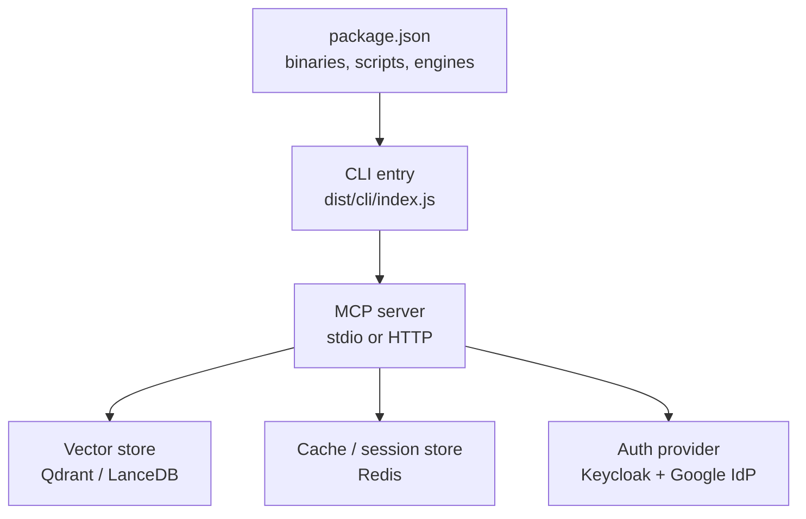
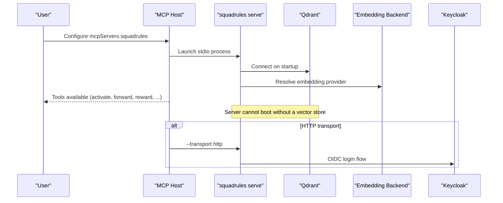
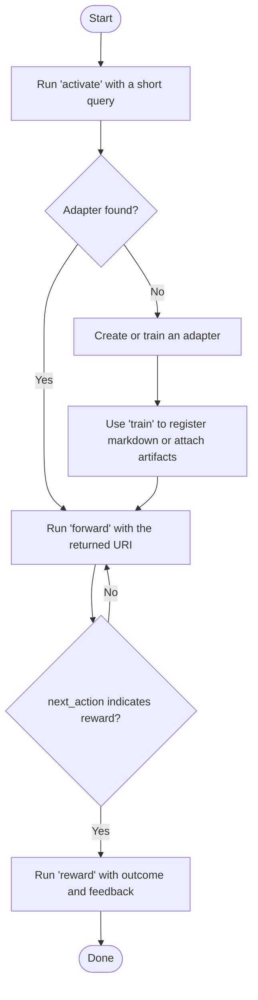
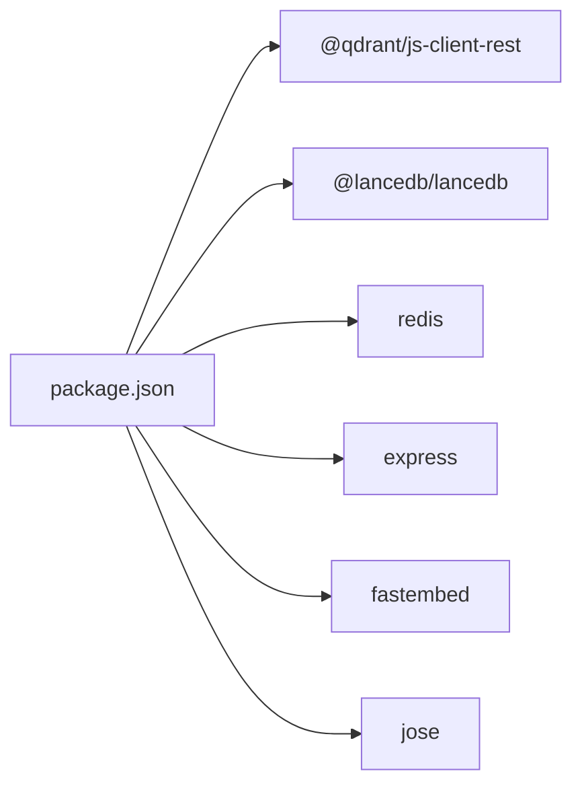

# Getting Started

<cite>
**Referenced Files in This Document**
- [package.json](file://package.json)
- [docs/README.md](file://docs/README.md)
- [docs/CLI.md](file://docs/CLI.md)
- [.agents/skills/squadrules/SKILL.md](file://.agents/skills/squadrules/SKILL.md)
- [.agents/skills/squadrules/references/install.md](file://.agents/skills/squadrules/references/install.md)
- [docs/adapter-authoring-guide.md](file://docs/adapter-authoring-guide.md)
</cite>

## Table of Contents
1. [Introduction](#introduction)
2. [Project Structure](#project-structure)
3. [Core Components](#core-components)
4. [Architecture Overview](#architecture-overview)
5. [Detailed Component Analysis](#detailed-component-analysis)
6. [Dependency Analysis](#dependency-analysis)
7. [Performance Considerations](#performance-considerations)
8. [Troubleshooting Guide](#troubleshooting-guide)
9. [Conclusion](#conclusion)
10. [Appendices](#appendices)

## Introduction
This guide helps you install, configure, and run SquadRules MCP for the first time. It covers:
- Installing the npm package
- Configuring environment variables
- Running infrastructure dependencies (Qdrant, Redis, Keycloak)
- Starting the server with Docker Compose or manually
- Creating your first adapter
- Running basic workflows through the CLI
- Understanding the CLI interface
- Verifying installation
- Setting up a development environment (TypeScript compilation, testing, debugging)

SquadRules is an agent-first MCP framework where AI agents are the primary users. The core workflow is activate → forward → reward, and adapters provide deterministic, auditable task execution. Vector databases such as Qdrant (primary) and LanceDB (secondary) power semantic search over rules and workflows. Storage includes Redis for sessions and rate limiting, vector stores for embeddings, and the filesystem for configuration and adapters. Authentication uses Keycloak plus Google IdP for OAuth2/JWT. Skills under `.agents/skills/` are hand-authored routing logic; `squadrules` is the canonical action router.

## Project Structure
At a high level:
- `src/` contains the TypeScript server, CLI, HTTP routes, services, tools, UI, and utilities.
- `docs/` holds curated documentation not derivable from code.
- `.agents/skills/squadrules/` contains the agent-facing skill that routes action intents to the activate → forward → reward chain.
- `package.json` defines binaries, scripts, dependencies, and Node engine requirements.

**Diagram sources**
- [package.json:30-34](file://package.json#L30-L34)
- [package.json:159-161](file://package.json#L159-L161)

**Section sources**
- [package.json:1-194](file://package.json#L1-L194)
- [docs/README.md:1-33](file://docs/README.md#L1-L33)

## Core Components
- **CLI**: `squadrules`, `sq`, and `sqr` are equivalent binaries pointing at the same entry point. They support local-by-default operation against embedded LanceDB and remote operation against an HTTP server.
- **Server**: Starts in stdio mode by default for MCP hosts, or HTTP mode when requested.
- **Adapters**: Markdown-based contracts that define flows, verification steps, and artifacts.
- **Embedding backends**: Exactly one must be configured (OpenAI, OpenAI-compatible/Ollama, or TEI).
- **Infrastructure**: Qdrant is required for boot; Redis and Keycloak are used for sessions/rate-limiting and authentication respectively.

**Section sources**
- [package.json:30-34](file://package.json#L30-L34)
- [docs/CLI.md:9-44](file://docs/CLI.md#L9-L44)
- [.agents/skills/squadrules/references/install.md:12-25](file://.agents/skills/squadrules/references/install.md#L12-L25)

## Architecture Overview
The end-to-end flow for a new user is:
1. Install Node.js and the npm package.
2. Start Qdrant locally.
3. Configure exactly one embedding backend via environment variables.
4. Point your MCP host at `squadrules serve`.
5. Verify tools appear in your host.
6. Optionally start the HTTP server and authenticate against Keycloak.

**Diagram sources**
- [.agents/skills/squadrules/references/install.md:12-25](file://.agents/skills/squadrules/references/install.md#L12-L25)
- [.agents/skills/squadrules/references/install.md:65-74](file://.agents/skills/squadrules/references/install.md#L65-L74)
- [docs/CLI.md:221-229](file://docs/CLI.md#L221-L229)

## Detailed Component Analysis

### Installation and Environment Setup
- Prerequisites:
  - Node.js 24 or later.
  - A reachable Qdrant instance (default `localhost:6333`, no auth).
  - Exactly one embedding backend configured via environment variables.
- Install globally:
  - Run `npm install -g @squadrules/mcp`.
  - Confirm the CLI with `squadrules --help`.
- Configure your MCP host:
  - Add `squadrules` to your host’s `mcpServers` configuration.
  - Use command `squadrules` with args `serve`.
  - Set environment variables for Qdrant and your chosen embedding backend.
- Verify:
  - Your host should list SquadRules tools (`activate`, `forward`, `reward`, etc.).
  - If you can run the CLI directly, confirm `squadrules --help`.

Environment variables:
- Qdrant:
  - `QDRANT_URL`: defaults to `http://localhost:6333`.
  - `QDRANT_API_KEY`: defaults to empty string for no-auth localhost.
- Embedding backend (choose one):
  - OpenAI hosted: set `OPENAI_API_KEY`.
  - OpenAI-compatible / Ollama: set `OPENAI_API_URL`, `OPENAI_EMBEDDING_MODEL`, and `OPENAI_API_KEY`.
  - TEI: set `TEI_BASE_URL` and optionally `TEI_MODEL`.

Optional HTTP listener:
- Default is stdio. To enable HTTP, pass `--transport http` or set `TRANSPORT_TYPE=http`.

**Section sources**
- [.agents/skills/squadrules/references/install.md:12-31](file://.agents/skills/squadrules/references/install.md#L12-L31)
- [.agents/skills/squadrules/references/install.md:37-63](file://.agents/skills/squadrules/references/install.md#L37-L63)
- [.agents/skills/squadrules/references/install.md:65-74](file://.agents/skills/squadrules/references/install.md#L65-L74)
- [.agents/skills/squadrules/references/install.md:76-90](file://.agents/skills/squadrules/references/install.md#L76-L90)

### Infrastructure Dependencies
- Qdrant:
  - Required for server boot.
  - Quick start: run a container exposing port 6333.
  - Any reachable Qdrant endpoint works if you set `QDRANT_URL`.
- Redis:
  - Used for sessions and rate limiting.
  - Configure via environment variables expected by the service layer.
- Keycloak:
  - Provides OAuth2/JWT authentication.
  - Configure client registration and scopes according to the server’s OIDC integration.

Note: Container images, Docker Compose deployment, and Helm charts are owned by sibling repositories. Use them to deploy Qdrant, Redis, and Keycloak alongside the server.

**Section sources**
- [.agents/skills/squadrules/references/install.md:12-25](file://.agents/skills/squadrules/references/install.md#L12-L25)
- [docs/README.md:23-26](file://docs/README.md#L23-L26)

### Initial Server Setup
- Stdio mode (recommended for MCP hosts):
  - No flags needed; `serve` defaults to stdio.
  - Configure your host to invoke `squadrules serve`.
- HTTP mode:
  - Pass `--transport http` or set `TRANSPORT_TYPE=http`.
  - Use `--server-port` or `SERVER_PORT` to control the listen address.
  - Root `--url` does not set the listen address.

Verification endpoints:
- `/health` should respond on the base URL when running HTTP.
- `/mcp` is the MCP JSON-RPC endpoint.

Authentication (HTTP targets only):
- Use `squadrules login` to perform browser PKCE login or supply a token.
- After login, data commands automatically target the stored HTTP API URL.

**Section sources**
- [docs/CLI.md:221-229](file://docs/CLI.md#L221-L229)
- [docs/CLI.md:231-246](file://docs/CLI.md#L231-L246)

### First-Time Workflow Walkthrough
- Create your first adapter:
  - Follow the Adapter Authoring Guide to define trigger, inputs, authority, outcome, and evidence.
  - Choose the appropriate contract type using the verification ladder: shell, subagent, or comment.
  - For executable gates, prefer the script-export pattern with an attached artifact.
- Run basic workflows:
  - Use `activate` to find the best matching adapter for a query.
  - Use `forward` to execute the next layer until the chain indicates reward.
  - Use `reward` to record success or failure feedback.
- Understand the CLI:
  - Local-by-default means commands run in-process against embedded LanceDB unless you specify a remote URL.
  - Global options include `--url`, `--timeout`, `--retries`, `--format`, `--space`, and `--reseed`.
  - Output formats: auto, pretty, json, text.

**Diagram sources**
- [docs/CLI.md:79-103](file://docs/CLI.md#L79-L103)
- [docs/CLI.md:131-149](file://docs/CLI.md#L131-L149)

**Section sources**
- [docs/adapter-authoring-guide.md:11-21](file://docs/adapter-authoring-guide.md#L11-L21)
- [docs/adapter-authoring-guide.md:23-44](file://docs/adapter-authoring-guide.md#L23-L44)
- [docs/adapter-authoring-guide.md:85-113](file://docs/adapter-authoring-guide.md#L85-L113)
- [docs/CLI.md:79-103](file://docs/CLI.md#L79-L103)
- [docs/CLI.md:131-149](file://docs/CLI.md#L131-L149)

### CLI Interface Reference
- Binaries: `squadrules`, `sq`, `sqr`.
- Invocation:
  - Global install: `npm install -g @squadrules/mcp` then `squadrules --help`.
  - Without global install: `npx -y @squadrules/mcp activate "how do I deploy a release"`.
- Local-by-default:
  - Commands run in-process against embedded LanceDB unless a remote URL is specified.
- Global options:
  - `-u, --url <url>`: API base URL or `local`/`stdio`.
  - `--timeout <seconds>`: Request timeout.
  - `--retries <n>`: Max retries.
  - `--format <format>`: Output format.
  - `--space <space>`: Space scope.
  - `--reseed`: Force re-injection of bundled adapters in local mode.
  - `--no-browser`: Never open a browser for auth.
- Commands:
  - `activate`, `forward`, `reward`, `tune`, `delete`, `spaces`, `train`, `export`, `serve`.
- Authentication:
  - `login`, `token`, `logout` for HTTP targets.

**Section sources**
- [docs/CLI.md:9-44](file://docs/CLI.md#L9-L44)
- [docs/CLI.md:46-75](file://docs/CLI.md#L46-L75)
- [docs/CLI.md:77-229](file://docs/CLI.md#L77-L229)
- [docs/CLI.md:231-246](file://docs/CLI.md#L231-L246)

### Development Environment Setup
- Node.js:
  - Engine requirement is Node.js 24 or later.
- Build:
  - `npm run build` compiles TypeScript and builds the React UI.
  - `npm run ui:build` builds the UI separately.
- Type checking:
  - `npm run typecheck` runs TypeScript checks for both server and UI.
- Testing:
  - Unit tests: Jest.
  - UI tests: Vitest.
  - Automation tests: Node test runner scripts.
- Linting:
  - ESLint, markdownlint, and custom doc-link checker.
- Debugging:
  - Use your IDE’s Node debugger against `dist/cli/index.js`.
  - For HTTP mode, inspect logs and health endpoints.

**Section sources**
- [package.json:40-79](file://package.json#L40-L79)
- [package.json:159-161](file://package.json#L159-L161)

## Dependency Analysis
Key runtime dependencies relevant to setup:
- Vector stores:
  - Qdrant client for remote-capable vector storage.
  - LanceDB for embedded secondary storage.
- Cache/session store:
  - Redis client for sessions and rate limiting.
- HTTP stack:
  - Express for HTTP server routes.
- Embeddings:
  - Fastembed for local embedding fallback.
- Authentication:
  - JWT library for token validation.

**Diagram sources**
- [package.json:81-121](file://package.json#L81-L121)

**Section sources**
- [package.json:81-121](file://package.json#L81-L121)

## Performance Considerations
- Prefer Qdrant for production-scale semantic search; use LanceDB for local/embedded scenarios.
- Keep embedding model selection consistent across environments to avoid drift.
- Tune Redis connection settings for high-throughput sessions and rate limiting.
- Avoid unnecessary network hops by using local-by-default CLI behavior during development.

[No sources needed since this section provides general guidance]

## Troubleshooting Guide
Common issues and resolutions:
- Server exits immediately or cannot reach vector store:
  - Ensure Qdrant is reachable on `localhost:6333` or set `QDRANT_URL` appropriately.
  - Test connectivity with `curl http://localhost:6333/readyz`.
- Embedding errors:
  - Ensure exactly one embedding backend is configured and its endpoint/model/key are correct.
- Auth failures against remote Qdrant:
  - Set `QDRANT_API_KEY` for remote instances; leave it empty only for no-auth localhost.
- CLI target confusion:
  - Remember that without `login`, data commands target the embedded store.
  - Use `--url` to explicitly target a remote server.
- HTTP server not starting:
  - Verify `--transport http` or `TRANSPORT_TYPE=http`.
  - Check `--server-port` or `SERVER_PORT`.
  - Confirm `/health` responds on the base URL.

**Section sources**
- [.agents/skills/squadrules/references/install.md:92-100](file://.agents/skills/squadrules/references/install.md#L92-L100)
- [docs/CLI.md:29-44](file://docs/CLI.md#L29-L44)
- [docs/CLI.md:221-229](file://docs/CLI.md#L221-L229)

## Conclusion
You now have the essentials to install SquadRules MCP, configure environment variables, run infrastructure dependencies, start the server, create your first adapter, and execute basic workflows. Use the CLI reference for deeper operations and consult the Adapter Authoring Guide for robust adapter design. For deployment packaging and orchestration, refer to the sibling repositories for containers and Helm charts.

[No sources needed since this section summarizes without analyzing specific files]

## Appendices

### Verification Checklist
- Node.js version meets engine requirement.
- Qdrant is reachable and responding.
- Exactly one embedding backend is configured.
- MCP host lists SquadRules tools.
- Optional: HTTP server responds on `/health`.
- Optional: Authentication succeeds via Keycloak.

**Section sources**
- [package.json:159-161](file://package.json#L159-L161)
- [.agents/skills/squadrules/references/install.md:76-90](file://.agents/skills/squadrules/references/install.md#L76-L90)
- [docs/CLI.md:221-229](file://docs/CLI.md#L221-L229)