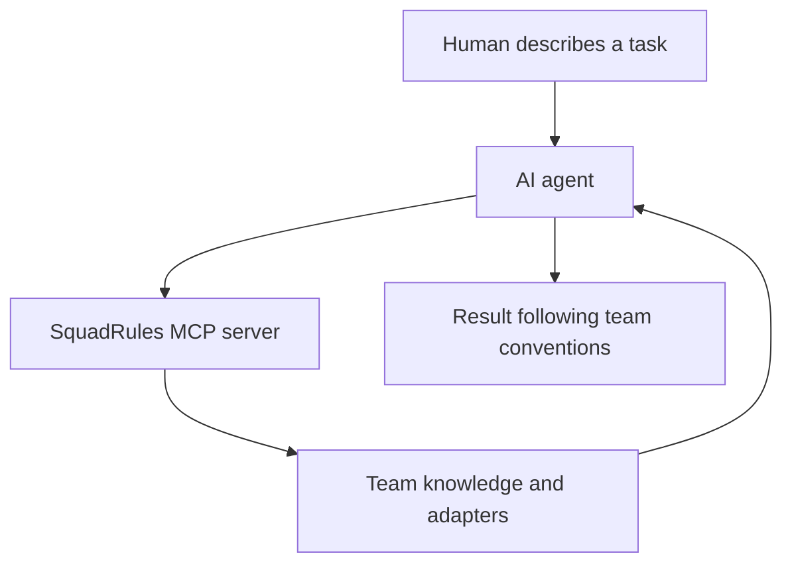
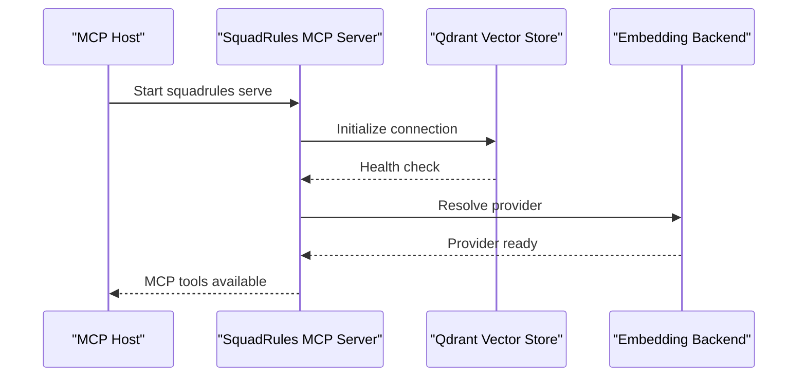
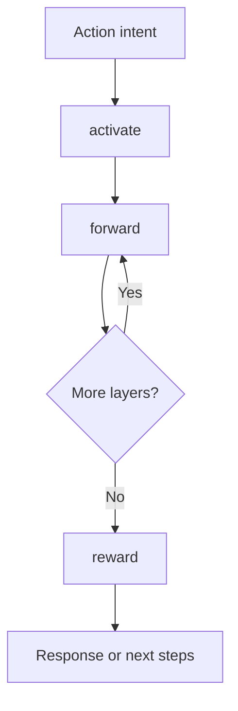
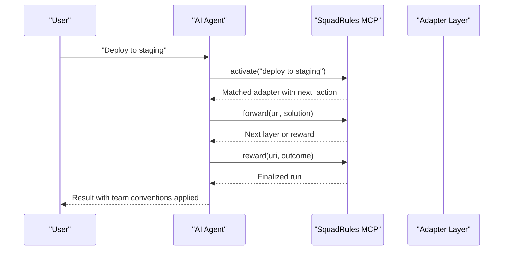

# Getting Started

<cite>
**Referenced Files in This Document**
- [README.md](file://README.md)
- [package.json](file://package.json)
- [docs/CLI.md](file://docs/CLI.md)
- [.agents/skills/squadrules/SKILL.md](file://.agents/skills/squadrules/SKILL.md)
- [.agents/skills/squadrules/references/install.md](file://.agents/skills/squadrules/references/install.md)
- [.agents/skills/squadrules/references/action-routing.md](file://.agents/skills/squadrules/references/action-routing.md)
- [src/config/runtime-mode.ts](file://src/config/runtime-mode.ts)
- [src/stdio/stdio-server.ts](file://src/stdio/stdio-server.ts)
- [src/services/qdrant/connection.ts](file://src/services/qdrant/connection.ts)
- [src/config.ts](file://src/config.ts)
</cite>

## Table of Contents
1. [Introduction](#introduction)
2. [What SquadRules Is](#what-squadrules-is)
3. [Installation Requirements](#installation-requirements)
4. [Quick Start](#quick-start)
5. [Manual Installation](#manual-installation)
6. [MCP Configuration](#mcp-configuration)
7. [Skill Installation](#skill-installation)
8. [Your First Interaction](#your-first-interaction)
9. [Core Concepts](#core-concepts)
10. [Connecting SquadRules to AI Apps](#connecting-squadrules-to-ai-apps)
11. [Running Your First Workflow](#running-your-first-workflow)
12. [Troubleshooting](#troubleshooting)
13. [Next Steps](#next-steps)

## Introduction
SquadRules is an agent-first MCP framework that helps AI assistants remember team preferences and workflows. Instead of repeating instructions, your AI can consult shared knowledge, follow team conventions, and keep that knowledge up to date as things change.

The most important idea is simple: one AI plus one human is a team. The AI maintains the knowledge; the human configures preferences through the AI.

## What SquadRules Is
SquadRules gives AI assistants a shared place to keep preferences and ways of working. It is not just another chat memory store. It is designed so that:

- Agents are the primary users.
- Humans configure preferences through agents.
- Workflows are deterministic and auditable.
- Adapters encode team-specific rules for tasks like building, deploying, reviewing, testing, or automating work.
- Vector storage powers semantic search over rules and workflows.
- The `activate → forward → reward` chain guides agents from intent detection through execution to feedback.

This means you do not need to manually manage every rule. You describe what matters, and the agent helps maintain it.



[No sources needed since this diagram shows conceptual workflow, not actual code structure]

## Installation Requirements
Before installing SquadRules, make sure your environment meets these requirements:

| Requirement | Details |
|---|---|
| Node.js | Version 24 or newer |
| MCP host | An AI app that supports MCP |
| Vector store | A Qdrant instance reachable by default at `localhost:6333` with no authentication |
| Embedding backend | Exactly one configured embedding provider |
| Terminal access | Required for global installation and skill setup |

The package declares Node.js 24+ as its engine requirement, and the documentation explicitly requires Node.js 24 or newer.

**Section sources**
- [package.json:160-162](file://package.json#L160-L162)
- [README.md:13-16](file://README.md#L13-L16)
- [.agents/skills/squadrules/references/install.md:12-25](file://.agents/skills/squadrules/references/install.md#L12-L25)

## Quick Start
If you want the fastest path to try SquadRules:

1. Install Node.js 24+.
2. Run the global install command.
3. Add SquadRules to your MCP host configuration.
4. Install the SquadRules skill.
5. Ask your AI assistant to build your first workflow.

The repository’s quick start uses `npx -y @squadrules/mcp@latest` directly from your MCP host configuration, then installs the `squadrules` skill through the skills tooling.

**Section sources**
- [README.md:18-50](file://README.md#L18-L50)

## Manual Installation
The manual installation path is intended for end users who want full control over how their MCP host connects to SquadRules.

### Step 1: Install the package globally
Run:

```bash
npm install -g @squadrules/mcp
```

This installs the `squadrules` CLI and exposes the MCP server entry point used by MCP hosts.

### Step 2: Start a vector store
SquadRules needs a vector store to boot. By default, it expects Qdrant on `localhost:6333` without authentication. If you do not already have Qdrant running, you can start it with Docker:

```bash
docker run -p 6333:6333 qdrant/qdrant
```

Any Qdrant reachable at `localhost:6333` works; Docker is only a convenience.

### Step 3: Choose an embedding backend
You must configure exactly one embedding backend. The supported options include:

| Backend | Environment variables |
|---|---|
| OpenAI (hosted) | `OPENAI_API_KEY` |
| OpenAI-compatible / Ollama (local) | `OPENAI_API_URL`, `OPENAI_EMBEDDING_MODEL`, `OPENAI_API_KEY` |
| TEI | `TEI_BASE_URL`, optional `TEI_MODEL` |

The implementation reads these values from environment variables and selects the active provider accordingly.

### Step 4: Verify the installation
After installation, verify the CLI is available:

```bash
squadrules --help
```

**Section sources**
- [.agents/skills/squadrules/references/install.md:27-90](file://.agents/skills/squadrules/references/install.md#L27-L90)
- [src/config.ts:70-81](file://src/config.ts#L70-L81)

## MCP Configuration
There are two main ways to connect SquadRules to an MCP host.

### Option A: Quick npx connection
Add SquadRules to your MCP host configuration using `npx`:

```json
{
  "mcpServers": {
    "squadrules": {
      "command": "npx",
      "args": ["-y", "@squadrules/mcp@latest"]
    }
  }
}
```

This is the simplest option because the MCP host downloads and runs the package on demand.

### Option B: Global install with `squadrules serve`
If you installed SquadRules globally, configure your MCP host to run the `serve` command:

```json
{
  "mcpServers": {
    "squadrules": {
      "command": "squadrules",
      "args": ["serve"],
      "env": {
        "QDRANT_URL": "http://localhost:6333",
        "QDRANT_API_KEY": "",
        "OPENAI_API_KEY": "sk-..."
      }
    }
  }
}
```

Important notes:

- `serve` defaults to stdio transport, so no `--transport` flag is required.
- All parameters are environment-overridable.
- The default Qdrant URL is `http://localhost:6333`.
- The default Qdrant API key is empty, meaning no authentication for local setups.



**Diagram sources**
- [src/stdio/stdio-server.ts:6-12](file://src/stdio/stdio-server.ts#L6-L12)
- [src/services/qdrant/connection.ts:24-60](file://src/services/qdrant/connection.ts#L24-L60)
- [src/config.ts:70-81](file://src/config.ts#L70-L81)

**Section sources**
- [README.md:18-37](file://README.md#L18-L37)
- [.agents/skills/squadrules/references/install.md:37-63](file://.agents/skills/squadrules/references/install.md#L37-L63)
- [src/config/runtime-mode.ts:43-55](file://src/config/runtime-mode.ts#L43-L55)
- [src/services/qdrant/connection.ts:24-60](file://src/services/qdrant/connection.ts#L24-L60)

## Skill Installation
The SquadRules skill tells your AI when to use SquadRules. It contains routing logic that directs action intents through the `activate → forward → reward` chain.

Install the skill with:

```bash
npx skills add SquadRules/mcp --skill squadrules
```

Use an app that supports both MCP and skills. If you are unsure where to add the configuration or run the command, ask your AI assistant to help set up SquadRules for your app.

The skill is agent-internal. Humans should not need to interact with SquadRules directly; the agent routes actions automatically while humans observe passively.

**Section sources**
- [README.md:39-50](file://README.md#L39-L50)
- [.agents/skills/squadrules/SKILL.md:1-20](file://.agents/skills/squadrules/SKILL.md#L1-L20)
- [.agents/skills/squadrules/SKILL.md:22-33](file://.agents/skills/squadrules/SKILL.md#L22-L33)

## Your First Interaction
The recommended first interaction is collaborative and agent-led. Try something like:

> Let's build our first SquadRules flow together. Ask me what I do often, help me improve it, and save the flow for next time.

This prompts the agent to:

1. Discover recurring tasks.
2. Identify team-specific conventions.
3. Route through SquadRules when appropriate.
4. Create or repair adapters as needed.
5. Save the workflow for future use.

**Section sources**
- [README.md:52-55](file://README.md#L52-L55)
- [.agents/skills/squadrules/SKILL.md:35-46](file://.agents/skills/squadrules/SKILL.md#L35-L46)

## Core Concepts
SquadRules is built around a few core ideas that shape how you use it.

### Agent-first design
Agents are the primary users. The skill is written for the agent, not the human. The agent detects action intents, consults team knowledge, and executes workflows according to team rules.

### One team per human-AI pair
Even one human and one AI assistant form a team. SquadRules stores preferences and workflows for that team context.

### The activate → forward → reward chain
This is the central workflow:

1. **Activate:** Find the best matching adapter for an intent.
2. **Forward:** Execute one or more adapter layers.
3. **Reward:** Record success or failure feedback.

The agent must complete the full chain before responding to the user or starting substantive work.

### Adapters are team runbooks
Adapters do not teach the AI how to perform generic tasks. They encode team-specific conventions such as branch naming, ticket references, commit formats, deployment sequences, approvals, and post-action checks.



**Diagram sources**
- [.agents/skills/squadrules/SKILL.md:35-46](file://.agents/skills/squadrules/SKILL.md#L35-L46)
- [.agents/skills/squadrules/references/action-routing.md:19-30](file://.agents/skills/squadrules/references/action-routing.md#L19-L30)

**Section sources**
- [.agents/skills/squadrules/SKILL.md:22-46](file://.agents/skills/squadrules/SKILL.md#L22-L46)
- [.agents/skills/squadrules/references/action-routing.md:19-47](file://.agents/skills/squadrules/references/action-routing.md#L19-L47)

## Connecting SquadRules to AI Apps
Most MCP-enabled AI apps connect to SquadRules through an MCP configuration file. The exact location depends on your app, but the connection pattern is consistent.

### Common integration patterns
| Integration type | How it works |
|---|---|
| MCP host with npx | The host runs `npx -y @squadrules/mcp@latest` when connecting |
| MCP host with global install | The host runs `squadrules serve` with environment variables |
| Developer HTTP mode | The server listens on HTTP with `/mcp`, `/api/*`, `/ui`, and `/health` endpoints |
| Local embedded mode | Data commands run against an embedded LanceDB store without a remote server |

### Choosing stdio vs HTTP
By default, `squadrules serve` uses stdio transport. HTTP mode is useful for developers or environments that require an HTTP endpoint. You can enable HTTP mode with `--transport http` or by setting `TRANSPORT_TYPE=http`.

**Section sources**
- [README.md:18-37](file://README.md#L18-L37)
- [.agents/skills/squadrules/references/install.md:85-90](file://.agents/skills/squadrules/references/install.md#L85-L90)
- [docs/CLI.md:176-184](file://docs/CLI.md#L176-L184)
- [src/config/runtime-mode.ts:43-55](file://src/config/runtime-mode.ts#L43-L55)

## Running Your First Workflow
Once SquadRules is connected, your first workflow usually starts with an action intent. Examples include:

- Building or deploying something
- Creating a pull request or merge request
- Writing or formatting code
- Testing or debugging
- Automating a repetitive process

The agent should detect the intent, call `activate`, follow `forward` until the chain ends, and then call `reward`.

### Example workflow sequence


**Diagram sources**
- [.agents/skills/squadrules/SKILL.md:35-46](file://.agents/skills/squadrules/SKILL.md#L35-L46)
- [.agents/skills/squadrules/references/action-routing.md:19-30](file://.agents/skills/squadrules/references/action-routing.md#L19-L30)

### Using the CLI directly
You can also test SquadRules directly from the terminal:

```bash
npx -y @squadrules/mcp activate "how do I deploy a release"
```

Or after a global install:

```bash
squadrules activate "how do I deploy a release"
```

**Section sources**
- [docs/CLI.md:14-23](file://docs/CLI.md#L14-L23)
- [.agents/skills/squadrules/references/action-routing.md:19-30](file://.agents/skills/squadrules/references/action-routing.md#L19-L30)

## Troubleshooting
This section covers the most common beginner setup issues.

### Node.js version too old
**Symptom:** Installation fails or the runtime reports an unsupported Node.js version.  
**Fix:** Upgrade to Node.js 24 or newer.

**Section sources**
- [package.json:160-162](file://package.json#L160-L162)
- [README.md:13-16](file://README.md#L13-L16)

### Qdrant is unreachable
**Symptom:** The server exits immediately or cannot reach the vector store.  
**Fix:** Confirm Qdrant is running on `localhost:6333` or update `QDRANT_URL`. Test connectivity with:

```bash
curl http://localhost:6333/readyz
```

**Section sources**
- [.agents/skills/squadrules/references/install.md:92-96](file://.agents/skills/squadrules/references/install.md#L92-L96)
- [src/services/qdrant/connection.ts:24-36](file://src/services/qdrant/connection.ts#L24-L36)

### Embedding errors
**Symptom:** Embedding calls fail or the server cannot initialize embeddings.  
**Fix:** Ensure exactly one embedding backend is configured and its endpoint, model, or API key is correct.

**Section sources**
- [.agents/skills/squadrules/references/install.md:97-98](file://.agents/skills/squadrules/references/install.md#L97-L98)
- [src/config.ts:70-81](file://src/config.ts#L70-L81)

### Auth failures against remote Qdrant
**Symptom:** Authentication fails when connecting to a remote Qdrant instance.  
**Fix:** Set `QDRANT_API_KEY` to the remote key. Leave it empty only for no-auth localhost setups.

**Section sources**
- [.agents/skills/squadrules/references/install.md:99-100](file://.agents/skills/squadrules/references/install.md#L99-L100)
- [src/services/qdrant/connection.ts:24-36](file://src/services/qdrant/connection.ts#L24-L36)

### MCP server unavailable or unauthenticated
**Symptom:** The agent cannot route actions because the MCP server is down, misconfigured, or unauthenticated.  
**Fix:**

1. Check whether the MCP endpoint URL is correct.
2. Verify `GET /health` responds on the same base URL if using HTTP.
3. Confirm the MCP host configuration points at the expected `/mcp` endpoint.
4. Ensure the host allows the required tools.
5. Reauthenticate if the session expired.

This is treated as a critical error: stop routing and ask the user to remediate.

**Section sources**
- [.agents/skills/squadrules/SKILL.md:70-79](file://.agents/skills/squadrules/SKILL.md#L70-L79)
- [.agents/skills/squadrules/references/action-routing.md:172-191](file://.agents/skills/squadrules/references/action-routing.md#L172-L191)

### Skills not detected
**Symptom:** The agent does not use SquadRules even though the MCP server is connected.  
**Fix:** Make sure the `squadrules` skill is installed and your MCP host supports skills. Use:

```bash
npx skills add SquadRules/mcp --skill squadrules
```

**Section sources**
- [README.md:39-50](file://README.md#L39-L50)
- [.agents/skills/squadrules/SKILL.md:1-20](file://.agents/skills/squadrules/SKILL.md#L1-L20)

## Next Steps
After your first successful workflow, consider:

- Training new adapters for recurring team tasks.
- Updating existing adapters when processes change.
- Exporting adapters for backup or sharing.
- Exploring spaces if your team shares knowledge across groups.
- Reading the CLI reference for bulk operations.

The CLI provides commands for `activate`, `forward`, `reward`, `train`, `tune`, `delete`, `export`, and `spaces`. For deeper architecture, API details, and internal behavior, consult the project Wiki rather than this getting started guide.

**Section sources**
- [docs/CLI.md:77-184](file://docs/CLI.md#L77-L184)
- [docs/README.md:1-8](file://docs/README.md#L1-L8)