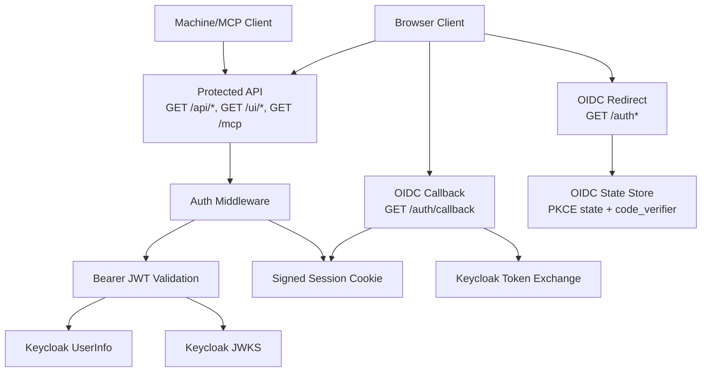
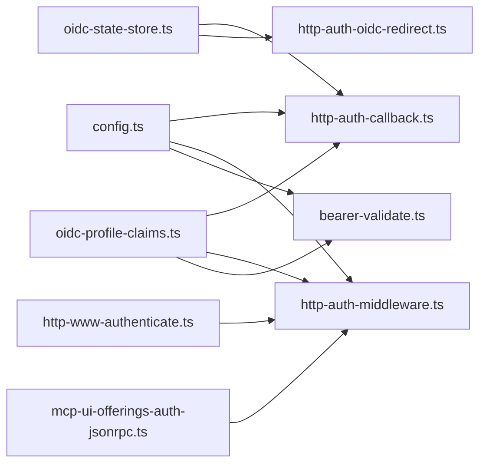

# Authentication Endpoints

<cite>
**Referenced Files in This Document**   
- [http-auth-callback.ts](file://src/http/http-auth-callback.ts)
- [http-auth-oidc-redirect.ts](file://src/http/http-auth-oidc-redirect.ts)
- [http-auth-middleware.ts](file://src/http/http-auth-middleware.ts)
- [bearer-validate.ts](file://src/http/bearer-validate.ts)
- [oidc-profile-claims.ts](file://src/http/oidc-profile-claims.ts)
- [oidc-state-store.ts](file://src/services/oidc-state-store.ts)
- [http-www-authenticate.ts](file://src/http/http-www-authenticate.ts)
- [mcp-ui-offerings-auth-jsonrpc.ts](file://src/http/mcp-ui-offerings-auth-jsonrpc.ts)
- [config.ts](file://src/config.ts)
</cite>

## Table of Contents
1. [Introduction](#introduction)
2. [Project Structure](#project-structure)
3. [Core Components](#core-components)
4. [Architecture Overview](#architecture-overview)
5. [Detailed Component Analysis](#detailed-component-analysis)
6. [Dependency Analysis](#dependency-analysis)
7. [Performance Considerations](#performance-considerations)
8. [Troubleshooting Guide](#troubleshooting-guide)
9. [Conclusion](#conclusion)
10. [Appendices](#appendices)

## Introduction
This document describes the SquadRules authentication endpoints and flows implemented in the HTTP server. It covers:
- OIDC/OAuth2 browser login with PKCE, authorization redirects, and callback handling.
- Bearer token validation for machine-to-machine or MCP clients using JWT verification against Keycloak.
- Session cookie creation, validation, and expiration behavior.
- User context extraction, including subject, groups, realm, and profile fields.
- Error responses for missing configuration, invalid state, failed token exchange, expired sessions, and invalid tokens.
- Security considerations for token storage, transmission, and validation.

The implementation integrates with Keycloak as the OIDC provider, uses a signed session cookie for browser flows, and validates Bearer access tokens via JWKS when configured.

## Project Structure
Authentication-related code is primarily under `src/http`, with shared OIDC utilities and a Redis-backed state store for login transactions.



**Diagram sources**
- [http-auth-oidc-redirect.ts:15-78](file://src/http/http-auth-oidc-redirect.ts#L15-L78)
- [http-auth-callback.ts:84-229](file://src/http/http-auth-callback.ts#L84-L229)
- [http-auth-middleware.ts:172-327](file://src/http/http-auth-middleware.ts#L172-L327)
- [bearer-validate.ts:120-208](file://src/http/bearer-validate.ts#L120-L208)
- [oidc-state-store.ts:50-61](file://src/services/oidc-state-store.ts#L50-L61)

**Section sources**
- [http-auth-callback.ts:84-229](file://src/http/http-auth-callback.ts#L84-L229)
- [http-auth-oidc-redirect.ts:15-78](file://src/http/http-auth-oidc-redirect.ts#L15-L78)
- [http-auth-middleware.ts:172-327](file://src/http/http-auth-middleware.ts#L172-L327)
- [bearer-validate.ts:120-208](file://src/http/bearer-validate.ts#L120-L208)
- [oidc-state-store.ts:50-61](file://src/services/oidc-state-store.ts#L50-L61)

## Core Components
- OIDC redirect helpers: build authorization URLs, generate PKCE state, and support RP-initiated logout.
- OIDC callback handler: exchanges authorization code for tokens, merges ID/access payloads, signs a session cookie, and redirects to UI.
- Auth middleware: enforces authentication on protected paths, supports both session cookies and Bearer tokens, and sets WWW-Authenticate headers.
- Bearer validator: verifies issuer, audience, expiration, signature via JWKS, enriches user profile, and optionally fetches groups from UserInfo.
- OIDC profile claims: whitelists and merges claims, normalizes groups, derives account labels, and extracts realms from issuers.
- OIDC state store: stores PKCE state and code verifier with TTL, backed by Redis when available.
- WWW-Authenticate builder: constructs RFC-compliant challenge headers for MCP clients.
- JSON-RPC auth error helper: returns structured errors for unauthenticated MCP requests.

**Section sources**
- [http-auth-oidc-redirect.ts:15-92](file://src/http/http-auth-oidc-redirect.ts#L15-L92)
- [http-auth-callback.ts:34-229](file://src/http/http-auth-callback.ts#L34-L229)
- [http-auth-middleware.ts:49-139](file://src/http/http-auth-middleware.ts#L49-L139)
- [bearer-validate.ts:22-208](file://src/http/bearer-validate.ts#L22-L208)
- [oidc-profile-claims.ts:56-288](file://src/http/oidc-profile-claims.ts#L56-L288)
- [oidc-state-store.ts:16-76](file://src/services/oidc-state-store.ts#L16-L76)
- [http-www-authenticate.ts:17-48](file://src/http/http-www-authenticate.ts#L17-L48)
- [mcp-ui-offerings-auth-jsonrpc.ts:7-34](file://src/http/mcp-ui-offerings-auth-jsonrpc.ts#L7-L34)

## Architecture Overview
The authentication architecture supports two primary client types:
- Browser clients: use OIDC Authorization Code Flow with PKCE, resulting in a signed session cookie.
- Machine/MCP clients: send Bearer access tokens validated against Keycloak’s JWKS.

```mermaid
sequenceDiagram
participant Browser as "Browser"
participant Server as "SquadRules Server"
participant IdP as "Keycloak"
participant Store as "OIDC State Store"
Browser->>Server : GET /auth (or GET /ui without session)
Server->>Store : set(state, {codeVerifier, createdAt})
Server-->>Browser : 302 to Keycloak Authorization URL
Browser->>IdP : Authorize with PKCE
IdP-->>Browser : 302 to AUTH_CALLBACK_BASE_URL/auth/callback?code&state
Browser->>Server : GET /auth/callback?code&state
Server->>Store : consume(state)
Server->>IdP : POST token endpoint with code, client_id, redirect_uri, code_verifier
IdP-->>Server : {id_token, access_token, expires_in}
Server->>Server : merge id/access payloads, apply group allowlist
Server-->>Browser : Set-Cookie squadrules_session; 302 to /ui/
```

**Diagram sources**
- [http-auth-oidc-redirect.ts:52-78](file://src/http/http-auth-oidc-redirect.ts#L52-L78)
- [http-auth-callback.ts:122-229](file://src/http/http-auth-callback.ts#L122-L229)
- [oidc-state-store.ts:50-61](file://src/services/oidc-state-store.ts#L50-L61)

## Detailed Component Analysis

### OIDC Authorization Redirects
- Purpose: initiate browser login with PKCE and return an authorization URL for programmatic flows.
- Key behaviors:
  - Generates cryptographically random state and code verifier.
  - Stores state and code verifier in the OIDC state store with a short TTL.
  - Builds Keycloak authorization URL with required scopes and S256 challenge.
  - Provides safe variants that return undefined instead of throwing when configuration is incomplete.

Endpoints and functions:
- `buildOidcAuthorizationUrl(state, codeChallenge)` constructs the Keycloak authorization URL.
- `redirectBrowserToOidcLogin(res)` stores state and redirects the browser.
- `createOidcLoginUrlForApiResponse()` returns a JSON-friendly login URL.
- `safeCreateOidcLoginUrlForApiResponse()` returns undefined if not configured.

Error conditions:
- Missing `AUTH_CALLBACK_BASE_URL` causes construction failures or undefined results.

Security notes:
- Uses PKCE to prevent authorization code interception.
- State is consumed atomically to prevent replay.

**Section sources**
- [http-auth-oidc-redirect.ts:15-78](file://src/http/http-auth-oidc-redirect.ts#L15-L78)
- [oidc-state-store.ts:50-61](file://src/services/oidc-state-store.ts#L50-L61)

### OIDC Callback Handling
- Purpose: exchange the authorization code for tokens, validate state, sign a session cookie, and redirect to the UI.
- Flow highlights:
  - Validates required environment configuration before processing.
  - Requires both `code` and `state`; otherwise redirects with an error query parameter.
  - Consumes state from the OIDC state store; invalid/expired state redirects with an error.
  - Exchanges code for tokens at Keycloak’s token endpoint using internal URL when available.
  - Merges ID token and access token payloads, ensuring consistent `sub`, `iss`, and `realm`.
  - Applies group allowlist filtering to restrict session groups.
  - Computes session expiration based on token lifetime or access token `exp`, with a fallback.
  - Signs session payload with HMAC-SHA256 using `SESSION_SECRET` and sets an HttpOnly, SameSite=Lax, Secure (when HTTPS base URL) cookie.

Response behavior:
- On success: sets session cookie and redirects to `/ui/`.
- On failure: redirects to root with error query parameters such as `missing_code_or_state`, `invalid_state`, `token_request_failed`, `token_exchange_failed`, `no_tokens`, `invalid_token_payload`, `mismatched_token_sub`, `invalid_token_sub`.

Configuration requirements:
- `AUTH_ENABLED`, `KEYCLOAK_URL`, `KEYCLOAK_REALM`, `KEYCLOAK_CLIENT_ID`, `AUTH_CALLBACK_BASE_URL`, `SESSION_SECRET`.

Session expiration logic:
- Prefers `expires_in` minus a safety margin.
- Falls back to access token `exp` minus a safety margin.
- Finally falls back to `SESSION_MAX_AGE_SEC`.

**Section sources**
- [http-auth-callback.ts:34-55](file://src/http/http-auth-callback.ts#L34-L55)
- [http-auth-callback.ts:122-229](file://src/http/http-auth-callback.ts#L122-L229)
- [oidc-profile-claims.ts:200-256](file://src/http/oidc-profile-claims.ts#L200-L256)

### Bearer Token Validation
- Purpose: validate machine/MCP Bearer access tokens against trusted issuers and allowed audiences, then extract user context.
- Validation steps:
  - Decodes JWT payload without verification to check issuer.
  - Loads JWKS for the issuer (cached per issuer).
  - Verifies signature, issuer, audience, and expiration using jose.
  - Accepts Keycloak-specific cases where audience may be `"account"` or empty when issuer includes `/realms/`.
  - Extracts `sub`, `iss`, and realm; normalizes groups from access token, nested ID token, or UserInfo.
  - Optionally merges groups from UserInfo when enabled.
  - Applies group allowlist filtering.
  - Enriches profile fields and account labels.

Userinfo fallback:
- If groups are missing from the access token, the validator calls Keycloak’s UserInfo endpoint with the same Bearer token to retrieve groups.
- Timeout is applied to avoid long waits during validation.

Configuration:
- `AUTH_TRUSTED_ISSUERS`: list of trusted issuer URIs.
- `AUTH_ALLOWED_AUDIENCES`: list of allowed audiences; defaults include server and CLI client IDs plus `"account"` for Keycloak realms.
- `OIDC_BEARER_MERGE_USERINFO_GROUPS`: enables merging groups from UserInfo.

Return value:
- Returns an `AuthPayload` object containing subject, groups, issuer, realm, and optional profile fields.

**Section sources**
- [bearer-validate.ts:120-208](file://src/http/bearer-validate.ts#L120-L208)
- [config.ts:304-343](file://src/config.ts#L304-L343)

### Session Management and User Context Extraction
- Session cookie:
  - Name: `squadrules_session`.
  - Format: base64url(payload).hmac-sha256(payload, SESSION_SECRET).
  - Options: Path=/, HttpOnly, SameSite=Lax, Secure when `AUTH_CALLBACK_BASE_URL` starts with HTTPS.
- Session parsing:
  - Verifies HMAC signature.
  - Checks expiration (`exp`) against current time.
  - Extracts `sub`, groups, realm, issuer, and optional profile fields.
  - Applies group allowlist filtering.
- User context:
  - `req.auth` contains the parsed `AuthPayload`.
  - Space context is derived from request parameters and merged into `req.spaceContext`.
  - Space permission checks reject requests for spaces not in the user’s allowed list.

WWW-Authenticate header:
- For unauthenticated or invalid-token scenarios, the server sets `WWW-Authenticate: Bearer ...` with resource metadata, authorization server metadata, scopes, and optional error details.

JSON-RPC errors:
- Unauthenticated MCP requests receive a structured JSON-RPC 2.0 error envelope with code `-32001` and remediation data including `login_url`.

**Section sources**
- [http-auth-middleware.ts:49-139](file://src/http/http-auth-middleware.ts#L49-L139)
- [http-auth-middleware.ts:172-327](file://src/http/http-auth-middleware.ts#L172-L327)
- [http-www-authenticate.ts:17-48](file://src/http/http-www-authenticate.ts#L17-L48)
- [mcp-ui-offerings-auth-jsonrpc.ts:7-34](file://src/http/mcp-ui-offerings-auth-jsonrpc.ts#L7-L34)

### Logout and Continue Sign-In
- Logout flow:
  - Clears the session cookie.
  - Attempts RP-initiated logout to Keycloak with `post_logout_redirect_uri` and optional `id_token_hint`.
  - If Keycloak end-session URL cannot be built, falls back to redirecting to the OIDC authorization endpoint.
- Continue sign-in path:
  - `/auth/continue-signin` redirects to OIDC login or UI depending on configuration.
- Legacy routes:
  - `/auth` redirects to `/ui`.
  - `/auth/success` redirects to `/ui/`.
  - `/auth/logged-out` redirects to continue sign-in.

**Section sources**
- [http-auth-callback.ts:77-120](file://src/http/http-auth-callback.ts#L77-L120)
- [http-auth-oidc-redirect.ts:34-50](file://src/http/http-auth-oidc-redirect.ts#L34-L50)

## Dependency Analysis
Authentication components depend on configuration, logging, and external services.



**Diagram sources**
- [config.ts:140-194](file://src/config.ts#L140-L194)
- [oidc-profile-claims.ts:56-288](file://src/http/oidc-profile-claims.ts#L56-L288)
- [oidc-state-store.ts:50-76](file://src/services/oidc-state-store.ts#L50-L76)
- [http-auth-callback.ts:20-32](file://src/http/http-auth-callback.ts#L20-L32)
- [http-auth-middleware.ts:9-30](file://src/http/http-auth-middleware.ts#L9-L30)
- [bearer-validate.ts:7-20](file://src/http/bearer-validate.ts#L7-L20)

**Section sources**
- [config.ts:140-194](file://src/config.ts#L140-L194)
- [oidc-profile-claims.ts:56-288](file://src/http/oidc-profile-claims.ts#L56-L288)
- [oidc-state-store.ts:50-76](file://src/services/oidc-state-store.ts#L50-L76)

## Performance Considerations
- JWKS caching: JWKS instances are cached per issuer to reduce network overhead during Bearer validation.
- UserInfo calls: Optional UserInfo fetch for groups is bounded by an 8-second timeout to avoid blocking request handling.
- OIDC state TTL: Login transaction state expires after 10 minutes, reducing storage growth and preventing stale state reuse.
- Session expiration calculation: Uses token lifetimes to minimize unnecessary re-authentication while maintaining security margins.

[No sources needed since this section provides general guidance]

## Troubleshooting Guide
Common issues and resolutions:
- Missing configuration:
  - Symptoms: 503 responses indicating auth not configured or misconfigured.
  - Causes: Missing `AUTH_ENABLED`, `KEYCLOAK_URL`, `KEYCLOAK_REALM`, `KEYCLOAK_CLIENT_ID`, `AUTH_CALLBACK_BASE_URL`, or `SESSION_SECRET`.
  - Resolution: Ensure all required environment variables are set. See startup validation in configuration.
- Invalid or expired state:
  - Symptoms: Redirect to root with `error=invalid_state`.
  - Causes: State consumed already or TTL expired before callback.
  - Resolution: Retry login; ensure clock synchronization and sufficient OIDC state TTL.
- Token exchange failure:
  - Symptoms: Redirect to root with `error=token_exchange_failed`.
  - Causes: Network error or non-OK response from Keycloak token endpoint.
  - Resolution: Verify Keycloak connectivity, client credentials, and redirect URI registration.
- No tokens returned:
  - Symptoms: Redirect to root with `error=no_tokens`.
  - Causes: Keycloak did not return `id_token` or `access_token`.
  - Resolution: Check Keycloak client configuration and requested scopes.
- Mismatched token subjects:
  - Symptoms: Redirect to root with `error=mismatched_token_sub`.
  - Causes: ID token and access token have different `sub` values.
  - Resolution: Ensure consistent user identity across tokens issued by Keycloak.
- Invalid bearer token:
  - Symptoms: 401 with `error=invalid_token` and `reauth_required=true`.
  - Causes: Expired token, wrong issuer, wrong audience, or signature verification failure.
  - Resolution: Re-authenticate and refresh tokens; verify issuer and audience configuration.
- Bearer not validated:
  - Symptoms: 401 with `error=bearer_not_validated`.
  - Causes: Trusted issuers or allowed audiences not configured.
  - Resolution: Set `AUTH_TRUSTED_ISSUERS` and `AUTH_ALLOWED_AUDIENCES`, and enable `AUTH_MODE=oidc_bearer` or `AUTH_ENABLED`.

**Section sources**
- [http-auth-callback.ts:122-198](file://src/http/http-auth-callback.ts#L122-L198)
- [http-auth-middleware.ts:230-285](file://src/http/http-auth-middleware.ts#L230-L285)
- [config.ts:251-265](file://src/config.ts#L251-L265)

## Conclusion
SquadRules implements a robust authentication system supporting both browser-based OIDC login with PKCE and machine-to-machine Bearer token validation. The design emphasizes security through signed session cookies, strict state handling, JWKS-based token verification, and configurable group allowlists. Clients should handle redirects for browser flows and respect `WWW-Authenticate` challenges for MCP clients, refreshing tokens as needed. Proper configuration of Keycloak, environment variables, and group mappings is essential for reliable operation.

[No sources needed since this section summarizes without analyzing specific files]

## Appendices

### API Definitions

#### OIDC Browser Login Redirects
- `GET /auth`
  - Behavior: Redirects to `/ui` for bookmarks; intended for browsers.
- `GET /auth/success`
  - Behavior: Legacy route; redirects to `/ui/`.
- `GET /auth/logout`
  - Behavior: Clears session cookie, attempts Keycloak RP-initiated logout, then continues to sign-in or UI.
- `GET /auth/continue-signin`
  - Behavior: Redirects to OIDC login or UI depending on configuration.
- `GET /auth/logged-out`
  - Behavior: Redirects to continue sign-in.

**Section sources**
- [http-auth-callback.ts:84-120](file://src/http/http-auth-callback.ts#L84-L120)

#### OIDC Callback
- `GET /auth/callback`
  - Query parameters:
    - `code`: Authorization code from Keycloak.
    - `state`: State token used to validate the login transaction.
  - Success response:
    - Sets `Set-Cookie: squadrules_session=...` with HttpOnly, SameSite=Lax, Secure (HTTPS base URL), and Max-Age.
    - Redirects to `/ui/`.
  - Failure responses:
    - Redirects to root with error query parameters:
      - `missing_code_or_state`
      - `invalid_state`
      - `token_request_failed`
      - `token_exchange_failed`
      - `no_tokens`
      - `invalid_token_payload`
      - `mismatched_token_sub`
      - `invalid_token_sub`

**Section sources**
- [http-auth-callback.ts:122-229](file://src/http/http-auth-callback.ts#L122-L229)

#### Protected API Paths
- Protected paths:
  - `/api`
  - `/api/*`
  - `/mcp`
  - `/ui`
  - `/ui/*`
- Authentication methods:
  - Session cookie: `squadrules_session` with valid HMAC and expiration.
  - Bearer token: Validated against trusted issuers and allowed audiences.
- Response behavior:
  - Unauthenticated browser GET: 302 redirect to OIDC login.
  - Unauthenticated non-browser or MCP: 401 with JSON body and `WWW-Authenticate` header.
  - MCP JSON-RPC: Structured error envelope with code `-32001`.

Error responses:
- `error: "Unauthorized"` with `message: "Authentication required"` and optional `login_url`.
- `error: "invalid_token"` with `reauth_required: true` and optional `login_url`.
- `error: "bearer_not_validated"` when issuer/audience configuration is missing.

**Section sources**
- [http-auth-middleware.ts:151-160](file://src/http/http-auth-middleware.ts#L151-L160)
- [http-auth-middleware.ts:297-327](file://src/http/http-auth-middleware.ts#L297-L327)
- [http-www-authenticate.ts:17-48](file://src/http/http-www-authenticate.ts#L17-L48)
- [mcp-ui-offerings-auth-jsonrpc.ts:7-34](file://src/http/mcp-ui-offerings-auth-jsonrpc.ts#L7-L34)

### Request and Response Schemas

#### OIDC Callback Query Parameters
- `code`: string, required.
- `state`: string, required.

#### Session Cookie Payload Fields
- Required:
  - `sub`: string.
  - `groups`: array of strings.
  - `iss`: string.
  - `realm`: string.
  - `exp`: number (Unix seconds).
- Optional:
  - `preferred_username`: string.
  - `name`: string.
  - `given_name`: string.
  - `family_name`: string.
  - `email`: string.
  - `email_verified`: boolean.
  - `identity_provider`: string.
  - `account_kind`: string ("local" | "sso").
  - `account_label`: string.
  - `oidc_id_token`: string (used for RP-initiated logout hint).

**Section sources**
- [http-auth-callback.ts:219-227](file://src/http/http-auth-callback.ts#L219-L227)
- [http-auth-middleware.ts:95-133](file://src/http/http-auth-middleware.ts#L95-L133)

#### Bearer Token Validation Result (`AuthPayload`)
- Required:
  - `sub`: string.
  - `groups`: array of strings.
  - `iss`: string.
  - `realm`: string.
- Optional:
  - `preferred_username`: string.
  - `name`: string.
  - `given_name`: string.
  - `family_name`: string.
  - `email`: string.
  - `email_verified`: boolean.
  - `identity_provider`: string.
  - `account_kind`: string ("local" | "sso").
  - `account_label`: string.

**Section sources**
- [bearer-validate.ts:22-39](file://src/http/bearer-validate.ts#L22-L39)

### Client-Side Authentication Flows

#### Browser Flow
1. Navigate to a protected page (e.g., `/ui`).
2. If no valid session, server redirects to Keycloak authorization URL.
3. After successful login, Keycloak redirects to `/auth/callback`.
4. Server exchanges code for tokens, signs session cookie, and redirects to `/ui/`.
5. Subsequent requests include the session cookie and are authenticated.

#### Machine/MCP Flow
1. Obtain a Bearer access token from Keycloak.
2. Include `Authorization: Bearer <token>` in requests.
3. Server validates token via JWKS and extracts user context.
4. If token is invalid or expired, server responds with 401 and `WWW-Authenticate` header.
5. Client should refresh tokens and retry.

**Section sources**
- [http-auth-oidc-redirect.ts:52-78](file://src/http/http-auth-oidc-redirect.ts#L52-L78)
- [http-auth-callback.ts:122-229](file://src/http/http-auth-callback.ts#L122-L229)
- [bearer-validate.ts:120-208](file://src/http/bearer-validate.ts#L120-L208)

### Security Considerations
- Token storage:
  - Session cookie is signed with HMAC-SHA256 and marked HttpOnly.
  - Avoid storing raw JWTs in localStorage; prefer secure transport and server-managed sessions.
- Token transmission:
  - Use HTTPS for all authentication endpoints and callbacks.
  - Respect `Secure` flag on session cookie when base URL is HTTPS.
- Token validation:
  - Validate issuer, audience, expiration, and signature.
  - Cache JWKS per issuer to improve performance without compromising security.
- Group filtering:
  - Apply group allowlist to restrict session/API groups.
  - Merge groups from UserInfo when necessary to align with browser session behavior.
- State protection:
  - Use PKCE and state tokens to prevent CSRF and code interception attacks.
  - Consume state atomically to prevent replay.

**Section sources**
- [http-auth-callback.ts:57-72](file://src/http/http-auth-callback.ts#L57-L72)
- [bearer-validate.ts:41-59](file://src/http/bearer-validate.ts#L41-L59)
- [oidc-profile-claims.ts:119-153](file://src/http/oidc-profile-claims.ts#L119-L153)
- [oidc-state-store.ts:16-23](file://src/services/oidc-state-store.ts#L16-L23)