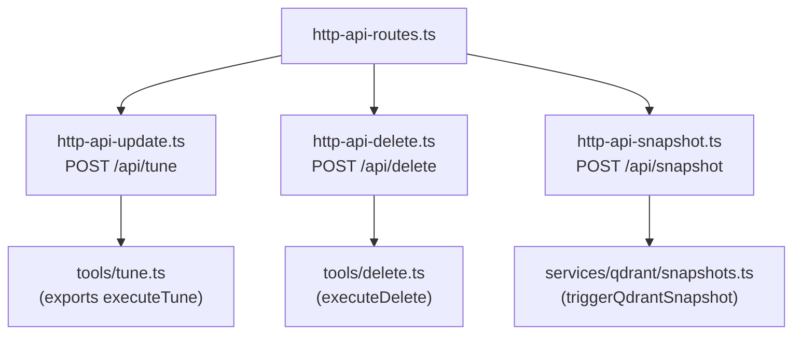
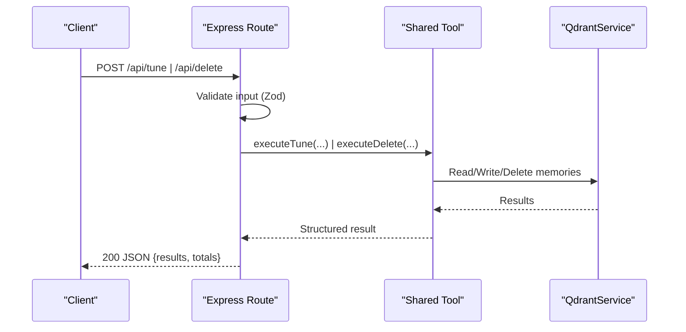
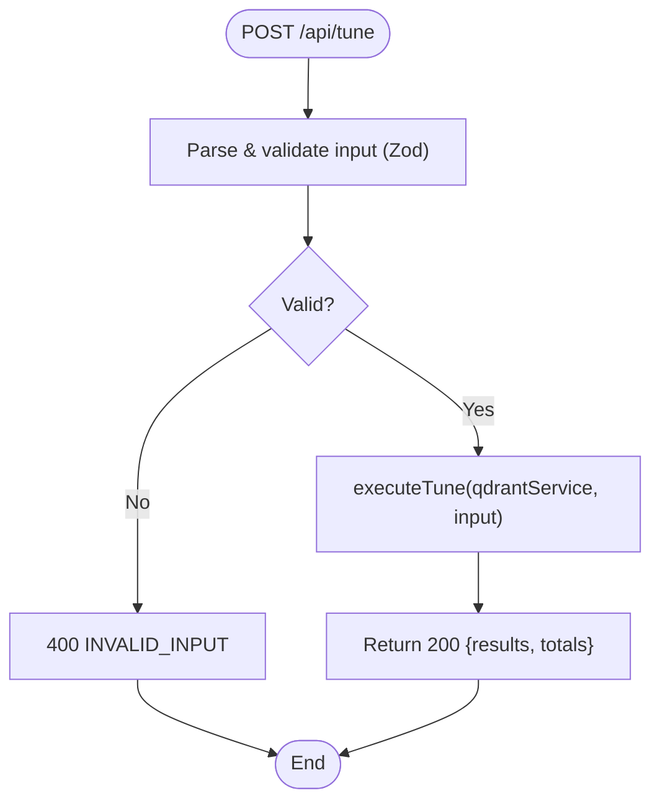
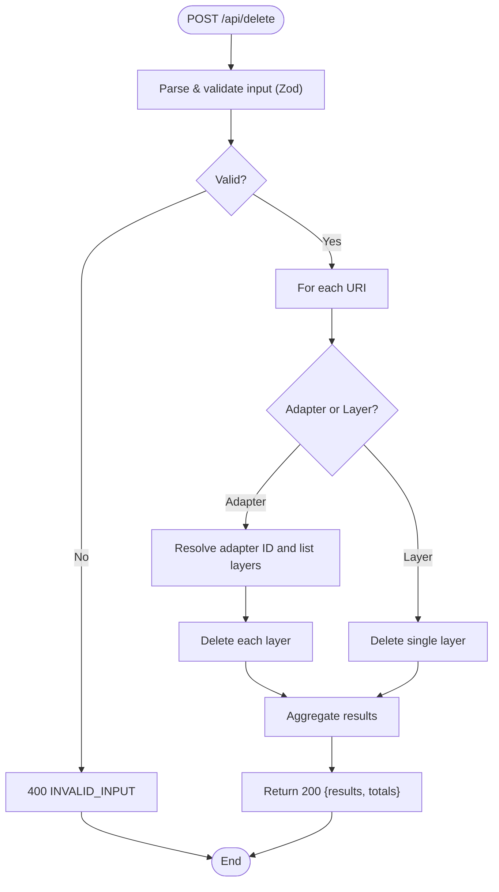
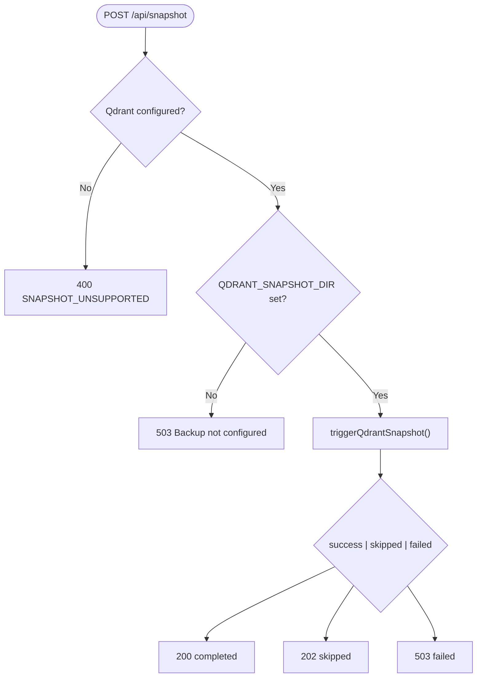
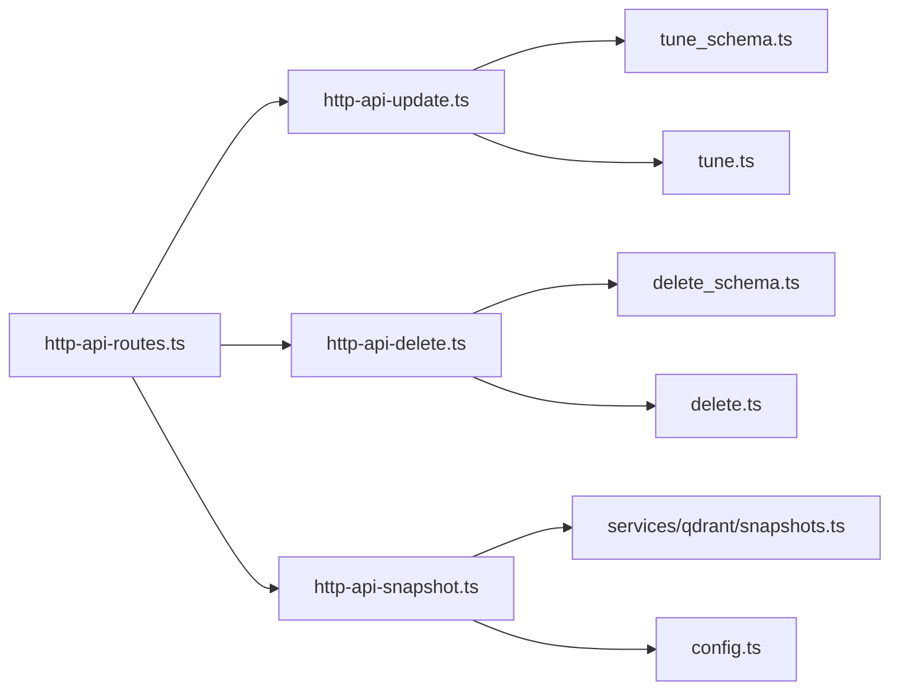

# Data Management Endpoints

<cite>
**Referenced Files in This Document**
- [http-api-update.ts](file://src/http/http-api-update.ts)
- [http-api-delete.ts](file://src/http/http-api-delete.ts)
- [http-api-snapshot.ts](file://src/http/http-api-snapshot.ts)
- [http-api-routes.ts](file://src/http/http-api-routes.ts)
- [tune_schema.ts](file://src/tools/tune_schema.ts)
- [delete_schema.ts](file://src/tools/delete_schema.ts)
- [tune.ts](file://src/tools/tune.ts)
- [delete.ts](file://src/tools/delete.ts)
- [snapshots.ts](file://src/services/qdrant/snapshots.ts)
- [config.ts](file://src/config.ts)
</cite>

## Table of Contents
1. [Introduction](#introduction)
2. [Project Structure](#project-structure)
3. [Core Components](#core-components)
4. [Architecture Overview](#architecture-overview)
5. [Detailed Component Analysis](#detailed-component-analysis)
6. [Dependency Analysis](#dependency-analysis)
7. [Performance Considerations](#performance-considerations)
8. [Troubleshooting Guide](#troubleshooting-guide)
9. [Conclusion](#conclusion)

## Introduction
This document specifies the data management HTTP endpoints for protocol tuning, resource deletion, and snapshot operations. It covers:
- POST /api/tune: Update adapter or layer content, move layers between spaces, and apply advanced field updates with validation and audit-friendly outputs.
- POST /api/delete: Remove adapters or layers, including cascade behavior when deleting an adapter (all its layers).
- POST /api/snapshot: Create a Qdrant snapshot backup; unsupported on embedded LanceDB backend.

The endpoints are implemented as Express routes that validate input via Zod schemas, execute domain logic through shared tool functions, and return structured results suitable for both human and agent consumers.

## Project Structure
The data management endpoints are registered under a single API router and delegate to shared tool implementations:
- Route registration: http-api-routes.ts
- Tune endpoint: http-api-update.ts → tools/tune.ts → tools/tune-execute.ts
- Delete endpoint: http-api-delete.ts → tools/delete.ts
- Snapshot endpoint: http-api-snapshot.ts → services/qdrant/snapshots.ts

**Diagram sources**
- [http-api-routes.ts:22-35](file://src/http/http-api-routes.ts#L22-L35)
- [http-api-update.ts:11-33](file://src/http/http-api-update.ts#L11-L33)
- [http-api-delete.ts:11-34](file://src/http/http-api-delete.ts#L11-L34)
- [http-api-snapshot.ts:14-52](file://src/http/http-api-snapshot.ts#L14-L52)
- [tune.ts:19-69](file://src/tools/tune.ts#L19-L69)
- [delete.ts:12-71](file://src/tools/delete.ts#L12-L71)
- [snapshots.ts:68-168](file://src/services/qdrant/snapshots.ts#L68-L168)

**Section sources**
- [http-api-routes.ts:1-36](file://src/http/http-api-routes.ts#L1-L36)

## Core Components
- POST /api/tune
  - Purpose: Update adapter or layer content, perform advanced field updates, and optionally move all layers of target adapters to a specified space.
  - Input schema: tuneInputSchema (Zod)
  - Output schema: tuneOutputSchema (Zod)
  - Behavior: Validates URIs and optional fields, enforces review evidence when content is provided, executes updates, and returns per-URI status with totals.

- POST /api/delete
  - Purpose: Delete one or more adapters or layers. Deleting an adapter cascades to all its layers.
  - Input schema: deleteInputSchema (Zod)
  - Output schema: deleteOutputSchema (Zod)
  - Behavior: Iterates URIs, resolves adapter-to-layers mapping when needed, deletes resources, and aggregates per-URI outcomes.

- POST /api/snapshot
  - Purpose: Trigger a Qdrant snapshot backup. Not supported on embedded LanceDB backend.
  - Configuration: Requires QDRANT_SNAPSHOT_DIR to be set; otherwise returns 503.
  - Behavior: Creates a snapshot via Qdrant REST API, downloads it, writes to disk, and reports success/skip/failure.

**Section sources**
- [http-api-update.ts:11-33](file://src/http/http-api-update.ts#L11-L33)
- [tune_schema.ts:14-67](file://src/tools/tune_schema.ts#L14-L67)
- [http-api-delete.ts:11-34](file://src/http/http-api-delete.ts#L11-L34)
- [delete_schema.ts:14-29](file://src/tools/delete_schema.ts#L14-L29)
- [http-api-snapshot.ts:14-52](file://src/http/http-api-snapshot.ts#L14-L52)
- [snapshots.ts:68-168](file://src/services/qdrant/snapshots.ts#L68-L168)
- [config.ts:268-276](file://src/config.ts#L268-L276)

## Architecture Overview
The endpoints follow a consistent pattern:
- Express route validates request body using a Zod schema.
- Shared tool function performs domain operations against QdrantService.
- Structured responses include per-item results and aggregate counts.
- Snapshot endpoint orchestrates Qdrant’s snapshot API and file I/O.

**Diagram sources**
- [http-api-update.ts:11-33](file://src/http/http-api-update.ts#L11-L33)
- [http-api-delete.ts:11-34](file://src/http/http-api-delete.ts#L11-L34)
- [tune.ts:19-69](file://src/tools/tune.ts#L19-L69)
- [delete.ts:12-71](file://src/tools/delete.ts#L12-L71)

## Detailed Component Analysis

### POST /api/tune
- URL: /api/tune
- Method: POST
- Authentication: Uses tenant context middleware; requests are scoped by space.
- Request body (validated by tuneInputSchema):
  - uris: non-empty array of adapter or layer URIs
    - Adapter URI format: squadrules://adapter/{slug}
    - Layer URI format: squadrules://layer/{uuid}[?execution_id={uuid}]
  - content: optional array of strings (one per URI) for updated adapter bodies
  - updates: optional record of field-level updates
  - space: optional string ("personal" or group name) to move all layers of each target adapter
  - review_evidence: required when content is provided; includes verdict_file, exit_code, stdout
- Response body (tuneOutputSchema):
  - results: array of { uri, status: "updated"|"error", message }
  - total_updated: number
  - total_failed: number
- Error handling:
  - 400 INVALID_INPUT when validation fails
  - 500 TUNE_FAILED on unexpected errors

**Diagram sources**
- [http-api-update.ts:11-33](file://src/http/http-api-update.ts#L11-L33)
- [tune_schema.ts:14-67](file://src/tools/tune_schema.ts#L14-L67)

**Section sources**
- [http-api-update.ts:11-33](file://src/http/http-api-update.ts#L11-L33)
- [tune_schema.ts:14-67](file://src/tools/tune_schema.ts#L14-L67)
- [tune.ts:19-69](file://src/tools/tune.ts#L19-L69)

### POST /api/delete
- URL: /api/delete
- Method: POST
- Authentication: Uses tenant context middleware; requests are scoped by space.
- Request body (validated by deleteInputSchema):
  - uris: non-empty array of adapter or layer URIs (same formats as tune)
- Response body (deleteOutputSchema):
  - results: array of { uri, status: "deleted"|"error", message }
  - total_deleted: number
  - total_failed: number
- Cascade behavior:
  - When deleting an adapter URI, the implementation retrieves all layers for that adapter and deletes each layer individually.
- Error handling:
  - 400 INVALID_INPUT when validation fails
  - 500 DELETE_FAILED on unexpected errors

**Diagram sources**
- [http-api-delete.ts:11-34](file://src/http/http-api-delete.ts#L11-L34)
- [delete.ts:12-71](file://src/tools/delete.ts#L12-L71)
- [delete_schema.ts:14-29](file://src/tools/delete_schema.ts#L14-L29)

**Section sources**
- [http-api-delete.ts:11-34](file://src/http/http-api-delete.ts#L11-L34)
- [delete.ts:12-71](file://src/tools/delete.ts#L12-L71)
- [delete_schema.ts:14-29](file://src/tools/delete_schema.ts#L14-L29)

### POST /api/snapshot
- URL: /api/snapshot
- Method: POST
- Backend support:
  - Qdrant: Supported; creates a snapshot and downloads it to disk.
  - Embedded LanceDB: Unsupported; returns 400 SNAPSHOT_UNSUPPORTED.
- Configuration:
  - QDRANT_SNAPSHOT_DIR must be set; otherwise returns 503 Backup not configured.
- Response body:
  - status: "completed" | "skipped" | "failed"
  - target: "qdrant"
  - snapshotName: string (when available)
  - bytesWritten: number (bytes written to disk)
  - durationMs: number (milliseconds)
  - message: string (human-readable details)
- Behavior:
  - If disabled or directory not configured, returns skipped.
  - Creates snapshot via Qdrant REST API, waits for completion, downloads, streams to disk, and cleans partial files on failure.

**Diagram sources**
- [http-api-snapshot.ts:14-52](file://src/http/http-api-snapshot.ts#L14-L52)
- [snapshots.ts:68-168](file://src/services/qdrant/snapshots.ts#L68-L168)
- [config.ts:268-276](file://src/config.ts#L268-L276)

**Section sources**
- [http-api-snapshot.ts:14-52](file://src/http/http-api-snapshot.ts#L14-L52)
- [snapshots.ts:68-168](file://src/services/qdrant/snapshots.ts#L68-L168)
- [config.ts:268-276](file://src/config.ts#L268-L276)

## Dependency Analysis
- Route registration binds endpoints to handlers:
  - setupUpdateRoute registers /api/tune
  - setupDeleteRoute registers /api/delete
  - setupSnapshotRoute registers /api/snapshot
- Handlers depend on:
  - Zod schemas for input/output validation
  - Shared tool functions for domain logic
  - QdrantService for storage operations
  - Config values for snapshot configuration

**Diagram sources**
- [http-api-routes.ts:22-35](file://src/http/http-api-routes.ts#L22-L35)
- [http-api-update.ts:11-33](file://src/http/http-api-update.ts#L11-L33)
- [http-api-delete.ts:11-34](file://src/http/http-api-delete.ts#L11-L34)
- [http-api-snapshot.ts:14-52](file://src/http/http-api-snapshot.ts#L14-L52)
- [tune_schema.ts:14-67](file://src/tools/tune_schema.ts#L14-L67)
- [delete_schema.ts:14-29](file://src/tools/delete_schema.ts#L14-L29)
- [tune.ts:19-69](file://src/tools/tune.ts#L19-L69)
- [delete.ts:12-71](file://src/tools/delete.ts#L12-L71)
- [snapshots.ts:68-168](file://src/services/qdrant/snapshots.ts#L68-L168)
- [config.ts:268-276](file://src/config.ts#L268-L276)

**Section sources**
- [http-api-routes.ts:1-36](file://src/http/http-api-routes.ts#L1-L36)

## Performance Considerations
- Bulk operations:
  - /api/tune and /api/delete accept arrays of URIs and process them sequentially within the handler/tool. Large batches may increase latency; consider batching by logical groups.
- I/O-bound snapshot:
  - /api/snapshot streams Qdrant snapshot data to disk; ensure sufficient disk space and fast storage to avoid timeouts.
- Validation overhead:
  - Zod parsing occurs per request; keep payloads concise.

[No sources needed since this section provides general guidance]

## Troubleshooting Guide
- 400 INVALID_INPUT (/api/tune, /api/delete)
  - Cause: Missing or invalid uris array, mismatched content length, missing review_evidence when content is provided.
  - Action: Ensure uris match expected formats; provide content length equal to uris; include review_evidence when editing adapter bodies.

- 500 TUNE_FAILED / DELETE_FAILED
  - Cause: Unexpected server-side error during update or delete.
  - Action: Inspect logs for stack traces; verify Qdrant connectivity and permissions.

- 400 SNAPSHOT_UNSUPPORTED (/api/snapshot)
  - Cause: Running on embedded LanceDB backend where server-side snapshots are not supported.
  - Action: Stop the server and back up its data directory instead.

- 503 Backup not configured (/api/snapshot)
  - Cause: QDRANT_SNAPSHOT_DIR not set.
  - Action: Set QDRANT_SNAPSHOT_DIR to an absolute path; ensure the directory exists or can be created.

- Snapshot failures
  - Cause: Qdrant snapshot creation or download errors; partial file cleanup on failure.
  - Action: Check Qdrant health and network; verify disk write permissions; inspect logs for HTTP status and response bodies.

**Section sources**
- [http-api-update.ts:11-33](file://src/http/http-api-update.ts#L11-L33)
- [http-api-delete.ts:11-34](file://src/http/http-api-delete.ts#L11-L34)
- [http-api-snapshot.ts:14-52](file://src/http/http-api-snapshot.ts#L14-L52)
- [snapshots.ts:68-168](file://src/services/qdrant/snapshots.ts#L68-L168)

## Conclusion
The data management endpoints provide robust, validated interfaces for updating protocols, removing resources with cascade semantics, and creating backups via Qdrant snapshots. They emphasize clear error signaling, structured outputs, and configuration-driven behavior. For disaster recovery, rely on periodic snapshots and ensure proper environment configuration for backup directories.

[No sources needed since this section summarizes without analyzing specific files]