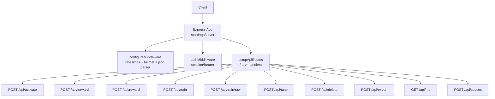
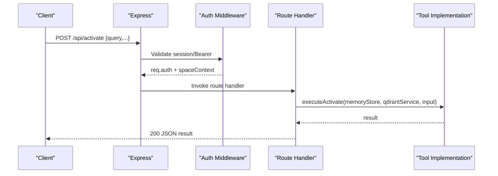
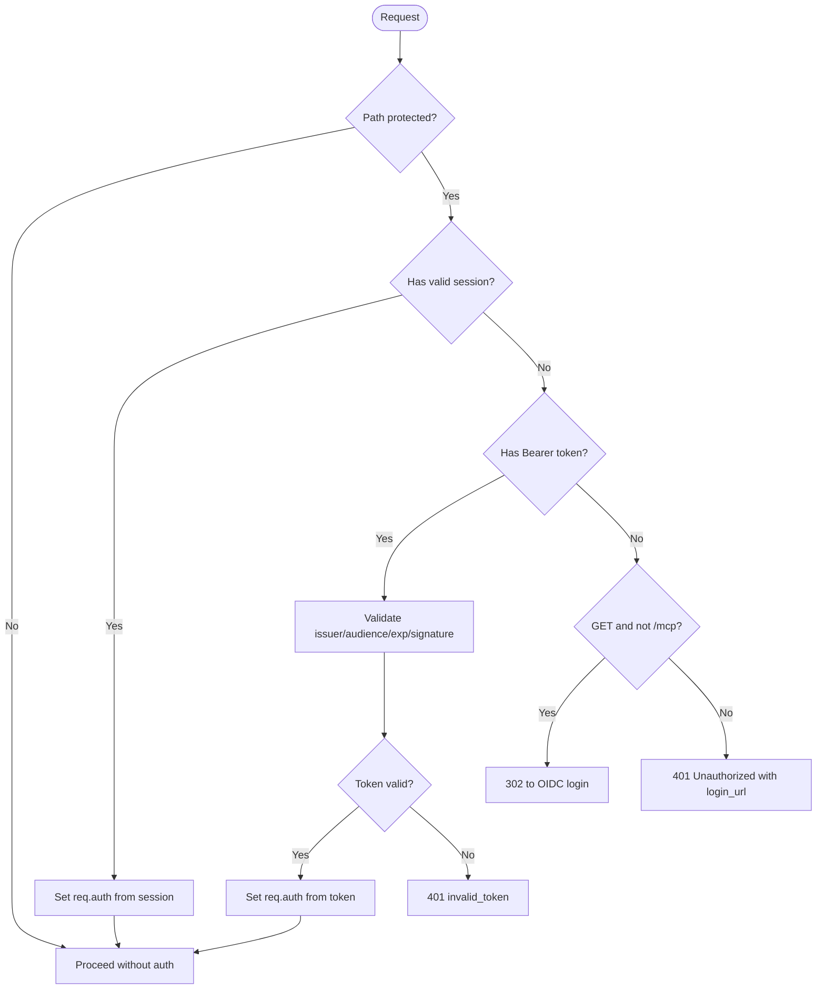
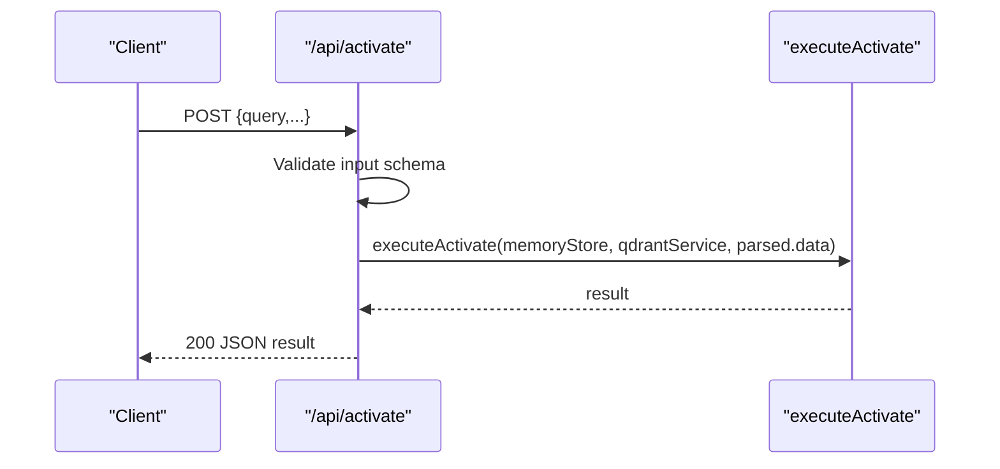
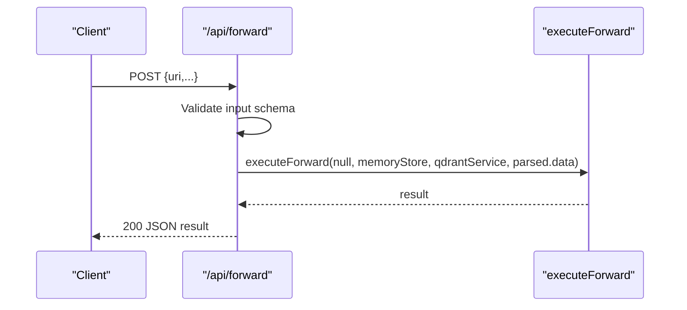
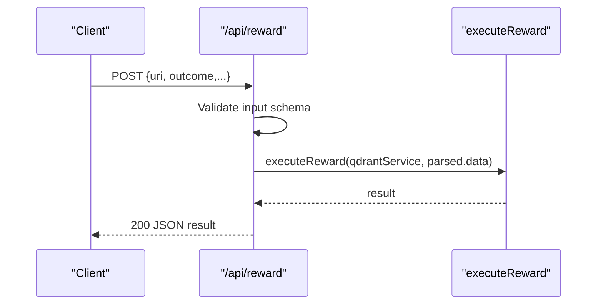
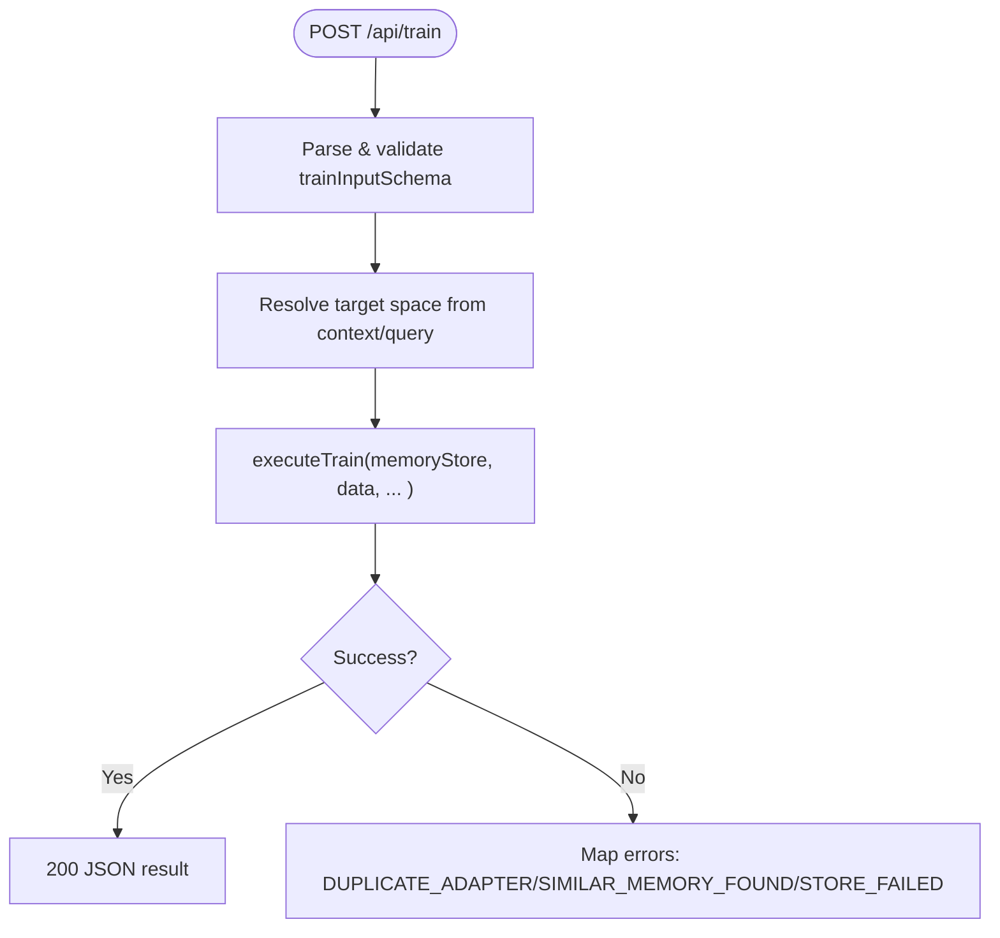
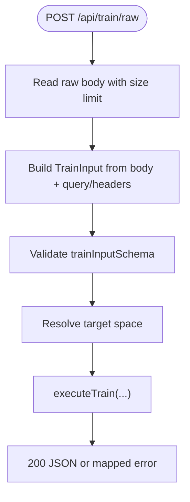
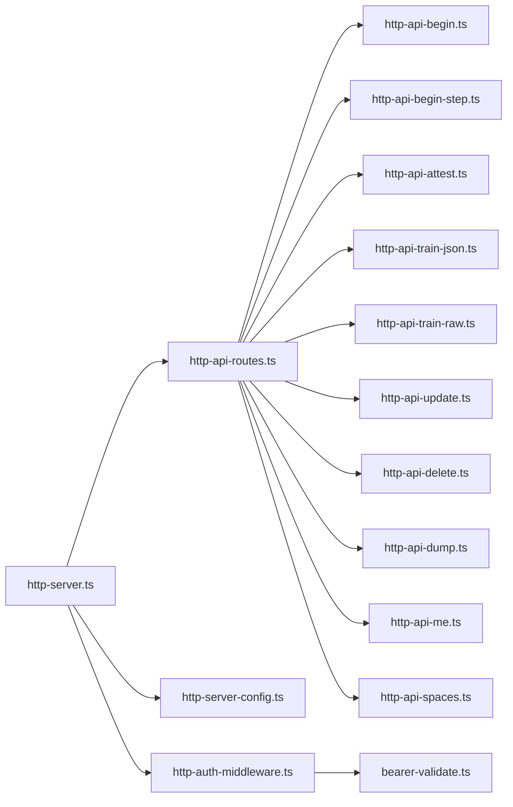

# HTTP API Reference

<cite>
**Referenced Files in This Document**
- [http-server.ts](file://src/http/http-server.ts)
- [http-api-routes.ts](file://src/http/http-api-routes.ts)
- [http-auth-middleware.ts](file://src/http/http-auth-middleware.ts)
- [bearer-validate.ts](file://src/http/bearer-validate.ts)
- [http-server-config.ts](file://src/http/http-server-config.ts)
- [http-api-begin.ts](file://src/http/http-api-begin.ts)
- [http-api-begin-step.ts](file://src/http/http-api-begin-step.ts)
- [http-api-attest.ts](file://src/http/http-api-attest.ts)
- [http-api-train-json.ts](file://src/http/http-api-train-json.ts)
- [http-api-train-raw.ts](file://src/http/http-api-train-raw.ts)
- [http-api-update.ts](file://src/http/http-api-update.ts)
- [http-api-delete.ts](file://src/http/http-api-delete.ts)
- [http-api-dump.ts](file://src/http/http-api-dump.ts)
- [http-api-me.ts](file://src/http/http-api-me.ts)
- [http-api-spaces.ts](file://src/http/http-api-spaces.ts)
</cite>

## Table of Contents
1. [Introduction](#introduction)
2. [Project Structure](#project-structure)
3. [Core Components](#core-components)
4. [Architecture Overview](#architecture-overview)
5. [Detailed Component Analysis](#detailed-component-analysis)
6. [Dependency Analysis](#dependency-analysis)
7. [Performance Considerations](#performance-considerations)
8. [Troubleshooting Guide](#troubleshooting-guide)
9. [Conclusion](#conclusion)
10. [Appendices](#appendices)

## Introduction
This document provides a comprehensive REST API reference for the SquadRules HTTP endpoints. It covers authentication, protocol execution (activate/forward/reward), memory operations (train, tune, delete, export), and administrative functions (me, spaces). It also documents security, rate limiting, error handling, versioning strategy, and best practices for client implementations.

SquadRules is an agent-first MCP framework where AI agents are primary users and humans configure preferences through agents. The core flow is activate → forward → reward. Adapters provide deterministic, auditable task execution. Authentication supports both browser sessions and Bearer tokens validated against OIDC/JWT.

## Project Structure
The HTTP server composes middleware, authentication, routes, and utilities:
- Server bootstrap wires Express, middleware, auth, routes, and startup.
- Route registration centralizes all /api endpoints.
- Auth middleware enforces session or Bearer token validation for protected paths.
- Rate limiting and security headers are applied globally.

**Diagram sources**
- [http-server.ts:22-47](file://src/http/http-server.ts#L22-L47)
- [http-api-routes.ts:22-35](file://src/http/http-api-routes.ts#L22-L35)

**Section sources**
- [http-server.ts:22-47](file://src/http/http-server.ts#L22-L47)
- [http-api-routes.ts:22-35](file://src/http/http-api-routes.ts#L22-L35)

## Core Components
- Authentication: Session cookies and Bearer JWTs; protected paths include /api, /mcp, /ui.
- Protocol execution: activate, forward, reward.
- Memory operations: train (JSON and raw markdown), tune, delete, export.
- Administrative: me (current user profile), spaces (list spaces and adapter counts).
- Security: Helmet CSP, JSON body size limit, per-path rate limiting.
- Error handling: standardized error envelopes with codes and messages.

**Section sources**
- [http-auth-middleware.ts:151-160](file://src/http/http-auth-middleware.ts#L151-L160)
- [http-server-config.ts:57-82](file://src/http/http-server-config.ts#L57-L82)

## Architecture Overview
The HTTP layer validates requests, applies tenant context (space scoping), and delegates to tool implementations.

**Diagram sources**
- [http-server.ts:22-47](file://src/http/http-server.ts#L22-L47)
- [http-api-begin.ts:14-39](file://src/http/http-api-begin.ts#L14-L39)

## Detailed Component Analysis

### Authentication and Authorization
- Protected paths: /api, /api/*, /mcp, /ui, /ui/.
- Browser clients: redirect to OIDC login on first unauthenticated GET; subsequent requests use httpOnly session cookie.
- Machine clients: send Authorization: Bearer <JWT>. Tokens are validated against trusted issuers and allowed audiences.
- Response when unauthenticated:
  - 401 Unauthorized with JSON including login_url.
  - For MCP JSON-RPC calls, returns a structured JSON-RPC 2.0 error envelope.
- Space scoping: optional query parameter space or space_id restricts access to a specific space if present in allowed spaces.

**Diagram sources**
- [http-auth-middleware.ts:151-160](file://src/http/http-auth-middleware.ts#L151-L160)
- [http-auth-middleware.ts:172-327](file://src/http/http-auth-middleware.ts#L172-L327)
- [bearer-validate.ts:116-143](file://src/http/bearer-validate.ts#L116-L143)

**Section sources**
- [http-auth-middleware.ts:151-160](file://src/http/http-auth-middleware.ts#L151-L160)
- [http-auth-middleware.ts:172-327](file://src/http/http-auth-middleware.ts#L172-L327)
- [bearer-validate.ts:116-143](file://src/http/bearer-validate.ts#L116-L143)

### Protocol Execution Endpoints

#### POST /api/activate
- Purpose: Execute the activation step to search and prepare adapters based on a query.
- Request schema: Validated by activateInputSchema.
- Response: 200 JSON with activation result.
- Errors:
  - 400 INVALID_INPUT when request body fails validation.
  - 5xx ACTIVATE_FAILED on internal errors.

**Diagram sources**
- [http-api-begin.ts:14-39](file://src/http/http-api-begin.ts#L14-L39)

**Section sources**
- [http-api-begin.ts:14-39](file://src/http/http-api-begin.ts#L14-L39)

#### POST /api/forward
- Purpose: Execute the forward step to run an adapter workflow.
- Request schema: Validated by forwardInputSchema.
- Response: 200 JSON with forward result.
- Errors:
  - 400 INVALID_INPUT on validation failure.
  - 5xx FORWARD_FAILED on internal errors.

**Diagram sources**
- [http-api-begin-step.ts:13-38](file://src/http/http-api-begin-step.ts#L13-L38)

**Section sources**
- [http-api-begin-step.ts:13-38](file://src/http/http-api-begin-step.ts#L13-L38)

#### POST /api/reward
- Purpose: Attest outcomes for executed workflows.
- Request schema: Validated by rewardInputSchema.
- Response: 200 JSON with reward result.
- Errors:
  - 400 INVALID_INPUT on validation failure.
  - 5xx REWARD_FAILED on internal errors.

**Diagram sources**
- [http-api-attest.ts:12-35](file://src/http/http-api-attest.ts#L12-L35)

**Section sources**
- [http-api-attest.ts:12-35](file://src/http/http-api-attest.ts#L12-L35)

### Memory Operations Endpoints

#### POST /api/train (JSON)
- Purpose: Train/update adapters via JSON payload.
- Request schema: Validated by trainInputSchema. Supports fields such as content, llm_model_id, force_update, protocol_version, space, review_evidence.
- Behavior: Resolves target space using ctx.defaultWriteSpaceId or allowedSpaceIds; supports personal and named spaces.
- Responses:
  - 200 JSON success.
  - 400 INVALID_INPUT on validation failure.
  - 400 with domain-specific errors like SPACE_NOT_FOUND, SPACE_READ_ONLY.
  - 409 DUPLICATE_ADAPTER or SIMILAR_MEMORY_FOUND with guidance.
  - 500 STORE_FAILED on storage errors.

**Diagram sources**
- [http-api-train-json.ts:46-172](file://src/http/http-api-train-json.ts#L46-L172)

**Section sources**
- [http-api-train-json.ts:46-172](file://src/http/http-api-train-json.ts#L46-L172)

#### POST /api/train/raw
- Purpose: Train/update adapters by sending raw markdown body.
- Request: Raw UTF-8 text body; parameters via query/headers (llm_model_id, force, protocol_version, space, review_evidence).
- Limits: Enforces HTTP_TRAIN_RAW_BODY_LIMIT.
- Responses:
  - 200 JSON success.
  - 400 INVALID_INPUT or empty content.
  - 413 PAYLOAD_TOO_LARGE when exceeding size limit.
  - 409 DUPLICATE_ADAPTER or SIMILAR_MEMORY_FOUND with guidance.
  - 500 STORE_FAILED on storage errors.

**Diagram sources**
- [http-api-train-raw.ts:48-214](file://src/http/http-api-train-raw.ts#L48-L214)

**Section sources**
- [http-api-train-raw.ts:48-214](file://src/http/http-api-train-raw.ts#L48-L214)

#### POST /api/tune
- Purpose: Update adapter layers for given URIs.
- Request schema: Validated by tuneInputSchema (uris array).
- Response: 200 JSON with total_updated and total_failed counters.
- Errors:
  - 400 INVALID_INPUT on validation failure.
  - 500 TUNE_FAILED on internal errors.

**Section sources**
- [http-api-update.ts:11-34](file://src/http/http-api-update.ts#L11-L34)

#### POST /api/delete
- Purpose: Delete memories by URIs.
- Request schema: Validated by deleteInputSchema (uris array).
- Response: 200 JSON with total_deleted and total_failed counters.
- Errors:
  - 400 INVALID_INPUT on validation failure.
  - 500 DELETE_FAILED on internal errors.

**Section sources**
- [http-api-delete.ts:11-35](file://src/http/http-api-delete.ts#L11-L35)

#### POST /api/export
- Purpose: Export memories/adapters in specified formats.
- Request schema: Validated by exportInputSchema.
- Response: 200 JSON payload with export results.
- Errors:
  - 400 INVALID_INPUT on validation failure.
  - 404 NOT_FOUND when resources missing.
  - 500 EXPORT_FAILED on internal errors.

**Section sources**
- [http-api-dump.ts:19-61](file://src/http/http-api-dump.ts#L19-L61)

### Administrative Endpoints

#### GET /api/me
- Purpose: Return current authenticated user profile and authorization fields.
- Authentication: Required (session or Bearer).
- Response: 200 JSON with sub, groups, realm, account_kind, account_label, and optional profile fields.
- Errors:
  - 401 Unauthorized if not authenticated.

**Section sources**
- [http-api-me.ts:31-40](file://src/http/http-api-me.ts#L31-L40)

#### POST /api/spaces
- Purpose: List spaces and optionally include adapter titles/artifacts.
- Authentication: Required (session or Bearer).
- Request body: Optional include_adapter_titles and include_artifacts booleans.
- Response: 200 JSON with spaces metadata.
- Errors:
  - 500 SPACES_FAILED on internal errors.

**Section sources**
- [http-api-spaces.ts:11-31](file://src/http/http-api-spaces.ts#L11-L31)

## Dependency Analysis
- Server composition: startHttpServer wires middleware, auth, routes, and startup.
- Route registry: setupApiRoutes registers all /api endpoints and passes dependencies (memoryStore, qdrantService).
- Auth dependency chain: authMiddleware uses bearer-validate for JWT verification and config values for trusted issuers/audiences.
- Rate limiting: configured per path group (/auth, /api, /mcp).

**Diagram sources**
- [http-server.ts:22-47](file://src/http/http-server.ts#L22-L47)
- [http-api-routes.ts:22-35](file://src/http/http-api-routes.ts#L22-L35)
- [http-auth-middleware.ts:172-327](file://src/http/http-auth-middleware.ts#L172-L327)
- [bearer-validate.ts:116-143](file://src/http/bearer-validate.ts#L116-L143)

**Section sources**
- [http-server.ts:22-47](file://src/http/http-server.ts#L22-L47)
- [http-api-routes.ts:22-35](file://src/http/http-api-routes.ts#L22-L35)

## Performance Considerations
- Body size limits:
  - JSON bodies limited by HTTP_JSON_BODY_LIMIT.
  - Raw markdown training limited by HTTP_TRAIN_RAW_BODY_LIMIT.
- Rate limiting:
  - /auth, /api, /mcp each have independent windows and max request counts.
- Logging and metrics:
  - Structured HTTP logging and Prometheus metrics are enabled globally.
- Storage backends:
  - Qdrant (primary vector store) and LanceDB (secondary embedded) influence performance of semantic search and training.

[No sources needed since this section provides general guidance]

## Troubleshooting Guide
Common status codes and error responses:
- 400 INVALID_INPUT: Request body failed schema validation.
- 401 Unauthorized: Missing or invalid credentials; includes login_url for reauthentication.
- 401 invalid_token: Bearer token rejected or expired; reauthenticate and reconnect MCP if host caches tokens.
- 403 Forbidden: Requested space not in allowed spaces.
- 409 DUPLICATE_ADAPTER: Adapter already exists; use force_update to overwrite.
- 409 SIMILAR_MEMORY_FOUND: Similar memory detected; verify before overwriting.
- 413 PAYLOAD_TOO_LARGE: Raw markdown exceeds configured limit.
- 500 STORE_FAILED/TUNE_FAILED/DELETE_FAILED/EXPORT_FAILED/ACTIVATE_FAILED/FORWARD_FAILED/REWARD_FAILED: Internal server errors.

Operational tips:
- Verify AUTH_ENABLED, AUTH_TRUSTED_ISSUERS, AUTH_ALLOWED_AUDIENCES, and AUTH_CALLBACK_BASE_URL for proper authentication behavior.
- Use WWW-Authenticate header presence to detect MCP clients needing authentication.
- Inspect logs for detailed error traces and audit events.

**Section sources**
- [http-auth-middleware.ts:230-327](file://src/http/http-auth-middleware.ts#L230-L327)
- [http-api-train-json.ts:108-172](file://src/http/http-api-train-json.ts#L108-L172)
- [http-api-train-raw.ts:154-214](file://src/http/http-api-train-raw.ts#L154-L214)

## Conclusion
The SquadRules HTTP API provides a secure, rate-limited, and well-structured interface for protocol execution and memory management. Clients should authenticate via session or Bearer tokens, respect rate limits and body size constraints, and handle standardized error responses. For real-time communication, refer to the MCP transport documentation.

[No sources needed since this section summarizes without analyzing specific files]

## Appendices

### API Versioning and Compatibility
- No explicit URL versioning is used; endpoints are under /api.
- Backward compatibility is maintained by strict schema validation and stable response shapes.
- Deprecation policy: changes to schemas or behaviors will be introduced gradually with clear error messages and next_action guidance where applicable.

[No sources needed since this section provides general guidance]

### WebSocket Endpoints
- Real-time event streaming is provided via the MCP transport at /mcp.
- Authentication requirements mirror those for /api and /ui; MCP clients receive a structured JSON-RPC 2.0 error when authentication is required.

**Section sources**
- [http-auth-middleware.ts:297-327](file://src/http/http-auth-middleware.ts#L297-L327)

### Security Considerations and Best Practices
- Always enable AUTH_ENABLED and configure AUTH_TRUSTED_ISSUERS and AUTH_ALLOWED_AUDIENCES for Bearer token validation.
- Use HTTPS in production; ensure CORS is properly configured for MCP clients.
- Respect rate limits and implement retries with exponential backoff.
- Sanitize inputs and avoid logging sensitive data.
- Prefer minimal scopes and least privilege when configuring OIDC clients.

[No sources needed since this section provides general guidance]