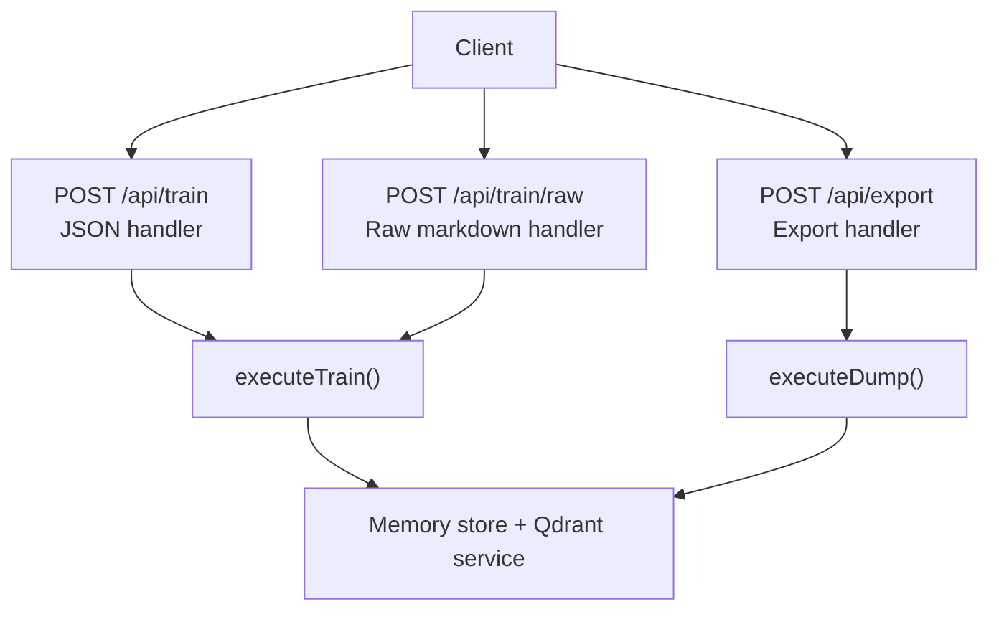
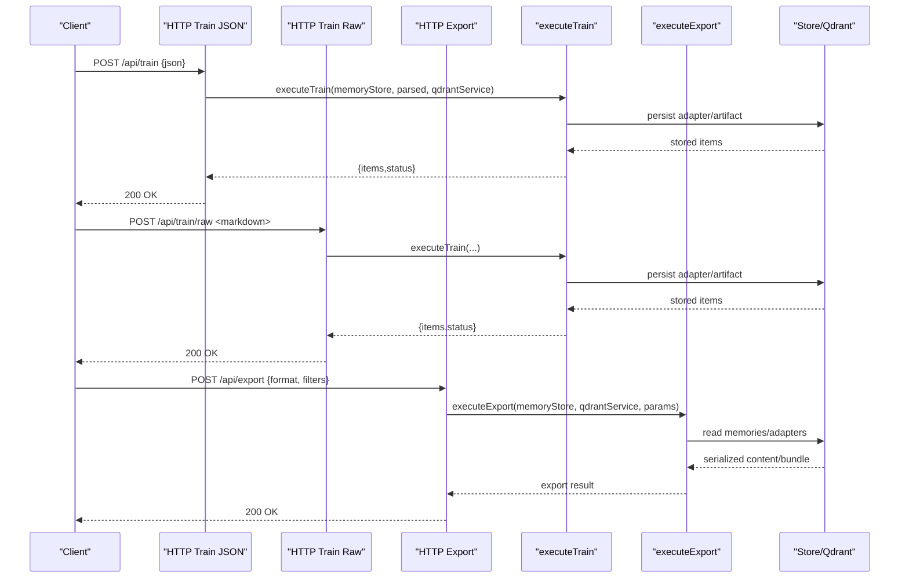
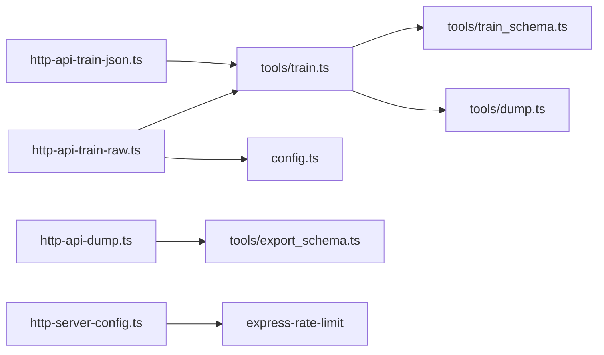

# Memory Management Endpoints

<cite>
**Referenced Files in This Document**
- [http-api-train-json.ts](file://src/http/http-api-train-json.ts)
- [http-api-train-raw.ts](file://src/http/http-api-train-raw.ts)
- [http-api-dump.ts](file://src/http/http-api-dump.ts)
- [train.ts](file://src/tools/train.ts)
- [dump.ts](file://src/tools/dump.ts)
- [train_schema.ts](file://src/tools/train_schema.ts)
- [dump_schema.ts](file://src/tools/dump_schema.ts)
- [export_schema.ts](file://src/tools/export_schema.ts)
- [config.ts](file://src/config.ts)
- [http-server-config.ts](file://src/http/http-server-config.ts)
- [api-client.ts](file://src/cli/api-client.ts)
</cite>

## Table of Contents
1. [Introduction](#introduction)
2. [Project Structure](#project-structure)
3. [Core Components](#core-components)
4. [Architecture Overview](#architecture-overview)
5. [Detailed Component Analysis](#detailed-component-analysis)
6. [Dependency Analysis](#dependency-analysis)
7. [Performance Considerations](#performance-considerations)
8. [Troubleshooting Guide](#troubleshooting-guide)
9. [Conclusion](#conclusion)

## Introduction
This document describes the memory management HTTP endpoints for adapter training and data export:
- POST /api/train (JSON payload)
- POST /api/train/raw (raw markdown body)
- POST /api/export (data dump/export with filtering options)

These endpoints support adapter creation, artifact attachment, fork-from-source workflows, space scoping, validation, error handling, and large payload protection. The documentation includes request schemas, response formats, rate limiting behavior, batch considerations, and examples of typical workflows.

## Project Structure
The relevant implementation is split between HTTP route handlers and shared tooling:
- HTTP routes parse and validate requests, resolve tenant/space context, and delegate to core logic.
- Core tools perform business operations such as training adapters and exporting memory content.
- Schemas define strict input/output contracts using Zod.
- Configuration controls limits like raw body size and server-level rate limiting.

**Diagram sources**
- [http-api-train-json.ts:46-107](file://src/http/http-api-train-json.ts#L46-L107)
- [http-api-train-raw.ts:48-153](file://src/http/http-api-train-raw.ts#L48-L153)
- [http-api-dump.ts:19-49](file://src/http/http-api-dump.ts#L19-L49)
- [train.ts:135-242](file://src/tools/train.ts#L135-L242)
- [dump.ts:97-179](file://src/tools/dump.ts#L97-L179)

**Section sources**
- [http-api-train-json.ts:46-107](file://src/http/http-api-train-json.ts#L46-L107)
- [http-api-train-raw.ts:48-153](file://src/http/http-api-train-raw.ts#L48-L153)
- [http-api-dump.ts:19-49](file://src/http/http-api-dump.ts#L19-L49)
- [train.ts:135-242](file://src/tools/train.ts#L135-L242)
- [dump.ts:97-179](file://src/tools/dump.ts#L97-L179)

## Core Components
- POST /api/train (JSON): Accepts a structured JSON payload describing an adapter or artifact training operation. Validates against trainInputSchema, resolves target space, and calls executeTrain.
- POST /api/train/raw: Accepts raw markdown in the request body. Derives metadata from query parameters and headers, validates via trainInputSchema, and calls executeTrain.
- POST /api/export: Accepts an export configuration, validates against export schema, and executes export logic through executeExport.

Key behaviors:
- Space resolution supports default write space, personal, and group names.
- Duplicate and similar adapter detection returns actionable errors.
- Raw endpoint enforces a configurable maximum body size.
- Error payloads are sanitized to expose only safe fields.

**Section sources**
- [http-api-train-json.ts:46-107](file://src/http/http-api-train-json.ts#L46-L107)
- [http-api-train-raw.ts:48-153](file://src/http/http-api-train-raw.ts#L48-L153)
- [http-api-dump.ts:19-49](file://src/http/http-api-dump.ts#L19-L49)
- [train_schema.ts:54-174](file://src/tools/train_schema.ts#L54-L174)
- [config.ts:117-118](file://src/config.ts#L117-L118)

## Architecture Overview
The training and export flows share common patterns:
- Input validation via Zod schemas.
- Tenant and space context resolution.
- Delegation to core tools (executeTrain, executeExport).
- Consistent error normalization and sanitization.

**Diagram sources**
- [http-api-train-json.ts:51-107](file://src/http/http-api-train-json.ts#L51-L107)
- [http-api-train-raw.ts:53-153](file://src/http/http-api-train-raw.ts#L53-L153)
- [http-api-dump.ts:24-49](file://src/http/http-api-dump.ts#L24-L49)
- [train.ts:135-242](file://src/tools/train.ts#L135-L242)

## Detailed Component Analysis

### POST /api/train (JSON)
Purpose:
- Train an adapter or attach artifacts using a structured JSON payload.

Request:
- Method: POST
- Path: /api/train
- Content-Type: application/json
- Body: TrainInput (see schema below)

TrainInput schema highlights:
- content: optional string; required if source_adapter_uri is not provided.
- llm_model_id: required string.
- force_update: optional boolean; defaults to false.
- protocol_version: optional string.
- space: optional; accepts "personal" or a group name.
- source_adapter_uri: optional; must match squadrules://adapter/{slug}.
- mime: optional; omit or use text/markdown for adapters; non-markdown indicates artifact mode.
- artifact_name: optional; required when mime is non-markdown or when inferring MIME from extension.
- adapter_uri: optional; required when mime is non-markdown.
- relative_path: optional; allowed only for artifact mode; must be skill-root-relative without .. segments.
- review_evidence: optional object; required for adapter (markdown) trains; contains verdict_file, exit_code, stdout.

Validation rules:
- If mime is non-markdown, artifact_name and adapter_uri are required.
- If artifact_name is present without explicit mime, MIME is inferred; unknown extensions require explicit mime.
- relative_path is only valid for artifact mode and must pass normalization checks.
- For adapter (markdown) trains without source_adapter_uri, review_evidence is required.

Response:
- 200 OK: { items: [{ uri, layer_uuid?, artifact_uuid?, adapter_uri?, label, tags, content_type? }], status: "stored" }
- 400 INVALID_INPUT: Validation failure details.
- 400 SPACE_NOT_FOUND or SPACE_READ_ONLY: Invalid or read-only target space.
- 409 DUPLICATE_ADAPTER: Adapter already exists; use force_update to overwrite.
- 409 SIMILAR_MEMORY_FOUND: Similar adapter detected; includes similarity_score, existing_memory, next_action.
- 500 STORE_FAILED: Unexpected storage failure.

Error payload sanitization:
- Only safe detail keys are included: missing, must_obey, next_action, existing_memory, similarity_score, content_preview, slug, adapter_id, sample_uri, base_slug, message.

Space resolution:
- Defaults to ctx.defaultWriteSpaceId or first allowed space.
- Supports "personal" and named groups with permission checks.

Progress tracking:
- Training is synchronous at the HTTP layer; responses reflect final state.
- Metrics track call counts, durations, input/output sizes, and duplicate/similar events.

Rate limiting:
- Server-level rate limiting is configured via express-rate-limit middleware.
- Clients should handle 429 responses and implement retry with backoff.

Examples:
- Minimal adapter train: provide content, llm_model_id, adapter_uri, and review_evidence.
- Artifact attach: provide mime, artifact_name, adapter_uri, and optionally relative_path.
- Fork from source: provide source_adapter_uri and optional content override.

**Section sources**
- [http-api-train-json.ts:46-107](file://src/http/http-api-train-json.ts#L46-L107)
- [http-api-train-json.ts:108-172](file://src/http/http-api-train-json.ts#L108-L172)
- [train_schema.ts:54-174](file://src/tools/train_schema.ts#L54-L174)
- [train_schema.ts:176-187](file://src/tools/train_schema.ts#L176-L187)
- [train.ts:135-242](file://src/tools/train.ts#L135-L242)
- [http-server-config.ts:3](file://src/http/http-server-config.ts#L3)

### POST /api/train/raw
Purpose:
- Train an adapter by uploading raw markdown content. Metadata is derived from query parameters and headers.

Request:
- Method: POST
- Path: /api/train/raw
- Body: raw markdown string
- Query/Headers:
  - llm_model_id: query or header x-llm-model-id; falls back to user-agent or "http-api".
  - force: query or header x-force-update; boolean true enables overwrite.
  - protocol_version: query or header x-protocol-version.
  - space: query or header x-space; supports "personal" and group names.
  - review_evidence: query or header x-review-evidence; JSON object with verdict_file, exit_code, stdout.

Body limit:
- Enforced by HTTP_TRAIN_RAW_BODY_LIMIT (default 2mb). Exceeding this returns 413 PAYLOAD_TOO_LARGE.

Validation:
- Empty body results in INVALID_INPUT.
- Constructed TrainInput is validated via trainInputSchema.

Response:
- Same structure as JSON train endpoint.
- Additional 413 PAYLOAD_TOO_LARGE for oversized bodies.

Error handling:
- Normalized TrainError and SquadrulesError responses.
- Duplicate and similar adapter errors return 409 with actionable guidance.

Examples:
- Upload markdown with model ID and target space.
- Force update an existing adapter by setting force=true.
- Include review_evidence as JSON in query or header for markdown adapter training.

**Section sources**
- [http-api-train-raw.ts:48-153](file://src/http/http-api-train-raw.ts#L48-L153)
- [http-api-train-raw.ts:154-214](file://src/http/http-api-train-raw.ts#L154-L214)
- [config.ts:117-118](file://src/config.ts#L117-L118)
- [train_schema.ts:54-174](file://src/tools/train_schema.ts#L54-L174)

### POST /api/export
Note: The repository implements export under POST /api/export. The path /api/dump is not exposed as an HTTP endpoint; it is used internally by training workflows.

Purpose:
- Export adapter or memory content based on a structured configuration.

Request:
- Method: POST
- Path: /api/export
- Content-Type: application/json
- Body: ExportInput (validated by export schema)

Behavior:
- Validates input against export schema.
- Resolves tenant/space context.
- Executes export logic and returns serialized content or bundle.

Response:
- 200 OK: Export result payload.
- 400 INVALID_INPUT: Validation failure.
- 404 NOT_FOUND: Resource not found during export.
- 500 EXPORT_FAILED: Unexpected export failure.

Notes:
- Base URL for downloads is derived from x-forwarded-host/host and x-forwarded-proto/protocol.
- Logging records format, URI, adapter counts, and space name.

**Section sources**
- [http-api-dump.ts:19-49](file://src/http/http-api-dump.ts#L19-L49)
- [http-api-dump.ts:50-61](file://src/http/http-api-dump.ts#L50-L61)
- [export_schema.ts](file://src/tools/export_schema.ts)

### Internal Dump Utility
Purpose:
- Used internally to serialize adapter layers into markdown or protocol documents.

Key capabilities:
- Normalize layer URIs and load memory resources with caching.
- Build single-step or multi-step protocol markdown.
- Attach challenge shapes and position metadata.

Usage:
- Called by training workflow to export source adapter content when forking.
- Not directly exposed as an HTTP endpoint.

**Section sources**
- [dump.ts:13-51](file://src/tools/dump.ts#L13-L51)
- [dump.ts:97-179](file://src/tools/dump.ts#L97-L179)
- [dump_schema.ts:1-22](file://src/tools/dump_schema.ts#L1-L22)

## Dependency Analysis

**Diagram sources**
- [http-api-train-json.ts:46-107](file://src/http/http-api-train-json.ts#L46-L107)
- [http-api-train-raw.ts:48-153](file://src/http/http-api-train-raw.ts#L48-L153)
- [train.ts:135-242](file://src/tools/train.ts#L135-L242)
- [dump.ts:97-179](file://src/tools/dump.ts#L97-L179)
- [config.ts:117-118](file://src/config.ts#L117-L118)
- [http-server-config.ts:3](file://src/http/http-server-config.ts#L3)

**Section sources**
- [http-api-train-json.ts:46-107](file://src/http/http-api-train-json.ts#L46-L107)
- [http-api-train-raw.ts:48-153](file://src/http/http-api-train-raw.ts#L48-L153)
- [train.ts:135-242](file://src/tools/train.ts#L135-L242)
- [dump.ts:97-179](file://src/tools/dump.ts#L97-L179)
- [config.ts:117-118](file://src/config.ts#L117-L118)
- [http-server-config.ts:3](file://src/http/http-server-config.ts#L3)

## Performance Considerations
- Large payloads:
  - Raw markdown endpoint enforces HTTP_TRAIN_RAW_BODY_LIMIT (default 2mb). Clients should chunk or compress where possible.
- Batch processing:
  - Endpoints are designed for single-operation requests. For bulk operations, clients should implement client-side batching with concurrency control and retries.
- Caching:
  - Dump utility uses Redis cache for memory resource reads to reduce store pressure.
- Metrics:
  - Tool metrics capture call counts, durations, input/output sizes, and specific error categories (duplicate/similar adapter).

Recommendations:
- Use POST /api/train with JSON for structured operations and better validation feedback.
- Use POST /api/train/raw for simple markdown uploads with minimal overhead.
- Implement exponential backoff on 429 responses and respect server rate limits.
- Prefer artifact mode with explicit mime and adapter_uri for deterministic MIME inference.

[No sources needed since this section provides general guidance]

## Troubleshooting Guide
Common errors and resolutions:
- INVALID_INPUT:
  - Cause: Missing or invalid fields per trainInputSchema or export schema.
  - Resolution: Ensure required fields are present and conform to constraints (e.g., review_evidence for markdown adapters, artifact_name and adapter_uri for non-markdown mime).
- SPACE_NOT_FOUND / SPACE_READ_ONLY:
  - Cause: Target space does not exist or is read-only.
  - Resolution: Verify space name or switch to "personal" or a writable group.
- DUPLICATE_ADAPTER:
  - Cause: Adapter with same label already exists.
  - Resolution: Set force_update=true to overwrite, or choose a different label.
- SIMILAR_MEMORY_FOUND:
  - Cause: Existing adapter has very similar title/content.
  - Resolution: Inspect existing_memory and similarity_score; use force_update with matching adapter id to replace if appropriate.
- PAYLOAD_TOO_LARGE:
  - Cause: Raw markdown exceeds HTTP_TRAIN_RAW_BODY_LIMIT.
  - Resolution: Reduce content size or increase limit via environment configuration.
- STORE_FAILED / EXPORT_FAILED:
  - Cause: Unexpected internal failures.
  - Resolution: Retry after a short delay; check server logs and dependencies.

Rate limiting:
- Server uses express-rate-limit middleware. Clients should detect 429 responses and retry with backoff.
- CLI client includes retry logic for 429 responses.

**Section sources**
- [http-api-train-json.ts:108-172](file://src/http/http-api-train-json.ts#L108-L172)
- [http-api-train-raw.ts:154-214](file://src/http/http-api-train-raw.ts#L154-L214)
- [http-api-dump.ts:50-61](file://src/http/http-api-dump.ts#L50-L61)
- [config.ts:117-118](file://src/config.ts#L117-L118)
- [http-server-config.ts:3](file://src/http/http-server-config.ts#L3)
- [api-client.ts:107-232](file://src/cli/api-client.ts#L107-L232)

## Conclusion
The memory management endpoints provide robust, validated interfaces for training adapters and exporting data:
- POST /api/train supports structured JSON payloads with comprehensive validation and clear error semantics.
- POST /api/train/raw offers a lightweight way to upload markdown with metadata via query/headers and enforces body size limits.
- POST /api/export handles data export with filtering and serialization, returning actionable results.
Clients should follow the documented schemas, handle errors gracefully, respect rate limits, and implement client-side batching for large-scale operations.

[No sources needed since this section summarizes without analyzing specific files]