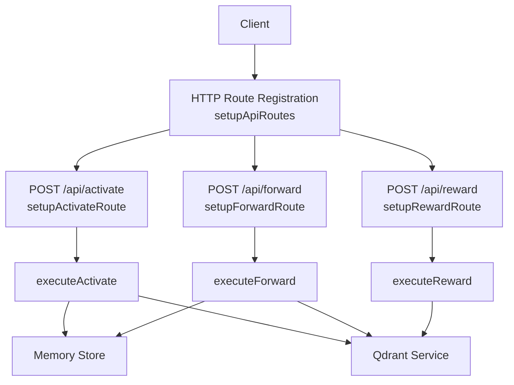
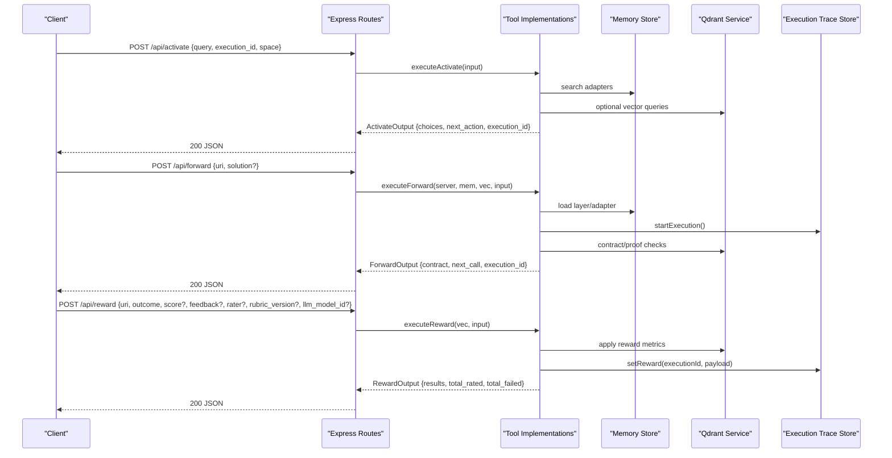
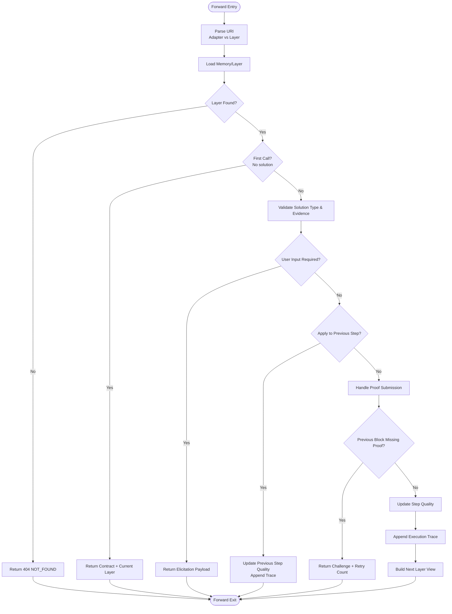
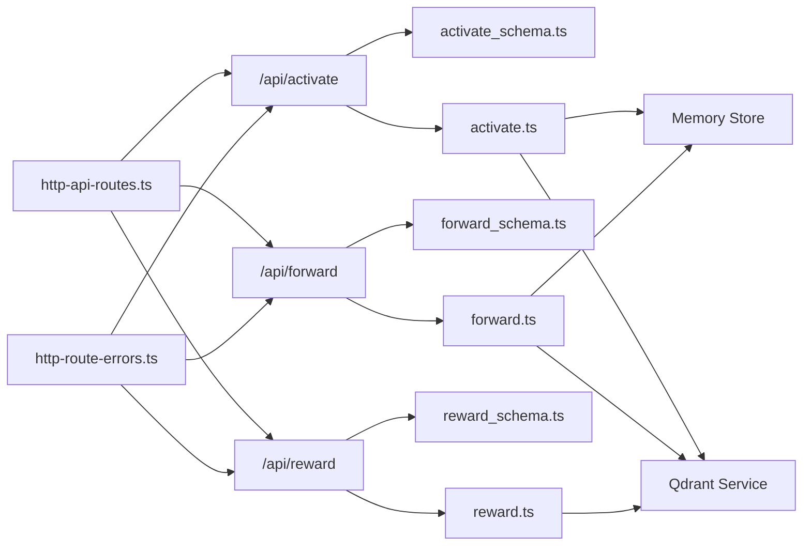

# Protocol Execution Endpoints

<cite>
**Referenced Files in This Document**
- [http-api-routes.ts](file://src/http/http-api-routes.ts)
- [http-api-begin.ts](file://src/http/http-api-begin.ts)
- [http-api-begin-step.ts](file://src/http/http-api-begin-step.ts)
- [http-api-attest.ts](file://src/http/http-api-attest.ts)
- [activate_schema.ts](file://src/tools/activate_schema.ts)
- [forward_schema.ts](file://src/tools/forward_schema.ts)
- [reward_schema.ts](file://src/tools/reward_schema.ts)
- [activate.ts](file://src/tools/activate.ts)
- [forward.ts](file://src/tools/forward.ts)
- [reward.ts](file://src/tools/reward.ts)
- [http-route-errors.ts](file://src/http/http-route-errors.ts)
- [execution-trace-store.ts](file://src/services/execution-trace-store.ts)
</cite>

## Table of Contents
1. [Introduction](#introduction)
2. [Project Structure](#project-structure)
3. [Core Components](#core-components)
4. [Architecture Overview](#architecture-overview)
5. [Detailed Component Analysis](#detailed-component-analysis)
6. [Dependency Analysis](#dependency-analysis)
7. [Performance Considerations](#performance-considerations)
8. [Troubleshooting Guide](#troubleshooting-guide)
9. [Conclusion](#conclusion)

## Introduction
This document provides comprehensive API documentation for the protocol execution endpoints that implement the activate → forward → reward workflow:

- POST /api/activate: Initiates a protocol by selecting an adapter and returning actionable choices.
- POST /api/forward: Executes one step of an adapter’s layered protocol, supporting multi-step workflows with contracts, proofs, and continuation URIs.
- POST /api/reward: Attests the final outcome of a completed run and records evaluation metadata.

The endpoints are HTTP wrappers around MCP-style tools. They validate inputs using Zod schemas, execute business logic through service layers, and return structured JSON responses. State is persisted in memory stores and vector storage (Qdrant), while execution traces are recorded for auditability.

## Project Structure
The protocol execution endpoints are registered as Express routes and delegate to tool implementations:

**Diagram sources**
- [http-api-routes.ts:22-35](file://src/http/http-api-routes.ts#L22-L35)
- [http-api-begin.ts:14-38](file://src/http/http-api-begin.ts#L14-L38)
- [http-api-begin-step.ts:13-38](file://src/http/http-api-begin-step.ts#L13-L38)
- [http-api-attest.ts:12-35](file://src/http/http-api-attest.ts#L12-L35)

**Section sources**
- [http-api-routes.ts:1-36](file://src/http/http-api-routes.ts#L1-L36)

## Core Components
- Activation endpoint: Validates activation input, executes search over adapters, and returns ranked choices with next-action instructions.
- Forward endpoint: Loads an adapter or layer, enforces contracts and proof requirements, advances state, and returns the next step or completion signal.
- Reward endpoint: Evaluates and persists rewards, computes eligibility for export pipelines, and returns evaluation results.

Key behaviors:
- Input validation uses canonical Zod schemas.
- Errors are normalized into structured error payloads.
- Execution traces are recorded for auditability.
- Space context and tenant isolation are applied via middleware.

**Section sources**
- [activate_schema.ts:69-116](file://src/tools/activate_schema.ts#L69-L116)
- [forward_schema.ts:244-339](file://src/tools/forward_schema.ts#L244-L339)
- [reward_schema.ts:10-48](file://src/tools/reward_schema.ts#L10-L48)

## Architecture Overview
The HTTP layer validates requests, invokes tool functions, and maps errors to consistent responses. The tool layer coordinates memory access, vector store operations, and persistence.

**Diagram sources**
- [http-api-begin.ts:14-38](file://src/http/http-api-begin.ts#L14-L38)
- [http-api-begin-step.ts:13-38](file://src/http/http-api-begin-step.ts#L13-L38)
- [http-api-attest.ts:12-35](file://src/http/http-api-attest.ts#L12-L35)
- [activate.ts:209-235](file://src/tools/activate.ts#L209-L235)
- [forward.ts:93-317](file://src/tools/forward.ts#L93-L317)
- [reward.ts:27-110](file://src/tools/reward.ts#L27-L110)
- [execution-trace-store.ts:119-145](file://src/services/execution-trace-store.ts#L119-L145)

## Detailed Component Analysis

### POST /api/activate
Purpose:
- Selects the best adapter(s) for a query and returns actionable choices.
- Supports refinement sequences via execution_id.

HTTP method and URL:
- Method: POST
- URL: /api/activate

Request schema:
- query: string (required)
- execution_id: string UUID (optional; echo back to refine)
- space: string (optional; scope to personal/group/space id)
- space_id: string (optional; alias for space)
- max_choices: integer (optional; bounded by configured limits)

Response schema:
- must_obey: boolean (always true)
- message: string
- next_action: string (instruction to pick a choice and follow its next_action)
- execution_id: string UUID (server-issued if not provided)
- query: string (echoed from request)
- choices: array of discriminated objects with role match/refine/create
  - uri: squadrules://adapter/{slug}
  - label: string
  - adapter_name: string | null
  - activation_score: number | null (0.0–1.0)
  - tags: string[]
  - next_action: string
  - adapter_version: string | null
  - activation_patterns: string[]
  - space_name: string | null
  - slug: string | null
  - forward_first_call: object { uri } for match/refine, null for create
  - linked_artifacts: optional array of artifact descriptors with download_url, sha256, materialize shell command, etc.
- squadrules_local_artifact_dir: string[] (client-resolved paths)

Status codes:
- 200: Success
- 400: INVALID_INPUT (validation failure)
- 5xx: Error response with structured error code and message

Error handling:
- Validation errors produce 400 with error: "INVALID_INPUT".
- Other failures map to structured error payloads via sendToolRouteError.

Retry mechanisms:
- Refinement: Re-run activate with the same execution_id to refine results.
- Linked artifacts: Materialize artifacts before calling forward as instructed by next_action.

State management:
- execution_id tracks refinement iterations.
- Choices include explicit next_action guidance for clients.

Example workflow:
1. Client calls POST /api/activate with query and optional space.
2. Server returns choices; client picks one and follows next_action.
3. If linked_artifacts exist, client materializes them to $SQUADRULES_LOCAL_ARTIFACT_DIR and verifies checksums.
4. Client calls POST /api/forward with the selected adapter URI and no solution to start.

**Section sources**
- [http-api-begin.ts:14-38](file://src/http/http-api-begin.ts#L14-L38)
- [activate_schema.ts:69-116](file://src/tools/activate_schema.ts#L69-L116)
- [activate.ts:44-207](file://src/tools/activate.ts#L44-L207)
- [activate.ts:209-235](file://src/tools/activate.ts#L209-L235)

### POST /api/forward
Purpose:
- Executes one step of an adapter’s layered protocol.
- Supports starting a new run (adapter URI or layer without execution_id) and continuing a run (layer URI with ?execution_id=...).
- Enforces contracts, handles user input elicitation, applies solutions to previous steps when needed, and advances to the next layer.

HTTP method and URL:
- Method: POST
- URL: /api/forward

Request schema:
- uri: string (adapter URI or layer URI; see below)
- solution: object (optional; required only for continuation calls)
  - type: tensor | shell | mcp | user_input | comment
  - outcome: success | failure | skipped (recommended v2)
  - evidence: object (type-specific proof)
  - nonce: string (optional; echo from contract)
  - proof_hash: string (optional; echo from previous layer)
  - trace: string (optional reasoning trace)

URI patterns:
- Adapter start: squadrules://adapter/{slug}
- Layer start: squadrules://layer/{uuid}
- Layer continuation: squadrules://layer/{uuid}?execution_id={uuid}

Validation rules:
- Starting a run must omit solution.
- Continuing a run must include solution.type matching contract.type and provide evidence.

Response schema:
- must_obey: boolean
- current_layer: object { uri, content, mimeType: "text/markdown" } | null
- contract: object describing expected inputs/outputs per layer
- tensor_in: object (optional)
- next_action: string
- proof_hash: string (optional)
- execution_id: string (optional)
- message: string (optional)
- error_code: string (optional)
- retry_count: number (optional)
- slug_disambiguation_note: string (optional)
- next_call: object { kind: "forward" | "reward", args: {...} }
- activation_space_name: string (optional)
- context_adapter_name: string (optional)
- current_layer_label: string (optional)
- adapter_layer_index: number (optional)
- adapter_layer_count: number (optional)
- squadrules_local_artifact_dir: string[] (optional)

Status codes:
- 200: Success
- 400: INVALID_INPUT (validation failure)
- 404: NOT_FOUND (layer or adapter not found)
- 5xx: Error response with structured error code and message

Concurrency and state persistence:
- Each run has an execution_id. On first call, runtime metadata is started and execution trace is initiated.
- Execution traces are persisted asynchronously; failures are logged but do not block the response.
- Previous-step application supports repairing prior layers when a solution matches earlier steps.

Timeout configuration:
- Shell steps define timeout_seconds within the contract; enforce at the adapter/tool level.

Retry mechanisms:
- Missing proof challenges may be returned with retry_count; clients should retry up to the indicated limit.
- User input elicitation can pause execution until confirmation is provided.

Example multi-step workflow:
1. Start: POST /api/forward with adapter URI and no solution.
2. Receive contract and current layer; prepare evidence according to contract.type.
3. Continue: POST /api/forward with layer URI including ?execution_id=... and solution.payload.
4. Repeat until server indicates final layer or next_call.kind === "reward".
5. Call POST /api/reward with the final layer URI and outcome.

**Diagram sources**
- [forward.ts:93-317](file://src/tools/forward.ts#L93-L317)
- [forward_schema.ts:244-339](file://src/tools/forward_schema.ts#L244-L339)

**Section sources**
- [http-api-begin-step.ts:13-38](file://src/http/http-api-begin-step.ts#L13-L38)
- [forward_schema.ts:244-339](file://src/tools/forward_schema.ts#L244-L339)
- [forward.ts:93-317](file://src/tools/forward.ts#L93-L317)

### POST /api/reward
Purpose:
- Records the final outcome of a completed run.
- Computes evaluation labels, eligibility for SFT/preference datasets, and quality bonuses.
- Persists reward metrics and execution trace reward data.

HTTP method and URL:
- Method: POST
- URL: /api/reward

Request schema:
- uri: string (final layer URI; must be a layer)
- outcome: success | failure
- score: number (optional; 0.0–1.0)
- feedback: string (optional)
- rater: string (optional; human evaluator identifier)
- rubric_version: string (optional; policy version tag)
- llm_model_id: string (optional; LLM model identifier)

Response schema:
- results: array of evaluation objects per rated item
  - uri: string
  - outcome: success | failure
  - score: number | null
  - feedback: string | null
  - rater: string | null
  - rubric_version: string | null
  - llm_model_id: string | null
  - grader_kind: human | model | unknown
  - evaluation_label: gold | silver | bronze | rejected
  - exportable_for_sft: boolean
  - exportable_for_preference: boolean
  - sft_blockers: string[]
  - preference_blockers: string[]
  - rated_at: string (ISO timestamp)
- total_rated: number
- total_failed: number
- next_call: null

Status codes:
- 200: Success
- 400: INVALID_URI (non-layer URI)
- 503: REWARD_FAILED (persistence failure; retry once when storage is healthy)
- 400: INVALID_INPUT (validation failure)

Error handling:
- Persistence failures wrap errors into SquadrulesError with code "REWARD_FAILED" and status 503.
- Clients should retry once after transient storage issues.

State persistence:
- Reward metrics are applied to Qdrant.
- Execution trace reward data is stored under execution_id when present.

**Section sources**
- [http-api-attest.ts:12-35](file://src/http/http-api-attest.ts#L12-L35)
- [reward_schema.ts:10-48](file://src/tools/reward_schema.ts#L10-L48)
- [reward.ts:27-110](file://src/tools/reward.ts#L27-L110)

## Dependency Analysis
The endpoints depend on shared utilities and services:

**Diagram sources**
- [http-api-routes.ts:22-35](file://src/http/http-api-routes.ts#L22-L35)
- [http-api-begin.ts:14-38](file://src/http/http-api-begin.ts#L14-L38)
- [http-api-begin-step.ts:13-38](file://src/http/http-api-begin-step.ts#L13-L38)
- [http-api-attest.ts:12-35](file://src/http/http-api-attest.ts#L12-L35)
- [activate_schema.ts:69-116](file://src/tools/activate_schema.ts#L69-L116)
- [forward_schema.ts:244-339](file://src/tools/forward_schema.ts#L244-L339)
- [reward_schema.ts:10-48](file://src/tools/reward_schema.ts#L10-L48)
- [activate.ts:209-235](file://src/tools/activate.ts#L209-L235)
- [forward.ts:93-317](file://src/tools/forward.ts#L93-L317)
- [reward.ts:27-110](file://src/tools/reward.ts#L27-L110)
- [http-route-errors.ts:20-37](file://src/http/http-route-errors.ts#L20-L37)

**Section sources**
- [http-api-routes.ts:1-36](file://src/http/http-api-routes.ts#L1-L36)
- [http-route-errors.ts:1-38](file://src/http/http-route-errors.ts#L1-L38)

## Performance Considerations
- Activation searches may involve vector similarity; tune max_choices to balance latency and recall.
- Forward steps can trigger external tool calls (shell, MCP); ensure timeouts are configured per contract.
- Execution trace persistence is fire-and-forget during forward; failures are logged and do not block the response.
- Reward persistence failures return 503; clients should retry once.

[No sources needed since this section provides general guidance]

## Troubleshooting Guide
Common issues and recovery patterns:

- Invalid input:
  - Symptom: 400 INVALID_INPUT.
  - Action: Validate request body against the documented schemas. Ensure required fields are present and types match.

- Not found:
  - Symptom: 404 NOT_FOUND on forward.
  - Action: Verify adapter or layer URI exists; check execution_id correctness for continuation calls.

- Missing proof:
  - Symptom: Forward returns challenge with error_code "MISSING_PROOF" and retry_count.
  - Action: Provide missing proof for previous step; retry up to retry_count times.

- Reward persistence failure:
  - Symptom: 503 REWARD_FAILED.
  - Action: Retry once after storage becomes healthy; inspect logs for underlying cause.

- Concurrency anomalies:
  - Symptom: Execution trace conflicts or reassignment errors.
  - Action: Ensure unique execution_id per run; avoid reusing IDs across different adapters.

**Section sources**
- [http-route-errors.ts:20-37](file://src/http/http-route-errors.ts#L20-L37)
- [forward.ts:106-108](file://src/tools/forward.ts#L106-L108)
- [reward.ts:18-25](file://src/tools/reward.ts#L18-L25)
- [execution-trace-store.ts:119-145](file://src/services/execution-trace-store.ts#L119-L145)

## Conclusion
The protocol execution endpoints implement a robust, auditable workflow:

- /api/activate selects adapters and guides clients toward correct next actions.
- /api/forward enforces contracts, manages multi-step state, and supports proof-based integrity.
- /api/reward evaluates outcomes and persists evaluation metadata for downstream pipelines.

Clients should adhere to the documented schemas, handle structured error responses, and implement retries where appropriate. For complex protocols, leverage execution_id to maintain continuity and use the provided next_action guidance to drive automated agent flows.

[No sources needed since this section summarizes without analyzing specific files]