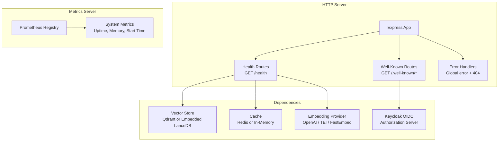
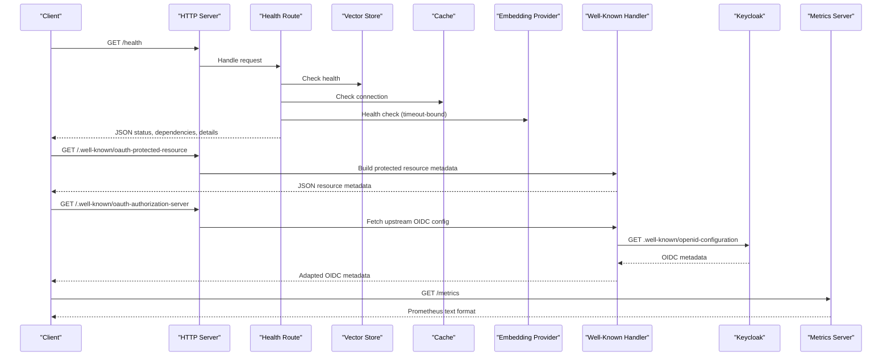
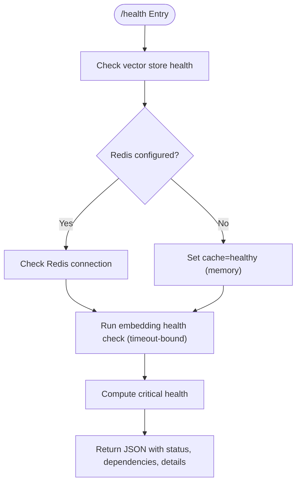

# System & Health Endpoints

<cite>
**Referenced Files in This Document**
- [http-health-routes.ts](file://src/http/http-health-routes.ts)
- [http-well-known.ts](file://src/http/http-well-known.ts)
- [metrics-server.ts](file://src/metrics-server.ts)
- [health.ts](file://src/services/embedding/health.ts)
- [registry.ts](file://src/services/metrics/registry.ts)
- [system-metrics.ts](file://src/services/metrics/system-metrics.ts)
- [config.ts](file://src/config.ts)
- [http-server-startup.ts](file://src/http/http-server-startup.ts)
- [http-error-handlers.ts](file://src/http/http-error-handlers.ts)
</cite>

## Table of Contents
1. [Introduction](#introduction)
2. [Project Structure](#project-structure)
3. [Core Components](#core-components)
4. [Architecture Overview](#architecture-overview)
5. [Detailed Component Analysis](#detailed-component-analysis)
6. [Dependency Analysis](#dependency-analysis)
7. [Performance Considerations](#performance-considerations)
8. [Troubleshooting Guide](#troubleshooting-guide)
9. [Conclusion](#conclusion)
10. [Appendices](#appendices)

## Introduction
This document describes the system monitoring and health check endpoints for the SquadRules MCP service. It covers:
- Service availability via `/health`
- Dependency status checks for vector storage, cache, and embedding providers
- Service discovery and authorization metadata via `/.well-known/oauth-protected-resource`, `/.well-known/oauth-authorization-server`, and `/.well-known/openid-configuration`
- Prometheus metrics collection on a dedicated metrics server
- Monitoring integration patterns, alerting thresholds, and performance indicators
- Examples of health check implementations and dashboard setup guidance

The implementation is HTTP-based, uses Express, and integrates with Keycloak OIDC for authorization metadata. Metrics are exposed through a separate process-scoped server to isolate scraping from application traffic.

## Project Structure
The monitoring and health surface is implemented across a small set of focused modules:
- Health routes under the HTTP layer
- Well-known OAuth/OIDC discovery endpoints
- A dedicated metrics server exposing Prometheus-compatible output
- Embedding provider health utilities
- Centralized configuration for ports, auth, and feature flags



**Diagram sources**
- [http-health-routes.ts:13-92](file://src/http/http-health-routes.ts#L13-L92)
- [http-well-known.ts:31-95](file://src/http/http-well-known.ts#L31-L95)
- [metrics-server.ts:19-42](file://src/metrics-server.ts#L19-L42)
- [health.ts:88-117](file://src/services/embedding/health.ts#L88-L117)
- [registry.ts:11-18](file://src/services/metrics/registry.ts#L11-L18)
- [system-metrics.ts:10-41](file://src/services/metrics/system-metrics.ts#L10-L41)

**Section sources**
- [http-health-routes.ts:13-118](file://src/http/http-health-routes.ts#L13-L118)
- [http-well-known.ts:31-224](file://src/http/http-well-known.ts#L31-L224)
- [metrics-server.ts:19-42](file://src/metrics-server.ts#L19-L42)

## Core Components
- `/health`: Returns service availability, version, transport, uptime, dependency statuses, and optional provider details when authenticated.
- `/.well-known/oauth-protected-resource`: Publishes resource metadata including scopes, bearer methods, and issuer information.
- `/.well-known/oauth-authorization-server` and `/.well-known/openid-configuration`: Proxy Keycloak’s OpenID configuration with local registration endpoint support.
- `/metrics` (metrics server): Exposes Prometheus metrics including system uptime, memory usage, and process start time.
- `/health` (metrics server): Lightweight readiness probe for the metrics server itself.

**Section sources**
- [http-health-routes.ts:13-92](file://src/http/http-health-routes.ts#L13-L92)
- [http-well-known.ts:31-95](file://src/http/http-well-known.ts#L31-L95)
- [metrics-server.ts:19-42](file://src/metrics-server.ts#L19-L42)

## Architecture Overview
The health and monitoring architecture separates concerns between the main HTTP server and a dedicated metrics server:
- The main HTTP server exposes `/health` and well-known discovery endpoints.
- The metrics server runs on a separate port and exposes `/metrics` and its own `/health`.
- Dependency checks in `/health` include vector store, cache, and embedding provider probes.
- Authorization metadata is proxied from Keycloak and adapted for MCP clients.



**Diagram sources**
- [http-health-routes.ts:15-92](file://src/http/http-health-routes.ts#L15-L92)
- [http-well-known.ts:31-95](file://src/http/http-well-known.ts#L31-L95)
- [http-well-known.ts:144-172](file://src/http/http-well-known.ts#L144-L172)
- [metrics-server.ts:23-32](file://src/metrics-server.ts#L23-L32)

## Detailed Component Analysis

### Health Endpoint (`GET /health`)
Purpose:
- Report service availability and overall health status.
- Provide dependency health for vector store, cache, and embedding provider.
- Include build version, transport type, and uptime.
- Optionally expose embedding provider details when the caller is authenticated.

Behavior:
- Checks vector store health; if Qdrant is configured, reports it under `qdrant`; otherwise reports embedded vector store status.
- Checks Redis connectivity when configured; otherwise reports in-memory cache as healthy.
- Performs an embedding provider health check with a short timeout to avoid blocking.
- Computes critical health based on configured dependencies and returns HTTP 200 for healthy, 503 for unhealthy.
- Adds detailed fields such as cache backend, vector store backend, and embedding provider info when authentication context is present.

Response shape:
- `status`: `"healthy"` or `"unhealthy"`
- `service`: `"squadrules-mcp"`
- `version`: build version string
- `transport`: `"http"`
- `uptime`: integer seconds
- `dependencies`: object mapping dependency names to `"healthy"`, `"unhealthy"`, or `"disabled"`
- `details`: object with backend hints and optional embedding/provider details when authenticated

Example response structure:
```json
{
  "status": "healthy",
  "service": "squadrules-mcp",
  "version": "1.2.3",
  "transport": "http",
  "uptime": 1234,
  "dependencies": {
    "qdrant": "healthy",
    "embedding": "healthy",
    "redis": "healthy"
  },
  "details": {
    "cacheBackend": "redis",
    "vectorStoreBackend": "qdrant",
    "provider": "openai",
    "providerPref": "auto"
  }
}
```

Implementation references:
- Health route logic and dependency checks
- Embedding provider health selection and timeout handling
- Authenticated detail exposure

**Section sources**
- [http-health-routes.ts:13-92](file://src/http/http-health-routes.ts#L13-L92)
- [health.ts:88-117](file://src/services/embedding/health.ts#L88-L117)

### Well-Known Discovery Endpoints

#### Protected Resource Metadata (`GET /.well-known/oauth-protected-resource`)
Purpose:
- Announce the protected resource URI, supported scopes, bearer methods, and authorization servers.
- Provide client ID metadata alias for SquadRules-aware clients.

Behavior:
- Builds metadata using the configured callback base URL and Keycloak issuer.
- Sets CORS headers when an origin header is present.
- Supports both root and path-specific `/mcp` variants.

Response highlights:
- `resource`: absolute resource URI
- `authorization_servers`: array of issuers
- `scopes_supported`: list of OIDC scopes
- `bearer_methods_supported`: typically `["header"]`
- Optional `authorization_endpoint` and `token_endpoint` when issuer is configured
- Optional `squadrules_cli_client_id` alias

**Section sources**
- [http-well-known.ts:31-57](file://src/http/http-well-known.ts#L31-L57)
- [http-well-known.ts:59-95](file://src/http/http-well-known.ts#L59-L95)

#### Authorization Server Metadata (`GET /.well-known/oauth-authorization-server`)
Purpose:
- Proxy Keycloak’s OpenID configuration for MCP clients.
- Preserve dynamic client registration endpoint and add client ID metadata document support.

Behavior:
- Caches upstream metadata for five minutes.
- Rewrites internal Keycloak URLs to external ones where applicable.
- Falls back to minimal static metadata when no upstream is configured, ensuring valid 200 responses.

Response highlights:
- Upstream OIDC fields from Keycloak
- `client_id_metadata_document_supported`: `true`
- `registration_endpoint`: local registration path derived from callback base URL

**Section sources**
- [http-well-known.ts:97-189](file://src/http/http-well-known.ts#L97-L189)
- [http-well-known.ts:191-224](file://src/http/http-well-known.ts#L191-L224)

### Metrics Server (`GET /metrics`)
Purpose:
- Expose Prometheus-compatible metrics on a dedicated server.
- Provide a lightweight health probe for the metrics server.

Behavior:
- Uses a shared Prometheus registry with default labels: `service`, `squadrules_version`, `instance`.
- Exposes system metrics: uptime, memory usage (RSS, heap total, heap used), and process start time.
- Logs errors during metrics generation and returns 500 on failure.

Metrics examples:
- `squadrules_system_uptime_seconds`
- `squadrules_system_memory_usage_bytes{type="rss"}`
- `squadrules_system_memory_usage_bytes{type="heapTotal"}`
- `squadrules_system_memory_usage_bytes{type="heapUsed"}`
- `squadrules_system_process_start_time_seconds`

**Section sources**
- [metrics-server.ts:19-42](file://src/metrics-server.ts#L19-L42)
- [registry.ts:11-18](file://src/services/metrics/registry.ts#L11-L18)
- [system-metrics.ts:10-41](file://src/services/metrics/system-metrics.ts#L10-L41)

### Error Handling and Global Behavior
- Global error handler logs structured error context and returns standardized error payloads.
- Specific handlers return appropriate status codes (e.g., 413 for payload too large).
- Catch-all 404 handler ensures unknown routes return consistent JSON.

**Section sources**
- [http-error-handlers.ts:9-53](file://src/http/http-error-handlers.ts#L9-L53)

## Dependency Analysis
The health endpoint composes dependency checks from multiple services:
- Vector store: Qdrant when configured; otherwise embedded LanceDB.
- Cache: Redis when configured; otherwise in-memory.
- Embedding provider: OpenAI, TEI, or FastEmbed depending on configuration and auto-selection.



**Diagram sources**
- [http-health-routes.ts:15-92](file://src/http/http-health-routes.ts#L15-L92)
- [health.ts:88-117](file://src/services/embedding/health.ts#L88-L117)

**Section sources**
- [http-health-routes.ts:15-92](file://src/http/http-health-routes.ts#L15-L92)
- [health.ts:16-86](file://src/services/embedding/health.ts#L16-L86)

## Performance Considerations
- Embedding health checks are bounded by a short timeout to prevent `/health` from blocking during test setup or slow provider responses.
- Metrics server isolation avoids impacting application performance during Prometheus scrapes.
- System metrics update every five seconds to balance freshness and overhead.
- Rate limiting middleware protects sensitive routes (`/auth`, `/api`, `/mcp`) from excessive requests.

Recommendations:
- Keep embedding provider timeouts conservative to maintain responsiveness.
- Monitor memory usage metrics and set alerts for heap growth trends.
- Use separate network access controls for the metrics server port.

**Section sources**
- [http-health-routes.ts:23-44](file://src/http/http-health-routes.ts#L23-L44)
- [metrics-server.ts:19-42](file://src/metrics-server.ts#L19-L42)
- [system-metrics.ts:34-41](file://src/services/metrics/system-metrics.ts#L34-L41)
- [http-server-config.ts:57-82](file://src/http/http-server-config.ts#L57-L82)

## Troubleshooting Guide
Common issues and diagnostics:
- `/health` returns 503:
  - Inspect `dependencies` and `details` fields to identify failing components.
  - Verify vector store connectivity and embedding provider configuration.
  - Check Redis connectivity when configured.
- Embedding provider failures:
  - Authentication errors indicate missing or invalid API keys.
  - Rate-limited responses may still be considered reachable but throttled.
- Well-known endpoints not resolving:
  - Ensure `AUTH_CALLBACK_BASE_URL` is set for production-compliant URIs.
  - Confirm Keycloak URLs and realm configuration.
- Metrics server unreachable:
  - Validate that the metrics server started on the configured port.
  - Check logs for errors generating metrics.

Operational tips:
- Use the metrics server’s `/health` for quick liveness checks.
- Leverage structured logging to correlate errors with request IDs.
- Review rate limit configurations if you observe throttling on health or metrics endpoints.

**Section sources**
- [http-health-routes.ts:15-92](file://src/http/http-health-routes.ts#L15-L92)
- [health.ts:16-86](file://src/services/embedding/health.ts#L16-L86)
- [http-well-known.ts:59-95](file://src/http/http-well-known.ts#L59-L95)
- [metrics-server.ts:23-42](file://src/metrics-server.ts#L23-L42)

## Conclusion
The SquadRules MCP service provides robust health and monitoring surfaces:
- `/health` offers comprehensive dependency checks and operational details.
- Well-known endpoints enable MCP clients to discover authorization settings and register dynamically.
- A dedicated metrics server exposes Prometheus-compatible metrics for reliable scraping.
- Configuration-driven behavior supports flexible deployments with Qdrant or embedded vector stores, Redis or in-memory caches, and multiple embedding providers.

These endpoints facilitate effective observability, automated orchestration, and integration with standard monitoring stacks.

## Appendices

### API Reference Summary

- `GET /health`
  - Purpose: Service availability and dependency status
  - Status codes: 200 (healthy), 503 (unhealthy)
  - Response fields: `status`, `service`, `version`, `transport`, `uptime`, `dependencies`, `details`

- `GET /.well-known/oauth-protected-resource`
  - Purpose: Protected resource metadata
  - Response fields: `resource`, `authorization_servers`, `scopes_supported`, `bearer_methods_supported`, optional endpoints and aliases

- `GET /.well-known/oauth-authorization-server`
  - Purpose: Authorization server metadata proxy
  - Response fields: Upstream OIDC fields plus `client_id_metadata_document_supported` and `registration_endpoint`

- `GET /.well-known/openid-configuration`
  - Purpose: Alias for authorization server metadata

- `GET /metrics` (metrics server)
  - Purpose: Prometheus metrics export
  - Content-Type: Prometheus text format
  - Example metrics: `squadrules_system_uptime_seconds`, `squadrules_system_memory_usage_bytes`, `squadrules_system_process_start_time_seconds`

- `GET /health` (metrics server)
  - Purpose: Lightweight readiness probe
  - Response: `{ "status": "ok", "service": "metrics" }`

**Section sources**
- [http-health-routes.ts:13-92](file://src/http/http-health-routes.ts#L13-L92)
- [http-well-known.ts:31-95](file://src/http/http-well-known.ts#L31-L95)
- [http-well-known.ts:191-224](file://src/http/http-well-known.ts#L191-L224)
- [metrics-server.ts:23-42](file://src/metrics-server.ts#L23-L42)

### Monitoring Integration Patterns

Prometheus configuration example:
```yaml
scrape_configs:
  - job_name: 'squadrules-http'
    metrics_path: '/metrics'
    static_configs:
      - targets: ['localhost:9090']
```

Grafana dashboard suggestions:
- Panel for `squadrules_system_uptime_seconds`
- Panel for `squadrules_system_memory_usage_bytes` split by `type`
- Alert on `/health` returning 503
- Alert on embedding provider health being unhealthy
- Alert on Redis connection failures

Alerting thresholds:
- Uptime drops below expected value after restarts
- Heap memory usage exceeds baseline thresholds
- Embedding provider latency or error rates increase
- Redis connection failures persist beyond a threshold window

**Section sources**
- [metrics-server.ts:19-42](file://src/metrics-server.ts#L19-L42)
- [system-metrics.ts:10-41](file://src/services/metrics/system-metrics.ts#L10-L41)
- [http-health-routes.ts:15-92](file://src/http/http-health-routes.ts#L15-L92)