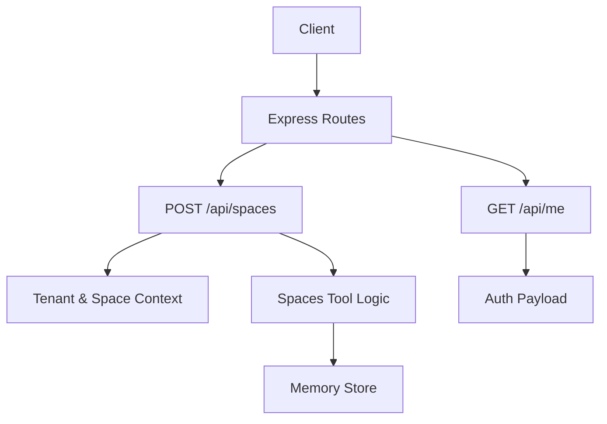
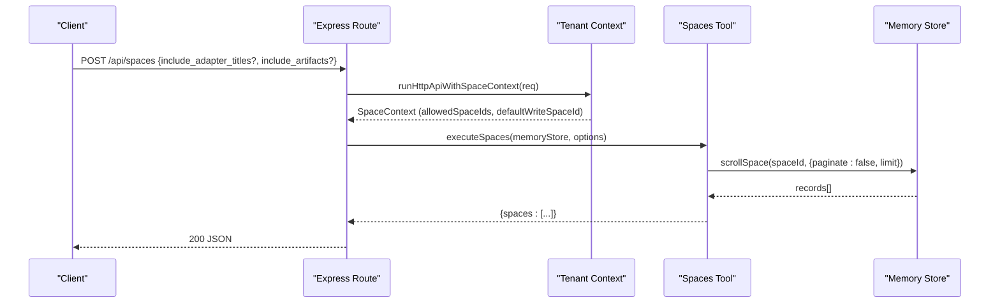
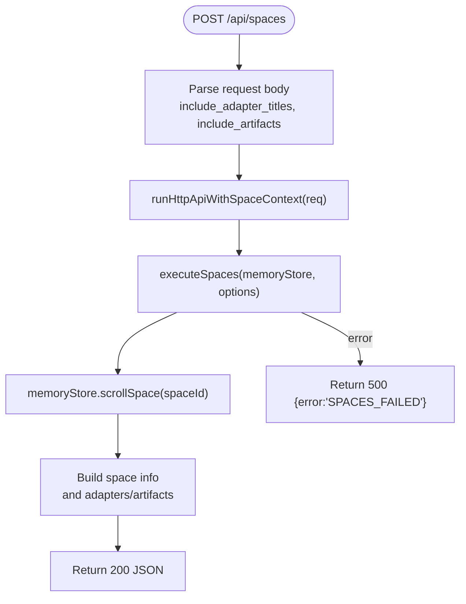
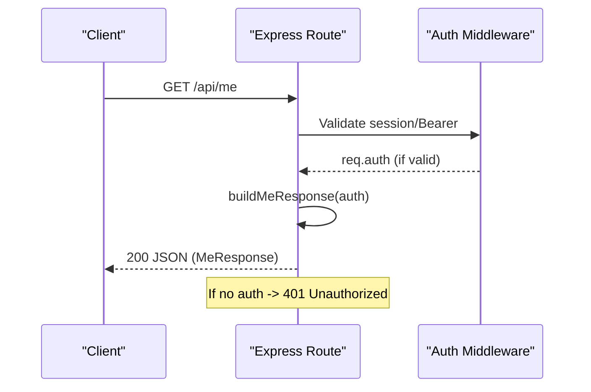
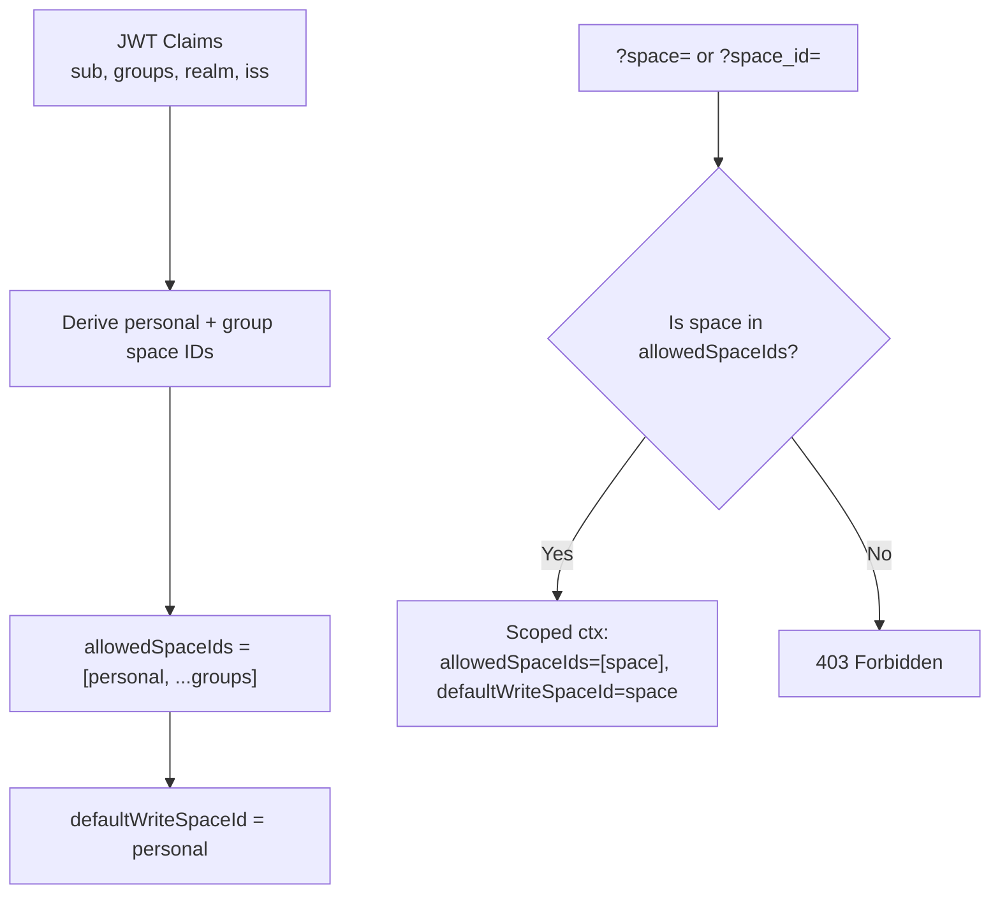
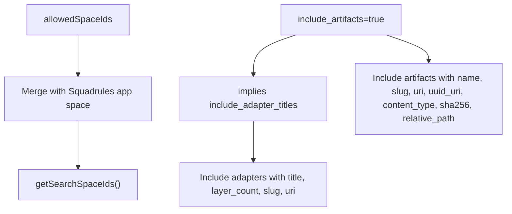
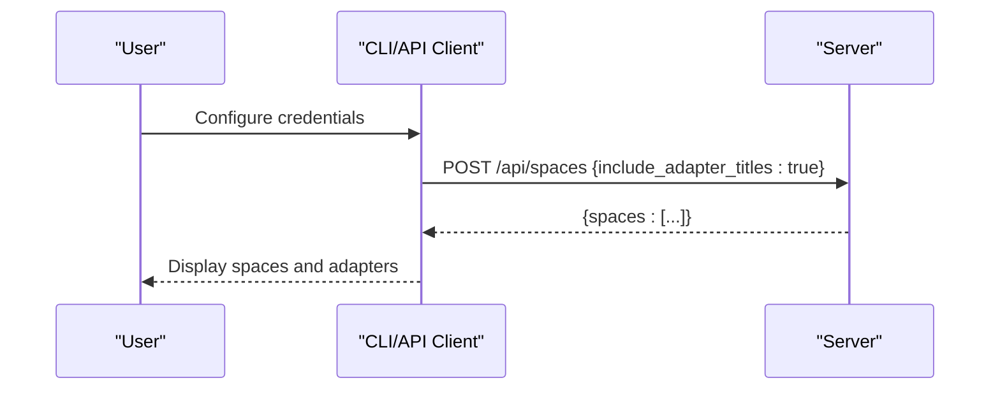
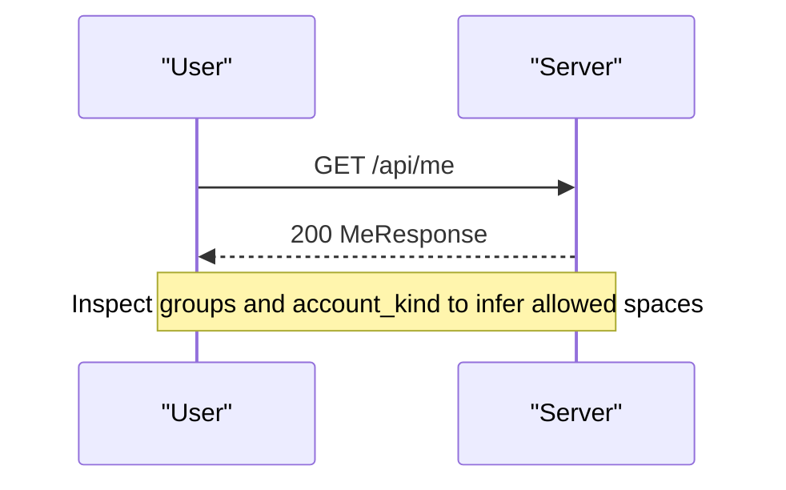
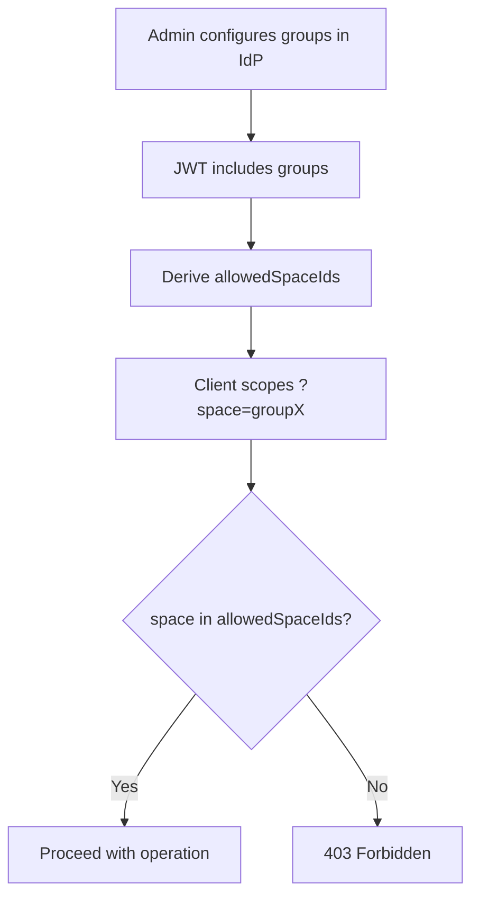
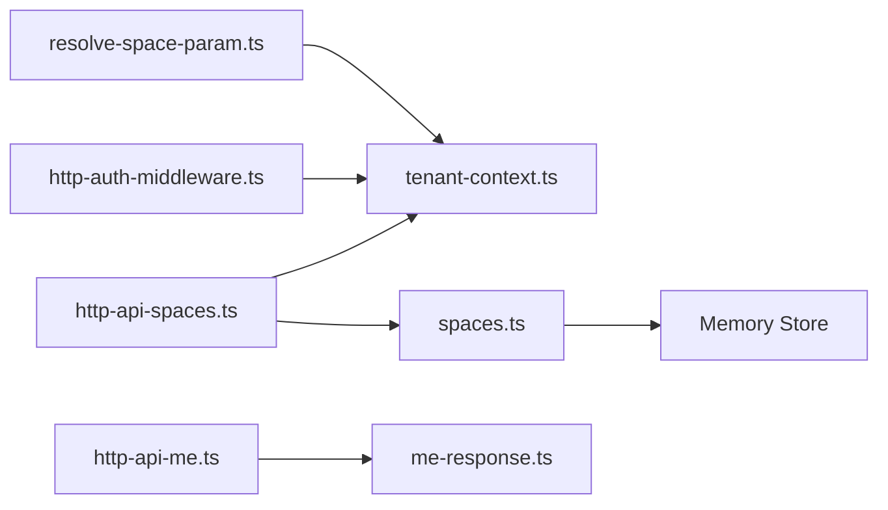

# Workspace & Spaces Endpoints

<cite>
**Referenced Files in This Document**
- [http-api-spaces.ts](file://src/http/http-api-spaces.ts)
- [http-api-me.ts](file://src/http/http-api-me.ts)
- [spaces_schema.ts](file://src/tools/spaces_schema.ts)
- [spaces.ts](file://src/tools/spaces.ts)
- [me-response.ts](file://src/me-response.ts)
- [tenant-context.ts](file://src/utils/tenant-context.ts)
- [http-auth-middleware.ts](file://src/http/http-auth-middleware.ts)
- [resolve-space-param.ts](file://src/utils/resolve-space-param.ts)
- [api-client.ts](file://src/cli/api-client.ts)
</cite>

## Table of Contents
1. [Introduction](#introduction)
2. [Project Structure](#project-structure)
3. [Core Components](#core-components)
4. [Architecture Overview](#architecture-overview)
5. [Detailed Component Analysis](#detailed-component-analysis)
6. [Dependency Analysis](#dependency-analysis)
7. [Performance Considerations](#performance-considerations)
8. [Troubleshooting Guide](#troubleshooting-guide)
9. [Conclusion](#conclusion)

## Introduction
This document provides API documentation for workspace and spaces management endpoints, focusing on:
- Listing available logical workspaces (spaces), their metadata, and adapter counts via POST /api/spaces.
- Retrieving the authenticated user’s context and profile via GET /api/me.
- Role-based access control, space isolation, and cross-space behavior.
- Request/response schemas for space metadata, permissions, and member-related fields exposed by the current identity.

The system uses Keycloak-derived JWT claims to derive allowed spaces per user and group, with strict isolation when authentication is enabled. The spaces endpoint reads from the memory store and returns a structured list of spaces and adapters, optionally including artifact metadata.

## Project Structure
The relevant implementation is split across HTTP route handlers, tool logic, schema definitions, and tenant/space context utilities:
- HTTP routes:
  - POST /api/spaces: lists spaces and adapter counts.
  - GET /api/me: returns current user profile and authorization fields.
- Tooling and schemas:
  - Space listing logic and MCP tool registration.
  - Zod schemas for input/output validation.
- Tenant and space context:
  - Derivation of allowed spaces from JWT groups and realm.
  - Request-scoped narrowing via query parameters.

**Diagram sources**
- [http-api-spaces.ts:11-30](file://src/http/http-api-spaces.ts#L11-L30)
- [http-api-me.ts:31-39](file://src/http/http-api-me.ts#L31-L39)
- [tenant-context.ts:256-311](file://src/utils/tenant-context.ts#L256-L311)
- [spaces.ts:172-189](file://src/tools/spaces.ts#L172-L189)

**Section sources**
- [http-api-spaces.ts:11-30](file://src/http/http-api-spaces.ts#L11-L30)
- [http-api-me.ts:31-39](file://src/http/http-api-me.ts#L31-L39)
- [tenant-context.ts:256-311](file://src/utils/tenant-context.ts#L256-L311)

## Core Components
- POST /api/spaces
  - Purpose: List available spaces and adapter counts; optionally include adapter titles and artifacts.
  - Authentication: Requires auth when enabled; otherwise operates in single-tenant mode.
  - Request body options:
    - include_adapter_titles: boolean (optional). Includes per-space adapter title and layer_count.
    - include_artifacts: boolean (optional). Includes artifact metadata per adapter; implies adapter titles.
  - Response: JSON object containing an array of spaces with metadata and optional adapters/artifacts.
- GET /api/me
  - Purpose: Return current user profile and authorization fields derived from session or Bearer token.
  - Authentication: Required; returns 401 if not authenticated.
  - Response: JSON object with user identity, groups, realm, account kind/label, and optional profile fields.

Key behaviors:
- Space isolation: When AUTH_ENABLED, unauthenticated requests receive no default space context to prevent data leakage.
- Cross-space visibility: Search/list operations may include the Squadrules app space alongside user/group spaces.
- Query scoping: A request-scoped space parameter can narrow allowedSpaceIds and defaultWriteSpaceId for the request.

**Section sources**
- [http-api-spaces.ts:11-30](file://src/http/http-api-spaces.ts#L11-L30)
- [http-api-me.ts:31-39](file://src/http/http-api-me.ts#L31-L39)
- [tenant-context.ts:256-311](file://src/utils/tenant-context.ts#L256-L311)

## Architecture Overview
The spaces endpoint integrates HTTP routing, tenant context derivation, and the spaces tool that queries the memory store. The me endpoint exposes a whitelisted subset of the auth payload as a user profile.

**Diagram sources**
- [http-api-spaces.ts:11-30](file://src/http/http-api-spaces.ts#L11-L30)
- [tenant-context.ts:298-303](file://src/utils/tenant-context.ts#L298-L303)
- [spaces.ts:172-189](file://src/tools/spaces.ts#L172-L189)

## Detailed Component Analysis

### POST /api/spaces
- Endpoint: POST /api/spaces
- Authentication: Required when enabled; otherwise single-tenant defaults apply.
- Request body:
  - include_adapter_titles: boolean (optional). Default false.
  - include_artifacts: boolean (optional). Default false. Implies include_adapter_titles.
- Response:
  - spaces: array of space objects.
  - Each space includes:
    - name: string
    - space_id: string
    - type: enum personal | group | app | other
    - adapter_count: number
    - adapters?: array of adapter objects (when include_adapter_titles is true):
      - adapter_id: string
      - title: string
      - layer_count: number
      - slug: string | null
      - uri: string
      - artifacts?: array of artifact objects (when include_artifacts is true):
        - name: string
        - slug: string
        - uri: string
        - uuid_uri: string
        - content_type: string
        - sha256: string
        - relative_path: string | null

Error handling:
- On failure, returns 500 with error code SPACES_FAILED and a message.

Access control and scope:
- Uses runHttpApiWithSpaceContext to establish SpaceContext from req.auth.
- Allowed spaces are derived from JWT sub + groups + realm/issuer.
- The Squadrules app space may be included in search/list results depending on configuration.

**Diagram sources**
- [http-api-spaces.ts:11-30](file://src/http/http-api-spaces.ts#L11-L30)
- [spaces.ts:172-189](file://src/tools/spaces.ts#L172-L189)

**Section sources**
- [http-api-spaces.ts:11-30](file://src/http/http-api-spaces.ts#L11-L30)
- [spaces_schema.ts:1-53](file://src/tools/spaces_schema.ts#L1-L53)
- [spaces.ts:172-189](file://src/tools/spaces.ts#L172-L189)

### GET /api/me
- Endpoint: GET /api/me
- Authentication: Required; returns 401 if not authenticated.
- Response fields:
  - sub: string
  - groups: string[]
  - realm: string
  - account_kind: local | sso
  - account_label: string
  - Optional profile fields: preferred_username, name, given_name, family_name, email, email_verified, identity_provider

Behavior:
- Builds a whitelisted response from the auth payload.
- Derives account_kind and account_label from identity provider when not present.

**Diagram sources**
- [http-api-me.ts:31-39](file://src/http/http-api-me.ts#L31-L39)
- [me-response.ts:1-20](file://src/me-response.ts#L1-L20)

**Section sources**
- [http-api-me.ts:31-39](file://src/http/http-api-me.ts#L31-L39)
- [me-response.ts:1-20](file://src/me-response.ts#L1-L20)

### Role-Based Access Control and Space Isolation
- Space derivation:
  - Personal space ID is deterministic based on issuer, realm, and user sub.
  - Group spaces are derived from JWT groups and normalized paths.
  - allowedSpaceIds contains personal space plus group spaces.
  - defaultWriteSpaceId points to the personal space unless narrowed by query.
- Strict isolation:
  - When AUTH_ENABLED and no auth context, a sentinel space is used to avoid leaking data between tenants.
- Query scoping:
  - Passing ?space= or ?space_id= narrows allowedSpaceIds and defaultWriteSpaceId for the request.
  - If the requested space is not in allowedSpaceIds, the middleware returns 403 forbidden.

**Diagram sources**
- [tenant-context.ts:217-248](file://src/utils/tenant-context.ts#L217-L248)
- [http-auth-middleware.ts:190-228](file://src/http/http-auth-middleware.ts#L190-L228)

**Section sources**
- [tenant-context.ts:217-248](file://src/utils/tenant-context.ts#L217-L248)
- [tenant-context.ts:256-311](file://src/utils/tenant-context.ts#L256-L311)
- [http-auth-middleware.ts:190-228](file://src/http/http-auth-middleware.ts#L190-L228)

### Cross-Space Operations and Visibility
- Search/list visibility:
  - getSearchSpaceIds merges allowedSpaceIds with the Squadrules app space unless already included.
  - This allows users to see shared app resources while writes remain scoped to allowed spaces.
- Adapter and artifact inclusion:
  - include_artifacts implies include_adapter_titles.
  - Artifacts are filtered by allowed MIME types and require a valid slug.

**Diagram sources**
- [tenant-context.ts:137-150](file://src/utils/tenant-context.ts#L137-L150)
- [spaces.ts:87-165](file://src/tools/spaces.ts#L87-L165)

**Section sources**
- [tenant-context.ts:137-150](file://src/utils/tenant-context.ts#L137-L150)
- [spaces.ts:87-165](file://src/tools/spaces.ts#L87-L165)

### Request/Response Schemas

#### POST /api/spaces Input Schema
- include_adapter_titles: boolean (optional, default false)
- include_artifacts: boolean (optional, default false)

#### POST /api/spaces Output Schema
- spaces: array of space objects
  - name: string
  - space_id: string
  - type: enum personal | group | app | other
  - adapter_count: number
  - adapters?: array of adapter objects
    - adapter_id: string
    - title: string
    - layer_count: number
    - slug: string | null
    - uri: string
    - artifacts?: array of artifact objects
      - name: string
      - slug: string
      - uri: string
      - uuid_uri: string
      - content_type: string
      - sha256: string
      - relative_path: string | null

#### GET /api/me Output Schema
- sub: string
- groups: string[]
- realm: string
- account_kind: local | sso
- account_label: string
- Optional: preferred_username, name, given_name, family_name, email, email_verified, identity_provider

**Section sources**
- [spaces_schema.ts:1-53](file://src/tools/spaces_schema.ts#L1-L53)
- [me-response.ts:1-20](file://src/me-response.ts#L1-L20)

### Example Workflows

#### Workspace Setup and Listing
- Authenticate via Keycloak (session or Bearer).
- Call POST /api/spaces with include_adapter_titles=true to discover available spaces and adapter details.
- Use include_artifacts=true to retrieve artifact metadata for each adapter.

**Diagram sources**
- [http-api-spaces.ts:11-30](file://src/http/http-api-spaces.ts#L11-L30)
- [api-client.ts:36-44](file://src/cli/api-client.ts#L36-L44)

#### User Provisioning and Profile Inspection
- After authentication, call GET /api/me to inspect current user identity and groups.
- Use groups and account_kind/account_label to determine permitted spaces and roles.

**Diagram sources**
- [http-api-me.ts:31-39](file://src/http/http-api-me.ts#L31-L39)
- [me-response.ts:1-20](file://src/me-response.ts#L1-L20)

#### Permission Management Workflow
- Admin provisions groups in Keycloak; JWT groups map to group spaces.
- Users inherit access to personal space and group spaces.
- Clients can scope operations to a specific group using ?space= or ?space_id=.
- Requests to unauthorized spaces are rejected with 403.

**Diagram sources**
- [tenant-context.ts:217-248](file://src/utils/tenant-context.ts#L217-L248)
- [http-auth-middleware.ts:190-228](file://src/http/http-auth-middleware.ts#L190-L228)

## Dependency Analysis
- HTTP routes depend on:
  - Tenant context utilities for deriving SpaceContext.
  - Spaces tool for business logic and schema validation.
  - Memory store for reading space data.
- Spaces tool depends on:
  - Tenant context for allowed spaces and display names.
  - Utility functions for slugs, URIs, and artifact filtering.
- Auth middleware enforces:
  - Session/Bearer validation.
  - Space parameter validation against allowedSpaceIds.

**Diagram sources**
- [http-api-spaces.ts:11-30](file://src/http/http-api-spaces.ts#L11-L30)
- [http-api-me.ts:31-39](file://src/http/http-api-me.ts#L31-L39)
- [tenant-context.ts:256-311](file://src/utils/tenant-context.ts#L256-L311)
- [resolve-space-param.ts:80-116](file://src/utils/resolve-space-param.ts#L80-L116)

**Section sources**
- [http-api-spaces.ts:11-30](file://src/http/http-api-spaces.ts#L11-L30)
- [http-api-me.ts:31-39](file://src/http/http-api-me.ts#L31-L39)
- [tenant-context.ts:256-311](file://src/utils/tenant-context.ts#L256-L311)
- [resolve-space-param.ts:80-116](file://src/utils/resolve-space-param.ts#L80-L116)

## Performance Considerations
- Pagination disabled for spaces listing; a fixed scroll limit is applied to avoid excessive payloads.
- Artifact inclusion increases payload size; use include_artifacts only when needed.
- Metrics are recorded for tool calls, duration, input/output sizes, and errors to aid performance monitoring.

[No sources needed since this section provides general guidance]

## Troubleshooting Guide
Common issues and resolutions:
- 401 Unauthorized on GET /api/me:
  - Ensure session or Bearer token is present and valid.
- 403 Forbidden on operations with ?space=:
  - Verify the requested space is in allowedSpaceIds for the current identity.
- Empty spaces list:
  - Confirm authentication is enabled and JWT includes groups mapping to spaces.
  - Check that the Squadrules app space is included in search/list visibility as configured.
- SPACES_FAILED error:
  - Review server logs for underlying errors during space enumeration.

**Section sources**
- [http-api-me.ts:31-39](file://src/http/http-api-me.ts#L31-L39)
- [http-auth-middleware.ts:190-228](file://src/http/http-auth-middleware.ts#L190-L228)
- [http-api-spaces.ts:25-29](file://src/http/http-api-spaces.ts#L25-L29)

## Conclusion
The workspace and spaces endpoints provide a secure, role-based mechanism for discovering and operating within logical workspaces. POST /api/spaces enumerates spaces and adapters with optional artifact details, while GET /api.me exposes the authenticated user’s profile and authorization fields. Space isolation is enforced through JWT-derived contexts, with strict separation when authentication is enabled and controlled cross-space visibility for shared resources. Clients should authenticate, inspect /api/me, and then call /api/spaces with appropriate flags to tailor responses to their needs.