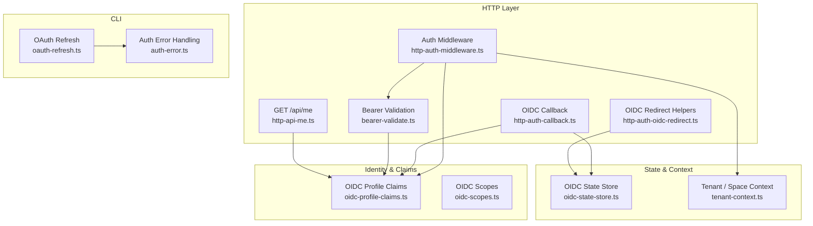
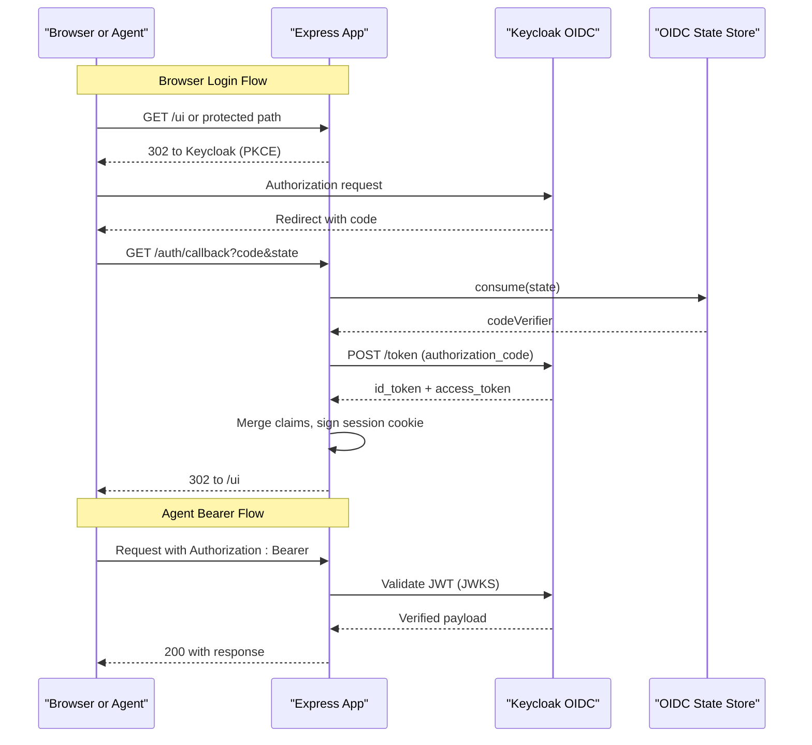
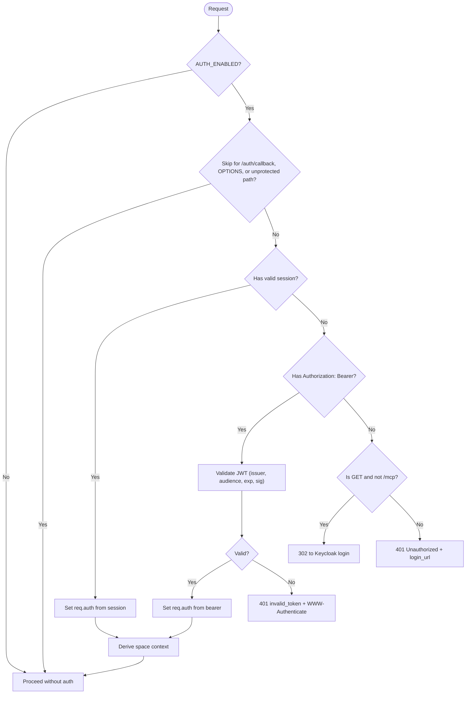
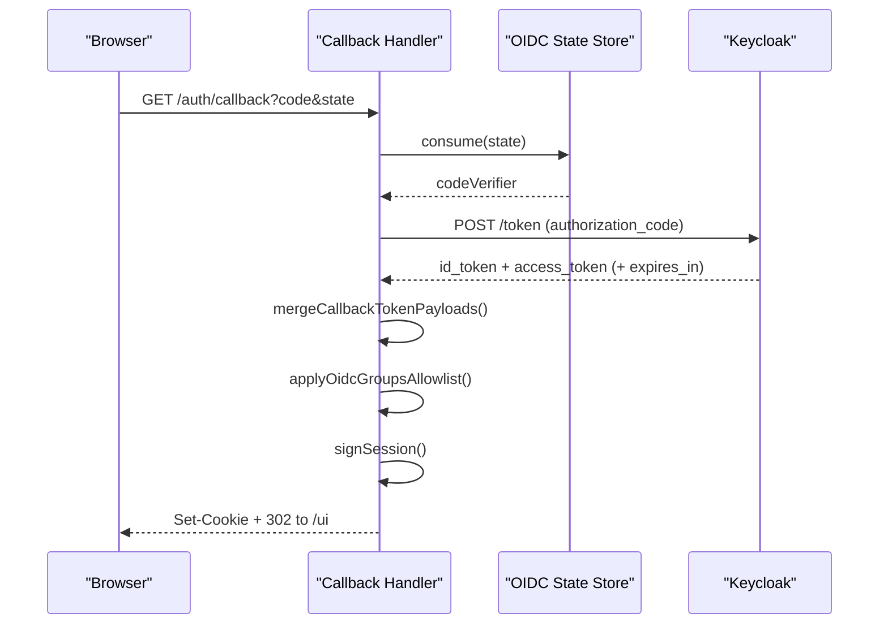
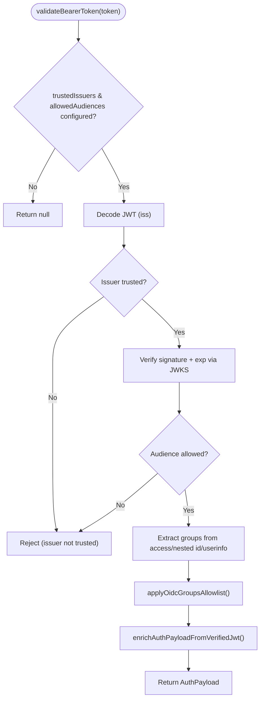
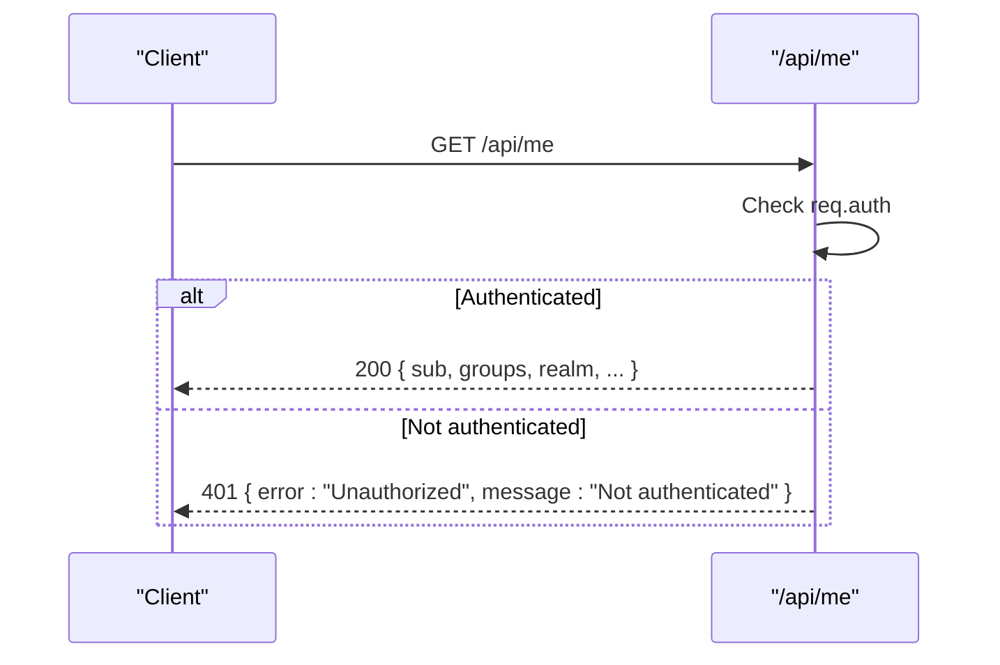
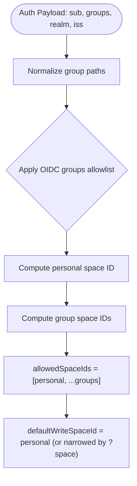
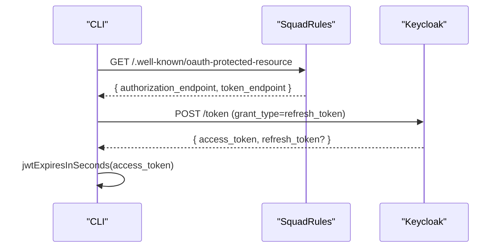
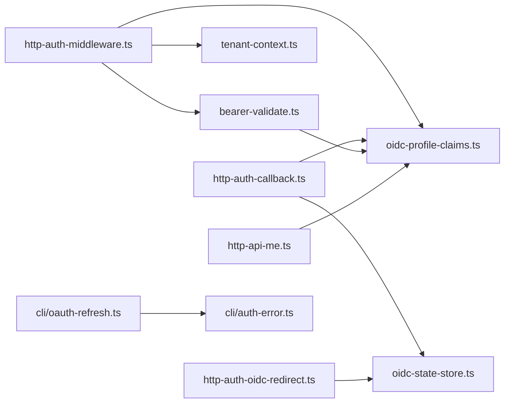

# Authentication Endpoints

<cite>
**Referenced Files in This Document**
- [http-auth-middleware.ts](file://src/http/http-auth-middleware.ts)
- [bearer-validate.ts](file://src/http/bearer-validate.ts)
- [http-api-me.ts](file://src/http/http-api-me.ts)
- [http-auth-callback.ts](file://src/http/http-auth-callback.ts)
- [http-auth-oidc-redirect.ts](file://src/http/http-auth-oidc-redirect.ts)
- [oidc-profile-claims.ts](file://src/http/oidc-profile-claims.ts)
- [oidc-scopes.ts](file://src/http/oidc-scopes.ts)
- [oidc-state-store.ts](file://src/services/oidc-state-store.ts)
- [tenant-context.ts](file://src/utils/tenant-context.ts)
- [me-response.ts](file://src/me-response.ts)
- [oauth-refresh.ts](file://src/cli/oauth-refresh.ts)
- [auth-error.ts](file://src/cli/auth-error.ts)
</cite>

## Table of Contents
1. [Introduction](#introduction)
2. [Project Structure](#project-structure)
3. [Core Components](#core-components)
4. [Architecture Overview](#architecture-overview)
5. [Detailed Component Analysis](#detailed-component-analysis)
6. [Dependency Analysis](#dependency-analysis)
7. [Performance Considerations](#performance-considerations)
8. [Troubleshooting Guide](#troubleshooting-guide)
9. [Conclusion](#conclusion)

## Introduction
This document explains SquadRules authentication endpoints and middleware, focusing on OAuth2/OIDC integration with Keycloak, JWT validation, bearer token handling, session management, and authorization. It covers:

- How browser sessions and agent bearer tokens are authenticated differently
- Group-based authorization and space-scoped permissions
- The `/api/me` endpoint specification
- Token refresh flows for CLI clients
- Proper `Authorization` header usage and common error responses

SquadRules is an agent-first MCP framework where AI agents are primary users and humans configure preferences through agents. Authentication supports both human browser sessions and machine-to-machine bearer tokens, enabling secure multi-tenant operation across spaces.

## Project Structure
Authentication-related code is primarily under `src/http`, with supporting utilities in `src/utils`, services in `src/services`, and CLI refresh helpers in `src/cli`.

**Diagram sources**
- [http-auth-middleware.ts:1-330](file://src/http/http-auth-middleware.ts#L1-L330)
- [bearer-validate.ts:1-209](file://src/http/bearer-validate.ts#L1-L209)
- [http-api-me.ts:1-41](file://src/http/http-api-me.ts#L1-L41)
- [http-auth-callback.ts:1-231](file://src/http/http-auth-callback.ts#L1-L231)
- [http-auth-oidc-redirect.ts:1-92](file://src/http/http-auth-oidc-redirect.ts#L1-L92)
- [oidc-profile-claims.ts:1-288](file://src/http/oidc-profile-claims.ts#L1-L288)
- [oidc-scopes.ts:1-31](file://src/http/oidc-scopes.ts#L1-L31)
- [oidc-state-store.ts:1-76](file://src/services/oidc-state-store.ts#L1-L76)
- [tenant-context.ts:1-312](file://src/utils/tenant-context.ts#L1-L312)
- [oauth-refresh.ts:1-111](file://src/cli/oauth-refresh.ts#L1-L111)
- [auth-error.ts:1-133](file://src/cli/auth-error.ts#L1-L133)

**Section sources**
- [http-auth-middleware.ts:1-330](file://src/http/http-auth-middleware.ts#L1-L330)
- [bearer-validate.ts:1-209](file://src/http/bearer-validate.ts#L1-L209)
- [http-api-me.ts:1-41](file://src/http/http-api-me.ts#L1-L41)
- [http-auth-callback.ts:1-231](file://src/http/http-auth-callback.ts#L1-L231)
- [http-auth-oidc-redirect.ts:1-92](file://src/http/http-auth-oidc-redirect.ts#L1-L92)
- [oidc-profile-claims.ts:1-288](file://src/http/oidc-profile-claims.ts#L1-L288)
- [oidc-scopes.ts:1-31](file://src/http/oidc-scopes.ts#L1-L31)
- [oidc-state-store.ts:1-76](file://src/services/oidc-state-store.ts#L1-L76)
- [tenant-context.ts:1-312](file://src/utils/tenant-context.ts#L1-L312)
- [oauth-refresh.ts:1-111](file://src/cli/oauth-refresh.ts#L1-L111)
- [auth-error.ts:1-133](file://src/cli/auth-error.ts#L1-L133)

## Core Components
- Auth middleware enforces authentication for protected paths (`/api`, `/mcp`, `/ui`) when enabled. It accepts either a signed session cookie or a validated Bearer token.
- OIDC callback exchanges the authorization code for tokens, merges claims, signs a session cookie, and redirects to the UI.
- Bearer validation verifies issuer, audience, expiration, and signature via JWKS; it also resolves groups from access token, nested ID token, or OIDC userinfo.
- `/api/me` returns a whitelisted profile and authorization fields for the current user.
- OIDC redirect helpers build PKCE login URLs and handle logout.
- OIDC state store persists PKCE state (code verifier + timestamp) using Redis or in-memory storage.
- Tenant context derives per-user personal space and group-based spaces from identity claims.
- CLI OAuth refresh discovers token endpoints and exchanges refresh tokens for new access tokens.

**Section sources**
- [http-auth-middleware.ts:1-330](file://src/http/http-auth-middleware.ts#L1-L330)
- [bearer-validate.ts:1-209](file://src/http/bearer-validate.ts#L1-L209)
- [http-api-me.ts:1-41](file://src/http/http-api-me.ts#L1-L41)
- [http-auth-callback.ts:1-231](file://src/http/http-auth-callback.ts#L1-L231)
- [http-auth-oidc-redirect.ts:1-92](file://src/http/http-auth-oidc-redirect.ts#L1-L92)
- [oidc-state-store.ts:1-76](file://src/services/oidc-state-store.ts#L1-L76)
- [tenant-context.ts:1-312](file://src/utils/tenant-context.ts#L1-L312)
- [oauth-refresh.ts:1-111](file://src/cli/oauth-refresh.ts#L1-L111)

## Architecture Overview
The system supports two authentication paths:

- Browser path: PKCE flow with Keycloak → callback → signed session cookie → subsequent requests use the cookie.
- Agent path: Direct Bearer token presented in `Authorization: Bearer <token>` → server validates JWT against Keycloak JWKS.

Both paths produce a normalized `AuthPayload` containing subject, groups, realm, issuer, and optional profile fields. Authorization then uses groups to derive allowed spaces and default write space.

**Diagram sources**
- [http-auth-oidc-redirect.ts:15-67](file://src/http/http-auth-oidc-redirect.ts#L15-L67)
- [http-auth-callback.ts:122-229](file://src/http/http-auth-callback.ts#L122-L229)
- [bearer-validate.ts:120-208](file://src/http/bearer-validate.ts#L120-L208)
- [oidc-state-store.ts:50-61](file://src/services/oidc-state-store.ts#L50-L61)

## Detailed Component Analysis

### Authentication Middleware
The middleware protects `/api`, `/mcp`, and `/ui` routes when authentication is enabled. It:

- Skips protection for `/auth/callback`, `OPTIONS`, and unprotected paths.
- Accepts a signed session cookie or a Bearer token.
- For browsers without auth, returns a redirect to Keycloak for GET requests; otherwise returns 401 with `WWW-Authenticate` and JSON body including a login URL.
- For MCP JSON-RPC calls, returns a structured JSON-RPC 2.0 error envelope.
- Derives space context from `req.auth` and query parameters, enforcing that requested spaces are within allowed spaces.

Key behaviors:
- Session cookie parsing validates HMAC and expiry, then extracts subject, groups, realm, issuer, and optional profile fields.
- Bearer validation requires trusted issuers and allowed audiences; if missing, returns a specific 401 explaining configuration requirements.
- Space scoping narrows allowed spaces and default write space based on `?space=` or `?space_id=`.

**Diagram sources**
- [http-auth-middleware.ts:172-327](file://src/http/http-auth-middleware.ts#L172-L327)

**Section sources**
- [http-auth-middleware.ts:1-330](file://src/http/http-auth-middleware.ts#L1-L330)

### OIDC Callback and Session Management
The callback endpoint:

- Validates required configuration and parameters (`code`, `state`).
- Consumes PKCE state from the shared store.
- Exchanges the code for tokens at Keycloak’s token endpoint.
- Merges `id_token` and `access_token` payloads, preferring access token groups and deriving realm and issuer.
- Applies group allowlist filtering.
- Computes session TTL from token lifetime or access token expiry.
- Signs and sets an httpOnly session cookie, then redirects to the UI.

Logout support clears the Squadrules session and optionally performs RP-initiated logout to Keycloak, using `id_token_hint` when available.

**Diagram sources**
- [http-auth-callback.ts:122-229](file://src/http/http-auth-callback.ts#L122-L229)
- [oidc-profile-claims.ts:200-256](file://src/http/oidc-profile-claims.ts#L200-L256)
- [oidc-state-store.ts:50-61](file://src/services/oidc-state-store.ts#L50-L61)

**Section sources**
- [http-auth-callback.ts:1-231](file://src/http/http-auth-callback.ts#L1-L231)
- [oidc-profile-claims.ts:1-288](file://src/http/oidc-profile-claims.ts#L1-L288)
- [oidc-state-store.ts:1-76](file://src/services/oidc-state-store.ts#L1-L76)

### Bearer Token Validation
Bearer validation:

- Decodes the JWT to check issuer against trusted issuers.
- Uses JWKS (cached per issuer) to verify signature and expiration.
- Validates audience, including special cases for Keycloak (`aud="account"` or empty aud when issuer is a Keycloak realm).
- Extracts groups from access token, nested `id_token`, or OIDC userinfo endpoint.
- Optionally merges userinfo groups into access token groups.
- Applies group allowlist and enriches profile fields.

**Diagram sources**
- [bearer-validate.ts:120-208](file://src/http/bearer-validate.ts#L120-L208)
- [oidc-profile-claims.ts:78-95](file://src/http/oidc-profile-claims.ts#L78-L95)
- [oidc-profile-claims.ts:119-153](file://src/http/oidc-profile-claims.ts#L119-L153)
- [oidc-profile-claims.ts:272-287](file://src/http/oidc-profile-claims.ts#L272-L287)

**Section sources**
- [bearer-validate.ts:1-209](file://src/http/bearer-validate.ts#L1-L209)
- [oidc-profile-claims.ts:1-288](file://src/http/oidc-profile-claims.ts#L1-L288)

### GET /api/me Endpoint
`GET /api/me` returns a whitelimited profile and authorization fields derived from `req.auth`. It requires authentication; otherwise returns 401.

Response includes:
- `sub`, `groups`, `realm`
- Optional profile fields: `preferred_username`, `name`, `given_name`, `family_name`, `email`, `email_verified`, `identity_provider`
- Derived account metadata: `account_kind`, `account_label`

**Diagram sources**
- [http-api-me.ts:31-40](file://src/http/http-api-me.ts#L31-L40)
- [me-response.ts:1-20](file://src/me-response.ts#L1-L20)

**Section sources**
- [http-api-me.ts:1-41](file://src/http/http-api-me.ts#L1-L41)
- [me-response.ts:1-20](file://src/me-response.ts#L1-L20)

### OIDC Redirects and Logout
Redirect helpers:

- Build PKCE authorization URLs with `client_id`, `redirect_uri`, `response_type=code`, scopes, `state`, `code_challenge=S256`, and `prompt=login`.
- Persist PKCE state (state + code_verifier + createdAt) in the shared store before redirecting.
- Provide safe variants for API responses that return a login URL instead of redirecting.
- Build Keycloak logout URLs with `post_logout_redirect_uri` and optional `id_token_hint`.

Scopes supported include `openid`, `profile`, `email`, custom `squadrules-groups`, and `offline_access`.

**Section sources**
- [http-auth-oidc-redirect.ts:1-92](file://src/http/http-auth-oidc-redirect.ts#L1-L92)
- [oidc-scopes.ts:1-31](file://src/http/oidc-scopes.ts#L1-L31)
- [oidc-state-store.ts:1-76](file://src/services/oidc-state-store.ts#L1-L76)

### Group-Based Authorization and Space-Scoped Permissions
Authorization is derived from OIDC groups:

- Groups are extracted from tokens and normalized to path forms.
- An allowlist can restrict which groups become SQUADRULES spaces (exact match or prefix match).
- Personal space ID is deterministic: `user:{realm}:{uuidv5(iss + "\\nuser\\n" + sub)}`.
- Group space IDs are deterministic: `group:{realm}:{uuidv5(iss + "\\ngroup\\n" + fullPath)}`.
- Allowed spaces include personal space plus all matching group spaces.
- Default write space is the personal space unless narrowed by `?space=`.
- When a space parameter is provided, the middleware ensures it belongs to allowed spaces and narrows context accordingly.

**Diagram sources**
- [oidc-profile-claims.ts:78-95](file://src/http/oidc-profile-claims.ts#L78-L95)
- [oidc-profile-claims.ts:119-153](file://src/http/oidc-profile-claims.ts#L119-L153)
- [tenant-context.ts:187-248](file://src/utils/tenant-context.ts#L187-L248)
- [http-auth-middleware.ts:196-220](file://src/http/http-auth-middleware.ts#L196-L220)

**Section sources**
- [oidc-profile-claims.ts:1-288](file://src/http/oidc-profile-claims.ts#L1-L288)
- [tenant-context.ts:1-312](file://src/utils/tenant-context.ts#L1-L312)
- [http-auth-middleware.ts:196-220](file://src/http/http-auth-middleware.ts#L196-L220)

### Human vs Agent Authentication
- Human browser requests rely on a signed session cookie established via the OIDC callback. The middleware parses and validates the session record, extracting subject, groups, realm, issuer, and profile fields.
- Agent requests present a Bearer token in the `Authorization` header. The server validates the JWT directly against Keycloak using JWKS. If groups are missing from the access token, they may be fetched from the OIDC userinfo endpoint.

Both paths converge to the same `AuthPayload` shape used for authorization and space derivation.

**Section sources**
- [http-auth-middleware.ts:49-133](file://src/http/http-auth-middleware.ts#L49-L133)
- [bearer-validate.ts:120-208](file://src/http/bearer-validate.ts#L120-L208)

### Token Refresh Flows
For CLI clients:

- Discover token and authorization endpoints from `/.well-known/oauth-protected-resource`.
- Exchange `refresh_token` for a new access token (and possibly a rotated refresh token).
- Parse JWT expiry to determine remaining lifetime.

If authentication is required but no credentials are present, CLI errors surface a login URL and can open the browser automatically.

**Diagram sources**
- [oauth-refresh.ts:26-51](file://src/cli/oauth-refresh.ts#L26-L51)
- [oauth-refresh.ts:62-96](file://src/cli/oauth-refresh.ts#L62-L96)
- [oauth-refresh.ts:98-111](file://src/cli/oauth-refresh.ts#L98-L111)
- [auth-error.ts:12-20](file://src/cli/auth-error.ts#L12-L20)
- [auth-error.ts:124-132](file://src/cli/auth-error.ts#L124-L132)

**Section sources**
- [oauth-refresh.ts:1-111](file://src/cli/oauth-refresh.ts#L1-L111)
- [auth-error.ts:1-133](file://src/cli/auth-error.ts#L1-L133)

## Dependency Analysis
The following diagram shows key dependencies among authentication components:

**Diagram sources**
- [http-auth-middleware.ts:1-330](file://src/http/http-auth-middleware.ts#L1-L330)
- [bearer-validate.ts:1-209](file://src/http/bearer-validate.ts#L1-L209)
- [http-auth-callback.ts:1-231](file://src/http/http-auth-callback.ts#L1-L231)
- [http-auth-oidc-redirect.ts:1-92](file://src/http/http-auth-oidc-redirect.ts#L1-L92)
- [oidc-profile-claims.ts:1-288](file://src/http/oidc-profile-claims.ts#L1-L288)
- [oidc-state-store.ts:1-76](file://src/services/oidc-state-store.ts#L1-L76)
- [tenant-context.ts:1-312](file://src/utils/tenant-context.ts#L1-L312)
- [http-api-me.ts:1-41](file://src/http/http-api-me.ts#L1-L41)
- [oauth-refresh.ts:1-111](file://src/cli/oauth-refresh.ts#L1-L111)
- [auth-error.ts:1-133](file://src/cli/auth-error.ts#L1-L133)

**Section sources**
- [http-auth-middleware.ts:1-330](file://src/http/http-auth-middleware.ts#L1-L330)
- [bearer-validate.ts:1-209](file://src/http/bearer-validate.ts#L1-L209)
- [http-auth-callback.ts:1-231](file://src/http/http-auth-callback.ts#L1-L231)
- [http-auth-oidc-redirect.ts:1-92](file://src/http/http-auth-oidc-redirect.ts#L1-L92)
- [oidc-profile-claims.ts:1-288](file://src/http/oidc-profile-claims.ts#L1-L288)
- [oidc-state-store.ts:1-76](file://src/services/oidc-state-store.ts#L1-L76)
- [tenant-context.ts:1-312](file://src/utils/tenant-context.ts#L1-L312)
- [http-api-me.ts:1-41](file://src/http/http-api-me.ts#L1-L41)
- [oauth-refresh.ts:1-111](file://src/cli/oauth-refresh.ts#L1-L111)
- [auth-error.ts:1-133](file://src/cli/auth-error.ts#L1-L133)

## Performance Considerations
- JWKS caching: JWKS instances are cached per issuer to avoid repeated network fetches.
- OIDC state store: Uses Redis when configured for distributed login state; falls back to in-memory for single-instance deployments.
- Userinfo fallback: When groups are missing from access tokens, the server may call the OIDC userinfo endpoint; this adds latency and depends on IdP configuration.
- Session TTL: Computed from token lifetime or access token expiry to align session duration with IdP behavior.

[No sources needed since this section provides general guidance]

## Troubleshooting Guide
Common issues and resolutions:

- Missing OIDC configuration:
  - Symptom: 503 responses indicating required environment variables are missing.
  - Resolution: Ensure `AUTH_ENABLED`, `KEYCLOAK_URL`, `SESSION_SECRET`, and `AUTH_CALLBACK_BASE_URL` are set.

- Bearer tokens not validated:
  - Symptom: 401 with message about bearer tokens not being validated.
  - Resolution: Configure `AUTH_TRUSTED_ISSUERS`, `AUTH_ALLOWED_AUDIENCES`, and appropriate `AUTH_MODE`.

- Invalid or expired tokens:
  - Symptom: 401 with `invalid_token` and `reauth_required`.
  - Resolution: Reauthenticate via browser or reconnect MCP client; ensure host does not cache stale credentials.

- Groups missing from bearer tokens:
  - Symptom: No groups in access token; space authorization fails.
  - Resolution: Add a Keycloak protocol mapper for Group Membership to the client scope or enable userinfo groups retrieval.

- OIDC state errors:
  - Symptom: Redirect loops or invalid state errors after login.
  - Resolution: Ensure OIDC state store (Redis or memory) is reachable and keys are not expiring prematurely.

- MCP JSON-RPC authentication:
  - Symptom: MCP clients receive generic 401 bodies.
  - Resolution: The server returns a JSON-RPC 2.0 error envelope for `/mcp`; ensure clients parse structured errors and prompt reconnection.

**Section sources**
- [http-auth-callback.ts:122-129](file://src/http/http-auth-callback.ts#L122-L129)
- [http-auth-middleware.ts:230-286](file://src/http/http-auth-middleware.ts#L230-L286)
- [bearer-validate.ts:120-208](file://src/http/bearer-validate.ts#L120-L208)
- [oidc-state-store.ts:1-76](file://src/services/oidc-state-store.ts#L1-L76)

## Conclusion
SquadRules authentication integrates tightly with Keycloak to support both human browser sessions and agent bearer tokens. The middleware normalizes identity into a consistent `AuthPayload`, while group-based authorization maps identities to deterministic personal and group spaces. The `/api/me` endpoint exposes a safe subset of profile data, and CLI refresh flows enable long-lived agent workflows. Proper configuration of OIDC scopes, group mappers, and trust settings is essential for reliable authorization and space isolation.

[No sources needed since this section summarizes without analyzing specific files]