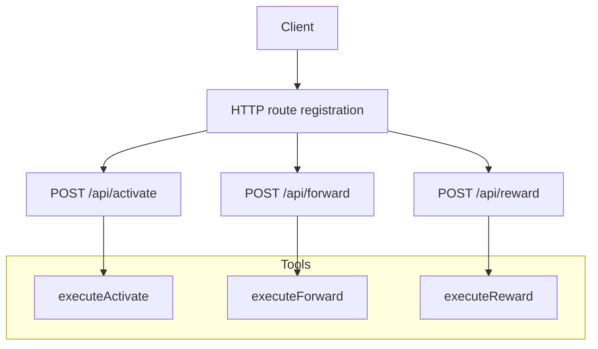
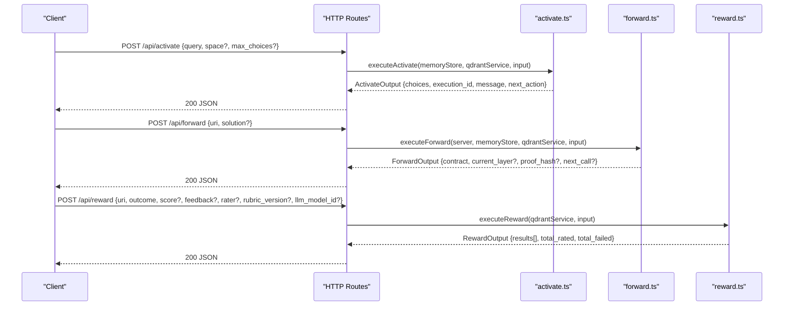
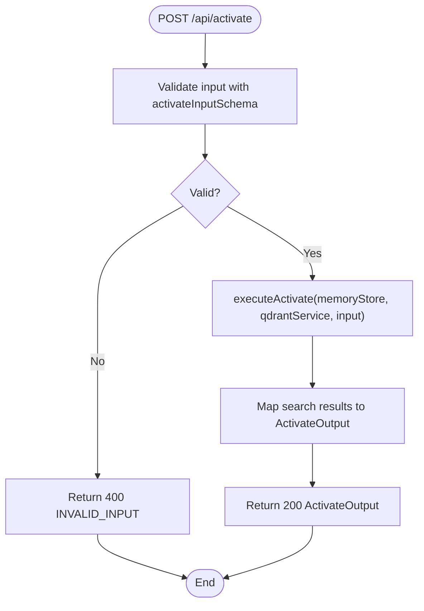
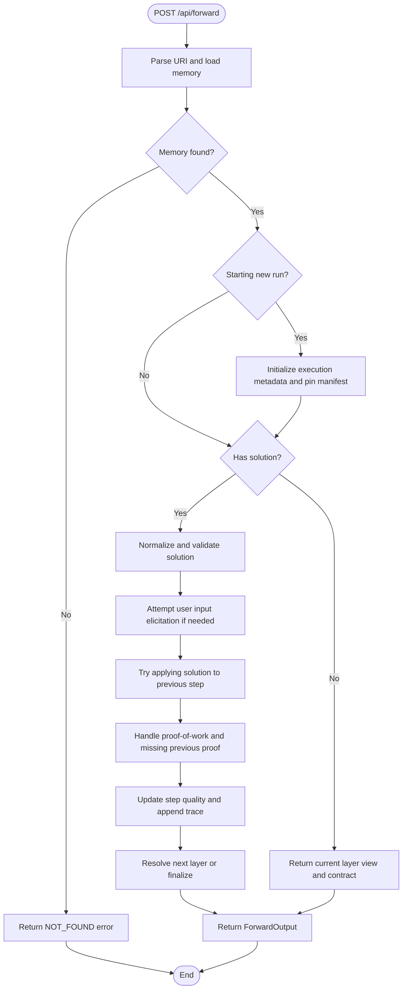
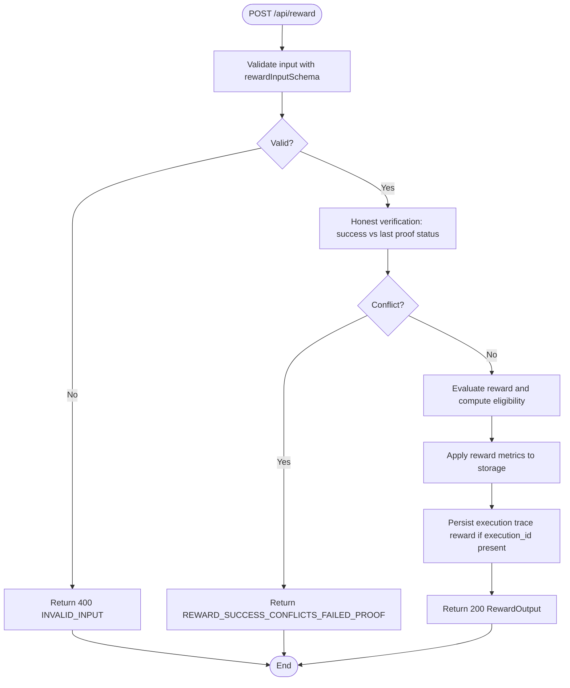
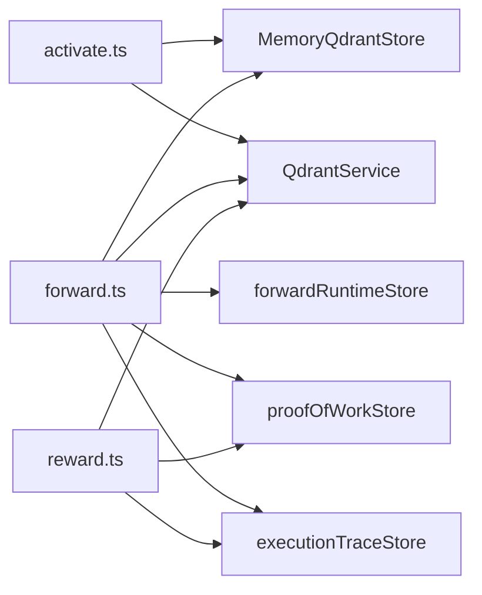

# Core Workflow Endpoints

<cite>
**Referenced Files in This Document**
- [http-api-routes.ts](file://src/http/http-api-routes.ts)
- [http-api-begin.ts](file://src/http/http-api-begin.ts)
- [http-api-begin-step.ts](file://src/http/http-api-begin-step.ts)
- [http-api-attest.ts](file://src/http/http-api-attest.ts)
- [activate.ts](file://src/tools/activate.ts)
- [activate_schema.ts](file://src/tools/activate_schema.ts)
- [forward.ts](file://src/tools/forward.ts)
- [forward_schema.ts](file://src/tools/forward_schema.ts)
- [reward.ts](file://src/tools/reward.ts)
- [reward_schema.ts](file://src/tools/reward_schema.ts)
</cite>

## Table of Contents
1. [Introduction](#introduction)
2. [Project Structure](#project-structure)
3. [Core Components](#core-components)
4. [Architecture Overview](#architecture-overview)
5. [Detailed Component Analysis](#detailed-component-analysis)
6. [Dependency Analysis](#dependency-analysis)
7. [Performance Considerations](#performance-considerations)
8. [Troubleshooting Guide](#troubleshooting-guide)
9. [Conclusion](#conclusion)

## Introduction
This document explains the core workflow endpoints `/api/activate`, `/api/forward`, and `/api/reward`. These endpoints implement the SquadRules agent-first MCP workflow: an adapter is activated, executed through one or more layers, and then rewarded. The documentation covers request/response schemas, state management, adapter selection, step-by-step execution, proof generation, reward submission, error handling, rate limiting, timeouts, and best practices for reliable workflow execution.

## Project Structure
The HTTP API routes are registered centrally and delegate to tool implementations:

- Route registration maps `/api/activate`, `/api/forward`, and `/api/reward` to their handlers.
- Each handler validates input with Zod schemas, logs structured events, runs the operation under tenant/space context, and returns standardized JSON responses.
- Tool implementations contain the business logic for activation search, forward execution, and reward evaluation.

**Diagram sources**
- [http-api-routes.ts:22-35](file://src/http/http-api-routes.ts#L22-L35)
- [http-api-begin.ts:14-38](file://src/http/http-api-begin.ts#L14-L38)
- [http-api-begin-step.ts:13-37](file://src/http/http-api-begin-step.ts#L13-L37)
- [http-api-attest.ts:12-34](file://src/http/http-api-attest.ts#L12-L34)

**Section sources**
- [http-api-routes.ts:1-36](file://src/http/http-api-routes.ts#L1-L36)

## Core Components
- `/api/activate`: Finds the best adapter(s) for a query and returns ranked choices with instructions for the next `forward` call. It supports authoring workflows, refinement sequences, artifact hints, and transport mode metadata.
- `/api/forward`: Executes an adapter layer or continues a multi-layer run. It handles contract types (shell, forward, user_input, comment, subagent), proof-of-work validation, missing previous proofs, user input elicitation, execution tracing, and finalization guidance.
- `/api/reward`: Records outcome signals for a final layer, evaluates eligibility for downstream training/export, and persists metrics and trace data.

Key responsibilities:
- Input validation via canonical Zod schemas.
- Tenant/space context propagation.
- Structured logging and error normalization.
- Integration with memory store, Qdrant service, runtime stores, and proof-of-work stores.

**Section sources**
- [http-api-begin.ts:10-38](file://src/http/http-api-begin.ts#L10-L38)
- [http-api-begin-step.ts:10-37](file://src/http/http-api-begin-step.ts#L10-L37)
- [http-api-attest.ts:9-34](file://src/http/http-api-attest.ts#L9-L34)
- [activate.ts:168-229](file://src/tools/activate.ts#L168-L229)
- [forward.ts:91-339](file://src/tools/forward.ts#L91-L339)
- [reward.ts:28-130](file://src/tools/reward.ts#L28-L130)

## Architecture Overview
The activate→forward→reward chain is implemented as a sequence of HTTP calls backed by tool functions and persistent stores.

**Diagram sources**
- [http-api-routes.ts:22-35](file://src/http/http-api-routes.ts#L22-L35)
- [http-api-begin.ts:14-38](file://src/http/http-api-begin.ts#L14-L38)
- [http-api-begin-step.ts:13-37](file://src/http/http-api-begin-step.ts#L13-L37)
- [http-api-attest.ts:12-34](file://src/http/http-api-attest.ts#L12-L34)
- [activate.ts:168-229](file://src/tools/activate.ts#L168-L229)
- [forward.ts:91-339](file://src/tools/forward.ts#L91-L339)
- [reward.ts:28-130](file://src/tools/reward.ts#L28-L130)

## Detailed Component Analysis

### Activate Endpoint
Purpose:
- Search for matching adapters based on the query.
- Return ranked choices with roles: match, refine, create.
- Provide next_action instructions to start a forward run.
- Support authoring workflows and refinement sequences.

Request schema (`/api/activate`):
- Required: `query`
- Optional: `execution_id`, `space`, `space_id`, `max_choices`, `authoring`

Response schema:
- `must_obey`, `message`, `next_action`, `execution_id`, `query`, `choices[]`, optional `squadrules_local_artifact_dir`, `transport`

Adapter selection algorithm:
- Activation searches produce choices with scores and roles.
- Match/refine choices include `forward_first_call` with a canonical adapter URI and optional authoring context.
- Create choices instruct creation and do not include a forward first call.
- Linked artifacts may be attached to match/refine choices with materialization instructions.

State management:
- `execution_id` is generated if omitted; it is echoed back for refinement sequences.
- Refinement footer visibility is controlled by refine count.

Error handling:
- Invalid input returns 400 with `INVALID_INPUT`.
- Unexpected errors return a normalized tool route error.

Rate limiting and timeouts:
- Rate limiting is surfaced through MCP tool wrappers that detect rate limit conditions and return structured error results.
- Timeouts are not enforced at this endpoint; clients should apply client-side timeouts.

Best practices:
- Use `space` or `space_id` to scope activation.
- Echo `execution_id` when refining.
- Follow `choices[].next_action` exactly to start forward.

**Diagram sources**
- [http-api-begin.ts:14-38](file://src/http/http-api-begin.ts#L14-L38)
- [activate.ts:168-229](file://src/tools/activate.ts#L168-L229)

**Section sources**
- [http-api-begin.ts:10-38](file://src/http/http-api-begin.ts#L10-L38)
- [activate_schema.ts:86-139](file://src/tools/activate_schema.ts#L86-L139)
- [activate.ts:44-166](file://src/tools/activate.ts#L44-L166)
- [activate.ts:168-229](file://src/tools/activate.ts#L168-L229)

### Forward Endpoint
Purpose:
- Load an adapter or continue a multi-layer execution.
- Enforce contracts per layer type.
- Validate proof-of-work and handle missing previous proofs.
- Elicit user input when required.
- Trace execution and guide next steps.

Request schema (`/api/forward`):
- Required: `uri` (adapter slug or layer UUID)
- Optional: `solution` (required only when continuing a run with a layer URI including `?execution_id=`)

Response schema:
- `current_layer`, `contract`, `next_action`, optional `proof_hash`, `execution_id`, `message`, `error_code`, `retry_count`, `slug_disambiguation_note`, `next_call`, plus UI/context fields.

Step-by-step workflow:
1. Parse URI and load memory for the adapter or layer.
2. If starting a new run, create execution metadata and pin layer manifest.
3. If no `solution`, return the current layer view and contract.
4. Normalize and validate the solution shape.
5. Attempt user input elicitation if the contract requires it.
6. Apply solution to previous step when applicable.
7. Handle proof-of-work submission and missing previous proof requirements.
8. Update step quality and append execution trace.
9. Resolve next layer or finalize the run.

Proof generation:
- Proof-of-work is validated against expected previous hashes.
- Missing previous proofs trigger a retry flow with challenge details.

Error handling:
- Not found returns a structured error.
- Authoring context mismatches return a specific error code.
- Missing proof flows return structured payloads with retry counts and next actions.

Rate limiting and timeouts:
- Shell contracts specify `timeout_seconds`; clients must enforce these limits.
- Rate limiting is handled by MCP tool wrappers where applicable.

Best practices:
- Start with adapter URI or layer without `execution_id`; omit `solution`.
- Continue with layer URI including `?execution_id=` and include `solution.type`, `outcome`, and `evidence`.
- Echo `nonce` and `proof_hash` when present in the contract.
- Respect `next_call` guidance for subsequent forward or reward calls.

**Diagram sources**
- [http-api-begin-step.ts:13-37](file://src/http/http-api-begin-step.ts#L13-L37)
- [forward.ts:91-339](file://src/tools/forward.ts#L91-L339)

**Section sources**
- [http-api-begin-step.ts:10-37](file://src/http/http-api-begin-step.ts#L10-L37)
- [forward_schema.ts:234-318](file://src/tools/forward_schema.ts#L234-L318)
- [forward.ts:43-89](file://src/tools/forward.ts#L43-L89)
- [forward.ts:91-339](file://src/tools/forward.ts#L91-L339)

### Reward Endpoint
Purpose:
- Record outcome signals for a final layer.
- Evaluate eligibility for SFT and preference datasets.
- Persist metrics and execution trace rewards.

Request schema (`/api/reward`):
- Required: `uri` (layer URI), `outcome` (`success` or `failure`)
- Optional: `score`, `feedback`, `rater`, `rubric_version`, `llm_model_id`

Response schema:
- `results[]` with per-record evaluation labels, eligibility flags, and metadata.
- `total_rated`, `total_failed`, `next_call` (null).

Validation and evaluation:
- Honest verification prevents recording success when the last stored proof failed.
- Evaluation computes normalized score, grader kind, label, and exportability blockers.

Persistence:
- Metrics are applied to Qdrant-backed storage.
- Execution trace reward is recorded when an `execution_id` is present.

Error handling:
- Invalid URI returns a structured error.
- Success conflict with failed proof returns a conflict error.
- Persistence failures return a 503 with retry guidance.

Best practices:
- Always record reward after the final layer completes.
- Include evaluator identity (`rater` or `llm_model_id`) and `rubric_version` to maximize export eligibility.
- Retry once on transient persistence failures.

**Diagram sources**
- [http-api-attest.ts:12-34](file://src/http/http-api-attest.ts#L12-L34)
- [reward.ts:28-130](file://src/tools/reward.ts#L28-L130)

**Section sources**
- [http-api-attest.ts:9-34](file://src/http/http-api-attest.ts#L9-L34)
- [reward_schema.ts:1-53](file://src/tools/reward_schema.ts#L1-L53)
- [reward.ts:28-130](file://src/tools/reward.ts#L28-L130)

## Dependency Analysis
The three endpoints share common dependencies:
- Memory store for adapter and layer retrieval.
- Qdrant service for semantic search, metrics, and reward propagation.
- Runtime stores for forward execution state and proof-of-work.
- Execution trace store for auditability.

**Diagram sources**
- [activate.ts:168-229](file://src/tools/activate.ts#L168-L229)
- [forward.ts:91-339](file://src/tools/forward.ts#L91-L339)
- [reward.ts:28-130](file://src/tools/reward.ts#L28-L130)

**Section sources**
- [activate.ts:168-229](file://src/tools/activate.ts#L168-L229)
- [forward.ts:91-339](file://src/tools/forward.ts#L91-L339)
- [reward.ts:28-130](file://src/tools/reward.ts#L28-L130)

## Performance Considerations
- Activation search can return multiple choices; use `max_choices` judiciously to balance relevance and payload size.
- Forward execution may involve shell commands; respect `timeout_seconds` from the contract and enforce client-side timeouts.
- Execution traces and proof-of-work records add I/O overhead; avoid unnecessary continuation calls.
- Reward evaluation and metric persistence are lightweight but depend on Qdrant availability; design retries for transient failures.

[No sources needed since this section provides general guidance]

## Troubleshooting Guide
Common issues and resolutions:
- Invalid input: Ensure request bodies conform to the canonical schemas. The endpoints return `INVALID_INPUT` with detailed field errors.
- Layer not found: Verify the layer URI and ensure the adapter has been activated and forwarded successfully.
- Authoring context mismatch: When using authoring workflows, keep the same `authoring` context across continuations.
- Missing proof: If a previous proof is required, follow the `next_action` and `challenge` guidance until all prior steps are completed.
- Reward conflict: Do not record success for a layer whose last stored proof failed; fix the step and rerun.

Operational tips:
- Log and capture `execution_id` throughout the lifecycle to correlate requests.
- Monitor structured logs for `ACTIVATE_FAILED`, `FORWARD_FAILED`, and `REWARD_FAILED`.
- For shell challenges, verify environment variables like `$SQUADRULES_LOCAL_ARTIFACT_DIR` and file permissions.

**Section sources**
- [http-api-begin.ts:14-38](file://src/http/http-api-begin.ts#L14-L38)
- [http-api-begin-step.ts:13-37](file://src/http/http-api-begin-step.ts#L13-L37)
- [http-api-attest.ts:12-34](file://src/http/http-api-attest.ts#L12-L34)
- [forward.ts:113-131](file://src/tools/forward.ts#L113-L131)
- [reward.ts:19-26](file://src/tools/reward.ts#L19-L26)

## Conclusion
The `/api/activate`, `/api/forward`, and `/api/reward` endpoints form a robust, auditable workflow for adapter activation, execution, and reward submission. Clients should strictly follow the activation choices, manage execution IDs, adhere to contract constraints and proof requirements, and record rewards with complete evaluator metadata. Reliable execution depends on proper error handling, timeout enforcement, and consistent state propagation across the activate→forward→reward chain.

[No sources needed since this section summarizes without analyzing specific files]