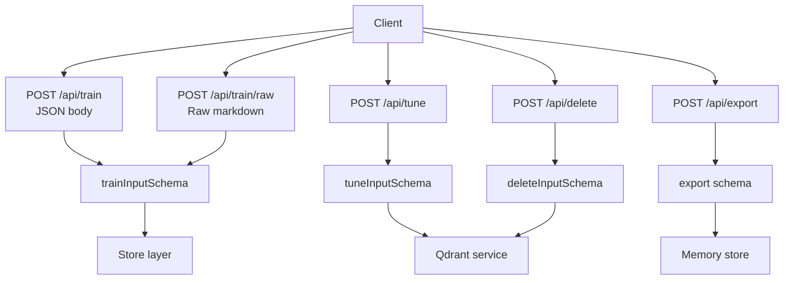
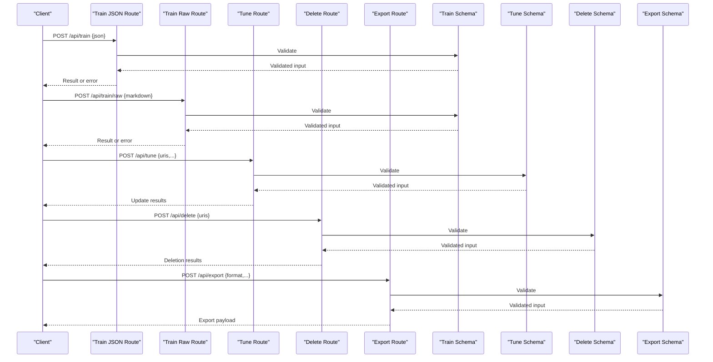
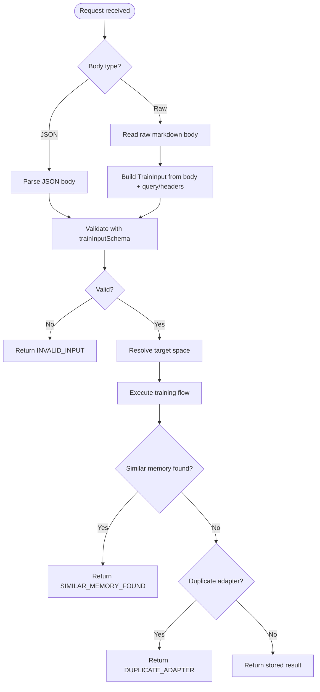
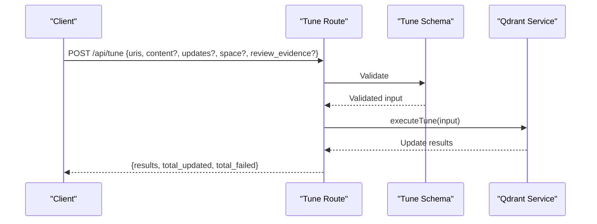
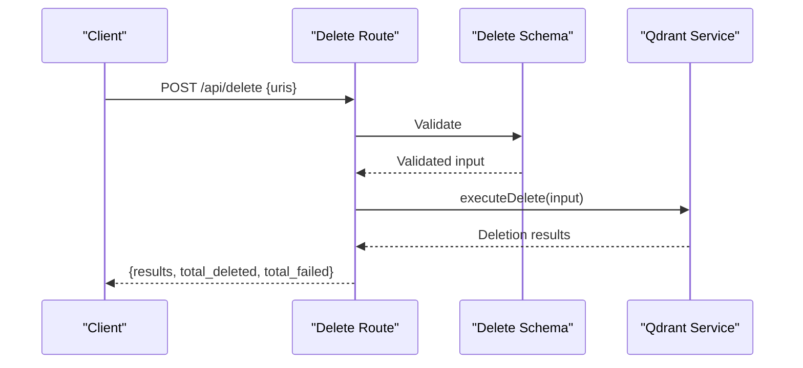
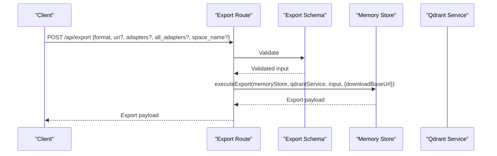
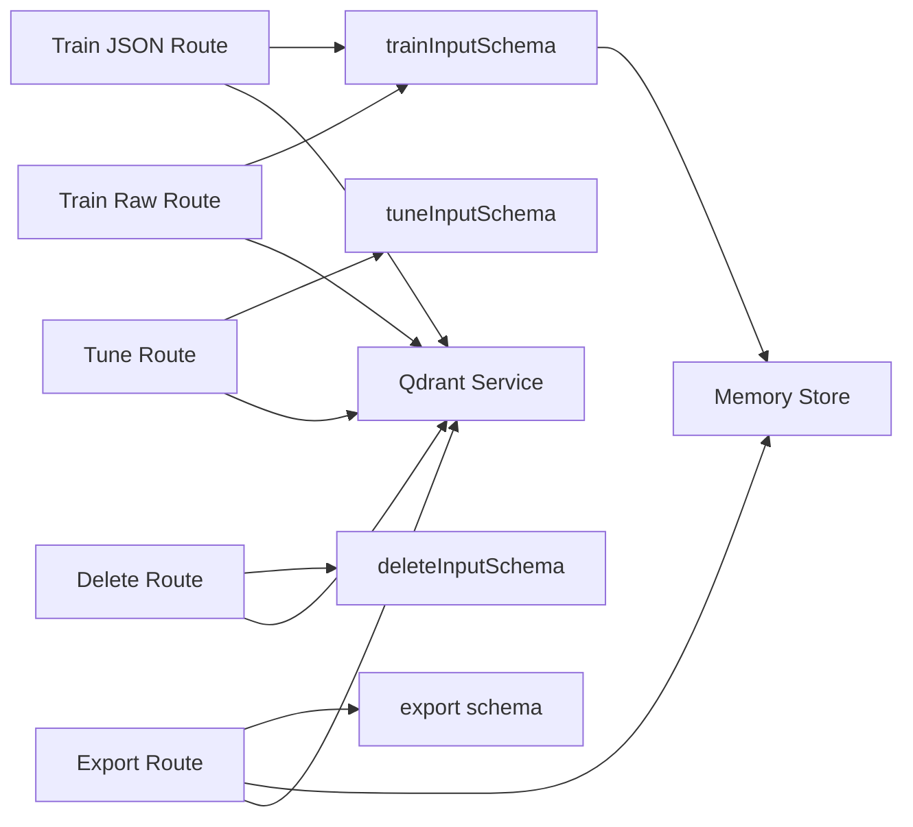

# Data Management Endpoints

<cite>
**Referenced Files in This Document**
- [http-api-train-json.ts](file://src/http/http-api-train-json.ts)
- [http-api-train-raw.ts](file://src/http/http-api-train-raw.ts)
- [http-api-update.ts](file://src/http/http-api-update.ts)
- [http-api-delete.ts](file://src/http/http-api-delete.ts)
- [http-api-dump.ts](file://src/http/http-api-dump.ts)
- [train_schema.ts](file://src/tools/train_schema.ts)
- [tune_schema.ts](file://src/tools/tune_schema.ts)
- [delete_schema.ts](file://src/tools/delete_schema.ts)
- [dump_schema.ts](file://src/tools/dump_schema.ts)
</cite>

## Table of Contents
1. [Introduction](#introduction)
2. [Project Structure](#project-structure)
3. [Core Components](#core-components)
4. [Architecture Overview](#architecture-overview)
5. [Detailed Component Analysis](#detailed-component-analysis)
6. [Dependency Analysis](#dependency-analysis)
7. [Performance Considerations](#performance-considerations)
8. [Troubleshooting Guide](#troubleshooting-guide)
9. [Conclusion](#conclusion)

## Introduction
This document describes the data management endpoints for training, updating, deleting, and exporting adapter content. It focuses on:
- POST /api/train (JSON body and raw markdown body)
- POST /api/tune for content updates
- POST /api/delete for resource removal
- POST /api/export for data export

It also documents payload schemas, validation rules, error responses, file upload limits, processing timeouts, and progress tracking mechanisms.

## Project Structure
The data management endpoints are implemented as HTTP routes that validate input with Zod schemas and delegate to tool-layer functions. The relevant files are:
- JSON train route: src/http/http-api-train-json.ts
- Raw train route: src/http/http-api-train-raw.ts
- Tune route: src/http/http-api-update.ts
- Delete route: src/http/http-api-delete.ts
- Export route: src/http/http-api-dump.ts
- Schemas: src/tools/train_schema.ts, tune_schema.ts, delete_schema.ts, dump_schema.ts

**Diagram sources**
- [http-api-train-json.ts:46-107](file://src/http/http-api-train-json.ts#L46-L107)
- [http-api-train-raw.ts:48-153](file://src/http/http-api-train-raw.ts#L48-L153)
- [http-api-update.ts:11-33](file://src/http/http-api-update.ts#L11-L33)
- [http-api-delete.ts:11-34](file://src/http/http-api-delete.ts#L11-L34)
- [http-api-dump.ts:19-49](file://src/http/http-api-dump.ts#L19-L49)
- [train_schema.ts:54-177](file://src/tools/train_schema.ts#L54-L177)
- [tune_schema.ts:14-57](file://src/tools/tune_schema.ts#L14-L57)
- [delete_schema.ts:14-29](file://src/tools/delete_schema.ts#L14-L29)

**Section sources**
- [http-api-train-json.ts:46-107](file://src/http/http-api-train-json.ts#L46-L107)
- [http-api-train-raw.ts:48-153](file://src/http/http-api-train-raw.ts#L48-L153)
- [http-api-update.ts:11-33](file://src/http/http-api-update.ts#L11-L33)
- [http-api-delete.ts:11-34](file://src/http/http-api-delete.ts#L11-L34)
- [http-api-dump.ts:19-49](file://src/http/http-api-dump.ts#L19-L49)

## Core Components
- Training endpoints accept either a structured JSON payload or raw markdown. Both validate against the same core schema and support space scoping, model selection, force overwrite, protocol versioning, artifact attachments, and critic-loop review evidence.
- Tune endpoint updates adapters/layers by URIs, supports optional content updates and advanced field updates, and enforces critic-loop evidence when editing content.
- Delete endpoint removes adapters/layers by URIs and returns per-item status.
- Export endpoint serializes memory into requested formats and can include download links based on request headers.

Key responsibilities:
- Input validation via Zod schemas
- Space context resolution and scoping
- Error normalization and safe detail sanitization
- Metrics and logging for observability

**Section sources**
- [train_schema.ts:54-177](file://src/tools/train_schema.ts#L54-L177)
- [tune_schema.ts:14-57](file://src/tools/tune_schema.ts#L14-L57)
- [delete_schema.ts:14-29](file://src/tools/delete_schema.ts#L14-L29)
- [http-api-train-json.ts:46-107](file://src/http/http-api-train-json.ts#L46-L107)
- [http-api-train-raw.ts:48-153](file://src/http/http-api-train-raw.ts#L48-L153)
- [http-api-update.ts:11-33](file://src/http/http-api-update.ts#L11-L33)
- [http-api-delete.ts:11-34](file://src/http/http-api-delete.ts#L11-L34)
- [http-api-dump.ts:19-49](file://src/http/http-api-dump.ts#L19-L49)

## Architecture Overview
The endpoints follow a consistent pattern:
1. Parse and validate request body using Zod.
2. Resolve tenant/space context from request headers and query parameters.
3. Execute business logic through tool-layer functions.
4. Return normalized JSON responses with standardized error shapes.

**Diagram sources**
- [http-api-train-json.ts:46-107](file://src/http/http-api-train-json.ts#L46-L107)
- [http-api-train-raw.ts:48-153](file://src/http/http-api-train-raw.ts#L48-L153)
- [http-api-update.ts:11-33](file://src/http/http-api-update.ts#L11-L33)
- [http-api-delete.ts:11-34](file://src/http/http-api-delete.ts#L11-L34)
- [http-api-dump.ts:19-49](file://src/http/http-api-dump.ts#L19-L49)
- [train_schema.ts:54-177](file://src/tools/train_schema.ts#L54-L177)
- [tune_schema.ts:14-57](file://src/tools/tune_schema.ts#L14-L57)
- [delete_schema.ts:14-29](file://src/tools/delete_schema.ts#L14-L29)

## Detailed Component Analysis

### Training Endpoints: POST /api/train (JSON) and POST /api/train/raw (Markdown)
Both endpoints accept adapter training requests but differ in how content is provided:
- JSON endpoint: structured body with fields like content, mime, artifact_name, adapter_uri, source_adapter_uri, directory, recursive, review_evidence, llm_model_id, force_update, protocol_version, space.
- Raw endpoint: raw markdown body; configuration comes from query parameters and headers such as llm_model_id, x-llm-model-id, user-agent, force, x-force-update, protocol_version, x-protocol-version, space, x-space, review_evidence.

Common behaviors:
- Input validation via trainInputSchema.
- Space resolution supporting personal and group spaces.
- Safe sanitization of detailed error fields before returning them.
- Similarity guard handling with SIMILAR_MEMORY_FOUND errors including similarity_score and existing_memory.
- Duplicate adapter detection mapped to DUPLICATE_ADAPTER.

Payload schema highlights:
- Required fields depend on mode:
  - Adapter (markdown): content required; review_evidence required unless artifact/fork mode.
  - Artifact: non-markdown mime or artifact_name + adapter_uri; relative_path allowed only for artifacts.
- Optional fields:
  - source_adapter_uri for fork/copy behavior.
  - directory/recursive for batch training from filesystem.
  - protocol_version for semantic versioning.
  - llm_model_id for model attribution.
  - force_update to overwrite existing adapters.

Error handling:
- INVALID_INPUT for schema failures.
- SPACE_NOT_FOUND or SPACE_READ_ONLY when space resolution fails.
- DUPLICATE_ADAPTER when label collision occurs.
- SIMILAR_MEMORY_FOUND with similarity_score and guidance.
- PAYLOAD_TOO_LARGE for raw markdown exceeding configured limit.
- STORE_FAILED for backend storage errors.

File upload limits and timeouts:
- Raw markdown body size is limited by HTTP_TRAIN_RAW_BODY_LIMIT.
- No explicit per-request timeout is enforced at the route level; clients should implement their own timeouts.

Progress tracking:
- Responses return immediate results; long-running operations are not streamed here.
- For batch directory training, batch_manifest may indicate per-file status.

**Diagram sources**
- [http-api-train-json.ts:46-107](file://src/http/http-api-train-json.ts#L46-L107)
- [http-api-train-raw.ts:48-153](file://src/http/http-api-train-raw.ts#L48-L153)
- [train_schema.ts:54-177](file://src/tools/train_schema.ts#L54-L177)

**Section sources**
- [http-api-train-json.ts:46-107](file://src/http/http-api-train-json.ts#L46-L107)
- [http-api-train-raw.ts:48-153](file://src/http/http-api-train-raw.ts#L48-L153)
- [train_schema.ts:54-177](file://src/tools/train_schema.ts#L54-L177)

#### Training Payload Schemas and Validation Rules
- content: string, optional for JSON; required for adapter markdown unless using source_adapter_uri or directory.
- llm_model_id: string, required.
- force_update: boolean, default false.
- protocol_version: string, optional.
- space: literal 'personal' or string, optional.
- source_adapter_uri: squadrules://adapter/{slug}, optional.
- mime: string, optional; non-markdown implies artifact mode.
- artifact_name: string, optional; required for artifact inference or non-markdown mime.
- adapter_uri: squadrules://adapter/{slug}, optional; required for artifact attachment.
- relative_path: string, optional; allowed only for artifacts; must be skill-root-relative without '..'.
- review_evidence: object with verdict_file (string), exit_code (number), stdout (string); required for adapter markdown trains.
- directory: string, optional; absolute path for batch training.
- recursive: boolean, optional; scan subdirectories.

Validation constraints:
- At least one of content, source_adapter_uri, or directory must be present.
- Non-markdown mime requires artifact_name and adapter_uri.
- When adapter_uri is provided without mime, artifact_name is required and mime must be inferable from extension.
- review_evidence required for adapter markdown unless artifact/fork mode.
- relative_path validated for safety and correctness.

Output shape:
- items array with uri, label, tags, optional layer_uuid/artifact_uuid/adapter_uri/content_type.
- status: 'stored'.
- batch_manifest: optional array of per-file results with source_file, status, uri, error.

**Section sources**
- [train_schema.ts:54-177](file://src/tools/train_schema.ts#L54-L177)
- [train_schema.ts:179-196](file://src/tools/train_schema.ts#L179-L196)

### Content Updates: POST /api/tune
Purpose:
- Update adapters or layers identified by URIs.
- Optionally update content bodies or apply advanced field updates.
- Optionally move all layers of target adapters to a specified space.

Input schema:
- uris: non-empty array of squadrules://adapter/{slug} or squadrules://layer/{uuid}[?execution_id={uuid}].
- content: optional array of strings, one per URI.
- updates: optional record of field updates.
- space: optional literal 'personal' or string to move layers.
- review_evidence: object with verdict_file, exit_code, stdout; required when content is provided.

Validation rules:
- content length must match uris length if provided.
- At least one of content, updates, or space must be provided.
- review_evidence required when any content entries are non-empty.

Response shape:
- results: array of per-URI status objects with uri, status ('updated' | 'error'), message.
- total_updated: number.
- total_failed: number.

Error handling:
- INVALID_INPUT for schema failures.
- TUNE_FAILED for unexpected errors.

**Diagram sources**
- [http-api-update.ts:11-33](file://src/http/http-api-update.ts#L11-L33)
- [tune_schema.ts:14-57](file://src/tools/tune_schema.ts#L14-L57)

**Section sources**
- [http-api-update.ts:11-33](file://src/http/http-api-update.ts#L11-L33)
- [tune_schema.ts:14-57](file://src/tools/tune_schema.ts#L14-L57)

### Resource Removal: POST /api/delete
Purpose:
- Delete adapters or layers by URIs.

Input schema:
- uris: non-empty array of squadrules://adapter/{slug} or squadrules://layer/{uuid}[?execution_id={uuid}].

Response shape:
- results: array of per-URI status objects with uri, status ('deleted' | 'error'), message.
- total_deleted: number.
- total_failed: number.

Error handling:
- INVALID_INPUT for schema failures.
- DELETE_FAILED for unexpected errors.

**Diagram sources**
- [http-api-delete.ts:11-34](file://src/http/http-api-delete.ts#L11-L34)
- [delete_schema.ts:14-29](file://src/tools/delete_schema.ts#L14-L29)

**Section sources**
- [http-api-delete.ts:11-34](file://src/http/http-api-delete.ts#L11-L34)
- [delete_schema.ts:14-29](file://src/tools/delete_schema.ts#L14-L29)

### Data Export: POST /api/export
Purpose:
- Export memory data in various formats.
- Compute base URL for downloads using forwarded host/proxy headers.

Input schema:
- Defined by export schema used by the export tool layer. Typical fields include format, uri, adapters, all_adapters, space_name.

Response shape:
- JSON payload containing exported data and metadata.

Error handling:
- INVALID_INPUT for schema failures.
- NOT_FOUND or EXPORT_FAILED depending on underlying error code.

**Diagram sources**
- [http-api-dump.ts:19-49](file://src/http/http-api-dump.ts#L19-L49)

**Section sources**
- [http-api-dump.ts:19-49](file://src/http/http-api-dump.ts#L19-L49)

## Dependency Analysis
- Routes depend on Zod schemas for strict validation.
- Train routes depend on memory store and optionally Qdrant service for vector operations.
- Tune and Delete routes depend on Qdrant service for layer/adapter updates and deletions.
- Export route depends on memory store and Qdrant service to assemble export payloads.

**Diagram sources**
- [http-api-train-json.ts:46-107](file://src/http/http-api-train-json.ts#L46-L107)
- [http-api-train-raw.ts:48-153](file://src/http/http-api-train-raw.ts#L48-L153)
- [http-api-update.ts:11-33](file://src/http/http-api-update.ts#L11-L33)
- [http-api-delete.ts:11-34](file://src/http/http-api-delete.ts#L11-L34)
- [http-api-dump.ts:19-49](file://src/http/http-api-dump.ts#L19-L49)

**Section sources**
- [http-api-train-json.ts:46-107](file://src/http/http-api-train-json.ts#L46-L107)
- [http-api-train-raw.ts:48-153](file://src/http/http-api-train-raw.ts#L48-L153)
- [http-api-update.ts:11-33](file://src/http/http-api-update.ts#L11-L33)
- [http-api-delete.ts:11-34](file://src/http/http-api-delete.ts#L11-L34)
- [http-api-dump.ts:19-49](file://src/http/http-api-dump.ts#L19-L49)

## Performance Considerations
- File upload limits:
  - Raw markdown body is constrained by HTTP_TRAIN_RAW_BODY_LIMIT. Clients should respect this limit to avoid 413 responses.
- Processing timeouts:
  - No explicit per-request timeout is enforced at the route level. Clients should implement client-side timeouts and retries with backoff.
- Concurrency:
  - Bulk operations (batch directory training, multiple URIs in tune/delete) process sequentially within each request. Large batches should be split across multiple requests to avoid long-running connections.
- Observability:
  - Structured logging records request details and outcomes. Metrics are emitted for similarity guard hits.

[No sources needed since this section provides general guidance]

## Troubleshooting Guide
Common errors and resolutions:
- INVALID_INPUT:
  - Cause: Schema validation failure.
  - Resolution: Ensure required fields are present and correctly typed; check review_evidence requirements for adapter markdown and tune content updates.
- SPACE_NOT_FOUND or SPACE_READ_ONLY:
  - Cause: Target space does not exist or is read-only.
  - Resolution: Use available_spaces from the response to select a writable space.
- DUPLICATE_ADAPTER:
  - Cause: Label collision.
  - Resolution: Use force_update to overwrite or choose a different label.
- SIMILAR_MEMORY_FOUND:
  - Cause: High similarity score detected.
  - Resolution: Review existing_memory and similarity_score; adjust content or proceed with caution.
- PAYLOAD_TOO_LARGE:
  - Cause: Raw markdown exceeds HTTP_TRAIN_RAW_BODY_LIMIT.
  - Resolution: Split content or reduce payload size.
- STORE_FAILED/TUNE_FAILED/DELETE_FAILED/EXPORT_FAILED:
  - Cause: Backend errors.
  - Resolution: Inspect logs and retry with smaller batches; verify connectivity to Qdrant and memory store.

**Section sources**
- [http-api-train-json.ts:108-170](file://src/http/http-api-train-json.ts#L108-L170)
- [http-api-train-raw.ts:154-211](file://src/http/http-api-train-raw.ts#L154-L211)
- [http-api-update.ts:26-33](file://src/http/http-api-update.ts#L26-L33)
- [http-api-delete.ts:27-34](file://src/http/http-api-delete.ts#L27-L34)
- [http-api-dump.ts:50-59](file://src/http/http-api-dump.ts#L50-L59)

## Conclusion
The data management endpoints provide robust, schema-validated interfaces for training, updating, deleting, and exporting adapter content. They enforce security and quality controls through critic-loop review evidence, similarity guards, and space scoping. Clients should handle standard error codes, respect file size limits, and implement appropriate timeouts and batching strategies for reliable operations.

[No sources needed since this section summarizes without analyzing specific files]