# HTTP REST API Reference

<cite>
**Referenced Files in This Document**
- [http-api-routes.ts](file://src/http/http-api-routes.ts)
- [http-auth-middleware.ts](file://src/http/http-auth-middleware.ts)
- [bearer-validate.ts](file://src/http/bearer-validate.ts)
- [http-error-handlers.ts](file://src/http/http-error-handlers.ts)
- [http-mcp-cors.ts](file://src/http/http-mcp-cors.ts)
- [http-api-begin.ts](file://src/http/http-api-begin.ts)
- [http-api-begin-step.ts](file://src/http/http-api-begin-step.ts)
- [http-api-attest.ts](file://src/http/http-api-attest.ts)
- [http-api-train-json.ts](file://src/http/http-api-train-json.ts)
- [http-api-train-raw.ts](file://src/http/http-api-train-raw.ts)
- [http-export-download-routes.ts](file://src/http/http-export-download-routes.ts)
- [http-api-me.ts](file://src/http/http-api-me.ts)
- [http-api-spaces.ts](file://src/http/http-api-spaces.ts)
- [http-api-delete.ts](file://src/http/http-api-delete.ts)
- [http-api-update.ts](file://src/http/http-api-update.ts)
- [http-api-dump.ts](file://src/http/http-api-dump.ts)
- [http-auth-callback.ts](file://src/http/http-auth-callback.ts)
</cite>

## Table of Contents
1. [Introduction](#introduction)
2. [Project Structure](#project-structure)
3. [Core Components](#core-components)
4. [Architecture Overview](#architecture-overview)
5. [Detailed Component Analysis](#detailed-component-analysis)
6. [Dependency Analysis](#dependency-analysis)
7. [Performance Considerations](#performance-considerations)
8. [Troubleshooting Guide](#troubleshooting-guide)
9. [Conclusion](#conclusion)

## Introduction
This document provides a comprehensive HTTP REST API reference for SquadRules. It covers the core agent workflow endpoints, administrative endpoints, authentication and authorization, error handling, CORS behavior, and client integration guidance. The primary operational flow is activate → forward → reward, with additional endpoints for training, exporting, deleting, tuning, listing spaces, and retrieving the current user profile.

SquadRules is an agent-first MCP framework where AI agents are the primary users. Humans configure preferences through agents. Adapters provide deterministic, auditable task execution. Vector stores (Qdrant and LanceDB) support semantic search over rules and workflows. Authentication integrates with Keycloak via OAuth2/OIDC, supporting both browser sessions and Bearer JWT tokens.

## Project Structure
The HTTP API is implemented as Express routes that validate inputs, enforce authentication, and delegate to domain services:
- Route registration aggregates all API endpoints under /api and related paths.
- Authentication middleware enforces session or Bearer token validation and sets per-request space context.
- Core workflow endpoints implement activate, forward, and reward.
- Administrative endpoints include train (JSON and raw), export, delete, tune, spaces, and me.
- Export download uses signed capability records for secure file delivery.

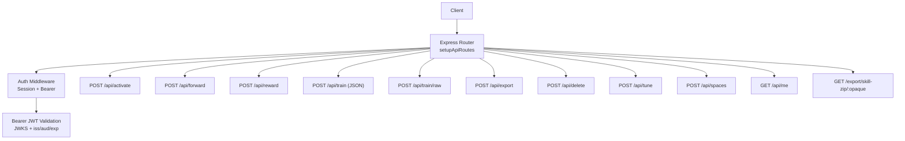

**Diagram sources**
- [http-api-routes.ts:22-35](file://src/http/http-api-routes.ts#L22-L35)
- [http-auth-middleware.ts:172-286](file://src/http/http-auth-middleware.ts#L172-L286)
- [bearer-validate.ts:120-208](file://src/http/bearer-validate.ts#L120-L208)

**Section sources**
- [http-api-routes.ts:1-36](file://src/http/http-api-routes.ts#L1-L36)

## Core Components
- Authentication and Authorization
  - Session-based login via OIDC callback; httpOnly cookie with HMAC signature and expiry.
  - Bearer JWT validation against trusted issuers and allowed audiences using JWKS.
  - Space scoping via query parameters and tenant context.
- API Routes
  - Workflow: activate, forward, reward.
  - Administration: train (JSON and raw), export, delete, tune, spaces, me.
  - Export download: signed capability-based zip streaming.
- Error Handling
  - Global Express error handler returns structured JSON errors and 404 catch-all.
  - Route-level input validation returns INVALID_INPUT with detailed messages.
- CORS
  - Dedicated CORS configuration for /mcp endpoint exposing WWW-Authenticate header.

**Section sources**
- [http-auth-middleware.ts:35-133](file://src/http/http-auth-middleware.ts#L35-L133)
- [bearer-validate.ts:41-109](file://src/http/bearer-validate.ts#L41-L109)
- [http-error-handlers.ts:9-53](file://src/http/http-error-handlers.ts#L9-L53)
- [http-mcp-cors.ts:3-28](file://src/http/http-mcp-cors.ts#L3-L28)

## Architecture Overview
The HTTP layer composes routing, authentication, and business logic:
- setupApiRoutes registers all endpoints and injects MemoryQdrantStore and QdrantService.
- authMiddleware validates requests, enriches req.auth and req.spaceContext, and redirects unauthenticated browsers to OIDC login when appropriate.
- Each route validates its input schema, logs structured events, executes domain logic, and returns standardized responses.

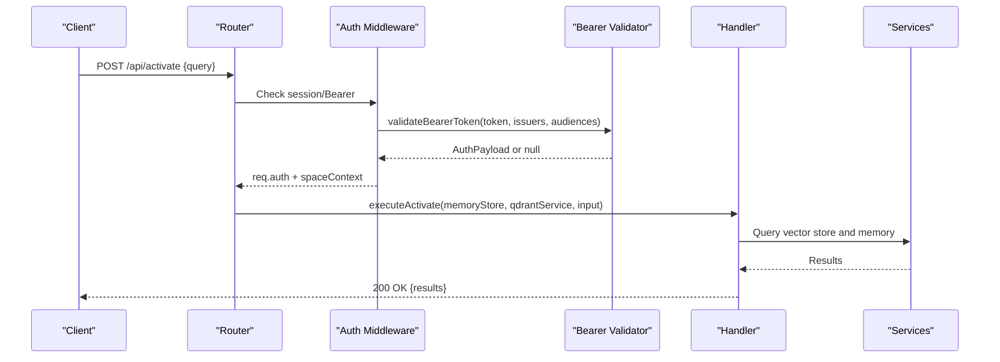

**Diagram sources**
- [http-api-routes.ts:22-35](file://src/http/http-api-routes.ts#L22-L35)
- [http-auth-middleware.ts:172-286](file://src/http/http-auth-middleware.ts#L172-L286)
- [bearer-validate.ts:120-208](file://src/http/bearer-validate.ts#L120-L208)
- [http-api-begin.ts:14-39](file://src/http/http-api-begin.ts#L14-L39)

## Detailed Component Analysis

### Authentication and Authorization
- Supported methods
  - Browser session via OIDC callback (/auth/callback).
  - Bearer JWT tokens validated by issuer, audience, expiration, and signature.
- Security details
  - Session cookie is HMAC-signed and includes exp; groups are allowlisted.
  - Bearer validation uses JWKS from Keycloak; supports internal URL override for Docker environments.
  - Groups may be fetched from OIDC userinfo if missing from access token.
- Access control
  - Protected paths include /api, /api/*, /mcp, /ui, /ui/.
  - Space scoping enforced via space or space_id query parameter; forbidden if not allowed.
- OIDC flows
  - Login redirect for GET requests on protected paths.
  - Callback exchanges code for tokens, merges claims, sets session cookie, and redirects to UI.

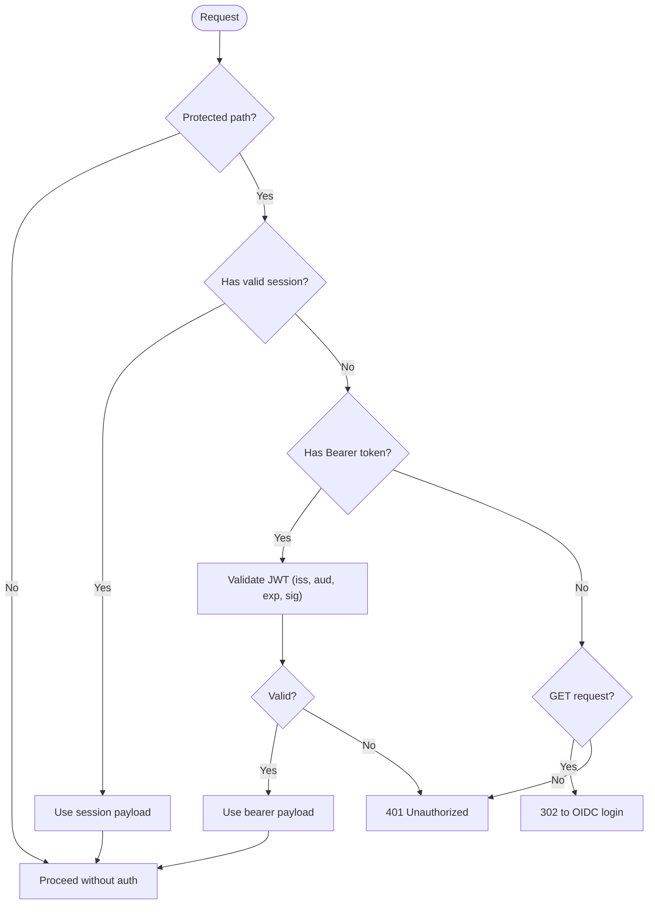

**Diagram sources**
- [http-auth-middleware.ts:151-160](file://src/http/http-auth-middleware.ts#L151-L160)
- [http-auth-middleware.ts:172-286](file://src/http/http-auth-middleware.ts#L172-L286)
- [bearer-validate.ts:120-208](file://src/http/bearer-validate.ts#L120-L208)
- [http-auth-callback.ts:122-229](file://src/http/http-auth-callback.ts#L122-L229)

**Section sources**
- [http-auth-middleware.ts:35-133](file://src/http/http-auth-middleware.ts#L35-L133)
- [bearer-validate.ts:41-109](file://src/http/bearer-validate.ts#L41-L109)
- [bearer-validate.ts:120-208](file://src/http/bearer-validate.ts#L120-L208)
- [http-auth-callback.ts:122-229](file://src/http/http-auth-callback.ts#L122-L229)

### Workflow Endpoints

#### POST /api/activate
- Purpose: Execute activation based on a query.
- Request body schema: Defined by activateInputSchema.
- Response: Activation results (no metadata).
- Status codes:
  - 200 OK on success.
  - 400 Bad Request with INVALID_INPUT on validation failure.
  - 500 Internal Server Error on unexpected failures.

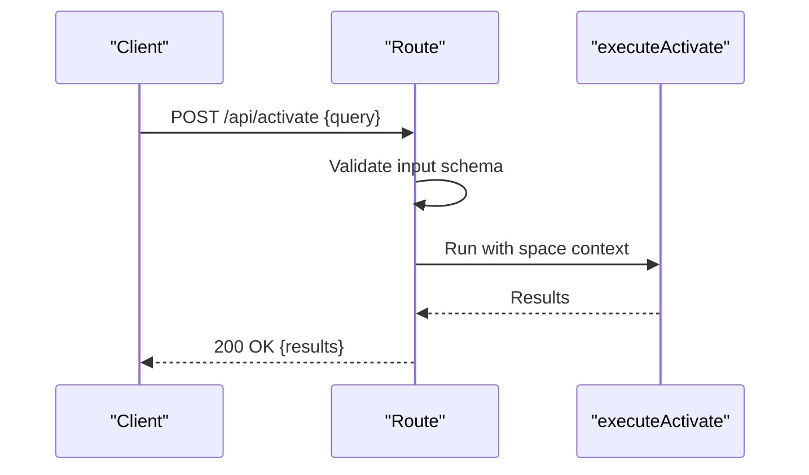

**Diagram sources**
- [http-api-begin.ts:14-39](file://src/http/http-api-begin.ts#L14-L39)

**Section sources**
- [http-api-begin.ts:14-39](file://src/http/http-api-begin.ts#L14-L39)

#### POST /api/forward
- Purpose: Forward to an adapter identified by URI.
- Request body schema: Defined by forwardInputSchema.
- Response: Forward execution result.
- Status codes:
  - 200 OK on success.
  - 400 Bad Request with INVALID_INPUT on validation failure.
  - 500 Internal Server Error on unexpected failures.

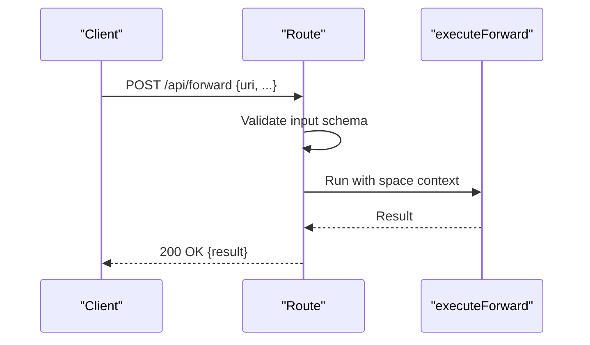

**Diagram sources**
- [http-api-begin-step.ts:13-38](file://src/http/http-api-begin-step.ts#L13-L38)

**Section sources**
- [http-api-begin-step.ts:13-38](file://src/http/http-api-begin-step.ts#L13-L38)

#### POST /api/reward
- Purpose: Record reward for an adapter outcome.
- Request body schema: Defined by rewardInputSchema.
- Response: Reward processing result.
- Status codes:
  - 200 OK on success.
  - 400 Bad Request with INVALID_INPUT on validation failure.
  - 500 Internal Server Error on unexpected failures.

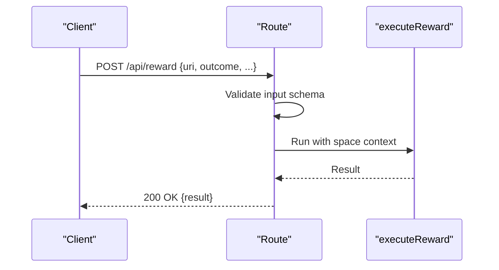

**Diagram sources**
- [http-api-attest.ts:12-35](file://src/http/http-api-attest.ts#L12-L35)

**Section sources**
- [http-api-attest.ts:12-35](file://src/http/http-api-attest.ts#L12-L35)

### Administrative Endpoints

#### POST /api/train (JSON)
- Purpose: Train adapters using JSON body with fields such as content, llm_model_id, force_update, protocol_version, space, review_evidence.
- Request body schema: Defined by trainInputSchema.
- Response: Training result including diagnostics and next actions.
- Status codes:
  - 200 OK on success.
  - 400 Bad Request with INVALID_INPUT on validation failure.
  - 409 Conflict for DUPLICATE_ADAPTER or SIMILAR_MEMORY_FOUND.
  - 500 Internal Server Error on unexpected failures.

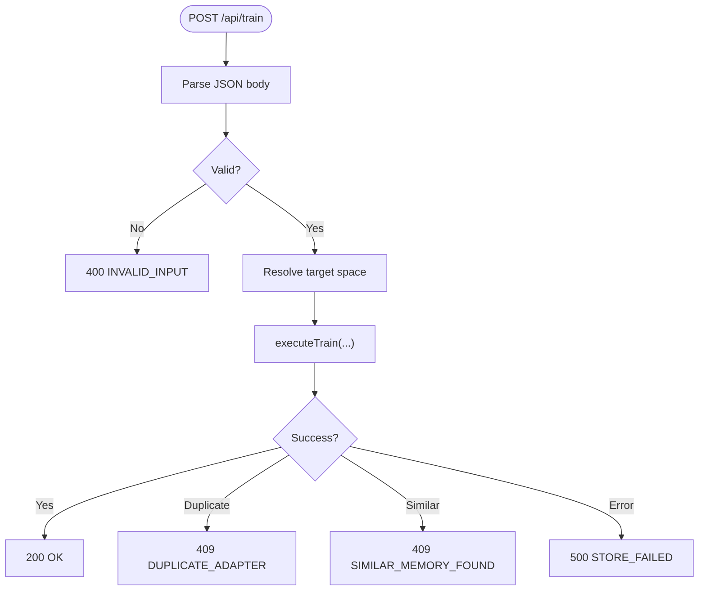

**Diagram sources**
- [http-api-train-json.ts:46-172](file://src/http/http-api-train-json.ts#L46-L172)

**Section sources**
- [http-api-train-json.ts:46-172](file://src/http/http-api-train-json.ts#L46-L172)

#### POST /api/train/raw
- Purpose: Train adapters by sending raw markdown body; options via query and headers.
- Request body: Raw UTF-8 markdown.
- Headers/query parameters:
  - x-llm-model-id or query llm_model_id
  - x-force-update or query force
  - x-protocol-version or query protocol_version
  - x-space or query space
  - x-review-evidence or query review_evidence (JSON object)
- Response: Training result similar to JSON variant.
- Status codes:
  - 200 OK on success.
  - 400 Bad Request with INVALID_INPUT on validation failure.
  - 413 Payload Too Large when exceeding configured limit.
  - 409 Conflict for DUPLICATE_ADAPTER or SIMILAR_MEMORY_FOUND.
  - 500 Internal Server Error on unexpected failures.

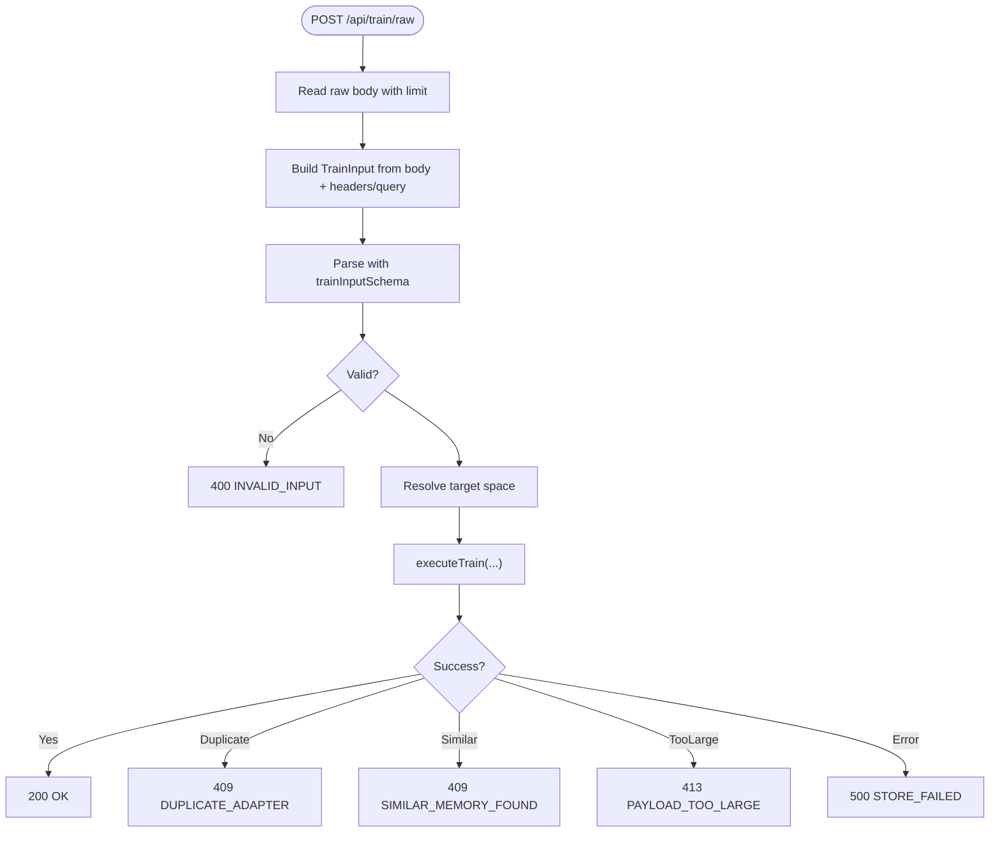

**Diagram sources**
- [http-api-train-raw.ts:48-214](file://src/http/http-api-train-raw.ts#L48-L214)

**Section sources**
- [http-api-train-raw.ts:48-214](file://src/http/http-api-train-raw.ts#L48-L214)

#### POST /api/export
- Purpose: Export adapters or selected items; supports multiple formats and optional download base URL generation.
- Request body schema: Defined by exportInputSchema.
- Response: Export result including links or payloads depending on format.
- Status codes:
  - 200 OK on success.
  - 400 Bad Request with INVALID_INPUT on validation failure.
  - 404 NOT_FOUND when requested resource is missing.
  - 500 Internal Server Error on unexpected failures.

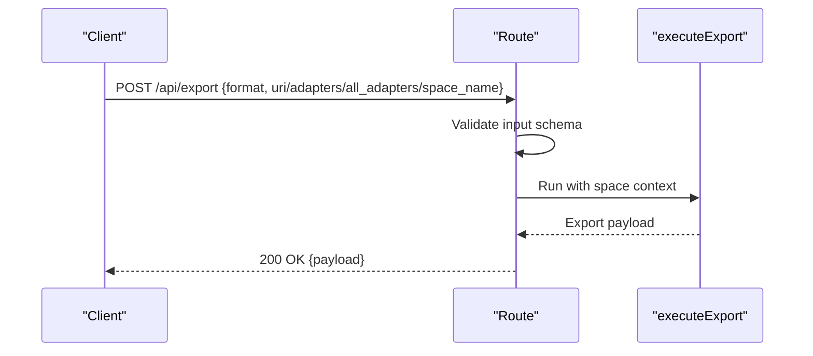

**Diagram sources**
- [http-api-dump.ts:19-61](file://src/http/http-api-dump.ts#L19-L61)

**Section sources**
- [http-api-dump.ts:19-61](file://src/http/http-api-dump.ts#L19-L61)

#### GET /export/skill-zip/:opaque
- Purpose: Stream a skill ZIP bundle using a signed opaque capability record.
- Path parameter: opaque — capability identifier.
- Response: Binary ZIP stream on success.
- Status codes:
  - 200 OK with ZIP stream.
  - 403 Forbidden if capability invalid or expired.
  - 500 Internal Server Error on unexpected failures.

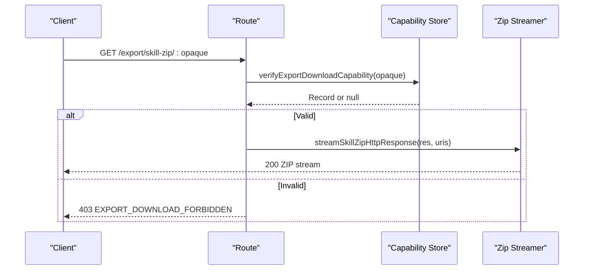

**Diagram sources**
- [http-export-download-routes.ts:9-47](file://src/http/http-export-download-routes.ts#L9-L47)

**Section sources**
- [http-export-download-routes.ts:9-47](file://src/http/http-export-download-routes.ts#L9-L47)

#### POST /api/delete
- Purpose: Delete memories by URIs.
- Request body schema: Defined by deleteInputSchema.
- Response: Deletion summary with total_deleted and total_failed.
- Status codes:
  - 200 OK on success.
  - 400 Bad Request with INVALID_INPUT on validation failure.
  - 500 Internal Server Error on unexpected failures.

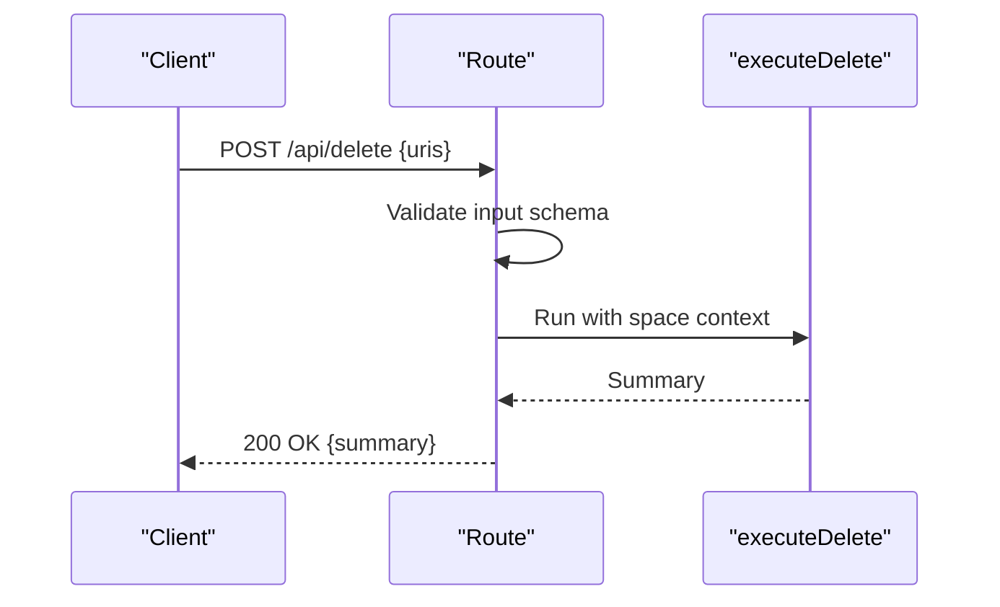

**Diagram sources**
- [http-api-delete.ts:11-35](file://src/http/http-api-delete.ts#L11-L35)

**Section sources**
- [http-api-delete.ts:11-35](file://src/http/http-api-delete.ts#L11-L35)

#### POST /api/tune
- Purpose: Update adapter layers for given URIs.
- Request body schema: Defined by tuneInputSchema.
- Response: Tuning summary with total_updated and total_failed.
- Status codes:
  - 200 OK on success.
  - 400 Bad Request with INVALID_INPUT on validation failure.
  - 500 Internal Server Error on unexpected failures.

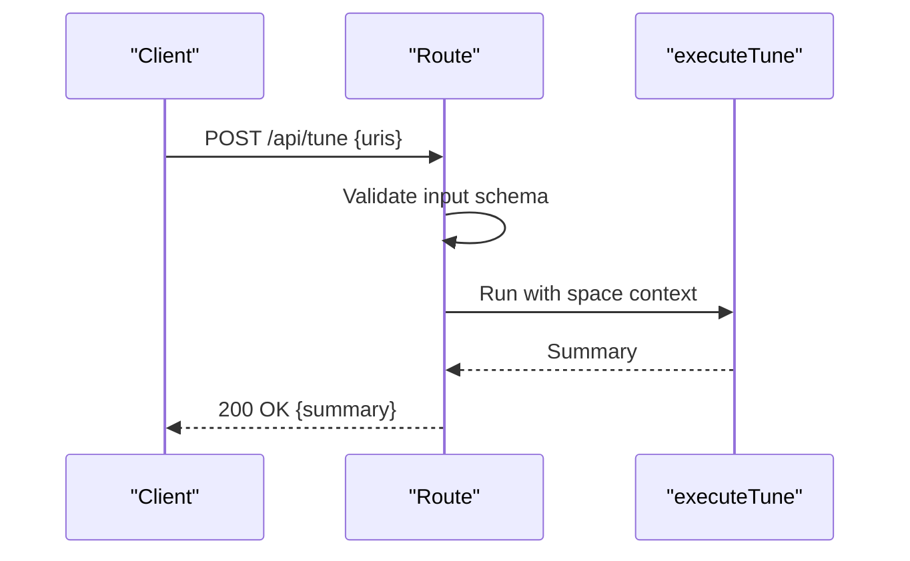

**Diagram sources**
- [http-api-update.ts:11-34](file://src/http/http-api-update.ts#L11-L34)

**Section sources**
- [http-api-update.ts:11-34](file://src/http/http-api-update.ts#L11-L34)

#### POST /api/spaces
- Purpose: List spaces and optionally include adapter titles and artifacts.
- Request body: Optional include_adapter_titles and include_artifacts booleans.
- Response: Space listings with counts and optional details.
- Status codes:
  - 200 OK on success.
  - 500 Internal Server Error on unexpected failures.

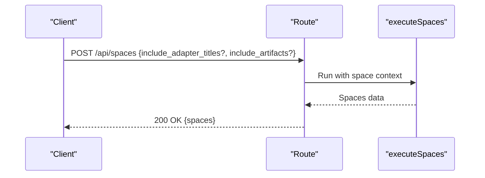

**Diagram sources**
- [http-api-spaces.ts:11-31](file://src/http/http-api-spaces.ts#L11-L31)

**Section sources**
- [http-api-spaces.ts:11-31](file://src/http/http-api-spaces.ts#L11-L31)

#### GET /api/me
- Purpose: Retrieve current authenticated user profile.
- Authentication: Required (session or Bearer).
- Response: Whitelisted profile fields including sub, groups, realm, account_kind, account_label, and optional identity attributes.
- Status codes:
  - 200 OK with profile.
  - 401 Unauthorized if not authenticated.

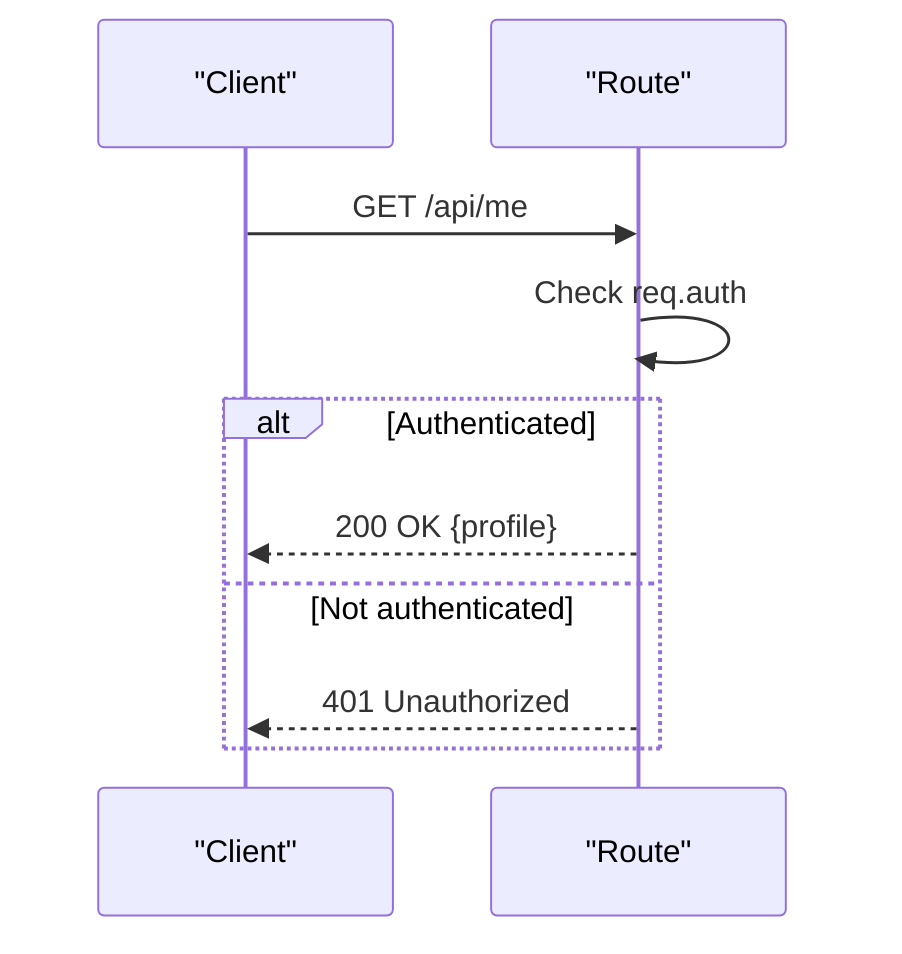

**Diagram sources**
- [http-api-me.ts:31-40](file://src/http/http-api-me.ts#L31-L40)

**Section sources**
- [http-api-me.ts:31-40](file://src/http/http-api-me.ts#L31-L40)

### Error Responses and Global Handlers
- Global error handler returns structured JSON for server errors and handles oversized payloads.
- 404 catch-all returns Not found.
- Method restrictions: GET /mcp returns 405 with Allow: POST.

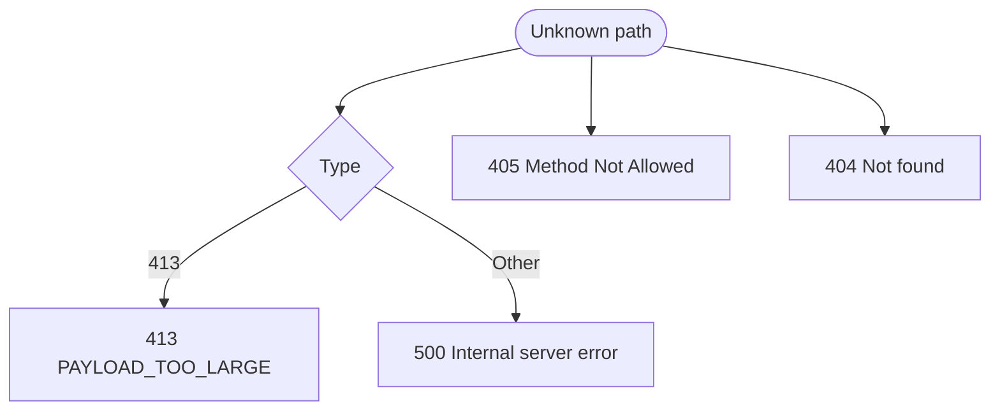

**Diagram sources**
- [http-error-handlers.ts:9-53](file://src/http/http-error-handlers.ts#L9-L53)

**Section sources**
- [http-error-handlers.ts:9-53](file://src/http/http-error-handlers.ts#L9-L53)

### CORS Configuration
- CORS is explicitly configured for /mcp:
  - Allows POST and OPTIONS.
  - Exposes WWW-Authenticate header.
  - Sets max age and allowed headers.

**Section sources**
- [http-mcp-cors.ts:3-28](file://src/http/http-mcp-cors.ts#L3-L28)

## Dependency Analysis
The HTTP layer depends on:
- MemoryQdrantStore for memory operations.
- QdrantService for vector store interactions.
- OIDC configuration and state store for authentication flows.
- Structured logger for observability.

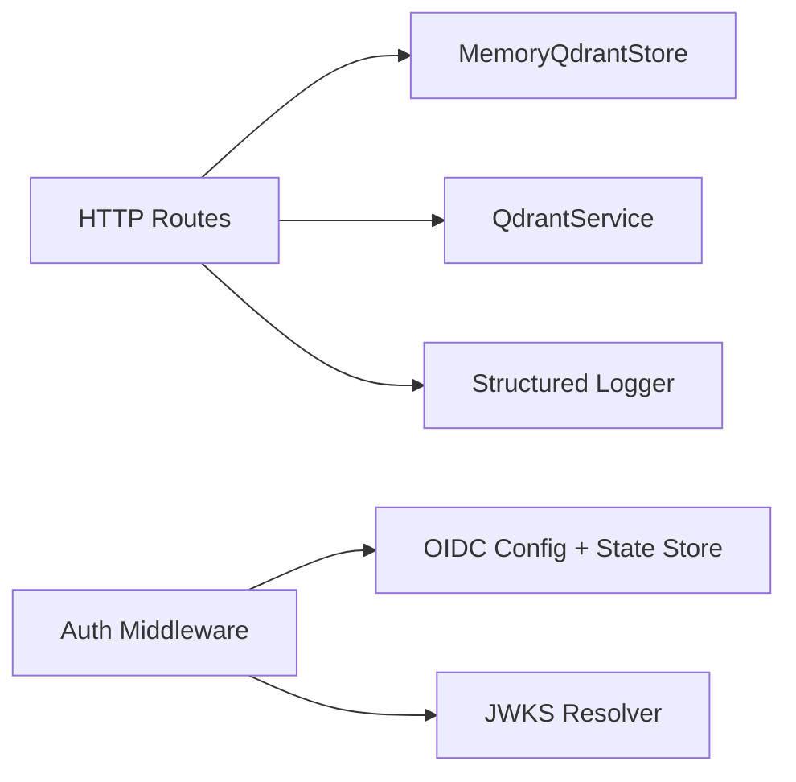

**Diagram sources**
- [http-api-routes.ts:22-35](file://src/http/http-api-routes.ts#L22-L35)
- [http-auth-middleware.ts:172-286](file://src/http/http-auth-middleware.ts#L172-L286)
- [bearer-validate.ts:41-109](file://src/http/bearer-validate.ts#L41-L109)

**Section sources**
- [http-api-routes.ts:1-36](file://src/http/http-api-routes.ts#L1-L36)
- [bearer-validate.ts:41-109](file://src/http/bearer-validate.ts#L41-L109)

## Performance Considerations
- Input validation occurs early to fail fast and reduce downstream work.
- Raw training endpoint enforces a configurable body size limit to prevent large payloads.
- Export downloads stream ZIP bundles to avoid loading entire archives into memory.
- Group resolution may call OIDC userinfo; caching and allowlists mitigate overhead.

[No sources needed since this section provides general guidance]

## Troubleshooting Guide
Common issues and resolutions:
- 401 Unauthorized
  - Missing or invalid session/Bearer token.
  - For Bearer: ensure issuer and audience are configured and token is valid.
  - For browser clients: follow redirect to OIDC login.
- 400 INVALID_INPUT
  - Request body does not match expected schema; check required fields and types.
- 403 Forbidden
  - Export download capability invalid or expired.
  - Requested space not allowed for the authenticated user.
- 409 Conflict
  - Duplicate adapter or similar memory detected during training; use force_update or inspect existing memory.
- 413 Payload Too Large
  - Raw training body exceeds configured limit; reduce content size.
- 500 Internal Server Error
  - Unexpected server-side failure; check logs for stack traces and request IDs.

Operational tips:
- Inspect structured logs for event names like export_download_request and export_http_request.
- Use x-request-id header for correlating requests across components.
- Verify OIDC configuration (KEYCLOAK_URL, KEYCLOAK_INTERNAL_URL, SESSION_SECRET, AUTH_CALLBACK_BASE_URL).

**Section sources**
- [http-auth-middleware.ts:230-286](file://src/http/http-auth-middleware.ts#L230-L286)
- [http-export-download-routes.ts:14-47](file://src/http/http-export-download-routes.ts#L14-L47)
- [http-api-train-raw.ts:154-162](file://src/http/http-api-train-raw.ts#L154-L162)
- [http-error-handlers.ts:9-53](file://src/http/http-error-handlers.ts#L9-L53)

## Conclusion
SquadRules exposes a clear, secure, and extensible HTTP REST API centered around the activate → forward → reward workflow. Authentication supports both OIDC browser sessions and Bearer JWT tokens with robust validation and group-based scoping. Administrative endpoints enable training, exporting, deletion, tuning, and space management. Clients should handle standard error codes, respect rate limits and payload constraints, and integrate with OIDC for secure access.

[No sources needed since this section summarizes without analyzing specific files]