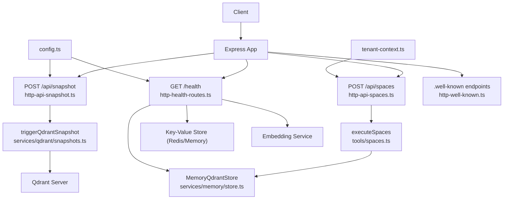
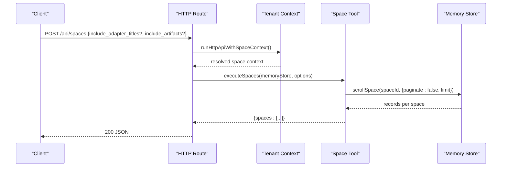
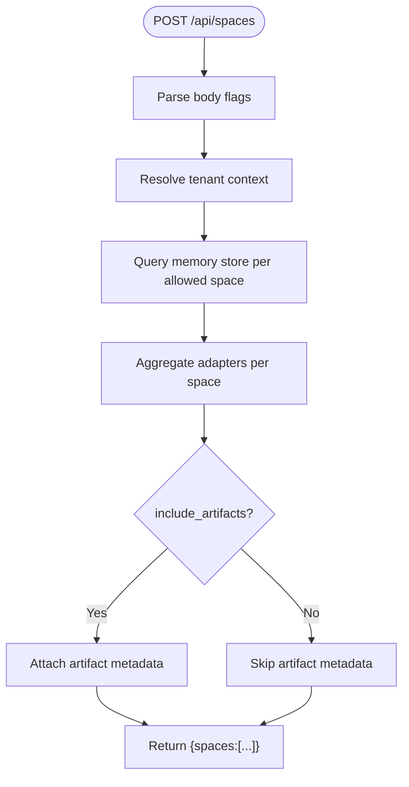
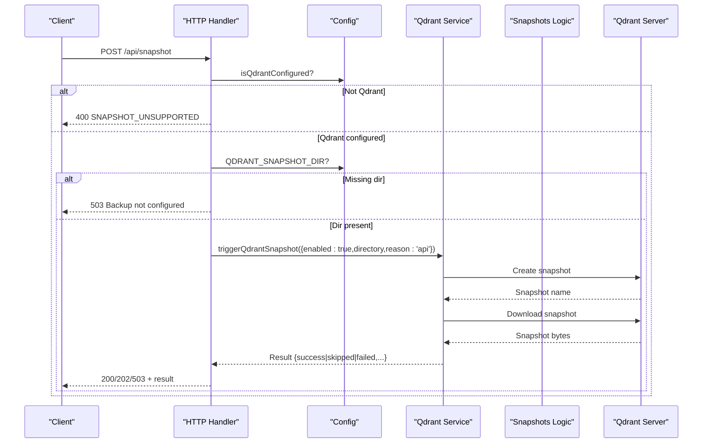
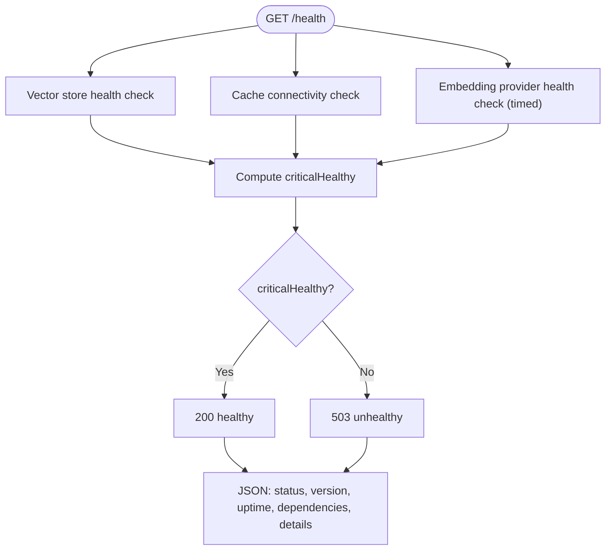
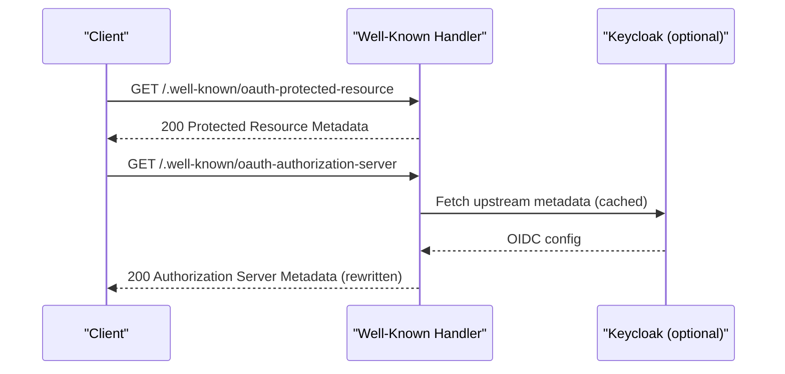

# System Administration Endpoints

<cite>
**Referenced Files in This Document**
- [http-api-spaces.ts](file://src/http/http-api-spaces.ts)
- [spaces.ts](file://src/tools/spaces.ts)
- [tenant-context.ts](file://src/utils/tenant-context.ts)
- [http-api-snapshot.ts](file://src/http/http-api-snapshot.ts)
- [snapshots.ts](file://src/services/qdrant/snapshots.ts)
- [config.ts](file://src/config.ts)
- [http-health-routes.ts](file://src/http/http-health-routes.ts)
- [store.ts](file://src/services/memory/store.ts)
- [http-well-known.ts](file://src/http/http-well-known.ts)
</cite>

## Table of Contents
1. [Introduction](#introduction)
2. [Project Structure](#project-structure)
3. [Core Components](#core-components)
4. [Architecture Overview](#architecture-overview)
5. [Detailed Component Analysis](#detailed-component-analysis)
6. [Dependency Analysis](#dependency-analysis)
7. [Performance Considerations](#performance-considerations)
8. [Troubleshooting Guide](#troubleshooting-guide)
9. [Conclusion](#conclusion)

## Introduction
This document describes the system administration endpoints for multi-tenancy and operational control:
- /api/spaces: Multi-tenancy operations to list spaces and adapter counts, with optional adapter details and artifacts.
- /api/snapshot: Vector database snapshot creation for Qdrant-backed deployments.
- /health: Service health monitoring including vector store, cache, and embedding provider status.
- /.well-known: OpenAPI/OIDC discovery endpoints for authorization server metadata and protected resource metadata.

These endpoints support space-based isolation, administrative privileges where applicable, backup and restore procedures, and system monitoring capabilities.

## Project Structure
The relevant implementation is split across HTTP route handlers, tool logic, services, and configuration:
- HTTP routes:
  - POST /api/spaces
  - POST /api/snapshot
  - GET /health
  - GET /.well-known/oauth-protected-resource and related endpoints
- Tooling and services:
  - Space listing and aggregation logic
  - Qdrant snapshot orchestration
- Configuration and context:
  - Tenant context for space scoping
  - Feature flags and backend selection (Qdrant vs embedded LanceDB)

**Diagram sources**
- [http-api-spaces.ts:11-30](file://src/http/http-api-spaces.ts#L11-L30)
- [http-api-snapshot.ts:14-52](file://src/http/http-api-snapshot.ts#L14-L52)
- [http-health-routes.ts:13-92](file://src/http/http-health-routes.ts#L13-L92)
- [http-well-known.ts:59-95](file://src/http/http-well-known.ts#L59-L95)
- [spaces.ts:172-189](file://src/tools/spaces.ts#L172-L189)
- [snapshots.ts:68-167](file://src/services/qdrant/snapshots.ts#L68-L167)
- [config.ts](file://src/config.ts)
- [tenant-context.ts](file://src/utils/tenant-context.ts)
- [store.ts](file://src/services/memory/store.ts)

**Section sources**
- [http-api-spaces.ts:11-30](file://src/http/http-api-spaces.ts#L11-L30)
- [http-api-snapshot.ts:14-52](file://src/http/http-api-snapshot.ts#L14-L52)
- [http-health-routes.ts:13-92](file://src/http/http-health-routes.ts#L13-L92)
- [http-well-known.ts:59-95](file://src/http/http-well-known.ts#L59-L95)

## Core Components
- Spaces management (/api/spaces): Lists available spaces based on the current tenant context, returning adapter counts and optionally adapter titles and artifacts.
- Snapshot management (/api/snapshot): Creates a Qdrant snapshot when configured; returns clear error codes for unsupported backends or missing backup directory.
- Health checks (/health): Reports service status and dependency health (vector store, cache, embedding).
- Well-known discovery (/.well-known): Provides OAuth Protected Resource Metadata and Authorization Server Metadata proxies for OIDC clients.

**Section sources**
- [http-api-spaces.ts:11-30](file://src/http/http-api-spaces.ts#L11-L30)
- [http-api-snapshot.ts:14-52](file://src/http/http-api-snapshot.ts#L14-L52)
- [http-health-routes.ts:13-92](file://src/http/http-health-routes.ts#L13-L92)
- [http-well-known.ts:59-95](file://src/http/http-well-known.ts#L59-L95)

## Architecture Overview
The administration endpoints follow a layered architecture:
- HTTP layer exposes REST endpoints.
- Business logic resides in tools and services.
- Data access uses memory store abstractions and external services (Qdrant, Redis, embedding providers).
- Configuration and tenant context drive behavior and isolation.

**Diagram sources**
- [http-api-spaces.ts:11-30](file://src/http/http-api-spaces.ts#L11-L30)
- [spaces.ts:172-189](file://src/tools/spaces.ts#L172-L189)
- [tenant-context.ts](file://src/utils/tenant-context.ts)
- [store.ts](file://src/services/memory/store.ts)

## Detailed Component Analysis

### Spaces Management: POST /api/spaces
Purpose:
- List spaces visible to the current tenant.
- Return adapter counts per space.
- Optionally include adapter titles and artifacts.

Behavior:
- Validates request body flags include_adapter_titles and include_artifacts.
- Uses tenant context to scope results to allowed spaces.
- Aggregates adapter information from memory store records.

Security and isolation:
- Space scoping is enforced via tenant context; only allowed space IDs are reported.

Operational notes:
- Errors return a standardized SPACES_FAILED code with a message.

Example usage patterns:
- List spaces with counts only: send include_adapter_titles=false, include_artifacts=false.
- Include adapter titles: set include_adapter_titles=true.
- Include artifacts: set include_artifacts=true (implies include_adapter_titles=true).

**Diagram sources**
- [http-api-spaces.ts:11-30](file://src/http/http-api-spaces.ts#L11-L30)
- [spaces.ts:172-189](file://src/tools/spaces.ts#L172-L189)

**Section sources**
- [http-api-spaces.ts:11-30](file://src/http/http-api-spaces.ts#L11-L30)
- [spaces.ts:172-189](file://src/tools/spaces.ts#L172-L189)
- [tenant-context.ts](file://src/utils/tenant-context.ts)

### Snapshot Operations: POST /api/snapshot
Purpose:
- Create a vector database snapshot for Qdrant-backed deployments.

Behavior:
- If Qdrant is not configured (embedded LanceDB), returns SNAPSHOT_UNSUPPORTED with guidance to back up data directory manually.
- If backup directory is not configured, returns 503 with Backup not configured.
- Otherwise, triggers Qdrant snapshot creation and downloads the snapshot file to the configured directory.

Response semantics:
- success: completed
- skipped: 202 when disabled or directory not configured
- failed: 503 when Qdrant errors occur

Backup and restore procedure:
- Ensure QDRANT_SNAPSHOT_DIR is set and writable.
- Call POST /api/snapshot to create snapshots.
- Restore by importing snapshots into Qdrant using Qdrant’s native mechanisms outside this endpoint.

**Diagram sources**
- [http-api-snapshot.ts:14-52](file://src/http/http-api-snapshot.ts#L14-L52)
- [snapshots.ts:68-167](file://src/services/qdrant/snapshots.ts#L68-L167)
- [config.ts](file://src/config.ts)

**Section sources**
- [http-api-snapshot.ts:14-52](file://src/http/http-api-snapshot.ts#L14-L52)
- [snapshots.ts:68-167](file://src/services/qdrant/snapshots.ts#L68-L167)
- [config.ts](file://src/config.ts)

### Health Checks: GET /health
Purpose:
- Provide readiness/liveness signals and dependency health.

Checks performed:
- Vector store health: Qdrant if configured; otherwise reports embedded LanceDB under vectorStore.
- Cache health: Redis if configured; otherwise reports memory cache as healthy.
- Embedding provider health: Optional, with timeout protection.

Status determination:
- criticalHealthy combines vector store, cache, and embedding provider states.
- Returns 200 when healthy, 503 when unhealthy.

Interpretation:
- dependencies.qdrant or dependencies.vectorStore indicates vector backend status.
- dependencies.embedding indicates embedding provider status (healthy/unhealthy/disabled).
- dependencies.redis or dependencies.cache indicates cache backend status.
- details.cacheBackend and details.vectorStoreBackend clarify backends in use.

**Diagram sources**
- [http-health-routes.ts:13-92](file://src/http/http-health-routes.ts#L13-L92)
- [store.ts](file://src/services/memory/store.ts)

**Section sources**
- [http-health-routes.ts:13-92](file://src/http/http-health-routes.ts#L13-L92)
- [store.ts](file://src/services/memory/store.ts)

### Well-Known Discovery: /.well-known
Purpose:
- Expose OAuth Protected Resource Metadata and Authorization Server Metadata for MCP clients.

Endpoints:
- GET /.well-known/oauth-protected-resource
- GET /.well-known/oauth-protected-resource/mcp
- GET /.well-known/oauth-authorization-server
- GET /.well-known/openid-configuration

Behavior:
- Builds Protected Resource Metadata with issuer, scopes, bearer methods, and resource name.
- Proxies Authorization Server Metadata from Keycloak, rewriting internal URLs and preserving registration_endpoint for Dynamic Client Registration.
- Adds client_id_metadata_document_supported flag for MCP spec compliance.

**Diagram sources**
- [http-well-known.ts:59-95](file://src/http/http-well-known.ts#L59-L95)
- [http-well-known.ts:144-189](file://src/http/http-well-known.ts#L144-L189)

**Section sources**
- [http-well-known.ts:59-95](file://src/http/http-well-known.ts#L59-L95)
- [http-well-known.ts:144-189](file://src/http/http-well-known.ts#L144-L189)

## Dependency Analysis
- Spaces route depends on:
  - Tenant context for space scoping
  - Space tool for aggregation
  - Memory store for data retrieval
- Snapshot route depends on:
  - Configuration flags for backend selection and backup directory
  - Qdrant service and snapshot logic
- Health route depends on:
  - Memory store health check
  - Key-value store connectivity
  - Embedding service health
- Well-known route depends on:
  - Configuration for Keycloak URLs and realm
  - Optional proxy to upstream OIDC configuration

```mermaid
graph LR
SpacesRoute["/api/spaces"] --> TenantCtx["tenant-context.ts"]
SpacesRoute --> SpacesTool["tools/spaces.ts"]
SpacesTool --> MemoryStore["services/memory/store.ts"]
SnapshotRoute["/api/snapshot"] --> Config["config.ts"]
SnapshotRoute --> Snapshots["services/qdrant/snapshots.ts"]
HealthRoute["/health"] --> MemoryStore
HealthRoute --> KVStore["key-value-store-factory"]
HealthRoute --> EmbeddingSvc["embedding/service"]
WellKnownRoute["/.well-known/*"] --> Config
```

**Diagram sources**
- [http-api-spaces.ts:11-30](file://src/http/http-api-spaces.ts#L11-L30)
- [spaces.ts:172-189](file://src/tools/spaces.ts#L172-L189)
- [http-api-snapshot.ts:14-52](file://src/http/http-api-snapshot.ts#L14-L52)
- [snapshots.ts:68-167](file://src/services/qdrant/snapshots.ts#L68-L167)
- [http-health-routes.ts:13-92](file://src/http/http-health-routes.ts#L13-L92)
- [http-well-known.ts:59-95](file://src/http/http-well-known.ts#L59-L95)
- [config.ts](file://src/config.ts)
- [tenant-context.ts](file://src/utils/tenant-context.ts)
- [store.ts](file://src/services/memory/store.ts)

**Section sources**
- [http-api-spaces.ts:11-30](file://src/http/http-api-spaces.ts#L11-L30)
- [http-api-snapshot.ts:14-52](file://src/http/http-api-snapshot.ts#L14-L52)
- [http-health-routes.ts:13-92](file://src/http/http-health-routes.ts#L13-L92)
- [http-well-known.ts:59-95](file://src/http/http-well-known.ts#L59-L95)

## Performance Considerations
- Spaces listing:
  - Uses a fixed scroll limit to avoid unbounded queries; consider tuning SCROLL_LIMIT for large spaces.
  - Including artifacts increases payload size; enable only when needed.
- Snapshot creation:
  - Streaming download avoids loading entire snapshots into memory.
  - Directory I/O performance affects overall duration; ensure fast storage for QDRANT_SNAPSHOT_DIR.
- Health checks:
  - Embedding provider health check is bounded by a short timeout to keep responses responsive.
  - Avoid enabling unnecessary dependency checks in constrained environments.

[No sources needed since this section provides general guidance]

## Troubleshooting Guide
Common issues and resolutions:
- /api/spaces fails:
  - Check tenant context configuration and allowed space IDs.
  - Verify memory store connectivity and permissions.
  - Inspect logs for SPACES_FAILED and underlying messages.
- /api/snapshot unsupported:
  - Embedded LanceDB does not support server-side snapshots; back up data directory manually.
- /api/snapshot backup not configured:
  - Set QDRANT_SNAPSHOT_DIR to a writable directory.
- /health unhealthy:
  - Vector store unreachable: verify Qdrant connectivity or confirm embedded LanceDB mode.
  - Redis unavailable: ensure REDIS_URL is correct or accept memory cache mode.
  - Embedding provider down: check provider configuration and network reachability.

**Section sources**
- [http-api-spaces.ts:25-29](file://src/http/http-api-spaces.ts#L25-L29)
- [http-api-snapshot.ts:19-34](file://src/http/http-api-snapshot.ts#L19-L34)
- [http-health-routes.ts:15-54](file://src/http/http-health-routes.ts#L15-L54)

## Conclusion
The system administration endpoints provide robust controls for multi-tenancy, backups, and monitoring:
- /api/spaces enables space-scoped visibility and reporting with optional rich metadata.
- /api/snapshot offers reliable Qdrant-backed backups with clear error signaling for unsupported configurations.
- /health delivers actionable dependency health signals for operators.
- /.well-known supports OIDC discovery for MCP clients, ensuring interoperability.

Operators should configure tenant contexts, backup directories, and authentication settings appropriately to achieve secure, isolated, and observable deployments.