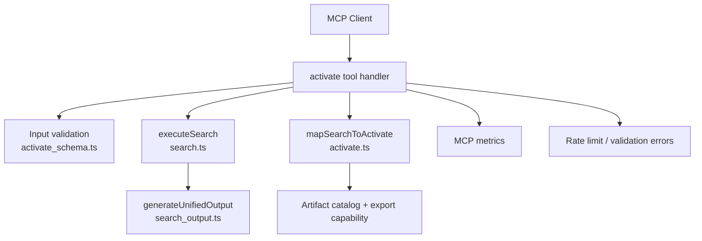
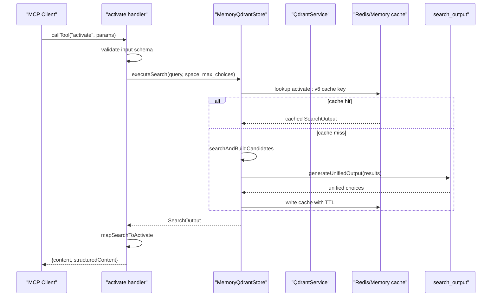
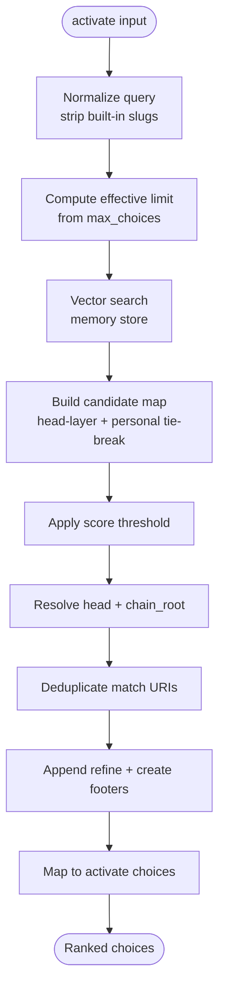
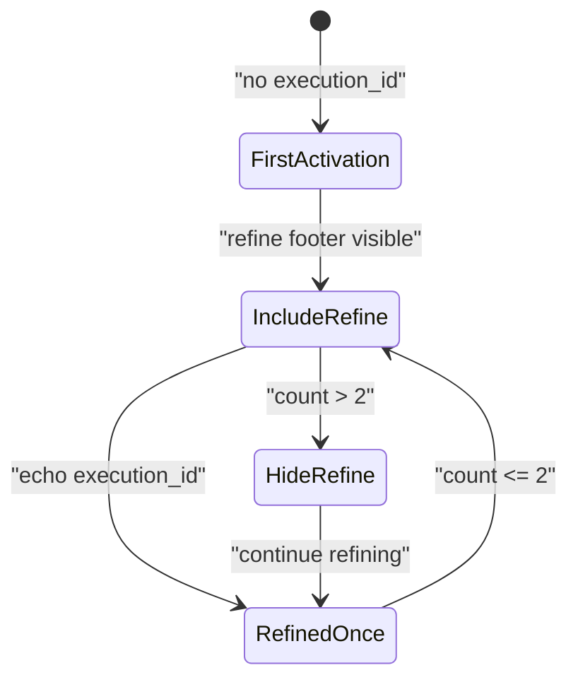
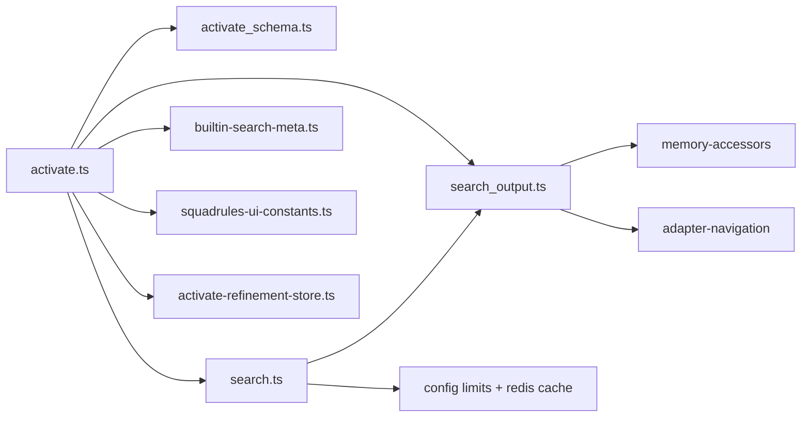

# Activate Tool

<cite>
**Referenced Files in This Document**
- [activate.ts](file://src/tools/activate.ts)
- [activate_schema.ts](file://src/tools/activate_schema.ts)
- [search.ts](file://src/tools/search.ts)
- [search_output.ts](file://src/tools/search_output.ts)
- [squadrules-ui-constants.ts](file://src/mcp-apps/squadrules-ui-constants.ts)
- [builtin-search-meta.ts](file://src/constants/builtin-search-meta.ts)
- [activate-refinement-store.ts](file://src/services/activate-refinement-store.ts)
</cite>

## Table of Contents
1. [Introduction](#introduction)
2. [Project Structure](#project-structure)
3. [Core Components](#core-components)
4. [Architecture Overview](#architecture-overview)
5. [Detailed Component Analysis](#detailed-component-analysis)
6. [Dependency Analysis](#dependency-analysis)
7. [Performance Considerations](#performance-considerations)
8. [Troubleshooting Guide](#troubleshooting-guide)
9. [Conclusion](#conclusion)

## Introduction
The `activate` tool is the entry point for SquadRules’ agent-first adapter routing workflow. Its purpose is to find the best adapter for a current user request and return ranked activation choices that guide the next step. The canonical flow is:

1. Call `activate` with a natural-language query.
2. Choose one returned choice.
3. Follow its `next_action`, which typically means calling `forward` with the suggested adapter URI.
4. Optionally refine or create adapters when no suitable match exists.

This document explains the complete input schema, output structure, ranking behavior, space filtering, refinement state, artifact handling, error handling, authentication context, rate limiting, performance characteristics, and integration patterns with subsequent `forward` calls.

## Project Structure
The `activate` tool is implemented as an MCP tool registration plus a search-and-ranking pipeline:

- Tool registration and orchestration: `src/tools/activate.ts`
- Input/output schemas: `src/tools/activate_schema.ts`
- Shared search execution: `src/tools/search.ts`
- Unified search output building: `src/tools/search_output.ts`
- Built-in refine/create footer metadata: `src/constants/builtin-search-meta.ts`
- UI widget binding for activate results: `src/mcp-apps/squadrules-ui-constants.ts`
- Refinement sequence counter: `src/services/activate-refinement-store.ts`

**Diagram sources**
- [activate.ts:237-286](file://src/tools/activate.ts#L237-L286)
- [activate_schema.ts:69-116](file://src/tools/activate_schema.ts#L69-L116)
- [search.ts:192-253](file://src/tools/search.ts#L192-L253)
- [search_output.ts:117-238](file://src/tools/search_output.ts#L117-L238)

**Section sources**
- [activate.ts:237-286](file://src/tools/activate.ts#L237-L286)
- [activate_schema.ts:69-116](file://src/tools/activate_schema.ts#L69-L116)
- [search.ts:192-253](file://src/tools/search.ts#L192-L253)
- [search_output.ts:117-238](file://src/tools/search_output.ts#L117-L238)

## Core Components
- **Tool handler**: Registers the `activate` tool, validates input, measures duration and payload size, handles validation and rate-limit errors, and returns structured content.
- **Execution function**: Generates an execution ID, tracks refinement count, runs shared search, and maps search results into activate-specific choices.
- **Search layer**: Performs vector search, candidate deduplication, head-layer resolution, chain-root resolution, thresholding, and unified output generation.
- **Schema layer**: Defines strict Zod schemas for input and output, including discriminated unions over choice roles.
- **UI metadata**: Binds the activate result to an MCP Apps HTML widget resource.
- **Refinement store**: Tracks how many times the same `execution_id` has been used for refinement within a bounded TTL.

**Section sources**
- [activate.ts:209-286](file://src/tools/activate.ts#L209-L286)
- [search.ts:93-186](file://src/tools/search.ts#L93-L186)
- [search_output.ts:77-238](file://src/tools/search_output.ts#L77-L238)
- [activate_schema.ts:69-116](file://src/tools/activate_schema.ts#L69-L116)
- [squadrules-ui-constants.ts:45-52](file://src/mcp-apps/squadrules-ui-constants.ts#L45-L52)
- [activate-refinement-store.ts:6-46](file://src/services/activate-refinement-store.ts#L6-L46)

## Architecture Overview
The activate tool does not directly perform vector search itself; it delegates to the shared search pipeline and then adapts the unified search output into activate-specific guidance.

**Diagram sources**
- [activate.ts:209-235](file://src/tools/activate.ts#L209-L235)
- [search.ts:192-253](file://src/tools/search.ts#L192-L253)
- [search_output.ts:117-238](file://src/tools/search_output.ts#L117-L238)

## Detailed Component Analysis

### Purpose and High-Level Behavior
The `activate` tool answers the question “which adapter should I run for this request?” It returns:
- A global directive telling the caller to pick one choice and follow its `next_action`.
- A human-readable message summarizing matches and confidence.
- Ranked choices with roles:
  - `match`: existing adapters that may satisfy the request.
  - `refine`: built-in help for improving the query.
  - `create`: built-in help for registering a new adapter/protocol/workflow.

For `match` choices, the tool may also resolve linked artifacts and provide shell-safe materialization commands.

**Section sources**
- [activate.ts:44-207](file://src/tools/activate.ts#L44-L207)
- [search_output.ts:117-238](file://src/tools/search_output.ts#L117-L238)

### Input Schema
The activate input is validated by a strict Zod schema. Required fields are enforced, and optional fields allow scoping and tuning.

| Field | Type | Required | Description |
|---|---|---:|---|
| `query` | string | Yes | Activation query used to find the best matching adapter. Must be at least one character. |
| `execution_id` | string (UUID) | No | Server-issued execution ID for a refinement sequence. Echo it back when re-running `activate` to refine the query for the same user request. |
| `space` | string | No | Scope results to a space: personal, group name, `Group: …`, or space ID. |
| `space_id` | string | No | Alias for `space`. |
| `max_choices` | integer | No | Maximum adapter choices to return. Bounded by configured minimum and maximum search limits. |

Important constraints:
- `execution_id` must be a UUID if provided.
- `max_choices` is clamped to configured limits.
- Space filtering uses either `space` or `space_id`; both are supported for compatibility.

**Section sources**
- [activate_schema.ts:69-88](file://src/tools/activate_schema.ts#L69-L88)
- [search.ts:198-203](file://src/tools/search.ts#L198-L203)

### Output Schema
The activate output is a strict object describing the global directive, contextual message, echoed query, execution ID, and ranked choices.

| Field | Type | Description |
|---|---|---|
| `must_obey` | boolean | Always true. Pick one adapter and follow `next_action`. |
| `message` | string | Human-readable summary of matches, confidence, and guidance. |
| `next_action` | string | Global instruction: pick one choice and follow that choice’s `next_action`. |
| `execution_id` | string (UUID) | Echoed server-issued execution ID for refinement sequences. |
| `query` | string | Echo of the original activation query. |
| `choices` | array | Ranked choices discriminated by `role`. |
| `squadrules_local_artifact_dir` | string[] | Ordered client-side hints for resolving local handoff directories. |

#### Choice Discriminated Union
Each choice has a `role` field that determines its shape:

| Role | Meaning | Key Fields |
|---|---|---|
| `match` | Existing adapter that may satisfy the request. | `uri`, `label`, `adapter_name`, `activation_score`, `tags`, `next_action`, `adapter_version`, `activation_patterns`, `space_name`, `slug`, `forward_first_call`, optional `linked_artifacts`. |
| `refine` | Built-in helper to improve the query. | `uri`, `label`, `adapter_name`, `activation_score` is null, `tags`, `next_action`, `adapter_version`, `space_name` is null, `slug`, `forward_first_call`. |
| `create` | Built-in helper to register a new adapter/protocol/workflow. | `uri`, `label`, `adapter_name`, `activation_score` is null, `tags`, `next_action`, `adapter_version`, `space_name` is null, `slug`, `forward_first_call` is null. |

#### Confidence Scores
- `activation_score` is a normalized value between 0.0 and 1.0 for `match` choices.
- For `refine` and `create` choices, `activation_score` is null because they are meta actions, not semantic matches.
- The top match’s confidence is often shown as a percentage in the response message.

#### Forward Hints
- `forward_first_call.uri` points to the adapter URI that should be used for the first `forward` call.
- For `create` choices, `forward_first_call` is null because creation is handled through training rather than direct forward execution.

#### Linked Artifacts
For `match` choices, the tool may resolve linked artifacts associated with the adapter. When present, each artifact includes:
- `slug`
- `filename`
- `relative_path`
- `download_url`
- `sha256`
- `content_type`
- `materialize`

The `materialize` field contains a shell command to download the artifact into `$SQUADRULES_LOCAL_ARTIFACT_DIR` and verify its SHA-256 before executing the adapter.

**Section sources**
- [activate_schema.ts:90-116](file://src/tools/activate_schema.ts#L90-L116)
- [activate.ts:69-178](file://src/tools/activate.ts#L69-L178)
- [search_output.ts:52-66](file://src/tools/search_output.ts#L52-L66)

### Ranking and Selection Logic
The ranking logic is primarily implemented in the shared search pipeline and then adapted by `activate`.

Key behaviors:
1. **Candidate collection**: The search layer collects candidate memories from the memory store, using a dynamic initial limit based on `max_choices`.
2. **Head-layer preference**: Head layers are preferred over non-head layers when scores are tied.
3. **Personal-space tie-breaking**: When scores are equal, candidates from the default write space are preferred.
4. **Thresholding**: Results below a normalized score threshold are filtered out.
5. **Chain-root resolution**: If an adapter defines a chain root, the resolved root URI and label may replace the original choice URI and label.
6. **Deduplication**: Match choices collapsing to the same chain-root URI are deduplicated.
7. **Footer injection**: Built-in `refine` and `create` choices are appended as meta rows.

**Diagram sources**
- [search.ts:93-186](file://src/tools/search.ts#L93-L186)
- [search_output.ts:77-238](file://src/tools/search_output.ts#L77-L238)
- [activate.ts:44-207](file://src/tools/activate.ts#L44-L207)

**Section sources**
- [search.ts:58-111](file://src/tools/search.ts#L58-L111)
- [search.ts:143-186](file://src/tools/search.ts#L143-L186)
- [search_output.ts:77-238](file://src/tools/search_output.ts#L77-L238)

### Space Filtering
Space filtering allows restricting activation results to a specific scope:
- `space`: preferred space parameter.
- `space_id`: alias for backward compatibility.
- When either is provided, the search runs inside the corresponding space context.
- The output includes `space_name` for stored adapters where available.

Space display names are derived from the space context, and app-level defaults are used when necessary.

**Section sources**
- [activate_schema.ts:76-80](file://src/tools/activate_schema.ts#L76-L80)
- [search.ts:198-203](file://src/tools/search.ts#L198-L203)
- [search_output.ts:131-136](file://src/tools/search_output.ts#L131-L136)

### Refinement State Management
When an `execution_id` is provided, the tool increments a refinement counter for that execution. This affects whether the built-in `refine` footer is included:
- If no `execution_id` is provided, the refine footer is included.
- If an `execution_id` is provided, the refine footer is included while the refinement count is less than or equal to two.
- After more than two refinements, the refine footer is hidden to avoid endless refinement loops.

The refinement counter is stored with a TTL so it does not persist indefinitely.

**Diagram sources**
- [activate.ts:214-218](file://src/tools/activate.ts#L214-L218)
- [activate-refinement-store.ts:13-23](file://src/services/activate-refinement-store.ts#L13-L23)

**Section sources**
- [activate.ts:214-218](file://src/tools/activate.ts#L214-L218)
- [activate-refinement-store.ts:6-46](file://src/services/activate-refinement-store.ts#L6-L46)

### Artifact Materialization
For `match` choices with linked artifacts:
1. The tool resolves the adapter entry.
2. It lists linked artifacts for the adapter.
3. For each artifact, it creates a temporary download capability URL.
4. It normalizes relative paths and generates a shell-safe materialization command.
5. If artifact loading fails, it logs a warning but continues with the rest of the choice.

The generated `materialize` command:
- Creates parent directories under `$SQUADRULES_LOCAL_ARTIFACT_DIR`.
- Downloads the artifact.
- Verifies the SHA-256 checksum.
- Makes the file executable.

**Section sources**
- [activate.ts:51-67](file://src/tools/activate.ts#L51-L67)
- [activate.ts:115-177](file://src/tools/activate.ts#L115-L177)

### Authentication Requirements
Authentication is not performed inside the `activate` tool itself. Instead:
- The tool handler reads the tenant ID from the current request context.
- Metrics are tagged with the tenant ID.
- Space context, request ID, and other per-request identity information are accessed through tenant utilities.
- In the broader system, authentication is handled by HTTP middleware and OIDC/OAuth flows, with JWT tokens validating both human and agent requests.

Clients should ensure that activate calls include valid authentication headers or tokens according to their transport (HTTP, stdio, or MCP host).

**Section sources**
- [activate.ts:254-256](file://src/tools/activate.ts#L254-L256)
- [search.ts:150-152](file://src/tools/search.ts#L150-L152)

### Rate Limiting Considerations
The activate tool integrates with a generic rate-limit error handler:
- On unexpected errors, the handler checks whether the error represents a rate-limit condition.
- If so, it returns a structured rate-limit error result instead of throwing.
- Otherwise, the error is rethrown after recording metrics.

Clients should treat rate-limit responses as transient and implement retry with backoff.

**Section sources**
- [activate.ts:276-283](file://src/tools/activate.ts#L276-L283)

### Performance Characteristics
- **Shared search caching**: The search pipeline caches unified search results using a versioned cache key that includes space, query, group-collapse setting, and effective limit. The default TTL is 300 seconds.
- **Two-phase search**: The search layer performs an initial search with a computed limit and may fall back to a second search without group collapse if fewer candidates are found.
- **Head-layer and personal-space preferences**: These reduce noise by preferring authoritative versions and default-write spaces.
- **Chain-root resolution**: Resolving chain roots can redirect a choice to a different adapter URI and label.
- **Artifact loading**: Linked artifact resolution is attempted per choice but failures are logged and do not break the overall response.

Optimization tips:
- Use `max_choices` to cap the number of returned choices.
- Reuse `execution_id` only when intentionally refining the same request.
- Prefer explicit `space` or `space_id` when you know the target scope.
- Avoid overly broad queries that return many weak matches.
- Cache client-side results when appropriate, respecting the server’s structured output.

**Section sources**
- [search.ts:55-56](file://src/tools/search.ts#L55-L56)
- [search.ts:93-111](file://src/tools/search.ts#L93-L111)
- [search.ts:206-248](file://src/tools/search.ts#L206-L248)
- [activate.ts:125-157](file://src/tools/activate.ts#L125-L157)

### Practical Examples

#### Common Activation Patterns
- **Run an existing adapter**: Provide a clear query describing the task. Choose the top `match` choice and follow its `next_action`, which usually means calling `forward` with the suggested adapter URI.
- **No match found**: If the response indicates no strong match, choose the `refine` choice to improve the query, or choose the `create` choice to register a new adapter.
- **Multiple matches**: Compare labels, tags, activation scores, and `space_name`. Choose the most relevant adapter and follow its `next_action`.

#### Multi-Step Workflow Initiation
A typical multi-step workflow looks like this:
1. Call `activate` with a high-level goal.
2. Select the best `match` choice.
3. Call `forward` with the suggested URI and no solution to start the adapter.
4. If the adapter requires artifacts, materialize them first using the provided `materialize` commands.
5. Continue following the adapter’s steps until completion.
6. If the adapter needs review or validation, it may internally invoke other adapters via `forward`.

#### Refinement Workflow
Use refinement when:
- `activate` returns no match.
- `activate` returns only weak choices.
- The response includes a `refine` choice.

Steps:
1. Keep the original `execution_id`.
2. Improve the query based on missing context or constraints.
3. Call `activate` again with the refined query and the same `execution_id`.
4. Stop refining after the built-in limit; offer clarification or create a new adapter if needed.

#### Error Handling Scenarios
- **Invalid input**: Validation errors return a structured result indicating which fields failed. Fix the input and retry.
- **Rate limit**: Treat the response as transient and retry with exponential backoff.
- **Missing artifacts**: If artifact loading fails, the choice still appears, but `linked_artifacts` may be absent. Proceed with `forward` if the adapter does not require artifacts.
- **No matches**: Use `refine` or `create` as guided by the response message.

**Section sources**
- [activate.ts:258-283](file://src/tools/activate.ts#L258-L283)
- [search_output.ts:218-237](file://src/tools/search_output.ts#L218-L237)
- [activate.ts:181-206](file://src/tools/activate.ts#L181-L206)

### Integration with Subsequent `forward` Calls
The activate tool is designed to feed directly into `forward`:
- Each `match` and `refine` choice includes `forward_first_call.uri`.
- The `next_action` text explicitly instructs the caller to call `forward` with the adapter URI and no solution to start the adapter.
- For `create` choices, `forward_first_call` is null because creation is handled through training rather than direct forward execution.

Recommended integration pattern:
1. Parse the structured output from `activate`.
2. Select the highest-confidence `match` choice unless domain rules prefer another option.
3. Extract `forward_first_call.uri`.
4. Call `forward` with that URI and the required inputs.
5. Preserve `execution_id` across refinement cycles.
6. Persist adapter state, such as selected URI, step index, and workspace context, if your application manages multi-step workflows.

**Section sources**
- [activate_schema.ts:16-20](file://src/tools/activate_schema.ts#L16-L20)
- [activate_schema.ts:55-67](file://src/tools/activate_schema.ts#L55-L67)
- [activate.ts:109-112](file://src/tools/activate.ts#L109-L112)
- [activate.ts:173-176](file://src/tools/activate.ts#L173-L176)

### UI and Widget Binding
The activate tool exposes MCP Apps UI metadata that binds the tool result to an HTML widget resource. This enables hosts to render interactive adapter-choice interfaces rather than raw JSON.

Key constants:
- Activate UI resource URI.
- Skybridge-compatible URI variant.
- Tool `_meta.ui.resourceUri`.
- Flat resource URI key for hosts expecting normalized metadata.

**Section sources**
- [squadrules-ui-constants.ts:24-28](file://src/mcp-apps/squadrules-ui-constants.ts#L24-L28)
- [squadrules-ui-constants.ts:45-52](file://src/mcp-apps/squadrules-ui-constants.ts#L45-L52)

## Dependency Analysis
The activate tool depends on several internal services and modules:

**Diagram sources**
- [activate.ts:1-23](file://src/tools/activate.ts#L1-L23)
- [search.ts:1-28](file://src/tools/search.ts#L1-L28)
- [search_output.ts:6-28](file://src/tools/search_output.ts#L6-L28)

**Section sources**
- [activate.ts:1-23](file://src/tools/activate.ts#L1-L23)
- [search.ts:1-28](file://src/tools/search.ts#L1-L28)
- [search_output.ts:6-28](file://src/tools/search_output.ts#L6-L28)

## Performance Considerations
- **Cache effectiveness**: The activate search cache reduces repeated work for identical queries within the same space and configuration. Monitor cache hits and misses during development.
- **Limit tuning**: Larger `max_choices` increases search depth and output size. Use the smallest useful value for your use case.
- **Artifact overhead**: Linking many artifacts adds network and filesystem operations. Prefer minimal, necessary artifacts.
- **Refinement loop control**: The refinement counter prevents infinite refinement loops. Clients should respect this bound.
- **Metrics**: The tool records call counts, durations, input sizes, output sizes, and error rates. Use these metrics to detect slow or failing activations.

[No sources needed since this section provides general guidance]

## Troubleshooting Guide

### Input Validation Errors
Symptoms:
- Missing `query`.
- Invalid `execution_id` format.
- `max_choices` outside configured bounds.

Resolution:
- Ensure `query` is non-empty.
- Use a valid UUID for `execution_id`.
- Clamp `max_choices` to the configured minimum and maximum.

**Section sources**
- [activate_schema.ts:69-88](file://src/tools/activate_schema.ts#L69-L88)
- [activate.ts:258-264](file://src/tools/activate.ts#L258-L264)

### Rate Limit Responses
Symptoms:
- Activate returns a structured rate-limit error.
- Repeated calls fail quickly.

Resolution:
- Implement retry with exponential backoff.
- Reduce request frequency.
- Inspect upstream rate-limit headers or metrics if available.

**Section sources**
- [activate.ts:276-283](file://src/tools/activate.ts#L276-L283)

### No Matches or Weak Matches
Symptoms:
- Response indicates no match or low confidence.
- Only `refine` and `create` choices appear.

Resolution:
- Use the `refine` choice to improve the query.
- Add clearer activation patterns to the target adapter.
- Train or update the adapter so its semantics align with user queries.
- Use `create` to register a new adapter when none exists.

**Section sources**
- [search_output.ts:218-237](file://src/tools/search_output.ts#L218-L237)
- [activate.ts:181-206](file://src/tools/activate.ts#L181-L206)

### Artifact Download Failures
Symptoms:
- `linked_artifacts` is missing even though the adapter is expected to have artifacts.
- Shell materialization commands fail due to permissions or network issues.

Resolution:
- Verify `$SQUADRULES_LOCAL_ARTIFACT_DIR` is set and writable.
- Check network access to artifact download URLs.
- Validate SHA-256 checksums before execution.
- Review server warnings about artifact loading failures.

**Section sources**
- [activate.ts:125-157](file://src/tools/activate.ts#L125-L157)
- [activate.ts:51-67](file://src/tools/activate.ts#L51-L67)

### Refinement Loop Problems
Symptoms:
- `refine` choice disappears after multiple activations.
- Agent keeps refining without progress.

Resolution:
- Respect the refinement count limit.
- Stop refining after the built-in threshold.
- Offer clarification or create a new adapter.

**Section sources**
- [activate.ts:214-218](file://src/tools/activate.ts#L214-L218)
- [activate-refinement-store.ts:13-23](file://src/services/activate-refinement-store.ts#L13-L23)

## Conclusion
The `activate` tool is the discovery and ranking layer for SquadRules adapters. It transforms a natural-language query into actionable, ranked choices that guide agents toward deterministic, auditable execution via `forward`. Its design emphasizes:
- Clear input validation and structured output.
- Semantic search with head-layer and space-aware ranking.
- Built-in refinement and creation pathways.
- Artifact-aware activation with safe materialization commands.
- Refinement state management to prevent endless loops.
- Metrics, caching, and error handling suitable for production MCP workloads.

For reliable integrations, clients should:
- Use `query` to express the real user need.
- Respect `must_obey` and follow the chosen choice’s `next_action`.
- Use `execution_id` for controlled refinement.
- Handle rate limits and validation errors gracefully.
- Manage state across `activate` → `forward` → `reward` cycles.

[No sources needed since this section summarizes without analyzing specific files]