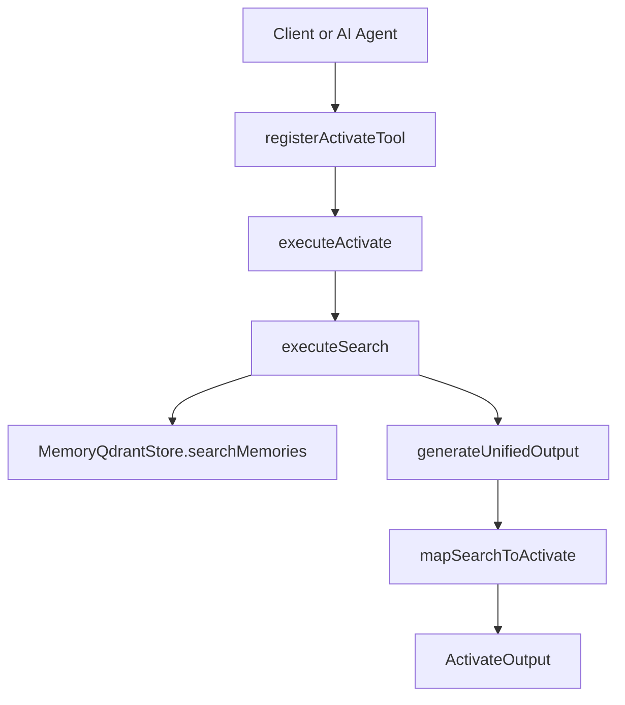
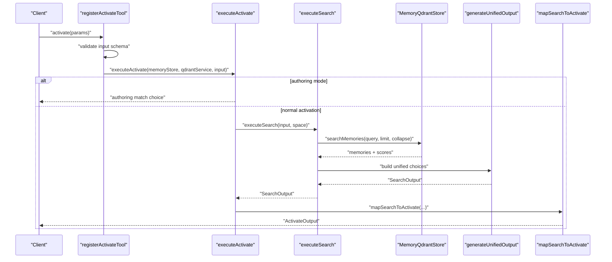
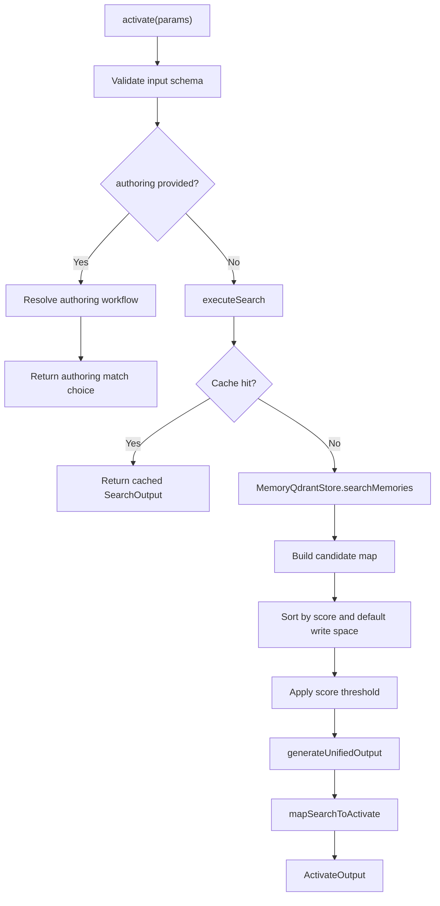
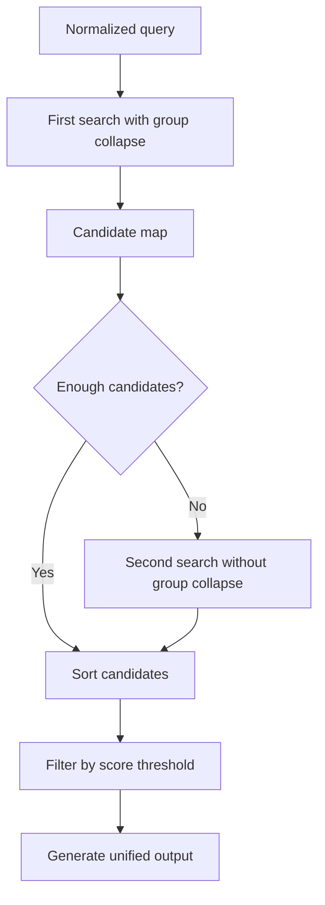
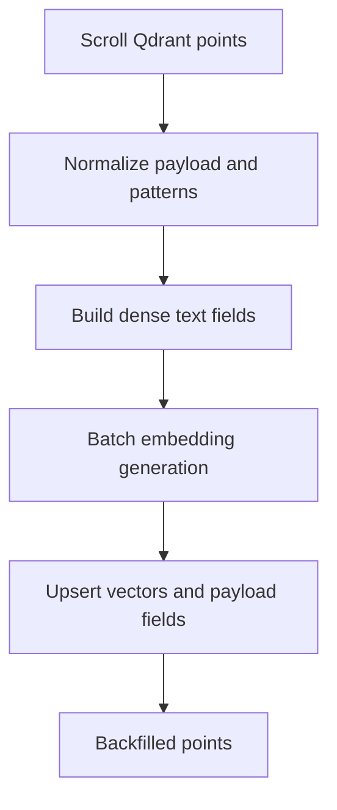
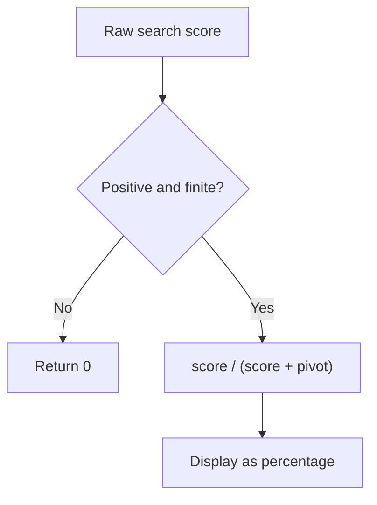
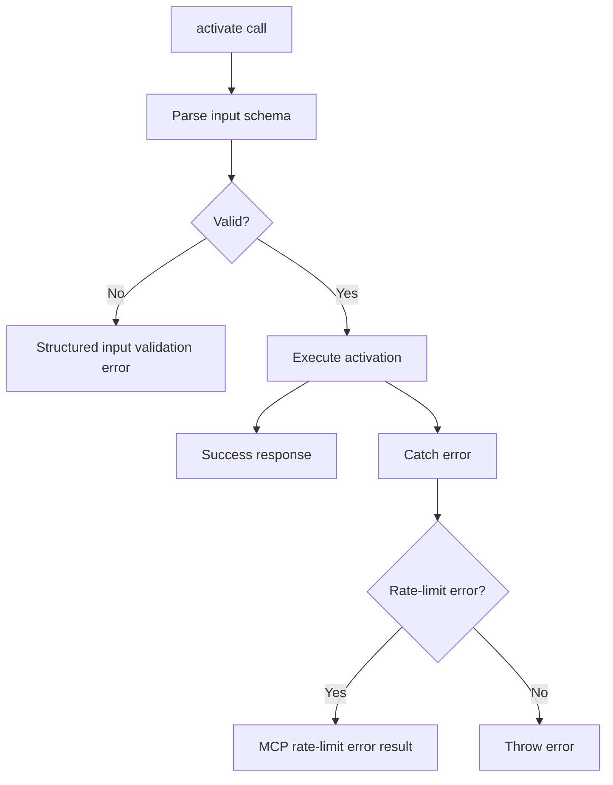
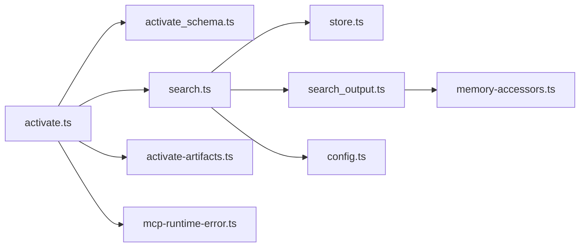

# Activate Tool

<cite>
**Referenced Files in This Document**
- [activate.ts](file://src/tools/activate.ts)
- [activate_schema.ts](file://src/tools/activate_schema.ts)
- [activate.md](file://src/embed-docs/tools/activate.md)
- [search.ts](file://src/tools/search.ts)
- [search_output.ts](file://src/tools/search_output.ts)
- [store.ts](file://src/services/memory/store.ts)
- [activation-search-backfill.ts](file://src/services/memory/activation-search-backfill.ts)
- [activation-pattern-payload.ts](file://src/services/memory/activation-pattern-payload.ts)
- [config.ts](file://src/config.ts)
- [mcp-runtime-error.ts](file://src/tools/mcp-runtime-error.ts)
</cite>

## Table of Contents
1. [Introduction](#introduction)
2. [Project Structure](#project-structure)
3. [Core Components](#core-components)
4. [Architecture Overview](#architecture-overview)
5. [Detailed Component Analysis](#detailed-component-analysis)
6. [Dependency Analysis](#dependency-analysis)
7. [Performance Considerations](#performance-considerations)
8. [Troubleshooting Guide](#troubleshooting-guide)
9. [Conclusion](#conclusion)

## Introduction
The SquadRules activate tool is the entry point for selecting the best adapter based on user context and query similarity. It accepts a short activation query, optional space filtering, and configuration options, then returns ranked adapter choices with confidence scores, metadata, and explicit next actions. The canonical workflow is:

1. Call `activate` with a concise intent summary.
2. Pick one choice from the returned list.
3. Copy that choice’s `forward_first_call` into the `forward` tool to execute the selected adapter or protocol.

Activate supports three choice roles:

- `match`: A stored adapter matched the query; it includes a normalized confidence score and a ready-to-use `forward_first_call`.
- `refine`: A guided helper to improve the query before re-running activate.
- `create`: No suitable adapter was found; this signals creation of a new adapter or protocol.

The tool also supports an authoring mode where the caller explicitly requests adapter create, review, or update operations instead of executing an existing adapter.

## Project Structure
The activate implementation is split across several focused modules:

- Tool registration and execution: `src/tools/activate.ts`
- Input/output schemas: `src/tools/activate_schema.ts`
- Semantic search pipeline: `src/tools/search.ts`
- Unified output construction: `src/tools/search_output.ts`
- Memory and vector store access: `src/services/memory/store.ts`
- Activation vector backfill utilities: `src/services/memory/activation-search-backfill.ts`
- Activation pattern normalization: `src/services/memory/activation-pattern-payload.ts`
- Configuration and limits: `src/config.ts`
- Embedded tool documentation: `src/embed-docs/tools/activate.md`
- Rate-limit error handling: `src/tools/mcp-runtime-error.ts`

**Diagram sources**
- [activate.ts:168-229](file://src/tools/activate.ts#L168-L229)
- [search.ts:192-253](file://src/tools/search.ts#L192-L253)
- [search_output.ts:117-239](file://src/tools/search_output.ts#L117-L239)
- [store.ts:151-153](file://src/services/memory/store.ts#L151-L153)

**Section sources**
- [activate.ts:1-281](file://src/tools/activate.ts#L1-L281)
- [activate_schema.ts:1-139](file://src/tools/activate_schema.ts#L1-L139)
- [activate.md:1-118](file://src/embed-docs/tools/activate.md#L1-L118)

## Core Components

### Activate Tool Entry Point
The activate tool registers an MCP tool named `activate`, validates input through a Zod schema, measures metrics, executes activation logic, and wraps results in the standard MCP response shape.

Key responsibilities:

- Parse and validate activation input.
- Support authoring mode for adapter creation, review, and update.
- Delegate semantic search to `executeSearch`.
- Convert search results into activation choices.
- Attach artifact materialization instructions when adapters ship scripts.
- Return structured content plus a text representation for MCP clients.

**Diagram sources**
- [activate.ts:231-280](file://src/tools/activate.ts#L231-L280)
- [activate.ts:168-229](file://src/tools/activate.ts#L168-L229)
- [search.ts:192-253](file://src/tools/search.ts#L192-L253)
- [search_output.ts:117-239](file://src/tools/search_output.ts#L117-L239)

**Section sources**
- [activate.ts:231-280](file://src/tools/activate.ts#L231-L280)
- [activate.ts:168-229](file://src/tools/activate.ts#L168-L229)

### Input Schema
The activate input schema defines all supported parameters:

| Parameter | Type | Required | Description |
|---|---|---:|---|
| `query` | string | Yes | Short activation query describing the user’s intent. |
| `execution_id` | string (UUID) | No | Echoed server-issued identifier used to refine the same activation sequence. |
| `space` | string | No | Scope results to a personal space, group path, or space ID. |
| `space_id` | string | No | Alias for `space`. |
| `max_choices` | integer | No | Maximum number of adapter choices to return, bounded by configured minimum and maximum. |
| `authoring` | object | No | Explicit adapter authoring request containing operation and optional target adapter URI. |

Authoring mode routes to the built-in authoring workflow rather than executing a target adapter. For review/update, the caller should resolve the existing target URI before invoking activate.

**Section sources**
- [activate_schema.ts:86-106](file://src/tools/activate_schema.ts#L86-L106)
- [activate.md:96-118](file://src/embed-docs/tools/activate.md#L96-L118)

### Output Schema
The activate output always contains:

| Field | Type | Description |
|---|---|---|
| `must_obey` | boolean | Always true; pick one choice and follow its `next_action`. |
| `message` | string | Human-readable guidance about matches, refinement, or creation. |
| `next_action` | string | Global instruction telling the caller to pick one choice and follow its next action. |
| `execution_id` | string | Echoed execution identifier for refinement sequences. |
| `query` | string | Echo of the original activation query. |
| `choices` | array | Ranked adapter choices discriminated by role. |
| `squadrules_local_artifact_dir` | string array | Ordered client-side artifact directory hints. |
| `transport` | string | MCP transport mode, either `stdio` or `http`. |

Each choice includes:

| Field | Type | Description |
|---|---|---|
| `uri` | string | Slug-form adapter URI. |
| `label` | string | Display label. |
| `adapter_name` | string or null | Stored adapter name when present. |
| `activation_score` | number or null | Normalized confidence for `match`; null for `refine` and `create`. |
| `role` | string | One of `match`, `refine`, or `create`. |
| `tags` | string array | Adapter tags. |
| `next_action` | string | Choice-specific instruction. |
| `adapter_version` | string or null | Stored adapter version when available. |
| `activation_patterns` | string array or undefined | Associated activation phrases. |
| `space_name` | string or null | Human-readable space name for stored adapters. |
| `slug` | string or null | Routing slug when present. |
| `forward_first_call` | object or null | Required for `match` and `refine`; null for `create`. |
| `linked_artifacts` | array or undefined | Artifact rows for adapters that ship scripts. |

**Section sources**
- [activate_schema.ts:51-84](file://src/tools/activate_schema.ts#L51-L84)
- [activate_schema.ts:108-135](file://src/tools/activate_schema.ts#L108-L135)
- [activate.md:21-77](file://src/embed-docs/tools/activate.md#L21-L77)

## Architecture Overview
Activate combines semantic search, candidate deduplication, scoring, and output formatting into a single activation flow.

**Diagram sources**
- [activate.ts:168-229](file://src/tools/activate.ts#L168-L229)
- [search.ts:93-186](file://src/tools/search.ts#L93-L186)
- [search.ts:206-253](file://src/tools/search.ts#L206-L253)
- [search_output.ts:77-92](file://src/tools/search_output.ts#L77-L92)
- [search_output.ts:117-239](file://src/tools/search_output.ts#L117-L239)

**Section sources**
- [search.ts:93-186](file://src/tools/search.ts#L93-L186)
- [search.ts:206-253](file://src/tools/search.ts#L206-L253)
- [search_output.ts:77-92](file://src/tools/search_output.ts#L77-L92)
- [search_output.ts:117-239](file://src/tools/search_output.ts#L117-L239)

## Detailed Component Analysis

### Semantic Search and Ranking
The search pipeline performs multi-stage retrieval and ranking:

1. Normalize the query by removing built-in refining and creation protocol URIs and slugs.
2. Compute an effective limit using configured minimum, maximum, and default values.
3. Optionally run a first search with group collapse enabled.
4. If needed, run a second broader search without group collapse.
5. Deduplicate candidates by adapter key, preferring head layers and higher scores.
6. Break ties by preferring the default write space.
7. Sort candidates by normalized score, then by default write space preference.
8. Apply a score threshold to filter weak matches.
9. Generate unified output including match, refine, and create choices.
10. Cache the result in Redis or memory-backed storage.

**Diagram sources**
- [search.ts:35-51](file://src/tools/search.ts#L35-L51)
- [search.ts:93-111](file://src/tools/search.ts#L93-L111)
- [search.ts:143-186](file://src/tools/search.ts#L143-L186)
- [search_output.ts:77-92](file://src/tools/search_output.ts#L77-L92)

**Section sources**
- [search.ts:35-51](file://src/tools/search.ts#L35-L51)
- [search.ts:93-111](file://src/tools/search.ts#L93-L111)
- [search.ts:143-186](file://src/tools/search.ts#L143-L186)

### Vector Similarity and Embedding Backfill
Activation search relies on vector embeddings stored in Qdrant. The system maintains:

- Title vectors for adapter titles.
- Activation pattern vectors for canonical activation phrases.
- Text payload fields for searchable adapter names, labels, activation patterns, and tags.

The backfill process:

1. Scroll points in the target collection.
2. Normalize activation patterns and adapter payloads.
3. Build dense text fields for title and activation patterns.
4. Generate batch embeddings through the embedding service.
5. Upsert missing or outdated vectors and payload fields.

This ensures that semantic search can compare user queries against adapter titles and activation patterns.

**Diagram sources**
- [activation-search-backfill.ts:16-121](file://src/services/memory/activation-search-backfill.ts#L16-L121)
- [activation-pattern-payload.ts:84-132](file://src/services/memory/activation-pattern-payload.ts#L84-L132)

**Section sources**
- [activation-search-backfill.ts:16-121](file://src/services/memory/activation-search-backfill.ts#L16-L121)
- [activation-pattern-payload.ts:84-132](file://src/services/memory/activation-pattern-payload.ts#L84-L132)

### Score Normalization and Confidence Scores
Raw search scores are transformed into public-facing confidence values using a sigmoid-like normalization:

- Non-positive or non-finite scores become zero.
- Positive scores are divided by their sum with a pivot constant.
- The resulting value is between zero and one.

The top match’s normalized score is displayed as a percentage in the activation message.

**Diagram sources**
- [search_output.ts:68-75](file://src/tools/search_output.ts#L68-L75)
- [search_output.ts:220-239](file://src/tools/search_output.ts#L220-L239)

**Section sources**
- [search_output.ts:68-75](file://src/tools/search_output.ts#L68-L75)
- [search_output.ts:220-239](file://src/tools/search_output.ts#L220-L239)

### Space Filtering and Multi-Space Queries
Space filtering narrows activation results to a specific scope:

- Accepts `space` or `space_id`.
- Supports personal spaces, group paths, and raw space IDs.
- Uses tenant context to determine allowed spaces and default write space.
- Prefers personal copies on ties so a personal adapter can override a group template.

When activating within a specific space, the search runs under that space context.

**Section sources**
- [activate_schema.ts:94-98](file://src/tools/activate_schema.ts#L94-L98)
- [activate.ts:214-223](file://src/tools/activate.ts#L214-L223)
- [search.ts:198-203](file://src/tools/search.ts#L198-L203)

### Artifact Materialization
Adapters may ship executable scripts or other artifacts. When a match choice includes `linked_artifacts`, each row provides:

- `slug`
- `filename`
- `relative_path`
- `download_url`
- `sha256`
- `content_type`
- `materialize`

The `materialize` instruction tells the agent to call the MCP `export` tool with `format: "source"`, write the content to the specified output path, verify the SHA-256 digest, and set executable permissions.

If artifact loading fails, the activation message warns that artifact files are unknown and instructs the agent to export the adapter before running shell contracts.

**Section sources**
- [activate_schema.ts:26-50](file://src/tools/activate_schema.ts#L26-L50)
- [activate.ts:84-135](file://src/tools/activate.ts#L84-L135)
- [activate.md:56-77](file://src/embed-docs/tools/activate.md#L56-L77)

### Refinement and Creation Workflows
Activate always includes meta footer choices unless refinement footers are suppressed after repeated refinements:

- `refine`: Guides the agent to improve the query.
- `create`: Signals that no adapter matched and creation is appropriate.

The refinement footer is included while the refinement count is at or below two for a given `execution_id`. After more than two refinements, the default refine footer is removed to prevent looping.

**Section sources**
- [activate.ts:173-178](file://src/tools/activate.ts#L173-L178)
- [activate.ts:139-165](file://src/tools/activate.ts#L139-L165)
- [activate.md:81-94](file://src/embed-docs/tools/activate.md#L81-L94)

### Authentication Requirements
Authentication depends on runtime mode:

- In HTTP mode, authentication is enabled by default and uses Keycloak OIDC.
- In stdio mode, authentication is disabled because there is no HTTP listener.
- JWT tokens validate both human and agent requests when OIDC bearer validation is configured.

Required environment variables include Keycloak URL, realm, client ID, callback base URL, and session secret when authentication is explicitly enabled.

**Section sources**
- [config.ts:121-126](file://src/config.ts#L121-L126)
- [config.ts:141-168](file://src/config.ts#L141-L168)
- [config.ts:248-266](file://src/config.ts#L248-L266)

### Rate Limiting Policies
Rate limiting applies at multiple layers:

- HTTP-level rate limiting controls general API throughput.
- Auth-level rate limiting protects authentication endpoints.
- MCP-level rate limiting protects tool calls such as activate.
- Embedding providers may return 429 responses when their quotas are exhausted.

The activate tool wraps errors through a rate-limit error helper that converts provider rate-limit errors into structured MCP error results.

**Section sources**
- [config.ts:121-126](file://src/config.ts#L121-L126)
- [activate.ts:270-277](file://src/tools/activate.ts#L270-L277)
- [mcp-runtime-error.ts:1-27](file://src/tools/mcp-runtime-error.ts#L1-L27)

### Error Handling Patterns
Activate handles errors in three main ways:

1. **Input validation errors**: Invalid parameters return a structured MCP input validation error.
2. **Rate-limit errors**: Provider or system rate-limit errors are converted into MCP-compatible error results.
3. **Unexpected errors**: Other exceptions are logged, measured, and rethrown after metrics are updated.

**Diagram sources**
- [activate.ts:247-278](file://src/tools/activate.ts#L247-L278)
- [mcp-runtime-error.ts:14-27](file://src/tools/mcp-runtime-error.ts#L14-L27)

**Section sources**
- [activate.ts:247-278](file://src/tools/activate.ts#L247-L278)
- [mcp-runtime-error.ts:14-27](file://src/tools/mcp-runtime-error.ts#L14-L27)

## Dependency Analysis

**Diagram sources**
- [activate.ts:1-23](file://src/tools/activate.ts#L1-L23)
- [search.ts:1-28](file://src/tools/search.ts#L1-L28)
- [search_output.ts:1-28](file://src/tools/search_output.ts#L1-L28)
- [store.ts:1-15](file://src/services/memory/store.ts#L1-L15)
- [config.ts:108-126](file://src/config.ts#L108-L126)

**Section sources**
- [activate.ts:1-23](file://src/tools/activate.ts#L1-L23)
- [search.ts:1-28](file://src/tools/search.ts#L1-L28)
- [search_output.ts:1-28](file://src/tools/search_output.ts#L1-L28)

## Performance Considerations
Activate and search are optimized for agent-driven workflows:

- **Overfetch and collapse**: The search pipeline overfetches initial candidates and collapses groups to reduce duplicate work.
- **Two-phase search**: A narrower first pass followed by a broader second pass improves recall without excessive latency.
- **Score thresholding**: Weak matches are filtered early to avoid noisy choices.
- **Default write space tiebreaker**: Personal adapters are preferred on ties, reducing unnecessary duplication.
- **Cache layer**: Search results are cached with a TTL to reduce repeated vector lookups.
- **Batch embeddings**: Backfill generates embeddings in batches to minimize embedding provider calls.
- **Configurable limits**: Minimum, maximum, and default choice limits prevent abuse and control downstream resolution cost.

Recommended tuning knobs:

- Adjust `SQUADRULES_SEARCH_LIMIT_MIN` and `SQUADRULES_SEARCH_LIMIT_CAP` to balance recall and performance.
- Tune `SCORE_THRESHOLD` if too many or too few matches reach the output stage.
- Monitor cache hits and misses to evaluate whether the current TTL and grouping strategy fit your workload.

[No sources needed since this section provides general guidance]

## Troubleshooting Guide

### No Matches Returned
Symptoms:

- Activation returns only `refine` and `create` choices.
- Top confidence is low or zero.

Likely causes:

- Query does not match stored adapter titles, descriptions, or activation patterns.
- Space filter excludes relevant adapters.
- Score threshold filters out weak matches.
- Vectors are missing or outdated.

Actions:

- Use the `refine` choice to improve the query.
- Remove or adjust `space` / `space_id`.
- Run the activation vector backfill to regenerate missing vectors.
- Review `SCORE_THRESHOLD` and related configuration.

**Section sources**
- [search_output.ts:220-239](file://src/tools/search_output.ts#L220-L239)
- [activation-search-backfill.ts:16-121](file://src/services/memory/activation-search-backfill.ts#L16-L121)

### Too Many Choices
Symptoms:

- Large `choices` array.
- High latency due to repeated `resolveHead` and artifact resolution.

Likely causes:

- `max_choices` is too high.
- Group collapse is disabled.
- Overfetch factor produces large intermediate candidate sets.

Actions:

- Lower `max_choices`.
- Keep group collapse enabled unless debugging collapse behavior.
- Check `SQUADRULES_SEARCH_MAX_CHOICES`, `SQUADRULES_SEARCH_LIMIT_CAP`, and `SQUADRULES_SEARCH_LIMIT_MIN`.

**Section sources**
- [config.ts:108-116](file://src/config.ts#L108-L116)
- [search.ts:200-203](file://src/tools/search.ts#L200-L203)

### Artifact Execution Fails
Symptoms:

- Shell contract cannot find a script path.
- Activation warns that linked artifacts could not be loaded.

Likely causes:

- Artifacts were not materialized.
- SHA-256 verification failed.
- Permissions were not set correctly.
- Artifact export failed.

Actions:

- Follow the `materialize` instruction for each linked artifact.
- Call `export` with the correct format and output path.
- Verify the SHA-256 digest.
- Set executable permissions as instructed.

**Section sources**
- [activate.ts:84-135](file://src/tools/activate.ts#L84-L135)
- [activate_schema.ts:26-50](file://src/tools/activate_schema.ts#L26-L50)
- [activate.md:56-77](file://src/embed-docs/tools/activate.md#L56-L77)

### Repeated Refinements Loop
Symptoms:

- Activate keeps returning the refine choice.
- The agent loops without creating or asking clarifying questions.

Likely causes:

- Same `execution_id` is reused more than twice.
- Query remains weak.

Actions:

- Stop refining after the default refine footer is removed.
- Ask the user clarifying questions.
- Create a custom adapter or protocol.

**Section sources**
- [activate.ts:173-178](file://src/tools/activate.ts#L173-L178)
- [activate.md:89-94](file://src/embed-docs/tools/activate.md#L89-L94)

### Rate-Limit Errors
Symptoms:

- Activation fails with a rate-limit error.
- Embedding provider returns 429.

Likely causes:

- MCP, HTTP, auth, or embedding provider rate limits exceeded.
- Quota exhaustion.

Actions:

- Retry with backoff.
- Reduce concurrent activation calls.
- Check embedding provider quota and billing.
- Inspect MCP and HTTP rate-limit configuration.

**Section sources**
- [config.ts:121-126](file://src/config.ts#L121-L126)
- [activate.ts:270-277](file://src/tools/activate.ts#L270-L277)
- [mcp-runtime-error.ts:14-27](file://src/tools/mcp-runtime-error.ts#L14-L27)

## Conclusion
The SquadRules activate tool is the central routing mechanism for adapter selection. It transforms a natural-language activation query into ranked, actionable adapter choices backed by semantic search, vector similarity, and configurable ranking rules. Clients should treat activate as the first step in the activate → forward → reward chain, pick exactly one choice, and follow its `next_action`. For agents, the most important fields are `role`, `activation_score`, `forward_first_call`, `linked_artifacts`, and `execution_id`. For operators, the most important configuration areas are search limits, score thresholds, space filtering, caching, and rate limiting.

[No sources needed since this section summarizes without analyzing specific files]