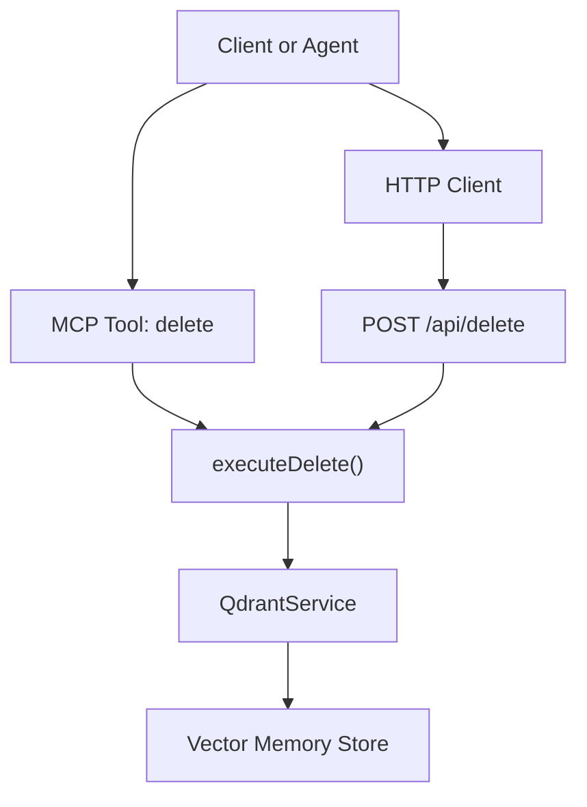
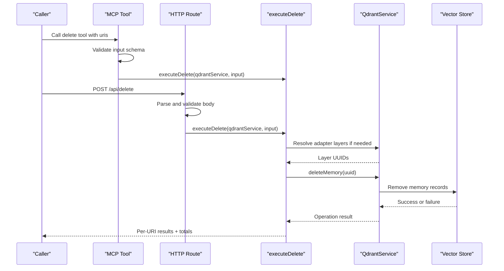
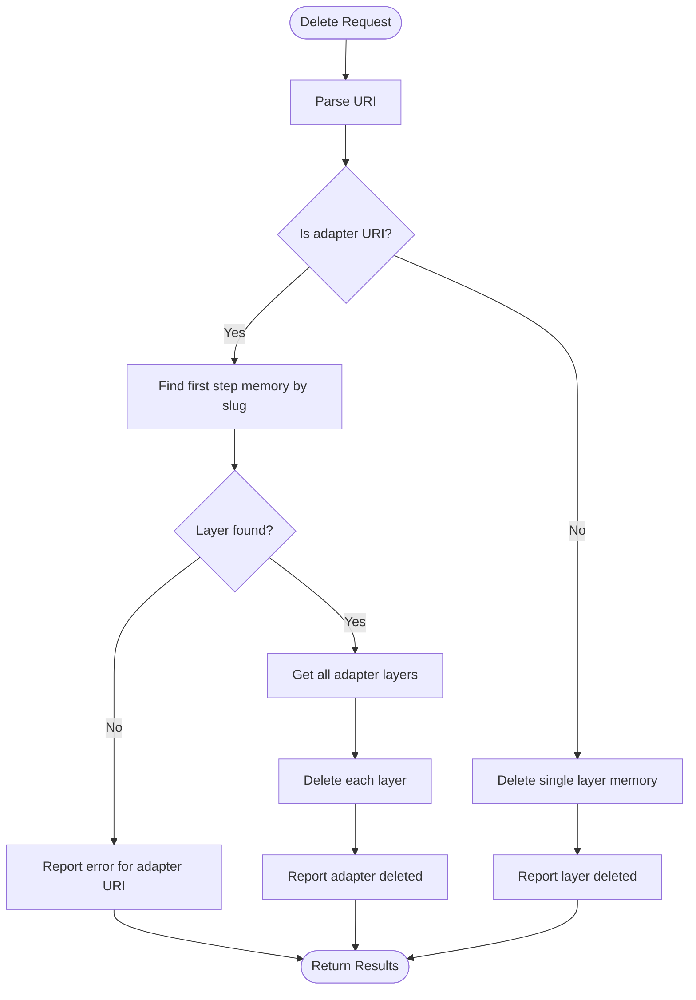
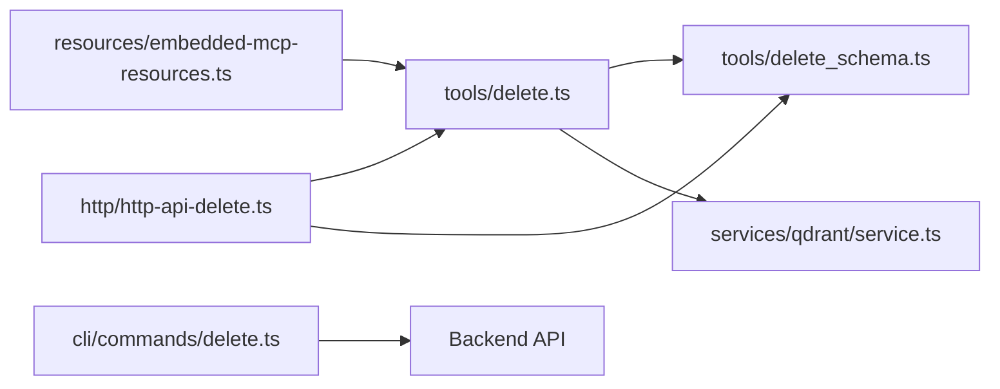

# Delete Tool

<cite>
**Referenced Files in This Document**
- [delete.ts](file://src/tools/delete.ts)
- [delete_schema.ts](file://src/tools/delete_schema.ts)
- [http-api-delete.ts](file://src/http/http-api-delete.ts)
- [cli delete command](file://src/cli/commands/delete.ts)
- [embedded MCP tool documentation for delete](file://src/resources/embedded-mcp-resources.ts)
- [Qdrant service import and deleteMemory usage](file://src/services/qdrant/service.ts)
</cite>

## Table of Contents
1. [Introduction](#introduction)
2. [Project Structure](#project-structure)
3. [Core Components](#core-components)
4. [Architecture Overview](#architecture-overview)
5. [Detailed Component Analysis](#detailed-component-analysis)
6. [Dependency Analysis](#dependency-analysis)
7. [Performance Considerations](#performance-considerations)
8. [Troubleshooting Guide](#troubleshooting-guide)
9. [Conclusion](#conclusion)

## Introduction
The SquadRules `delete` tool removes adapter resources and their associated memory layers from the vector store. It is designed around two resource identifiers:

- **Adapter URI**: `squadrules://adapter/{slug}` — deletes all layers belonging to that adapter.
- **Layer URI**: `squadrules://layer/{uuid}` — deletes only that specific layer memory.

The tool supports bulk deletion through a single `uris` array, returning per-resource results plus aggregate counts. It is exposed as an MCP tool, an HTTP endpoint, and a CLI command.

Deletion is destructive. The embedded tool documentation explicitly warns operators to prefer `export` before removing production adapters.

## Project Structure
The delete functionality spans several layers:

| Layer | Responsibility | Key File |
|---|---|---|
| MCP tool registration | Registers the `delete` tool, validates input, emits metrics, returns structured content | [delete.ts](file://src/tools/delete.ts) |
| Input/output schema | Defines allowed URIs, validation rules, and response shape | [delete_schema.ts](file://src/tools/delete_schema.ts) |
| HTTP API route | Accepts `POST /api/delete`, parses body, runs shared logic, logs structured audit-style entries | [http-api-delete.ts](file://src/http/http-api-delete.ts) |
| CLI command | Wraps backend delete calls and renders results | [cli delete command](file://src/cli/commands/delete.ts) |
| Vector store interaction | Performs actual memory deletion through Qdrant service methods | [Qdrant service import and deleteMemory usage](file://src/services/qdrant/service.ts) |

**Diagram sources**
- [delete.ts:73-115](file://src/tools/delete.ts#L73-L115)
- [http-api-delete.ts:11-35](file://src/http/http-api-delete.ts#L11-L35)
- [delete.ts:12-71](file://src/tools/delete.ts#L12-L71)
- [Qdrant service import and deleteMemory usage:1-10](file://src/services/qdrant/service.ts#L1-L10)

**Section sources**
- [delete.ts:1-116](file://src/tools/delete.ts#L1-L116)
- [delete_schema.ts:1-33](file://src/tools/delete_schema.ts#L1-L33)
- [http-api-delete.ts:1-38](file://src/http/http-api-delete.ts#L1-L38)
- [cli delete command:1-31](file://src/cli/commands/delete.ts#L1-L31)
- [embedded MCP tool documentation for delete:16-17](file://src/resources/embedded-mcp-resources.ts#L16-L17)

## Core Components

### Delete Tool Entry Point
The MCP tool registration wires the `delete` tool into the server. It:

- Resolves the tool description from embedded documentation.
- Applies loose input parsing with strict schema validation.
- Records input size, duration, call count, error count, and output size via MCP metrics.
- Returns both text content and structured content containing the deletion result.

Key responsibilities:
- Input validation using `deleteInputSchema`.
- Delegation to `executeDelete`.
- Error path instrumentation.

**Section sources**
- [delete.ts:73-115](file://src/tools/delete.ts#L73-L115)

### Shared Deletion Logic
`executeDelete` is the core business function used by both the MCP tool and the HTTP route. It processes each URI independently and accumulates results.

Behavior summary:
- Adapter URIs are normalized and resolved to stored layers.
- All layers for an adapter are deleted.
- Layer URIs delete only the specified layer.
- Each URI produces a result row with status and message.
- Aggregate counters track total deleted and total failed.

**Section sources**
- [delete.ts:12-71](file://src/tools/delete.ts#L12-L71)

### Input and Output Schema
The schema enforces:

- `uris`: non-empty array.
- Allowed URI patterns:
  - Adapter slug URIs.
  - Layer UUID URIs.
- Response structure:
  - `results`: array of per-URI outcomes.
  - `total_deleted`: number of successfully deleted items.
  - `total_failed`: number of failed deletions.

This schema is the contract between callers and the service.

**Section sources**
- [delete_schema.ts:1-33](file://src/tools/delete_schema.ts#L1-L33)

### HTTP API Route
The HTTP route exposes `POST /api/delete`. It:

- Validates the request body against `deleteInputSchema`.
- Logs the incoming request with URI count.
- Runs deletion under space context.
- Returns the same result shape as the MCP tool.
- Returns `400` for invalid input and `500` for unexpected failures.

**Section sources**
- [http-api-delete.ts:1-38](file://src/http/http-api-delete.ts#L1-L38)

### CLI Command
The CLI `squadrules delete <uris...>` command:

- Accepts one or more URIs as positional arguments.
- Calls the backend delete operation.
- Emits results using configured output formatting.
- Handles API errors through the shared auth/error handler.

**Section sources**
- [cli delete command:1-31](file://src/cli/commands/delete.ts#L1-L31)

## Architecture Overview

**Diagram sources**
- [delete.ts:73-115](file://src/tools/delete.ts#L73-L115)
- [http-api-delete.ts:11-35](file://src/http/http-api-delete.ts#L11-L35)
- [delete.ts:12-71](file://src/tools/delete.ts#L12-L71)
- [Qdrant service import and deleteMemory usage:1-10](file://src/services/qdrant/service.ts#L1-L10)

## Detailed Component Analysis

### Deletion Scope and Cascading Effects

#### Adapter URI Deletion
When an adapter URI is provided:

1. The URI is parsed.
2. The adapter slug is validated as a wire adapter URI.
3. The first step memory UUID is resolved by slug.
4. If no matching layer is found, the operation fails for that URI.
5. All adapter layers are retrieved.
6. Each layer is deleted individually.
7. The adapter-level result reports success after all layers are processed.

This means adapter deletion cascades to every stored layer belonging to that adapter.

#### Layer URI Deletion
When a layer URI is provided:

1. The URI is parsed.
2. The layer UUID is extracted.
3. Only that layer memory is deleted.
4. The result reports success for that layer.

#### Important Distinction
Deleting an adapter does not necessarily remove unrelated execution traces, rewards, or external artifacts unless those references are tied directly to the deleted memory rows. Operators should treat `delete` as a vector-store mutation focused on adapter memories and their layers.

**Diagram sources**
- [delete.ts:21-71](file://src/tools/delete.ts#L21-L71)

**Section sources**
- [delete.ts:21-71](file://src/tools/delete.ts#L21-L71)

### Input Parameters

| Parameter | Type | Required | Description |
|---|---|---:|---|
| `uris` | Array of strings | Yes | Non-empty array of adapter or layer URIs to delete |
| Adapter URI value | String | Conditional | Must match `squadrules://adapter/{slug}` |
| Layer URI value | String | Conditional | Must match `squadrules://layer/{uuid}` |

There is no explicit confirmation parameter in the current implementation. Safety relies on caller discipline, preflight export, and operator permissions.

**Section sources**
- [delete_schema.ts:4-19](file://src/tools/delete_schema.ts#L4-L19)
- [embedded MCP tool documentation for delete:16-17](file://src/resources/embedded-mcp-resources.ts#L16-L17)

### Response Structure

| Field | Type | Description |
|---|---|---|
| `results` | Array | Per-URI deletion outcome |
| `results[].uri` | String | Original URI from input |
| `results[].status` | Enum | `deleted` or `error` |
| `results[].message` | String | Human-readable status or failure reason |
| `total_deleted` | Number | Count of successfully deleted resources |
| `total_failed` | Number | Count of failed deletions |

The MCP tool wraps this object in both `content` (JSON string) and `structuredContent` (parsed object). The HTTP route returns the raw object directly.

**Section sources**
- [delete_schema.ts:21-33](file://src/tools/delete_schema.ts#L21-L33)
- [delete.ts:66-70](file://src/tools/delete.ts#L66-L70)
- [delete.ts:103-106](file://src/tools/delete.ts#L103-L106)
- [http-api-delete.ts:23-26](file://src/http/http-api-delete.ts#L23-L26)

### Data Retention and Cleanup Policy

Based on the implementation:

- Deletion is immediate at the vector-store level.
- There is no soft-delete flag in the delete flow.
- There is no built-in tombstone or retention period in the delete tool itself.
- Cleanup is performed per memory UUID.
- Adapter deletion iterates over discovered layers and deletes each one.

Operators should assume that successful deletion removes the targeted memory records from the vector store.

**Section sources**
- [delete.ts:37-54](file://src/tools/delete.ts#L37-L54)
- [Qdrant service import and deleteMemory usage:1-10](file://src/services/qdrant/service.ts#L1-L10)

### Safety Measures

#### Destructive Warning
The embedded tool documentation includes a warning that deletion is destructive and recommends exporting before removing production adapters.

#### Validation Guardrails
- Input must be a non-empty array.
- Each URI must match the expected adapter or layer pattern.
- Adapter deletion requires resolving a stored layer by slug; missing adapters produce an error result rather than silently succeeding.

#### Audit Logging
The HTTP route uses structured logging for incoming requests and completion status. The delete tool also records MCP metrics such as call count, duration, input size, output size, and error counts.

#### Recovery Options
The delete tool does not implement recovery, undo, or soft-delete behavior. Recommended recovery strategy:

1. Use `export` before deletion.
2. Keep backups of adapter Markdown and skill bundles.
3. Re-train or re-import adapters from exported content when needed.
4. For bulk operations, review `total_failed` and retry only failed URIs.

**Section sources**
- [embedded MCP tool documentation for delete:16-17](file://src/resources/embedded-mcp-resources.ts#L16-L17)
- [delete_schema.ts:14-19](file://src/tools/delete_schema.ts#L14-L19)
- [delete.ts:55-63](file://src/tools/delete.ts#L55-L63)
- [http-api-delete.ts:23-33](file://src/http/http-api-delete.ts#L23-L33)
- [delete.ts:84-112](file://src/tools/delete.ts#L84-L112)

### Spaces-Based Access Control and Permissions

The HTTP route runs deletion through a space-context helper, indicating that space scoping is applied at the HTTP layer. However, the delete implementation itself does not perform explicit permission checks inside `executeDelete`.

Operational implications:

- Space context may influence tenant or scope resolution.
- Authorization and access control are likely enforced at higher layers (authentication middleware, route guards, or service-layer policies).
- The delete tool should be considered a write operation requiring appropriate permissions.
- Agents should consult team knowledge and existing preferences before deleting resources, consistent with project-wide agent autonomy guidance.

**Section sources**
- [http-api-delete.ts:6-24](file://src/http/http-api-delete.ts#L6-L24)
- [delete.ts:84-99](file://src/tools/delete.ts#L84-L99)

### Examples

#### Deleting an Individual Layer
Use a layer URI to remove one adapter step:

- Input: `uris` containing one `squadrules://layer/{uuid}`.
- Expected behavior: That layer memory is deleted.
- Result: One entry with `status: "deleted"` and aggregate `total_deleted: 1`.

#### Deleting an Entire Adapter
Use an adapter URI to remove all layers:

- Input: `uris` containing one `squadrules://adapter/{slug}`.
- Expected behavior: All layers for that adapter are deleted.
- Result: One entry with `status: "deleted"` and `total_deleted` equal to the number of layers removed.

#### Bulk Deletion
Pass multiple URIs in one call:

- Input: `uris` containing adapter and layer URIs.
- Expected behavior: Each URI is processed independently.
- Result: Multiple `results` entries, with accurate `total_deleted` and `total_failed` counts.

#### Cleanup Operation
For cleanup after migration, testing, or deprecation:

1. Export adapters before deletion.
2. Identify deprecated adapters or stale layers.
3. Run `delete` with the relevant URIs.
4. Verify via `activate` or `spaces` that the resources no longer resolve.
5. Inspect `total_failed` and investigate any error entries.

**Section sources**
- [embedded MCP tool documentation for delete:16-17](file://src/resources/embedded-mcp-resources.ts#L16-L17)
- [delete.ts:21-71](file://src/tools/delete.ts#L21-L71)

## Dependency Analysis

**Diagram sources**
- [delete.ts:1-10](file://src/tools/delete.ts#L1-L10)
- [delete.ts:73-82](file://src/tools/delete.ts#L73-L82)
- [http-api-delete.ts:1-7](file://src/http/http-api-delete.ts#L1-L7)
- [cli delete command:1-12](file://src/cli/commands/delete.ts#L1-L12)
- [embedded MCP tool documentation for delete:16-17](file://src/resources/embedded-mcp-resources.ts#L16-L17)

### Coupling and Cohesion
- `executeDelete` is cohesive: it encapsulates the deletion algorithm.
- The MCP tool and HTTP route share the same core logic, reducing duplication.
- Schema validation is isolated in `delete_schema.ts`.
- Vector-store mutations are delegated to `QdrantService`, keeping storage concerns separate.

### External Dependencies
- Qdrant service provides memory lookup and deletion.
- Structured logger is used by the HTTP route.
- MCP metrics capture performance and error signals.
- Tenant/space context is used for HTTP-scoped operations.

**Section sources**
- [delete.ts:1-10](file://src/tools/delete.ts#L1-L10)
- [http-api-delete.ts:1-7](file://src/http/http-api-delete.ts#L1-L7)
- [delete_schema.ts:1-3](file://src/tools/delete_schema.ts#L1-L3)

## Performance Considerations

- Adapter deletion can trigger multiple layer deletions, so adapter-level deletes may be heavier than single-layer deletes.
- Per-URI processing is sequential within `executeDelete`; failures do not stop processing of remaining URIs.
- Metrics include input size, output size, duration, call count, and error count, which helps monitor load and failure rates.
- Large adapter chains increase the number of `deleteMemory` calls.

Recommendations:

- Prefer targeting specific layers when possible.
- Batch related deletions carefully and inspect `total_failed`.
- Monitor MCP metrics for high error rates or unusually large payloads.
- Avoid repeatedly deleting and retraining the same adapter without cause.

**Section sources**
- [delete.ts:21-71](file://src/tools/delete.ts#L21-L71)
- [delete.ts:84-112](file://src/tools/delete.ts#L84-L112)

## Troubleshooting Guide

### Common Errors

| Symptom | Likely Cause | Resolution |
|---|---|---|
| Invalid input error | Missing or malformed `uris` array | Provide a non-empty array of valid adapter or layer URIs |
| Adapter not found | Slug does not resolve to a stored layer | Verify the adapter exists via `activate` or `spaces` |
| Layer not found | Layer UUID does not exist | Confirm the layer URI from `forward` or export output |
| Partial failures | Some URIs succeeded while others failed | Inspect `results[]` and retry only failed URIs |
| HTTP 400 | Request body failed schema validation | Fix URI format and ensure `uris` is present |
| HTTP 500 | Unexpected server-side failure | Check structured logs and retry after investigating root cause |

### Diagnostic Fields
Use these fields to diagnose issues:

- `results[].status`: indicates whether a specific URI succeeded or failed.
- `results[].message`: contains the error detail for failed URIs.
- `total_deleted`: confirms how many resources were actually removed.
- `total_failed`: highlights whether the operation was partially successful.

**Section sources**
- [delete_schema.ts:21-29](file://src/tools/delete_schema.ts#L21-L29)
- [delete.ts:55-70](file://src/tools/delete.ts#L55-L70)
- [http-api-delete.ts:14-33](file://src/http/http-api-delete.ts#L14-L33)

## Conclusion
The SquadRules `delete` tool is a focused, destructive mutation operation for adapter memories and their layers. It supports both adapter-level cascading deletion and precise layer deletion, with clear per-resource results and aggregate counts. While it lacks soft-delete, audit-specific deletion events, or built-in recovery, its design emphasizes simplicity, shared logic across MCP and HTTP interfaces, and strong input validation.

Safe operational practice should follow the documented workflow: export before deletion, verify chain dependencies, run the delete operation, and confirm that the target no longer resolves. Authorization and space-based access control are applied at the HTTP and service boundaries, so operators should ensure callers have appropriate permissions before invoking delete.