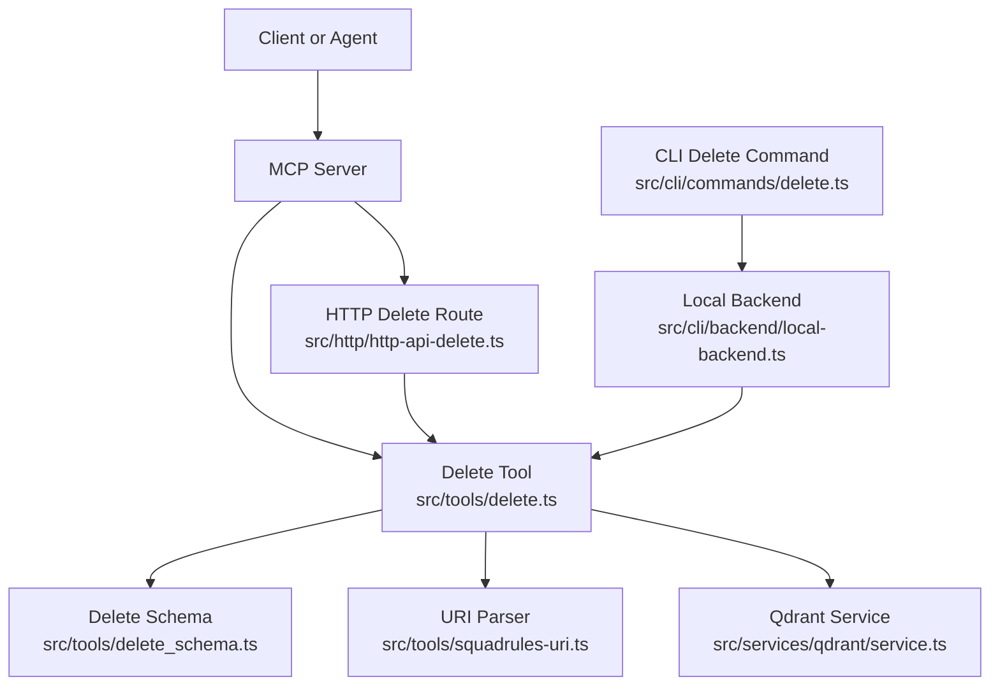
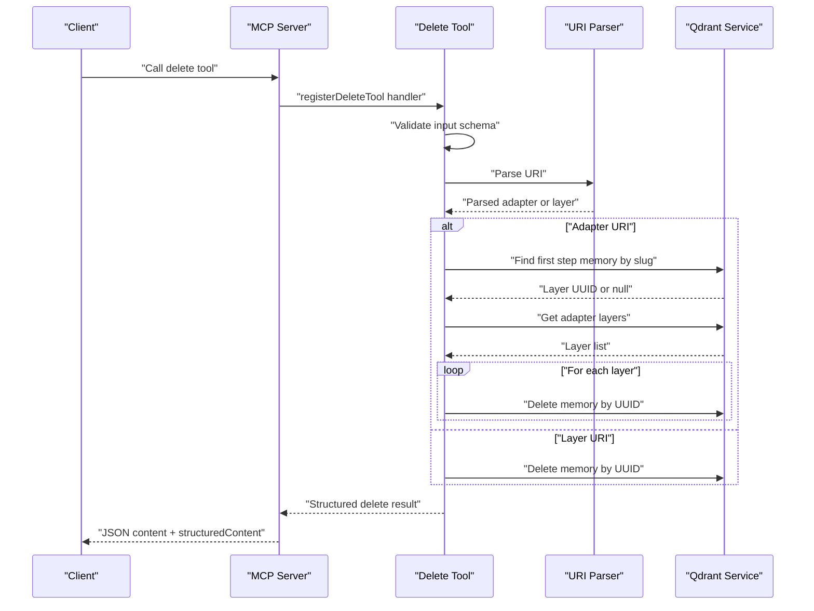
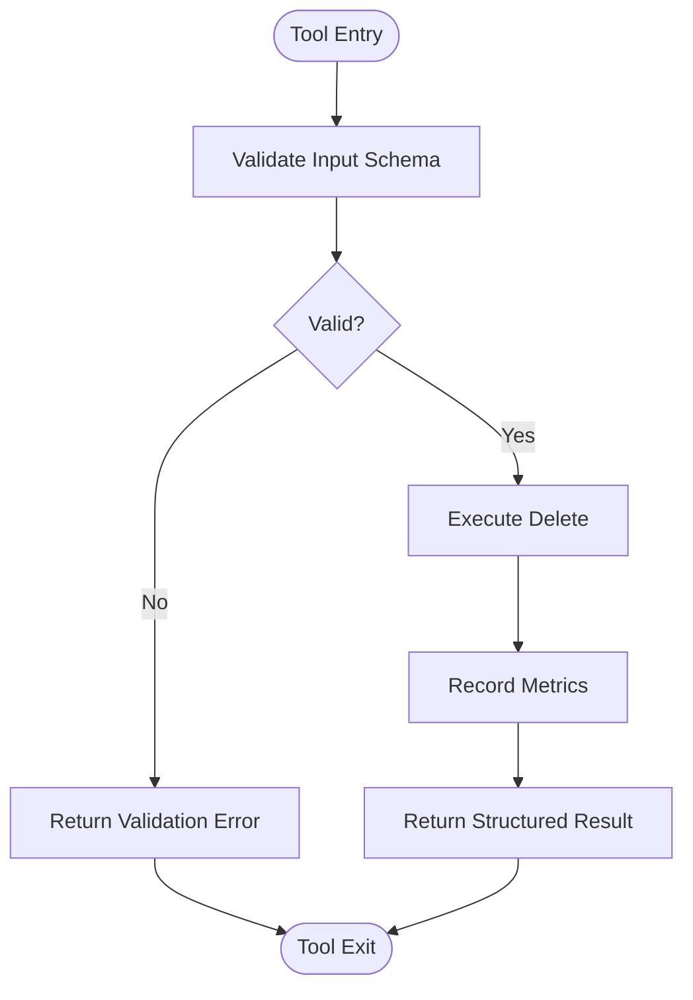
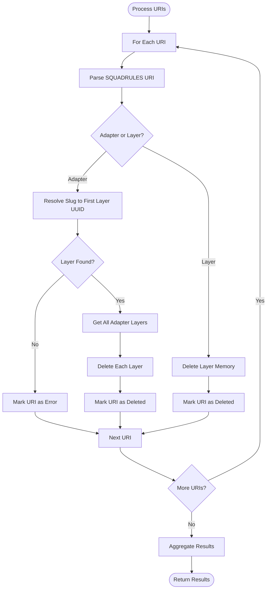
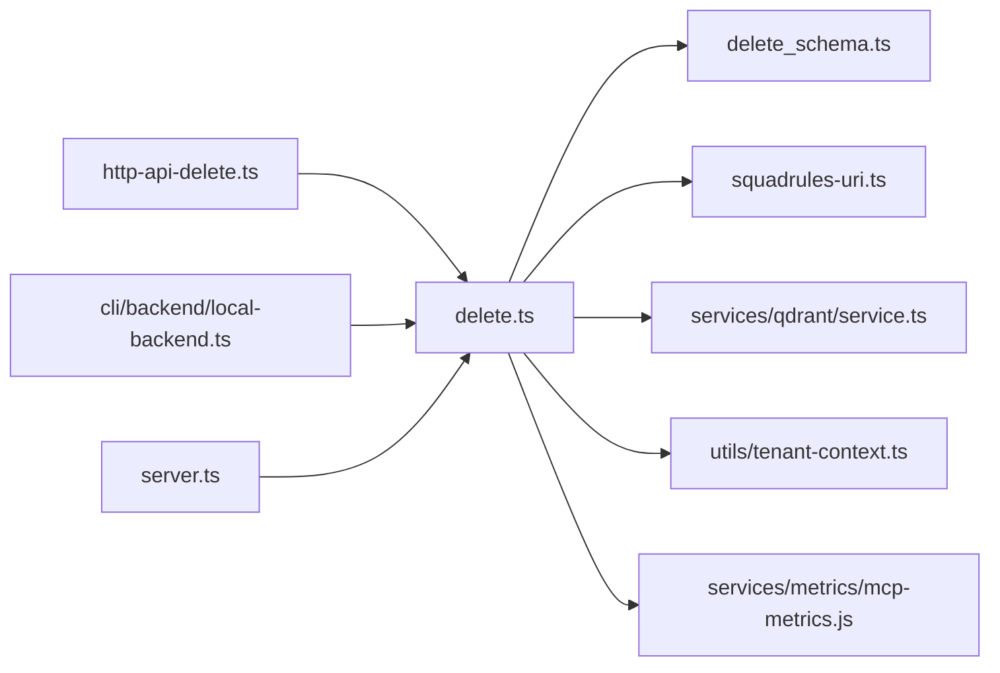

# Delete Tool

<cite>
**Referenced Files in This Document**
- [delete.ts](file://src/tools/delete.ts)
- [delete_schema.ts](file://src/tools/delete_schema.ts)
- [squadrules-uri.ts](file://src/tools/squadrules-uri.ts)
- [service.ts](file://src/services/qdrant/service.ts)
- [http-api-delete.ts](file://src/http/http-api-delete.ts)
- [delete.md](file://src/embed-docs/tools/delete.md)
- [tenant-context.ts](file://src/utils/tenant-context.ts)
- [server.ts](file://src/server.ts)
- [local-backend.ts](file://src/cli/backend/local-backend.ts)
- [delete-command.ts](file://src/cli/commands/delete.ts)
</cite>

## Table of Contents
1. [Introduction](#introduction)
2. [Project Structure](#project-structure)
3. [Core Components](#core-components)
4. [Architecture Overview](#architecture-overview)
5. [Detailed Component Analysis](#detailed-component-analysis)
6. [Dependency Analysis](#dependency-analysis)
7. [Performance Considerations](#performance-considerations)
8. [Authentication and Permissions](#authentication-and-permissions)
9. [Data Retention and Recovery](#data-retention-and-recovery)
10. [Usage Examples](#usage-examples)
11. [Troubleshooting Guide](#troubleshooting-guide)
12. [Conclusion](#conclusion)

## Introduction
The delete tool is the SQUADRULES MCP tool for removing adapter resources by URI. It supports two deletion modes:

- **Adapter deletion**: removes all layers belonging to an adapter.
- **Layer deletion**: removes a single layer memory.

It is designed for destructive cleanup operations, so it should be used with caution. The tool returns per-resource results and aggregate counts rather than throwing on individual failures, which makes it suitable for both targeted deletions and bulk operations.

## Project Structure
The delete functionality is split into several focused files:

| Area | File | Responsibility |
|---|---|---|
| MCP tool implementation | `src/tools/delete.ts` | Registers the MCP tool, validates input, executes deletion, emits metrics |
| Input/output schema | `src/tools/delete_schema.ts` | Zod schemas for delete requests and responses |
| URI parsing | `src/tools/squadrules-uri.ts` | Parses and validates `squadrules://adapter`, `squadrules://layer`, and artifact URIs |
| Storage service | `src/services/qdrant/service.ts` | Qdrant-backed memory operations including adapter lookup and deletion |
| HTTP API route | `src/http/http-api-delete.ts` | Reuses shared delete logic over REST |
| CLI integration | `src/cli/backend/local-backend.ts`, `src/cli/commands/delete.ts` | CLI command that calls the same delete logic |
| Tool documentation | `src/embed-docs/tools/delete.md` | Human-readable tool description loaded at runtime |
| Server registration | `src/server.ts` | Registers the delete tool with the MCP server |
| Tenant context | `src/utils/tenant-context.ts` | Space and tenant isolation for metrics and request context |



**Diagram sources**
- [delete.ts:11-115](file://src/tools/delete.ts#L11-L115)
- [delete_schema.ts:14-29](file://src/tools/delete_schema.ts#L14-L29)
- [squadrules-uri.ts:42-129](file://src/tools/squadrules-uri.ts#L42-L129)
- [service.ts:74-100](file://src/services/qdrant/service.ts#L74-L100)
- [http-api-delete.ts:11-34](file://src/http/http-api-delete.ts#L11-L34)
- [delete-command.ts:13-29](file://src/cli/commands/delete.ts#L13-L29)
- [local-backend.ts:161-165](file://src/cli/backend/local-backend.ts#L161-L165)

**Section sources**
- [delete.ts:11-115](file://src/tools/delete.ts#L11-L115)
- [delete_schema.ts:14-29](file://src/tools/delete_schema.ts#L14-L29)
- [squadrules-uri.ts:42-129](file://src/tools/squadrules-uri.ts#L42-L129)
- [service.ts:74-100](file://src/services/qdrant/service.ts#L74-L100)
- [http-api-delete.ts:11-34](file://src/http/http-api-delete.ts#L11-L34)
- [delete-command.ts:13-29](file://src/cli/commands/delete.ts#L13-L29)
- [local-backend.ts:161-165](file://src/cli/backend/local-backend.ts#L161-L165)

## Core Components
The delete tool has three main responsibilities:

1. **Input validation**: Ensures the request contains a non-empty array of valid SQUADRULES URIs.
2. **Resource resolution**: Determines whether each URI refers to an adapter or a layer.
3. **Deletion execution**: Deletes either all adapter layers or a single layer, tracking success and failure per resource.

### Key Implementation Points
- The shared `executeDelete` function handles both MCP and HTTP usage.
- Adapter URIs are normalized through wire-contract validation before lookup.
- Layer URIs are deleted directly by their UUID.
- Per-URI results include status, message, and original URI.
- Aggregate counters track total deleted and total failed resources.

**Section sources**
- [delete.ts:11-71](file://src/tools/delete.ts#L11-L71)
- [delete_schema.ts:14-29](file://src/tools/delete_schema.ts#L14-L29)
- [squadrules-uri.ts:42-129](file://src/tools/squadrules-uri.ts#L42-L129)

## Architecture Overview
The delete tool follows a layered architecture:



**Diagram sources**
- [delete.ts:73-115](file://src/tools/delete.ts#L73-L115)
- [delete.ts:11-71](file://src/tools/delete.ts#L11-L71)
- [squadrules-uri.ts:42-129](file://src/tools/squadrules-uri.ts#L42-L129)
- [service.ts:74-100](file://src/services/qdrant/service.ts#L74-L100)

## Detailed Component Analysis

### Delete Tool Handler
The MCP tool handler performs these steps:

1. Resolves the tenant ID from the current space context.
2. Records input size and starts timing metrics.
3. Validates the input against the delete schema.
4. Calls the shared `executeDelete` function.
5. Records output size and completion metrics.
6. Returns both text content and structured content.



**Diagram sources**
- [delete.ts:73-115](file://src/tools/delete.ts#L73-L115)

**Section sources**
- [delete.ts:73-115](file://src/tools/delete.ts#L73-L115)

### Shared Delete Execution Logic
The core deletion algorithm processes each URI independently:



**Diagram sources**
- [delete.ts:11-71](file://src/tools/delete.ts#L11-L71)

**Section sources**
- [delete.ts:11-71](file://src/tools/delete.ts#L11-L71)

### Input Schema
The delete input schema enforces strict URI validation:

| Field | Type | Required | Description |
|---|---|---:|---|
| `uris` | Array of strings | Yes | Non-empty array of adapter or layer URIs |

Supported URI formats:

| Format | Pattern | Behavior |
|---|---|---|
| Adapter URI | `squadrules://adapter/{uuid}` | Deletes all layers belonging to the adapter |
| Adapter URI | `squadrules://adapter/{slug}` | Normalizes slug and deletes all layers |
| Layer URI | `squadrules://layer/{uuid}` | Deletes the specified layer |
| Layer URI | `squadrules://layer/{uuid}?execution_id={uuid}` | Deletes the specified layer; query parameter is preserved during parsing but not required for deletion |

**Section sources**
- [delete_schema.ts:14-19](file://src/tools/delete_schema.ts#L14-L19)
- [squadrules-uri.ts:14-25](file://src/tools/squadrules-uri.ts#L14-L25)
- [squadrules-uri.ts:42-101](file://src/tools/squadrules-uri.ts#L42-L101)

### Output Schema
The delete output schema provides detailed feedback:

| Field | Type | Description |
|---|---|---|
| `results` | Array | Per-URI deletion results |
| `results[].uri` | String | Original URI from input |
| `results[].status` | Enum | Either `deleted` or `error` |
| `results[].message` | String | Human-readable status message |
| `total_deleted` | Number | Count of successfully deleted resources |
| `total_failed` | Number | Count of failed deletion attempts |

**Section sources**
- [delete_schema.ts:21-29](file://src/tools/delete_schema.ts#L21-L29)

### URI Parsing and Validation
The URI parser supports three resource kinds:

| Resource Kind | Identifier Types | Notes |
|---|---|---|
| Adapter | UUID or slug | Slugs are normalized using author slug normalization |
| Layer | UUID only | Optional `execution_id` query parameter supported |
| Artifact | UUID or slug | Supported by parser but not used by delete tool |

The wire adapter URI guard ensures adapter URIs conform to the public contract format.

**Section sources**
- [squadrules-uri.ts:42-129](file://src/tools/squadrules-uri.ts#L42-L129)

### Qdrant Service Integration
The delete tool uses the Qdrant service for storage operations:

| Method | Purpose | Used By |
|---|---|---|
| `findFirstStepMemoryUuidBySlug(slug)` | Resolves adapter slug to first layer UUID | Adapter deletion |
| `getMemoryByUUID(uuid)` | Retrieves layer metadata | Adapter layer ID extraction |
| `getAdapterLayers(adapterId)` | Lists all layers for an adapter | Adapter deletion |
| `deleteMemory(id)` | Deletes a memory record | Both adapter and layer deletion |

**Section sources**
- [service.ts:74-100](file://src/services/qdrant/service.ts#L74-L100)
- [delete.ts:23-40](file://src/tools/delete.ts#L23-L40)

## Dependency Analysis
The delete tool has clear dependency boundaries:



**Diagram sources**
- [delete.ts:1-9](file://src/tools/delete.ts#L1-L9)
- [http-api-delete.ts:1-6](file://src/http/http-api-delete.ts#L1-L6)
- [local-backend.ts:161-165](file://src/cli/backend/local-backend.ts#L161-L165)
- [server.ts:14-14](file://src/server.ts#L14-L14)

**Section sources**
- [delete.ts:1-9](file://src/tools/delete.ts#L1-L9)
- [http-api-delete.ts:1-6](file://src/http/http-api-delete.ts#L1-L6)
- [local-backend.ts:161-165](file://src/cli/backend/local-backend.ts#L161-L165)
- [server.ts:14-14](file://src/server.ts#L14-L14)

## Performance Considerations
- **Per-URI processing**: Each URI is processed independently, allowing partial success in bulk operations.
- **Adapter deletion cost**: Deleting an adapter requires multiple database queries: slug resolution, layer listing, and individual layer deletions.
- **Layer deletion cost**: Direct UUID-based deletion is typically faster than adapter deletion.
- **Metrics collection**: Input/output sizes and timing are recorded for observability.
- **Concurrency**: The tool does not implement parallel deletion; operations are sequential within a single request.

Optimization opportunities:
- Batch layer deletions if the underlying storage supports it.
- Add dry-run mode to validate URIs without performing deletions.
- Implement pagination for large adapter layer lists.

[No sources needed since this section provides general guidance]

## Authentication and Permissions
The delete tool operates within the SQUADRULES multitenancy model:

- **Tenant context**: The tool retrieves the tenant ID from the current space context for metrics.
- **Space isolation**: HTTP routes wrap delete operations with space context propagation.
- **Default behavior**: When authentication is disabled, the default personal space is used.
- **Strict isolation**: When authentication is enabled without context, no default space is accessible.

### Permission Model
- Write operations like delete use the `defaultWriteSpaceId` from the space context.
- Search operations may include additional read-only app spaces.
- Space narrowing via parameters restricts both search and write scopes.

### Security Considerations
- Delete operations are destructive and irreversible.
- No confirmation prompt exists in the tool itself.
- Clients should implement safety checks before calling delete.
- Audit logging is available through the structured logger.

**Section sources**
- [delete.ts:84-87](file://src/tools/delete.ts#L84-L87)
- [http-api-delete.ts:24-24](file://src/http/http-api-delete.ts#L24-L24)
- [tenant-context.ts:20-74](file://src/utils/tenant-context.ts#L20-L74)
- [tenant-context.ts:120-150](file://src/utils/tenant-context.ts#L120-L150)
- [tenant-context.ts:256-311](file://src/utils/tenant-context.ts#L256-L311)

## Data Retention and Recovery
### Deletion Behavior
- **Adapter deletion**: Removes all layers associated with the adapter.
- **Layer deletion**: Removes only the specified layer memory.
- **Partial failures**: Individual URI failures do not stop processing of other URIs.
- **No cascade options**: The tool does not support selective cascade behavior beyond the built-in adapter-to-layers relationship.

### Recovery Options
- Use the `export` tool before deleting production adapters.
- Maintain external backups of important adapter content.
- Review audit logs for deletion tracking.
- Consider soft-delete patterns if recovery is frequently needed.

### Best Practices
- Always export before deleting production adapters.
- Test deletions in development environments first.
- Document deletion reasons in change management systems.
- Monitor deletion metrics for unexpected patterns.

**Section sources**
- [delete.md:1-16](file://src/embed-docs/tools/delete.md#L1-L16)
- [delete.ts:21-70](file://src/tools/delete.ts#L21-L70)

## Usage Examples

### Targeted Layer Deletion
Delete a specific layer by its UUID:

```json
{
  "uris": ["squadrules://layer/abc123-def456-ghi789-jkl012-mno345"]
}
```

Expected response structure:

```json
{
  "results": [
    {
      "uri": "squadrules://layer/abc123-def456-ghi789-jkl012-mno345",
      "status": "deleted",
      "message": "Adapter layer squadrules://layer/abc123-def456-ghi789-jkl012-mno345 deleted successfully"
    }
  ],
  "total_deleted": 1,
  "total_failed": 0
}
```

### Adapter Deletion
Delete all layers of an adapter by slug:

```json
{
  "uris": ["squadrules://adapter/my-adapter-slug"]
}
```

This will:
1. Normalize the slug
2. Find the first step memory UUID
3. Retrieve all adapter layers
4. Delete each layer individually

### Bulk Operations
Delete multiple resources in one call:

```json
{
  "uris": [
    "squadrules://adapter/old-workflow",
    "squadrules://layer/abc123-def456-ghi789-jkl012-mno345",
    "squadrules://adapter/deprecated-process"
  ]
}
```

### Safety Checks
Before calling delete:

1. **Verify ownership**: Ensure you have write permissions to the target space.
2. **Export first**: Use the export tool to back up adapter content.
3. **Test in staging**: Validate deletion behavior in non-production environments.
4. **Review impact**: Check if other workflows depend on the adapter.
5. **Document changes**: Record deletion reasons and affected resources.

**Section sources**
- [delete_schema.ts:14-19](file://src/tools/delete_schema.ts#L14-L19)
- [delete.ts:21-70](file://src/tools/delete.ts#L21-L70)
- [delete.md:1-16](file://src/embed-docs/tools/delete.md#L1-L16)

## Troubleshooting Guide

### Common Errors

| Error | Cause | Resolution |
|---|---|---|
| Invalid URI format | URI does not match expected pattern | Verify URI syntax and resource type |
| Adapter not found | Slug cannot be resolved to a layer | Check adapter existence and slug spelling |
| Layer not found | Layer UUID does not exist | Verify layer UUID and access permissions |
| Permission denied | Insufficient space write permissions | Check user's allowed spaces and default write space |
| Validation error | Input schema validation failed | Ensure `uris` is a non-empty array of valid URIs |

### Debugging Steps

1. **Validate URIs**: Use the URI parser to verify format before calling delete.
2. **Check existence**: Query the adapter or layer before attempting deletion.
3. **Review metrics**: Monitor MCP tool metrics for error rates and performance.
4. **Inspect logs**: Check structured logs for detailed error messages.
5. **Test incrementally**: Delete one resource at a time to isolate issues.

### HTTP API Errors

| Status Code | Error Code | Meaning |
|---:|---|---|
| 400 | `INVALID_INPUT` | Request body failed schema validation |
| 500 | `DELETE_FAILED` | Unexpected server error during deletion |

**Section sources**
- [delete_schema.ts:4-12](file://src/tools/delete_schema.ts#L4-L12)
- [delete.ts:23-63](file://src/tools/delete.ts#L23-L63)
- [http-api-delete.ts:14-32](file://src/http/http-api-delete.ts#L14-L32)
- [squadrules-uri.ts:99-101](file://src/tools/squadrules-uri.ts#L99-L101)

## Conclusion
The delete tool provides a robust mechanism for removing SQUADRULES adapter resources through well-defined URIs. Its design emphasizes safety through explicit validation, comprehensive error reporting, and clear separation between adapter and layer deletion semantics. 

Key takeaways:
- Use adapter URIs for complete cleanup of workflow definitions.
- Use layer URIs for precise removal of individual execution artifacts.
- Always backup important content before deletion.
- Monitor deletion operations through metrics and logs.
- Respect space-based permission boundaries.

The tool integrates cleanly with both MCP clients and HTTP APIs while maintaining consistent behavior across different access methods. Its structured output format enables automated processing and monitoring of deletion operations.

[No sources needed since this section summarizes without analyzing specific files]