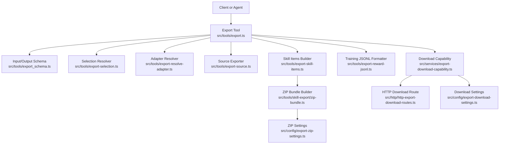
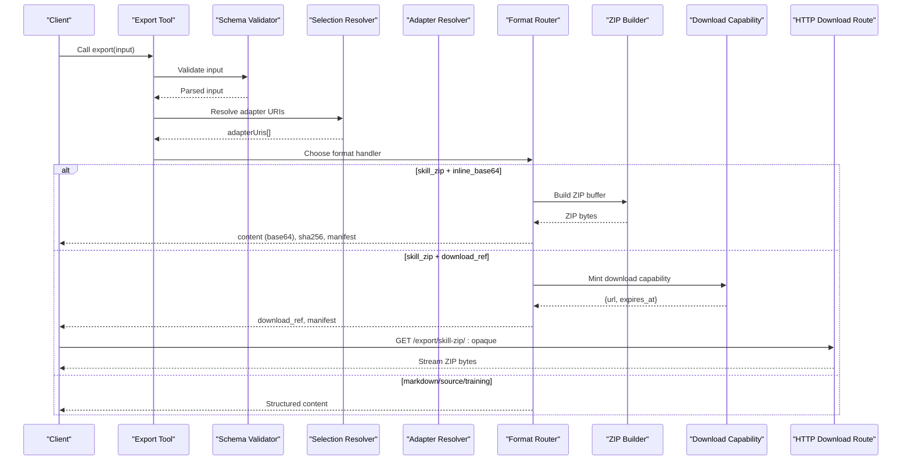
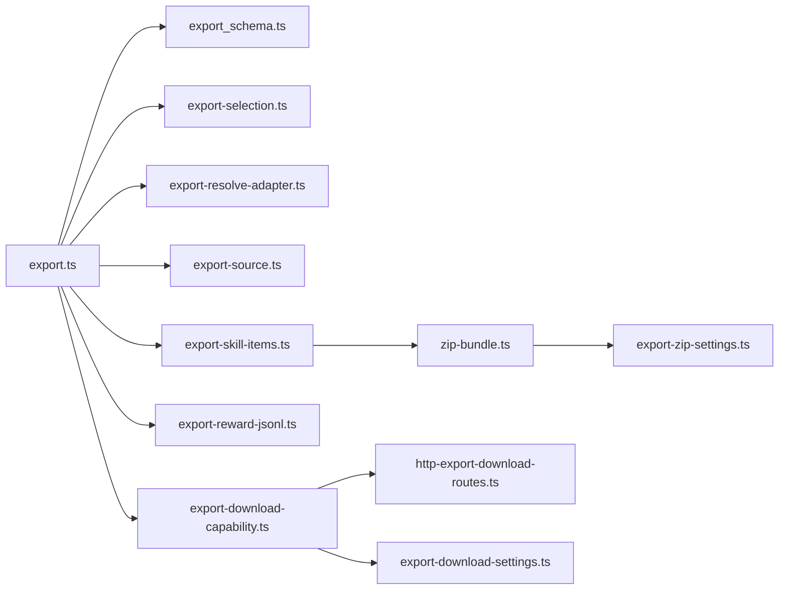

# Export Tool

<cite>
**Referenced Files in This Document**
- [export.ts](file://src/tools/export.ts)
- [export_schema.ts](file://src/tools/export_schema.ts)
- [export-selection.ts](file://src/tools/export-selection.ts)
- [export-resolve-adapter.ts](file://src/tools/export-resolve-adapter.ts)
- [export-source.ts](file://src/tools/export-source.ts)
- [export-skill-items.ts](file://src/tools/export-skill-items.ts)
- [zip-bundle.ts](file://src/tools/skill-export/zip-bundle.ts)
- [export-reward-jsonl.ts](file://src/tools/export-reward-jsonl.ts)
- [export-download-capability.ts](file://src/services/export-download-capability.ts)
- [http-export-download-routes.ts](file://src/http/http-export-download-routes.ts)
- [export-download-settings.ts](file://src/config/export-download-settings.ts)
- [export-zip-settings.ts](file://src/config/export-zip-settings.ts)
- [export.ts](file://src/cli/commands/export.ts)
</cite>

## Table of Contents
1. [Introduction](#introduction)
2. [Project Structure](#project-structure)
3. [Core Components](#core-components)
4. [Architecture Overview](#architecture-overview)
5. [Detailed Component Analysis](#detailed-component-analysis)
6. [Dependency Analysis](#dependency-analysis)
7. [Performance Considerations](#performance-considerations)
8. [Troubleshooting Guide](#troubleshooting-guide)
9. [Conclusion](#conclusion)
10. [Appendices](#appendices)

## Introduction
The export tool is the portable, agent-first way to back up and move adapter definitions and training datasets out of SquadRules. It supports exporting:
- A single adapter as flat Markdown for human-readable portability.
- Source artifacts or an artifact list for a given adapter.
- Training datasets in several JSONL formats derived from execution traces and rewards.
- Skill bundles as either a JSON tree or a ZIP archive with a manifest.

The tool is exposed as an MCP tool and also has a CLI command that writes exported content to disk without printing raw bytes to stdout.

## Project Structure
The export feature spans several modules:
- Input/output schemas and validation live in `export_schema.ts`.
- Selection logic resolves URIs, slugs, spaces, and limits in `export-selection.ts`.
- Adapter resolution maps URIs to internal adapter and layer identifiers in `export-resolve-adapter.ts`.
- The main orchestration and format routing live in `export.ts`.
- Source exports are handled by `export-source.ts`.
- Skill bundle assembly uses `export-skill-items.ts` and `zip-bundle.ts`.
- Training dataset formatting is implemented in `export-reward-jsonl.ts`.
- Secure, short-lived download links for skill ZIPs are created by `export-download-capability.ts` and served by `http-export-download-routes.ts`.
- Download URL signing, TTL, and base URL configuration come from `export-download-settings.ts`.
- ZIP compression defaults and filename conventions are defined in `export-zip-settings.ts`.
- The CLI wrapper builds input, writes files, and prints machine-friendly manifests in `src/cli/commands/export.ts`.

**Diagram sources**
- [export.ts:40-270](file://src/tools/export.ts#L40-L270)
- [export_schema.ts:44-146](file://src/tools/export_schema.ts#L44-L146)
- [export-selection.ts:38-67](file://src/tools/export-selection.ts#L38-L67)
- [export-resolve-adapter.ts:6-44](file://src/tools/export-resolve-adapter.ts#L6-L44)
- [export-source.ts:94-113](file://src/tools/export-source.ts#L94-L113)
- [export-skill-items.ts:17-55](file://src/tools/export-skill-items.ts#L17-L55)
- [zip-bundle.ts:11-66](file://src/tools/skill-export/zip-bundle.ts#L11-L66)
- [export-reward-jsonl.ts:92-181](file://src/tools/export-reward-jsonl.ts#L92-L181)
- [export-download-capability.ts:63-111](file://src/services/export-download-capability.ts#L63-L111)
- [http-export-download-routes.ts:9-47](file://src/http/http-export-download-routes.ts#L9-L47)
- [export-download-settings.ts:17-30](file://src/config/export-download-settings.ts#L17-L30)
- [export-zip-settings.ts:5-27](file://src/config/export-zip-settings.ts#L5-L27)

**Section sources**
- [export.ts:40-270](file://src/tools/export.ts#L40-L270)
- [export_schema.ts:44-146](file://src/tools/export_schema.ts#L44-L146)

## Core Components
- Export tool entry point: validates input, selects scope, routes to format-specific exporters, and returns structured output.
- Input schema: enforces selection modes, supported formats, delivery options, and constraints such as maximum adapters.
- Selection resolver: converts user-provided URIs, slugs, or space-wide selections into concrete adapter URIs.
- Adapter resolver: maps adapter or layer URIs to internal adapter and layer IDs, supporting slug-based lookup when available.
- Source exporter: returns a single source artifact or a JSON list of artifacts for an adapter.
- Skill items builder: assembles SKILL.md plus artifacts and diagnostics per adapter, deduplicates slugs, and computes checksums.
- ZIP bundle builder: streams or buffers ZIP archives with configurable zlib compression.
- Training JSONL formatter: produces trace, reward, SFT, and preference datasets from execution traces and rewards.
- Download capability: signs and stores short-lived capabilities for secure ZIP downloads outside the authenticated API surface.
- HTTP download route: verifies capability tokens and streams ZIP responses.
- Configuration: controls download secret/TTL/base URL and ZIP compression level.

**Section sources**
- [export.ts:40-270](file://src/tools/export.ts#L40-L270)
- [export_schema.ts:44-146](file://src/tools/export_schema.ts#L44-L146)
- [export-selection.ts:38-67](file://src/tools/export-selection.ts#L38-L67)
- [export-resolve-adapter.ts:6-44](file://src/tools/export-resolve-adapter.ts#L6-L44)
- [export-source.ts:94-113](file://src/tools/export-source.ts#L94-L113)
- [export-skill-items.ts:17-55](file://src/tools/export-skill-items.ts#L17-L55)
- [zip-bundle.ts:11-66](file://src/tools/skill-export/zip-bundle.ts#L11-L66)
- [export-reward-jsonl.ts:92-181](file://src/tools/export-reward-jsonl.ts#L92-L181)
- [export-download-capability.ts:63-111](file://src/services/export-download-capability.ts#L63-L111)
- [http-export-download-routes.ts:9-47](file://src/http/http-export-download-routes.ts#L9-L47)
- [export-download-settings.ts:17-30](file://src/config/export-download-settings.ts#L17-L30)
- [export-zip-settings.ts:5-27](file://src/config/export-zip-settings.ts#L5-L27)

## Architecture Overview
The export tool follows a layered flow:
1. Input validation against the export schema.
2. Scope resolution into one or more adapter URIs.
3. Format-specific processing:
   - Flat Markdown for a single adapter.
   - Source export for a single artifact or adapter artifact list.
   - Training JSONL from execution traces and rewards.
   - Skill tree JSON or skill ZIP bundle.
4. For skill ZIP, either inline base64 content or a signed, time-limited download link.

**Diagram sources**
- [export.ts:40-270](file://src/tools/export.ts#L40-L270)
- [export-selection.ts:38-67](file://src/tools/export-selection.ts#L38-L67)
- [export-resolve-adapter.ts:6-44](file://src/tools/export-resolve-adapter.ts#L6-L44)
- [zip-bundle.ts:11-66](file://src/tools/skill-export/zip-bundle.ts#L11-L66)
- [export-download-capability.ts:63-111](file://src/services/export-download-capability.ts#L63-L111)
- [http-export-download-routes.ts:9-47](file://src/http/http-export-download-routes.ts#L9-L47)

## Detailed Component Analysis

### Input Schema and Validation
The export input schema defines:
- Selection fields: `uri`, `adapters`, `all_adapters`, `space_name`.
- Format field: `markdown`, `trace_jsonl`, `reward_jsonl`, `sft_jsonl`, `preference_jsonl`, `source`, `skill_tree`, `skill_zip`.
- Delivery field: `download_ref`, `inline_base64` (only valid for `skill_zip`).
- Training flag: `include_reward` (default true).

Validation rules include:
- Exactly one selection mode must be provided.
- `all_adapters` requires `space_name`.
- `format: markdown` requires a single `uri`.
- Training formats and `source` require a single `uri`.
- Maximum number of adapters per export is enforced.
- `delivery` is only allowed with `skill_zip`.

The output schema includes:
- `uri`, `format`, `content_type`, `content`.
- Optional metadata: `item_count`, `adapter_name`, `adapter_version`, `space_id`, `space_name`, `space_type`.
- Binary handling: `content_encoding` (for example base64) and `bundle_sha256`.
- Bundle metadata: `export_adapter_count`, `skill_bundle_manifest`.
- External access: `download_ref` with `url`, `expires_at`, optional `filename`, and `content_type`.

**Section sources**
- [export_schema.ts:22-146](file://src/tools/export_schema.ts#L22-L146)

### Selection Resolution
The selection resolver normalizes inputs:
- Converts slugs to canonical `squadrules://adapter/{slug}` URIs.
- Returns a single URI if `uri` is provided.
- Returns multiple URIs if `adapters` is provided.
- Lists all adapters in a space if `all_adapters` is true, enforcing the maximum adapter limit.

It also deduplicates slugs and rehomes item files when building multi-adapter skill bundles.

**Section sources**
- [export-selection.ts:8-67](file://src/tools/export-selection.ts#L8-L67)

### Adapter Resolution
The adapter resolver maps URIs to internal identifiers:
- For adapter URIs, it finds the first layer UUID and derives the adapter ID.
- Slug-based lookup requires the Qdrant service; otherwise, it throws an error.
- For layer URIs, it returns the layer ID directly.
- For artifact URIs, it returns the artifact’s adapter context where applicable.

**Section sources**
- [export-resolve-adapter.ts:6-44](file://src/tools/export-resolve-adapter.ts#L6-L44)

### Source Export
Source export supports two modes:
- Single artifact export: returns the artifact text with its content type and adapter metadata.
- Adapter artifact list: returns a JSON array of artifact records including UUID URIs, labels, slugs, versions, SHA-256 hashes, names, content types, tags, and relative paths.

**Section sources**
- [export-source.ts:13-113](file://src/tools/export-source.ts#L13-L113)

### Training Dataset Export
Training formats consume execution traces and optional reward data:
- `trace_jsonl`: emits raw instruction/response pairs.
- `reward_jsonl`: emits enriched records with reward details and eligibility flags.
- `sft_jsonl`: emits user/assistant message pairs suitable for supervised fine-tuning, optionally including reward metadata.
- `preference_jsonl`: emits prompt/chosen/rejected triples grouped by layer and index, selecting best success and failure examples.

All training outputs use newline-delimited JSON with `application/x-ndjson` content type.

**Section sources**
- [export.ts:119-174](file://src/tools/export.ts#L119-L174)
- [export-reward-jsonl.ts:92-181](file://src/tools/export-reward-jsonl.ts#L92-L181)

### Skill Tree and Skill ZIP Export
Skill exports assemble one folder per adapter slug containing:
- `SKILL.md` generated from the adapter.
- Associated artifact files.
- Diagnostics collected during assembly.
- A checksum file summarizing artifact integrity.

Two output modes exist:
- `skill_tree`: returns a JSON document describing skills, files, and diagnostics.
- `skill_zip`:
  - With `delivery: inline_base64`, returns base64-encoded ZIP bytes, a SHA-256 digest, and a compact manifest string.
  - With `delivery: download_ref`, returns a short-lived signed URL and manifest metadata.

The ZIP builder supports streaming and configurable zlib compression levels.

**Section sources**
- [export.ts:176-266](file://src/tools/export.ts#L176-L266)
- [export-skill-items.ts:17-55](file://src/tools/export-skill-items.ts#L17-L55)
- [zip-bundle.ts:11-66](file://src/tools/skill-export/zip-bundle.ts#L11-L66)
- [export-zip-settings.ts:5-27](file://src/config/export-zip-settings.ts#L5-L27)

### Secure Download Capability
For large ZIP exports, the tool can mint a signed, time-limited capability:
- The payload contains a capability ID and expiration timestamp.
- The signature is computed using HMAC-SHA256 with a configured secret.
- The record is stored with the same TTL as the token.
- The public download endpoint verifies the signature, checks expiry, and streams the ZIP under the original space context.

Configuration includes:
- Secret key via environment variables.
- TTL in seconds.
- Public base URL derivation.

**Section sources**
- [export-download-capability.ts:14-111](file://src/services/export-download-capability.ts#L14-L111)
- [http-export-download-routes.ts:9-47](file://src/http/http-export-download-routes.ts#L9-L47)
- [export-download-settings.ts:17-30](file://src/config/export-download-settings.ts#L17-L30)

### CLI Export Command
The CLI command provides a machine-friendly interface for bulk exports:
- Builds the same selection union as the MCP/HTTP export.
- Writes content to disk instead of printing raw bytes.
- Supports explicit ZIP output path and directory output.
- Emits a manifest in JSON mode listing written artifacts, sizes, formats, and digests.

Supported export formats include `skill_zip`, `markdown`, `skill_tree`, `source`, and all training JSONL formats.

**Section sources**
- [export.ts:45-224](file://src/cli/commands/export.ts#L45-L224)

## Dependency Analysis
The export tool composes several dependencies:
- Memory store for adapter and artifact data.
- Qdrant service for slug-based lookups and adapter layer enumeration.
- Execution trace store for training pair construction.
- Metrics and telemetry for call counting, duration, input/output size, and export observations.
- Space context utilities for tenant isolation and display names.
- ZIP archiver for skill bundle creation.
- Download capability store for temporary export links.

**Diagram sources**
- [export.ts:40-270](file://src/tools/export.ts#L40-L270)
- [export_schema.ts:44-146](file://src/tools/export_schema.ts#L44-L146)
- [export-selection.ts:38-67](file://src/tools/export-selection.ts#L38-L67)
- [export-resolve-adapter.ts:6-44](file://src/tools/export-resolve-adapter.ts#L6-L44)
- [export-source.ts:94-113](file://src/tools/export-source.ts#L94-L113)
- [export-skill-items.ts:17-55](file://src/tools/export-skill-items.ts#L17-L55)
- [zip-bundle.ts:11-66](file://src/tools/skill-export/zip-bundle.ts#L11-L66)
- [export-reward-jsonl.ts:92-181](file://src/tools/export-reward-jsonl.ts#L92-L181)
- [export-download-capability.ts:63-111](file://src/services/export-download-capability.ts#L63-L111)
- [http-export-download-routes.ts:9-47](file://src/http/http-export-download-routes.ts#L9-L47)
- [export-download-settings.ts:17-30](file://src/config/export-download-settings.ts#L17-L30)
- [export-zip-settings.ts:5-27](file://src/config/export-zip-settings.ts#L5-L27)

**Section sources**
- [export.ts:40-270](file://src/tools/export.ts#L40-L270)

## Performance Considerations
- ZIP streaming: Use streaming ZIP builders for large bundles to avoid buffering entire archives in memory.
- Compression tuning: Adjust zlib compression level based on bandwidth vs CPU trade-offs.
- Adapter limits: Enforce maximum adapter count to prevent oversized exports.
- Base64 overhead: Inline base64 increases payload size by approximately 33%; prefer download references for large ZIPs.
- Training dataset filtering: Prefer specific training formats (`sft_jsonl`, `preference_jsonl`) to reduce downstream processing.

[No sources needed since this section provides general guidance]

## Troubleshooting Guide
Common issues and resolutions:
- Invalid selection: Ensure exactly one of `uri`, `adapters`, or `all_adapters` is set. When using `all_adapters`, provide `space_name`.
- Unsupported format for selection: `markdown` requires a single `uri`; training formats and `source` also require a single `uri`.
- Missing slug lookup: Slug-based adapter or artifact lookup requires the Qdrant service; configure it before exporting.
- Empty export result: Verify that the selected space contains adapters and that the selection matches existing resources.
- Expired download link: Short-lived download URLs expire after the configured TTL; mint a new capability if necessary.
- Permission errors on download: The public download endpoint rejects invalid or expired capability tokens.

**Section sources**
- [export_schema.ts:54-113](file://src/tools/export_schema.ts#L54-L113)
- [export-resolve-adapter.ts:13-20](file://src/tools/export-resolve-adapter.ts#L13-L20)
- [export-selection.ts:53-66](file://src/tools/export-selection.ts#L53-L66)
- [http-export-download-routes.ts:14-46](file://src/http/http-export-download-routes.ts#L14-L46)
- [export-download-capability.ts:92-111](file://src/services/export-download-capability.ts#L92-L111)

## Conclusion
The export tool provides a robust, portable export surface for SquadRules adapters and training datasets. It supports human-readable Markdown, structured source listings, training JSONL variants, and skill bundles with secure external downloads. By combining strict input validation, clear output contracts, and configurable delivery mechanisms, it enables reliable backups, migration workflows, and integration with external systems.

[No sources needed since this section summarizes without analyzing specific files]

## Appendices

### Complete Input Schema Summary
- `uri`: Single adapter, layer, or artifact URI.
- `adapters`: Array of adapter URIs or slugs.
- `all_adapters`: Boolean to export all adapters in a space.
- `space_name`: Required when `all_adapters` is true.
- `format`: One of `markdown`, `trace_jsonl`, `reward_jsonl`, `sft_jsonl`, `preference_jsonl`, `source`, `skill_tree`, `skill_zip`.
- `delivery`: One of `download_ref`, `inline_base64` (only for `skill_zip`).
- `include_reward`: Boolean controlling reward inclusion in training formats.

**Section sources**
- [export_schema.ts:44-113](file://src/tools/export_schema.ts#L44-L113)

### Output Structure Summary
- `uri`: Primary reference URI.
- `format`: Export format used.
- `content_type`: MIME type of the content.
- `content`: String content; may be base64-encoded when `content_encoding` is present.
- `item_count`: Number of items included.
- `adapter_name`, `adapter_version`: Adapter identity when applicable.
- `space_id`, `space_name`, `space_type`: Space context for Markdown exports.
- `content_encoding`: Encoding such as `base64`.
- `bundle_sha256`: SHA-256 of decoded binary content.
- `export_adapter_count`: Number of adapters in a multi-adapter bundle.
- `skill_bundle_manifest`: Compact manifest JSON string for skill bundles.
- `download_ref`: External download capability with `url`, `expires_at`, optional `filename`, and `content_type`.

**Section sources**
- [export_schema.ts:117-146](file://src/tools/export_schema.ts#L117-L146)

### Example Workflows

#### Single Adapter Markdown Export
- Purpose: Portable, human-readable backup of one adapter.
- Input: `format: markdown`, `uri` pointing to an adapter or layer.
- Output: Markdown content, adapter metadata, and optional space fields.

**Section sources**
- [export.ts:84-117](file://src/tools/export.ts#L84-L117)
- [export_schema.ts:44-113](file://src/tools/export_schema.ts#L44-L113)

#### Selective Multi-Adapter Skill ZIP Export
- Purpose: Backup multiple adapters as a ZIP bundle.
- Input: `format: skill_zip`, `adapters` list, `delivery: download_ref`.
- Output: Manifest, adapter counts, and a signed download URL.

**Section sources**
- [export.ts:176-266](file://src/tools/export.ts#L176-L266)
- [export-selection.ts:38-67](file://src/tools/export-selection.ts#L38-L67)
- [export-download-capability.ts:63-111](file://src/services/export-download-capability.ts#L63-L111)

#### Automated Backup Workflow
- Schedule regular exports using the CLI command.
- Use `--as skill_zip` and `--out <dir>` to write ZIP files.
- In JSON output mode, parse the manifest to track filenames, sizes, and digests.
- Rotate old backups and retain the latest manifest for verification.

**Section sources**
- [export.ts:185-224](file://src/cli/commands/export.ts#L185-L224)

### Authentication and Security Notes
- MCP tool calls are subject to the server’s authentication and authorization model.
- External ZIP downloads use signed, time-limited capability tokens.
- The download secret and TTL are configurable via environment variables.
- The public base URL determines the downloadable endpoint prefix.

**Section sources**
- [export-download-settings.ts:17-30](file://src/config/export-download-settings.ts#L17-L30)
- [export-download-capability.ts:44-111](file://src/services/export-download-capability.ts#L44-L111)
- [http-export-download-routes.ts:14-46](file://src/http/http-export-download-routes.ts#L14-L46)

### Size Limitations and Constraints
- Maximum adapters per export: enforced by schema and selection logic.
- Training formats require a single adapter URI.
- Markdown export requires a single URI.
- Inline base64 increases payload size; prefer download references for large bundles.

**Section sources**
- [export_schema.ts:22-113](file://src/tools/export_schema.ts#L22-L113)
- [export-selection.ts:53-66](file://src/tools/export-selection.ts#L53-L66)

### Best Practices for Data Portability
- Prefer `skill_zip` with `download_ref` for large or multi-adapter exports.
- Preserve `skill_bundle_manifest` alongside downloaded ZIPs for integrity checks.
- Use `bundle_sha256` to verify downloaded content.
- Keep training datasets separate from adapter assets to simplify downstream pipelines.
- Compress and version export artifacts in external storage systems.

[No sources needed since this section provides general guidance]