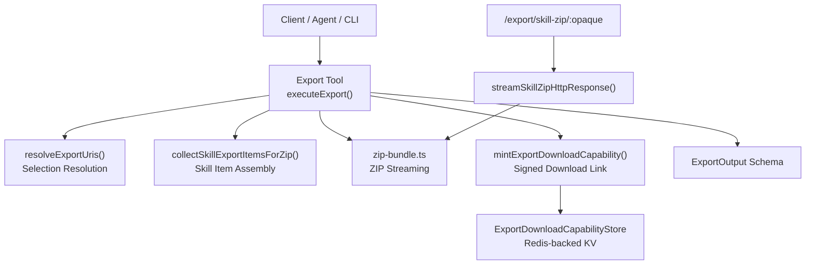
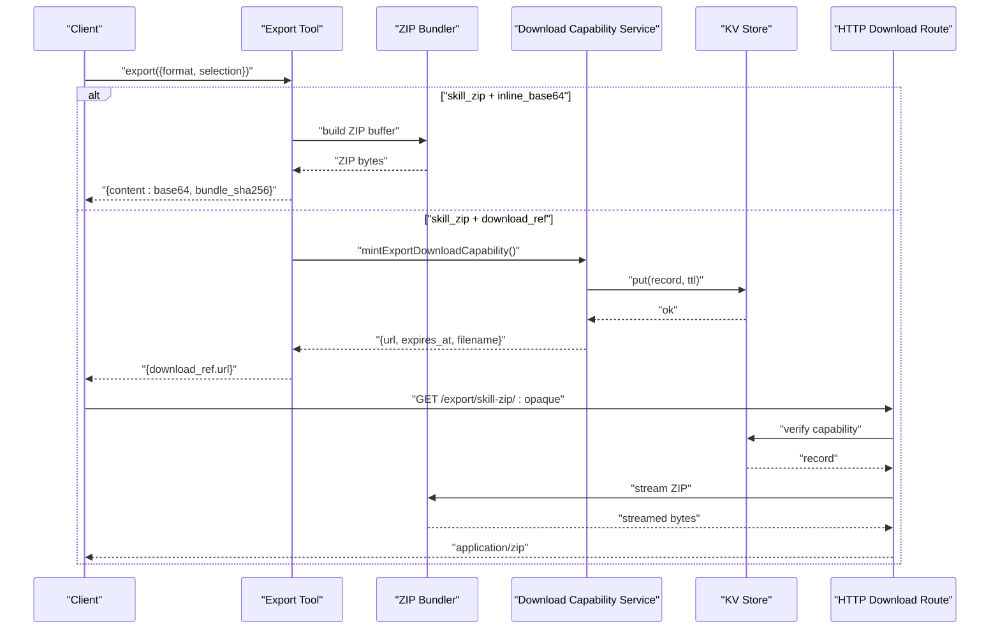
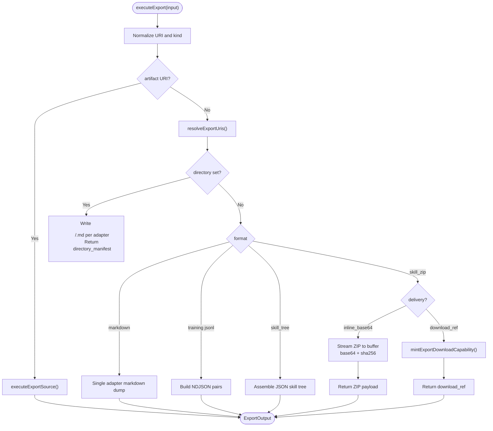
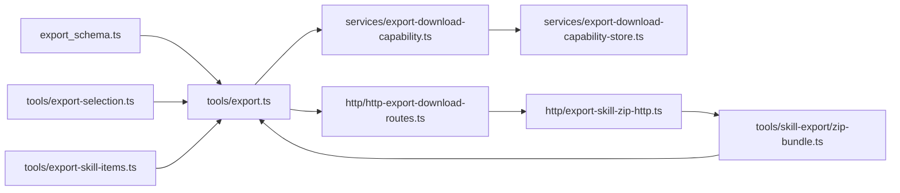

# Export Tool

<cite>
**Referenced Files in This Document**
- [export.ts](file://src/tools/export.ts)
- [export_schema.ts](file://src/tools/export_schema.ts)
- [export-selection.ts](file://src/tools/export-selection.ts)
- [export-skill-items.ts](file://src/tools/export-skill-items.ts)
- [zip-bundle.ts](file://src/tools/skill-export/zip-bundle.ts)
- [http-export-download-routes.ts](file://src/http/http-export-download-routes.ts)
- [export-skill-zip-http.ts](file://src/http/export-skill-zip-http.ts)
- [export-download-capability.ts](file://src/services/export-download-capability.ts)
- [export-download-capability-store.ts](file://src/services/export-download-capability-store.ts)
- [export-download-settings.ts](file://src/config/export-download-settings.ts)
- [export-zip-settings.ts](file://src/config/export-zip-settings.ts)
- [export.ts (CLI)](file://src/cli/commands/export.ts)
</cite>

## Table of Contents
1. [Introduction](#introduction)
2. [Project Structure](#project-structure)
3. [Core Components](#core-components)
4. [Architecture Overview](#architecture-overview)
5. [Detailed Component Analysis](#detailed-component-analysis)
6. [Dependency Analysis](#dependency-analysis)
7. [Performance Considerations](#performance-considerations)
8. [Security Considerations](#security-considerations)
9. [Troubleshooting Guide](#troubleshooting-guide)
10. [Conclusion](#conclusion)
11. [Appendices](#appendices)

## Introduction
This document provides comprehensive API documentation for the SquadRules export tool. It explains how to export adapters, skills, and training data in multiple formats, including flat markdown, JSON skill trees, ZIP bundles, and JSONL training datasets. It also documents input parameters, response structures, artifact packaging, compression options, external storage integration via short-lived download links, security considerations, size limitations, rate limiting guidance, and practical examples for full system exports, selective exports, and automated workflows.

The export tool is exposed as an MCP tool and can be invoked programmatically or through the CLI. The CLI command builds a machine-readable selection and writes artifacts to disk without printing raw content bytes to stdout.

## Project Structure
The export feature spans several layers:
- Input/output schemas define validation rules and response contracts.
- The core exporter resolves selections, builds skill items, and produces format-specific outputs.
- ZIP bundling streams archives efficiently.
- HTTP routes serve short-lived, signed ZIP downloads.
- Configuration controls download TTLs, public base URLs, and ZIP compression levels.
- The CLI wraps the backend export call and writes artifacts to local directories or files.

**Diagram sources**
- [export.ts:67-345](file://src/tools/export.ts#L67-L345)
- [export-selection.ts:38-67](file://src/tools/export-selection.ts#L38-L67)
- [export-skill-items.ts:17-55](file://src/tools/export-skill-items.ts#L17-L55)
- [zip-bundle.ts:19-53](file://src/tools/skill-export/zip-bundle.ts#L19-L53)
- [export-download-capability.ts:63-89](file://src/services/export-download-capability.ts#L63-L89)
- [export-download-capability-store.ts:16-29](file://src/services/export-download-capability-store.ts#L16-L29)
- [http-export-download-routes.ts:9-46](file://src/http/http-export-download-routes.ts#L9-L46)
- [export-skill-zip-http.ts:11-40](file://src/http/export-skill-zip-http.ts#L11-L40)

**Section sources**
- [export.ts:67-345](file://src/tools/export.ts#L67-L345)
- [export_schema.ts:44-158](file://src/tools/export_schema.ts#L44-L158)
- [export-selection.ts:38-67](file://src/tools/export-selection.ts#L38-L67)
- [export-skill-items.ts:17-55](file://src/tools/export-skill-items.ts#L17-L55)
- [zip-bundle.ts:19-53](file://src/tools/skill-export/zip-bundle.ts#L19-L53)
- [http-export-download-routes.ts:9-46](file://src/http/http-export-download-routes.ts#L9-L46)
- [export-skill-zip-http.ts:11-40](file://src/http/export-skill-zip-http.ts#L11-L40)
- [export-download-capability.ts:63-89](file://src/services/export-download-capability.ts#L63-L89)
- [export-download-capability-store.ts:16-29](file://src/services/export-download-capability-store.ts#L16-L29)

## Core Components
- Export tool entrypoint: validates input, resolves adapter URIs, and dispatches to format-specific exporters.
- Selection resolver: supports single URI, explicit adapter list, or all adapters in a named space with safety limits.
- Skill item assembler: collects SKILL.md, artifacts, diagnostics, SHA256SUMS, and deduplicates slugs.
- ZIP bundler: streams ZIP archives using configurable zlib compression; supports both in-memory buffers and streaming to HTTP responses.
- Download capability service: issues short-lived, HMAC-signed URLs backed by a Redis-like key-value store.
- HTTP download route: verifies capabilities and streams ZIP bytes with metadata headers.
- CLI export command: constructs inputs, enforces mutually exclusive flags, writes artifacts to disk, and emits a machine manifest.

Key responsibilities:
- Input validation and cross-field constraints are enforced by the schema.
- Multi-adapter exports produce either a JSON tree or a ZIP bundle.
- Training formats require a single adapter and return NDJSON lines.
- Directory-based markdown export writes per-adapter files on the server side in local mode.

**Section sources**
- [export.ts:67-345](file://src/tools/export.ts#L67-L345)
- [export_schema.ts:44-158](file://src/tools/export_schema.ts#L44-L158)
- [export-selection.ts:38-67](file://src/tools/export-selection.ts#L38-L67)
- [export-skill-items.ts:17-55](file://src/tools/export-skill-items.ts#L17-L55)
- [zip-bundle.ts:19-53](file://src/tools/skill-export/zip-bundle.ts#L19-L53)
- [export-download-capability.ts:63-89](file://src/services/export-download-capability.ts#L63-L89)
- [http-export-download-routes.ts:9-46](file://src/http/http-export-download-routes.ts#L9-L46)
- [export.ts (CLI):48-143](file://src/cli/commands/export.ts#L48-L143)

## Architecture Overview
The export flow supports two primary delivery modes for ZIP bundles:
- Inline base64: ZIP bytes are encoded into the response payload.
- Download reference: A short-lived, signed URL is returned; clients fetch the ZIP from `/export/skill-zip/:opaque`.

**Diagram sources**
- [export.ts:250-339](file://src/tools/export.ts#L250-L339)
- [zip-bundle.ts:19-53](file://src/tools/skill-export/zip-bundle.ts#L19-L53)
- [export-download-capability.ts:63-89](file://src/services/export-download-capability.ts#L63-L89)
- [export-download-capability-store.ts:16-29](file://src/services/export-download-capability-store.ts#L16-L29)
- [http-export-download-routes.ts:9-46](file://src/http/http-export-download-routes.ts#L9-L46)

## Detailed Component Analysis

### Export Tool and Format Dispatch
The export tool validates and normalizes inputs, resolves adapter URIs, and dispatches to format handlers:
- Markdown: returns a single adapter’s layer content as text/markdown.
- Source: returns source representation for a single adapter or artifact.
- Training JSONL: trace_jsonl, reward_jsonl, sft_jsonl, preference_jsonl require a single adapter and return NDJSON.
- Skill tree: returns a JSON object describing skills and files.
- Skill ZIP: either returns base64-encoded ZIP bytes or a signed download link.

**Diagram sources**
- [export.ts:67-345](file://src/tools/export.ts#L67-L345)
- [export-selection.ts:38-67](file://src/tools/export-selection.ts#L38-L67)

**Section sources**
- [export.ts:67-345](file://src/tools/export.ts#L67-L345)

### Input Parameters and Validation
Supported input fields:
- uri: Single adapter, layer, or artifact URI.
- adapters: Array of adapter URIs or slugs (up to a maximum).
- all_adapters: Boolean requiring space_name when true.
- space_name: Required when exporting all adapters.
- format: One of markdown, trace_jsonl, reward_jsonl, sft_jsonl, preference_jsonl, source, skill_tree, skill_zip.
- delivery: Only valid with skill_zip; values are download_ref or inline_base64.
- include_reward: Boolean defaulting to true for training formats.
- directory: Absolute path for server-side markdown file writing (local mode only).

Validation rules:
- Exactly one selection mode must be provided.
- all_adapters requires space_name.
- markdown with adapters/all_adapters requires directory.
- Training formats and source require a single uri.
- adapters array length is bounded.
- delivery is restricted to skill_zip.

**Section sources**
- [export_schema.ts:24-117](file://src/tools/export_schema.ts#L24-L117)
- [export-selection.ts:38-67](file://src/tools/export-selection.ts#L38-L67)

### Response Structure
Common output fields:
- uri: Primary export target URI.
- format: Export format.
- content_type: MIME type.
- content: String payload; may be base64-encoded when content_encoding is present.
- item_count: Number of exported items where applicable.
- adapter_name, adapter_version: Present when exporting a single adapter.
- space_id, space_name, space_type: Present for markdown adapter exports when available.
- content_encoding: base64 when content is encoded.
- bundle_sha256: SHA-256 label for ZIP bundles.
- export_adapter_count: Count of adapters in multi-adapter bundles.
- skill_bundle_manifest: Compact JSON string describing the bundle.
- download_ref: Short-lived capability URL for ZIP downloads.
- directory_manifest: Per-file write results when directory export is used.

**Section sources**
- [export_schema.ts:121-158](file://src/tools/export_schema.ts#L121-L158)
- [export.ts:144-190](file://src/tools/export.ts#L144-L190)
- [export.ts:250-339](file://src/tools/export.ts#L250-L339)

### Artifact Packaging and Compression
- Skill ZIP bundles contain one folder per slug with SKILL.md and associated artifacts.
- SHA256SUMS are appended to each skill item.
- ZIP compression level is configurable via environment variable; default balances size and CPU.
- Streaming ZIP assembly avoids buffering entire archives in memory when serving HTTP responses.

Configuration:
- SQUADRULES_EXPORT_ZIP_COMPRESSION_LEVEL: Integer 0–9; defaults to a balanced value.
- DEFAULT_EXPORT_SKILL_ZIP_FILENAME: Default filename for HTTP ZIP downloads.

**Section sources**
- [zip-bundle.ts:11-53](file://src/tools/skill-export/zip-bundle.ts#L11-L53)
- [export-zip-settings.ts:1-28](file://src/config/export-zip-settings.ts#L1-L28)
- [export-skill-items.ts:17-55](file://src/tools/export-skill-items.ts#L17-L55)

### External Storage Integration and Download Links
When using skill_zip with download_ref:
- The server mints a signed capability containing an opaque token and stores it in a key-value store with a TTL.
- Clients fetch the ZIP from a public base URL under /export/skill-zip/:opaque.
- The route verifies the signature, expiration, and record existence before streaming the ZIP.

Configuration:
- SQUADRULES_EXPORT_DOWNLOAD_SECRET: Secret used to sign capability tokens.
- SQUADRULES_EXPORT_DOWNLOAD_TTL_SEC: Time-to-live for download links.
- SQUADRULES_PUBLIC_BASE_URL or AUTH_CALLBACK_BASE_URL: Public base URL fallback chain.

**Section sources**
- [export-download-capability.ts:63-111](file://src/services/export-download-capability.ts#L63-L111)
- [export-download-capability-store.ts:16-29](file://src/services/export-download-capability-store.ts#L16-L29)
- [http-export-download-routes.ts:9-46](file://src/http/http-export-download-routes.ts#L9-L46)
- [export-download-settings.ts:17-30](file://src/config/export-download-settings.ts#L17-L30)

### CLI Export Command
The CLI export command:
- Builds an ExportInput from flags and positional arguments.
- Enforces mutually exclusive selection modes and compatibility between format and delivery/directory options.
- Writes artifacts to disk without printing raw content bytes.
- Emits a machine-readable manifest listing written artifacts and metadata.

Key behaviors:
- --as selects export format; defaults to skill_zip.
- --delivery restricts to skill_zip; values are download_ref or inline_base64.
- --directory is local-mode only for markdown per-adapter file writing.
- --out and --to control artifact destinations; --zip-out targets ZIP files explicitly.

**Section sources**
- [export.ts (CLI):48-143](file://src/cli/commands/export.ts#L48-L143)
- [export.ts (CLI):201-266](file://src/cli/commands/export.ts#L201-L266)
- [export.ts (CLI):296-345](file://src/cli/commands/export.ts#L296-L345)

## Dependency Analysis
The export subsystem has clear boundaries:
- Schema layer defines strict contracts for inputs and outputs.
- Selection logic depends on space context and adapter enumeration utilities.
- Skill item assembly composes SKILL.md, artifacts, diagnostics, and checksums.
- ZIP bundling uses archiver with configurable compression.
- Download capability service depends on crypto, configuration, and a key-value store.
- HTTP routes depend on capability verification and streaming ZIP assembly.

**Diagram sources**
- [export_schema.ts:44-158](file://src/tools/export_schema.ts#L44-L158)
- [export.ts:67-345](file://src/tools/export.ts#L67-L345)
- [export-selection.ts:38-67](file://src/tools/export-selection.ts#L38-L67)
- [export-skill-items.ts:17-55](file://src/tools/export-skill-items.ts#L17-L55)
- [zip-bundle.ts:19-53](file://src/tools/skill-export/zip-bundle.ts#L19-L53)
- [export-download-capability.ts:63-111](file://src/services/export-download-capability.ts#L63-L111)
- [export-download-capability-store.ts:16-29](file://src/services/export-download-capability-store.ts#L16-L29)
- [http-export-download-routes.ts:9-46](file://src/http/http-export-download-routes.ts#L9-L46)
- [export-skill-zip-http.ts:11-40](file://src/http/export-skill-zip-http.ts#L11-L40)

**Section sources**
- [export_schema.ts:44-158](file://src/tools/export_schema.ts#L44-L158)
- [export.ts:67-345](file://src/tools/export.ts#L67-L345)
- [export-selection.ts:38-67](file://src/tools/export-selection.ts#L38-L67)
- [export-skill-items.ts:17-55](file://src/tools/export-skill-items.ts#L17-L55)
- [zip-bundle.ts:19-53](file://src/tools/skill-export/zip-bundle.ts#L19-L53)
- [export-download-capability.ts:63-111](file://src/services/export-download-capability.ts#L63-L111)
- [export-download-capability-store.ts:16-29](file://src/services/export-download-capability-store.ts#L16-L29)
- [http-export-download-routes.ts:9-46](file://src/http/http-export-download-routes.ts#L9-L46)
- [export-skill-zip-http.ts:11-40](file://src/http/export-skill-zip-http.ts#L11-L40)

## Performance Considerations
- Streaming ZIP assembly minimizes memory usage during HTTP downloads.
- ZIP compression level is tunable; higher levels reduce size but increase CPU time.
- Base64 encoding of large ZIP payloads increases network payload size; prefer download_ref for large bundles.
- Directory-based markdown export writes files directly on the server in local mode, avoiding large in-memory payloads.
- Training JSONL generation streams NDJSON lines; avoid loading entire datasets into client memory at once.

[No sources needed since this section provides general guidance]

## Security Considerations
- Download capability tokens are HMAC-signed and time-limited; verify signatures and expiration before serving ZIP content.
- The secret used for signing should be configured securely via environment variables.
- Directory export is restricted to local mode; remote backends reject directory writes to prevent unintended filesystem access.
- Adapter lists are bounded to mitigate excessive export sizes.
- Avoid exposing sensitive data in exported markdown or artifacts; sanitize and review adapter content before distribution.

**Section sources**
- [export-download-capability.ts:44-56](file://src/services/export-download-capability.ts#L44-L56)
- [export-download-capability.ts:92-111](file://src/services/export-download-capability.ts#L92-L111)
- [export-download-settings.ts:17-30](file://src/config/export-download-settings.ts#L17-L30)
- [export.ts (CLI):189-199](file://src/cli/commands/export.ts#L189-L199)
- [export_schema.ts:102-109](file://src/tools/export_schema.ts#L102-L109)

## Troubleshooting Guide
Common errors and resolutions:
- Invalid selection: Ensure exactly one of uri, adapters, or all_adapters is provided; all_adapters requires space_name.
- Markdown multi-adapter export: Use directory mode or switch to skill_tree/skill_zip.
- Training format selection: Provide a single adapter uri; lists and all_adapters are not supported.
- Delivery mode mismatch: delivery is only valid with skill_zip.
- Directory export on remote backend: Use skill_zip or skill_tree with --out instead of --directory.
- Missing download capability: Verify that the opaque token is unexpired and correctly signed; check TTL and secret configuration.

**Section sources**
- [export_schema.ts:55-117](file://src/tools/export_schema.ts#L55-L117)
- [export.ts (CLI):48-143](file://src/cli/commands/export.ts#L48-L143)
- [http-export-download-routes.ts:14-23](file://src/http/http-export-download-routes.ts#L14-L23)

## Conclusion
The SquadRules export tool provides robust, validated APIs for exporting adapters and training data across multiple formats. It supports efficient ZIP bundling with streaming, secure short-lived download links, and flexible selection mechanisms. Operators can tune compression and download link lifetimes, while developers can integrate the tool programmatically or via the CLI for automated workflows. Proper use of directory mode, delivery modes, and selection constraints ensures safe and performant exports.

[No sources needed since this section summarizes without analyzing specific files]

## Appendices

### Supported Export Formats
- markdown: Flat markdown for a single adapter layer.
- source: Source representation for a single adapter or artifact.
- trace_jsonl: Execution traces as NDJSON.
- reward_jsonl: Reward-focused NDJSON dataset.
- sft_jsonl: Supervised fine-tuning NDJSON dataset.
- preference_jsonl: Preference NDJSON dataset.
- skill_tree: JSON tree describing skills and files.
- skill_zip: ZIP bundle delivered inline (base64) or via signed download link.

**Section sources**
- [export_schema.ts:24-33](file://src/tools/export_schema.ts#L24-L33)
- [export.ts:158-339](file://src/tools/export.ts#L158-L339)

### Example Workflows

- Full system export (all adapters in a space):
  - Select all adapters by space name.
  - Choose skill_zip with download_ref for large bundles.
  - Retrieve the signed URL and stream the ZIP.

- Selective data export (specific adapters):
  - Provide a list of adapter URIs or slugs.
  - For markdown, use directory mode to write per-adapter files.
  - For training datasets, select a single adapter and choose the appropriate JSONL format.

- Automated export workflow:
  - Build ExportInput programmatically with validation.
  - Execute export and handle response based on format.
  - For skill_zip with download_ref, poll the signed URL until expiry.
  - Record bundle_sha256 and skill_bundle_manifest for integrity checks.

[No sources needed since this section provides conceptual examples]